[Back to AZ-104: Microsoft Azure Administrator](../1.md)

# Chapter 1 — Welcome to the course!

## Table of Contents

- [Introduction](#introduction)
- [Detailed tutorial](#detailed-tutorial)
  - [Who is teaching](#who-is-teaching)
  - [Hands-on instead of slides](#hands-on-instead-of-slides)
  - [Simulations in a browser](#simulations-in-a-browser)
  - [The storage account task](#the-storage-account-task)
  - [Opening the portal](#opening-the-portal)
  - [Basics on the create form](#basics-on-the-create-form)
  - [Data protection defaults](#data-protection-defaults)
  - [Built around the exam](#built-around-the-exam)
  - [Updates for life](#updates-for-life)
- [Summary](#summary)
- [References](#references)
- [Questions and Answers](#questions-and-answers)
  - [Question 1 — Who is teaching](#question-1-who-is-teaching)
  - [Question 2 — Time in the industry](#question-2-time-in-the-industry)
  - [Question 3 — Career timeline](#question-3-career-timeline)
  - [Question 4 — How class time is spent](#question-4-how-class-time-is-spent)
  - [Question 5 — What the simulations require](#question-5-what-the-simulations-require)
  - [Question 6 — The demo task](#question-6-the-demo-task)
  - [Question 7 — Where the demo runs](#question-7-where-the-demo-runs)
  - [Question 8 — First portal clicks](#question-8-first-portal-clicks)
  - [Question 9 — Resource group on Basics](#question-9-resource-group-on-basics)
  - [Question 10 — Filled Basics values](#question-10-filled-basics-values)
  - [Question 11 — Data protection defaults](#question-11-data-protection-defaults)
  - [Question 12 — The exam outcome](#question-12-the-exam-outcome)

## Introduction

Chapter 1 opens the AZ-104 course. John Christopher gives his background, says the class is hands-on demonstrations plus browser simulations, and plays the start of a storage-account simulation. He then ties the course to the AZ-104 exam objectives and says updates stay included when those objectives change.

## Detailed tutorial

**AZ-104 Microsoft Azure Administrator** · [01 - Welcome to the course!.mp4](../../../../../course_videos/Course%20AZ-104%20Microsoft%20Azure%20Administrator%20course%20with%20SIMULATIONS/01%20-%20Welcome%20to%20the%20course%21.mp4) · [Transcript](../../../../../course_videos/Course%20AZ-104%20Microsoft%20Azure%20Administrator%20course%20with%20SIMULATIONS/01%20-%20Welcome%20to%20the%20course%21.txt)

<strong>Who is teaching</strong>

The title card is already up when he starts speaking.

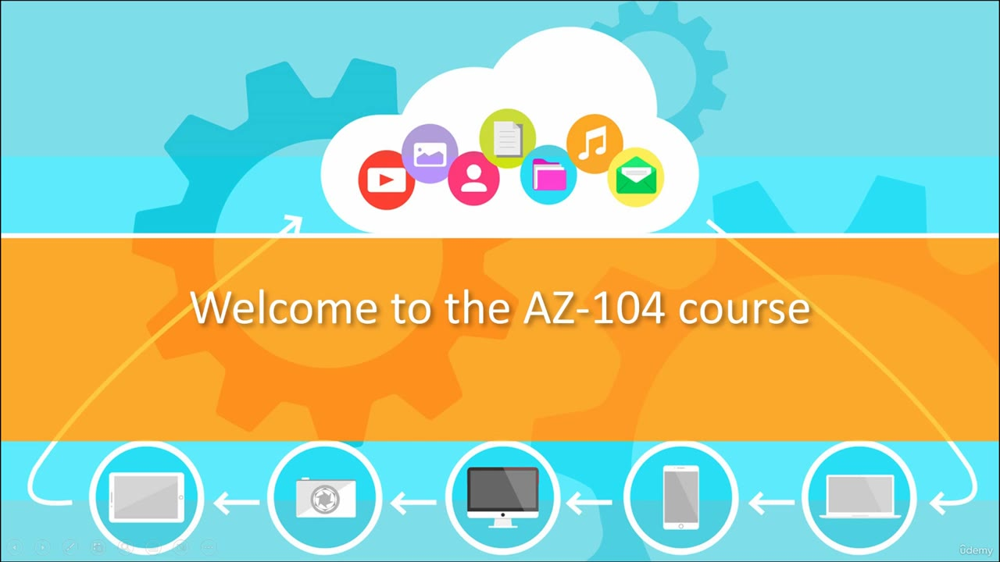

*Figure: 00:00. The title card reads "Welcome to the AZ-104 course."*

He introduces himself as John Christopher. He says he has been in IT about 23 to 24 years, starting in the 1990s as a junior network administrator on NT 3.50 and then NT 4. He says he earned the MCSE for NT 4, and that he was one of the first people to earn the MCSE for Windows 2000.

The rest of the career line is packed into one sentence in the transcript: Server 2003 and 2008, work with 2012–2016, then the words "The 2022," plus the client operating systems across those years. Nothing on screen names those products, so that list is the transcript's wording. He also says he works as a consultant and moves between teaching and hands-on industry work.

The same title card is still up at 00:10. It is the same slide, so it is not shown again.

<strong>Hands-on instead of slides</strong>

He says this will not be a death-by-PowerPoint course. The vast majority of the class is hands-on demonstrations. You follow along, build a small environment of your own, and get real-world examples with the lecture.

<strong>Simulations in a browser</strong>

The piece he says is different from other courses is the hands-on simulations. A web browser is enough. He says you do not have to set up an Azure account, and you can run the simulations anytime, anywhere. He says you learn by doing, then starts one simulation in this video so you can see the format.

<strong>The storage account task</strong>

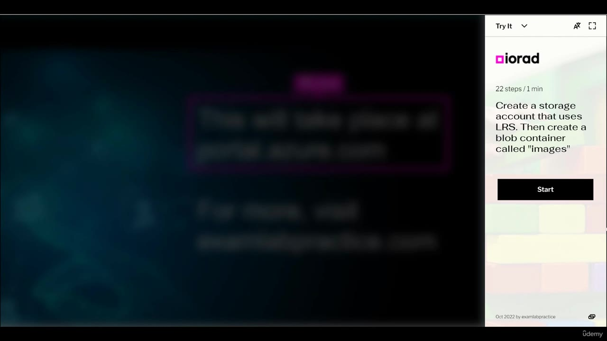

*Figure: 01:50. The iorad panel says to create a storage account that uses LRS, then a blob container called "images."*

The side panel is iorad. It is labeled **22 steps / 1 min**. The task text reads: create a storage account that uses LRS, then create a blob container called "images". A Start button sits under that text. The footer reads Oct 2022 by examlabpractice. The portal behind the panel is blurred.

The transcript disagrees with that panel in two places:

- He says you will be "activating LRS which is Locally Redundant Services." The panel says the account **uses** LRS. The redundancy list later in this same demo labels the option **Locally-redundant storage (LRS)**.
- He says a "blog container" called images. The panel says **blob** container.

Use the panel and the dropdown. This welcome clip does not finish the 22 steps. The images container never appears. The frames stop on the Data protection tab.

<strong>Opening the portal</strong>

He says the simulation tells you where the work happens, and that you make the clicks yourself.

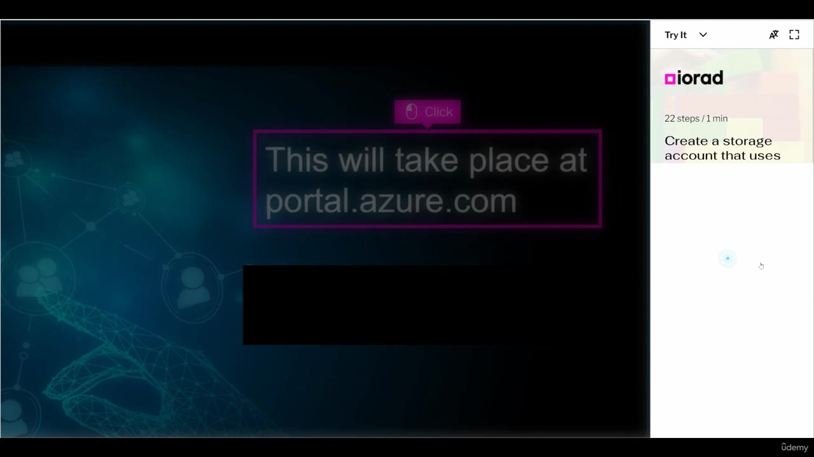

*Figure: 02:08. A Click marker sits on "This will take place at portal.azure.com."*

The readable line is **portal.azure.com**. A black bar covers the line under it. The task text on the right is cut off at "Create a storage account that uses."

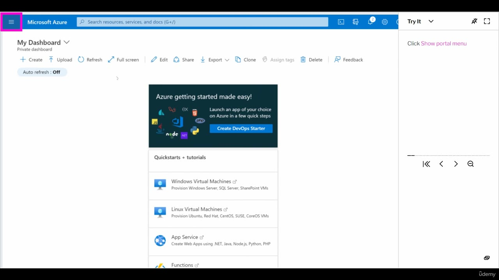

*Figure: 02:12. My Dashboard is open, and the task pane says to click Show portal menu.*

The portal opens on **My Dashboard**, marked Private dashboard. The search box reads "Search resources, services, and docs (G+/)". The task pane says **Click Show portal menu**, and the hamburger menu is highlighted. The dashboard tile says "Azure getting started made easy!" and offers **Create DevOps Starter**. Under Quickstarts + tutorials the visible rows are Windows Virtual Machines, Linux Virtual Machines, App Service, and Functions.

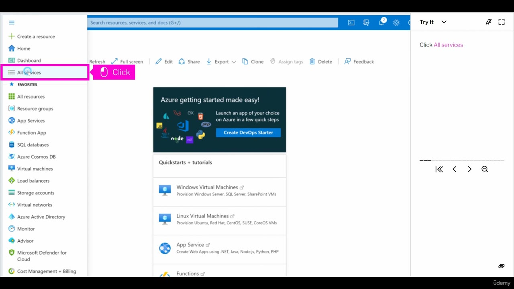

*Figure: 02:14. The portal menu is open, and the task pane says to click All services.*

The menu lists Create a resource, Home, Dashboard, and All services. Favorites under that are All resources, Resource groups, App Services, Function App, SQL databases, Azure Cosmos DB, Virtual machines, Load balancers, Storage accounts, Virtual networks, Azure Active Directory, Monitor, Advisor, Microsoft Defender for Cloud, and Cost Management + Billing. The task pane says **Click All services**, and All services is highlighted.

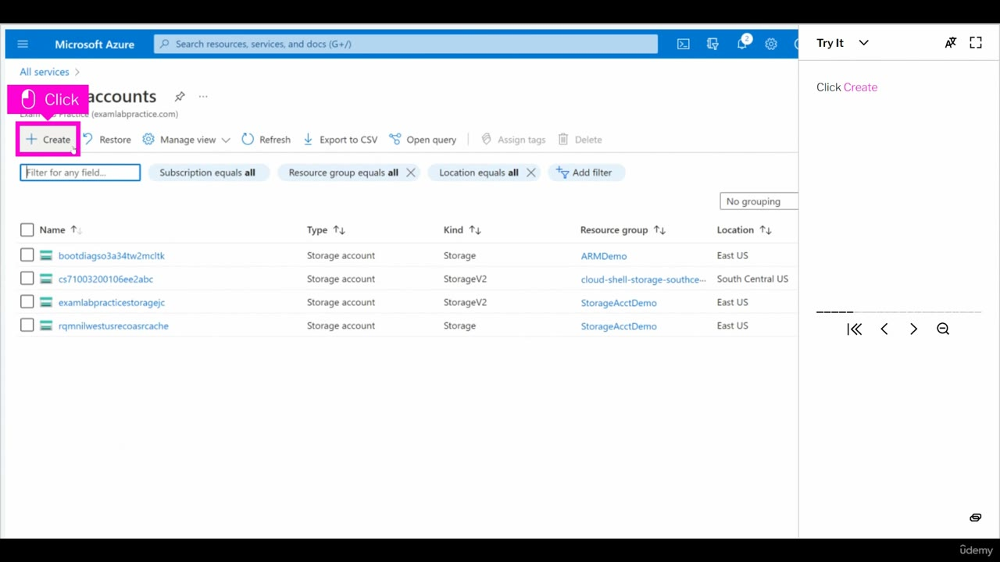

*Figure: 02:16. The storage accounts grid is open, and the task pane says to click Create.*

The blade sits under All services. A Click marker covers the start of the title, so the readable word is "accounts." The subtitle names examlabpractice (examlabpractice.com). The task pane says **Click Create**, and the Create command is highlighted. Filters are Subscription, Resource group, and Location, each set to all. Four storage accounts are already in the grid.

| Name | Kind | Resource group | Location |
| --- | --- | --- | --- |
| bootdiagso3a34tw2mcitk | Storage | ARMDemo | East US |
| cs71003200106ee2abc | StorageV2 | cloud-shell-storage-southce… | South Central US |
| examlabpracticestoragejc | StorageV2 | StorageAcctDemo | East US |
| rqmnilwestusrecoasrcache | Storage | StorageAcctDemo | East US |

Every row is Type **Storage account**. Two rows are Kind **Storage**, and two are Kind **StorageV2**.

<strong>Basics on the create form</strong>

The create blade opens on the Basics tab. The tabs across the top are Basics, Advanced, Networking, Data protection, Encryption, Tags, and Review. The page describes Azure Storage as a Microsoft-managed service for cloud storage that is highly available, secure, durable, scalable, and redundant, and it lists Azure Blobs (objects), Azure Data Lake Storage Gen2, Azure Files, Azure Queues, and Azure Tables.

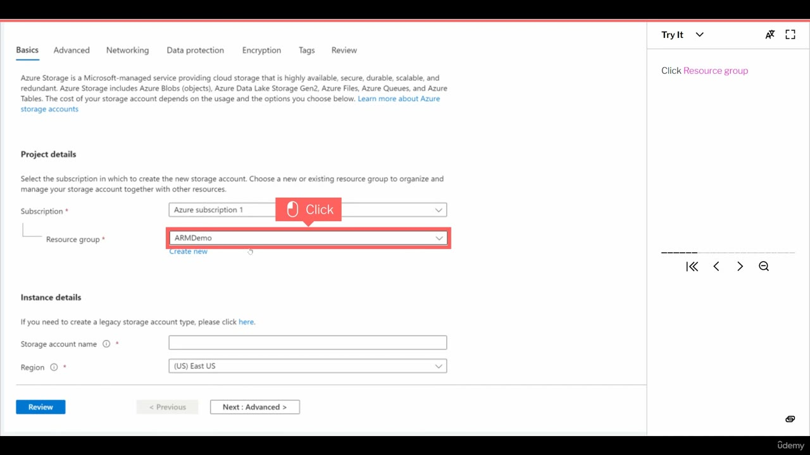

*Figure: 02:18. Subscription is Azure subscription 1, and the task pane says to click Resource group.*

Subscription is **Azure subscription 1**. The task pane says **Click Resource group**. The resource group field shows **ARMDemo**, and that field is highlighted. Region is already **(US) East US**. The storage account name is still empty.

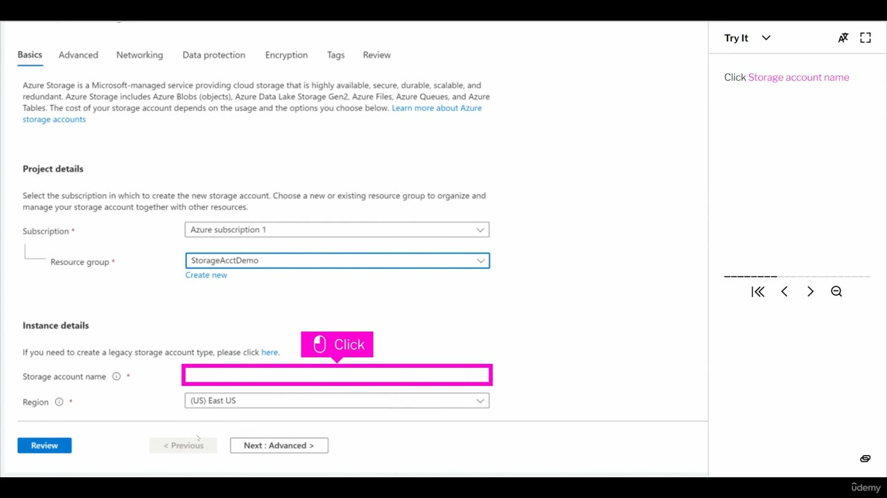

*Figure: 02:20. Resource group is now StorageAcctDemo, and the task pane says to click Storage account name.*

The next Basics frame changes the resource group. The field now reads **StorageAcctDemo**. The task pane says **Click Storage account name**, and the empty name box is highlighted. Region is still (US) East US.

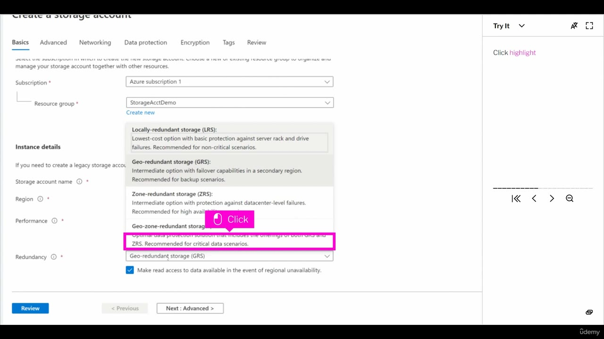

*Figure: 02:22. The redundancy list is open. The field still shows geo-redundant storage, and the highlight is on the geo-zone-redundant description.*

The task pane says **Click highlight**. The redundancy field still shows **Geo-redundant storage (GRS)**. The magenta box is on the geo-zone-redundant description, not on LRS. A checked box under the list reads "Make read access to data available in the event of regional unavailability." The four options on this frame:

| Option on screen | What the row says |
| --- | --- |
| Locally-redundant storage (LRS) | Lowest-cost option with basic protection against server rack and drive failures. Recommended for non-critical scenarios. |
| Geo-redundant storage (GRS) | Intermediate option with failover capabilities in a secondary region. Recommended for backup scenarios. |
| Zone-redundant storage (ZRS) | Intermediate option with protection against datacenter-level failures. Recommended for high availability scenarios. |
| Geo-zone-redundant storage (GZRS) | Optimal data protection solution that includes the offerings of both GRS and ZRS. Recommended for critical data scenarios. |

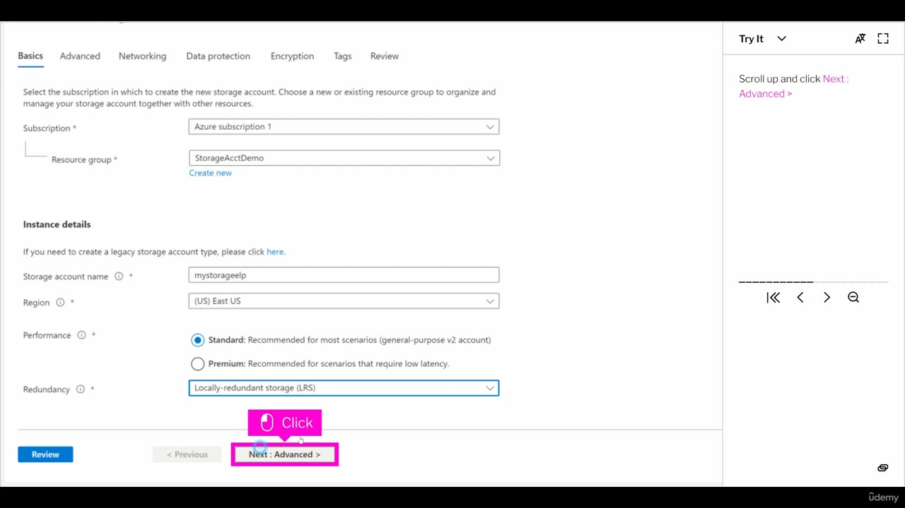

*Figure: 02:24. The name is mystorageelp, performance is Standard, redundancy is locally redundant storage, and Next: Advanced is highlighted.*

The form is filled before the wizard moves on:

- Storage account name: **mystorageelp**
- Region: **(US) East US**
- Performance: **Standard**, "Recommended for most scenarios (general-purpose v2 account)". Premium is unselected. Its label is "Recommended for scenarios that require low latency."
- Redundancy: **Locally-redundant storage (LRS)**
- Resource group: **StorageAcctDemo**
- Subscription: **Azure subscription 1**

The task pane says to scroll up and click **Next: Advanced**. That button is highlighted. The spoken task and this filled form agree on LRS. The 02:22 highlight was on the GZRS description while GRS was still the value in the field. The value selected before Next: Advanced is LRS.

<strong>Data protection defaults</strong>

He stops the walkthrough here and says he only wanted to demo it. The last frame is still inside the wizard.

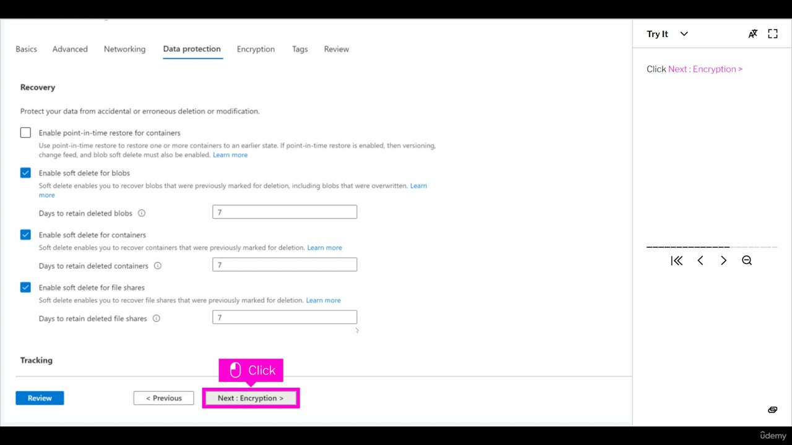

*Figure: 02:34. Data protection is the active tab, and the task pane says to click Next: Encryption.*

The Data protection tab is active. The task pane says **Click Next: Encryption**, and that button is highlighted. The Recovery section says it protects data from accidental or erroneous deletion or modification.

| Setting | State on this frame | Days |
| --- | --- | --- |
| Enable point-in-time restore for containers | Unchecked | — |
| Enable soft delete for blobs | Checked | 7 |
| Enable soft delete for containers | Checked | 7 |
| Enable soft delete for file shares | Checked | 7 |

The helper text under point-in-time restore says it restores one or more containers to an earlier state, and that versioning, change feed, and blob soft delete must also be enabled if point-in-time restore is enabled. Soft delete for blobs covers blobs marked for deletion, including blobs that were overwritten. Soft delete for containers and for file shares covers those items after they were marked for deletion. The Tracking heading is visible. Its settings are below this frame. The blob container named images is still not on screen.

<strong>Built around the exam</strong>

After the demo he says the course is also built to help you pass the AZ-104 exam. He says he prepares you for a first-try pass by teaching the concepts the exam requires. He designs the course around the test objectives and says he goes through each one. Passing the exam, he says, earns the Microsoft Certified Azure Administrator Associate certification. The certification page titles that credential **Microsoft Certified: Azure Administrator Associate**.

<strong>Updates for life</strong>

When Microsoft updates the exam objectives, he says he updates the course. He says those updates are included for life. He also says he tries to stay available so you can contact him with questions. The transcript ends on the review line, mid-sentence: "I hope you'll leave a review and I".

## Summary

- John Christopher teaches the course. He puts his own IT time at about 23 to 24 years, from NT 3.50 and the MCSE for NT 4 through a Windows 2000 MCSE and the later server releases named in the transcript.
- The class is hands-on demonstrations and browser simulations. A web browser is enough, and he says an Azure account is not required for the simulations.
- The demo task is a storage account that uses LRS, then a blob container called "images". The transcript says "blog" and "Locally Redundant Services". The panel says blob, and the dropdown says Locally-redundant storage (LRS).
- The preview runs at portal.azure.com: portal menu, All services, Create on the storage accounts list, then the create wizard. The filled Basics values are mystorageelp, (US) East US, Standard, and LRS, in resource group StorageAcctDemo.
- On Data protection, soft delete is checked for blobs, containers, and file shares, each with 7 days. Point-in-time restore for containers is unchecked. The images container is not created in this clip.
- The course follows the AZ-104 objectives. He says a pass earns the Microsoft Certified Azure Administrator Associate certification, and that objective updates are included for life.

## References

- [Lesson video](../../../../../course_videos/Course%20AZ-104%20Microsoft%20Azure%20Administrator%20course%20with%20SIMULATIONS/01%20-%20Welcome%20to%20the%20course%21.mp4)
- [Transcript](../../../../../course_videos/Course%20AZ-104%20Microsoft%20Azure%20Administrator%20course%20with%20SIMULATIONS/01%20-%20Welcome%20to%20the%20course%21.txt)
- [Study guide for Exam AZ-104: Microsoft Azure Administrator](https://learn.microsoft.com/en-us/credentials/certifications/resources/study-guides/az-104)
- [Microsoft Certified: Azure Administrator Associate](https://learn.microsoft.com/en-us/credentials/certifications/azure-administrator/)
- [Data redundancy in Azure Storage](https://learn.microsoft.com/en-us/azure/storage/common/storage-redundancy)

## Questions and Answers

<strong>Question 1 — Who is teaching</strong>

Who introduces this course?

**Answer.** John Christopher.

<strong>Question 2 — Time in the industry</strong>

How long does he say he has worked in IT?

**Answer.** About 23 to 24 years. He says he started in the 1990s as a junior network administrator.

<strong>Question 3 — Career timeline</strong>

Which certifications and products does he name from his own career?

**Answer.** He names NT 3.50, then NT 4, and the MCSE for NT 4. He says he was one of the first people to earn the MCSE for Windows 2000. The transcript then lists Server 2003 and 2008, work with 2012–2016, the words "The 2022," and the client operating systems. No slide in this video lists those products.

<strong>Question 4 — How class time is spent</strong>

What does he say this course will not be, and what does he say most of it is?

**Answer.** He says it will not be a death-by-PowerPoint course. The vast majority is hands-on demonstrations you can follow, with your own environment and real-world examples.

<strong>Question 5 — What the simulations require</strong>

What does he say you need in order to run the simulations, and what does he say you can skip?

**Answer.** A web browser. He says you do not have to set up an Azure account, and that you can run the simulations anytime, anywhere.

<strong>Question 6 — The demo task</strong>

What does the iorad panel tell you to create, and where does the transcript use different words?

**Answer.** The panel says to create a storage account that uses LRS, then a blob container called "images". The transcript says "activating LRS which is Locally Redundant Services" and a "blog container". The redundancy dropdown in the same demo says Locally-redundant storage (LRS). Follow the panel and the dropdown. This clip never shows the images container being created.

<strong>Question 7 — Where the demo runs</strong>

Where does the simulation say the work takes place, and how is the side panel labeled?

**Answer.** portal.azure.com. The side panel is iorad, labeled 22 steps / 1 min, with a footer of Oct 2022 by examlabpractice.

<strong>Question 8 — First portal clicks</strong>

After the portal opens, which two commands do the task panes call out before the create form appears?

**Answer.** Click Show portal menu, then Click All services. The next blade is the storage accounts list, and that task pane says Click Create.

<strong>Question 9 — Resource group on Basics</strong>

Which resource group is highlighted when the task says to click Resource group, and which resource group is selected on the next Basics frame?

**Answer.** ARMDemo is highlighted at 02:18. StorageAcctDemo is the value in the field at 02:20, and it is still StorageAcctDemo when the form is filled at 02:24. Subscription stays Azure subscription 1.

<strong>Question 10 — Filled Basics values</strong>

What name, region, performance, and redundancy are on the form when the task says to click Next: Advanced?

**Answer.** The name is mystorageelp. The region is (US) East US. Performance is Standard, labeled as the general-purpose v2 account recommended for most scenarios. Redundancy is Locally-redundant storage (LRS).

<strong>Question 11 — Data protection defaults</strong>

On the Data protection tab, which recovery options are checked, and what retention is shown?

**Answer.** Soft delete is checked for blobs, containers, and file shares. Each retention box shows 7 days. Point-in-time restore for containers is unchecked. The task pane says to click Next: Encryption.

<strong>Question 12 — The exam outcome</strong>

What does he say you earn by passing, and what does he say happens when Microsoft changes the exam?

**Answer.** He says you earn the Microsoft Certified Azure Administrator Associate certification. The certification page writes that name as Microsoft Certified: Azure Administrator Associate. He says the course follows each exam objective, and that updates are included for life when Microsoft updates those objectives.

