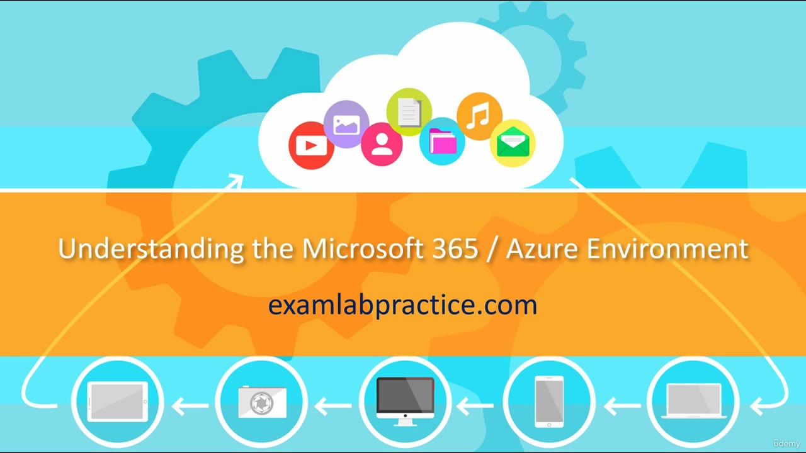

[Back to AZ-104: Microsoft Azure Administrator](../1.md)

# Chapter 2 — Understanding the Microsoft 365 and Azure Environment

## Table of Contents

- [Introduction](#introduction)
- [Detailed tutorial](#detailed-tutorial)
  - [What these lectures are for](#what-these-lectures-are-for)
  - [What the foundation covers](#what-the-foundation-covers)
  - [When you can skip it](#when-you-can-skip-it)
  - [Videos marked do not skip](#videos-marked-do-not-skip)
- [Summary](#summary)
- [References](#references)
- [Questions and Answers](#questions-and-answers)
  - [Question 1 — Who is missing foundation](#question-1-who-is-missing-foundation)
  - [Question 2 — What the next lectures are](#question-2-what-the-next-lectures-are)
  - [Question 3 — On-premises directory](#question-3-on-premises-directory)
  - [Question 4 — RAS and DMZ](#question-4-ras-and-dmz)
  - [Question 5 — Cloud products named](#question-5-cloud-products-named)
  - [Question 6 — Service models](#question-6-service-models)
  - [Question 7 — Why a picture](#question-7-why-a-picture)
  - [Question 8 — Who may skip](#question-8-who-may-skip)
  - [Question 9 — Which videos stay](#question-9-which-videos-stay)
  - [Question 10 — Where this sits](#question-10-where-this-sits)

## Introduction

This is the bridge into the foundation lectures. The course does not assume every student already has Active Directory, networking, or the Microsoft 365 and Azure map. The next videos draw that picture. A few later videos are tagged so they are not skipped.

## Detailed tutorial

**AZ-104 Microsoft Azure Administrator** · [02 - Understanding the Microsoft 365 and Azure Environment.mp4](../../../../../course_videos/Course%20AZ-104%20Microsoft%20Azure%20Administrator%20course%20with%20SIMULATIONS/02%20-%20Understanding%20the%20Microsoft%20365%20and%20Azure%20Environment.mp4) · [Transcript](../../../../../course_videos/Course%20AZ-104%20Microsoft%20Azure%20Administrator%20course%20with%20SIMULATIONS/02%20-%20Understanding%20the%20Microsoft%20365%20and%20Azure%20Environment.txt)

<strong>What these lectures are for</strong>

Students often start a course believing they already have the background. He says even experienced students are usually missing a few pieces from earlier work or earlier courses. The next lectures exist to fill those gaps before the Azure administrator tasks.

*Figure: 00:00. The title card reads "Understanding the Microsoft 365 / Azure Environment."*

<strong>What the foundation covers</strong>

He lists the picture he is about to draw:

- On-premises Active Directory Domain Services.
- RAS, DMZs, and virtualization.
- Microsoft cloud services as a whole, including Microsoft 365 and Azure.
- IaaS, PaaS, and SaaS, and what those labels mean.

The point of this pass is the drawing, so the later portal work has something to sit on.

<strong>When you can skip it</strong>

If you have already taken his courses and you already know these concepts, he says you are welcome to skip this foundation block. If you are not sure, he wants you to watch it so the rest of the course has a solid base.

<strong>Videos marked do not skip</strong>

Some later videos are tagged **DO NOT SKIP** or **DON'T SKIP** at the start of the title. He says that tag matters. Those are not part of the optional foundation. This lecture ends by sending you into the foundation.

## Summary

- The next lectures are a foundation, not the exam labs.
- They cover on-premises Active Directory Domain Services, RAS, DMZs, virtualization, Microsoft 365, Azure, and IaaS, PaaS, and SaaS.
- Experienced students are still expected to be missing pieces.
- Skip the foundation only if you have already learned it. Do not skip a video whose title starts with DO NOT SKIP or DON'T SKIP.

## References

- [Lesson video](../../../../../course_videos/Course%20AZ-104%20Microsoft%20Azure%20Administrator%20course%20with%20SIMULATIONS/02%20-%20Understanding%20the%20Microsoft%20365%20and%20Azure%20Environment.mp4)
- [Transcript](../../../../../course_videos/Course%20AZ-104%20Microsoft%20Azure%20Administrator%20course%20with%20SIMULATIONS/02%20-%20Understanding%20the%20Microsoft%20365%20and%20Azure%20Environment.txt)
- [Study guide for Exam AZ-104](https://learn.microsoft.com/en-us/credentials/certifications/resources/study-guides/az-104)
- [AZ-104: Prerequisites for Azure administrators](https://learn.microsoft.com/en-us/training/paths/az-104-administrator-prerequisites/)

## Questions and Answers

<strong>Question 1 — Who is missing foundation</strong>

Who does he say is often missing background, even when they feel ready for the course?

**Answer.** Even his most experienced students. He says people think they have everything they need, and they are usually missing pieces.

<strong>Question 2 — What the next lectures are</strong>

What does he call the lectures that come next?

**Answer.** Foundation lectures. They are there to draw the concepts before the course moves on.

<strong>Question 3 — On-premises directory</strong>

Which on-premises directory service does this foundation include?

**Answer.** Active Directory Domain Services.

<strong>Question 4 — RAS and DMZ</strong>

Which networking topics does he pair with virtualization in the foundation list?

**Answer.** RAS and DMZs.

<strong>Question 5 — Cloud products named</strong>

Which two Microsoft cloud products does he name as part of the cloud-services picture?

**Answer.** Microsoft 365 and Azure.

<strong>Question 6 — Service models</strong>

Which three service models does he say the foundation will explain?

**Answer.** IaaS, PaaS, and SaaS.

<strong>Question 7 — Why a picture</strong>

Why does he say he will draw a picture of these ideas?

**Answer.** So you can see what the concepts are before the rest of the course uses them.

<strong>Question 8 — Who may skip</strong>

Who does he invite to skip this foundation?

**Answer.** Someone who has already taken his courses and has already seen these concepts.

<strong>Question 9 — Which videos stay</strong>

What title tag means you should not skip the video?

**Answer.** DO NOT SKIP or DON'T SKIP at the beginning of the video name.

<strong>Question 10 — Where this sits</strong>

What does he do at the end of this lecture?

**Answer.** He sends you into the foundation. This video is the setup, not the foundation itself.

