[Back to AZ-104: Microsoft Azure Administrator](../1.md)

# Chapter 3 — Having a Solid Foundation of Active Directory Domains

## Table of Contents

- [Introduction](#introduction)
- [Detailed tutorial](#detailed-tutorial)
  - [What this lecture is setting up](#what-this-lecture-is-setting-up)
  - [Mainframes, the chip, and the PC](#mainframes-the-chip-and-the-pc)
  - [Peer-to-peer](#peer-to-peer)
  - [Novell NetWare and the server](#novell-netware-and-the-server)
  - [The Active Directory triangle](#the-active-directory-triangle)
  - [Two domain controllers](#two-domain-controllers)
  - [Replication and the user](#replication-and-the-user)
  - [Kerberos, NTLM, and LDAP](#kerberos-ntlm-and-ldap)
  - [DNS and the domain name](#dns-and-the-domain-name)
  - [Group Policy](#group-policy)
  - [The firewall and the internet](#the-firewall-and-the-internet)
  - [Where he goes next](#where-he-goes-next)
- [Summary](#summary)
- [References](#references)
- [Questions and Answers](#questions-and-answers)
  - [Question 1 — Room-sized machines](#question-1-room-sized-machines)
  - [Question 2 — The 1970s chip](#question-2-the-1970s-chip)
  - [Question 3 — Equal computers](#question-3-equal-computers)
  - [Question 4 — Sharing files](#question-4-sharing-files)
  - [Question 5 — The 1990s product](#question-5-the-1990s-product)
  - [Question 6 — Microsoft's server](#question-6-microsofts-server)
  - [Question 7 — The year 2000](#question-7-the-year-2000)
  - [Question 8 — The cylinder](#question-8-the-cylinder)
  - [Question 9 — More than one](#question-9-more-than-one)
  - [Question 10 — The smiley](#question-10-the-smiley)
  - [Question 11 — How logon speaks](#question-11-how-logon-speaks)
  - [Question 12 — The initials on the left](#question-12-the-initials-on-the-left)
  - [Question 13 — Finding a controller](#question-13-finding-a-controller)
  - [Question 14 — Settings on the machines](#question-14-settings-on-the-machines)
  - [Question 15 — Outside the triangle](#question-15-outside-the-triangle)

## Introduction

Video chapter 3 of the AZ-104 course. He draws the on-premises domain that the later cloud picture sits on: why a room full of equal PCs could not be managed, what a domain controller and Active Directory Domain Services are, why you run two of them, and how DNS, Group Policy, and a firewall fit on the same triangle. He frames the move from on-premises administration into the cloud, then spends this video on the traditional domain. RAS, VPN, and virtualization are the next section.

## Detailed tutorial

**AZ-104 Microsoft Azure Administrator** · [03 - Having a Solid Foundation of Active Directory Domains.mp4](../../../../../course_videos/Course%20AZ-104%20Microsoft%20Azure%20Administrator%20course%20with%20SIMULATIONS/03%20-%20Having%20a%20Solid%20Foundation%20of%20Active%20Directory%20Domains.mp4) · [Transcript](../../../../../course_videos/Course%20AZ-104%20Microsoft%20Azure%20Administrator%20course%20with%20SIMULATIONS/03%20-%20Having%20a%20Solid%20Foundation%20of%20Active%20Directory%20Domains.txt)

<strong>What this lecture is setting up</strong>

Anyone working in Microsoft administration, he says, needs the foundations: domains, networking, RAS and VPNs, virtualization, and how cloud services fit with all of that. Work has been moving to a cloud-oriented environment. Before that, everything was managed on-premises. He wants the path from how things were, to how they are, to where Microsoft is going.

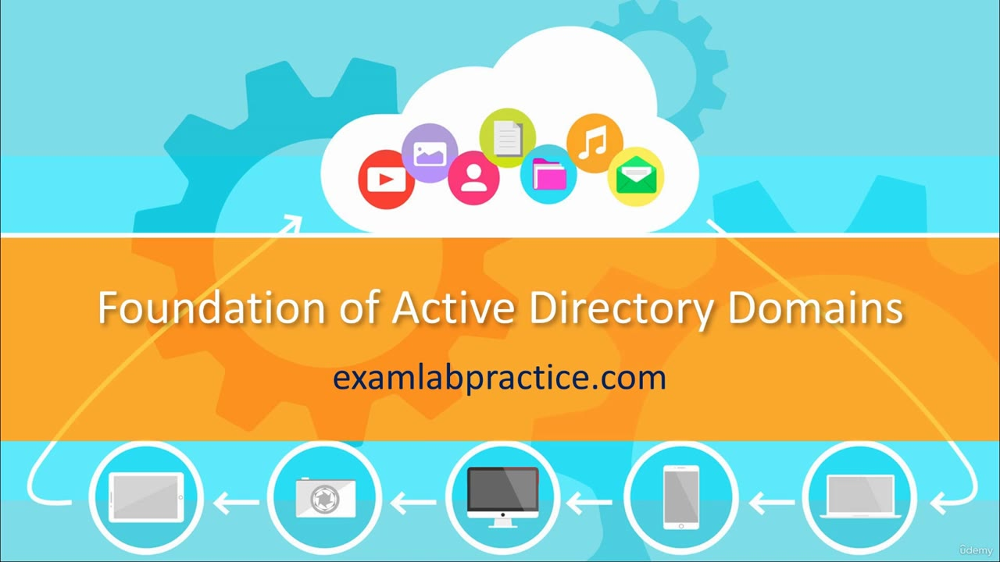

*Figure: 00:00. Title card. "Foundation of Active Directory Domains" with examlabpractice.com under it. The cloud and device icons are the title art. The domain drawing starts later.*

This video is the domain half of that path. He calls the result a traditional domain, the way this work was done for about 20 years.

<strong>Mainframes, the chip, and the PC</strong>

He starts in the 1950s and 1960s.

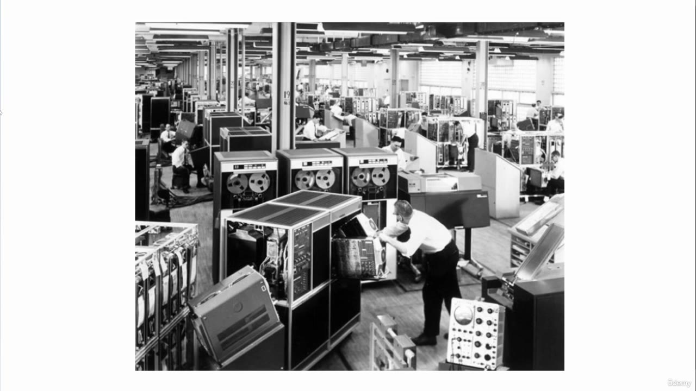

*Figure: 01:04. The room-sized machines. Rows of cabinets and reel-to-reel tape drives, with operators working on the equipment.*

Those machines were mainframes. He describes them as gigantic computers that filled entire rooms, built with vacuum tubes.

The 1970s change is the integrated circuit.

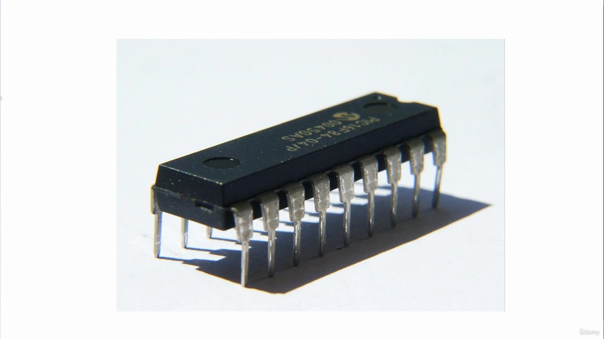

*Figure: 01:16. The chip he calls an IC, an integrated circuit. A black dual in-line package with two rows of pins.*

An IC let binary math run on a small chip. That is where he says personal computing became possible.

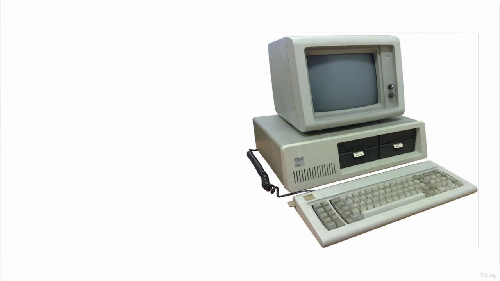

*Figure: 01:28. A 1980s personal computer. IBM system unit, CRT on top, two floppy drives, and a keyboard.*

In the 1980s, companies bought PCs. The machines showed up in offices and were networked together. That is the start of the problem he wants to fix.

<strong>Peer-to-peer</strong>

Those early networks were peer-to-peer. You could connect the computers, and each computer was equal. No computer controlled the others. To change something, an administrator sat down at every machine, or asked users to help. He says it worked, and it did not work efficiently.

File sharing had the same shape. Each machine shared with the others, and people had to know each other's passwords.

| Peer-to-peer, as he describes it | Domain, once a domain controller exists |
| --- | --- |
| Every computer is equal | One special server manages the other machines |
| Changes mean a visit to each computer | Settings can be pushed from the domain |
| Sharing files means knowing someone else's password | A file server holds the shared files |
| No central name or account store | DNS and the Active Directory database sit in the domain |

<strong>Novell NetWare and the server</strong>

In the 1990s he credits Novell, and a product called NetWare. The caption writes "novel" and "Netware." The product is Novell NetWare. The idea was a server that helped manage machines and made file sharing easier: a more powerful machine people could share files on, and then a server that could manage the other machines.

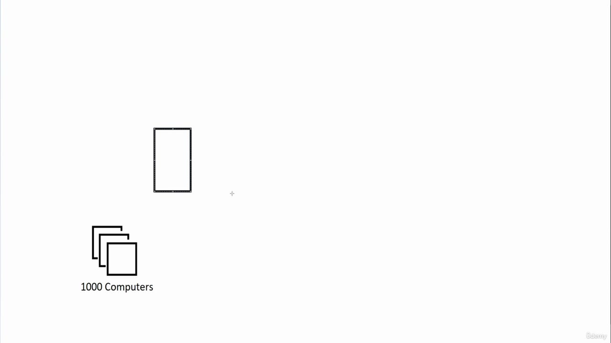

*Figure: 02:42. The first whiteboard marks. A tall rectangle sits above a stack of squares labeled "1000 Computers." He is introducing the server that would manage that pile of PCs. The rectangle is not labeled yet.*

Microsoft enters on the back of that idea. He says Microsoft's product was NT, and NT's special server was the domain controller: a server that manages the other machines.

<strong>The Active Directory triangle</strong>

NT had the domain controller. He says the domain itself came with that, and then he jumps to the year 2000, when Microsoft released the domain technology he still wants you to know: Active Directory.

Active Directory domains, on his board, are a triangle. A domain controller is a server with a database on it. That database is the Active Directory database.

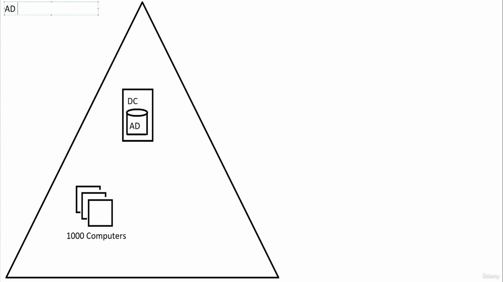

*Figure: 04:06. The triangle is the domain. One box labeled DC holds a cylinder labeled AD. The same "1000 Computers" stack sits inside the triangle. A small "AD" label is in the upper left.*

He then writes the name he wants you to recognize.

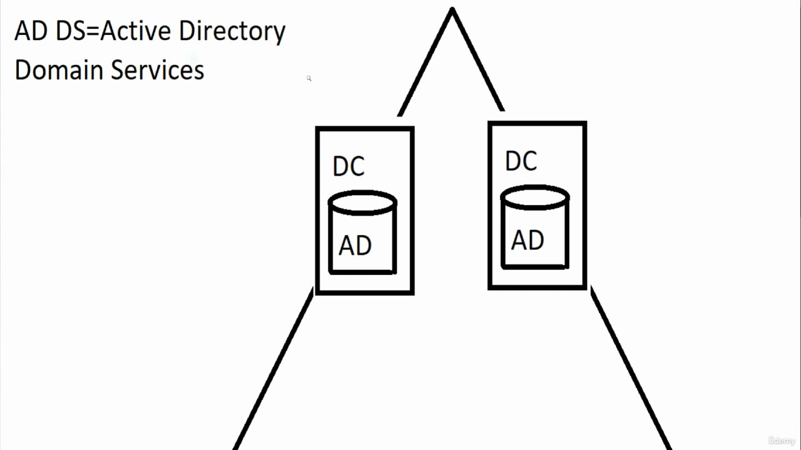

*Figure: 04:56. Zoomed to the top of the triangle. The label reads "AD DS=Active Directory Domain Services." A second DC, with its own AD cylinder, is now beside the first. The computers are below the frame.*

AD DS means Active Directory Domain Services. When he hears that term, he says it means an on-premises domain. He also says "on-prem" and "on-premise" for the same place.

<strong>Two domain controllers</strong>

He always wants more than one domain controller. The reasons are the same reasons he gives for any server you cannot afford to lose, applied to logon.

| Reason | What he is protecting |
| --- | --- |
| Load | The computers authenticate to the domain controllers. With a lot of machines, he does not want all of that on one server. He calls it breaking up the disbursement of the load. |
| Redundancy | If the only domain controller goes down, you are in trouble. |

The two DC boxes on the 04:56 frame are that pair. Each one holds its own copy of the AD database.

<strong>Replication and the user</strong>

The smiley is a user. He creates the account on a domain controller.

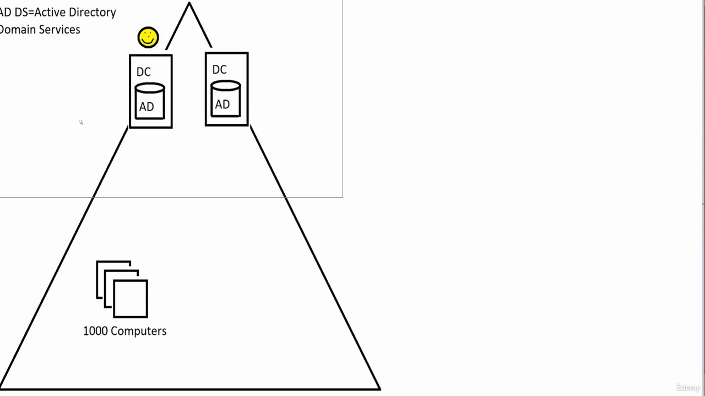

*Figure: 05:14. The full triangle again. "AD DS=Active Directory Domain Services" is at the upper left. The smiley sits above the left DC. Both controllers still show an AD cylinder. "1000 Computers" is back at the bottom. The replication arrow is not drawn yet.*

Domain controllers replicate. What you do on one copies to the other. Create the user on the first controller, and replication carries that account across. His arrow is that copy. Because both controllers have the account, the user can log on at any of the thousand machines and authenticate to a domain controller.

A few seconds on either side of this frame are the same drawing, zoomed in or with the cursor parked on the left database. This is the one that shows the user and the computers together.

<strong>Kerberos, NTLM, and LDAP</strong>

Authentication uses Kerberos. He calls a protocol a language. Kerberos is the authentication protocol.

There is an older protocol for legacy machines from before the year 2000. The board spells it NTLM and marks it legacy. The caption hears "NTLN." Read the board.

He says that protocol stack let them keep encrypted passwords and authenticate securely. He also says the whole design is decades old. It was cutting-edge when it arrived, it is dated now, it still works, and he still calls it pretty secure. He mentions security considerations and says he is not explaining them in this video.

Active Directory's directory language is LDAP, Lightweight Directory Access Protocol.

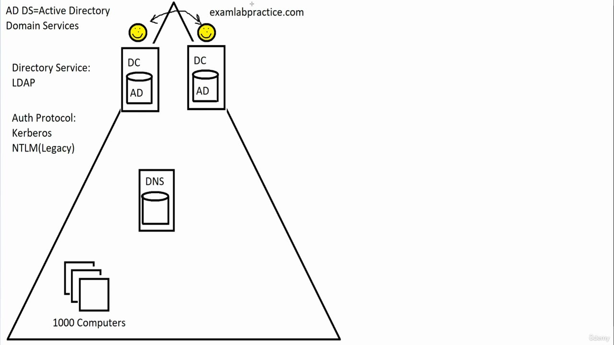

*Figure: 07:50. The labels are on the board. "Directory Service: LDAP" and "Auth Protocol: Kerberos" with "NTLM(Legacy)" under it. Two smileys and a curved arrow sit above the two DCs. The domain name examlabpractice.com is at the top. A DNS server and its cylinder are inside the triangle. The cylinder is not filled red yet. No GPO, file server, or firewall.*

| Label on this frame | What he says it is |
| --- | --- |
| Kerberos | The authentication protocol for the domain. A protocol, in his words, is like a language |
| NTLM(Legacy) | The older protocol, for machines from before 2000. The caption writes NTLN |
| LDAP | Lightweight Directory Access Protocol, the directory service language |
| The arrow between the smileys | Replication. The account created on one controller is on the other |

<strong>DNS and the domain name</strong>

Every machine needs a name, and that name has to be tied to an IP address. The service is DNS. He first says Domain Name Service, then Domain Name System Server. The name he lands on is Domain Name System. The domain itself has to have a name.

He names a domain after the company, often after the company's web presence. His example is examlabpractice.com, the same name as on the title card. A DNS server in the domain associates names and IP addresses. That server has its own database, the DNS database. On the board he borders that database in red and fills it red so the red database belongs to the red domain name.

The 07:50 frame is the DNS server arriving, with examlabpractice.com written above the controllers. The red fill and the red box around the name are on the later frames.

What the clients do with it:

1. The machines register in DNS. They put their IP addresses in that database. A file server is one of the machines he adds. He says file servers are common.
2. Name resolution is centralized. A machine that needs another machine queries DNS.
3. Logon uses the same query. The clients have to authenticate to the domain controllers, so a client asks DNS for the address of a domain controller.
4. DNS answers with that information. The client then goes and authenticates.

He calls that efficient. Together with the domain controllers, DNS is how this picture becomes centralized. The peer-to-peer network had every machine as its own boss. The triangle has a place that holds the accounts and a place that holds the names.

<strong>Group Policy</strong>

A group policy object, a GPO, is an object you create that holds settings. Any attribute you want to configure on the machines, he says, can go in a GPO. His examples:

- Force the firewalls on.
- Keep antivirus up to date.
- Disable wallpaper, so people cannot put their own pictures on the machines.
- Deploy software, if you want to.

He says there are literally thousands of things inside a GPO. The GPO instructs the machines to turn things on and turn things off. GPOs replicate. Create one on a domain controller and it copies to the other, so it does not matter which domain controller a machine authenticates with.

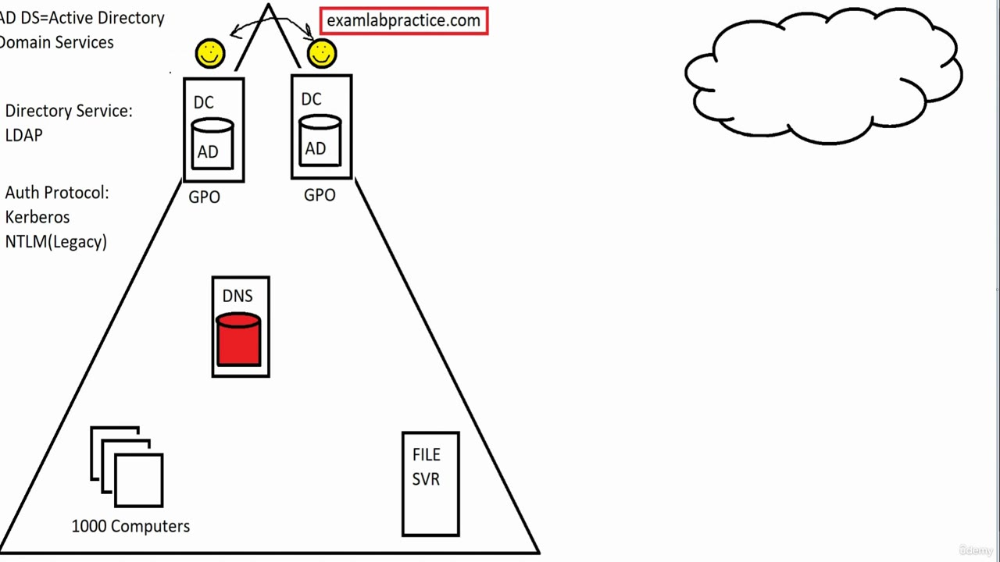

*Figure: 11:06. The domain after Group Policy and the file server. "GPO" is written under each DC. The DNS cylinder is filled red, and examlabpractice.com is in a red box, which is the association he described. "FILE SVR" is inside the triangle on the right. An unlabeled cloud sits outside the triangle. He has said that cloud is the internet. The firewall is not drawn yet.*

<strong>The firewall and the internet</strong>

He draws the internet as a cloud, wipes the first sketch, and redraws it beside the domain. The in-between strokes are the same cloud being cleaned up. The 11:06 frame is the cloud once it is sitting next to the triangle.

The internal network stays off the open internet. The company puts a firewall on that path.

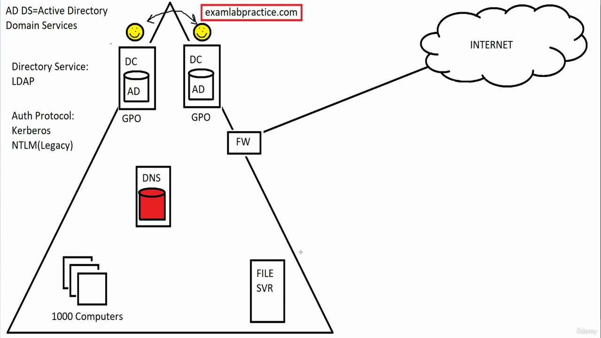

*Figure: 12:02. The traditional domain. The cloud is now labeled INTERNET. A box marked FW sits on the right edge of the triangle, on the line from the domain out to that cloud. The red DNS database, the red examlabpractice.com box, both GPOs, the file server, and the 1,000 computers are all still on the board.*

His firewall rules, as he states them here:

- Traffic has a secure way out to the internet.
- What comes back in is the traffic you sent out.
- You can allow other things through if you choose to.

He calls this whole drawing a traditional domain, and the way this has been done for 20 years.

<strong>Where he goes next</strong>

He closes this section and points at the expansion: where this went with RAS, VPN, and virtualization. The caption at the end hears "razz." The opening of the same video, and the previous lecture, name RAS. That next drawing is the following section.

## Summary

- The path he is drawing starts on-premises. This video is the traditional Active Directory domain. He dates that pattern at about 20 years and sends RAS, VPN, and virtualization to the next section.
- Mainframes and vacuum tubes, then the integrated circuit, then 1980s PCs. Peer-to-peer meant every machine was equal, changes were a visit to each computer, and file sharing meant knowing someone else's password.
- Novell NetWare is his 1990s server. Microsoft NT's special server is the domain controller. In 2000 that domain technology is Active Directory, drawn as a triangle.
- AD DS is Active Directory Domain Services. He says that term means an on-premises domain. The cylinder on each DC is the Active Directory database.
- Run more than one domain controller so authentication load is spread out and one failure does not take logon with it. They replicate, including user accounts and GPOs.
- Kerberos is the authentication protocol. The board's legacy protocol is NTLM(Legacy), for pre-2000 machines. The caption writes NTLN. LDAP is Lightweight Directory Access Protocol, the directory service language.
- The example domain is examlabpractice.com. Clients register in DNS and ask DNS for a domain controller before they authenticate. The red DNS database is tied to that name.
- A GPO pushes settings such as firewalls, antivirus, wallpaper, and software, and it replicates.
- A firewall on the edge is what keeps the internal triangle off the open internet.

## References

- [Lesson video](../../../../../course_videos/Course%20AZ-104%20Microsoft%20Azure%20Administrator%20course%20with%20SIMULATIONS/03%20-%20Having%20a%20Solid%20Foundation%20of%20Active%20Directory%20Domains.mp4)
- [Transcript](../../../../../course_videos/Course%20AZ-104%20Microsoft%20Azure%20Administrator%20course%20with%20SIMULATIONS/03%20-%20Having%20a%20Solid%20Foundation%20of%20Active%20Directory%20Domains.txt)
- [Study guide for Exam AZ-104](https://learn.microsoft.com/en-us/credentials/certifications/resources/study-guides/az-104)
- [Active Directory Domain Services overview](https://learn.microsoft.com/en-us/windows-server/identity/ad-ds/get-started/virtual-dc/active-directory-domain-services-overview)
- [Active Directory Replication Concepts](https://learn.microsoft.com/en-us/windows-server/identity/ad-ds/get-started/replication/active-directory-replication-concepts)
- [Kerberos authentication overview in Windows Server](https://learn.microsoft.com/en-us/windows-server/security/kerberos/kerberos-authentication-overview)
- [NTLM overview in Windows Server](https://learn.microsoft.com/en-us/windows-server/security/kerberos/ntlm-overview)
- [Group Policy overview for Windows Server](https://learn.microsoft.com/en-us/windows-server/identity/ad-ds/manage/group-policy/group-policy-overview)
- [How DNS Support for Active Directory Works](https://learn.microsoft.com/en-us/previous-versions/windows/it-pro/windows-server-2003/cc759550(v=ws.10))

## Questions and Answers

<strong>Question 1 — Room-sized machines</strong>

What does he say companies were running in the 1950s and 1960s, and which component does he name?

**Answer.** Mainframes, gigantic computers that filled entire rooms. He says they used vacuum tubes.

<strong>Question 2 — The 1970s chip</strong>

What does he say was created in the 1970s, and what did that make it possible to process on a chip?

**Answer.** An IC, an integrated circuit. He says it allowed binary math to be processed on little chips, which is where personal computing became popular.

<strong>Question 3 — Equal computers</strong>

What does he call the early office networks, and what made a change painful for the administrator?

**Answer.** Peer-to-peer. Each computer was equal, so there was no machine in charge. The administrator had to sit at every computer, or get the users to help.

<strong>Question 4 — Sharing files</strong>

How does he say people shared files before the file-server idea?

**Answer.** The machines shared files with each other, and people had to know each other's passwords. He says that did not work very well.

<strong>Question 5 — The 1990s product</strong>

Which company and product does he credit with the server that managed machines and made sharing files easier?

**Answer.** Novell, with NetWare. The caption writes "novel" and "Netware."

<strong>Question 6 — Microsoft's server</strong>

What does he say Microsoft NT called the special server that manages the other machines?

**Answer.** A domain controller.

<strong>Question 7 — The year 2000</strong>

What domain technology does he say Microsoft released in 2000, and what shape does he use for that domain?

**Answer.** Active Directory. He represents the domain with a triangle.

<strong>Question 8 — The cylinder</strong>

What does the cylinder on each domain controller represent, and what does he say you should hear when someone says AD DS?

**Answer.** The Active Directory database. AD DS is Active Directory Domain Services, and he says that term means an on-premises domain.

<strong>Question 9 — More than one</strong>

Why does he want more than one domain controller? Give both reasons he names.

**Answer.** To spread the authentication load, and for redundancy. If the only domain controller goes down, logon is in trouble.

<strong>Question 10 — The smiley</strong>

He creates a user on one domain controller. What does the arrow between the smileys mean, and where can that user log on?

**Answer.** The arrow is replication. The account copies to the other domain controller. The user can log on at any of the thousand machines and authenticate to a domain controller.

<strong>Question 11 — How logon speaks</strong>

Which protocol does he say clients use to authenticate, and which label on the board is for machines from before 2000?

**Answer.** Kerberos is the authentication protocol. The legacy label is NTLM(Legacy). The caption hears NTLN.

<strong>Question 12 — The initials on the left</strong>

What does he say LDAP stands for, and what is his definition of a protocol?

**Answer.** Lightweight Directory Access Protocol, which he calls the directory service language. A protocol, he says, is like a language.

<strong>Question 13 — Finding a controller</strong>

What domain name does he write on the board, and what does a client ask DNS before it can authenticate?

**Answer.** examlabpractice.com. The client asks DNS for the address of a domain controller. DNS replies, and then the client authenticates.

<strong>Question 14 — Settings on the machines</strong>

What object does he use to push firewall, antivirus, wallpaper, and software settings, and what happens to that object after he creates it on one domain controller?

**Answer.** A GPO, a group policy object. It replicates to the other domain controller, so the machine can authenticate to either one.

<strong>Question 15 — Outside the triangle</strong>

What does he draw on the line between the domain and the internet, and which topics does he say the next section covers?

**Answer.** A firewall, labeled FW, so the internal network is not left exposed. Next is RAS, VPN, and virtualization. The closing caption hears RAS as "razz."

