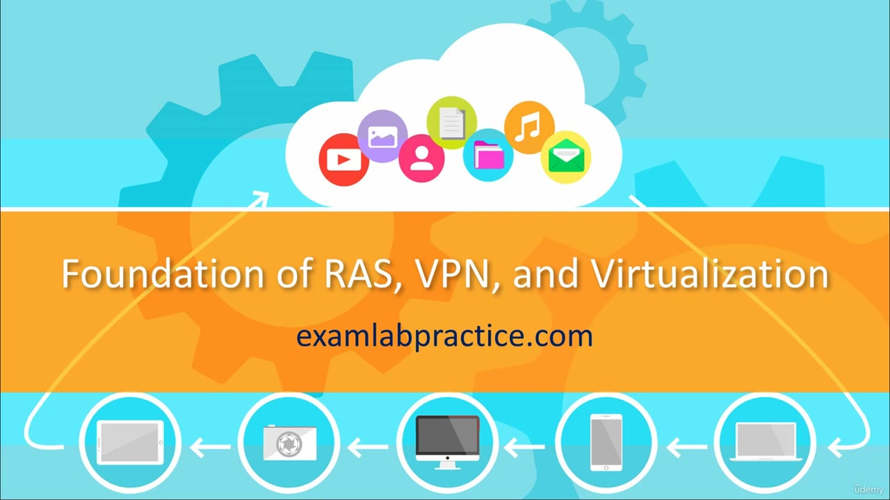
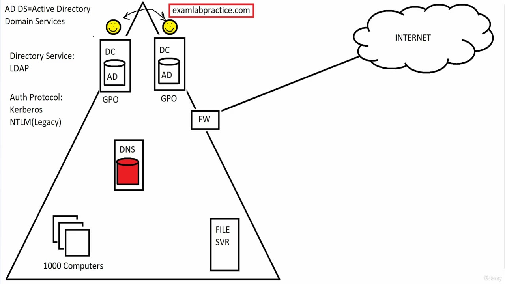
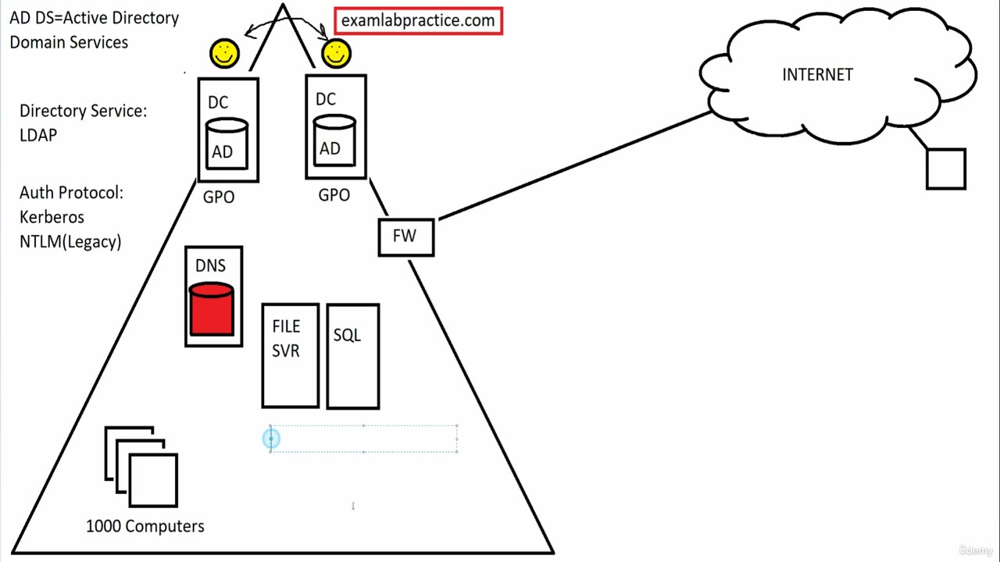
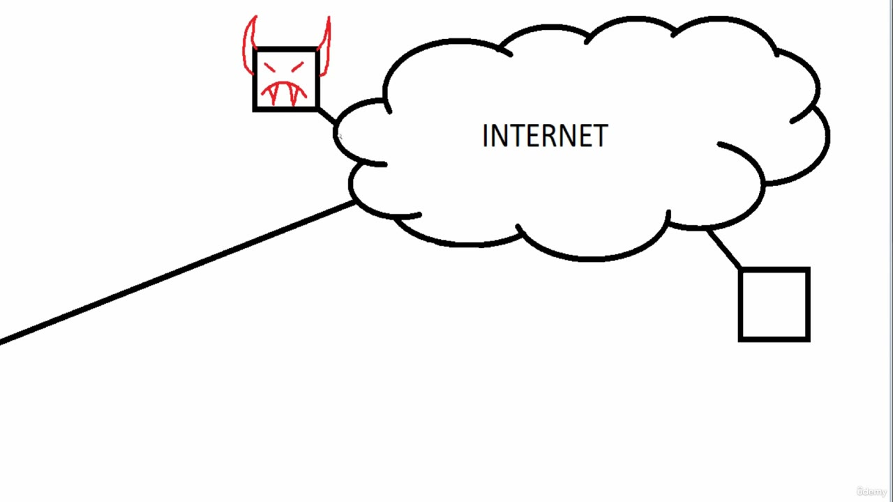
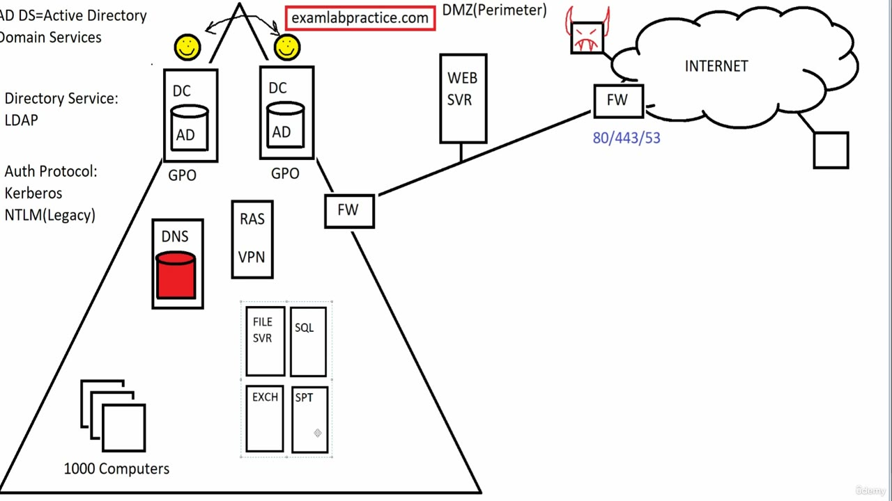
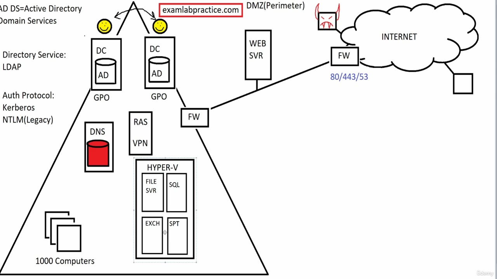
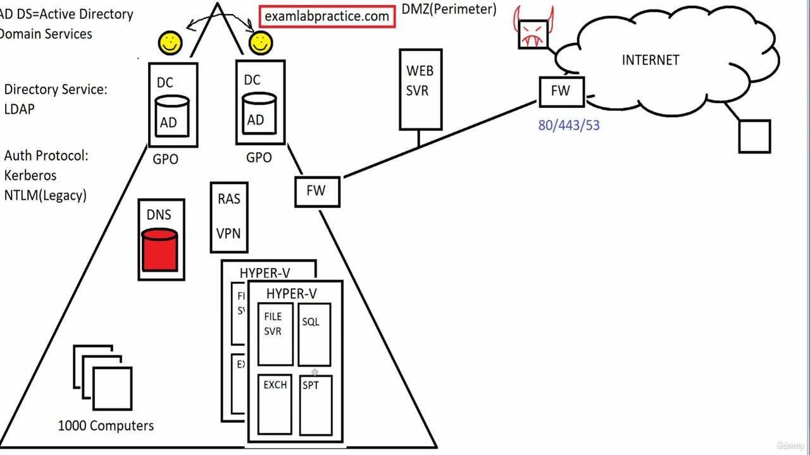

[Back to AZ-104: Microsoft Azure Administrator](../1.md)

# Chapter 4 — Having a Solid Foundation of RAS, DMZ, and Virtualization

## Table of Contents

- [Introduction](#introduction)
- [Detailed tutorial](#detailed-tutorial)
  - [Why the older design is here](#why-the-older-design-is-here)
  - [The domain already on the board](#the-domain-already-on-the-board)
  - [Servers the company hosted](#servers-the-company-hosted)
  - [The home user and the open firewall](#the-home-user-and-the-open-firewall)
  - [RAS and the VPN tunnel](#ras-and-the-vpn-tunnel)
  - [The public website](#the-public-website)
  - [Two firewalls and the DMZ](#two-firewalls-and-the-dmz)
  - [Hyper-V on one host](#hyper-v-on-one-host)
  - [A second host, checkpoints, and elasticity](#a-second-host-checkpoints-and-elasticity)
- [Summary](#summary)
- [References](#references)
- [Questions and Answers](#questions-and-answers)
  - [Question 1 — Why the older design](#question-1-why-the-older-design)
  - [Question 2 — Directory protocol](#question-2-directory-protocol)
  - [Question 3 — Legacy authentication](#question-3-legacy-authentication)
  - [Question 4 — Services hosted on site](#question-4-services-hosted-on-site)
  - [Question 5 — The home user path](#question-5-the-home-user-path)
  - [Question 6 — The horned box](#question-6-the-horned-box)
  - [Question 7 — The Microsoft server name](#question-7-the-microsoft-server-name)
  - [Question 8 — What remains visible](#question-8-what-remains-visible)
  - [Question 9 — From the website inward](#question-9-from-the-website-inward)
  - [Question 10 — The network between the firewalls](#question-10-the-network-between-the-firewalls)
  - [Question 11 — The blue numbers](#question-11-the-blue-numbers)
  - [Question 12 — Physical servers for redundancy](#question-12-physical-servers-for-redundancy)
  - [Question 13 — Reverting a change](#question-13-reverting-a-change)
  - [Question 14 — Spare memory](#question-14-spare-memory)

## Introduction

This lecture draws the on-premises picture that later cloud work sits on. He keeps the Active Directory domain from the previous board, then shows a person working from home, a public website, and the servers a company used to run itself. Remote access goes through a RAS server and a VPN tunnel. The website goes in a DMZ between two firewalls. The last part is virtualization: one Hyper-V host, a second host for a copy of the virtual machines, checkpoints, and elasticity. Cloud services start in the next section.

## Detailed tutorial

**AZ-104 Microsoft Azure Administrator** · [video](../../../../../course_videos/Course%20AZ-104%20Microsoft%20Azure%20Administrator%20course%20with%20SIMULATIONS/04%20-%20Having%20a%20Solid%20Foundation%20of%20RAS%2C%20DMZ%2C%20and%20Virtualization.mp4) · [Transcript](../../../../../course_videos/Course%20AZ-104%20Microsoft%20Azure%20Administrator%20course%20with%20SIMULATIONS/04%20-%20Having%20a%20Solid%20Foundation%20of%20RAS%2C%20DMZ%2C%20and%20Virtualization.txt)

<strong>Why the older design is here</strong>

He wants the older design in view before the current one. The point he states is that how companies hosted services for years is what makes the later design understandable. The protocols on the board are old. He says many of them have been updated over the years, and that you can still use them.

The title card names RAS, VPN, and virtualization. The whiteboard work in this lecture also builds the DMZ.

*Figure: 00:00. The title card reads "Foundation of RAS, VPN, and Virtualization" and examlabpractice.com. A cloud of app icons sits above a row of devices.*

<strong>The domain already on the board</strong>

The drawing he starts from is the on-premises domain. He names it Active Directory Domain Services, AD DS. The board already has the labels from that picture.

*Figure: 00:04. The domain triangle. Two domain controllers, each with an AD database and GPO. Red DNS. FILE SVR. 1000 Computers. One FW leads to the INTERNET cloud. The red box reads examlabpractice.com.*

| Label on the board | What he is using it for |
| --- | --- |
| AD DS = Active Directory Domain Services | The on-premises domain |
| Directory Service: LDAP | Lightweight Directory Access Protocol. The transcript says "director." The board says Directory |
| Auth Protocol: Kerberos | The authentication protocol he treats as the normal one |
| NTLM (Legacy) | New Technology LAN Manager. He ties it to legacy devices from the 1990s. The transcript says "land manager" |
| DC, AD, GPO | Two domain controllers already drawn, each with the directory database and GPO under it |
| DNS | The red DNS server, inside the domain |
| FILE SVR | The file server already inside the triangle |
| FW | The firewall between the domain and the internet |
| 1000 Computers | The internal PCs, drawn as three stacked squares |
| examlabpractice.com | The name in the red box at the top of the domain |

He says Kerberos has been in use for decades, and that the protocol itself is older than that. NTLM stays on the board as the legacy path. He is comfortable keeping both because the implementations have been updated.

<strong>Servers the company hosted</strong>

The habit he is drawing is "host it yourself." A company had its own data center and its own servers. He adds the services users at home would need to reach.

On this frame the file server has been moved up next to a new SQL box, and a selection rectangle is still open under them. Exchange is the service he is naming at this moment. SharePoint comes a few seconds later. The finished board labels those two EXCH and SPT.

*Figure: 02:04. FILE SVR and SQL sit inside the domain, beside the red DNS server. A selection rectangle is open under them. An unlabeled box hangs off the INTERNET cloud. The single FW is still the only firewall.*

The four services he names:

| Spoken name | Box on the later board | What he says it was |
| --- | --- | --- |
| File server | FILE SVR | Already on the board when this lecture starts |
| SQL database server | SQL | A server users need to reach |
| Microsoft Exchange | EXCH | Email |
| SharePoint | SPT | Microsoft SharePoint, on-premises, which he says was very popular |

Those four boxes are the workloads he virtualizes at the end of the lecture. At 02:04 only FILE SVR and SQL are drawn. EXCH and SPT appear on the board by the time the DMZ is finished.

<strong>The home user and the open firewall</strong>

The unlabeled box on the internet is the person working from home. He says that is much more common now, and that this person needs to reach services inside the domain. The person is outside the office.

He tells you to leave the firewall closed to that user. Opening every port so the home user can reach the file server, SQL, Exchange, and SharePoint is the path he rejects. He says a lot of companies did that in the 1990s. The first company he worked for had no real firewall: a machine had a public address, and you could connect to it from home. He calls that scary then, and much worse now, because people on the internet want company data, damage, and ransomware. He calls those people hackers.

He draws the hacker as a small box on the internet, then adds horns, a frown, and fangs. He starts a joke about the fangs and stops. The drawing is the threat. The home user and the hacker are both outside, on the same internet cloud.

*Figure: 04:06. Close-up of the INTERNET cloud. The horned box is tied to the upper left. The unlabeled home-user box is tied to the lower right. The line at the left runs back toward the firewall.*

| Path | What he says happens |
| --- | --- |
| Open the firewall so the home user can reach the internal servers | The user gets in. So can anyone else who can reach those open ports |
| A VPN tunnel to a RAS server, drawn next | The traffic is encrypted. The hacker can see that it reaches the firewall and cannot read it |

<strong>RAS and the VPN tunnel</strong>

The secure path is a virtual private network. He says you could buy a device called a VPN concentrator, a box that accepts secure connections. In the Microsoft world he uses a server instead. He calls it a RAS server, and also an RRAS server. The words he gives for that are routing and remote access services. The idea he wants from the name is remote access, with VPN support.

The tunnel is encrypted communication from the home user to that RAS server. From the RAS server, the user reaches the other internal resources. On the finished board the box inside the domain reads RAS VPN. It sits between DNS and the internal firewall.

What the hacker can still see is the traffic arriving at the firewall. He cannot see what the traffic says. That is the protection he is drawing: the payload is encrypted, and the RAS server is the point that then opens access to the internal servers.

The RAS VPN box is on the completed drawing in the DMZ section below. He finishes the tunnel explanation before he draws the website.

<strong>The public website</strong>

The next case is a service the company must expose on purpose. He uses their own web server as the example, and he names the site www.examlabpractice.com. People on the internet need to reach it anonymously. The red box at the top of the domain already reads examlabpractice.com. The server box he draws is labeled WEB SVR.

Putting that server inside the domain means opening the web ports into the domain. He names port 443 and port 80, and he calls them the HTTP ports. An anonymous visitor can then reach the site. A hacker who compromises the site can too. He calls the next step pivoting: from the website, the attacker reaches the other services on the internal network. The file server, SQL, Exchange, and SharePoint are those services on this board.

He mentions a reverse proxy as a way to host the site internally, and he leaves that for another time. The placement he draws is outside the domain.

A web server sitting on the internet with no second firewall is, in his words, completely exposed, with no protection. The fix he draws is a second firewall.

<strong>Two firewalls and the DMZ</strong>

He now has two firewalls, and he names them by which side they face.

- The original firewall, at the edge of the domain triangle, is the internal connected firewall.
- The new firewall, next to the internet cloud, is the external connected firewall.
- The network between them is the DMZ, the demilitarized zone. He says the more popular term is perimeter network. The board writes `DMZ(Perimeter)` above the web server.

WEB SVR stands in that segment, on the line between the internal firewall and the external firewall. The external firewall is the one with the blue port list.

He opens only the ports that service needs. He names port 80, port 443, and port 53 for DNS if DNS is placed in the perimeter, plus whatever other ports that service actually needs. The blue text under the external firewall reads `80/443/53`. The red DNS server stays inside the domain on this drawing. Port 53 is the port he would open if DNS were placed in the perimeter.

Traffic that hits the web server stops at the internal firewall. It stays off the file server, SQL, Exchange, and SharePoint. If the site is compromised, the attacker is still on the perimeter side of that internal firewall. The traffic he says you might still allow through the internal firewall is VPN, and he says authentication has to succeed for that to work.

*Figure: 10:02. RAS VPN is inside the triangle, between DNS and the internal FW. WEB SVR sits under the label DMZ(Perimeter), on the line to the external FW. Blue text under that external FW reads 80/443/53. The horned box and the unlabeled home-user box are on the INTERNET cloud. FILE SVR, SQL, EXCH, and SPT are still four separate boxes.*

| Piece | Where it sits on this frame | What he uses it for |
| --- | --- | --- |
| RAS VPN | Inside the domain, left of the internal FW | Ends the encrypted tunnel, then reaches internal resources |
| Internal FW | Edge of the domain triangle | The internal connected firewall. Web traffic from the DMZ stops here. VPN is the traffic he might allow, after authentication |
| WEB SVR | Between the two firewalls | The public site, his example www.examlabpractice.com |
| DMZ(Perimeter) | The label over that segment | Demilitarized zone, which he also calls a perimeter network |
| External FW | Beside the INTERNET cloud | The external connected firewall |
| 80/443/53 | Blue text under the external FW | The ports he would open: web ports, and DNS if DNS is in the perimeter |
| Horned box | Upper side of the internet cloud | The hacker |
| Unlabeled box | Lower right of the internet cloud | The person working from home |

<strong>Hyper-V on one host</strong>

The last idea in the lecture is virtualization, which is how he says this story starts to turn into cloud computing. Cloud services are the next section.

The habit he just drew was a company hosting everything itself: a data center, a file server, SQL, Exchange, and SharePoint. He says that was the normal design.

Virtualization is an old term in this lecture. He defines a hypervisor as the software that emulates hardware, so software can run on that emulated machine. He says the word hypervisor has been around since the 1970s, and that mainframes dividing processing time and sharing a computer were already a form of virtualization.

VMware is who he credits with expanding that idea until separate servers could run together on fewer machines. He calls VMware the biggest contributor, and he dates the hypervisor idea to the 1970s, earlier than either company's product. The Microsoft software on the board is Hyper-V. He says the name as Hyper-V, hypervisor.

Without virtualization, the four services are four physical servers. A redundant copy of each, which he describes as clustering them, is eight physical servers. With virtualization he buys one powerful server, installs the hypervisor, and runs the four servers as virtual machines on it.

*Figure: 11:18. The same domain, DMZ, and internet as the previous frame. FILE SVR, SQL, EXCH, and SPT now sit inside one box labeled HYPER-V. A selection rectangle is still around that box.*

<strong>A second host, checkpoints, and elasticity</strong>

Three consequences of that one host are the rest of the lecture.

**Checkpoints.** On a powerful host, he gets checkpoints. That is the Microsoft word. He says they used to be called snapshots, and that many other companies still say snapshot. You make a change, and if it breaks the machine you revert to the point before the change.

**A second host.** Full redundancy is a second server that holds a copy of the virtual machines. Two physical servers replace the eight. On the board he draws a second HYPER-V box over the first while he says that. The first box is partly covered. FILE SVR and EXCH still show at its left edge.

*Figure: 11:20. Two HYPER-V boxes overlap. The front box still holds FILE SVR, SQL, EXCH, and SPT. The box behind it is partly hidden, with the left edge of FILE SVR and EXCH still visible.*

| Design he describes | Physical servers | What is running |
| --- | --- | --- |
| One server per workload | 4 | File, SQL, Exchange, SharePoint, each on its own hardware |
| A second copy of each, clustered | 8 | Redundancy without virtualization |
| One Hyper-V host | 1 | The same four workloads as virtual machines |
| A second host with a copy of those virtual machines | 2 | The redundant design he wants |

**Elasticity.** Each virtual machine is given an amount of RAM and processing power. If the file server has more RAM than it is using, and SQL needs RAM, the file server gives some up. When SQL is finished with that extra memory, it goes back into a pool of RAM and a pool of CPU. The machines grow and shrink as they need to. He calls that elasticity, and he calls this the small, on-premises version of it. He says the cloud version of the same idea spreads across many machines in large data centers. He stops there. The next section is cloud services.

## Summary

- The board starts as an Active Directory Domain Services domain: LDAP, Kerberos, and NTLM labeled legacy. Two domain controllers, DNS, a file server, one firewall, and the internet are already drawn.
- A home user reaches internal servers through a VPN tunnel to a RAS server, also called RRAS, routing and remote access services. The tunnel is encrypted. An observer sees the traffic reach the firewall and cannot read it.
- A public web server stays out of the domain. Between an internal firewall and an external firewall is a DMZ, which he also calls a perimeter network. The external firewall shows ports 80, 443, and 53. Traffic from the website does not pass the internal firewall. VPN, after authentication, is the traffic he might allow.
- Hyper-V is Microsoft's hypervisor. He credits VMware with making this way of running many servers practical, and he dates the idea to the 1970s.
- Four physical servers, doubled for redundancy, would be eight. Two Hyper-V hosts, one holding a copy of the virtual machines, replace those eight.
- Microsoft calls the saved state a checkpoint. The older word, still used elsewhere, is snapshot. Revert to it if a change breaks the machine.
- Elasticity, in this lecture, means unused RAM and CPU go back to a pool so another virtual machine can use them. He points that idea at cloud computing and starts cloud services next.

## References

- [Video](../../../../../course_videos/Course%20AZ-104%20Microsoft%20Azure%20Administrator%20course%20with%20SIMULATIONS/04%20-%20Having%20a%20Solid%20Foundation%20of%20RAS%2C%20DMZ%2C%20and%20Virtualization.mp4)
- [Transcript](../../../../../course_videos/Course%20AZ-104%20Microsoft%20Azure%20Administrator%20course%20with%20SIMULATIONS/04%20-%20Having%20a%20Solid%20Foundation%20of%20RAS%2C%20DMZ%2C%20and%20Virtualization.txt)
- [Study guide for Exam AZ-104](https://learn.microsoft.com/en-us/credentials/certifications/resources/study-guides/az-104)
- [Remote Access](https://learn.microsoft.com/en-us/windows-server/remote/remote-access/remote-access)
- [Install and configure Remote Access (RAS) as a VPN server](https://learn.microsoft.com/en-us/windows-server/remote/remote-access/get-started-install-ras-as-vpn)
- [Windows authentication overview](https://learn.microsoft.com/en-us/windows-server/security/windows-authentication/windows-authentication-overview)
- [NTLM overview](https://learn.microsoft.com/en-us/windows-server/security/kerberos/ntlm-overview)
- [Using checkpoints](https://learn.microsoft.com/en-us/windows-server/virtualization/hyper-v/checkpoints)

## Questions and Answers

<strong>Question 1 — Why the older design</strong>

Why does he start with how companies hosted services in the past?

**Answer.** So the current design is understandable. He says you need the older way of doing things in order to see how things work now.

<strong>Question 2 — Directory protocol</strong>

Which directory protocol does the board list under Active Directory Domain Services?

**Answer.** LDAP. He calls it Lightweight Directory Access Protocol. The board says "Directory Service: LDAP." The transcript says "director."

<strong>Question 3 — Legacy authentication</strong>

Which authentication protocol does the board keep for old devices, and how does he describe it?

**Answer.** NTLM, written NTLM (Legacy), under Kerberos. He expands it as New Technology LAN Manager and ties it to legacy devices from the 1990s. The transcript says "land manager." Kerberos is the authentication protocol he names as the normal one, and he says it is decades old as well.

<strong>Question 4 — Services hosted on site</strong>

Which four services does he say the company would host itself?

**Answer.** A file server, a SQL database server, Microsoft Exchange for email, and SharePoint. The finished board labels the boxes FILE SVR, SQL, EXCH, and SPT. At 02:04 only FILE SVR and SQL are drawn.

<strong>Question 5 — The home user path</strong>

What does he say a company should refuse to do so someone at home can reach the internal servers?

**Answer.** Open every port on the firewall and let that person straight in. He says companies did that in the 1990s. The first company he worked for had no real firewall, a public address, and a path you could connect to from home.

<strong>Question 6 — The horned box</strong>

Who does the box with red horns on the internet represent?

**Answer.** A hacker. He draws horns, a frown, and fangs, then stops a joke about going further. He is drawing someone who wants company data, damage, or ransomware.

<strong>Question 7 — The Microsoft server name</strong>

What Microsoft server does he use for the home user's secure connection, and what do the letters stand for?

**Answer.** A RAS server, which he also calls an RRAS server: routing and remote access services. The board labels the box RAS VPN. He says you could instead buy a VPN concentrator. The RAS server ends the encrypted tunnel and then allows access to the other internal resources.

<strong>Question 8 — What remains visible</strong>

Once that tunnel is up, what can the attacker still observe?

**Answer.** That the traffic is going to the firewall. He cannot read what the traffic says. The communication is encrypted.

<strong>Question 9 — From the website inward</strong>

What does he call the step from a compromised public website into the other internal servers?

**Answer.** Pivoting. That is why the web server stays out of the domain. Opening port 80 and port 443 into the domain would also give that attacker a path toward the file server, SQL, Exchange, and SharePoint. He names a reverse proxy as another way to host the site internally, and he leaves it for another time.

<strong>Question 10 — The network between the firewalls</strong>

What does he call each firewall, and what is the network between them?

**Answer.** The firewall on the domain is the internal connected firewall. The firewall by the internet is the external connected firewall. The network between them is a DMZ, a demilitarized zone. He says the more popular term is perimeter network. The board writes DMZ(Perimeter) over the WEB SVR.

<strong>Question 11 — The blue numbers</strong>

Which ports does he write under the external firewall, and when does he include the third one?

**Answer.** 80, 443, and 53. The blue text reads 80/443/53. He names 80 and 443 as the web ports, and 53 for DNS if DNS is placed in the perimeter. On this drawing the red DNS server stays inside the domain. He also says to open whatever other ports that service needs, and no more.

<strong>Question 12 — Physical servers for redundancy</strong>

He starts from four physical servers. What does redundancy cost without virtualization, and what does he change that count to?

**Answer.** A second copy of each server, which he describes as clustering them, is eight physical servers. Hyper-V on one host runs the four as virtual machines. A second host with a copy of those virtual machines is two physical servers. The board labels the box HYPER-V. He credits VMware as the biggest contributor to running servers this way, and he says the hypervisor idea dates to the 1970s.

<strong>Question 13 — Reverting a change</strong>

What does Microsoft call the saved state he reverts to, and what did that used to be called?

**Answer.** A checkpoint. He says Microsoft used to call them snapshots, and that many other companies still say snapshot. You make a change and revert to the earlier state if the change breaks the machine.

<strong>Question 14 — Spare memory</strong>

In his on-premises example, what happens to memory the file server is not using?

**Answer.** It can be given to SQL. When SQL is finished, that memory goes back into a pool of RAM and a pool of CPU, and the virtual machines grow and shrink. He calls that elasticity, and he calls it the small on-premises version. He says the cloud version spans many machines in large data centers, which is the next section.

