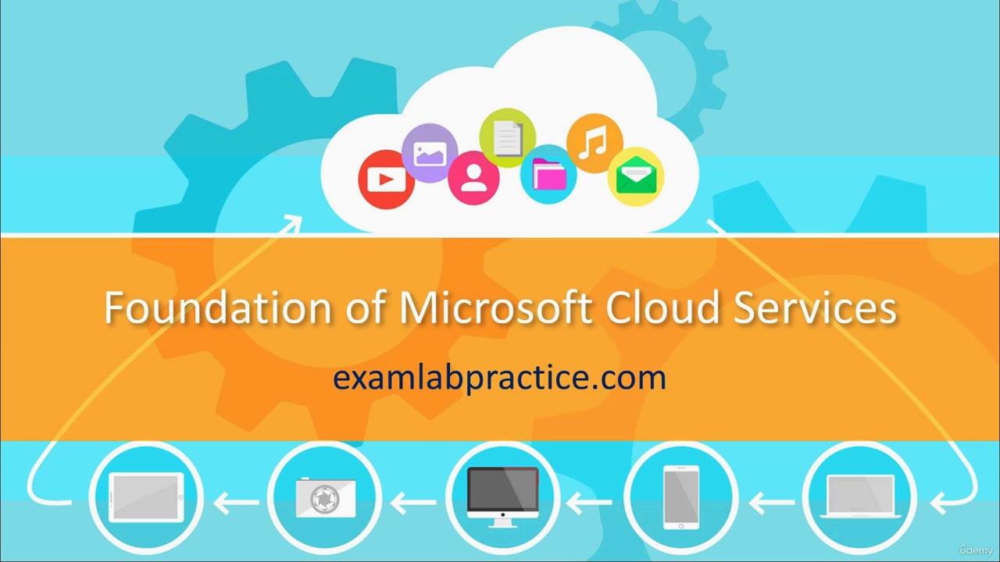
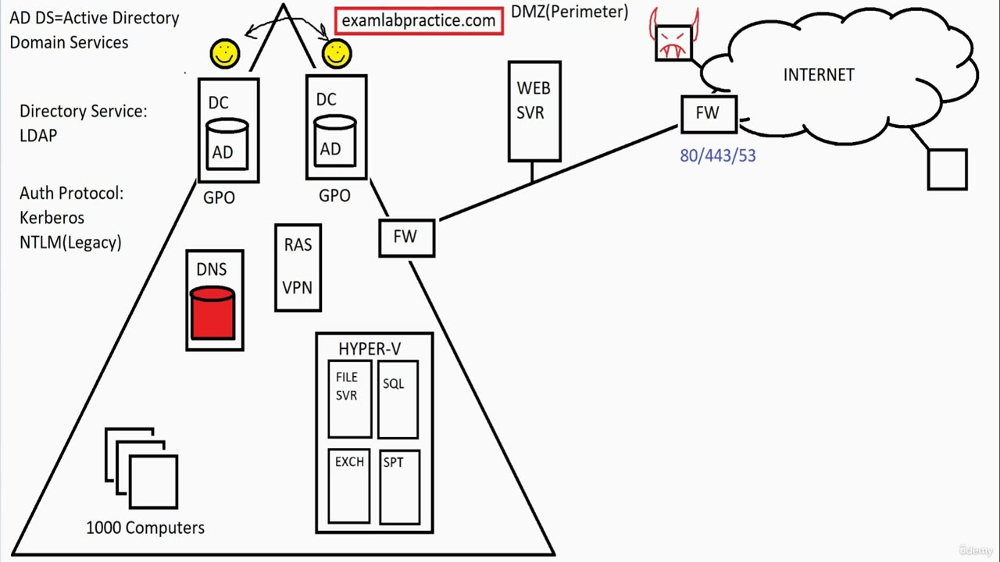
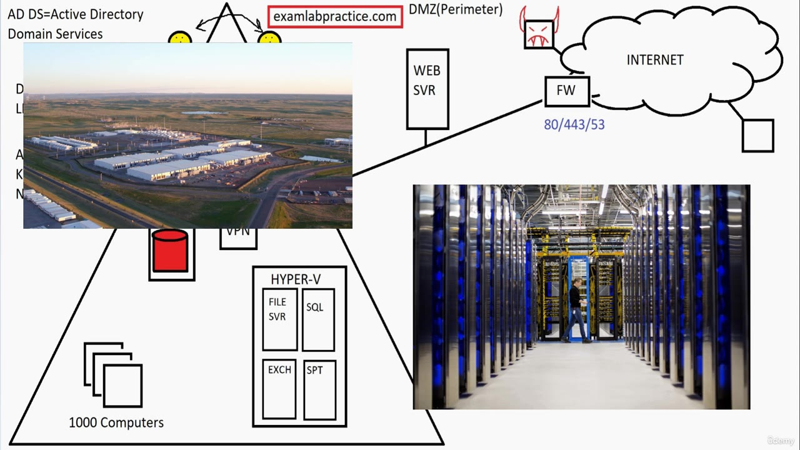
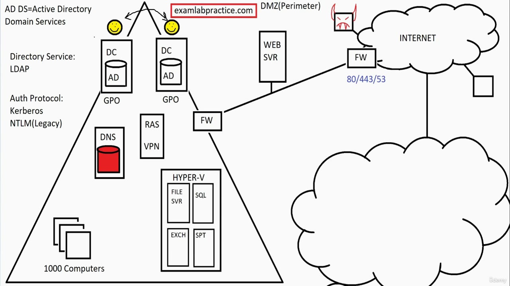
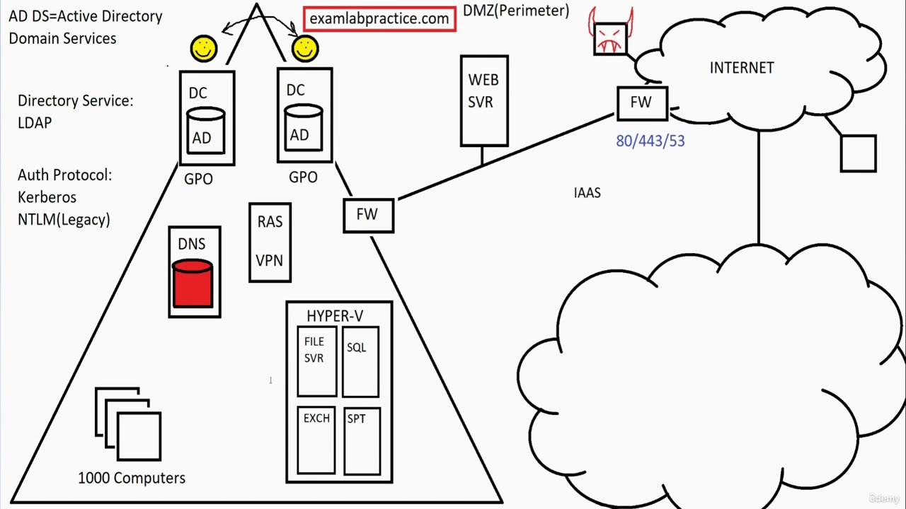
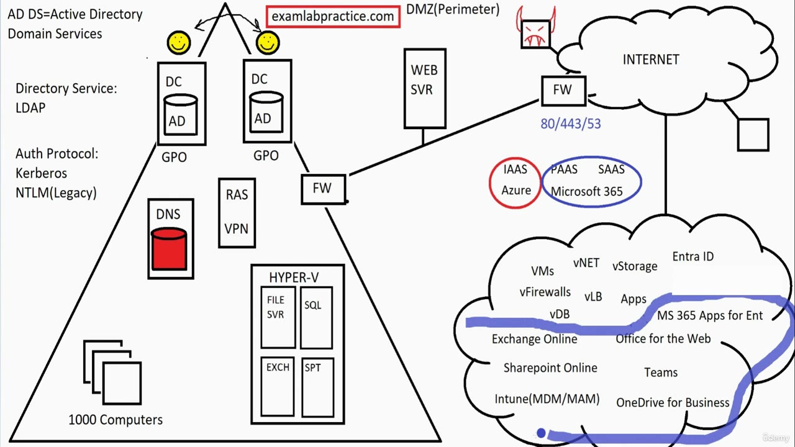
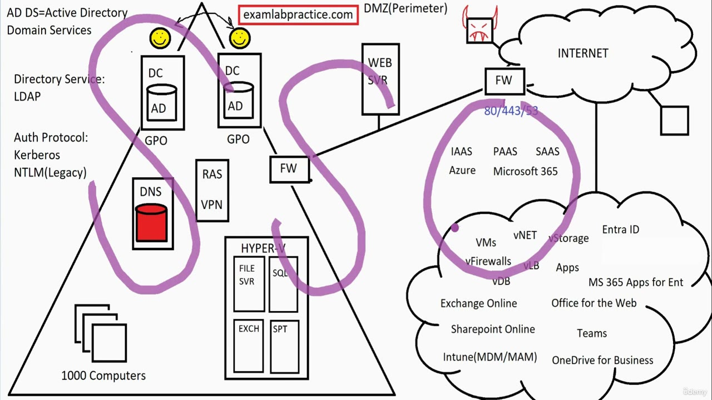
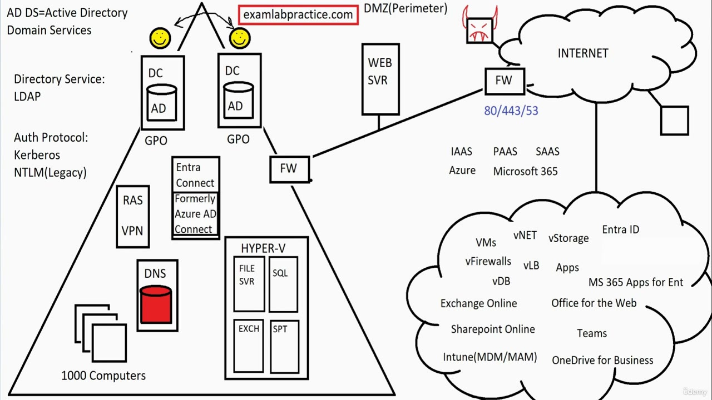

[Back to AZ-104: Microsoft Azure Administrator](../1.md)

# Chapter 5 — Having a Solid Foundation of the Microsoft Cloud Services

## Table of Contents

- [Introduction](#introduction)
- [Detailed tutorial](#detailed-tutorial)
  - [Where cloud services came from](#where-cloud-services-came-from)
  - [Infrastructure as a service](#infrastructure-as-a-service)
  - [Azure and the monthly fee](#azure-and-the-monthly-fee)
  - [Platform and software as a service](#platform-and-software-as-a-service)
  - [Entra ID, formerly Azure AD](#entra-id-formerly-azure-ad)
  - [Azure and Microsoft 365](#azure-and-microsoft-365)
  - [Products on the cloud](#products-on-the-cloud)
  - [Subscriptions and licenses](#subscriptions-and-licenses)
  - [The directory they share](#the-directory-they-share)
  - [Linking the on-premises domain](#linking-the-on-premises-domain)
  - [New companies and existing domains](#new-companies-and-existing-domains)
- [Summary](#summary)
- [References](#references)
- [Questions and Answers](#questions-and-answers)
  - [Question 1 — Who started selling the host](#question-1-who-started-selling-the-host)
  - [Question 2 — What IaaS sells](#question-2-what-iaas-sells)
  - [Question 3 — The name Azure](#question-3-the-name-azure)
  - [Question 4 — The Azure invoice](#question-4-the-azure-invoice)
  - [Question 5 — A finished application](#question-5-a-finished-application)
  - [Question 6 — A platform you administer](#question-6-a-platform-you-administer)
  - [Question 7 — Why the directory is a platform](#question-7-why-the-directory-is-a-platform)
  - [Question 8 — The name on older lessons](#question-8-the-name-on-older-lessons)
  - [Question 9 — The on-premises directory](#question-9-the-on-premises-directory)
  - [Question 10 — Two products, one stack](#question-10-two-products-one-stack)
  - [Question 11 — Users created on either side](#question-11-users-created-on-either-side)
  - [Question 12 — Two ways to run Office](#question-12-two-ways-to-run-office)
  - [Question 13 — Mail, sites, chat, and devices](#question-13-mail-sites-chat-and-devices)
  - [Question 14 — How Microsoft 365 is purchased](#question-14-how-microsoft-365-is-purchased)
  - [Question 15 — The sync server](#question-15-the-sync-server)
  - [Question 16 — The lighter tool and a new company](#question-16-the-lighter-tool-and-a-new-company)

## Introduction

This lecture keeps the on-premises domain on the left and draws the provider cloud on the right. He uses that cloud to separate infrastructure, platform, and software as a service, then places Azure on the infrastructure side and Microsoft 365 on the platform and software side. Both sides share one directory. The last box he adds inside the domain triangle is the server that syncs on-premises users out to that directory.

## Detailed tutorial

**AZ-104 Microsoft Azure Administrator** · [05 - Having a Solid Foundation of the Microsoft Cloud Services.mp4](../../../../../course_videos/Course%20AZ-104%20Microsoft%20Azure%20Administrator%20course%20with%20SIMULATIONS/05%20-%20Having%20a%20Solid%20Foundation%20of%20the%20Microsoft%20Cloud%20Services.mp4) · [Transcript](../../../../../course_videos/Course%20AZ-104%20Microsoft%20Azure%20Administrator%20course%20with%20SIMULATIONS/05%20-%20Having%20a%20Solid%20Foundation%20of%20the%20Microsoft%20Cloud%20Services.txt)

<strong>Where cloud services came from</strong>

*Figure: 00:00. The title card reads "Foundation of Microsoft Cloud Services." Devices along the bottom point up into a cloud of app icons.*

He starts from virtualization. Once companies could run many virtual machines on one set of hosts, Amazon, Google, Intel, IBM, and eventually Microsoft looked at their data centers and asked why a customer should keep doing that work on premises. The offer is simple: pay the company that already owns the data center to host the virtual machines, and skip the on-premises headaches.

*Figure: 00:04. The board from the earlier foundation lectures. The triangle is the on-premises domain: two domain controllers, DNS, RAS/VPN, a Hyper-V host with file, SQL, Exchange, and SharePoint guests, and 1,000 computers. The DMZ holds the web server and a firewall. Ports 80/443/53 sit on the line to the internet. The right side is still empty.*

His comparison for "as a service" is ordinary work. He knows how to change the oil in his car. He would rather pay a mechanic to do it. Cloud services are that same trade, applied to hosting.

*Figure: 00:44. A campus of long data-center buildings and an aisle of server racks cover the domain controllers and the right half of the board while he talks about those providers' data centers.*

<strong>Infrastructure as a service</strong>

*Figure: 00:56. He has outlined a second cloud under the internet cloud and drawn a line down into it. Nothing inside that cloud is labeled yet.*

**IaaS** is infrastructure as a service. The cloud provider offers its infrastructure for a fee. Instead of hosting virtual machines in the building you own, you pay that company to host them.

*Figure: 01:54. The word IAAS sits between the internal firewall and the empty provider cloud. The on-premises triangle is unchanged.*

He then lists what that hosted infrastructure can be. The later cloud drawing uses these labels:

| On the board | What he is pointing at |
| --- | --- |
| VMs | Virtual machines you no longer rack yourself |
| vNET | A virtual network |
| vStorage | Storage offered to you |
| vFirewalls | Virtual firewalls on those virtual networks |
| vLB | Virtual load balancers |
| Apps | Applications available in the cloud |
| vDB | Virtual databases |

His summary of the list: almost anything you can host on premises can be hosted in the cloud service.

<strong>Azure and the monthly fee</strong>

Microsoft's infrastructure-as-a-service cloud is **Azure**.

He stops on the pronunciation. The developers he watched when he was learning the product said it the way he says it. He later found that the developers do not agree with each other. He has heard someone say "Azure-ray." He treats it as tomato, tomato: say it however you say it. The transcript spells every variant as Azure except that "Azure-ray" line.

The bill is usage. Each month you pay for the CPU, memory, storage, and network you use.

<strong>Platform and software as a service</strong>

Two more acronyms sit next to IaaS. He defines software as a service first, then platform as a service, because the difference is how much admin work is left.

| | IaaS | PaaS | SaaS |
| --- | --- | --- | --- |
| His definition | The provider's infrastructure, for a fee | A software platform that is ready for you, and still needs an admin before it does anything | A fully functional application, ready for you or your users |
| Work that remains | You consume hosted VMs, networks, storage, firewalls, load balancers, apps, and databases | You administer the platform. His example is the cloud directory, which starts with the admin account | Users open it and work. His pure example is Office for the web, after a license is assigned |
| Where he places Microsoft | Azure, mostly. He says Azure also contains some platform and software services | Microsoft 365, mostly, shared with SaaS. Entra ID is the directory he calls a platform | The user side of Microsoft 365. Office for the web is the case he calls 100 percent SaaS |
| How this lecture says you pay | CPU, memory, storage, and network, for what you use | On the Microsoft 365 side, a subscription and a count of licenses | The same licenses. The user-facing app turns on when the license is there |

**SaaS** means the application is already finished. You, or your users, start using it.

**PaaS** means the platform is ready, and it still will not do the organization's work until an admin configures it. He says there is a little more work from an admin standpoint than there is with a finished app.

<strong>Entra ID, formerly Azure AD</strong>

The platform example is Microsoft's cloud directory. The cloud on the later frame is labeled **Entra ID**. The transcript hears that name as "intra id" and "IntraID."

He says this was formerly **Azure AD**, and that a lot of documentation still says Azure AD. The services are the same. It is a name change. One caption line reverses the direction and says they changed it to Azure AD. The board, and the sentence before that line, say the current name is Entra ID and the former name is Azure AD. Follow the board.

He warns that hundreds of hours of this course still say Azure AD, and that he has not updated all of them. After the foundation videos, a lecture whose title says do not skip covers the rename. He wants that video watched.

Entra ID holds the user accounts, passwords, groups, and role permissions. On premises, the directory in a domain is **AD DS**, Active Directory Domain Services. He thinks part of the reason for the new cloud name is to keep those two directories distinct.

Entra ID is a platform, in his classification, because a new tenant is not a finished directory for the company. There is essentially one user, the admin. You add the users and you control the rest. That admin work is why he refuses to call it software as a service.

<strong>Azure and Microsoft 365</strong>

He splits Microsoft's cloud into two products that still belong to one stack.

- **Azure** is mostly IaaS. It also has some platform services and some software services.
- **Microsoft 365** is mostly platform as a service and software as a service.

Microsoft 365 sits on Azure. He says you cannot have Microsoft 365 without Azure. Creating an Azure account lets you create a Microsoft 365 account. He does not want you to think of them as two unrelated sign-ups. They are linked.

*Figure: 11:44. A red circle is around IAAS and Azure. A blue circle is around PAAS, SAAS, and Microsoft 365. Inside the cloud, Entra ID sits at the top. A blue stroke runs under VMs, vNET, vStorage, vFirewalls, vLB, vDB, and Apps. Below that stroke are Exchange Online, Office for the Web, SharePoint Online (the board spells it Sharepoint), Teams, Intune (MDM/MAM), OneDrive for Business, and MS 365 Apps for Ent.*

<strong>Products on the cloud</strong>

He says he cannot fit every cloud product on the board. These are the ones he does write, and the way he sorts them.

| Product on the board | How he classifies it |
| --- | --- |
| Microsoft 365 apps for enterprise, labeled "MS 365 Apps for Ent" | Formerly Office 365. The downloadable apps are Word, Excel, PowerPoint, and the rest. Most people call this SaaS because the apps are downloadable. From an admin seat it is PaaS, because you administer it. He calls the product a mix |
| Office for the web | Web versions of the Office apps. He calls this 100 percent SaaS. A user with a license can use it |
| Exchange Online | Admin side is PaaS. User side is SaaS |
| SharePoint Online | Same split. Admin side is PaaS. User side is SaaS |
| Teams | Same split, for messaging and the rest of that product |
| Intune (MDM/MAM) | Mobile device management and mobile application management. He calls it the cloud place of Group Policy. On premises, GPOs set computer configuration and deploy software. In the cloud, Intune does that job, and he says it can also control on-premises machines |
| OneDrive for Business | Cloud storage that users can access |
| Entra ID | PaaS, and shared by Azure and Microsoft 365. Covered in the next section |

<strong>Subscriptions and licenses</strong>

The two products are billed differently, even though he has just said they are linked.

Azure stays consumption. You pay for the CPU, RAM, storage, and network you use.

Microsoft 365 uses **subscriptions**. You buy a subscription, you buy a number of licenses, and you issue those licenses to users. The monthly fee follows how many licenses the subscription has. He presents that as the basic model, not a catalog of plan names.

<strong>The directory they share</strong>

Azure and Microsoft 365 share Entra ID. His picture for that is "red and blue make purple." On the 11:44 frame the red ink is the IaaS/Azure circle and the blue ink is the PaaS/SaaS/Microsoft 365 circle. The shared directory is the point of the phrase.

Create a user on the Azure side, or create a user on the Microsoft 365 side, and you see the same user. It is one directory service, not a copy you keep reconciled by hand.

<strong>Linking the on-premises domain</strong>

Companies that already have the triangle on the left often add this cloud rather than replacing the domain on day one. He calls that combination common. The problem he names is single sign-on. **SSO** means one user account reaches what that person needs. A domain account plus a separate cloud account is two logons, so it is not SSO.

*Figure: 12:44. One purple loop encloses the on-premises domain: both domain controllers, DNS, and the client stack. A second purple loop encloses the IAAS / Azure labels and the top of the provider cloud (VMs, vNET, vStorage, vFirewalls). The Microsoft 365 product names sit outside that second loop. He is about to name the service that links the two sides.*

The service he writes inside the domain is **Entra Connect**, formerly **Azure AD Connect**. The transcript hears the new name as "Intra Connect" and "Interconnect." The box on the board is the name to remember. He wants the old name kept as well, because documentation still says Azure AD Connect.

*Figure: 13:58. The new box reads "Entra Connect Formerly Azure AD Connect." It sits under the domain controllers. RAS/VPN has moved to the left of that box. DNS remains below it. The provider cloud is unchanged.*

What he says that server does:

- It runs on premises. He calls this the heavier option, and he says they want a server dedicated to it.
- It synchronizes on-premises user accounts out to Entra ID.
- You choose which users. He says you do not have to sync every account.
- Users created in Entra ID stay in the cloud. He says you cannot currently sync those cloud-created users back down to the on-premises domain.
- A password changed out in the cloud syncs as well.
- With that in place he describes **seamless SSO**: a user who logs on to the domain is logged on in both places, the on-premises domain and the cloud.

The lighter option is only in the voiceover. The captions hear it as "Intrasync" or "Intra ID sync." He calls it a very lightweight application, and he says you do not dedicate a server to it the way Entra Connect wants a server. He says each route has pluses and minuses, and he leaves those for later. The traditional route, on this board, is Entra Connect.

Microsoft's documented lighter-weight sync, the one that uses a provisioning agent rather than a full sync server, is [Microsoft Entra Cloud Sync](https://learn.microsoft.com/en-us/entra/identity/hybrid/cloud-sync/what-is-cloud-sync). He does not write that product name on this frame.

<strong>New companies and existing domains</strong>

He says Microsoft is moving away from domains. For a company that already has the on-premises domain on this board, he still wants the sync: Entra Connect, or the lighter tool.

For a new company, he says he no longer recommends building a domain. He has spent more than two decades teaching and implementing on-premises Active Directory, and he says the change of advice is painful. His reason is cost. In most cases, he says, the company spends less by using cloud services. He adds that client machines can be hosted in the cloud, and he does not cover that here.

He closes the foundation block here. The drawing is the on-premises triangle, the provider cloud, and the sync server between them.

## Summary

- Virtualization is what led Amazon, Google, Intel, IBM, and Microsoft to sell space in their data centers for other people's virtual machines.
- IaaS is rented infrastructure. On this board that is VMs, vNET, vStorage, vFirewalls, vLB, apps, and vDB. Microsoft's IaaS cloud is Azure, billed by CPU, memory, storage, and network.
- SaaS is a finished app. PaaS is a ready platform that an admin still has to run. Entra ID is his PaaS example because it starts with the admin account.
- Entra ID was Azure AD. AD DS remains the on-premises directory name. A later do-not-skip video covers the rename. One caption line reverses which name is current. The board does not.
- Azure is mostly IaaS. Microsoft 365 sits on Azure and is mostly PaaS and SaaS. The accounts are linked, and they share Entra ID, so a user created on either side is the same user.
- Microsoft 365 apps for enterprise (formerly Office 365) are a mix. Office for the web is SaaS. Exchange Online, SharePoint Online, and Teams are PaaS for the admin and SaaS for the user. Intune is the cloud stand-in for GPOs and can also control on-premises machines. OneDrive for Business is user cloud storage.
- Microsoft 365 is sold as a subscription with a count of licenses. Azure stays pay-for-what-you-use.
- Entra Connect, formerly Azure AD Connect, syncs chosen on-premises users out to Entra ID, supports seamless SSO, and syncs a password changed in the cloud. Cloud-created users do not sync back down. The lighter tool is unnamed on the board. A new company, in his current advice, does not start by building a domain.

## References

- [Lesson video](../../../../../course_videos/Course%20AZ-104%20Microsoft%20Azure%20Administrator%20course%20with%20SIMULATIONS/05%20-%20Having%20a%20Solid%20Foundation%20of%20the%20Microsoft%20Cloud%20Services.mp4)
- [Transcript](../../../../../course_videos/Course%20AZ-104%20Microsoft%20Azure%20Administrator%20course%20with%20SIMULATIONS/05%20-%20Having%20a%20Solid%20Foundation%20of%20the%20Microsoft%20Cloud%20Services.txt)
- [Study guide for Exam AZ-104](https://learn.microsoft.com/en-us/credentials/certifications/resources/study-guides/az-104)
- [AZ-104: Prerequisites for Azure administrators](https://learn.microsoft.com/en-us/training/paths/az-104-administrator-prerequisites/)
- [Describe cloud service types](https://learn.microsoft.com/en-us/training/modules/describe-cloud-service-types/)
- [New name for Azure Active Directory](https://learn.microsoft.com/en-us/entra/fundamentals/new-name)
- [Compare Active Directory to Microsoft Entra ID](https://learn.microsoft.com/en-us/entra/fundamentals/compare)
- [What is Microsoft Entra Connect](https://learn.microsoft.com/en-us/entra/identity/hybrid/connect/whatis-azure-ad-connect)
- [What is Microsoft Entra Cloud Sync?](https://learn.microsoft.com/en-us/entra/identity/hybrid/cloud-sync/what-is-cloud-sync)

## Questions and Answers

<strong>Question 1 — Who started selling the host</strong>

Which companies does he name as the ones who turned their data centers into a paid host for other people's virtual machines, and what technology got them thinking?

**Answer.** Amazon, Google, Intel, IBM, and eventually Microsoft. Virtualization is what raised the question. The customer pays to host virtual machines there and skips the on-premises headaches.

<strong>Question 2 — What IaaS sells</strong>

What is the provider offering when he writes IaaS, and which hosted pieces does he list?

**Answer.** Infrastructure, for a fee, as a service. He lists virtual machines, a virtual network, storage, virtual firewalls, virtual load balancers, apps, and virtual databases. The board labels those vNET, vStorage, vFirewalls, vLB, Apps, and vDB.

<strong>Question 3 — The name Azure</strong>

What does he call Microsoft's infrastructure-as-a-service offering, and what does he say about pronouncing it?

**Answer.** Azure. The developers he first watched said it the way he does. He later found they do not all agree, and he has heard "Azure-ray." He treats the pronunciation as optional.

<strong>Question 4 — The Azure invoice</strong>

Which usage does he say the monthly Azure fee follows?

**Answer.** CPU, memory, storage, and network. You pay for what you use.

<strong>Question 5 — A finished application</strong>

How does he define software as a service?

**Answer.** A fully functional application that is ready for you or your users to start using.

<strong>Question 6 — A platform you administer</strong>

How does he define platform as a service?

**Answer.** A software platform that is ready to use, and that an admin still has to administer before it does anything useful.

<strong>Question 7 — Why the directory is a platform</strong>

Why does he call the cloud directory platform as a service?

**Answer.** A new directory starts with the admin. You add the users, groups, and role permissions. He says it is not already set up, so it is a platform you administer.

<strong>Question 8 — The name on older lessons</strong>

What former name does he tell you to keep recognizing for the cloud directory, and which later video does he point at?

**Answer.** Azure AD. The board says Entra ID. He says documentation and hundreds of hours of this course still say Azure AD, and a later video titled do not skip explains the rename. One caption line says they changed it to Azure AD. That line reverses the board.

<strong>Question 9 — The on-premises directory</strong>

Which on-premises directory does he set beside the cloud directory, and why does he think the cloud directory was renamed?

**Answer.** Active Directory Domain Services, AD DS. He thinks the rename helps distinguish on-premises Active Directory from the former Azure AD.

<strong>Question 10 — Two products, one stack</strong>

How does he place Azure and Microsoft 365 relative to each other?

**Answer.** Azure is mostly IaaS, and it also has some PaaS and SaaS. Microsoft 365 is mostly PaaS and SaaS, and it sits on Azure. He says you cannot have Microsoft 365 without Azure, an Azure account can create a Microsoft 365 account, and the two are linked.

<strong>Question 11 — Users created on either side</strong>

What does he say you see if you create a user in Azure or in Microsoft 365?

**Answer.** The same user on the other side. Azure and Microsoft 365 share Entra ID. His phrase for that shared directory is that red and blue make purple.

<strong>Question 12 — Two ways to run Office</strong>

Which Office product does he call a mix of platform and software, and which one does he call entirely software as a service?

**Answer.** Microsoft 365 apps for enterprise, formerly Office 365, are the mix: downloadable Word, Excel, and PowerPoint, which most people call SaaS, while the admin side is PaaS. Office for the web is 100 percent SaaS. A licensed user can use the web apps immediately.

<strong>Question 13 — Mail, sites, chat, and devices</strong>

How does he split Exchange Online, SharePoint Online, and Teams, and what job does he give Intune?

**Answer.** For Exchange Online, SharePoint Online, and Teams, the admin side is PaaS and the user side is SaaS. Intune is mobile device management and mobile application management. He calls it the cloud place of Group Policy, and he says it can control on-premises machines as well. OneDrive for Business is cloud storage for users.

<strong>Question 14 — How Microsoft 365 is purchased</strong>

How does he say you pay for Microsoft 365?

**Answer.** You buy a subscription and a number of licenses, assign those licenses to users, and pay a monthly fee for the licenses on the subscription. Azure remains pay-for-what-you-use.

<strong>Question 15 — The sync server</strong>

What is the on-premises sync server called now and formerly, and which way do accounts and passwords move?

**Answer.** Entra Connect, formerly Azure AD Connect. You choose which on-premises users sync out to Entra ID. Users created in the cloud do not sync back down. A password changed in the cloud does sync. A domain logon then signs the user on in both places. He calls that seamless SSO.

<strong>Question 16 — The lighter tool and a new company</strong>

What lighter sync option does he mention, and what does he recommend for a new company that does not already have a domain?

**Answer.** The captions hear a lightweight application called "Intrasync" or "Intra ID sync." He says it does not need a dedicated server the way Entra Connect does, and he defers the tradeoffs. The traditional choice on the board is still Entra Connect. For a new company he no longer recommends building an on-premises domain. He says cloud services are usually cheaper. An existing domain is still a reason to run the sync.

