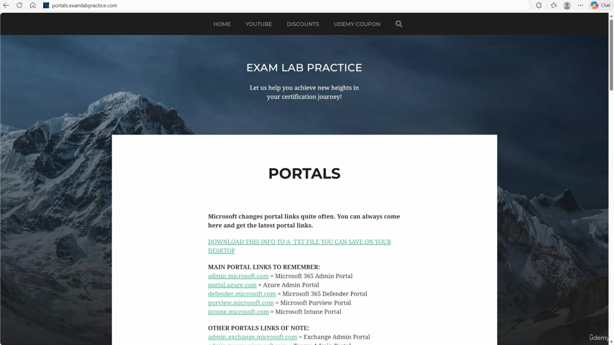
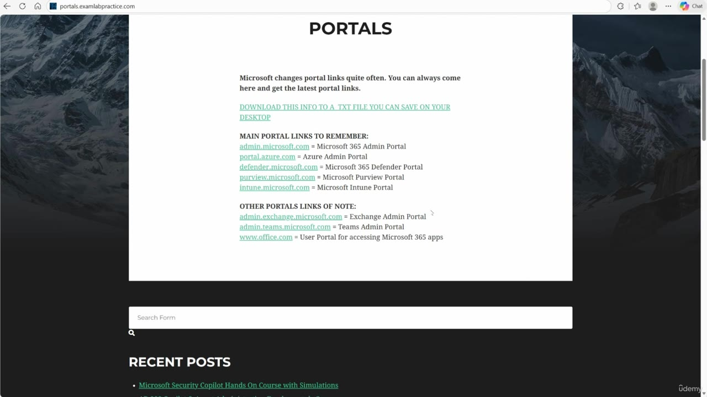
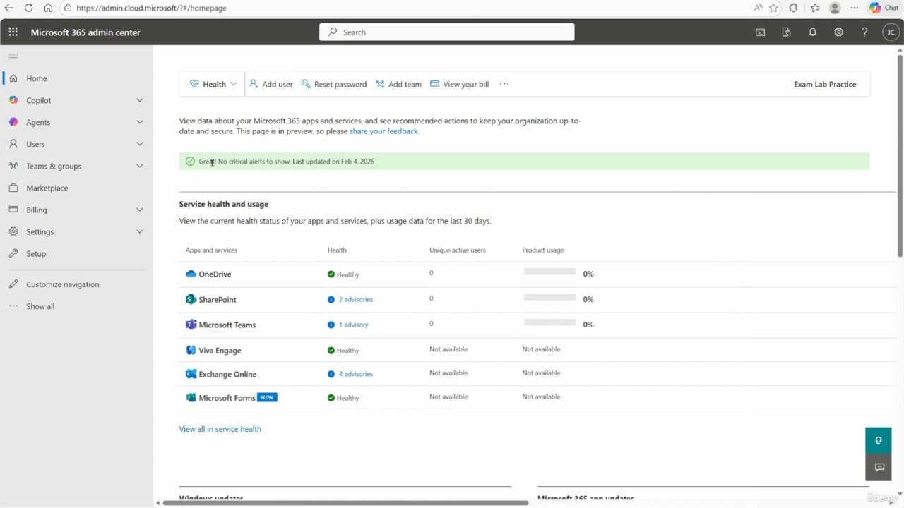
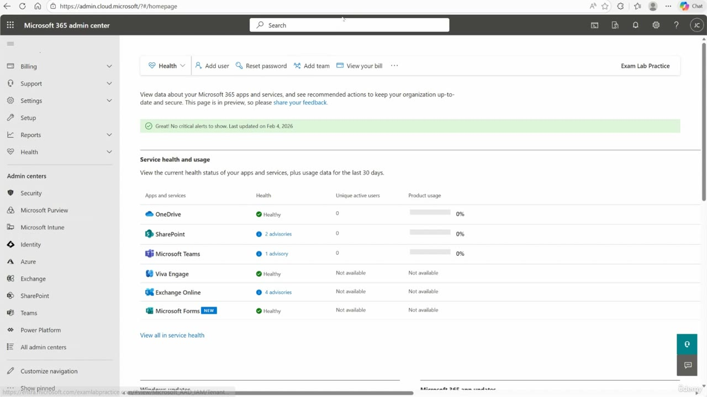

[Back to AZ-104: Microsoft Azure Administrator](../1.md)

# Chapter 6 — DO NOT SKIP Portals renamed!

## Table of Contents

- [Introduction](#introduction)
- [Detailed tutorial](#detailed-tutorial)
  - [Azure AD is now Entra ID](#azure-ad-is-now-entra-id)
  - [Renamed admin portals](#renamed-admin-portals)
  - [The portals page](#the-portals-page)
  - [Show all in the Microsoft 365 admin center](#show-all-in-the-microsoft-365-admin-center)
- [Summary](#summary)
- [References](#references)
- [Questions and Answers](#questions-and-answers)
  - [Question 1 — Why this video is marked](#question-1-why-this-video-is-marked)
  - [Question 2 — What Microsoft does to names](#question-2-what-microsoft-does-to-names)
  - [Question 3 — New name for Azure AD](#question-3-new-name-for-azure-ad)
  - [Question 4 — Docs that still say Azure AD](#question-4-docs-that-still-say-azure-ad)
  - [Question 5 — Old Microsoft 365 admin host](#question-5-old-microsoft-365-admin-host)
  - [Question 6 — Defender and Purview hosts](#question-6-defender-and-purview-hosts)
  - [Question 7 — Old Intune host](#question-7-old-intune-host)
  - [Question 8 — Where he keeps the list](#question-8-where-he-keeps-the-list)
  - [Question 9 — How to keep a local copy](#question-9-how-to-keep-a-local-copy)
  - [Question 10 — Show all](#question-10-show-all)
  - [Question 11 — Exchange and Teams](#question-11-exchange-and-teams)
  - [Question 12 — Address in the browser](#question-12-address-in-the-browser)

## Introduction

Microsoft renames products and moves admin portals. This lecture is tagged DO NOT SKIP because later videos, and older docs, still use the previous names. He keeps a page with the current hosts and shows where the Microsoft 365 admin center lists the other admin centers.

## Detailed tutorial

**AZ-104 Microsoft Azure Administrator** · [06 - DO NOT SKIP Portals renamed!.mp4](../../../../../course_videos/Course%20AZ-104%20Microsoft%20Azure%20Administrator%20course%20with%20SIMULATIONS/06%20-%20DO%20NOT%20SKIP%20Portals%20renamed%21.mp4) · [Transcript](../../../../../course_videos/Course%20AZ-104%20Microsoft%20Azure%20Administrator%20course%20with%20SIMULATIONS/06%20-%20DO%20NOT%20SKIP%20Portals%20renamed%21.txt)

<strong>Azure AD is now Entra ID</strong>

He puts this video in his courses because Microsoft renames things. The first rename: Azure Active Directory is now Microsoft Entra ID. The transcript hears the new name as "IntraID". Treat that as Entra ID.

He also says Microsoft has not updated every document. When you still see Azure AD, read it as the product now called Microsoft Entra ID.

<strong>Renamed admin portals</strong>

The spoken map of old hosts to current hosts:

| Old host | Current host |
| --- | --- |
| portal.microsoft.com | admin.microsoft.com (Microsoft 365 admin portal) |
| security.microsoft.com | defender.microsoft.com |
| compliance.microsoft.com | purview.microsoft.com |
| endpoint.microsoft.com | intune.microsoft.com |

<strong>The portals page</strong>

He sends you to `portals.examlabpractice.com` for the list he maintains. The page says Microsoft changes portal links often, and it offers a text file you can save to the desktop. Right-click that download link and save it.

*Figure: 00:00. portals.examlabpractice.com lists the main hosts: admin.microsoft.com, portal.azure.com, defender.microsoft.com, purview.microsoft.com, and intune.microsoft.com.*

*Figure: 00:44. The same page scrolled to the other links: Exchange, Teams, and the Office user portal.*

| Host on the page | What the page calls it |
| --- | --- |
| admin.microsoft.com | Microsoft 365 Admin Portal |
| portal.azure.com | Azure Admin Portal |
| defender.microsoft.com | Microsoft 365 Defender Portal |
| purview.microsoft.com | Microsoft Purview Portal |
| intune.microsoft.com | Microsoft Intune Portal |
| admin.exchange.microsoft.com | Exchange Admin Portal |
| admin.teams.microsoft.com | Teams Admin Portal |
| www.office.com | User portal for Microsoft 365 apps |

<strong>Show all in the Microsoft 365 admin center</strong>

He also opens the Microsoft 365 admin center and uses **Show all**. He warns that those in-product links change too, and he still wants the portals page as the list he updates.

The recording does not stay on the host he just said. He said `admin.microsoft.com`. The browser is on `admin.cloud.microsoft`.

*Figure: 01:40. admin.cloud.microsoft, home, with Show all still collapsed at the bottom of the left nav. The health page says it was last updated on Feb 4, 2026.*

*Figure: 01:46. Show all is open. Admin centers on this screen: Security, Microsoft Purview, Microsoft Intune, Identity, Azure, Exchange, SharePoint, Teams, Power Platform, and All admin centers.*

## Summary

- Azure Active Directory in older material means Microsoft Entra ID. The transcript's "IntraID" is that rename.
- Microsoft 365 admin, Defender, Purview, and Intune moved off portal.microsoft.com, security.microsoft.com, compliance.microsoft.com, and endpoint.microsoft.com.
- The list he maintains is portals.examlabpractice.com, with a text file you can save.
- Show all in the Microsoft 365 admin center reaches the other admin centers. In this recording that center opens at admin.cloud.microsoft.

## References

- [Lesson video](../../../../../course_videos/Course%20AZ-104%20Microsoft%20Azure%20Administrator%20course%20with%20SIMULATIONS/06%20-%20DO%20NOT%20SKIP%20Portals%20renamed%21.mp4)
- [Transcript](../../../../../course_videos/Course%20AZ-104%20Microsoft%20Azure%20Administrator%20course%20with%20SIMULATIONS/06%20-%20DO%20NOT%20SKIP%20Portals%20renamed%21.txt)
- [Study guide for Exam AZ-104](https://learn.microsoft.com/en-us/credentials/certifications/resources/study-guides/az-104)
- [Microsoft 365 admin center](https://admin.microsoft.com)
- [Azure portal](https://portal.azure.com)
- [Microsoft Defender portal](https://defender.microsoft.com)
- [Microsoft Purview portal](https://purview.microsoft.com)
- [Microsoft Intune admin center](https://intune.microsoft.com)

## Questions and Answers

<strong>Question 1 — Why this video is marked</strong>

Why does he mark this lecture DO NOT SKIP and drop it into more than one course?

**Answer.** Because Microsoft renames products and portals, and later lessons still depend on knowing the old names.

<strong>Question 2 — What Microsoft does to names</strong>

What habit of Microsoft is this lecture about?

**Answer.** Renaming things, including product names and the hosts of the admin portals.

<strong>Question 3 — New name for Azure AD</strong>

What is Azure Active Directory called now?

**Answer.** Microsoft Entra ID. The transcript hears the name as "IntraID".

<strong>Question 4 — Docs that still say Azure AD</strong>

Why might you still read "Azure AD" in documentation?

**Answer.** He says Microsoft has not updated all of the documentation yet. The older name still means Entra ID.

<strong>Question 5 — Old Microsoft 365 admin host</strong>

What did the Microsoft 365 admin portal host used to be, and what does he say it is now?

**Answer.** It used to be portal.microsoft.com. He says it is now admin.microsoft.com. This recording then opens admin.cloud.microsoft.

<strong>Question 6 — Defender and Purview hosts</strong>

Which old hosts moved to defender.microsoft.com and purview.microsoft.com?

**Answer.** security.microsoft.com moved to defender.microsoft.com. compliance.microsoft.com moved to purview.microsoft.com.

<strong>Question 7 — Old Intune host</strong>

What was the Intune portal host before intune.microsoft.com?

**Answer.** endpoint.microsoft.com.

<strong>Question 8 — Where he keeps the list</strong>

Where does he tell you to look up the current portal links?

**Answer.** portals.examlabpractice.com.

<strong>Question 9 — How to keep a local copy</strong>

How does he tell you to keep a copy of that list on the desktop?

**Answer.** Right-click the download link on that page and save the text file.

<strong>Question 10 — Show all</strong>

How do you reach the other admin centers from the Microsoft 365 admin center in this video?

**Answer.** Click Show all in the left navigation. He still warns that those links change.

<strong>Question 11 — Exchange and Teams</strong>

Which hosts does his portals page give for Exchange admin and Teams admin?

**Answer.** admin.exchange.microsoft.com and admin.teams.microsoft.com.

<strong>Question 12 — Address in the browser</strong>

Which host is actually open when he clicks Show all?

**Answer.** admin.cloud.microsoft. He had just said admin.microsoft.com.

