[Back to AZ-104: Microsoft Azure Administrator](../1.md)

# Chapter 7 — Questions for John Christopher

## Table of Contents

- [Introduction](#introduction)
- [Detailed tutorial](#detailed-tutorial)
  - [The same video in every course](#the-same-video-in-every-course)
  - [How to message him](#how-to-message-him)
  - [Why a reply can take time](#why-a-reply-can-take-time)
  - [Search the official articles](#search-the-official-articles)
  - [The article this search opens](#the-article-this-search-opens)
  - [Where the course list lives](#where-the-course-list-lives)
  - [Assignments and the certificate](#assignments-and-the-certificate)
  - [Whether the course is updated](#whether-the-course-is-updated)
  - [Exam questions](#exam-questions)
- [Summary](#summary)
- [References](#references)
- [Questions and Answers](#questions-and-answers)
  - [Question 1 — Which courses include this](#question-1-which-courses-include-this)
  - [Question 2 — The channel for questions](#question-2-the-channel-for-questions)
  - [Question 3 — Why patience](#question-3-why-patience)
  - [Question 4 — Before he writes back](#question-4-before-he-writes-back)
  - [Question 5 — The example search](#question-5-the-example-search)
  - [Question 6 — Which results to open](#question-6-which-results-to-open)
  - [Question 7 — How fast Microsoft changes](#question-7-how-fast-microsoft-changes)
  - [Question 8 — After you find the article](#question-8-after-you-find-the-article)
  - [Question 9 — The course catalog](#question-9-the-course-catalog)
  - [Question 10 — A stuck assignment](#question-10-a-stuck-assignment)
  - [Question 11 — Course updates](#question-11-course-updates)
  - [Question 12 — Practice questions](#question-12-practice-questions)

## Introduction

This lecture is the question-and-comment video John Christopher places in his courses. It covers how a message has to reach him, why a reply can wait, how to open an official Microsoft article before he writes back, where the current course list is, what to watch when an assignment or a certificate is stuck, and what he is allowed to say about exam questions.

## Detailed tutorial

**AZ-104 Microsoft Azure Administrator** · [07 - Questions for John Christopher.mp4](../../../../../course_videos/Course%20AZ-104%20Microsoft%20Azure%20Administrator%20course%20with%20SIMULATIONS/07%20-%20Questions%20for%20John%20Christopher.mp4) · [Transcript](../../../../../course_videos/Course%20AZ-104%20Microsoft%20Azure%20Administrator%20course%20with%20SIMULATIONS/07%20-%20Questions%20for%20John%20Christopher.txt)

<strong>The same video in every course</strong>

He says this video will be in all of his courses from this point on. If you have already watched it in another course, he says you can skip it here. The opening frame is the title card, with his site name under the title.

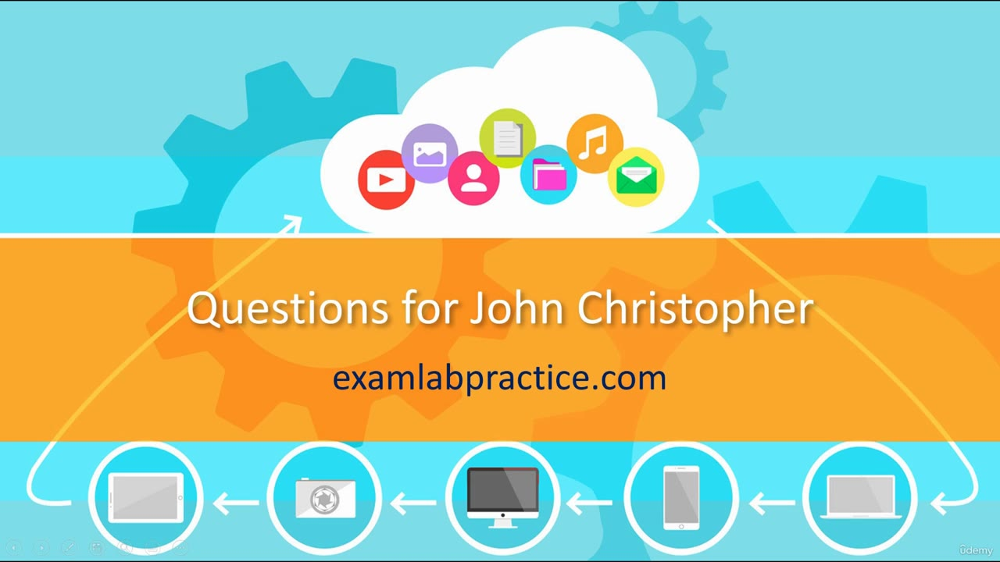

*Figure: 00:00. The card reads "Questions for John Christopher" and examlabpractice.com.*

<strong>How to message him</strong>

He says you are welcome to message him and that he likes hearing from students. The caption breaks off around 00:26 ("you're always more than") and picks up again at the head count. The slide that is up during that gap is the contact rule.

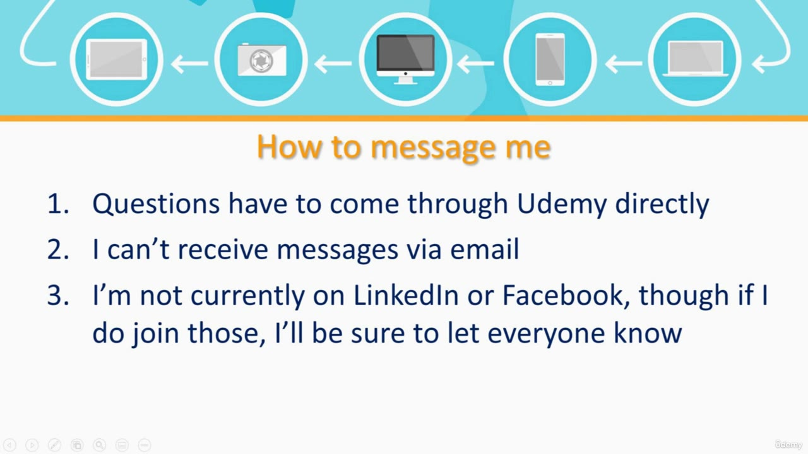

*Figure: 00:22. Three rules under "How to message me."*

The slide says:

1. Questions have to come through Udemy directly.
2. He cannot receive messages via email.
3. He is not currently on LinkedIn or Facebook. If he joins either one, he says he will tell everyone.

<strong>Why a reply can take time</strong>

He says tens of thousands of people are taking his courses at any given time. That volume is why he made the video. He says he is getting more questions than he can answer in a short period, that he does his best to answer every question, and that answering them was taking so much time he needed to address it directly.

The request is patience. He says he will respond as soon as he can.

<strong>Search the official articles</strong>

The second point is for a question you want answered before he can write back. He says it will look like a lesson on searching the web. What he wants from the search is a specific fact in the official documentation Microsoft publishes.

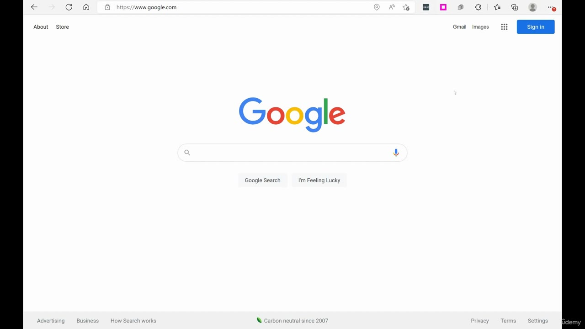

*Figure: 01:48. google.com, empty search box. The footer says "Carbon neutral since 2007."*

The example topic he names is Microsoft 365 dynamic query based groups. He types a shorter query. He says a typo can be corrected in the box.

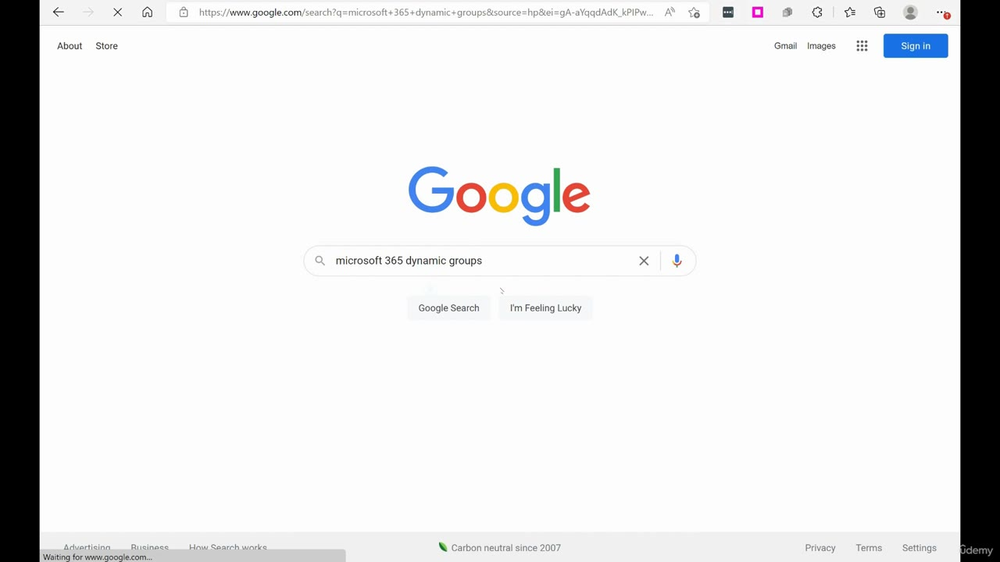

*Figure: 02:22. The box contains `microsoft 365 dynamic groups`. The address starts with `google.com/search?q=microsoft+365+dynamic+groups`.*

On the results, he says to use the headings that read `docs.microsoft.com`. He calls those the official articles and the place to get the latest information.

He ties that to how often the product moves:

- Microsoft changes things constantly. He calls keeping videos current a constant battle.
- The cadence he gives is week after week.
- He says that updating every video every week would still leave him behind, because buttons change and controls move.
- He wants that treated as normal work in the cloud. The latest write-up is the `docs.microsoft.com` article.

He says the vast majority of the questions he receives can be answered in those articles.

<strong>The article this search opens</strong>

The recording then opens one article and scrolls it. The address bar is:

`https://docs.microsoft.com/en-us/azure/active-directory/enterprise-users/groups-dynamic-membership`

The page on screen still says Azure AD. The same topic is now the Microsoft Learn article in References, whose title says Microsoft Entra ID. Read the frames below as the page he showed in this recording.

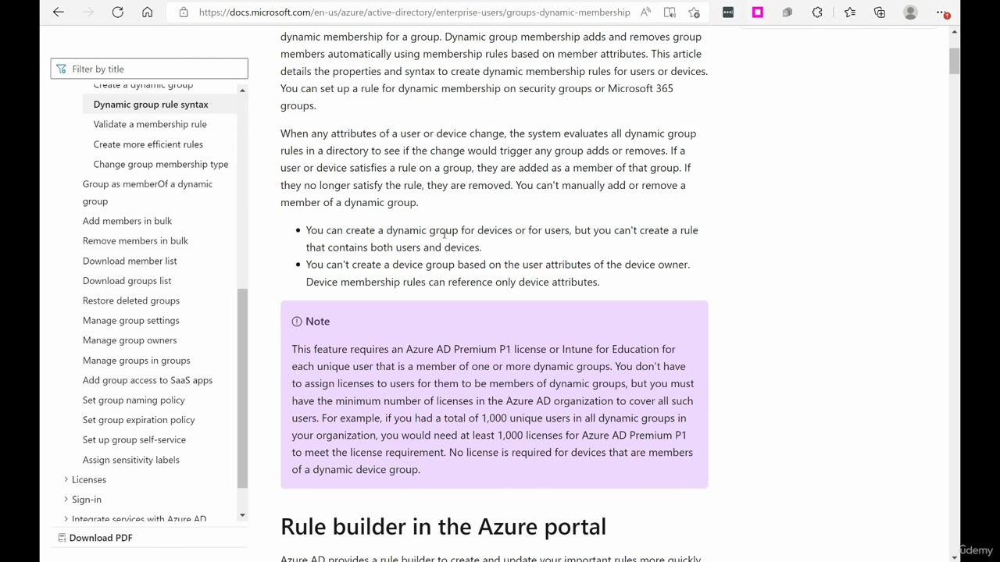

*Figure: 03:18. Left nav on "Dynamic group rule syntax." The purple note is the license requirement. "Rule builder in the Azure portal" starts at the bottom of the frame.*

What this frame shows:

- Dynamic membership adds and removes members from rules on member attributes. The article applies the rules to security groups or Microsoft 365 groups, for users or for devices.
- When an attribute changes, the directory evaluates dynamic-group rules. A user or device that satisfies the rule is added. One that no longer satisfies it is removed. A member of a dynamic group cannot be added or removed by hand.
- A dynamic group can be for devices or for users. One rule cannot contain both users and devices.
- A device group cannot be based on the user attributes of the device owner. Device membership rules can reference only device attributes.
- The note says the feature requires an Azure AD Premium P1 license or Intune for Education for each unique user who is a member of one or more dynamic groups. You do not assign a license to each member. The organization needs enough Premium P1 licenses to cover those unique users. The example on the page is 1,000 unique users across all dynamic groups, which needs at least 1,000 Azure AD Premium P1 licenses. Devices that are members of a dynamic device group do not need a license.

The left nav has "Dynamic group rule syntax" selected. Neighboring titles on this frame include validating a membership rule, creating more efficient rules, and changing the group membership type. He does not open those.

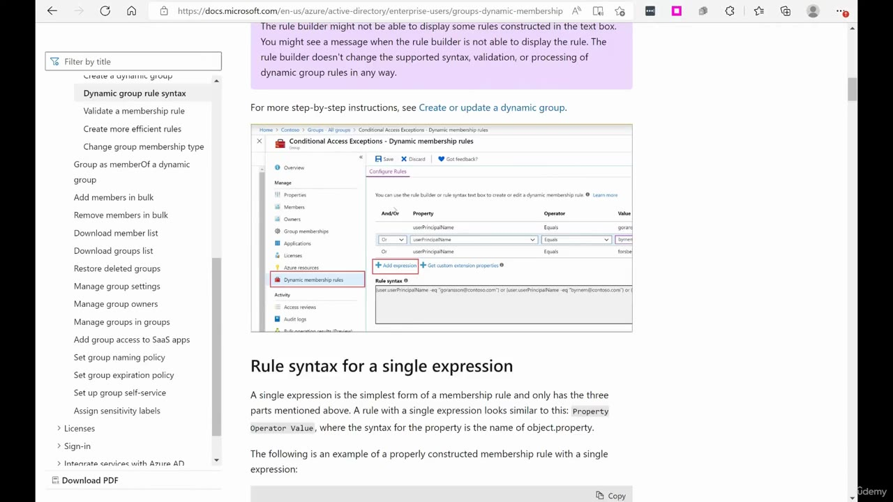

*Figure: 03:20. Further down the same URL. A portal screenshot titled "Conditional Access Exceptions - Dynamic membership rules," then the heading "Rule syntax for a single expression."*

This frame shows:

- A note that the rule builder might not be able to display some rules written in the text box. You might see a message when it cannot display the rule. The note says the builder does not change the supported syntax, validation, or processing of dynamic group rules.
- A link, "Create or update a dynamic group."
- The portal screenshot breadcrumb is Home > Contoso > Groups > All groups > Conditional Access Exceptions > Dynamic membership rules. "Dynamic membership rules" is selected in that portal's left nav.
- The builder columns are And/Or, Property, Operator, and Value. The visible rows are `userPrincipalName` with operator Equals. The first two values begin "gora" and "lynn". The third value is cut off. Under the rows are "Add expression" and "Get custom extension properties," plus a rule-syntax box.
- The heading under the screenshot says a single expression is the simplest membership rule and has three parts: Property, Operator, Value. The property syntax is the name of `object.property`.

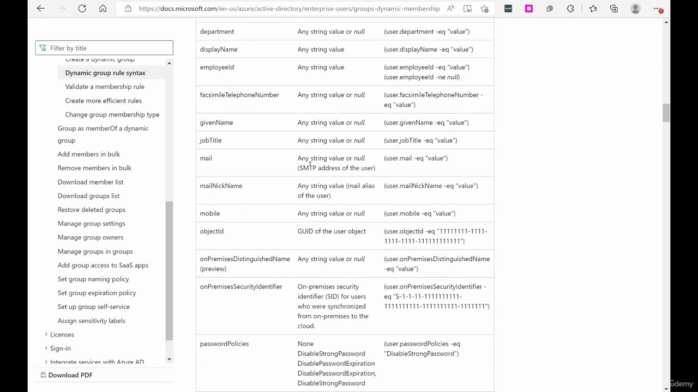

*Figure: 03:22. The same article, scrolled to the property table. Visible rows run from `department` through `passwordPolicies`.*

The table columns are the property, the values it accepts, and an example expression. Rows you can read on this frame include `department`, `displayName`, `employeeId`, `facsimileTelephoneNumber`, `givenName`, `jobTitle`, `mail`, `mailNickName`, `mobile`, `objectId`, `onPremisesDistinguishedName` (marked preview), `onPremisesSecurityIdentifier`, and `passwordPolicies`.

Examples that are readable on the frame:

- `(user.department -eq "value")`
- `(user.objectId -eq "11111111-1111-1111-1111-111111111111")`
- `(user.passwordPolicies -eq "DisableStrongPassword")`

The `passwordPolicies` cell lists None, DisableStrongPassword, and DisablePasswordExpiration. The `mail` cell calls that property the SMTP address of the user. The `onPremisesSecurityIdentifier` cell calls it the on-premises SID for users synchronized to the cloud.

He does not work an example rule. The page is the illustration of a `docs.microsoft.com` article.

<strong>Where the course list lives</strong>

The other question he says he gets often is whether a particular course is out. He says the courses he currently has available are on examlabpractice.com. The caption splits the name into "exam lab practice.com". The address bar is one word. He also says deals sometimes run there, and he tells you to check the site.

He leaves the docs tab by typing that host. Two frames are the address-bar suggestions, still with the property table behind them. They are different suggestion lists.

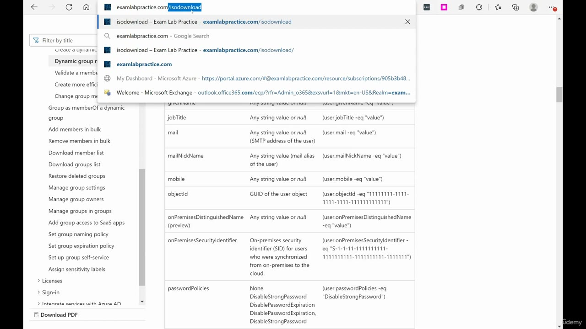

*Figure: 03:54. The bar reads examlabpractice.com/isodownload. Suggestions are that path, a Google result for "isodownload – Exam Lab Practice," the same path again, an Azure portal dashboard for examlabpractice.com, and a Microsoft Exchange welcome link.*

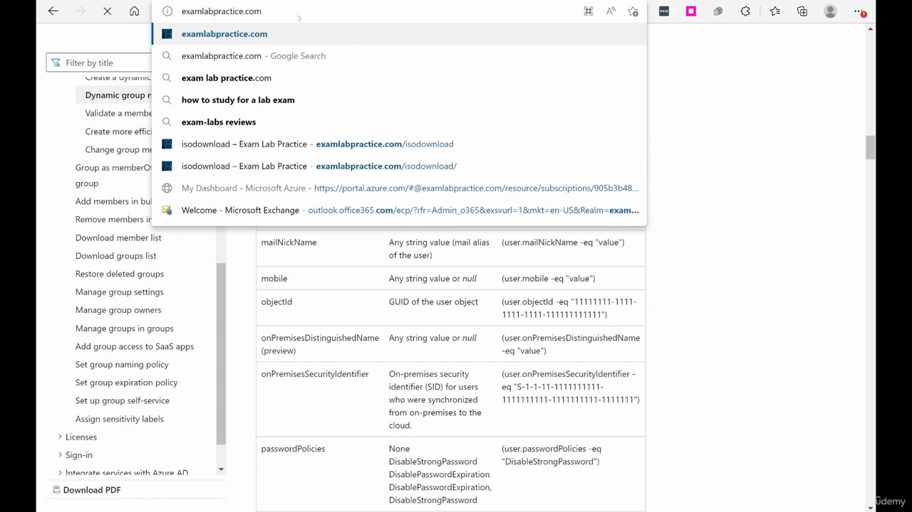

*Figure: 03:56. The bar is examlabpractice.com. New suggestions on this frame include "exam lab practice.com," "how to study for a lab exam," and "exam-labs reviews," then the isodownload hits and the same Azure and Exchange entries.*

The page that loads is the course catalog. The address bar says "Not secure" and examlabpractice.com. He scrolls. These three frames are different bands of that page, so the tiles do not repeat as the same view.

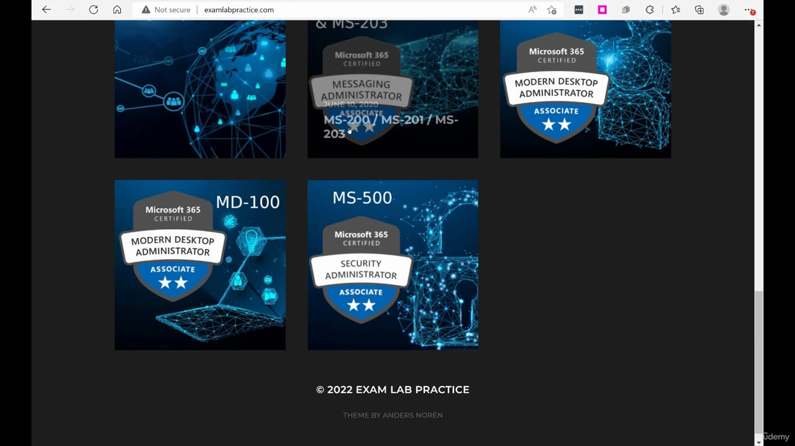

*Figure: 03:58. Bottom of examlabpractice.com. Footer reads "© 2022 EXAM LAB PRACTICE" and "THEME BY ANDERS NORÉN."*

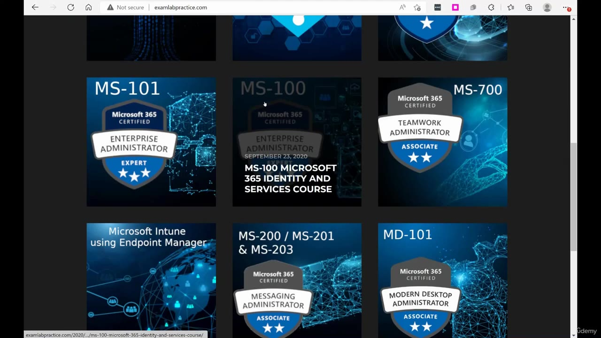

*Figure: 04:00. The pointer is on the MS-100 tile. The status bar shows a 2020 path ending in ms-100-microsoft-365-identity-and-services-course.*

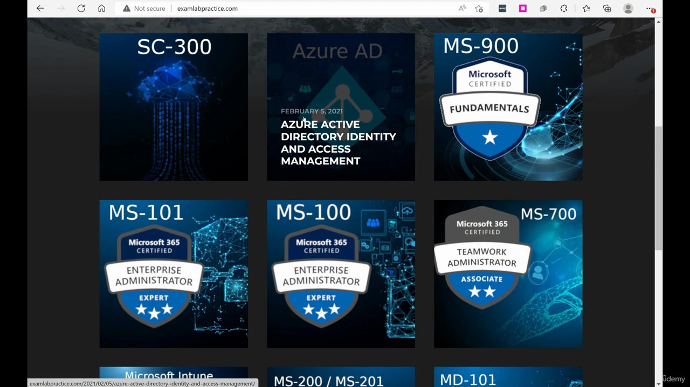

*Figure: 04:02. Higher on the same page. The status bar shows examlabpractice.com/2021/02/05/azure-active-directory-identity-and-access-management/.*

Tiles readable across those three frames:

| Tile | What the tile says | Where it shows |
| --- | --- | --- |
| SC-300 | SC-300 | 04:02 |
| Azure AD | February 5, 2021. "AZURE ACTIVE DIRECTORY IDENTITY AND ACCESS MANAGEMENT" | 04:02, and the status-bar link on that frame |
| MS-900 | Microsoft Certified Fundamentals | 04:02 |
| MS-101 | Microsoft 365 Certified Enterprise Administrator Expert | 04:00 and 04:02 |
| MS-100 | Enterprise Administrator. September 23, 2020. Overlay text: "MS-100 MICROSOFT 365 IDENTITY AND SERVICES COURSE". The 04:02 view of the badge says Expert | 04:00 and 04:02 |
| MS-700 | Microsoft 365 Certified Teamwork Administrator Associate | 04:00 and 04:02 |
| Microsoft Intune using Endpoint Manager | That title | 04:00 |
| MS-200 / MS-201 / MS-203 | Microsoft 365 Certified Messaging Administrator Associate. The 03:58 tile is dated June 10, 2020. The 04:00 tile writes the exams as "MS-200 / MS-201 & MS-203" | 03:58 and 04:00 |
| MD-101 | Microsoft 365 Certified Modern Desktop Administrator Associate | 04:00 |
| MD-100 | Microsoft 365 Certified Modern Desktop Administrator Associate | 03:58 |
| MS-500 | Microsoft 365 Certified Security Administrator Associate | 03:58 |

He does not open a course in this recording. The catalog is the answer to "do you have this course."

<strong>Assignments and the certificate</strong>

The next question he says he gets is that an assignment will not work, or that the certificate is unavailable because the course is not finished. His answer is the assignments video at the beginning of the class. He says that problem means the video was skipped, and that watching it takes care of it.

<strong>Whether the course is updated</strong>

He calls this the second-to-last point. The question is whether the course is updated. He says he works hard to keep the courses updated and that he takes pride in that. He also says he gets the question constantly, and he repeats that he will try to respond as soon as he can.

<strong>Exam questions</strong>

The last point is for a course that leads to an exam. People ask him for exam questions. He says he is not allowed to recommend anything other than Udemy. The reply he sends says to go to Udemy and search for questions there. He says that is the only response he can give, and that he cannot recommend another place.

## Summary

- This same video is in his courses from this point on. Skip it only if you have already watched it.
- Questions go through Udemy. The slide says email does not reach him, and that he is not on LinkedIn or Facebook.
- Tens of thousands of students is the reason a reply can wait. He says he still tries to answer every question.
- For a faster answer, search the topic and open the `docs.microsoft.com` result. The example query on screen is `microsoft 365 dynamic groups`, and the article is the dynamic membership rules page.
- On that page in this recording, a dynamic rule is users or devices, one rule cannot contain both, members are not edited by hand, and the note requires Azure AD Premium P1 or Intune for Education for each unique user in a dynamic group.
- Current courses are listed at examlabpractice.com. The frames show the 2022 catalog, including the Azure AD tile dated February 5, 2021, and he says deals sometimes run there.
- A stuck assignment or a blocked certificate means watch the assignments video at the start of the class.
- He says he keeps the courses updated. Exam-question requests get one answer from him: search Udemy.

## References

- [Lesson video](../../../../../course_videos/Course%20AZ-104%20Microsoft%20Azure%20Administrator%20course%20with%20SIMULATIONS/07%20-%20Questions%20for%20John%20Christopher.mp4)
- [Transcript](../../../../../course_videos/Course%20AZ-104%20Microsoft%20Azure%20Administrator%20course%20with%20SIMULATIONS/07%20-%20Questions%20for%20John%20Christopher.txt)
- [Study guide for Exam AZ-104](https://learn.microsoft.com/en-us/credentials/certifications/resources/study-guides/az-104)
- [Manage rules for dynamic membership groups](https://learn.microsoft.com/en-us/entra/identity/users/groups-dynamic-membership)

## Questions and Answers

<strong>Question 1 — Which courses include this</strong>

How widely does he say he is using this video?

**Answer.** He says it will be in all of his courses from this point on. If you have already seen it, he says you do not have to watch it again.

<strong>Question 2 — The channel for questions</strong>

What does the "How to message me" slide require, and what does it say he cannot use?

**Answer.** Questions have to come through Udemy directly. He cannot receive messages via email. He is not currently on LinkedIn or Facebook, and he says he will announce it if that changes.

<strong>Question 3 — Why patience</strong>

Why does he say a reply may not come quickly?

**Answer.** He says tens of thousands of people are taking his courses at once, so the number of questions is more than he can clear in a short time. He still says he tries to answer every question, and that he will respond as soon as he can.

<strong>Question 4 — Before he writes back</strong>

What does he tell you to do when you want an answer faster than his reply?

**Answer.** Search for the specific topic and open the official Microsoft documentation.

<strong>Question 5 — The example search</strong>

What topic does he name, and what text is in the search box?

**Answer.** He names Microsoft 365 dynamic query based groups. The box contains `microsoft 365 dynamic groups`.

<strong>Question 6 — Which results to open</strong>

Which result headings does he tell you to use?

**Answer.** `docs.microsoft.com`. He calls those the official articles and the latest information.

<strong>Question 7 — How fast Microsoft changes</strong>

What cadence does he give for product changes, and what does he say about re-recording every week?

**Answer.** Week after week. He says buttons change and controls move, and that updating every video every week would still leave him behind.

<strong>Question 8 — After you find the article</strong>

Does he want the docs search to replace messaging him?

**Answer.** He says most of the questions he gets can be answered in those articles. He also says to keep messaging him, and to be patient while you wait.

<strong>Question 9 — The course catalog</strong>

Where does he say the courses he currently offers are listed, and what else does he say you might find there?

**Answer.** examlabpractice.com. The caption splits it into "exam lab practice.com". He says deals sometimes run on that site. This recording shows the catalog whose footer reads © 2022.

<strong>Question 10 — A stuck assignment</strong>

What does he tell you to watch when an assignment fails or the certificate stays locked because the course is not finished?

**Answer.** The assignments video at the beginning of the class. He says the problem means that video was skipped.

<strong>Question 11 — Course updates</strong>

What does he say when students ask if the course is updated?

**Answer.** He says he works hard to keep the courses updated and takes pride in that. He also says he gets the question constantly and will try to reply as soon as he can.

<strong>Question 12 — Practice questions</strong>

What is he allowed to tell you when you ask for exam questions?

**Answer.** Go to Udemy and search for questions there. He says he is not allowed to recommend any other place, and that this is the only reply he can send.

