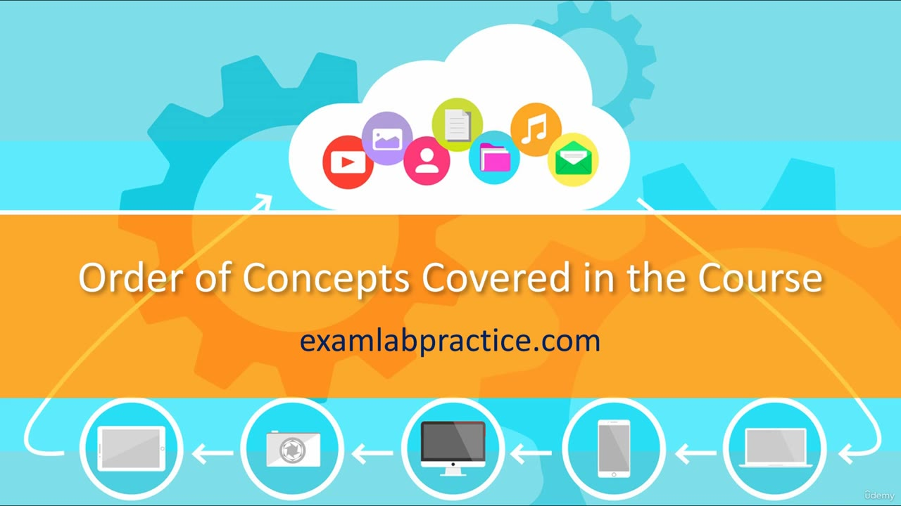

[Back to AZ-104: Microsoft Azure Administrator](../1.md)

# Chapter 8 — Order of concepts covered in the course

## Table of Contents

- [Introduction](#introduction)
- [Detailed tutorial](#detailed-tutorial)
  - [Why the course reorders the objectives](#why-the-course-reorders-the-objectives)
  - [The objective list is not a lesson order](#the-objective-list-is-not-a-lesson-order)
  - [Titles that do not match a single objective](#titles-that-do-not-match-a-single-objective)
- [Summary](#summary)
- [References](#references)
- [Questions and Answers](#questions-and-answers)
  - [Question 1 — The question students ask](#question-1-the-question-students-ask)
  - [Question 2 — Are objectives a syllabus](#question-2-are-objectives-a-syllabus)
  - [Question 3 — What has to come first](#question-3-what-has-to-come-first)
  - [Question 4 — How the written list is arranged](#question-4-how-the-written-list-is-arranged)
  - [Question 5 — Does reordering drop objectives](#question-5-does-reordering-drop-objectives)
  - [Question 6 — Why a title can differ](#question-6-why-a-title-can-differ)
  - [Question 7 — One video, several objectives](#question-7-one-video-several-objectives)
  - [Question 8 — One objective, several videos](#question-8-one-objective-several-videos)
  - [Question 9 — How far back he points](#question-9-how-far-back-he-points)
  - [Question 10 — What you should assume](#question-10-what-you-should-assume)

## Introduction

Students ask why the lessons do not follow the AZ-104 objective list line for line. This lecture answers that. The exam objectives are a list of skills, not a teaching sequence, and a video title may join or split those skills.

## Detailed tutorial

**AZ-104 Microsoft Azure Administrator** · [08 - Order of concepts covered in the course.mp4](../../../../../course_videos/Course%20AZ-104%20Microsoft%20Azure%20Administrator%20course%20with%20SIMULATIONS/08%20-%20Order%20of%20concepts%20covered%20in%20the%20course.mp4) · [Transcript](../../../../../course_videos/Course%20AZ-104%20Microsoft%20Azure%20Administrator%20course%20with%20SIMULATIONS/08%20-%20Order%20of%20concepts%20covered%20in%20the%20course.txt)

<strong>Why the course reorders the objectives</strong>

The question he gets is why the material is not in the same order as the exam objectives. His reason is that the objective list is not arranged as a way to learn the subject. He points back to the 1990s, about twenty years of teaching, and says the order has to be one that helps people understand.

The whole lecture sits on one title card.

*Figure: 00:00. The card reads "Order of Concepts Covered in the Course."*

<strong>The objective list is not a lesson order</strong>

Foundational ideas sometimes have to come before advanced ones. He says the published objectives sometimes put an advanced topic earlier in the list and the basic topic later. Teaching in that written order would not make sense. He still covers the objectives. He covers them in an order he thinks you can follow.

<strong>Titles that do not match a single objective</strong>

A video title may not match one objective line. He says that happens for two reasons:

- One video covers more than one objective.
- One objective is split across more than one video.

The name on the lesson can be slightly different. He says the objectives are still covered.

## Summary

- The exam objective list is not sorted as a learning path.
- Basics come before advanced topics when the written list does the reverse.
- Reordering is not the same as skipping an objective.
- A title can differ because objectives are combined into one video or split across videos.

## References

- [Lesson video](../../../../../course_videos/Course%20AZ-104%20Microsoft%20Azure%20Administrator%20course%20with%20SIMULATIONS/08%20-%20Order%20of%20concepts%20covered%20in%20the%20course.mp4)
- [Transcript](../../../../../course_videos/Course%20AZ-104%20Microsoft%20Azure%20Administrator%20course%20with%20SIMULATIONS/08%20-%20Order%20of%20concepts%20covered%20in%20the%20course.txt)
- [Study guide for Exam AZ-104](https://learn.microsoft.com/en-us/credentials/certifications/resources/study-guides/az-104)

## Questions and Answers

<strong>Question 1 — The question students ask</strong>

What do students keep asking about the lesson order?

**Answer.** Why the course does not follow the exam objectives in the order they are published.

<strong>Question 2 — Are objectives a syllabus</strong>

Does he treat the exam objectives as an order you should learn in?

**Answer.** No. He says they are not put in an order related to how you should learn the material.

<strong>Question 3 — What has to come first</strong>

What does he say you sometimes have to explain before the advanced topics?

**Answer.** The basic foundational concepts.

<strong>Question 4 — How the written list is arranged</strong>

What does he say is wrong with following the objective list from top to bottom?

**Answer.** Advanced concepts sometimes appear earlier in the list than the basic concepts they depend on.

<strong>Question 5 — Does reordering drop objectives</strong>

Does he say a changed order means an objective is left out?

**Answer.** No. He says he covers the test objectives, in an order that makes sense for learning.

<strong>Question 6 — Why a title can differ</strong>

Why might a video title not match the wording of an objective?

**Answer.** He sometimes renames a lesson slightly because he groups or splits objectives.

<strong>Question 7 — One video, several objectives</strong>

What is one way he combines the written objectives?

**Answer.** He covers more than one objective in a single video.

<strong>Question 8 — One objective, several videos</strong>

What is the other way a title drifts from the objective line?

**Answer.** He breaks one objective into separate videos.

<strong>Question 9 — How far back he points</strong>

How far back does he place the teaching experience he uses to justify the order?

**Answer.** Into the 1990s. He describes it as twenty-some years. The sentence in the transcript is broken, but that is the span he gives.

<strong>Question 10 — What you should assume</strong>

What does he want you to assume when a title looks different?

**Answer.** The objectives still get covered, in an order meant to be understandable.

