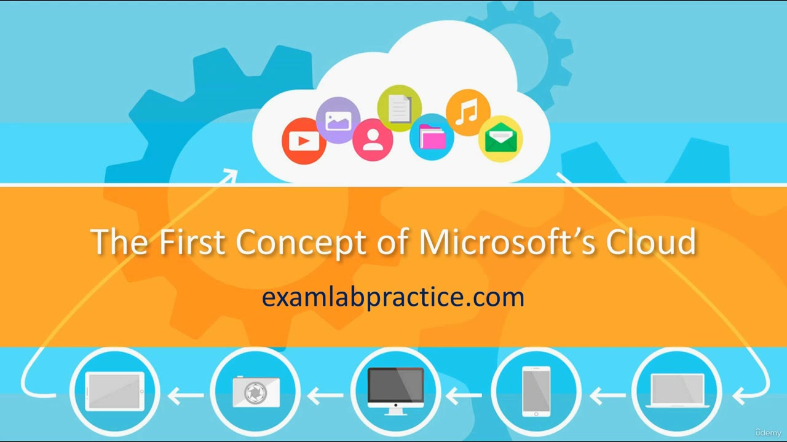

[Back to AZ-104: Microsoft Azure Administrator](../1.md)

# Chapter 9 — DO NOT SKIP The first thing to know about working with Microsoft Cloud Services

## Table of Contents

- [Introduction](#introduction)
- [Detailed tutorial](#detailed-tutorial)
  - [Cloud changes faster than Windows Server](#cloud-changes-faster-than-windows-server)
  - [Buttons move and names change](#buttons-move-and-names-change)
  - [You will have to hunt](#you-will-have-to-hunt)
- [Summary](#summary)
- [References](#references)
- [Questions and Answers](#questions-and-answers)
  - [Question 1 — The first concept](#question-1-the-first-concept)
  - [Question 2 — Compared with twenty years ago](#question-2-compared-with-twenty-years-ago)
  - [Question 3 — Windows Server cadence](#question-3-windows-server-cadence)
  - [Question 4 — How fast the cloud moves](#question-4-how-fast-the-cloud-moves)
  - [Question 5 — What moves in the portal](#question-5-what-moves-in-the-portal)
  - [Question 6 — Can you track every change](#question-6-can-you-track-every-change)
  - [Question 7 — What he asks you to do](#question-7-what-he-asks-you-to-do)
  - [Question 8 — What gets renamed](#question-8-what-gets-renamed)
  - [Question 9 — What to get used to](#question-9-what-to-get-used-to)
  - [Question 10 — Why the video is tagged](#question-10-why-the-video-is-tagged)

## Introduction

The first working idea in the Microsoft cloud, as this course frames it, is that the portal does not sit still. Buttons move, names change, and a weekly difference is normal. The lecture is tagged DO NOT SKIP so that later labs are not a surprise when the screen no longer matches an older screenshot.

## Detailed tutorial

**AZ-104 Microsoft Azure Administrator** · [09 - DO NOT SKIP The first thing to know about working with Microsoft Cloud Services.mp4](../../../../../course_videos/Course%20AZ-104%20Microsoft%20Azure%20Administrator%20course%20with%20SIMULATIONS/09%20-%20DO%20NOT%20SKIP%20The%20first%20thing%20to%20know%20about%20working%20with%20Microsoft%20Cloud%20Services.mp4) · [Transcript](../../../../../course_videos/Course%20AZ-104%20Microsoft%20Azure%20Administrator%20course%20with%20SIMULATIONS/09%20-%20DO%20NOT%20SKIP%20The%20first%20thing%20to%20know%20about%20working%20with%20Microsoft%20Cloud%20Services.txt)

<strong>Cloud changes faster than Windows Server</strong>

He has been in IT for over 20 years. He says IT has always changed, and the cloud is the stretch where that change is constant. Windows Server, in his comparison, had a big change about every three years. In Azure or Microsoft 365, something can change from week to week.

The slide never leaves the title.

*Figure: 00:00. The card reads "The First Concept of Microsoft's Cloud."*

<strong>Buttons move and names change</strong>

The example is a button. One week it is in one place in Azure or Microsoft 365. The next week it has moved. He also says buttons change and things get renamed. Staying current with every small change is, in his words, impossible, including for the course itself.

<strong>You will have to hunt</strong>

He wants that treated as part of the service, not as a broken lesson. You will have to hunt for a control. He says he tries to keep the course current and that you can contact him when something large has changed. The sooner the moving target feels normal, the less time you lose looking for a button that was renamed.

## Summary

- The first cloud concept in this lecture is that things change constantly.
- A Windows Server-style change about every three years is the contrast. Cloud UI can change week to week.
- Buttons move and features get renamed. You will have to search.
- He asks to be told about large changes. He does not claim the course catches every one.

## References

- [Lesson video](../../../../../course_videos/Course%20AZ-104%20Microsoft%20Azure%20Administrator%20course%20with%20SIMULATIONS/09%20-%20DO%20NOT%20SKIP%20The%20first%20thing%20to%20know%20about%20working%20with%20Microsoft%20Cloud%20Services.mp4)
- [Transcript](../../../../../course_videos/Course%20AZ-104%20Microsoft%20Azure%20Administrator%20course%20with%20SIMULATIONS/09%20-%20DO%20NOT%20SKIP%20The%20first%20thing%20to%20know%20about%20working%20with%20Microsoft%20Cloud%20Services.txt)
- [Study guide for Exam AZ-104](https://learn.microsoft.com/en-us/credentials/certifications/resources/study-guides/az-104)
- [AZ-104: Prerequisites for Azure administrators](https://learn.microsoft.com/en-us/training/paths/az-104-administrator-prerequisites/)

## Questions and Answers

<strong>Question 1 — The first concept</strong>

What does he call the first concept of Microsoft's cloud?

**Answer.** Things are constantly changing.

<strong>Question 2 — Compared with twenty years ago</strong>

How does he contrast the cloud with IT as it was 20 years ago?

**Answer.** He has been in IT for over 20 years and says the cloud is where change became constant, week to week, rather than occasional.

<strong>Question 3 — Windows Server cadence</strong>

What change cadence does he give for Windows Server?

**Answer.** About every three years, something big might change.

<strong>Question 4 — How fast the cloud moves</strong>

How often does he say a cloud control can move?

**Answer.** From week to week. A button can be in one place one week and somewhere else the next.

<strong>Question 5 — What moves in the portal</strong>

Which products does he use for the moving-button example?

**Answer.** Azure or Microsoft 365.

<strong>Question 6 — Can you track every change</strong>

Does he say you can stay on top of every cloud change?

**Answer.** No. He calls it impossible, including for himself and for the course.

<strong>Question 7 — What he asks you to do</strong>

What does he invite you to do when you notice a change, especially a large one?

**Answer.** Get in touch with him and tell him.

<strong>Question 8 — What gets renamed</strong>

Besides a button moving, what else does he say will change?

**Answer.** Buttons themselves change, and things get renamed.

<strong>Question 9 — What to get used to</strong>

What skill does he say you need once you accept that the portal moves?

**Answer.** You will have to hunt for things.

<strong>Question 10 — Why the video is tagged</strong>

Why is this filed as something not to skip?

**Answer.** It is the first concept he wants in place before you work in Microsoft's cloud: the interface keeps changing, and that is normal.

