[Back to AZ-104: Microsoft Azure Administrator](../1.md)

# Chapter 11 — IMPORTANT Using Assignments in the course

## Table of Contents

- [Introduction](#introduction)
- [Detailed tutorial](#detailed-tutorial)
  - [Assignments are where the simulations are](#assignments-are-where-the-simulations-are)
  - [Start the assignment and read it first](#start-the-assignment-and-read-it-first)
  - [Open the simulation in a new tab](#open-the-simulation-in-a-new-tab)
  - [Click through the storage account](#click-through-the-storage-account)
  - [Create the blob container](#create-the-blob-container)
  - [Close the tab and submit](#close-the-tab-and-submit)
  - [The checkbox and the certificate](#the-checkbox-and-the-certificate)
  - [If something is wrong with the course](#if-something-is-wrong-with-the-course)
- [Summary](#summary)
- [References](#references)
- [Questions and Answers](#questions-and-answers)
  - [Question 1 — Where the simulations are](#question-1-where-the-simulations-are)
  - [Question 2 — What people report after they finish](#question-2-what-people-report-after-they-finish)
  - [Question 3 — What the assignment tells you to create](#question-3-what-the-assignment-tells-you-to-create)
  - [Question 4 — Which button starts it](#question-4-which-button-starts-it)
  - [Question 5 — How to open the simulation link](#question-5-how-to-open-the-simulation-link)
  - [Question 6 — Why he wants a separate tab](#question-6-why-he-wants-a-separate-tab)
  - [Question 7 — Where the first simulation screen says the work happens](#question-7-where-the-first-simulation-screen-says-the-work-happens)
  - [Question 8 — What to do when the simulation says you are done](#question-8-what-to-do-when-the-simulation-says-you-are-done)
  - [Question 9 — Which redundancy the filled form uses](#question-9-which-redundancy-the-filled-form-uses)
  - [Question 10 — What he names the container](#question-10-what-he-names-the-container)
  - [Question 11 — What he puts in the submission](#question-11-what-he-puts-in-the-submission)
  - [Question 12 — Whether the checkbox controls the certificate](#question-12-whether-the-checkbox-controls-the-certificate)

## Introduction

Assignments are where the simulations in this course sit. This lecture is the checkout path: start the assignment, open the simulation in a new tab, close that tab, answer the question, and submit. The example on screen is Assignment 1, a storage account that uses locally redundant storage and a blob container. He clicks through the portal quickly and says the later lessons explain those clicks. The second half is his request that you contact him when something is wrong.

## Detailed tutorial

**AZ-104 Microsoft Azure Administrator** · [11 - IMPORTANT Using Assignments in the course.mp4](../../../../../course_videos/Course%20AZ-104%20Microsoft%20Azure%20Administrator%20course%20with%20SIMULATIONS/11%20-%20IMPORTANT%20Using%20Assignments%20in%20the%20course.mp4) · [Transcript](../../../../../course_videos/Course%20AZ-104%20Microsoft%20Azure%20Administrator%20course%20with%20SIMULATIONS/11%20-%20IMPORTANT%20Using%20Assignments%20in%20the%20course.txt)

<strong>Assignments are where the simulations are</strong>

He stops before the course work and says you need the assignment mechanic. The simulations are the assignments. They show up through the course so you can practice. The problem he is answering is a finished simulation that never checks the assignment off.

The item open in course content is Assignment 1. Udemy estimates 5 minutes. The task under the title is: create a storage account that uses LRS, then create a blob container called "images".

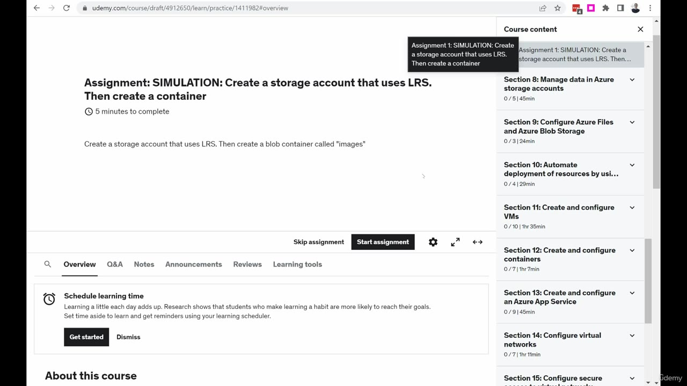

*Figure: 00:00. The assignment overview. Course content is open on Assignment 1. Skip assignment and Start assignment sit on the bar. The task names the container "images".*

<strong>Start the assignment and read it first</strong>

He clicks **Start assignment**. The step bar is Instructions, Submission, Instructor example, and Give feedback. Instructions is the selected step, and he says to read that block before the link.

The instructions say:

- If the assignment will not check out after you finish, watch his assignments video again at the beginning of the course.
- You do not need to complete the assignment to complete the course and get a Udemy certificate.
- Right-click the hyperlink and open it in a new browser tab.

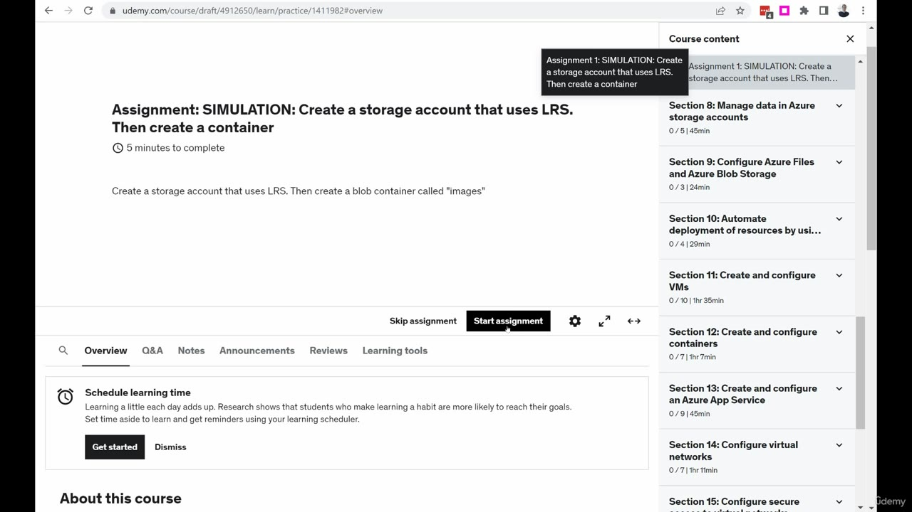

*Figure: 00:32. The same overview, with the pointer on Start assignment.*

<strong>Open the simulation in a new tab</strong>

The link label is **CLICK HERE**. He right-clicks it and chooses **Open link in new tab**. The status bar shows the iorad player for this task, player 2038014.

He wants the new tab because he cannot host the simulations on Udemy, and the simulation site cannot send you back to this assignment page. The order is: open the new tab, do the simulation, close that tab, and the assignment is still there.

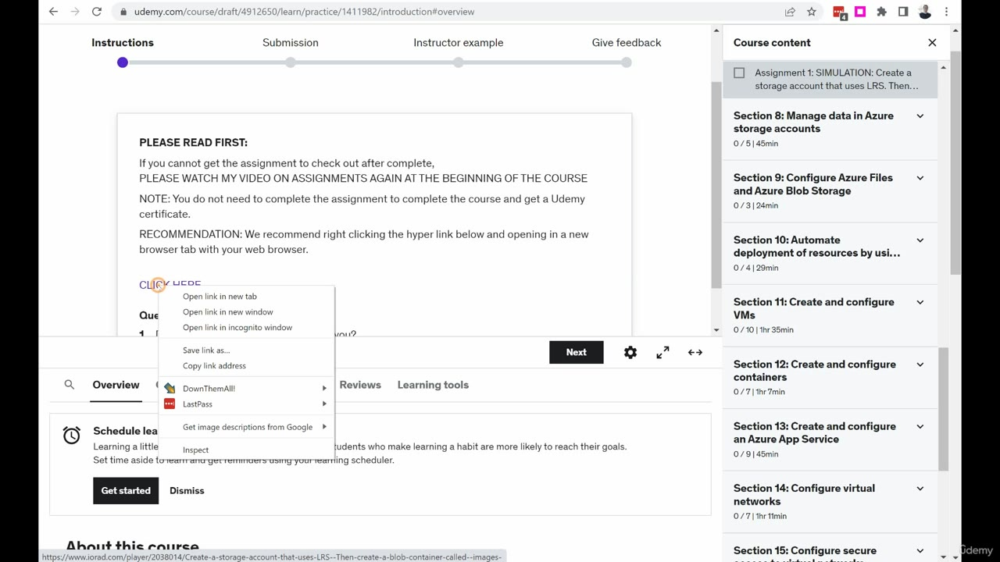

*Figure: 00:42. Instructions, with the context menu open on CLICK HERE. Open link in new tab is the first item. The note about the Udemy certificate is on the same page.*

The new tab is an iorad player dated Oct 2022 by examlabpractice. The side panel repeats the task and says 22 steps, about 1 minute. He clicks **Start**.

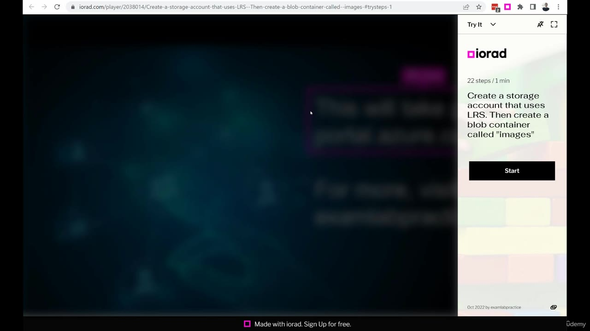

*Figure: 01:12. The simulation tab. Start is on the right. The footer says Made with iorad.*

The first click is the splash. It says the work takes place at portal.azure.com, and it points to examlabpractice.com. The counter on this frame is step 2 of 22. The prompt says Click highlight.

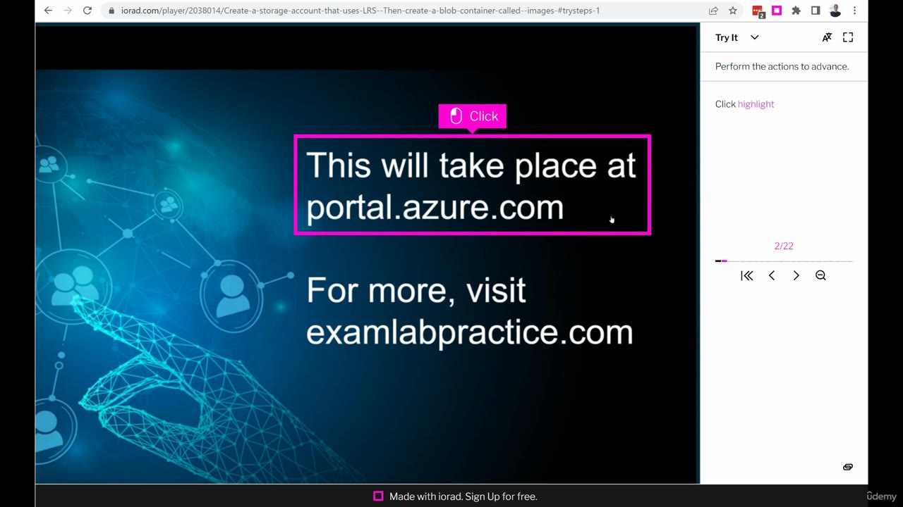

*Figure: 01:14. The highlighted line is portal.azure.com. The prompt is Click highlight. Step 2 of 22.*

He says he is only clicking through. In the course itself he explains the clicks. If the portal is unfamiliar here, the later storage lessons are where he teaches them.

<strong>Click through the storage account</strong>

The captured stills are the distinct screens. He moves fast, so some of the 22 steps never get their own frame. Each block below is a step that is actually on a still. Status-bar wait text is ignored.

The portal home is up. The prompt is **Click All services**. The left nav shows Home, Dashboard, All services, and the favorites list. The home canvas is the Azure getting-started quickstart.

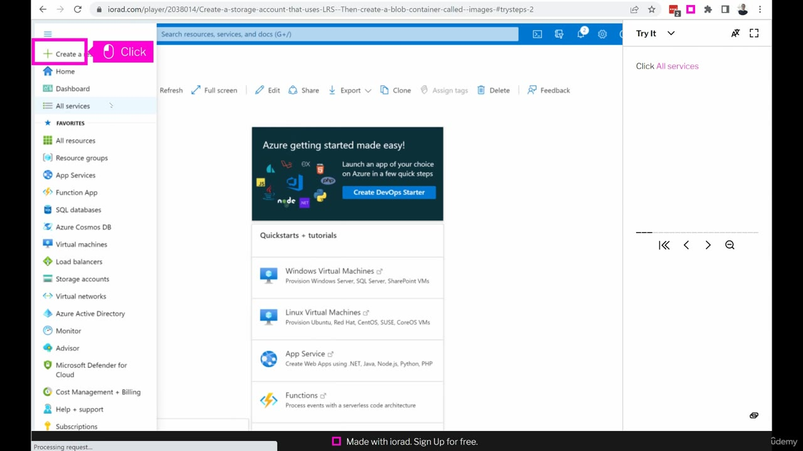

*Figure: 01:16. Azure portal home inside the player. The step prompt is Click All services.*

The next still is the storage accounts list. Visible resource groups include ARMDemo and StorageAcctDemo, with locations in East US and South Central US. The prompt is **Click Create**.

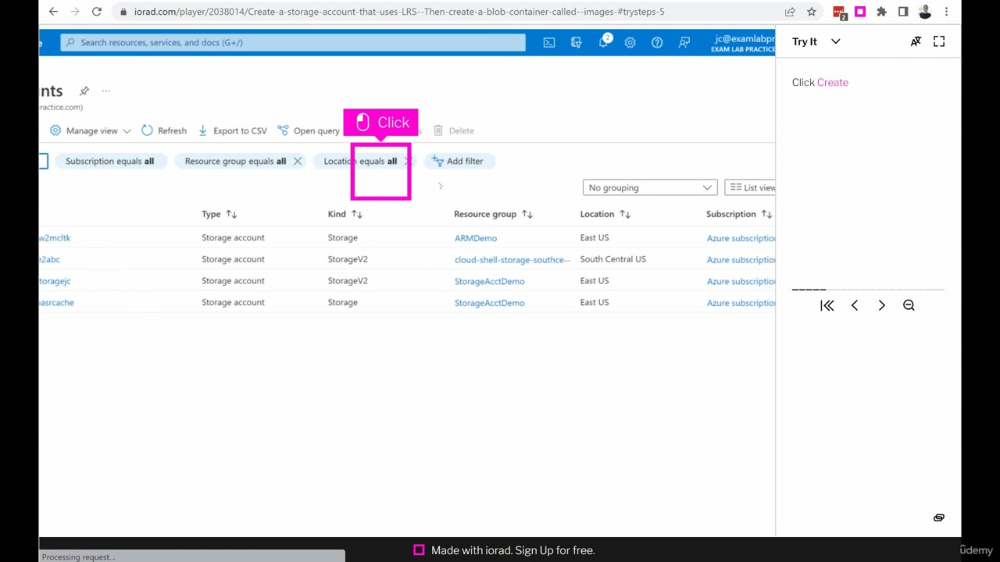

*Figure: 01:18. The storage accounts blade. The prompt is Click Create.*

**Create a storage account** opens on the Basics tab. Subscription is Azure subscription 1. The prompt is **Click Resource group**. The resource group control on this frame shows ARMDemo. Region is already (US) East US.

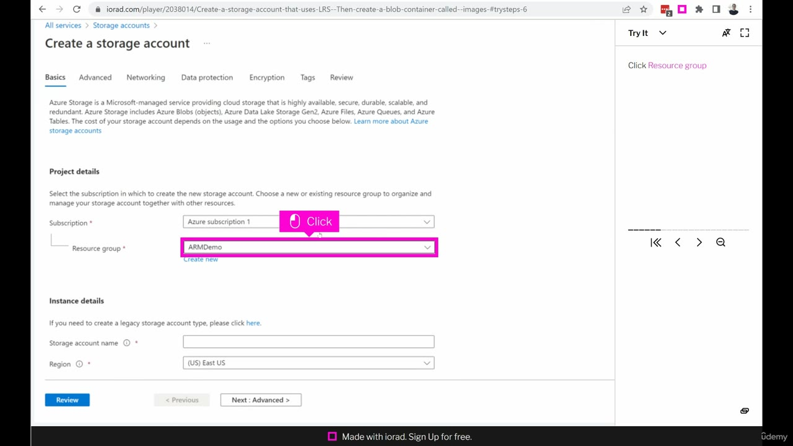

*Figure: 01:20. Basics. The resource group control shows ARMDemo. The prompt is Click Resource group.*

On the next frame the resource group control shows StorageAcctDemo, and the prompt has moved to **Click Storage account name**. The name box is empty. Region is still (US) East US.

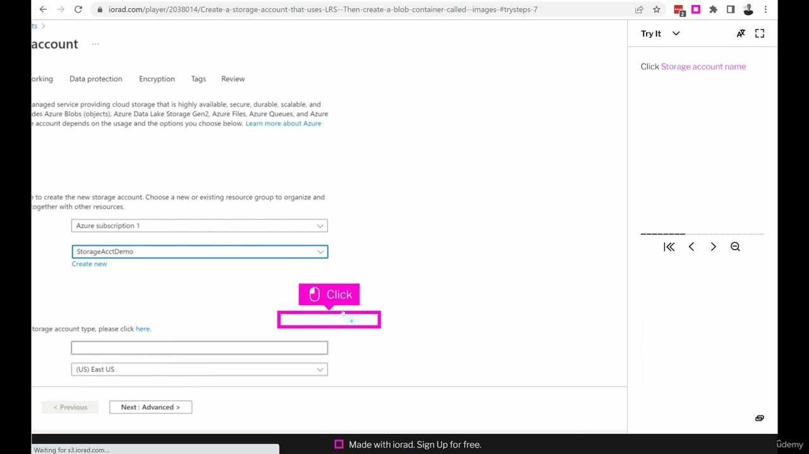

*Figure: 01:22. The name field is the click. Resource group now reads StorageAcctDemo.*

The redundancy list is open. The prompt is **Click highlight**. The rows on screen are locally redundant storage (LRS), geo-redundant storage (GRS), zone-redundant storage (ZRS), and geo-zone-redundant storage. The LRS row calls it the lowest-cost option, with basic protection against server rack and drive failures, recommended for non-critical scenarios.

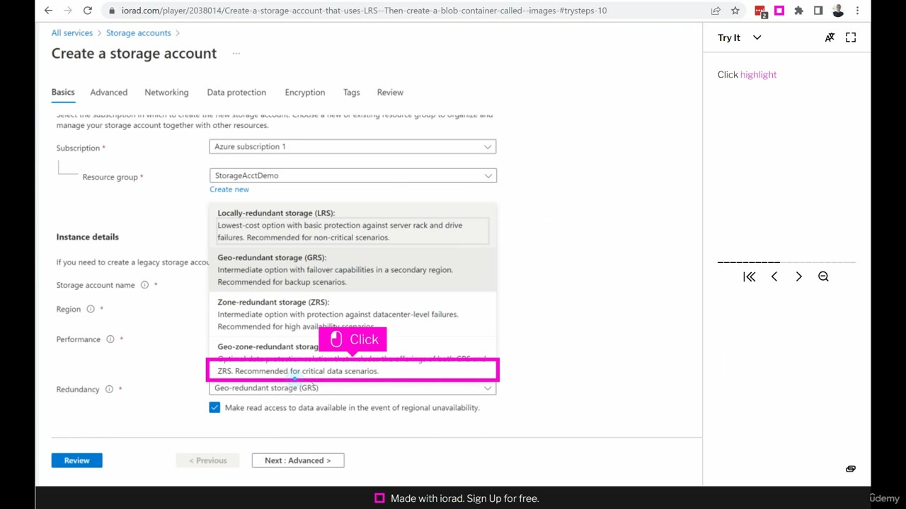

*Figure: 01:24. The redundancy menu on Basics. The prompt is Click highlight.*

The filled Basics blade is the result of that pass. He then scrolls up. The prompt is **Scroll up and click Next: Advanced**.

| Field | Value on this frame |
| --- | --- |
| Subscription | Azure subscription 1 |
| Resource group | StorageAcctDemo |
| Storage account name | mystorageelp |
| Region | (US) East US |
| Performance | Standard (general-purpose v2) |
| Redundancy | Locally-redundant storage (LRS) |

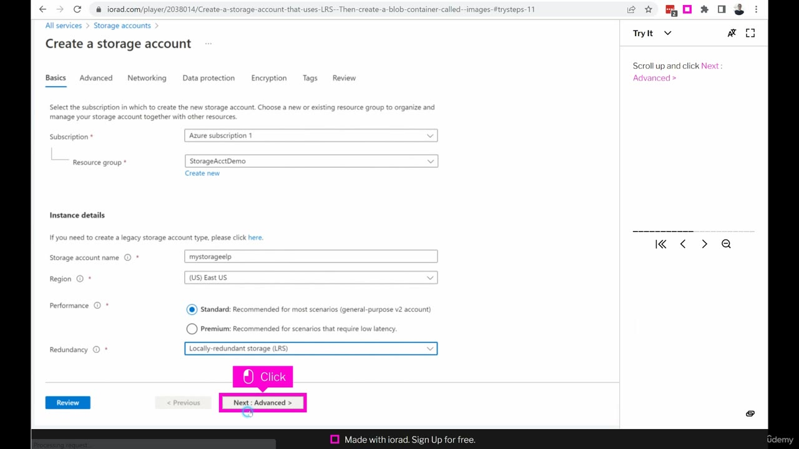

*Figure: 01:26. Name mystorageelp, Standard, LRS. The click is Next: Advanced.*

The next captured blade is **Data protection**. He does not change the checkboxes. The prompt is **Click Next: Encryption**.

| Setting | State on this frame |
| --- | --- |
| Point-in-time restore for containers | Clear |
| Soft delete for blobs | Checked, retain 7 days |
| Soft delete for containers | Checked, retain 7 days |
| Soft delete for file shares | Checked, retain 7 days |

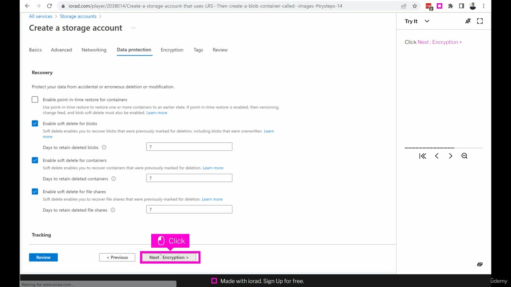

*Figure: 01:28. Data protection left as shown. The click is Next: Encryption.*

The next captured blade is **Review**. He clicks **Create**.

Basics on the review:

| Field | Value |
| --- | --- |
| Subscription | Azure subscription 1 |
| Resource group | StorageAcctDemo |
| Location | eastus |
| Storage account name | mystorageelp |
| Deployment model | Resource manager |
| Performance | Standard |
| Replication | Locally-redundant storage (LRS) |

Advanced on the same review:

| Field | Value |
| --- | --- |
| Secure transfer | Enabled |
| Allow storage account key access | Enabled |
| Allow cross-tenant replication | Enabled |
| Default to Azure Active Directory authorization in the Azure portal | Disabled |
| Blob public access | Enabled |
| Minimum TLS version | Version 1.2 |
| Permitted scope for copy operations | From any storage account |

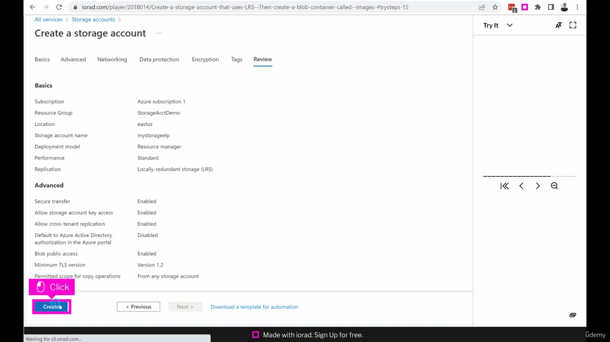

*Figure: 01:30. Review for mystorageelp. Replication is LRS. The click is Create.*

The account overview opens for **mystorageelp**. Essentials match the review: resource group StorageAcctDemo, location East US, performance Standard, replication locally redundant storage, account kind StorageV2 (general purpose v2), provisioning state Succeeded, created 10/18/2022, 12:44:41 PM. The prompt is **Click Containers**.

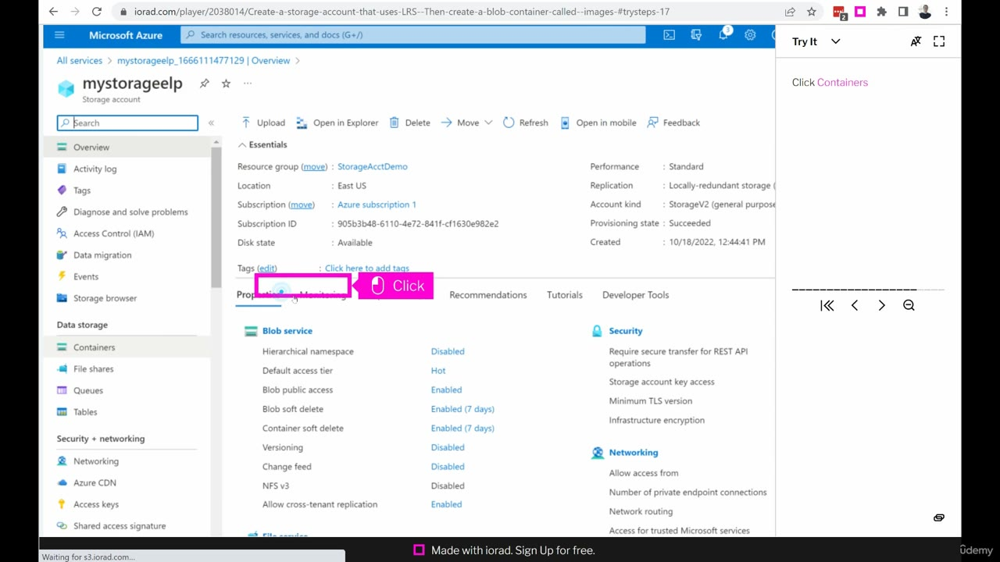

*Figure: 01:32. The new account overview. The prompt is Click Containers, under Data storage.*

<strong>Create the blob container</strong>

The containers blade already lists **$logs**, last modified 10/18/2022, 12:45:04 PM, public access Private. A New container pane is opening on the right. The prompt is **Click Name**.

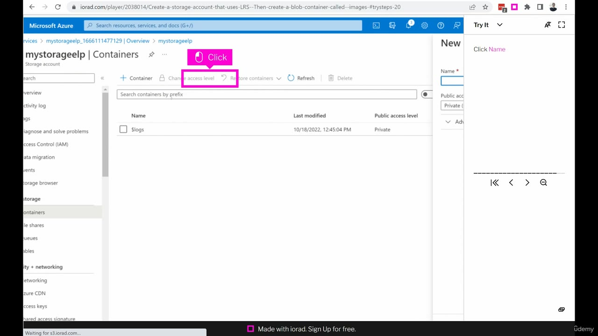

*Figure: 01:34. Containers for mystorageelp. $logs is Private. The prompt is Click Name.*

The New container pane is filled. Name is **images**. Public access level is **Private (no anonymous access)**. The prompt is **Click Create**.

That private container is a different setting from the review blade, where blob public access on the account is Enabled. The container he creates here is Private.

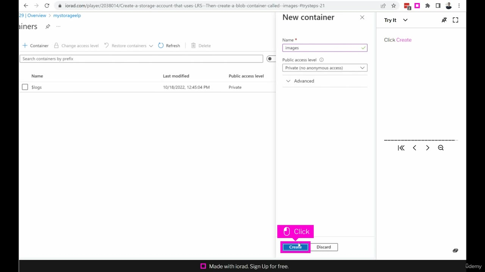

*Figure: 01:36. Name images, public access Private. The click is Create.*

<strong>Close the tab and submit</strong>

He says the simulation ends on a congratulations screen: you completed a simulation, and you can close this browser tab. That screen is not one of the stills. Closing the tab is what returns you to the assignment.

Back on Udemy, Instructions is still the selected step. The question is there: did the simulation work smoothly for you? Assignment 1 in course content is still an empty box. He clicks **Next**.

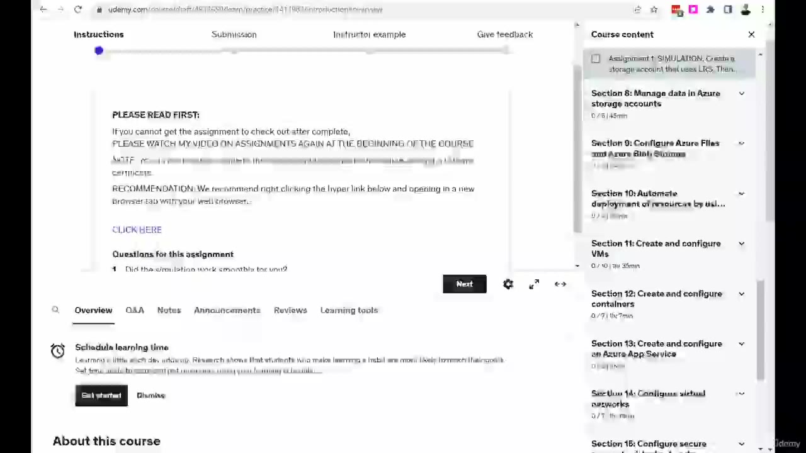

*Figure: 01:46. The assignment page after the simulation tab is closed. The smoothness question is on Instructions. Next is the black button. The assignment checkbox is empty.*

On Submission he types **yes**. The sharing box is checked: yes, he wants feedback from fellow students. **Submit** opens a confirm dialog: you will no longer be able to edit after you submit. He clicks **Submit** on that dialog.

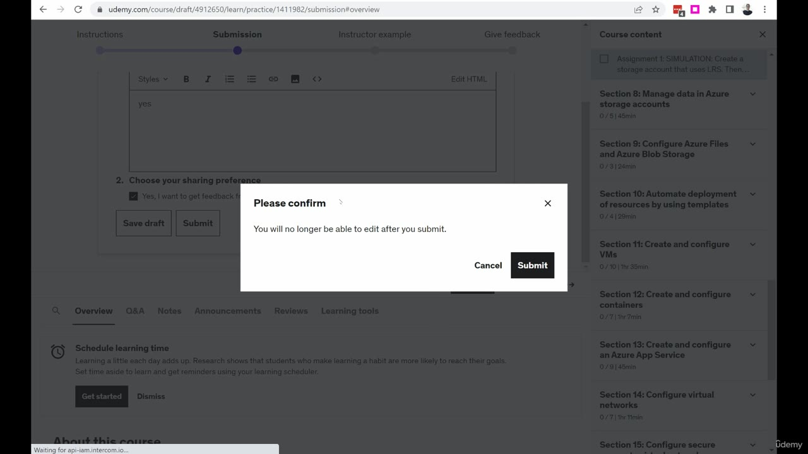

*Figure: 02:04. Submission. The editor contains yes. The dialog says you will no longer be able to edit after you submit. Submit is the black button.*

The page then shows **Assignment submitted**. A toast says the answer has been successfully submitted.

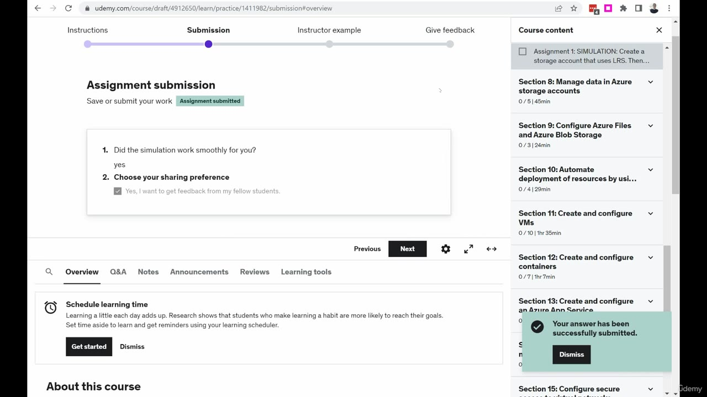

*Figure: 02:06. The badge says Assignment submitted. The answer on the page is yes. The toast is "Your answer has been successfully submitted."*

<strong>The checkbox and the certificate</strong>

He says to refresh the browser. When the submit went through, the assignment checkbox should fill in.

On the still after the toast is gone, Assignment 1 is still an empty box. He has seen Udemy leave that box empty. His rule for that bug: the Udemy certificate still follows the videos. When every video is checked off, an empty assignment box does not hold the certificate. The same sentence is already on the instructions page: you do not need to complete the assignment to complete the course and get a Udemy certificate.

If the assignment will not check out, the instructions send you back to this video at the beginning of the course.

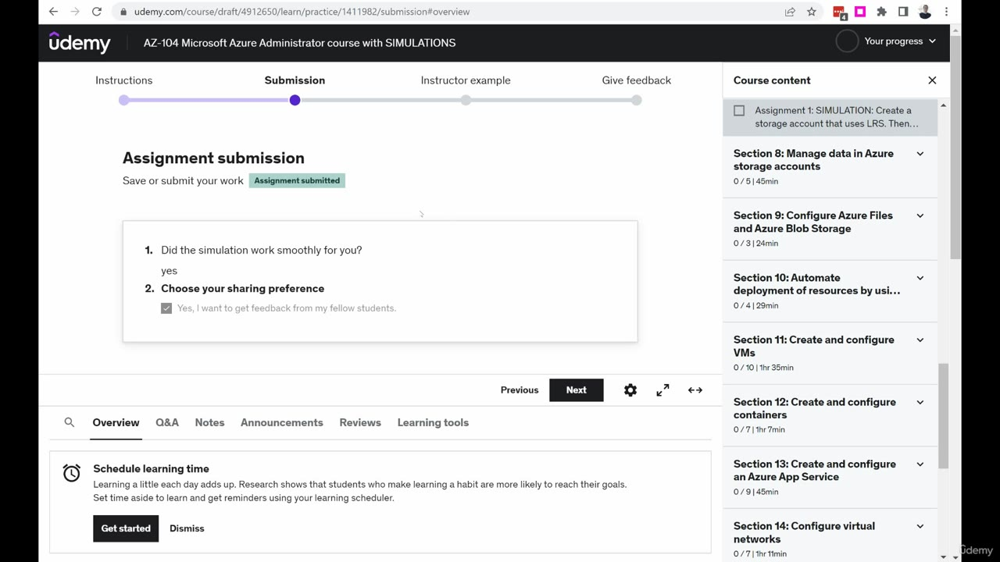

*Figure: 02:40. The same submitted page after the toast. Course content still shows an empty box on Assignment 1. The header is the AZ-104 course with simulations.*

<strong>If something is wrong with the course</strong>

The rest of the lecture stays on that submitted page. He asks for one thing in return for the simulations.

He says the simulations are the reason he points people to examlabpractice.com, and that exam courses now include a hands-on portion these sims are meant to practice. He also says the portal changes from week to week, and that keeping the courses current matters to him.

If you are unhappy, or stuck, he wants you to contact him. He wants an honest rating, and he wants a chance to fix a problem before a rating is the first time he hears about it. He says a bad rating hurts the course, including ones he considers unfounded, and that some of those complaints are small things he can correct.

## Summary

- The simulations are the assignments. They appear through the course so you can practice the clicks.
- On this recording the sample is Assignment 1: an LRS storage account, then a blob container named images. Udemy lists it as 5 minutes.
- Start assignment, read the note, right-click CLICK HERE, and open the iorad player in a new tab. Close that tab when the simulation says you are done.
- The pass he clicks creates mystorageelp in StorageAcctDemo, East US, Standard, LRS, then a private container named images.
- Type yes, submit, and confirm. Refresh so the checkbox can fill in.
- The Udemy certificate follows the videos. An empty assignment box still leaves the certificate available. If checkout fails, rewatch this lecture.
- If something in the course is wrong, he wants you to tell him and give him a chance to fix it.

## References

- [Lesson video](../../../../../course_videos/Course%20AZ-104%20Microsoft%20Azure%20Administrator%20course%20with%20SIMULATIONS/11%20-%20IMPORTANT%20Using%20Assignments%20in%20the%20course.mp4)
- [Transcript](../../../../../course_videos/Course%20AZ-104%20Microsoft%20Azure%20Administrator%20course%20with%20SIMULATIONS/11%20-%20IMPORTANT%20Using%20Assignments%20in%20the%20course.txt)
- [Study guide for Exam AZ-104](https://learn.microsoft.com/en-us/credentials/certifications/resources/study-guides/az-104)
- [Create a storage account](https://learn.microsoft.com/en-us/azure/storage/common/storage-account-create)
- [Data redundancy](https://learn.microsoft.com/en-us/azure/storage/common/storage-redundancy)
- [Manage blob containers in the portal](https://learn.microsoft.com/en-us/azure/storage/blobs/blob-containers-portal)
- [Simulation opened in the video](https://www.iorad.com/player/2038014/Create-a-storage-account-that-uses-LRS--Then-create-a-blob-container-called--images-)

## Questions and Answers

<strong>Question 1 — Where the simulations are</strong>

Where does he say you will practice the simulations in this course?

**Answer.** In the assignments. They show up periodically so you can practice.

<strong>Question 2 — What people report after they finish</strong>

What do people complain fails to happen after they finish a simulation?

**Answer.** The assignment does not get checked off.

<strong>Question 3 — What the assignment tells you to create</strong>

What does the Assignment 1 task tell you to create?

**Answer.** A storage account that uses LRS, then a blob container called "images". Udemy estimates 5 minutes.

<strong>Question 4 — Which button starts it</strong>

Which button does he click on the assignment overview?

**Answer.** Start assignment.

<strong>Question 5 — How to open the simulation link</strong>

What do the instructions tell you to do with CLICK HERE?

**Answer.** Right-click it and open it in a new browser tab.

<strong>Question 6 — Why he wants a separate tab</strong>

Why does he say the simulation has to run in its own tab?

**Answer.** He cannot host the simulations on Udemy, and the simulation site cannot redirect you back to the assignment page. You do the simulation in the new tab, close that tab, and the assignment is still on screen.

<strong>Question 7 — Where the first simulation screen says the work happens</strong>

The splash says this task will take place at which site, and which site does it tell you to visit for more?

**Answer.** portal.azure.com. The same screen says to visit examlabpractice.com. The player is iorad, 22 steps, about 1 minute, dated Oct 2022 by examlabpractice.

<strong>Question 8 — What to do when the simulation says you are done</strong>

What does he say the last simulation screen tells you to do?

**Answer.** Close the browser tab. The screen says congratulations, you completed a simulation, and you can close this browser tab. That brings you back to the assignment.

<strong>Question 9 — Which redundancy the filled form uses</strong>

On the Basics blade he advances with Next: Advanced, which redundancy is selected, and what are the name, region, performance, and resource group?

**Answer.** Locally-redundant storage (LRS). The name is mystorageelp, the region is (US) East US, performance is Standard, and the resource group is StorageAcctDemo. The review blade repeats replication as LRS, location eastus, deployment model Resource manager.

<strong>Question 10 — What he names the container</strong>

What name is in the New container pane, and which public access level is selected when he clicks Create?

**Answer.** images, with Private (no anonymous access). The containers list already shows $logs as Private. On the storage account review, blob public access for the account is Enabled.

<strong>Question 11 — What he puts in the submission</strong>

After he is back on the assignment, what does he enter, and what does the confirm dialog tell him?

**Answer.** He clicks Next, types yes for "Did the simulation work smoothly for you?", and submits. The dialog says you will no longer be able to edit after you submit. The page then shows Assignment submitted.

<strong>Question 12 — Whether the checkbox controls the certificate</strong>

If Assignment 1 stays unchecked after you submit, what does he say about the Udemy certificate?

**Answer.** The certificate still follows the videos. When the videos are checked off, an empty assignment box does not block it. Refreshing should fill the box when the submit worked. The instructions say you do not need to complete the assignment to complete the course and get a Udemy certificate, and they send you back to this video if checkout fails.

