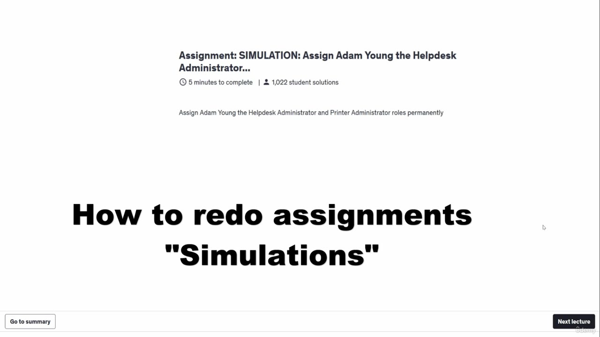
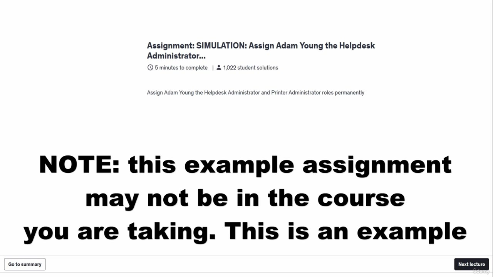
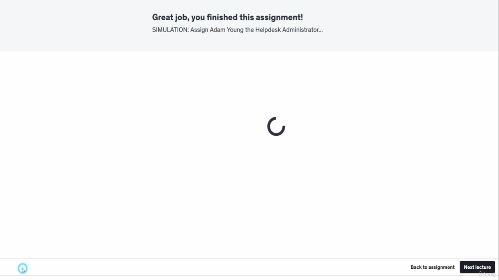
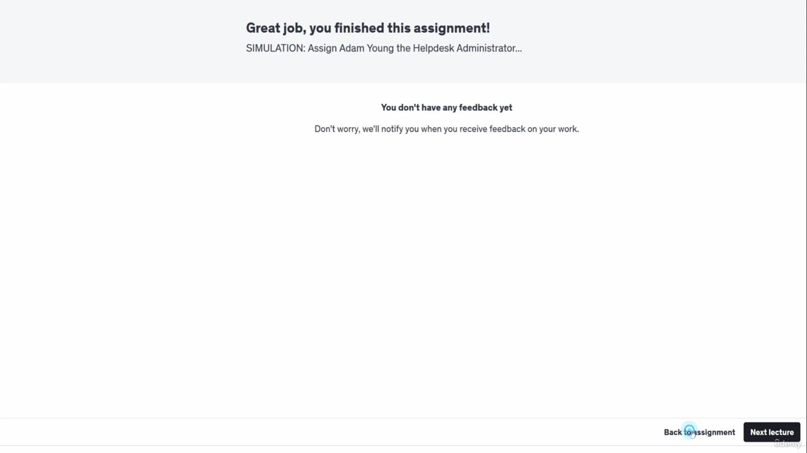
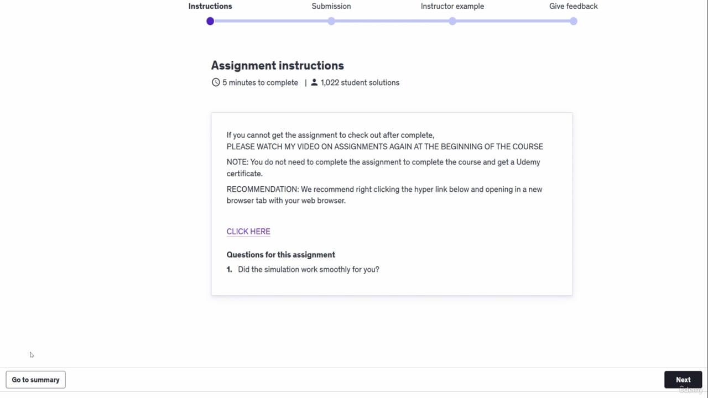
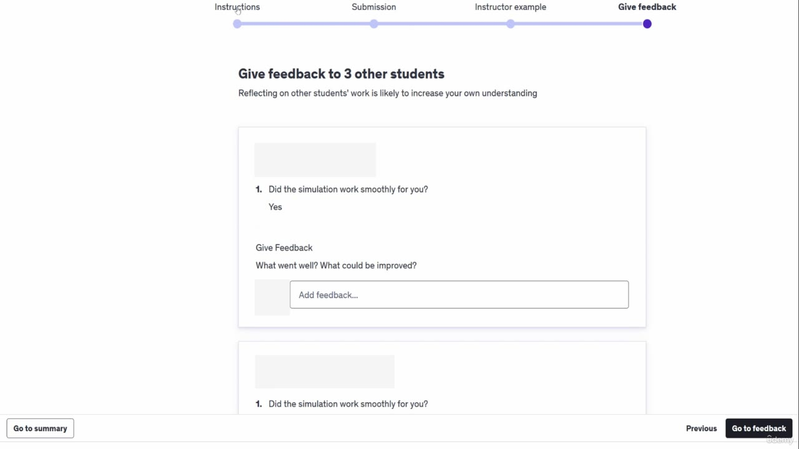

[Back to AZ-104: Microsoft Azure Administrator](../1.md)

# Chapter 24 — DONT SKIP Redoing simulations in the course

## Table of Contents

- [Introduction](#introduction)
- [Detailed tutorial](#detailed-tutorial)
  - [Completed assignments do not offer restart](#completed-assignments-do-not-offer-restart)
  - [The example on screen may not be yours](#the-example-on-screen-may-not-be-yours)
  - [Go to summary, then back to assignment](#go-to-summary-then-back-to-assignment)
  - [Instructions holds the simulation link](#instructions-holds-the-simulation-link)
- [Summary](#summary)
- [References](#references)
- [Questions and Answers](#questions-and-answers)
  - [Question 1 — What becomes hard](#question-1-what-becomes-hard)
  - [Question 2 — Where Udemy leaves you](#question-2-where-udemy-leaves-you)
  - [Question 3 — Is this assignment in AZ-104](#question-3-is-this-assignment-in-az-104)
  - [Question 4 — What the sample task says](#question-4-what-the-sample-task-says)
  - [Question 5 — First click](#question-5-first-click)
  - [Question 6 — Second click](#question-6-second-click)
  - [Question 7 — Third click](#question-7-third-click)
  - [Question 8 — Where the simulation link is](#question-8-where-the-simulation-link-is)
  - [Question 9 — What the instructions tell you to do with the link](#question-9-what-the-instructions-tell-you-to-do-with-the-link)
  - [Question 10 — Do you need the assignment for the certificate](#question-10-do-you-need-the-assignment-for-the-certificate)

## Introduction

Udemy does not put a restart button on a finished assignment, and the simulations in this course live behind those assignments. This lecture, tagged DONT SKIP, is the three-click path back to the instructions so you can run a simulation again.

## Detailed tutorial

**AZ-104 Microsoft Azure Administrator** · [24 - DONT SKIP Redoing simulations in the course.mp4](../../../../../course_videos/Course%20AZ-104%20Microsoft%20Azure%20Administrator%20course%20with%20SIMULATIONS/24%20-%20DONT%20SKIP%20Redoing%20simulations%20in%20the%20course.mp4) · [Transcript](../../../../../course_videos/Course%20AZ-104%20Microsoft%20Azure%20Administrator%20course%20with%20SIMULATIONS/24%20-%20DONT%20SKIP%20Redoing%20simulations%20in%20the%20course.txt)

<strong>Completed assignments do not offer restart</strong>

Once you complete an assignment, Udemy does not make it easy to open the same assignment and do it again. The simulations are reached from those assignments, so the same friction blocks a second pass. He says a finished assignment comes back looking like the screen in this video, with no restart control.

*Figure: 00:00. The overlay says how to redo assignments ("Simulations"). Behind it is "SIMULATION: Assign Adam Young the Helpdesk Administrator..." Go to summary is already at the lower left.*

<strong>The example on screen may not be yours</strong>

This recording is reused across his courses. The assignment on screen may not exist in AZ-104. The task under the title is: assign Adam Young the Helpdesk Administrator and Printer Administrator roles permanently. He says not to worry if your course uses a different assignment name. The clicks are the point.

*Figure: 00:26. A note says this example assignment may not be in the course you are taking. Go to summary is at the lower left.*

<strong>Go to summary, then back to assignment</strong>

The path he clicks:

1. **Go to summary**, lower left.
2. **Back to assignment**, lower right of the finished screen.

The finished screen says "Great job, you finished this assignment!" and names the same Helpdesk Administrator simulation. One frame in between is only a spinner. The next frame has no feedback yet and still shows **Back to assignment**.

*Figure: 01:04. The finished state. Back to assignment is at the lower right. A spinner is still in the middle of the page.*

*Figure: 01:10. The summary has loaded: "You don't have any feedback yet." Back to assignment is the control he uses next.*

<strong>Instructions holds the simulation link</strong>

After **Back to assignment**, he goes to the upper left and opens **Instructions**. That page has the simulation link. On this recording the instructions say to right-click **CLICK HERE** and open it in a new browser tab. They also say you do not need to complete the assignment to finish the course and get a Udemy certificate, and they point you back to his assignments video if checkout fails.

The same recording also passes through **Give feedback**, which asks you to give feedback to 3 other students. That tab is not where the simulation link is. The link is on Instructions.

*Figure: 01:30. Instructions is the selected step. CLICK HERE is the simulation link. The note says to open it in a new browser tab.*

*Figure: 01:14. Give feedback is a different step on the same bar. It does not contain the simulation link.*

He repeats the three clicks: **Go to summary**, **Back to assignment**, **Instructions**.

## Summary

- A finished Udemy assignment has no restart button, and that is how you lose the simulation link.
- The Adam Young Helpdesk Administrator assignment is an example. It may not be the assignment in this course.
- The path is Go to summary, Back to assignment, then Instructions.
- Instructions holds CLICK HERE. Give feedback is a different tab.

## References

- [Lesson video](../../../../../course_videos/Course%20AZ-104%20Microsoft%20Azure%20Administrator%20course%20with%20SIMULATIONS/24%20-%20DONT%20SKIP%20Redoing%20simulations%20in%20the%20course.mp4)
- [Transcript](../../../../../course_videos/Course%20AZ-104%20Microsoft%20Azure%20Administrator%20course%20with%20SIMULATIONS/24%20-%20DONT%20SKIP%20Redoing%20simulations%20in%20the%20course.txt)
- [Study guide for Exam AZ-104](https://learn.microsoft.com/en-us/credentials/certifications/resources/study-guides/az-104)

## Questions and Answers

<strong>Question 1 — What becomes hard</strong>

What does Udemy make difficult after you finish an assignment?

**Answer.** Getting back in to do the assignment again. That is how you lose a second pass at the simulation.

<strong>Question 2 — Where Udemy leaves you</strong>

What is missing when you return to a completed assignment?

**Answer.** A way to restart it. He says the screen will look similar to the one in this video, with no restart.

<strong>Question 3 — Is this assignment in AZ-104</strong>

Should you expect the assignment on this screen to exist in every course that includes the video?

**Answer.** No. He says the assignment on screen may not be in the course you are taking. The video is reused, and this one is an example.

<strong>Question 4 — What the sample task says</strong>

What does the sample assignment tell you to assign to Adam Young?

**Answer.** The Helpdesk Administrator and Printer Administrator roles, permanently.

<strong>Question 5 — First click</strong>

What is the first click, and where is it?

**Answer.** Go to summary, in the lower left.

<strong>Question 6 — Second click</strong>

What does he click after the summary?

**Answer.** Back to assignment, on the lower right of the finished screen.

<strong>Question 7 — Third click</strong>

Which step does he open in the upper left to get the simulation again?

**Answer.** Instructions.

<strong>Question 8 — Where the simulation link is</strong>

Which label on the instructions page is the simulation link?

**Answer.** CLICK HERE.

<strong>Question 9 — What the instructions tell you to do with the link</strong>

How do the instructions say to open that link?

**Answer.** Right-click it and open it in a new browser tab.

<strong>Question 10 — Do you need the assignment for the certificate</strong>

Do the instructions say you must finish the assignment to get the Udemy certificate?

**Answer.** No. The note on the instructions page says you do not need to complete the assignment to complete the course and get a Udemy certificate.

