[Back to AZ-104: Microsoft Azure Administrator](../1.md)

# Chapter 32 — Installing Azure CLI locally

## Table of Contents

- [Introduction](#introduction)
- [Detailed tutorial](#detailed-tutorial)
  - [The local CLI is the same tool](#the-local-cli-is-the-same-tool)
  - [Search and skip the ad](#search-and-skip-the-ad)
  - [The install page lists every system](#the-install-page-lists-every-system)
  - [The Windows page uses an MSI](#the-windows-page-uses-an-msi)
  - [The proxy note on the Windows page](#the-proxy-note-on-the-windows-page)
  - [Download the latest release](#download-the-latest-release)
  - [The setup wizard ends on Finish](#the-setup-wizard-ends-on-finish)
  - [PowerShell is already open](#powershell-is-already-open)
  - [The az command prints the groups](#the-az-command-prints-the-groups)
  - [Az login opens the browser](#az-login-opens-the-browser)
  - [The login JSON](#the-login-json)
  - [Local PowerShell matches Cloud Shell](#local-powershell-matches-cloud-shell)
- [Summary](#summary)
- [References](#references)
- [Questions and Answers](#questions-and-answers)
  - [Question 1 — Why this install](#question-1-why-this-install)
  - [Question 2 — How he finds the download](#question-2-how-he-finds-the-download)
  - [Question 3 — Which systems the page lists](#question-3-which-systems-the-page-lists)
  - [Question 4 — What the page calls current](#question-4-what-the-page-calls-current)
  - [Question 5 — How Windows is installed](#question-5-how-windows-is-installed)
  - [Question 6 — An existing install](#question-6-an-existing-install)
  - [Question 7 — The terminal note](#question-7-the-terminal-note)
  - [Question 8 — Opening PowerShell](#question-8-opening-powershell)
  - [Question 9 — The first command](#question-9-the-first-command)
  - [Question 10 — Signing in](#question-10-signing-in)
  - [Question 11 — The success page](#question-11-the-success-page)
  - [Question 12 — The JSON](#question-12-the-json)

## Introduction

Video chapter 32 installs the Azure CLI on the Windows computer he is already using, then signs that copy in from PowerShell. He searches for the Microsoft Learn install article, runs the Windows MSI, and treats `az login` as the check that the local tool can reach the same subscription he has open in the portal. The page in this recording says the current build is 2.40.0. He ends on the point of the lesson: commands he has been running in Cloud Shell can now run locally.

## Detailed tutorial

**AZ-104 Microsoft Azure Administrator** · [32 - Installing Azure CLI locally.mp4](../../../../../course_videos/Course%20AZ-104%20Microsoft%20Azure%20Administrator%20course%20with%20SIMULATIONS/32%20-%20Installing%20Azure%20CLI%20locally.mp4) · [Transcript](../../../../../course_videos/Course%20AZ-104%20Microsoft%20Azure%20Administrator%20course%20with%20SIMULATIONS/32%20-%20Installing%20Azure%20CLI%20locally.txt)

<details id="the-local-cli-is-the-same-tool">
<summary><strong>The local CLI is the same tool</strong></summary>

He calls this the last Azure CLI step. Cloud Shell already has the CLI. This pass puts that same CLI on the computer, then opens it from PowerShell.

The browser starts on the portal home, already signed in. The account in the header is `jc@examlabpractice.com`. That same address comes back on the password page and in the `az login` JSON. The recent list under the home blade is earlier lab work. He does not open any of those resources.

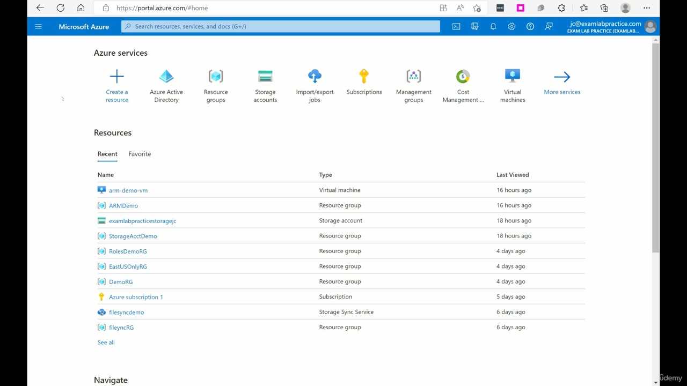

*Figure: 00:00. Azure portal home for jc@examlabpractice.com. He leaves this page to search for the CLI installer.*

</details>

<details id="search-and-skip-the-ad">
<summary><strong>Search and skip the ad</strong></summary>

He says use a search engine, Google or Bing, and type download Azure CLI. The box on the Google homepage reads `download azure cli`.

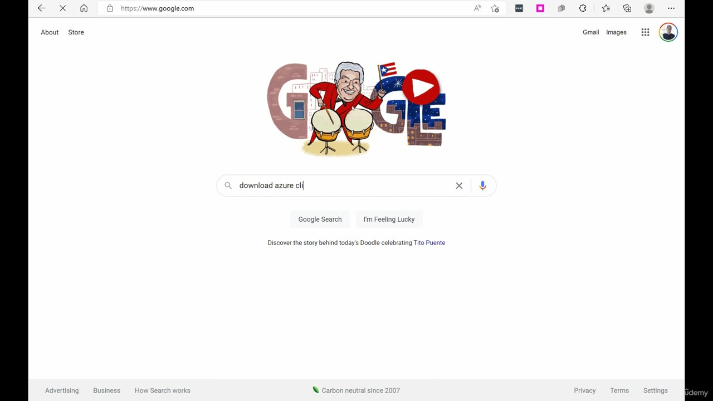

*Figure: 00:16. The Google homepage with `download azure cli` in the search box, before he runs the search.*

The first screen of results is an ad. He says skip the ads. The ad on this frame is "Microsoft Azure Download - Create Your Account Now" from azure.microsoft.com. Under it, the result he wants is already starting: **How to install the Azure CLI** on Microsoft Learn.

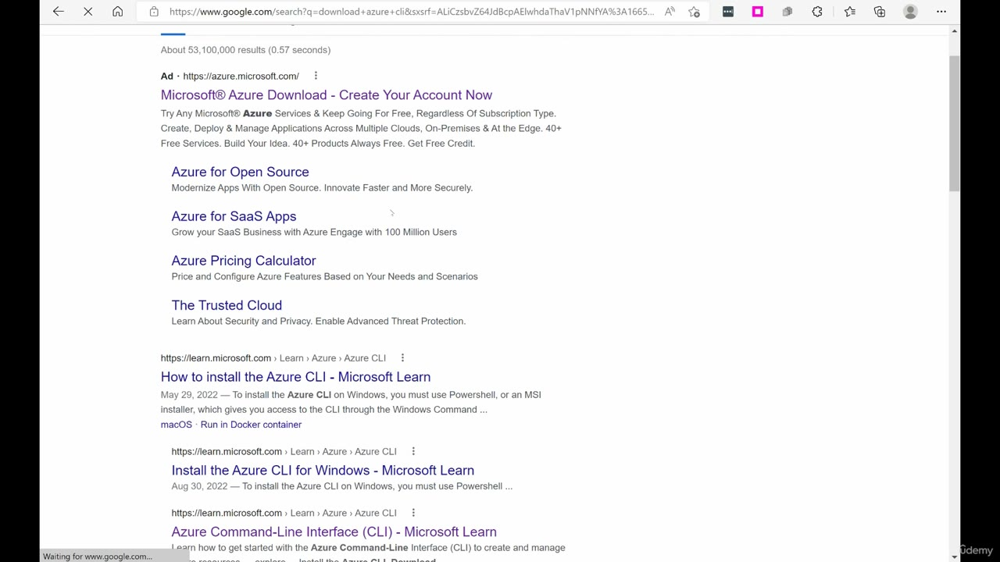

*Figure: 00:18. The ad sits above the Learn result "How to install the Azure CLI."*

Scrolled past the ad, the organic results are the Learn articles. The one he opens is **How to install the Azure CLI**. The snippet under it says that on Windows you use PowerShell or an MSI. The other rows on this frame are Install the Azure CLI for Windows, Azure Command-Line Interface (CLI), and Install the Azure CLI on Linux. People also ask sits under those links. He does not open it.

The search snippet dates that first article May 29, 2022. The article header, once the page loads, says 05/30/2022. The address he lands on is `https://learn.microsoft.com/en-us/cli/azure/install-azure-cli`.

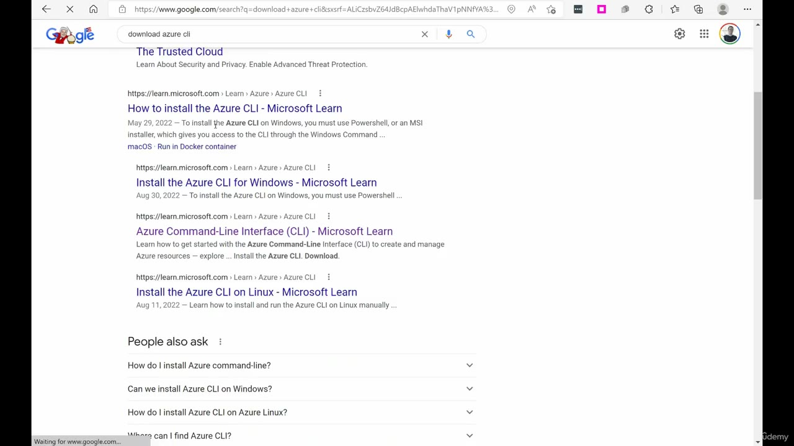

*Figure: 00:20. The ad is scrolled off. How to install the Azure CLI is the Learn result he opens.*

</details>

<details id="the-install-page-lists-every-system">
<summary><strong>The install page lists every system</strong></summary>

The article header is 05/30/2022. The first sentence on the page says the Azure CLI can be installed on Windows, macOS, and Linux, and can also run in a Docker container and in Azure Cloud Shell.

The current-version line on this recording says **2.40.0**. It tells you to read the release notes for the latest build, and to run `az version` to see what you have installed. He never runs `az version`. The transcript never says 2.40.0. The page and the later file name are the number to remember from this video. The same Learn article is still the install page, and that current-version line has moved on, so 2.40.0 is the build in this recording.

The transcript names four places: Windows, Mac, Debian, and Ubuntu. He says he will install on Windows. The bullet list on the page is longer than that sentence.

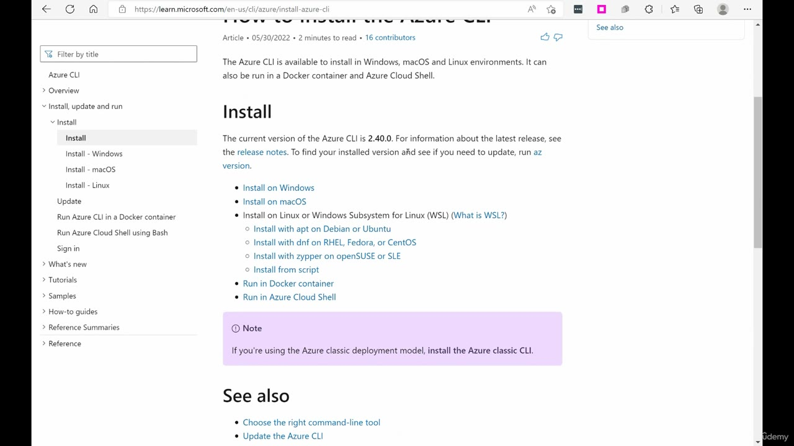

*Figure: 00:26. How to install the Azure CLI. The page says the current version is 2.40.0 and lists Windows, macOS, Linux, Docker, and Cloud Shell.*

| On the install page | What he says |
| --- | --- |
| Install on Windows | This is the path he clicks |
| Install on macOS | He says Mac |
| Linux or WSL, apt on Debian or Ubuntu | He names Debian and Ubuntu |
| Linux or WSL, dnf on RHEL, Fedora, or CentOS | On the page. He does not name these |
| Linux or WSL, zypper on openSUSE or SLE | On the page. He does not name these |
| Install from script, under Linux or WSL | On the page. He does not name it |
| Run in Docker container | On the page. He does not open it |
| Run in Azure Cloud Shell | On the page. He comes back to Cloud Shell at the end as the place those commands already ran |

A note under the list says that the Azure classic deployment model uses the Azure classic CLI. He does not install that.

</details>

<details id="the-windows-page-uses-an-msi">
<summary><strong>The Windows page uses an MSI</strong></summary>

He clicks **Install on Windows**. The address is `https://learn.microsoft.com/en-us/cli/azure/install-azure-cli-windows`, with `?tabs=azure-cli` on the end. The article header on this frame is 08/30/2022.

The page says the CLI is a cross-platform tool you can install locally on Windows, and that the same CLI can also be used in a browser through Cloud Shell or from a Docker container. For Windows, installation is an MSI. That MSI gives you the `az` command in **Windows Command Prompt (CMD) or PowerShell**. The transcript only talks about PowerShell. The page names both shells. WSL is called out separately: use the packages for the Linux distribution, from the main install page.

This page repeats **2.40.0** and `az version`.

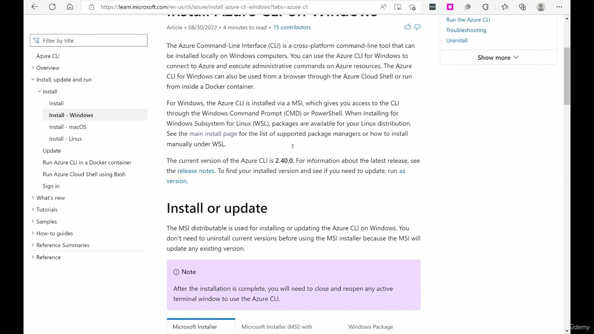

*Figure: 00:40. The Windows article. Install - Windows is selected. The body says the Windows install is an MSI for CMD or PowerShell, version 2.40.0.*

Scrolled to **Install or update**, the page says the MSI is how you install or update, and that you do not uninstall the current version first because the MSI updates whatever is already there.

The purple note under that is the terminal rule: after installation you will need to close and reopen any active terminal window to use the Azure CLI. Hold that next to the demo. He types `az` in a PowerShell window that was already open.

Three tabs sit on this section. He stays on the first.

| Tab | What he does with it |
| --- | --- |
| Microsoft Installer (MSI) | This is the tab. He uses the **Latest release of the Azure CLI** button |
| Microsoft Installer (MSI) with Command | On the page. He does not open it |
| Windows Package Manager | On the page. He does not open it |

**Latest version** tells you to download the latest release, and to click **Yes** when the installer asks if it can make changes to the computer. That Yes line is the page. The transcript instead says he accepts the terms and clicks Install inside the wizard. The frames do not show the Yes dialog or the license page.

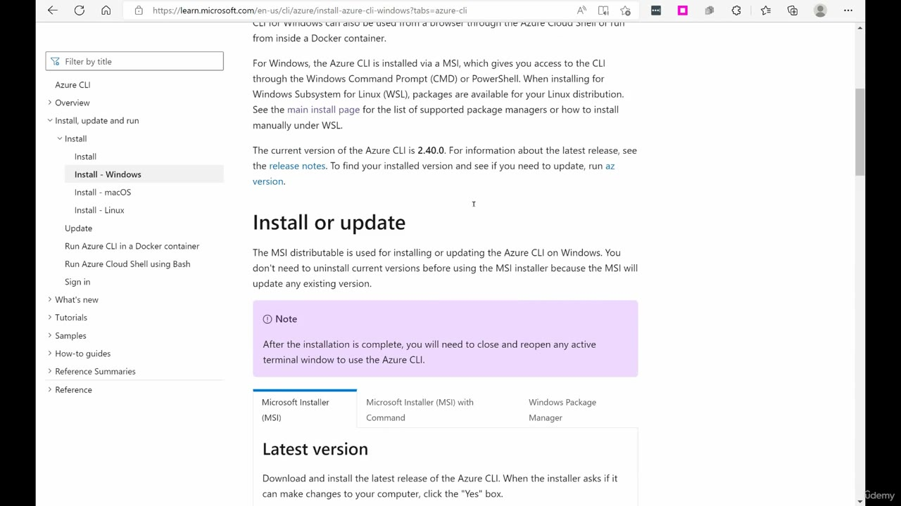

*Figure: 00:42. Install or update. The MSI updates an existing install, the note says to reopen the terminal, and Latest version says to click Yes.*

Further down, **Latest release of the Azure CLI** is the button he clicks. **Specific version** shows how to pin an older MSI: change the version segment in `https://azcliprod.blob.core.windows.net/msi/azure-cli-<version>.msi`. He does not pin a version. He takes the latest button, which on this page is 2.40.0.

**Run the Azure CLI** on the same screen says you run it with the `az` command from either Windows Command Prompt or PowerShell. That is the command he types after Finish.

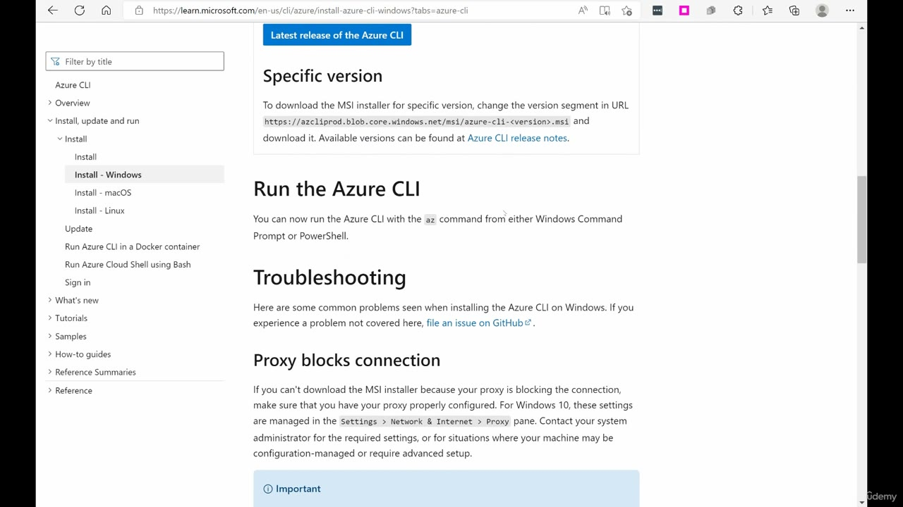

*Figure: 00:44. The blue Latest release of the Azure CLI button, the versioned MSI URL, and the line that says to run az from Command Prompt or PowerShell.*

</details>

<details id="the-proxy-note-on-the-windows-page">
<summary><strong>The proxy note on the Windows page</strong></summary>

He keeps scrolling. The transcript never mentions a proxy. The page does, under **Proxy blocks connection**.

If the MSI will not download, the page says to check the proxy. On Windows 10 that is Settings, Network & Internet, Proxy. An Important box says the same settings are required before PowerShell or Command Prompt can reach Azure. The PowerShell snippet on the page is:

```powershell
(New-Object System.Net.WebClient).Proxy.Credentials = `
[System.Net.CredentialCache]::DefaultNetworkCredentials
```

The page then says the proxy has to allow HTTPS to:

- `https://aka.ms/`
- `https://azcliprod.blob.core.windows.net/`

He does not run the snippet. He scrolls back up and uses the latest-release button.

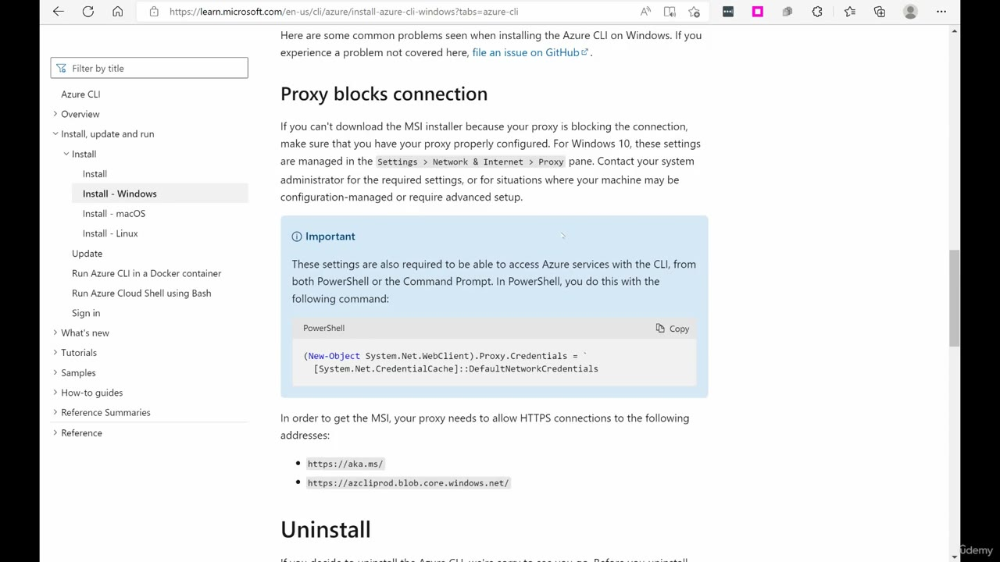

*Figure: 00:48. The Windows page at Proxy blocks connection, with the PowerShell credential line and the two HTTPS hosts.*

</details>

<details id="download-the-latest-release">
<summary><strong>Download the latest release</strong></summary>

He says there is the latest release of the Azure CLI, clicks it, and lets the file download. Downloads shows `azure-cli-2.40.0.msi` at the top of the list, with Open file beside it. The transcript never says 2.40.0. The file name matches the version line on the page. Other files in that Downloads list are older downloads. They are not part of this install.

Opening the MSI starts **Microsoft Azure CLI Setup**. The frame of the wizard says "Welcome to the Microsoft Azure CLI Setup Wizard" and "Computing space requirements." Back, Next, and Cancel are at the bottom. Next is not available yet.

The transcript says he accepts the terms, clicks Install, and waits a few minutes while that runs. Those license and Install screens are not in the frames. The next wizard frame is the completed page.

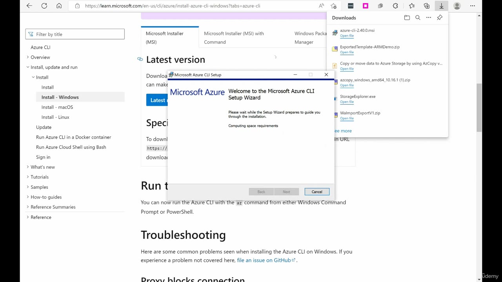

*Figure: 01:08. Downloads lists azure-cli-2.40.0.msi. The setup wizard is on "Computing space requirements."*

</details>

<details id="the-setup-wizard-ends-on-finish">
<summary><strong>The setup wizard ends on Finish</strong></summary>

He says the install takes a few minutes, then he clicks Finish. The wizard text is **Completed the Microsoft Azure CLI Setup Wizard** and **Click the Finish button to exit the Setup Wizard.** Finish is the selected button. Back and Cancel are the other two.

The Learn page is still behind the wizard, on the same Latest version section, still telling you to run `az` from Command Prompt or PowerShell.

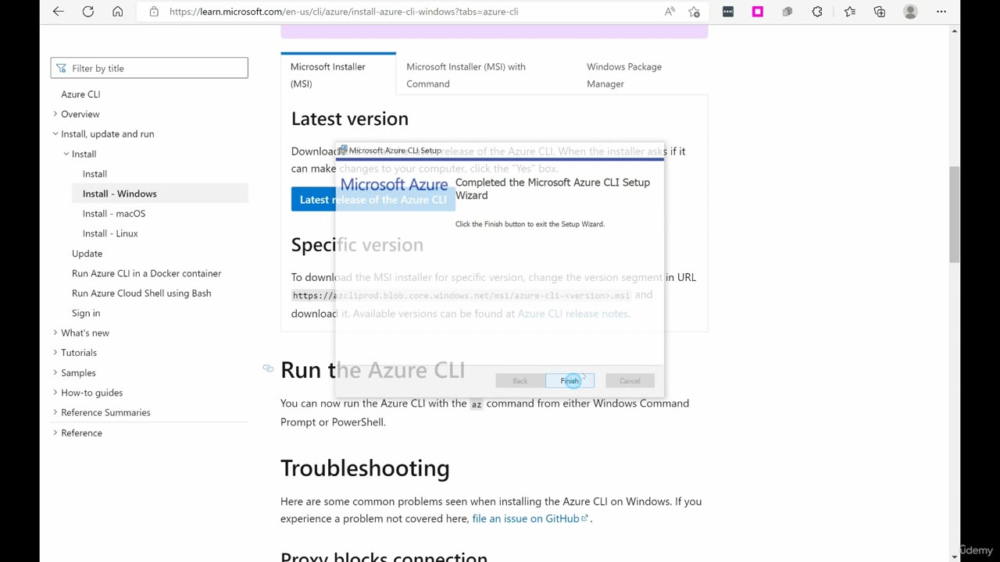

*Figure: 01:42. The setup wizard says it completed and tells you to click Finish.*

</details>

<details id="powershell-is-already-open">
<summary><strong>PowerShell is already open</strong></summary>

He says that once it is installed, the CLI is available in PowerShell. He also says he already has PowerShell open, and then says to right-click Start and open PowerShell.

The frame does not show the Start menu. It shows a window that is already open. The title bar reads **Administrator: Windows PowerShell**. The prompt is `PS C:\WINDOWS\system32>`. The scrollback above the prompt is directory-user output from an earlier command (lab users and a directory sync account). This video does not run that command. The window is only here so he can type `az`.

The Windows page said to close and reopen any active terminal. This is the already-open elevated window he uses anyway.

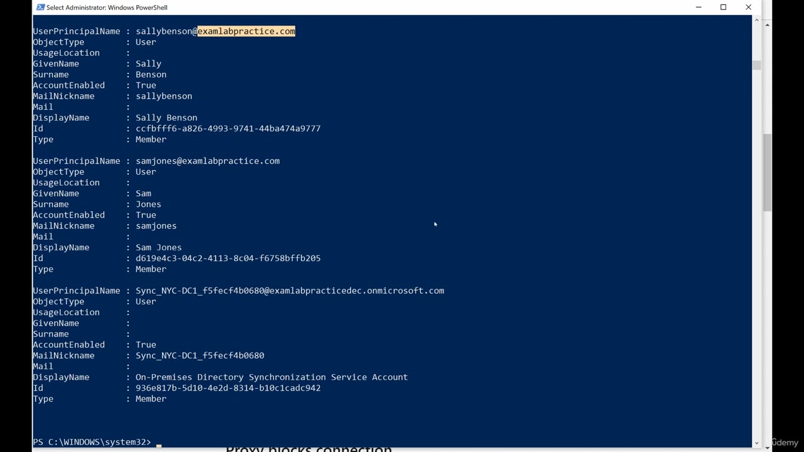

*Figure: 01:46. Administrator: Windows PowerShell at C:\WINDOWS\system32. The user list above the prompt is leftover output.*

</details>

<details id="the-az-command-prints-the-groups">
<summary><strong>The az command prints the groups</strong></summary>

He types `az` and says the Azure CLI commands should be available. The first frame is the command at the prompt, before the help prints.

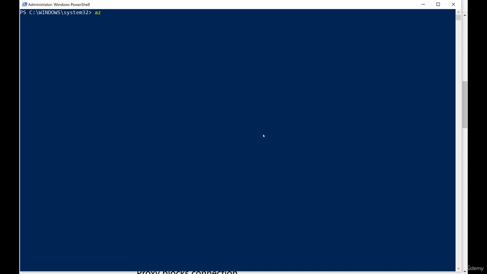

*Figure: 01:58. Administrator PowerShell with `az` typed at `PS C:\WINDOWS\system32>`. The help has not printed yet.*

`az` with no arguments prints the command groups. This frame is the bottom of that list, then the prompt comes back. He treats that list as the proof the CLI is on the machine. A few of the groups still on screen:

| Group | Help line on this frame |
| --- | --- |
| role | Manage user roles for access control with Azure Active Directory and service principals |
| storage | Manage Azure Cloud Storage resources |
| sql | Manage Azure SQL Databases and Data Warehouses |
| vm | Manage Linux or Windows virtual machines |
| vmss | Manage groupings of virtual machines in an Azure Virtual Machine Scale Set (VMSS) |
| webapp | Manage web apps |

The list on the frame continues past those, from postgres down through version and webapp. He does not run one of the groups yet. Login is the next command.

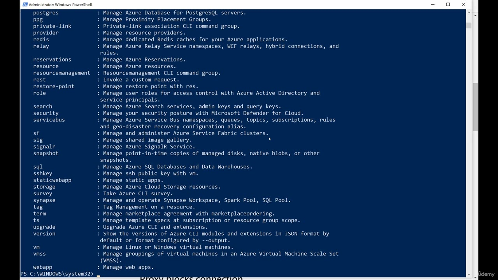

*Figure: 02:00. The tail of the `az` help, from postgres through webapp, and the prompt has returned.*

</details>

<details id="az-login-opens-the-browser">
<summary><strong>Az login opens the browser</strong></summary>

He types `az login` and says it will give him a chance to authenticate in the browser, then he can enter the password.

The shell prints that a web browser has been opened at `https://login.microsoftonline.com/organizations/oauth2/v2.0/authorize`, and to continue the login in the browser. The same message gives the fallback: if no browser is available or the browser fails to open, use device code flow with `az login --use-device-code`. He uses the browser. He does not use the device-code command.

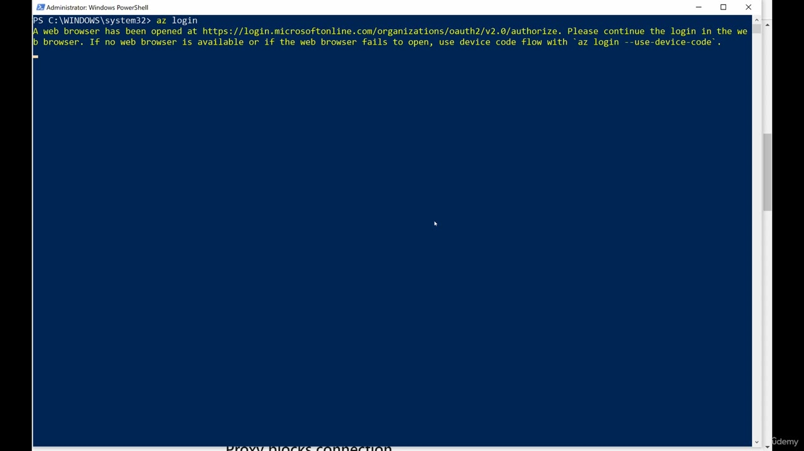

*Figure: 02:06. `az login` has opened login.microsoftonline.com and printed the device-code fallback.*

The sign-in page is Microsoft Azure for `jc@examlabpractice.com`, the same account as the portal header. The heading is **Enter password**. He fills the password box and uses **Sign in**. The transcript says he puts the password in. The page does not show the password.

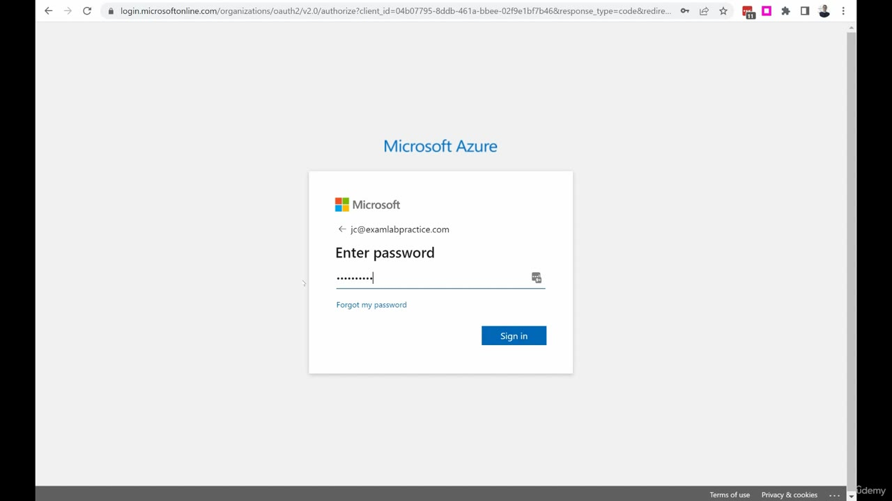

*Figure: 02:16. The Microsoft Azure password page for jc@examlabpractice.com, with Sign in ready.*

The next page is the success text. Read the page, because the transcript uses different words. The transcript says it says he has been successfully logged in. The page says:

- **You have logged into Microsoft Azure!**
- You can close this window, or we will redirect you to the Azure CLI documentation in 10 seconds.

The address bar is a localhost callback (`localhost:17959`). He goes back to PowerShell for the result.

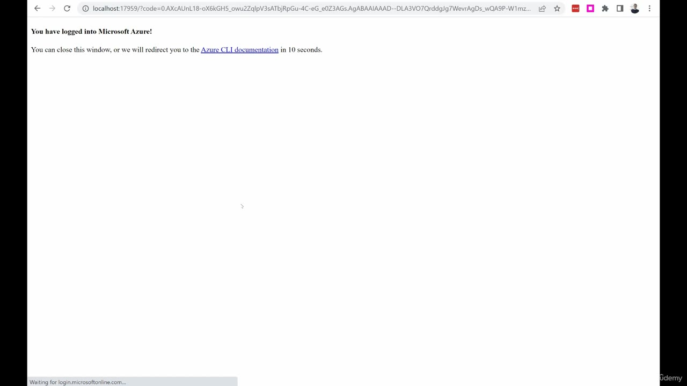

*Figure: 02:18. The browser says "You have logged into Microsoft Azure!" and offers a close or a redirect in 10 seconds.*

</details>

<details id="the-login-json">
<summary><strong>The login JSON</strong></summary>

Back in the same PowerShell window, `az login` has printed one subscription object and returned the prompt. He says there it is. These are the values on this frame, for this lab sign-in.

| Field | Value on this login |
| --- | --- |
| cloudName | AzureCloud |
| name | Azure subscription 1 |
| state | Enabled |
| isDefault | true |
| id | 905b3b48-6110-4e72-841f-cf1630e982e2 |
| homeTenantId | f3f57252-17ea-41ea-87e7-fa30bb666a96 |
| tenantId | f3f57252-17ea-41ea-87e7-fa30bb666a96 |
| managedByTenants | empty |
| user.name | jc@examlabpractice.com |
| user.type | user |

`user.name` matches the portal header and the password page. `homeTenantId` and `tenantId` are the same GUID on this login. `id` is the subscription id, and `name` is the subscription name. He does not run another command after this JSON.

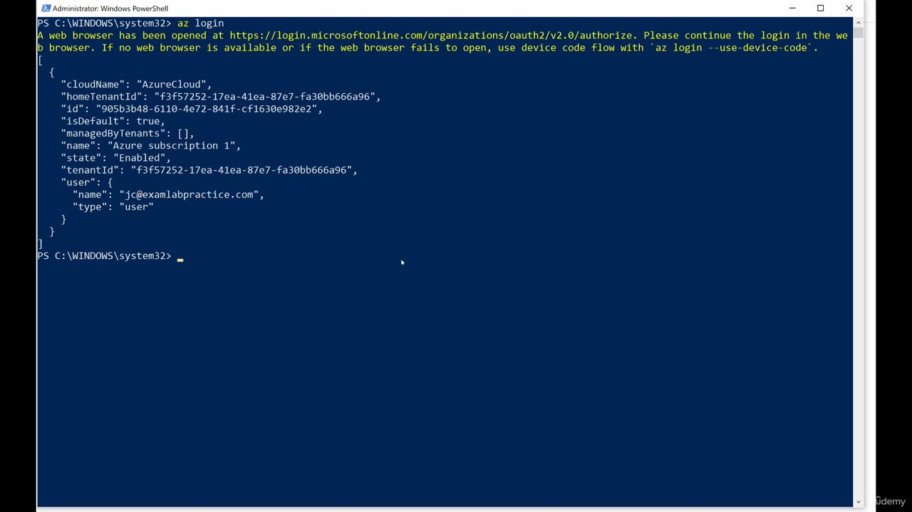

*Figure: 02:24. `az login` has printed Azure subscription 1 for jc@examlabpractice.com and returned the prompt.*

</details>

<details id="local-powershell-matches-cloud-shell">
<summary><strong>Local PowerShell matches Cloud Shell</strong></summary>

That JSON is the end of the demo. He says he can now run, on this computer in PowerShell, the same commands he could run in the Cloud Shell version of the CLI. He does not show one of those resource commands here. The install, `az`, and `az login` are the whole lesson.

</details>

## Summary

- Search `download azure cli`, skip the ad, and open How to install the Azure CLI on Microsoft Learn.
- The install page lists Windows, macOS, Linux or WSL (apt, dnf, zypper, and a script), Docker, and Cloud Shell. He installs Windows. The transcript only names Windows, Mac, Debian, and Ubuntu.
- This recording's page says the current version is 2.40.0. Downloads shows `azure-cli-2.40.0.msi`. The transcript never says that number.
- The Windows path he uses is the MSI button **Latest release of the Azure CLI**. The page says the MSI updates an existing install, and that you close and reopen any open terminal. He types `az` in the Administrator PowerShell that was already open.
- The wizard ends on **Completed the Microsoft Azure CLI Setup Wizard**. He clicks Finish.
- `az` prints the command groups. `az login` opens the browser. The success page says "You have logged into Microsoft Azure!" The transcript's phrase is "successfully logged."
- The JSON is subscription Azure subscription 1, state Enabled, default, cloud AzureCloud, user jc@examlabpractice.com. Local PowerShell can then run the same commands as Cloud Shell.

## References

- [Lesson video](../../../../../course_videos/Course%20AZ-104%20Microsoft%20Azure%20Administrator%20course%20with%20SIMULATIONS/32%20-%20Installing%20Azure%20CLI%20locally.mp4)
- [Transcript](../../../../../course_videos/Course%20AZ-104%20Microsoft%20Azure%20Administrator%20course%20with%20SIMULATIONS/32%20-%20Installing%20Azure%20CLI%20locally.txt)
- [Study guide for Exam AZ-104](https://learn.microsoft.com/en-us/credentials/certifications/resources/study-guides/az-104)
- [How to install the Azure CLI](https://learn.microsoft.com/en-us/cli/azure/install-azure-cli)
- [Install the Azure CLI on Windows](https://learn.microsoft.com/en-us/cli/azure/install-azure-cli-windows?view=azure-cli-latest)

## Questions and Answers

<details id="question-1-why-this-install">
<summary><strong>Question 1 — Why this install</strong></summary>

What is he adding in this video, given that he already has the CLI in Cloud Shell?

**Answer.** The Azure CLI on his own computer, opened from PowerShell. He calls it the last CLI step, and he ends by saying the Cloud Shell commands can now run locally.

</details>

<details id="question-2-how-he-finds-the-download">
<summary><strong>Question 2 — How he finds the download</strong></summary>

What does he type into the search engine, and which result does he use?

**Answer.** `download azure cli`, on Google or Bing. He skips the ad and opens How to install the Azure CLI on Microsoft Learn.

</details>

<details id="question-3-which-systems-the-page-lists">
<summary><strong>Question 3 — Which systems the page lists</strong></summary>

The transcript names Windows, Mac, Debian, and Ubuntu. What else does the install page list?

**Answer.** macOS, Linux or WSL with dnf (RHEL, Fedora, or CentOS), zypper (openSUSE or SLE), install from script, Docker, and Cloud Shell, plus a note for the Azure classic CLI. The page is the full list. His sentence only covers the path he is about to click and the two Linux names he says out loud.

</details>

<details id="question-4-what-the-page-calls-current">
<summary><strong>Question 4 — What the page calls current</strong></summary>

Which version does the install page call current in this recording, and which file shows up in Downloads?

**Answer.** 2.40.0, and the file is `azure-cli-2.40.0.msi`. The transcript never says the number. The page and the Downloads row do.

</details>

<details id="question-5-how-windows-is-installed">
<summary><strong>Question 5 — How Windows is installed</strong></summary>

How does the Windows page say to install the CLI, and which tab does he use?

**Answer.** An MSI, which adds `az` to Command Prompt or PowerShell. He stays on Microsoft Installer (MSI) and clicks Latest release of the Azure CLI. The other tabs are Microsoft Installer (MSI) with Command and Windows Package Manager.

</details>

<details id="question-6-an-existing-install">
<summary><strong>Question 6 — An existing install</strong></summary>

What does the Windows page say to do about an older Azure CLI before you run the MSI?

**Answer.** Leave it. The page says you do not uninstall the current version first, because the MSI updates any existing version.

</details>

<details id="question-7-the-terminal-note">
<summary><strong>Question 7 — The terminal note</strong></summary>

What does the Windows page say to do with an open terminal after the install, and what does the demo show?

**Answer.** The page says you will need to close and reopen any active terminal. The demo types `az` in the Administrator PowerShell that was already open, and the command groups still print.

</details>

<details id="question-8-opening-powershell">
<summary><strong>Question 8 — Opening PowerShell</strong></summary>

The transcript says to right-click Start and open PowerShell. What window is actually on screen?

**Answer.** An already-open window titled Administrator: Windows PowerShell, with the prompt `PS C:\WINDOWS\system32>`. No Start menu is shown. The user list above the prompt is leftover output from an earlier command.

</details>

<details id="question-9-the-first-command">
<summary><strong>Question 9 — The first command</strong></summary>

What does he type to see whether the CLI is installed, and what comes back?

**Answer.** `az`. The CLI prints its command groups. The frame shows the bottom of that list, through webapp, and then the prompt returns.

</details>

<details id="question-10-signing-in">
<summary><strong>Question 10 — Signing in</strong></summary>

Which command starts sign-in, and what does the shell say to do if the browser does not open?

**Answer.** `az login`. It opens a browser at login.microsoftonline.com. The same message says to use `az login --use-device-code` if the browser is missing or fails. He uses the browser, on the password page for jc@examlabpractice.com.

</details>

<details id="question-11-the-success-page">
<summary><strong>Question 11 — The success page</strong></summary>

What sentence does the browser show after the password, and how does the transcript say it?

**Answer.** The page says "You have logged into Microsoft Azure!" and that you can close the window or be redirected to the Azure CLI documentation in 10 seconds. The transcript says he has been successfully logged in. The page is the wording to keep.

</details>

<details id="question-12-the-json">
<summary><strong>Question 12 — The JSON</strong></summary>

Which subscription, cloud, state, and user does `az login` print?

**Answer.** Subscription name Azure subscription 1, cloud AzureCloud, state Enabled, isDefault true, user jc@examlabpractice.com of type user. That JSON is the sign-in result he reads back in PowerShell, and the user matches the portal account.

</details>
