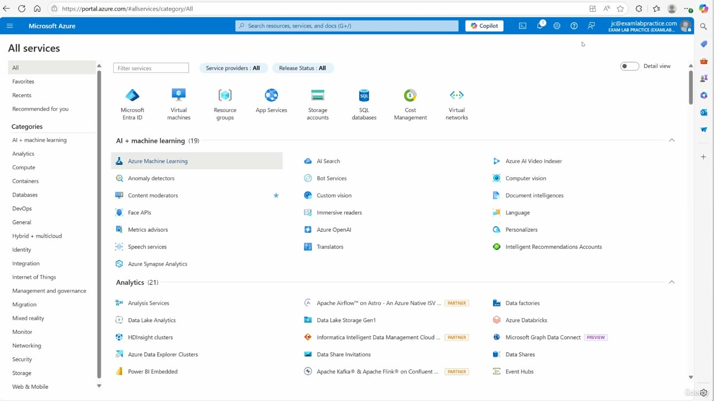
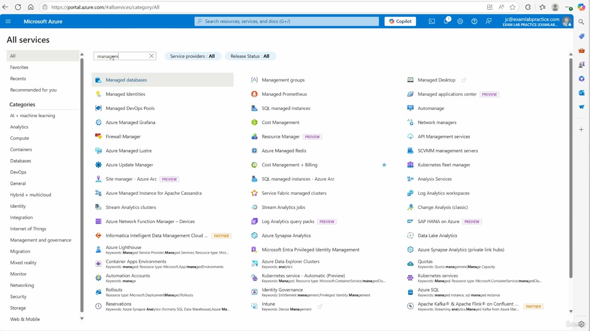
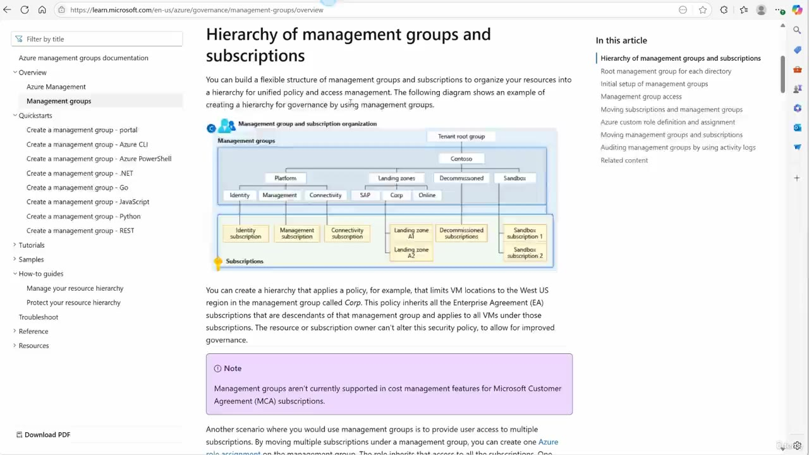

[Back to AZ-104: Microsoft Azure Administrator](../1.md)

# Chapter 39 — Configure management groups

## Table of Contents

- [Introduction](#introduction)
- [Detailed tutorial](#detailed-tutorial)
  - [Why subscriptions are grouped](#why-subscriptions-are-grouped)
  - [Open management groups in the portal](#open-management-groups-in-the-portal)
  - [The Contoso hierarchy](#the-contoso-hierarchy)
  - [Policy, access, and the cost note](#policy-access-and-the-cost-note)
  - [Create the root and name the group](#create-the-root-and-name-the-group)
- [Summary](#summary)
- [References](#references)
- [Questions and Answers](#questions-and-answers)
  - [Question 1 — What a management group groups](#question-1-what-a-management-group-groups)
  - [Question 2 — Which blade he searches from](#question-2-which-blade-he-searches-from)
  - [Question 3 — The filter text](#question-3-the-filter-text)
  - [Question 4 — The article he looks up](#question-4-the-article-he-looks-up)
  - [Question 5 — The top of the diagram](#question-5-the-top-of-the-diagram)
  - [Question 6 — Access across subscriptions](#question-6-access-across-subscriptions)
  - [Question 7 — The four groups under Contoso](#question-7-the-four-groups-under-contoso)
  - [Question 8 — What sits under Platform](#question-8-what-sits-under-platform)
  - [Question 9 — What sits under Landing zones](#question-9-what-sits-under-landing-zones)
  - [Question 10 — Where spaces are allowed](#question-10-where-spaces-are-allowed)
  - [Question 11 — The policy under the diagram](#question-11-the-policy-under-the-diagram)
  - [Question 12 — The note on the article](#question-12-the-note-on-the-article)

## Introduction

Video chapter 39 of AZ-104. A management group is the scope he puts above subscriptions so production, development, and testing, or subscriptions tied to different places, can be governed together. He opens All services, filters to Management groups, and leaves that blade while it is still loading. The rest of the lesson is the Contoso diagram on the Learn article, then the rule for the management group name versus the display name.

He says he searches for management groups. The filter box reads `managem`. The caption says decommission. The diagram says Decommissioned. Read the diagram.

## Detailed tutorial

**AZ-104 Microsoft Azure Administrator** · [39 - Configure management groups.mp4](../../../../../course_videos/Course%20AZ-104%20Microsoft%20Azure%20Administrator%20course%20with%20SIMULATIONS/39%20-%20Configure%20management%20groups.mp4) · [Transcript](../../../../../course_videos/Course%20AZ-104%20Microsoft%20Azure%20Administrator%20course%20with%20SIMULATIONS/39%20-%20Configure%20management%20groups.txt)

<strong>Why subscriptions are grouped</strong>

He starts from a tenant that has more than one subscription. One subscription holds the production resources. Another is for people developing a product. A third is only for testing. A management group is how he containerizes those subscriptions so they can be handled as one group.

Place is the same kind of split. He names subscriptions tied to New York and subscriptions tied to London, and he would group those with a management group too.

<strong>Open management groups in the portal</strong>

On portal.azure.com he opens the menu and chooses All services. The account chip is the exam lab practice directory.

*Figure: 00:00. All services at portal.azure.com/#allservices/category/All. The service tiles are still unfiltered.*

He searches for management groups.

*Figure: 01:00. The filter box reads managem. Management groups is in the results, beside Managed databases and Managed Identities. Service providers and Release Status are both All.*

He opens that result and says this is where he would create the management group. The blade title is Management groups, under All services. The page is still a blank loading screen, so the create form is not filled in on camera. He leaves it and opens the article.

<strong>The Contoso hierarchy</strong>

He tells you to search the keywords organize your resources with management groups in Azure. That is the article name. The page that opens is the management groups overview, scrolled to the hierarchy section.

*Figure: 01:14. Learn article at learn.microsoft.com/en-us/azure/governance/management-groups/overview. The heading in the frame is Hierarchy of management groups and subscriptions. Tenant root group is the top box.*

The paragraph under the heading says you build a hierarchy of management groups and subscriptions for unified policy and access management. He wants the diagram. The boxes are the outline. The caption compresses them.

He says you do not start with any management groups. You create a root. On this diagram the root is the top box, Tenant root group. Contoso is the company management group directly under that root. He says a new Azure tenant may not have the root yet, and that you create it and give it a name.

He asks what you do with more than one company, and he says you get another hierarchy like this one. The drawing on screen is one tree: Tenant root group, then Contoso, then the child groups.

| Where | Boxes on the diagram |
| --- | --- |
| Top | Tenant root group |
| Under the root | Contoso |
| Under Contoso | Platform, Landing zones, Decommissioned, Sandbox |
| Under Platform | Identity, Management, Connectivity |
| Under Landing zones | SAP, Corp, Online |

The caption runs the Contoso children together as "platform landing zones, decommission, sandbox." Platform and Landing zones are separate boxes. The fourth box is Decommissioned.

Under Platform he says identity, management, and connectivity. Those three boxes match.

He does not name SAP, Corp, or Online. They are the three management groups under Landing zones.

The yellow row is the subscriptions tied to those groups.

| Hung from | Subscriptions on the diagram |
| --- | --- |
| Identity | Identity subscription |
| Management | Management subscription |
| Connectivity | Connectivity subscription |
| Landing zones branch | Landing zone A1, Landing zone A2 |
| Decommissioned | Decommissioned subscriptions |
| Sandbox | Sandbox subscription 1, Sandbox subscription 2 |

He says that is how you categorize the groups and then hang subscriptions under them.

<strong>Policy, access, and the cost note</strong>

The same frame, under the diagram, is the governance example. A policy on the management group called Corp limits VM locations to the West US region. That policy applies to the Enterprise Agreement (EA) subscriptions that descend from Corp, and to all VMs under those subscriptions. The resource or subscription owner can't alter this policy.

Corp is one of the three groups under Landing zones.

The note under that paragraph says management groups aren't currently supported in cost management features for Microsoft Customer Agreement (MCA) subscriptions.

The next paragraph is the access case. Move several subscriptions under one management group, then create one Azure role assignment on the management group. The role inherits that access to all the subscriptions.

<strong>Create the root and name the group</strong>

The browser stays on that same article while he states the naming rule. He says he has already created a root group. On a new tenant you may not have one, so you create it and give it a name.

The management group name cannot contain spaces. He uses production group as the example of a name that includes a space. The display name is the field that can contain spaces.

After the group exists, you link subscriptions directly under it.

## Summary

- A management group groups subscriptions. His examples are production, developers, and testing, or subscriptions tied to places such as New York and London.
- Portal path: menu, All services, filter. The filter box reads `managem`. The result is Management groups. The create blade is titled Management groups and is still loading when he leaves it.
- The article is Organize your resources with management groups. The heading on screen is Hierarchy of management groups and subscriptions. The top box is Tenant root group. Contoso sits under it.
- Under Contoso: Platform, Landing zones, Decommissioned, Sandbox. The caption says decommission. The box says Decommissioned.
- Under Platform: Identity, Management, Connectivity, each with a matching subscription. Under Landing zones: SAP, Corp, Online, with Landing zone A1 and Landing zone A2 in that branch. Sandbox has Sandbox subscription 1 and Sandbox subscription 2.
- The Corp example limits VM locations to West US and applies to descendant EA subscriptions. The owner of the resource or subscription can't change that policy.
- One Azure role assignment on the management group inherits to the subscriptions moved under it.
- The note says management groups aren't currently supported in cost management features for MCA subscriptions.
- The management group name cannot contain spaces. The display name can. His spaced example is production group. Subscriptions link directly under the group.

## References

- [39 - Configure management groups.mp4](../../../../../course_videos/Course%20AZ-104%20Microsoft%20Azure%20Administrator%20course%20with%20SIMULATIONS/39%20-%20Configure%20management%20groups.mp4)
- [Transcript](../../../../../course_videos/Course%20AZ-104%20Microsoft%20Azure%20Administrator%20course%20with%20SIMULATIONS/39%20-%20Configure%20management%20groups.txt)
- [AZ-104 study guide](https://learn.microsoft.com/en-us/credentials/certifications/resources/study-guides/az-104)
- [Organize your resources with management groups](https://learn.microsoft.com/en-us/azure/governance/management-groups/overview)

## Questions and Answers

<strong>Question 1 — What a management group groups</strong>

What does he say a management group groups together, and which two kinds of split does he use?

**Answer.** Subscriptions. One split is purpose: a production subscription, a subscription for developers, and a subscription for testing. The other split is place: subscriptions tied to New York and subscriptions tied to London.

<strong>Question 2 — Which blade he searches from</strong>

Which portal blade is open when he searches, and how does he get there?

**Answer.** All services. From portal.azure.com he uses the menu, then All services. The address on that frame is portal.azure.com/#allservices/category/All.

<strong>Question 3 — The filter text</strong>

What text is in the All services filter box when Management groups shows up in the results?

**Answer.** `managem`. He says he searches for management groups. The box on screen is `managem`, and Management groups is one of the results. Service providers and Release Status are both All.

<strong>Question 4 — The article he looks up</strong>

Which keywords does he tell you to search, and which heading is on screen when that page opens?

**Answer.** organize your resources with management groups in Azure. That is the article name. The frame is scrolled to Hierarchy of management groups and subscriptions, on the management groups overview page.

<strong>Question 5 — The top of the diagram</strong>

What is the top box in the diagram, and what does he say a new tenant has at the start?

**Answer.** Tenant root group. He calls that the root. He says you do not start with management groups, and a new Azure tenant may not have the root until you create it and give it a name. Contoso is the company group directly under that root. The drawing is one tree.

<strong>Question 6 — Access across subscriptions</strong>

The article describes a way to give a user access to several subscriptions at once. What do you create, and where?

**Answer.** One Azure role assignment on the management group, after those subscriptions are moved under it. The role inherits that access to all the subscriptions.

<strong>Question 7 — The four groups under Contoso</strong>

Which four management groups sit directly under Contoso?

**Answer.** Platform, Landing zones, Decommissioned, and Sandbox. The caption says decommission. The diagram labels that box Decommissioned. Platform and Landing zones are separate boxes.

<strong>Question 8 — What sits under Platform</strong>

Which three management groups are under Platform, and which subscriptions does the diagram hang from them?

**Answer.** Identity, Management, and Connectivity. The subscriptions are Identity subscription, Management subscription, and Connectivity subscription.

<strong>Question 9 — What sits under Landing zones</strong>

Which management groups are under Landing zones, and which subscription boxes does that branch of the diagram show?

**Answer.** SAP, Corp, and Online. The subscription boxes in that branch are Landing zone A1 and Landing zone A2. He does not name SAP, Corp, or Online. They are on the diagram.

<strong>Question 10 — Where spaces are allowed</strong>

When he creates a management group, which name can contain a space, and which example does he use for a name that has one?

**Answer.** The display name can contain spaces. The management group name cannot. His example of a name with a space is production group.

<strong>Question 11 — The policy under the diagram</strong>

What does the article's example policy on Corp do, and who is not allowed to change it?

**Answer.** It limits VM locations to the West US region. It applies to the Enterprise Agreement subscriptions that descend from the Corp management group, and to all VMs under those subscriptions. The resource or subscription owner can't alter that policy. Corp is one of the groups under Landing zones.

<strong>Question 12 — The note on the article</strong>

What limitation does the note under the policy paragraph state?

**Answer.** Management groups aren't currently supported in cost management features for Microsoft Customer Agreement (MCA) subscriptions.

