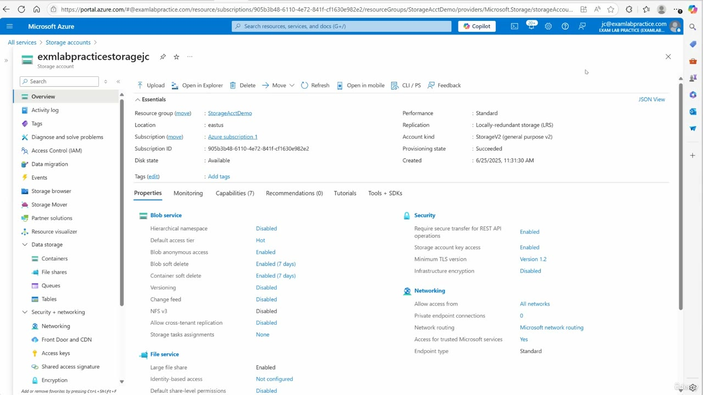
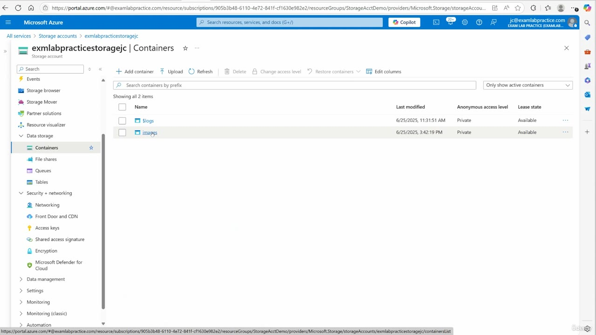
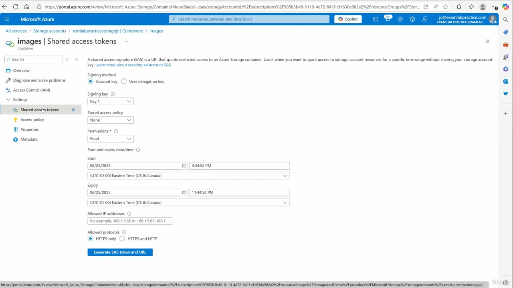
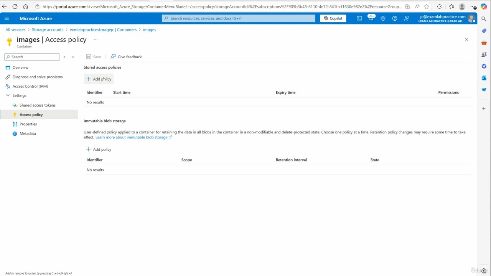
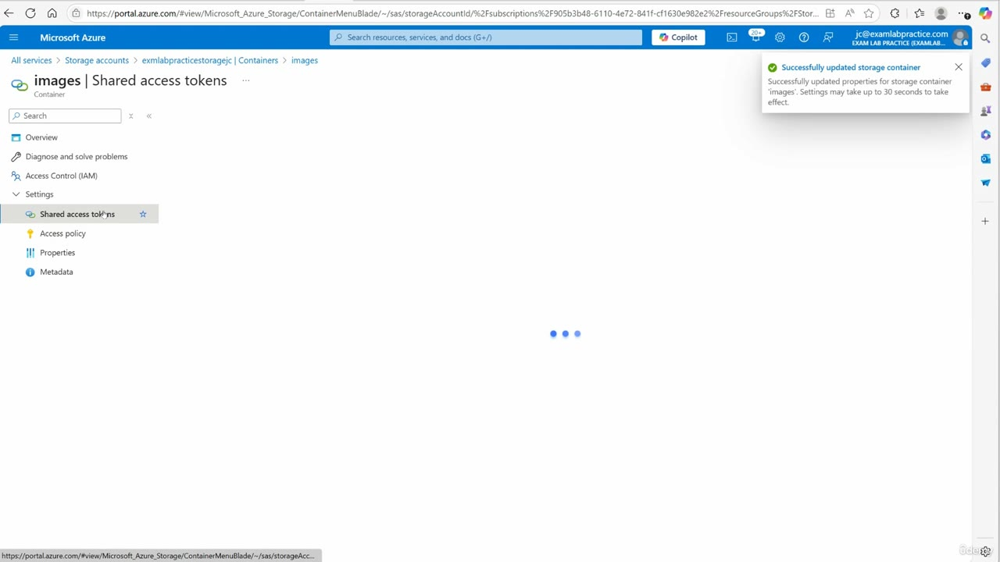
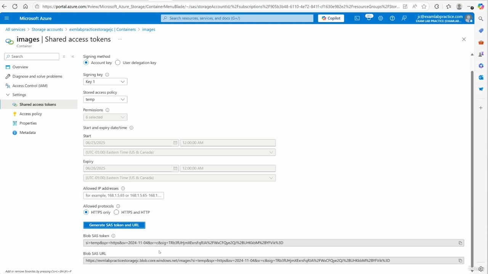

[Back to AZ-104: Microsoft Azure Administrator](../1.md)

# Chapter 49 — Configure stored access policies

## Table of Contents

- [Introduction](#introduction)
- [Detailed tutorial](#detailed-tutorial)
  - [Account SAS versus a container policy](#account-sas-versus-a-container-policy)
  - [Open the images container](#open-the-images-container)
  - [Shared access tokens before a policy](#shared-access-tokens-before-a-policy)
  - [The access policy blade](#the-access-policy-blade)
  - [Save the policy first](#save-the-policy-first)
  - [Generate the SAS from temp](#generate-the-sas-from-temp)
  - [Change the policy later](#change-the-policy-later)
  - [Immutable blob storage](#immutable-blob-storage)
- [Summary](#summary)
- [References](#references)
- [Questions and Answers](#questions-and-answers)
  - [Where do you create a stored access policy?](#question-1-where-the-policy-is-created)
  - [Which container receives the policy?](#question-2-which-container)
  - [What anonymous access level does images show?](#question-3-images-access-level)
  - [What signing method is selected on the container SAS form?](#question-4-signing-method)
  - [What is stored access policy set to before one is saved?](#question-5-policy-before-save)
  - [What permission is selected before the policy is applied?](#question-6-permission-before-policy)
  - [What identifier does the dropdown show after the save?](#question-7-policy-identifier)
  - [What start and expiry does the policy put on the SAS?](#question-8-policy-start-and-expiry)
  - [What has to happen before the policy appears in the dropdown?](#question-9-save-before-the-dropdown)
  - [How long can that container update take?](#question-10-toast-delay)
  - [Which SAS parameter carries the policy name?](#question-11-sas-policy-parameter)
  - [What does he say immutable blob storage is for?](#question-12-immutable-blob-storage)

## Introduction

Video chapter 49 of AZ-104. The lesson puts a stored access policy on one blob container, saves it, and generates a container shared access signature (SAS) from that policy. The same Access policy blade also shows immutable blob storage. He names that feature and does not add an immutability policy.

The captions say "SaaS tokens." Every blade on screen says SAS. Read the portal.

## Detailed tutorial

**AZ-104 Microsoft Azure Administrator** · [49 - Configure stored access policies.mp4](../../../../../course_videos/Course%20AZ-104%20Microsoft%20Azure%20Administrator%20course%20with%20SIMULATIONS/49%20-%20Configure%20stored%20access%20policies.mp4) · [Transcript](../../../../../course_videos/Course%20AZ-104%20Microsoft%20Azure%20Administrator%20course%20with%20SIMULATIONS/49%20-%20Configure%20stored%20access%20policies.txt)

<strong>Account SAS versus a container policy</strong>

He starts on the storage account. The earlier SAS work lived on the account itself, under Security + networking, on Shared access signature. This lesson is the container version: a policy that a SAS for one container can point at.

*Figure: 00:00. Storage account overview. Shared access signature is on the account menu. Containers is under Data storage.*

| | On this account |
| --- | --- |
| Name | exmlabpracticestoragejc |
| Resource group | StorageAcctDemo |
| Location | eastus |
| Kind | StorageV2 (general purpose v2) |
| Performance | Standard |
| Replication | Locally-redundant storage (LRS) |
| Created | 6/25/2025, 11:31:30 AM |
| Storage account key access | Enabled |
| Require secure transfer for REST API operations | Enabled |

Key access is enabled, so the container form can sign with an account key. The account also shows blob anonymous access enabled. That account switch is separate from the container access level, which is still Private on the next blade.

| | Account SAS, earlier in the course | Stored access policy, this lesson |
| --- | --- | --- |
| Where | Storage account, Shared access signature | One container, Settings, Access policy |
| Scope | The whole storage account | That container |
| What you keep | A token whose start, expiry, and permissions are on the token | An identifier, a permission set, and a start and expiry that later SAS tokens can reuse |

<strong>Open the images container</strong>

Data storage, then Containers. The list has two rows. He opens images.

*Figure: 00:34. Both containers are Private, and both leases are Available. He opens images.*

| Name | Last modified | Anonymous access level | Lease state |
| --- | --- | --- | --- |
| $logs | 6/25/2025, 11:31:51 AM | Private | Available |
| images | 6/25/2025, 3:42:19 PM | Private | Available |

$logs was created with the account. images was modified later the same afternoon. The policy in this lesson is only on images.

<strong>Shared access tokens before a policy</strong>

Inside images, Settings has two blades that matter: Shared access tokens and Access policy. He opens Shared access tokens first. This form can already mint a container SAS with no stored policy. Stored access policy is None, and Permissions is Read.

*Figure: 00:42. Container SAS form before a policy exists. Signing method is Account key, signing key is Key 1, and the policy dropdown is None.*

The portal text on that blade: a SAS is a URI that grants restricted access to an Azure Storage container, for a specific time range, without sharing the storage account key.

What this frame is actually set to:

- Signing method: Account key. User delegation key is the other radio, and it is not selected.
- Signing key: Key 1.
- Stored access policy: None.
- Permissions: Read.
- Start: 06/25/2025, 3:44:52 PM.
- Expiry: 06/25/2025, 11:44:52 PM. That is eight hours on the same day.
- Time zone: (UTC-05:00) Eastern Time (US & Canada).
- Allowed IP addresses: empty.
- Allowed protocols: HTTPS only.
- Generate SAS token and URL is on the form. This frame does not show a token yet.

<strong>The access policy blade</strong>

Access policy is the other item under Settings. The top section is Stored access policies. At 00:48 that table is empty. He is about to add the row. The bottom section is Immutable blob storage, also empty. That second section is a different feature, covered at the end.

*Figure: 00:48. Access policy on images. Stored access policies has no rows. Immutable blob storage has no rows.*

Stored access policies columns are Identifier, Start time, Expiry time, and Permissions. The add control is + Add policy. Save sits at the top of the blade. Nothing is stored until that Save.

He adds a policy and talks through the fields. The Add policy dialog itself is not in these frames. Use the values the SAS form shows after the save, because those are the values the portal kept:

- He says the identifier out loud as "temp policy." The dropdown and the SAS both use `temp`. Follow the screen.
- He sets permissions on the policy. The later form reports 6 selected. The checkboxes are not expanded in the video, so the lesson does not name the six.
- He says from today until tomorrow. The portal stores 06/25/2025 12:00:00 AM through 06/26/2025 12:00:00 AM Eastern. The recording day on the account is 6/25/2025, so "today" and "tomorrow" match those two dates, at midnight rather than at the clock time he was speaking.

<strong>Save the policy first</strong>

He leaves Access policy and starts toward Shared access tokens, then stops. The policy is not in the dropdown until the container is saved. He says he needs to save it first.

*Figure: 01:18. The tokens blade is still loading. The toast is the save result for container images.*

The toast reads:

- Successfully updated storage container.
- Successfully updated properties for storage container 'images'. Settings may take up to 30 seconds to take effect.

That 30 seconds is the portal's own warning. The policy can be missing from the dropdown for a short time after Save.

<strong>Generate the SAS from temp</strong>

Shared access tokens reloads with the new policy. Stored access policy is `temp`. He says the dates and the permissions are already filled in, and he generates the SAS.

*Figure: 01:30. Policy `temp` is selected. Permissions reads 6 selected. Start and expiry are the policy window. The blob SAS token and blob SAS URL are filled in.*

| | Ad hoc form at 00:42 | SAS after `temp` is selected |
| --- | --- | --- |
| Signing method | Account key | Account key |
| Signing key | Key 1 | Key 1 |
| Stored access policy | None | temp |
| Permissions | Read | 6 selected |
| Start | 06/25/2025 3:44:52 PM | 06/25/2025 12:00:00 AM |
| Expiry | 06/25/2025 11:44:52 PM | 06/26/2025 12:00:00 AM |
| Allowed protocols | HTTPS only | HTTPS only |
| Token on screen | Not generated yet | Present |

The time zone is still (UTC-05:00) Eastern Time (US & Canada). Allowed IP addresses stays empty.

The blob SAS URL is on the images container:

`https://exmlabpracticestoragejc.blob.core.windows.net/images`

The token on screen binds the policy with these parameters. The signature value is omitted here.

| Parameter | Value on screen | What it is doing |
| --- | --- | --- |
| si | temp | Signed identifier. This is the stored access policy name |
| spr | https | Allowed protocol, matching HTTPS only |
| sv | 2024-11-08 | Storage service version used to sign |
| sr | c | Signed resource. `c` is the container |

He treats that as the point of the feature. The policy already holds the dates and the permissions, so the SAS form picks them up when you choose `temp`, and Generate SAS token and URL writes a token that names the policy.

<strong>Change the policy later</strong>

He says you can change the policy on the fly. The path he describes is Access policy, edit, extend the dates or change the permissions, OK, then Save. He says the policy is altered as soon as that save finishes, which is why a stored policy is more useful than a one-off token whose dates are frozen in the URI.

The frames after the token is generated do not show that edit. At 01:34 the cursor sits on the expiry field of the same SAS form. At 01:38 the title bar reads images | Access policy, and the body is still the generated SAS for `temp`, with the same start, expiry, 6 selected permissions, and the same token. There is no edit dialog and no second toast. Take the change-on-the-fly steps from what he says. Take the completed values from the 01:30 form.

<strong>Immutable blob storage</strong>

The bottom of the same Access policy blade is Immutable blob storage. He does not click + Add policy there. The table stays empty: Identifier, Scope, Retention interval, State.

He describes it as a way to keep blob data from being modified. The name he wants you to remember is WORM, write once, read many. He gives three uses: a legal hold, time-based retention, or simply locking the data so it cannot be changed.

The blade text is tighter than the voiceover. A user-defined policy on the container retains the data in all blobs in that container in a non-modifiable and delete-protected state. You choose one policy at a time. Retention policy changes may require some time to take effect.

| | Stored access policy | Immutable blob storage |
| --- | --- | --- |
| On this blade | Top section | Bottom section |
| What it controls | Start, expiry, and permissions for SAS tokens on this container | Whether blob data in the container can be changed or deleted |
| His example | `temp`, today through tomorrow | WORM: legal hold, time-based retention, or a lock against changes |
| What he does in the video | Adds it, saves, generates a SAS | Names it, and leaves the table empty |

He closes on the stored access policy. Immutable storage is the extra control on the same page.

## Summary

- A stored access policy in this lesson is container scope. The account Shared access signature blade is the earlier, account-wide SAS.
- Open Data storage, Containers, images. That container is Private. Settings then splits into Shared access tokens and Access policy.
- Before any policy, the container SAS form uses Account key, Key 1, policy None, permission Read, and an eight-hour window on 06/25/2025. Protocol is HTTPS only.
- The policy identifier on screen is `temp`. He says "temp policy." The dropdown and `si=temp` are the values to remember.
- The policy window on screen is 06/25/2025 12:00:00 AM to 06/26/2025 12:00:00 AM, Eastern. After you select `temp`, permissions reads 6 selected.
- Save the container before the policy shows in the dropdown. The toast says the images update can take up to 30 seconds.
- The generated token carries `si=temp`, `spr=https`, `sv=2024-11-08`, and `sr=c`.
- He says you can edit the policy later, change dates or permissions, and Save. The later frames do not show that edit dialog.
- Immutable blob storage is the lower section of the same blade. WORM means write once, read many. He does not add that policy. The screen says one policy at a time, for data that is non-modifiable and delete-protected.

## References

- [49 - Configure stored access policies.mp4](../../../../../course_videos/Course%20AZ-104%20Microsoft%20Azure%20Administrator%20course%20with%20SIMULATIONS/49%20-%20Configure%20stored%20access%20policies.mp4)
- [Transcript](../../../../../course_videos/Course%20AZ-104%20Microsoft%20Azure%20Administrator%20course%20with%20SIMULATIONS/49%20-%20Configure%20stored%20access%20policies.txt)
- [AZ-104 study guide](https://learn.microsoft.com/en-us/credentials/certifications/resources/study-guides/az-104)
- [Define a stored access policy](https://learn.microsoft.com/en-us/rest/api/storageservices/define-stored-access-policy)

## Questions and Answers

<strong>Where do you create a stored access policy?</strong>

Where do you create the stored access policy in this lesson?

**Answer.** On the images container, under Settings, then Access policy. That blade is where he adds the identifier, the permissions, and the dates for a SAS that belongs to this container.

<strong>Which container receives the policy?</strong>

Which container does he open and attach the policy to?

**Answer.** images. The containers list also has $logs, and he goes into images before opening Access policy.

<strong>What anonymous access level does images show?</strong>

What anonymous access level does the images row show on the containers blade?

**Answer.** Private. The containers list shows Private for images, with lease state Available.

<strong>What signing method is selected on the container SAS form?</strong>

What signing method is selected when he generates the container SAS?

**Answer.** Account key, with signing key Key 1. Both the empty form and the form after `temp` is selected keep that same radio and the same key.

<strong>What is stored access policy set to before one is saved?</strong>

What does the Stored access policy dropdown show on the first Shared access tokens frame?

**Answer.** None. That frame is the container SAS form before Access policy has a saved row.

<strong>What permission is selected before the policy is applied?</strong>

What permission is selected on the container SAS form while the policy dropdown is still None?

**Answer.** Read. After `temp` is selected, that same field changes to 6 selected.

<strong>What identifier does the dropdown show after the save?</strong>

What identifier appears in the Stored access policy dropdown once the policy is saved?

**Answer.** temp. He says "temp policy" while he creates it, and the dropdown plus the SAS parameter `si` both use temp.

<strong>What start and expiry does the policy put on the SAS?</strong>

What start and expiry does the SAS form show after the stored access policy is selected?

**Answer.** Start 06/25/2025 12:00:00 AM and expiry 06/26/2025 12:00:00 AM, (UTC-05:00) Eastern Time (US & Canada). He calls that window today until tomorrow, and the portal stores it as those two midnights.

<strong>What has to happen before the policy appears in the dropdown?</strong>

Why does he turn around before the new policy shows under Shared access tokens?

**Answer.** The container has to be saved first. He says he needs to save it, and the policy shows up in the dropdown only after that save.

<strong>How long can that container update take?</strong>

What does the save toast say about how long the images container settings can take?

**Answer.** Up to 30 seconds. The toast says the properties for storage container images were updated, and that settings may take up to 30 seconds to take effect.

<strong>Which SAS parameter carries the policy name?</strong>

Which query parameter on the generated blob SAS token names the stored access policy?

**Answer.** si, set to temp. That signed identifier is how the token points at the policy whose dates and permissions were just saved.

<strong>What does he say immutable blob storage is for?</strong>

What does he say the immutable blob storage section is for?

**Answer.** Keeping blob data from being modified, which he calls WORM, write once, read many. He names legal hold, time-based retention, or a lock so nothing is changed, and the blade text says the data stays non-modifiable and delete-protected.

