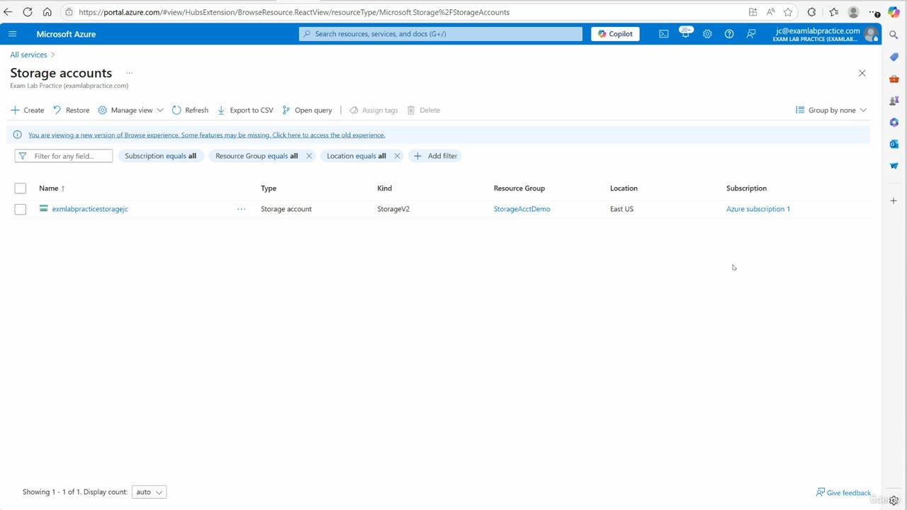
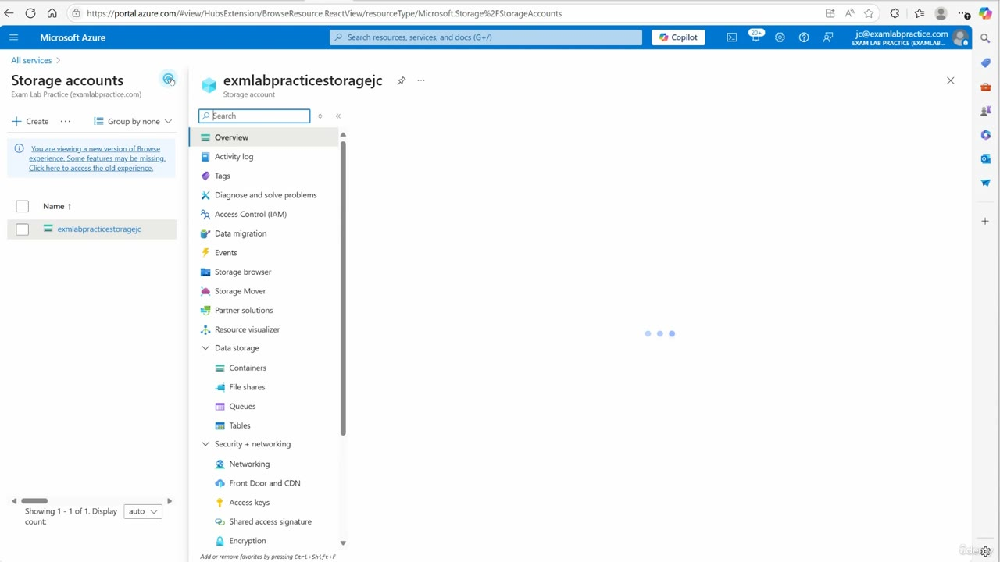
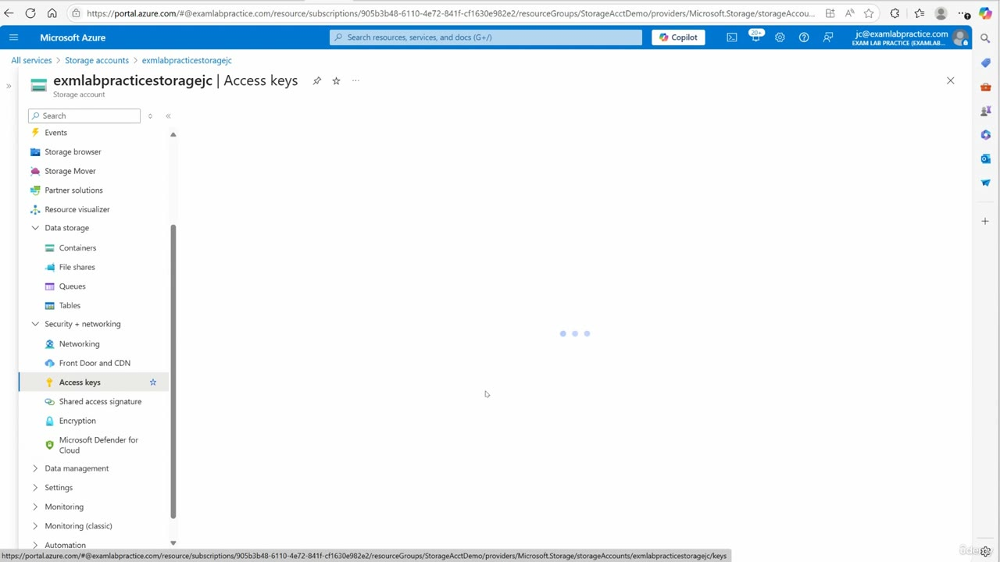

[Back to AZ-104: Microsoft Azure Administrator](../1.md)

# Chapter 50 — Manage access keys

## Table of Contents

- [Introduction](#introduction)
- [Detailed tutorial](#detailed-tutorial)
  - [The storage accounts list](#the-storage-accounts-list)
  - [Security + networking](#security-and-networking)
  - [What an access key allows](#what-an-access-key-allows)
  - [Two keys](#two-keys)
  - [Rotate one key at a time](#rotate-one-key-at-a-time)
  - [Key one in the connection string](#key-one-in-the-connection-string)
  - [Keep the key secret](#keep-the-key-secret)
- [Summary](#summary)
- [References](#references)
- [Questions and Answers](#questions-and-answers)
  - [Where does he open Access keys?](#question-1-where-access-keys-sits)
  - [Which storage account is on the list?](#question-2-account-name)
  - [What kind, resource group, and location does the row show?](#question-3-kind-group-location)
  - [What operations does he say an access key allows?](#question-4-operations)
  - [Which data services does he say the key covers?](#question-5-services)
  - [How many access keys does he say you get?](#question-6-how-many-keys)
  - [What does he compare an access key to?](#question-7-master-password)
  - [Which clients does he say can use a key?](#question-8-clients)
  - [How does he rotate without downtime?](#question-9-rotation)
  - [Which key goes in the image-upload connection string?](#question-10-connection-string-key)
  - [Where does he say an Azure key should be stored?](#question-11-key-vault)
  - [What does he want a web server to use?](#question-12-sas-for-web-servers)

## Introduction

Video chapter 50 of AZ-104. The lesson is the storage account access key: where it sits in the portal, what a client can do with it, and why he treats the pair as master passwords you rotate. He opens `exmlabpracticestoragejc` from the storage accounts list, then points at Security + networking, Access keys.

The Access keys pane on the last frame is still the three loading dots. Key values, connection strings, and a rotate control are his explanation. They are not painted on the blade.

## Detailed tutorial

**AZ-104 Microsoft Azure Administrator** · [50 - Manage access keys.mp4](../../../../../course_videos/Course%20AZ-104%20Microsoft%20Azure%20Administrator%20course%20with%20SIMULATIONS/50%20-%20Manage%20access%20keys.mp4) · [Transcript](../../../../../course_videos/Course%20AZ-104%20Microsoft%20Azure%20Administrator%20course%20with%20SIMULATIONS/50%20-%20Manage%20access%20keys.txt)

<strong>The storage accounts list</strong>

He starts on portal.azure.com, on the storage accounts list, signed in as jc@examlabpractice.com in the EXAM LAB PRACTICE directory. The list has one row. He opens that account.

*Figure: 00:00. Storage accounts. One row, StorageV2, in StorageAcctDemo, East US. A banner says this is a new browse experience and some features may be missing.*

| | On this list |
| --- | --- |
| Name | exmlabpracticestoragejc |
| Type | Storage account |
| Kind | StorageV2 |
| Resource group | StorageAcctDemo |
| Location | East US |
| Subscription | Azure subscription 1 |

The footer says showing 1 of 1.

<strong>Security + networking</strong>

The account blade opens with the resource menu. He says to look under Security + networking, and the item there is Access keys.

*Figure: 00:14. `exmlabpracticestoragejc` is open. Security + networking lists Networking, Front Door and CDN, Access keys, Shared access signature, and Encryption. The overview body is still the three loading dots.*

Data storage on that same menu is Containers, File shares, Queues, and Tables. Those four entries are the services he is about to say the key can reach.

He then selects Access keys. The blade title becomes `exmlabpracticestoragejc | Access keys`, and Access keys is the highlighted item. The body stays on the loading dots, so this recording never shows a key, a connection string, or a rotate button.

*Figure: 00:20. Access keys is selected. The title is the account name, then Access keys. Shared access signature is the next item. The key pane has not loaded.*

<strong>What an access key allows</strong>

He says an access key lets clients, apps, and services authenticate, and that the key has full access operations on the storage account. He spells those operations as read, write, and delete.

The scope is the whole account. He says the key reaches blobs, files, queues, and tables. His line is "you name it."

That is the account key, the same class of secret the earlier SAS work can be signed with. This lesson is the key itself. Shared access signature stays the next menu item, and he comes back to it when he talks about web servers.

<strong>Two keys</strong>

He says you get two access keys. He calls them base64-encoded secret keys, and he calls them master passwords. His summary line is that they are keys to the kingdom for the storage account.

He names three callers that can use a key:

1. An SDK. He expands that as a software developer kit.
2. A REST API. He expands that as representational state transfer, application programming interface, for developers.
3. Explorer.

He does not show a key value, a copy button, or a connection string on the blade. The two-key claim is what he says while Access keys is the selected item.

<strong>Rotate one key at a time</strong>

If he suspects a key is compromised, he rotates it. The reason the account has two keys, in this lesson, is so the rotation can happen while something is still authenticated.

| Moment | What the apps use | What he rotates |
| --- | --- | --- |
| While he rotates the first key | Key two, temporarily | The first key |
| After the apps are switched over | The key they were moved to | The second key |

He says that sequence has no downtime. He does not click a rotate control in the frames. The key pane is still loading, so the portal's button label is not on screen. The word he uses is rotate.

<strong>Key one in the connection string</strong>

His example is an app that uploads images to blob storage. He puts key one in the connection string.

He says that string gives the app full access to all the containers, blobs, and operations. The example is the same scope as the earlier point: one account key covers the account, not one container.

<strong>Keep the key secret</strong>

He stops on a security warning. Access keys are powerful and sensitive. He does not want them given out, and he does not want them left where anybody can read them.

What he wants instead:

- Store an Azure key in a secure place. The product he names is Azure Key Vault. He says the keys are secret.
- For a web server that needs data, use a shared access signature. That is the item directly under Access keys on the menu he has open.
- For an SDK, working with a developer, he says you might still hand over an access key if that developer needed it.

He closes the lesson there. The portal never shows a stored secret, a vault, or a generated SAS in this video.

## Summary

- Open the storage account, then Security + networking, then Access keys. On this recording the account is `exmlabpracticestoragejc`, kind StorageV2, resource group StorageAcctDemo, East US, Azure subscription 1.
- He says the key is full access: read, write, and delete, across blobs, files, queues, and tables.
- The account has two keys. He calls them base64-encoded secret keys, master passwords, and keys to the kingdom. Callers he names are an SDK, a REST API, and Explorer.
- Rotation: suspect a key, rotate one while apps temporarily use key two, switch the apps over, then rotate the second. He says there is no downtime. The rotate control is not on these frames.
- His image-upload app puts key one in the connection string and gets every container and blob operation.
- Keep the key in Azure Key Vault. For a web server, he wants a shared access signature. A developer who needs an SDK can still receive an access key.
- The Access keys body stays on the loading dots, so this chapter has no key value and no connection string from the screen.

## References

- [50 - Manage access keys.mp4](../../../../../course_videos/Course%20AZ-104%20Microsoft%20Azure%20Administrator%20course%20with%20SIMULATIONS/50%20-%20Manage%20access%20keys.mp4)
- [Transcript](../../../../../course_videos/Course%20AZ-104%20Microsoft%20Azure%20Administrator%20course%20with%20SIMULATIONS/50%20-%20Manage%20access%20keys.txt)
- [AZ-104 study guide](https://learn.microsoft.com/en-us/credentials/certifications/resources/study-guides/az-104)
- [Manage storage account access keys](https://learn.microsoft.com/en-us/azure/storage/common/storage-account-keys-manage)
- [Grant limited access to data with shared access signatures](https://learn.microsoft.com/en-us/azure/storage/common/storage-sas-overview)

## Questions and Answers

<strong>Where does he open Access keys?</strong>

Where is Access keys on the storage account he opens?

**Answer.** Under Security + networking. On the account menu it sits below Front Door and CDN and above Shared access signature. He selects it, and the blade title becomes `exmlabpracticestoragejc | Access keys`.

<strong>Which storage account is on the list?</strong>

Which storage account does he open from the storage accounts list?

**Answer.** exmlabpracticestoragejc. The list shows that one row, and the later blade title uses the same name.

<strong>What kind, resource group, and location does the row show?</strong>

What does the storage accounts row show for kind, resource group, and location?

**Answer.** Kind StorageV2, resource group StorageAcctDemo, location East US. The type column says Storage account, and the subscription column says Azure subscription 1.

<strong>What operations does he say an access key allows?</strong>

What operations does he say a client with an access key can perform on the storage account?

**Answer.** Read, write, and delete. He calls that full, complete access for clients, apps, and services that authenticate with the key.

<strong>Which data services does he say the key covers?</strong>

Which data services does he say the access key reaches?

**Answer.** Blobs, files, queues, and tables. He treats that as the whole account. The account menu lists those under Data storage as Containers, File shares, Queues, and Tables.

<strong>How many access keys does he say you get?</strong>

How many access keys does he say the storage account has?

**Answer.** Two. He calls them base64-encoded secret keys. The Access keys pane never finishes loading, so the two values are not on screen.

<strong>What does he compare an access key to?</strong>

What everyday object does he compare an access key to, and what phrase does he use for the pair?

**Answer.** A master password. He also calls the two keys the keys to the kingdom for the storage account.

<strong>Which clients does he say can use a key?</strong>

Which clients does he say can authenticate with an access key?

**Answer.** An SDK (software developer kit), a REST API (he expands it as representational state transfer, application programming interface), and Explorer.

<strong>How does he rotate without downtime?</strong>

How does he rotate a key while apps stay connected, and when does he say you do it?

**Answer.** Rotate one key while apps temporarily use key two. After the apps are switched over, rotate the second key. He says there is no downtime. He does this when he suspects a key has been compromised. No rotate control appears on the frames.

<strong>Which key goes in the image-upload connection string?</strong>

In his example of an app that uploads images to blob storage, which key goes in the connection string, and what access does he say that gives?

**Answer.** Key one. He says the app then has full access to all the containers, blobs, and operations.

<strong>Where does he say an Azure key should be stored?</strong>

Where does he say a secret Azure key should be kept?

**Answer.** In a secure place. The product he names is Azure Key Vault. He says the keys are secret and he does not want them given out.

<strong>What does he want a web server to use?</strong>

What does he want you to give a web server that needs data, and when does he still allow an access key?

**Answer.** A shared access signature, which is the menu item under Access keys. He still allows an access key for a developer who needs it for an SDK.

