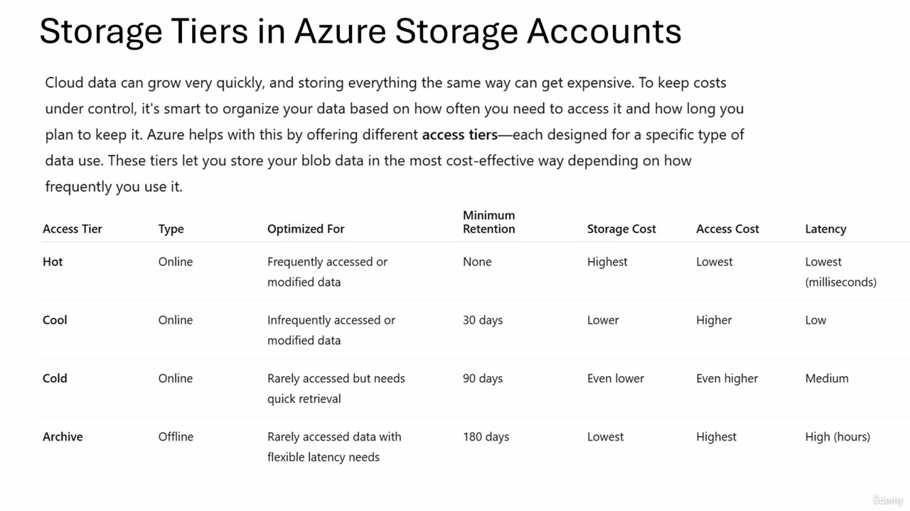
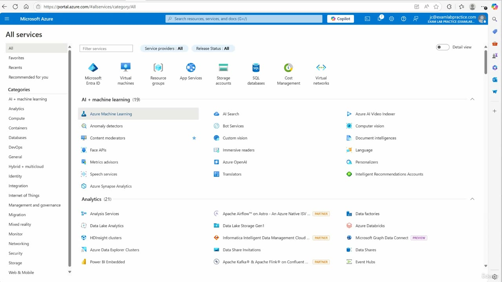
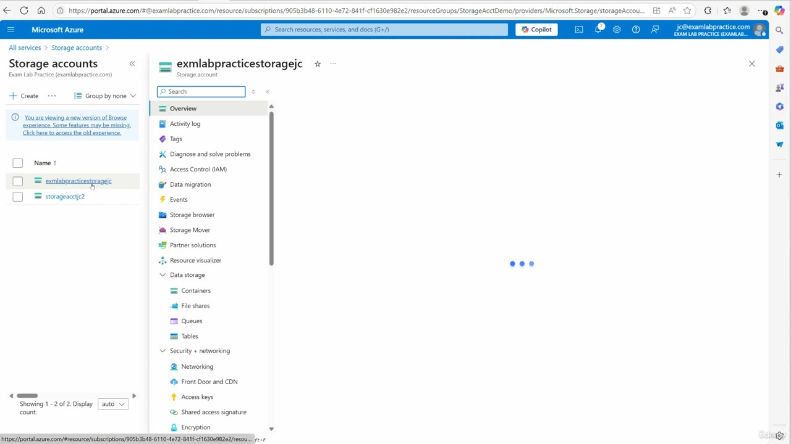
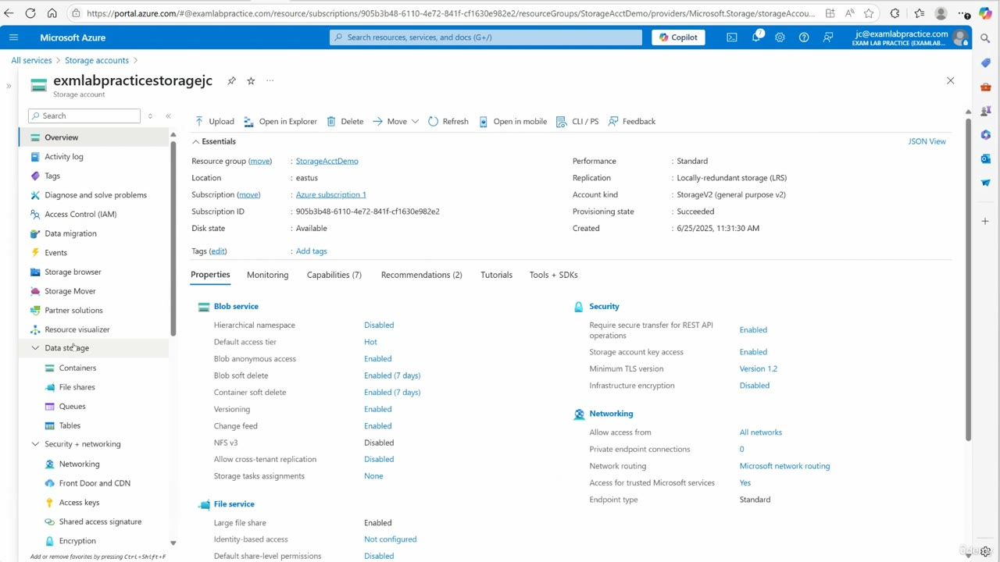

[Back to AZ-104: Microsoft Azure Administrator](../1.md)

# Chapter 59 — Configure storage tiers

## Table of Contents

- [Introduction](#introduction)
- [Detailed tutorial](#detailed-tutorial)
  - [Why the tiers exist](#why-the-tiers-exist)
  - [The four access tiers](#the-four-access-tiers)
  - [Hot](#hot)
  - [Cool](#cool)
  - [Cold](#cold)
  - [Archive](#archive)
  - [Open Storage accounts](#open-storage-accounts)
  - [Default access tier on the account](#default-access-tier-on-the-account)
  - [The blob he points at](#the-blob-he-points-at)
- [Summary](#summary)
- [References](#references)
- [Questions and Answers](#questions-and-answers)
  - [Which four access tiers does he walk through?](#question-1-four-tiers)
  - [Which tiers does the slide mark online?](#question-2-online-or-offline)
  - [What is hot optimized for, and what retention does it have?](#question-3-hot)
  - [How do storage cost and access cost move from hot toward archive?](#question-4-cost-direction)
  - [What latency does the slide give hot and archive?](#question-5-latency)
  - [What minimum retention does each cooler tier have?](#question-6-retention)
  - [What does he say archive is for?](#question-7-archive-use)
  - [Which storage account does he open?](#question-8-which-account)
  - [What default access tier does the overview show?](#question-9-default-tier)
  - [What performance, replication, and kind does that account show?](#question-10-account-kind)
  - [Which container does he open, and what tier is that blob on?](#question-11-images-blob)
  - [Where does he say you change a blob's tier?](#question-12-where-to-change)

## Introduction

Video chapter 59 of AZ-104. The lesson is blob access tiers: hot, cool, cold, and archive. He reads one comparison slide, then opens a storage account in the portal. The account overview shows the blob service default access tier as Hot. He then says a blob in the images container is already Hot, and that the ellipsis, then Properties, is where that blob's tiers are listed.

## Detailed tutorial

**AZ-104 Microsoft Azure Administrator** · [59 - Configure storage tiers.mp4](../../../../../course_videos/Course%20AZ-104%20Microsoft%20Azure%20Administrator%20course%20with%20SIMULATIONS/59%20-%20Configure%20storage%20tiers.mp4) · [Transcript](../../../../../course_videos/Course%20AZ-104%20Microsoft%20Azure%20Administrator%20course%20with%20SIMULATIONS/59%20-%20Configure%20storage%20tiers.txt)

<strong>Why the tiers exist</strong>

He treats "storage tiers" and "access tiers" as the same choice. The choice is for blob data inside a storage account.

Cloud data grows quickly. Storing every blob the same way gets expensive. The slide says to organize data by how often you access it and how long you plan to keep it, and to put blob data on the most cost-effective tier for that use. He wants the same thing: pick the tier on purpose, so storage cost stays under control.

<strong>The four access tiers</strong>

The slide stays up for the first two minutes. Read the columns with what he says. The slide is the grid. The voiceover is the reason each row exists.

*Figure: 00:00. Access tier, type, what it is optimized for, minimum retention, storage cost, access cost, and latency. Hot, cool, and cold are online. Archive is offline.*

| Access tier | Type | Optimized for | Minimum retention | Storage cost | Access cost | Latency |
| --- | --- | --- | --- | --- | --- | --- |
| Hot | Online | Frequently accessed or modified data | None | Highest | Lowest | Lowest (milliseconds) |
| Cool | Online | Infrequently accessed or modified data | 30 days | Lower | Higher | Low |
| Cold | Online | Rarely accessed but needs quick retrieval | 90 days | Even lower | Even higher | Medium |
| Archive | Offline | Rarely accessed data with flexible latency needs | 180 days | Lowest | Highest | High (hours) |

Storage cost falls as you move down the table. Access cost rises. Latency rises with it. He says you want the most cost-effective row for how often that blob is actually used.

<strong>Hot</strong>

Hot stores data online. He says it is for data you access or modify frequently, and that there is no minimum retention period. The slide's retention cell is None.

On cost, hot is the expensive row to store and the cheap row to read. He says storage cost is the highest and access cost is the lowest, because you are in the data very often. Latency is the lowest. He puts that at milliseconds.

<strong>Cool</strong>

Cool is the next online tier. He says it is for data you access or modify infrequently. The slide's minimum retention is 30 days. He says the minimum is usually 30 days.

Storage cost is lower than hot. Access cost is higher. Latency is low. He says it is still low, and that hot is lower.

<strong>Cold</strong>

Cold is still online. He says you can get to it, and that it is for rarely accessed data. The slide's optimized-for cell is more specific: rarely accessed, but it still needs quick retrieval.

Minimum retention on the slide is 90 days. The storage-cost cell is Even lower, and the access-cost cell is Even higher. After the 90 days he says "even lower than what you get with cool," then says the access cost is higher. Latency on the slide is Medium. He says it takes a little longer than the tiers above it.

<strong>Archive</strong>

Archive is the offline tier. He says the data is stored offline, for data you use very rarely. The slide says rarely accessed data with flexible latency needs.

Minimum retention is 180 days. Storage cost is the lowest. Access cost is the highest. He says it can take hours before you can pull the data in. The slide's latency cell is High (hours).

He names backups as the use. The closing line on the slide is the same one he started with: be deliberate about which tier you put on blob data in the storage account.

<strong>Open Storage accounts</strong>

He leaves the slide and goes to portal.azure.com. He says click the menu and go down to Storage accounts.

*Figure: 02:12. All services on portal.azure.com. Storage accounts sits in the top icon row, with Virtual machines, Resource groups, and the other favorites.*

The signed-in account on this portal is jc@examlabspractice.com, in the Exam Lab Practice directory.

He opens his storage account from the list. The list has two rows.

*Figure: 02:24. exmlabpracticestoragejc is selected. storageacctjc2 is the other row. Data storage is expanded. The overview pane is still the loading dots.*

| | On this list |
| --- | --- |
| Directory | Exam Lab Practice (examlabspractice.com) |
| Rows | 2 |
| Selected account | exmlabpracticestoragejc |
| Other account | storageacctjc2 |

The resource menu is already open on the selected account. Under Data storage the entries are Containers, File shares, Queues, and Tables. He calls Containers "storage containers." That is the next click. A banner on the browse pane says this is a new version of the Browse experience and that some features may be missing.

<strong>Default access tier on the account</strong>

The overview finishes loading on exmlabpracticestoragejc. The tier for this lesson is in the Blob service block: Default access tier is Hot.

*Figure: 02:26. Storage account overview. Blob service, Default access tier, Hot. Performance is Standard, replication is LRS, kind is StorageV2.*

| | Essentials |
| --- | --- |
| Name | exmlabpracticestoragejc |
| Resource group | StorageAcctDemo |
| Location | eastus |
| Subscription | Azure subscription 1 |
| Subscription ID | 905b3b48-6110-4e72-841f-cf1630e982e2 |
| Disk state | Available |
| Performance | Standard |
| Replication | Locally-redundant storage (LRS) |
| Account kind | StorageV2 (general purpose v2) |
| Provisioning state | Succeeded |
| Created | 6/25/2025, 11:31:30 AM |

The same Blob service block is where the default tier sits:

| Blob service | Value |
| --- | --- |
| Hierarchical namespace | Disabled |
| Default access tier | Hot |
| Blob anonymous access | Enabled |
| Blob soft delete | Enabled (7 days) |
| Container soft delete | Enabled (7 days) |
| Versioning | Enabled |
| Change feed | Enabled |
| NFS v3 | Disabled |
| Allow cross-tenant replication | Disabled |
| Storage task assignments | None |

That Hot value is the account default for blob data. The per-blob tier is the next step he describes. Security on this same page shows secure transfer required, storage account key access enabled, minimum TLS version 1.2, and infrastructure encryption disabled. Networking allows all networks, with Microsoft network routing.

<strong>The blob he points at</strong>

He goes to Containers and opens the images container. He says the blobs there show the current tier, and that this one is Hot.

The frame of that container is still the loading dots. The breadcrumb reads Storage accounts, exmlabpracticestoragejc, Containers, images. The Hot value he gives that blob is from the narration while that pane is loading. What he says he does next:

1. Look at the blobs in images. The one he is pointing at is Hot.
2. Click the ellipsis on that blob.
3. Open Properties.
4. Read the tiers listed there. He says that list is how you change the tier.

The caption says "changed." He is describing the place on the blob where the tiers are listed. The recording ends once that path is named. The account default on the overview, and the blob he describes, are both Hot.

## Summary

- Access tiers in this lesson are hot, cool, cold, and archive, and he is talking about blob data.
- Hot, cool, and cold are online. Archive is offline.
- Hot has no minimum retention, the highest storage cost, the lowest access cost, and millisecond latency.
- Cool is infrequent data, 30 days (he says usually 30 days), lower storage cost, higher access cost, low latency.
- Cold is rarely accessed data that still needs quick retrieval, 90 days, even lower storage cost, even higher access cost, medium latency.
- Archive is rarely used data, 180 days, the lowest storage cost, the highest access cost, and hours to retrieve. He names backups.
- Storage cost falls from hot to archive. Access cost and latency rise.
- Portal path: menu, Storage accounts, exmlabpracticestoragejc. The other account on the list is storageacctjc2.
- The account is StorageV2, Standard, LRS, eastus, resource group StorageAcctDemo. Blob service default access tier is Hot.
- He says the images container has a blob already on Hot, and that the ellipsis, then Properties, lists the tiers you can switch to.

## References

- [59 - Configure storage tiers.mp4](../../../../../course_videos/Course%20AZ-104%20Microsoft%20Azure%20Administrator%20course%20with%20SIMULATIONS/59%20-%20Configure%20storage%20tiers.mp4)
- [Transcript](../../../../../course_videos/Course%20AZ-104%20Microsoft%20Azure%20Administrator%20course%20with%20SIMULATIONS/59%20-%20Configure%20storage%20tiers.txt)
- [Study guide for Exam AZ-104: Microsoft Azure Administrator](https://learn.microsoft.com/en-us/credentials/certifications/resources/study-guides/az-104)
- [AZ-104: Manage storage](https://learn.microsoft.com/en-us/training/paths/az-104-manage-storage/)
- [Access tiers for blob data](https://learn.microsoft.com/en-us/azure/storage/blobs/access-tiers-overview)
- [Assign blob access tiers](https://learn.microsoft.com/en-us/training/modules/configure-blob-storage/4-create-blob-access-tiers)

## Questions and Answers

<strong>Which four access tiers does he walk through?</strong>

**Answer.** Hot, cool, cold, and archive. He calls them storage tiers or access tiers, and he is talking about blob data.

<strong>Which tiers does the slide mark online?</strong>

**Answer.** Hot, cool, and cold are Online. Archive is Offline. He says archive data is stored offline, and that the three tiers above it are data you can still get to.

<strong>What is hot optimized for, and what retention does it have?</strong>

**Answer.** Frequently accessed or modified data. Minimum retention is None. He says there is no minimum retention period, storage cost is the highest, access cost is the lowest, and latency is down to milliseconds.

<strong>How do storage cost and access cost move from hot toward archive?</strong>

**Answer.** Storage cost falls: Highest, Lower, Even lower, Lowest. Access cost rises: Lowest, Higher, Even higher, Highest. He wants the row whose storage cost matches how rarely you touch the blob.

<strong>What latency does the slide give hot and archive?</strong>

**Answer.** Hot is Lowest (milliseconds). Archive is High (hours). Cool is Low. Cold is Medium. He says cool is low and hot is lower, cold takes a little longer, and archive can take hours before you can pull the data in.

<strong>What minimum retention does each cooler tier have?</strong>

**Answer.** Cool is 30 days. He says usually 30 days. Cold is 90 days. Archive is 180 days. Hot is None.

<strong>What does he say archive is for?</strong>

**Answer.** Very rarely used data, and he names backups. The slide says rarely accessed data with flexible latency needs. It is the offline tier, with the lowest storage cost and the highest access cost.

<strong>Which storage account does he open?</strong>

**Answer.** exmlabpracticestoragejc. The Storage accounts list also has storageacctjc2. The directory on the portal is Exam Lab Practice (examlabspractice.com), and the signed-in user is jc@examlabspractice.com.

<strong>What default access tier does the overview show?</strong>

**Answer.** Hot. It is under Blob service, on the label Default access tier. That is the account default. The blob tier he describes later is a separate setting on the blob.

<strong>What performance, replication, and kind does that account show?</strong>

**Answer.** Performance Standard, replication Locally-redundant storage (LRS), account kind StorageV2 (general purpose v2). Location eastus, resource group StorageAcctDemo, subscription Azure subscription 1, provisioning state Succeeded, created 6/25/2025, 11:31:30 AM.

<strong>Which container does he open, and what tier is that blob on?</strong>

**Answer.** images, under Containers. He says the blob he is looking at is Hot. That container's frame is still the loading dots, so the Hot value is what he says.

<strong>Where does he say you change a blob's tier?</strong>

**Answer.** On the blob: the ellipsis, then Properties. He says the tiers are listed there, and that list is how you change it. The caption word is "changed." The recording ends on that description.

