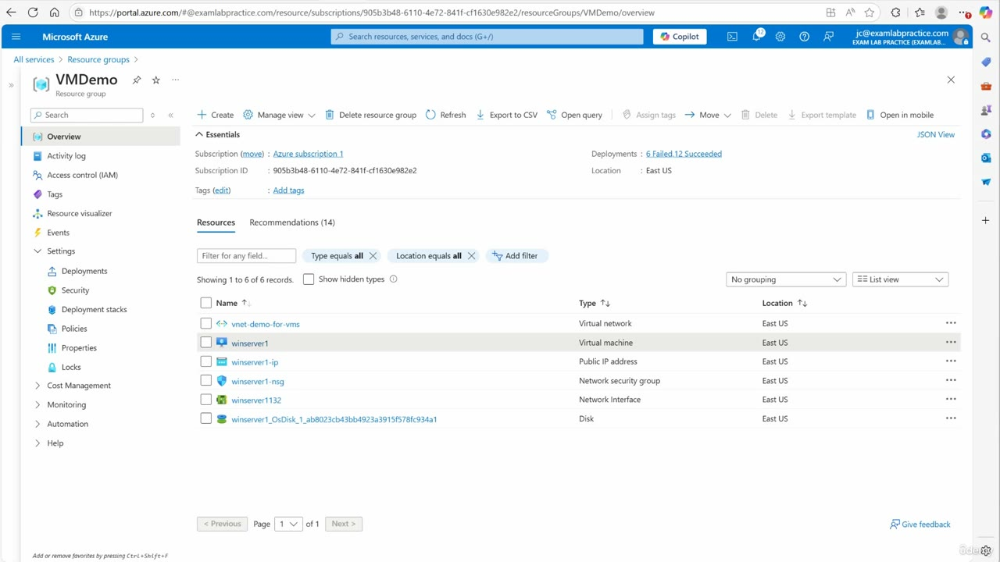
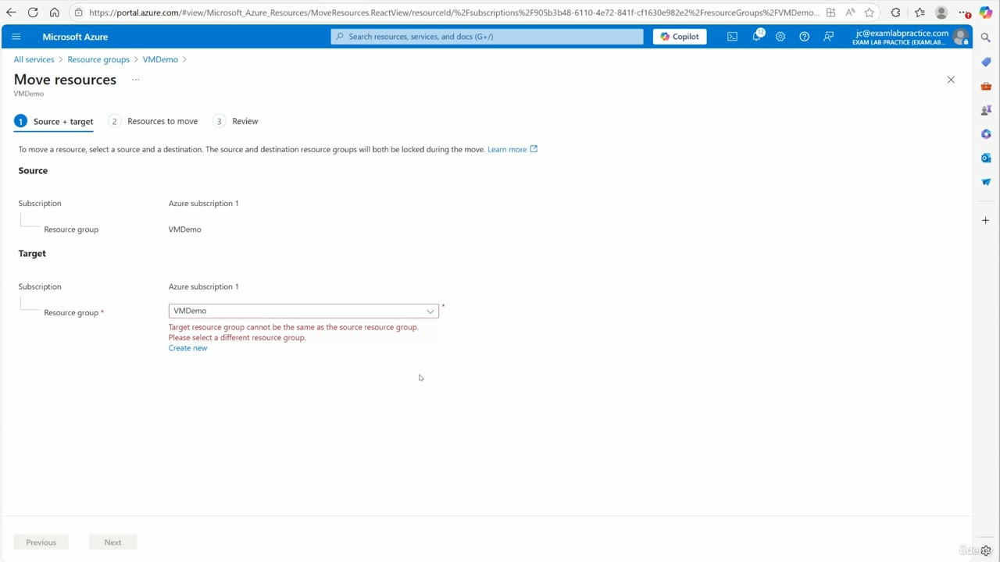
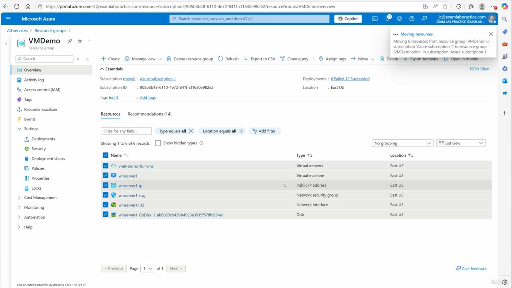
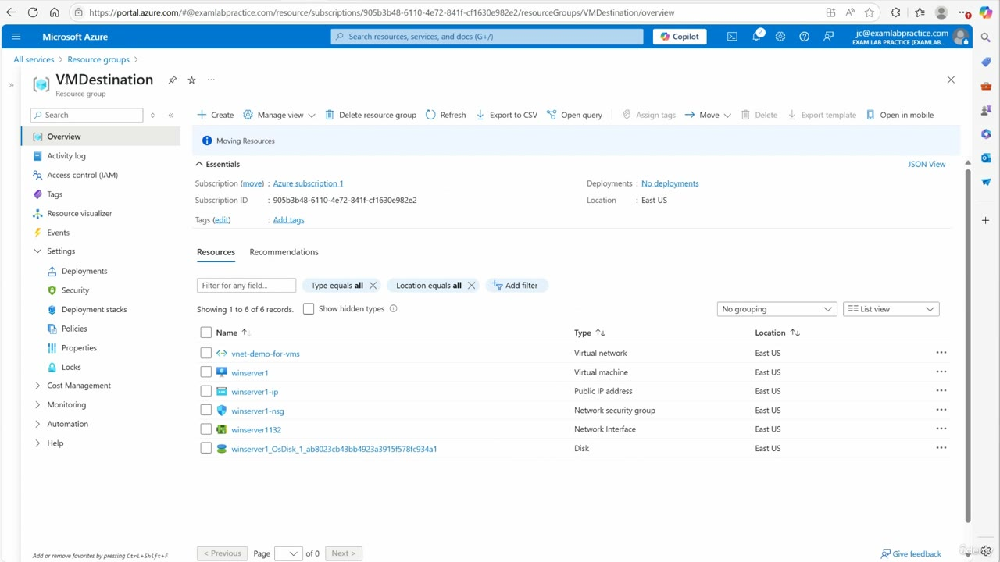
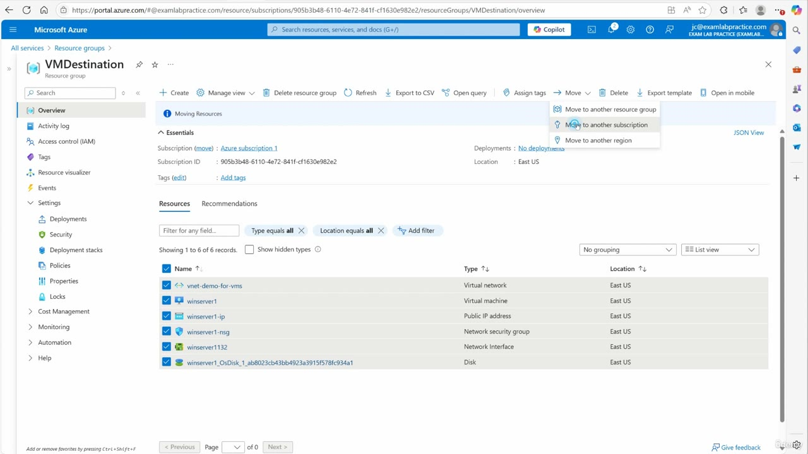

[Back to AZ-104: Microsoft Azure Administrator](../1.md)

# Chapter 71 — Move a virtual machine to another resource group, subscription, or region

## Table of Contents

- [Introduction](#introduction)
- [Detailed tutorial](#detailed-tutorial)
  - [When a move comes up](#when-a-move-comes-up)
  - [Open the source resource group](#open-the-source-resource-group)
  - [Select the resources and choose a resource group](#select-the-resources-and-choose-a-resource-group)
  - [Source and target](#source-and-target)
  - [Validate, review, and the resource ID checkbox](#validate-review-and-the-resource-id-checkbox)
  - [The moving notification](#the-moving-notification)
  - [Confirm the resources in VMDestination](#confirm-the-resources-in-vmdestination)
  - [The subscription command and the region command](#the-subscription-command-and-the-region-command)
- [Summary](#summary)
- [References](#references)
- [Questions and Answers](#questions-and-answers)
  - [Where does he start the move?](#where-does-he-start-the-move)
  - [Which resources are in the source resource group?](#which-resources-are-in-the-source-resource-group)
  - [What commands does the Move menu list?](#what-commands-does-the-move-menu-list)
  - [Which Move command does he finish?](#which-move-command-does-he-finish)
  - [What does Source + target show before a new resource group exists?](#what-does-source--target-show-before-a-new-resource-group-exists)
  - [What resource group does he create from the wizard?](#what-resource-group-does-he-create-from-the-wizard)
  - [What does the wizard do after the first Next?](#what-does-the-wizard-do-after-the-first-next)
  - [What does he acknowledge before he clicks Move?](#what-does-he-acknowledge-before-he-clicks-move)
  - [What does the notification report while the move runs?](#what-does-the-notification-report-while-the-move-runs)
  - [How does he confirm the resources changed resource groups?](#how-does-he-confirm-the-resources-changed-resource-groups)
  - [What subscription and location do the resources keep?](#what-subscription-and-location-do-the-resources-keep)
  - [What does he say about a subscription move and a region move?](#what-does-he-say-about-a-subscription-move-and-a-region-move)

## Introduction

Video chapter 71 of the AZ-104 Microsoft Azure Administrator course. The study guide lists **Move a virtual machine to another resource group, subscription, or region** under Create and configure virtual machines, in Deploy and manage Azure compute resources (20–25%). The lesson is the portal **Move** menu on a resource group.

He finishes one move. Six resources, including the virtual machine **winserver1**, leave resource group **VMDemo** and land in **VMDestination**. Both groups are in **Azure subscription 1**. Every row stays in **East US**.

The same menu has **Move to another subscription** and **Move to another region**. He opens it and names those two commands. He does not run either wizard. A subscription move, in his words, needs a different subscription, and this blade has one.

## Detailed tutorial

**AZ-104 Microsoft Azure Administrator** · [video](../../../../../course_videos/Course%20AZ-104%20Microsoft%20Azure%20Administrator%20course%20with%20SIMULATIONS/71%20-%20Move%20a%20virtual%20machine%20to%20another%20resource%20group%2C%20subscription%2C%20or%20region.mp4) · [Transcript](../../../../../course_videos/Course%20AZ-104%20Microsoft%20Azure%20Administrator%20course%20with%20SIMULATIONS/71%20-%20Move%20a%20virtual%20machine%20to%20another%20resource%20group%2C%20subscription%2C%20or%20region.txt)

<strong>When a move comes up</strong>

He opens with the case that shows up later in an Azure career: resources need to move from one place to another. The example he wants on screen is a virtual machine. The rest of the recording is that move, done from the resource group that already holds the virtual machine and the resources that sit with it.

He says the same pattern is how you move objects around inside Azure. This pass uses the portal. He is on portal.azure.com.

<strong>Open the source resource group</strong>

He is inside the resource group he calls VM demo. The portal name is **VMDemo**. Overview is selected. Nothing in the resource grid is checked yet.

*Figure: 00:00. Resource group VMDemo, Overview. Six resources, all in East US. The Move button is on the command bar. No row is selected.*

Essentials on that page:

| Field | What the portal shows |
| --- | --- |
| Subscription | Azure subscription 1 |
| Subscription ID | 905b3b48-6110-4e72-841f-cf1630e982e2 |
| Deployments | 6 Failed, 12 Succeeded |
| Location | East US |
| Tags | Add tags |

The grid is filtered with **Type equals all** and **Location equals all**. It says showing 1 to 6 of 6 records. Recommendations (14) is the other tab. He stays on Resources.

| Name | Type | Location |
| --- | --- | --- |
| vnet-demo-for-vms | Virtual network | East US |
| winserver1 | Virtual machine | East US |
| winserver1-ip | Public IP address | East US |
| winserver1-nsg | Network security group | East US |
| winserver1132 | Network interface | East US |
| winserver1_OsDisk_1_ab8023cb43bb4923a3915f78fc934a1 | Disk | East US |

The virtual machine is **winserver1**. The rows around it are the virtual network, the public IP, the network security group, the network interface, and the OS disk. Those six are the set he moves.

<strong>Select the resources and choose a resource group</strong>

He selects the resources on that page. The command bar **Move** control is a dropdown. He reads three commands:

1. Move to a different resource group.
2. Move to a different subscription.
3. Move to a different region.

He chooses **move to a different resource group**. The labels on the later frame of the same menu are **Move to another resource group**, **Move to another subscription**, and **Move to another region**. That frame is on VMDestination after this move, with the subscription command highlighted. The three commands are the same menu.

<strong>Source and target</strong>

The blade is **Move resources**, scoped to VMDemo. The steps across the top are **1 Source + target**, **2 Resources to move**, and **3 Review**.

*Figure: 00:38. Move resources, step 1, Source + target. Source is Azure subscription 1 / VMDemo. The target resource group is still VMDemo, so the page errors and offers Create new.*

The line under the step titles is the lock: to move a resource, select a source and a destination. The source and destination resource groups will both be locked during the move. A **Learn more** link sits on that sentence.

Source on this frame:

| Field | Value |
| --- | --- |
| Subscription | Azure subscription 1 |
| Resource group | VMDemo |

Target on this frame:

| Field | Value |
| --- | --- |
| Subscription | Azure subscription 1 |
| Resource group | VMDemo, and the page rejects it |

The error under the target resource group is: **Target resource group cannot be the same as the source resource group. Please select a different resource group.** **Create new** is the link under that error.

He says you can create the destination resource group beforehand. He can also create it from here. He clicks create, names it VM destination, and clicks OK. The portal name on every later frame is **VMDestination**. The target subscription on this frame stays **Azure subscription 1**, which is why this pass is a resource-group move inside one subscription.

<strong>Validate, review, and the resource ID checkbox</strong>

He clicks **Next**. The wizard validates that the resources can be moved. He pauses the recording while that validation runs. When it finishes, he clicks **Next** again. That page is the review.

On review he checks the acknowledgment. The sentence he reads is that tools and scripts associated with the moved resources will not work until he updates them to use the new resource IDs. His reason: scripts or tools that were written against the old IDs, including IDs that involve the old resource group, have to be updated.

A resource ID has this shape:

`/subscriptions/{subscriptionId}/resourceGroups/{resourceGroupName}/providers/{resourceProviderNamespace}/{resourceType}/{resourceName}`

On this move the resource group segment changes from **VMDemo** to **VMDestination**. The subscription ID on both groups is `905b3b48-6110-4e72-841f-cf1630e982e2`. The [move article](https://learn.microsoft.com/en-us/azure/azure-resource-manager/management/move-resource-group-and-subscription) documents the same portal sequence he uses: validation, then the acknowledgment that tools and scripts need the new resource IDs, then **Move**. It also states that this kind of move changes the resource group in the resource ID, and the resource stays in its region.

He then clicks **Move** and pauses the recording while the resources move.

<strong>The moving notification</strong>

The notification that is on screen is the in-progress one. He is still on the VMDemo overview. All six rows are checked.

*Figure: 01:38. VMDemo, with every row selected. The notification says it is moving 6 resources from VMDemo to VMDestination, both in Azure subscription 1.*

The notification text:

> Moving resources. Moving 6 resources from resource group 'VMDemo' in subscription 'Azure subscription 1' to resource group 'VMDestination' in subscription 'Azure subscription 1'.

The count is six, which matches the grid: virtual network, virtual machine, public IP, network security group, network interface, and disk. The source group and the target group in that sentence are both in **Azure subscription 1**.

<strong>Confirm the resources in VMDestination</strong>

After the pause he says he has the move-complete message. The rows are still listed on VMDemo. He refreshes that page, and he says they are gone.

He then opens **VMDestination**. The same six resources are listed there. He says the move went smoothly.

*Figure: 01:54. Resource group VMDestination. The six resources are listed, all East US. An info banner still reads Moving Resources. Deployments says No deployments.*

Essentials on the destination:

| Field | What the portal shows |
| --- | --- |
| Subscription | Azure subscription 1 |
| Subscription ID | 905b3b48-6110-4e72-841f-cf1630e982e2 |
| Deployments | No deployments |
| Location | East US |
| Tags | Add tags |

The subscription ID matches VMDemo. The info banner on this page still reads **Moving Resources**. The grid says showing 1 to 6 of 6 records. Checkboxes on this frame are clear. The rows:

| Name | Type | Location |
| --- | --- | --- |
| vnet-demo-for-vms | Virtual network | East US |
| winserver1 | Virtual machine | East US |
| winserver1-ip | Public IP address | East US |
| winserver1-nsg | Network security group | East US |
| winserver1132 | Network interface | East US |
| winserver1_OsDisk_1_ab8023cb43bb4923a3915f78fc934a1 | Disk | East US |

VMDemo's Essentials line was **6 Failed, 12 Succeeded**. VMDestination's Deployments line is **No deployments**. The resource rows moved. That deployment count did not come with them onto this page.

Location on every destination row is **East US**, the same location column VMDemo showed before the move.

<strong>The subscription command and the region command</strong>

He goes back to the Move menu from VMDestination, with the six resources selected again. The **Moving Resources** banner is still on the page. **Move to another subscription** is the highlighted command.

*Figure: 02:08. VMDestination, six resources selected. Move is open: Move to another resource group, Move to another subscription, Move to another region.*

| Command on the menu | What he does with it in this recording |
| --- | --- |
| Move to another resource group | Finishes it. VMDemo to VMDestination, inside Azure subscription 1 |
| Move to another subscription | Highlights the command. Says the move needs a different subscription. Does not run the wizard |
| Move to another region | Points at this command and calls it the wizard for a region move. Does not open it |

He says you can walk the subscription wizard, and you have to have a different subscription to move to. Source and target on the resource-group blade were both **Azure subscription 1**.

He says a move to a different region uses the region command on this menu. The resources he already moved still show **East US** in the Location column. The region command is the separate wizard. This recording stops on the menu.

## Summary

- The study-guide task is the portal **Move** menu: another resource group, another subscription, or another region.
- He starts on portal.azure.com in resource group **VMDemo**, subscription **Azure subscription 1**, subscription ID `905b3b48-6110-4e72-841f-cf1630e982e2`, location **East US**.
- The six rows he moves are **vnet-demo-for-vms**, **winserver1**, **winserver1-ip**, **winserver1-nsg**, **winserver1132**, and the OS disk **winserver1_OsDisk_1_ab8023cb43bb4923a3915f78fc934a1**.
- The Move blade steps are **Source + target**, **Resources to move**, and **Review**. Source and destination resource groups are both locked during the move.
- The target resource group cannot be the source. He creates **VMDestination** from **Create new** and clicks OK. He says the group can also exist before you open Move.
- Next runs validation. The next Next is review. He checks the box that tools and scripts need the new resource IDs, then clicks **Move**.
- The notification reports 6 resources moving from VMDemo to VMDestination, both in Azure subscription 1. A refresh clears VMDemo. VMDestination lists the same six resources, still **East US**.
- VMDestination Essentials says **No deployments**. VMDemo had shown **6 Failed, 12 Succeeded**.
- **Move to another subscription** needs a different subscription. **Move to another region** is the other wizard. He does not run either one. The completed move leaves the location as East US and changes the resource group segment of the resource ID.

## References

- [71 - Move a virtual machine to another resource group, subscription, or region.mp4](../../../../../course_videos/Course%20AZ-104%20Microsoft%20Azure%20Administrator%20course%20with%20SIMULATIONS/71%20-%20Move%20a%20virtual%20machine%20to%20another%20resource%20group%2C%20subscription%2C%20or%20region.mp4)
- [Transcript](../../../../../course_videos/Course%20AZ-104%20Microsoft%20Azure%20Administrator%20course%20with%20SIMULATIONS/71%20-%20Move%20a%20virtual%20machine%20to%20another%20resource%20group%2C%20subscription%2C%20or%20region.txt)
- [Study guide for Exam AZ-104: Microsoft Azure Administrator](https://learn.microsoft.com/en-us/credentials/certifications/resources/study-guides/az-104)
- [Move Azure resources to a new resource group or subscription](https://learn.microsoft.com/en-us/azure/azure-resource-manager/management/move-resource-group-and-subscription)
- [Move Azure VMs across regions with Azure Resource Mover](https://learn.microsoft.com/en-us/azure/resource-mover/tutorial-move-region-virtual-machines)

## Questions and Answers

<strong>Where does he start the move?</strong>

**Answer.** portal.azure.com, inside resource group **VMDemo**, on Overview. Essentials shows subscription **Azure subscription 1**, subscription ID `905b3b48-6110-4e72-841f-cf1630e982e2`, location **East US**, and deployments **6 Failed, 12 Succeeded**. He calls the group VM demo. The portal label is VMDemo. No resource row is selected on the opening frame. **Move** is on the command bar.

<strong>Which resources are in the source resource group?</strong>

**Answer.** Six resources, all in **East US**:

- **vnet-demo-for-vms**, virtual network
- **winserver1**, virtual machine
- **winserver1-ip**, public IP address
- **winserver1-nsg**, network security group
- **winserver1132**, network interface
- **winserver1_OsDisk_1_ab8023cb43bb4923a3915f78fc934a1**, disk

The grid says showing 1 to 6 of 6 records, with filters Type equals all and Location equals all. The later notification counts the same six.

<strong>What commands does the Move menu list?</strong>

**Answer.** Three. He names them as move to a different resource group, move to a different subscription, and move to a different region. The menu on the VMDestination frame labels them **Move to another resource group**, **Move to another subscription**, and **Move to another region**.

<strong>Which Move command does he finish?</strong>

**Answer.** **Move to another resource group.** The resources leave **VMDemo** and show up in **VMDestination**. He highlights **Move to another subscription** and points at **Move to another region**. He does not run those two wizards.

<strong>What does Source + target show before a new resource group exists?</strong>

**Answer.** The blade is **Move resources** for VMDemo. The steps are **1 Source + target**, **2 Resources to move**, and **3 Review**. Source is **Azure subscription 1** and **VMDemo**. Target subscription is **Azure subscription 1**. The target resource group is still **VMDemo**, and the page says the target resource group cannot be the same as the source resource group. **Create new** is the link under that error. The page also says the source and destination resource groups will both be locked during the move.

<strong>What resource group does he create from the wizard?</strong>

**Answer.** **VMDestination**. He says you can create the destination resource group before you start, and he can also create it from the wizard. He clicks create, calls it VM destination, and clicks OK. Every later frame spells the portal name **VMDestination**. The notification and the destination overview both use that name.

<strong>What does the wizard do after the first Next?</strong>

**Answer.** It validates that the resources can be moved. He pauses the recording while validation runs. When validation is done he clicks **Next** again, and that page is the review.

<strong>What does he acknowledge before he clicks Move?</strong>

**Answer.** He checks the review box that tools and scripts associated with the moved resources will not work until he updates them to use the new resource IDs. His explanation is that scripts or tools built around the old IDs, including IDs that involve the old resource group, have to be updated. On this move the resource group segment of the ID changes from **VMDemo** to **VMDestination**. He then clicks **Move**.

<strong>What does the notification report while the move runs?</strong>

**Answer.** **Moving resources.** It is moving **6** resources from resource group **VMDemo** in subscription **Azure subscription 1** to resource group **VMDestination** in subscription **Azure subscription 1**. The VMDemo grid behind that toast still has all six rows checked.

<strong>How does he confirm the resources changed resource groups?</strong>

**Answer.** He says a move-complete message arrives. The rows are still listed on VMDemo until he refreshes, and then he says they are gone. **VMDestination** lists the same six resources. He says the move went smoothly. That destination page still shows a **Moving Resources** banner, and its Deployments line says **No deployments**. VMDemo had shown **6 Failed, 12 Succeeded**.

<strong>What subscription and location do the resources keep?</strong>

**Answer.** Subscription **Azure subscription 1**, and the same subscription ID, `905b3b48-6110-4e72-841f-cf1630e982e2`, on both resource groups. Location on every row before the move and after it is **East US**. The resource group name is what changed.

<strong>What does he say about a subscription move and a region move?</strong>

**Answer.** A move to another subscription uses that wizard, and he says you have to have a different subscription to move to. This recording's source and target are both **Azure subscription 1**, and he does not run the subscription wizard. A move to another region uses the region command on the same Move menu. He calls that the wizard and does not open it. The resources he already moved still show **East US**.

