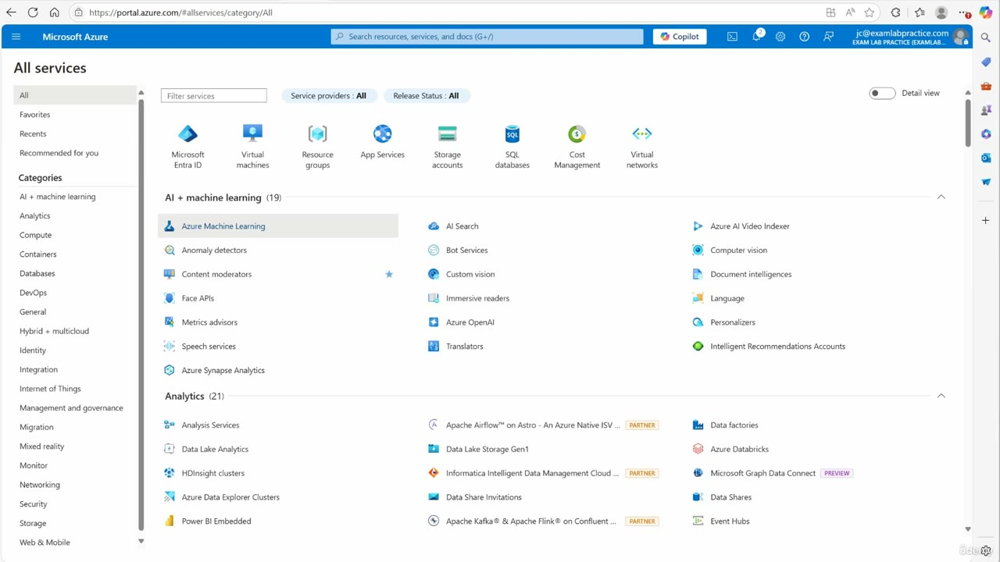
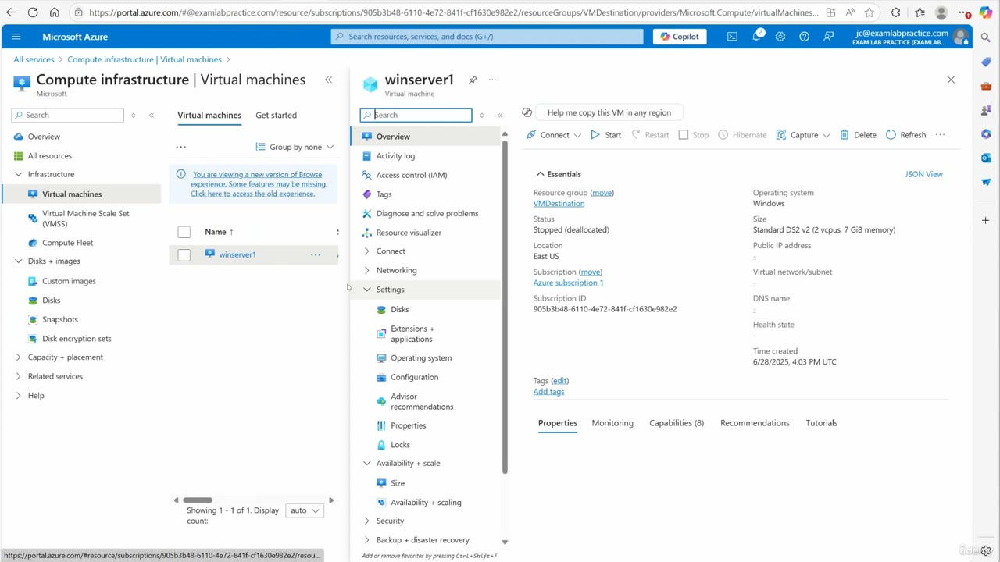
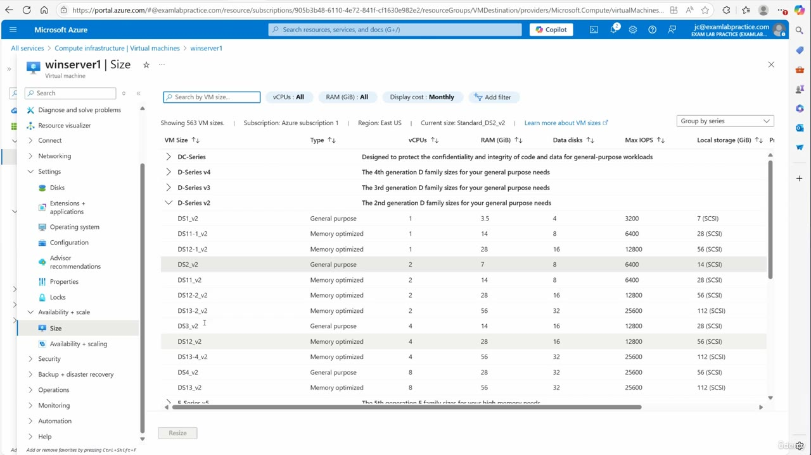
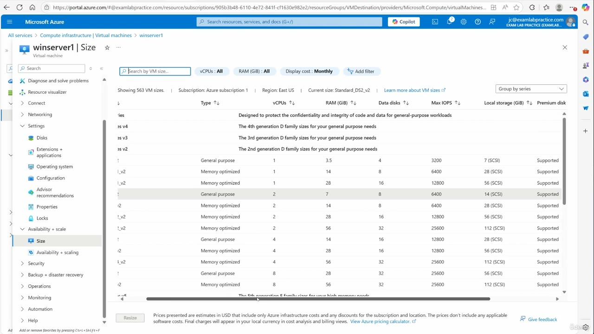
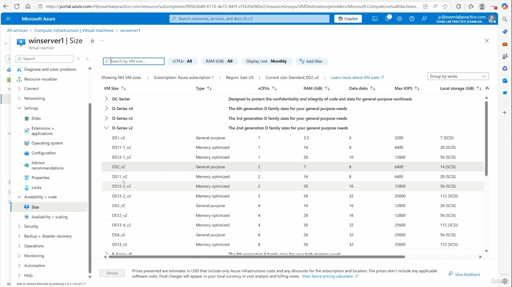
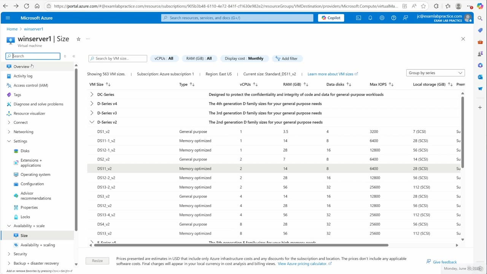

[Back to AZ-104: Microsoft Azure Administrator](../1.md)

# Chapter 72 — Manage virtual machine sizes

## Table of Contents

- [Introduction](#introduction)
- [Detailed tutorial](#detailed-tutorial)
  - [Why you resize](#why-you-resize)
  - [Open the virtual machine](#open-the-virtual-machine)
  - [Shut the virtual machine down first](#shut-the-virtual-machine-down-first)
  - [Read the Size blade](#read-the-size-blade)
  - [Choose a size and resize](#choose-a-size-and-resize)
  - [Confirm the new size](#confirm-the-new-size)
- [Summary](#summary)
- [References](#references)
- [Questions and Answers](#questions-and-answers)
  - [What does a resize change on the virtual machine?](#what-does-a-resize-change-on-the-virtual-machine)
  - [Which virtual machine does he open, and what power state is it in?](#which-virtual-machine-does-he-open-and-what-power-state-is-it-in)
  - [Where is the Size blade in the virtual machine menu?](#where-is-the-size-blade-in-the-virtual-machine-menu)
  - [What size is current when the Size blade first opens?](#what-size-is-current-when-the-size-blade-first-opens)
  - [Why shut the virtual machine down before resizing?](#why-shut-the-virtual-machine-down-before-resizing)
  - [What happens if you resize a virtual machine that is still running?](#what-happens-if-you-resize-a-virtual-machine-that-is-still-running)
  - [Which size row does he resize to?](#which-size-row-does-he-resize-to)
  - [What does the Size blade show after the resize finishes?](#what-does-the-size-blade-show-after-the-resize-finishes)
  - [Where else does he say to verify the new size?](#where-else-does-he-say-to-verify-the-new-size)
  - [Why does he say this resize will not use much Azure credit?](#why-does-he-say-this-resize-will-not-use-much-azure-credit)
  - [How is the size list filtered on this blade?](#how-is-the-size-list-filtered-on-this-blade)
  - [What changed between the starting size and the size he landed on?](#what-changed-between-the-starting-size-and-the-size-he-landed-on)

## Introduction

Video chapter 72 of the AZ-104 Microsoft Azure Administrator course. The study guide lists **Manage virtual machine sizes** under Create and configure virtual machines, in Deploy and manage Azure compute resources. The lesson is the portal change itself: open the virtual machine, read the current size, pick another row, click Resize, and confirm the new size after the blade reloads.

The virtual machine in the demo is **winserver1**. It starts as **Standard_DS2_v2** and finishes as **Standard_DS11_v2**. It is already **Stopped (deallocated)**. The caption mixes the 14 GiB row he selects with the 12,800 IOPS row under it. The Size blade is the number to keep.

## Detailed tutorial

**AZ-104 Microsoft Azure Administrator** · [72 - Manage virtual machine sizes.mp4](../../../../../course_videos/Course%20AZ-104%20Microsoft%20Azure%20Administrator%20course%20with%20SIMULATIONS/72%20-%20Manage%20virtual%20machine%20sizes.mp4) · [Transcript](../../../../../course_videos/Course%20AZ-104%20Microsoft%20Azure%20Administrator%20course%20with%20SIMULATIONS/72%20-%20Manage%20virtual%20machine%20sizes.txt)

<strong>Why you resize</strong>

A resize changes the virtual machine's vCPUs, memory, and the performance that comes with the size, including max IOPS. He uses it for three outcomes: bring the price up, bring the price down, or get better performance.

The story he opens with is a company paying for more virtual machine than the workload used. They had too much performance, so the size was scaled back. He says you can do that quickly, and the rest of the video is the portal click.

The demo itself moves the other direction on memory. **Standard_DS2_v2** is 7 GiB. **Standard_DS11_v2** is 14 GiB. Same Size blade either way. You do not have to pick his row. He says to keep what you have, or change it.

<strong>Open the virtual machine</strong>

He is on portal.azure.com. The menu opens All services. Virtual machines is in the icon row at the top.

*Figure: 00:00. All services. Virtual machines is in the icon row above the category list.*

Open Virtual machines, then open **winserver1**. The list on this frame is one virtual machine. The resource group is **VMDestination**.

*Figure: 00:52. winserver1 is open on Overview. Size is in the menu under Availability + scale. Essentials shows the current size and Stopped (deallocated).*

Essentials on that overview:

| Field | What the portal shows |
| --- | --- |
| Resource group | VMDestination |
| Operating system | Windows |
| Size | Standard DS2 v2 (2 vcpus, 7 GiB memory) |
| Status | Stopped (deallocated) |
| Location | East US |
| Subscription | Azure subscription 1 |
| Time created | 6/28/2025, 4:03 PM UTC |

The command bar includes Connect, Start, Restart, Stop, Hibernate, Capture, Delete, and Refresh. Public IP address, virtual network/subnet, and DNS name are blank on this deallocated virtual machine. The size string on Overview uses spaces. The Size blade writes the same SKU as **Standard_DS2_v2**.

<strong>Shut the virtual machine down first</strong>

He treats a shutdown as the usual practice before a resize, because the Size list shows more sizes when the virtual machine is shut down. winserver1 is already **Stopped (deallocated)** when the overview opens, so he is already in that state.

You can leave the virtual machine running. He says the resize restarts it anyway.

The [resize article](https://learn.microsoft.com/en-us/azure/virtual-machines/sizes/resize-vm) uses the same portal path he uses, and the same two points: stopping the virtual machine can reveal sizes that were missing from the list, and changing the size of a running virtual machine restarts it. He also says a resize can take a minute, and that you may have to refresh before the new size is the highlighted row.

<strong>Read the Size blade</strong>

In the virtual machine menu, under **Availability + scale**, open **Size**.

*Figure: 01:00. winserver1, Size. Current size is Standard_DS2_v2. That row is highlighted. The blade is showing 563 VM sizes in East US, grouped by series.*

The header on this blade:

- Search by VM size
- vCPUs: All
- RAM (GiB): All
- Display cost: Monthly
- Group by series
- Showing 563 VM sizes
- Subscription: Azure subscription 1
- Region: East US
- Current size: Standard_DS2_v2

The series headers in view:

| Series | Text on the blade |
| --- | --- |
| DC-Series | Designed to protect the confidentiality and integrity of code and data for general-purpose workloads |
| D-Series v4 | The 4th generation D family sizes for your general purpose needs |
| D-Series v3 | The 3rd generation D family sizes for your general purpose needs |
| D-Series v2 | The 2nd generation D family sizes for your general purpose needs |
| E-Series v6 | The 6th generation E family sizes for your high memory needs |

D-Series v2 is the expanded group. The series line says general purpose. The **Type** column is what marks individual rows as General purpose or Memory optimized. Read the Type column.

These are the D-Series v2 rows on the frame. **DS2_v2** is the highlighted current size. **DS11_v2** is the row he resizes to.

| VM size | Type | vCPUs | RAM (GiB) | Data disks | Max IOPS | Local storage (GiB) |
| --- | --- | --- | --- | --- | --- | --- |
| DS1_v2 | General purpose | 1 | 3.5 | 4 | 3200 | 7 (SCSI) |
| DS11-1_v2 | Memory optimized | 1 | 14 | 8 | 6400 | 28 (SCSI) |
| DS12-1_v2 | Memory optimized | 1 | 28 | 16 | 12800 | 56 (SCSI) |
| **DS2_v2** | **General purpose** | **2** | **7** | **8** | **6400** | **14 (SCSI)** |
| **DS11_v2** | **Memory optimized** | **2** | **14** | **8** | **6400** | **28 (SCSI)** |
| DS12-2_v2 | Memory optimized | 2 | 28 | 16 | 12800 | 56 (SCSI) |
| DS13-2_v2 | Memory optimized | 2 | 56 | 32 | 25600 | 112 (SCSI) |
| DS3_v2 | General purpose | 4 | 14 | 16 | 12800 | 28 (SCSI) |
| DS12_v2 | Memory optimized | 4 | 28 | 16 | 12800 | 56 (SCSI) |
| DS13-4_v2 | Memory optimized | 4 | 56 | 32 | 25600 | 112 (SCSI) |
| DS4_v2 | General purpose | 8 | 28 | 32 | 25600 | 56 (SCSI) |
| DS13_v2 | Memory optimized | 8 | 56 | 32 | 25600 | 112 (SCSI) |

**DS11-1_v2** and **DS11_v2** both show 14 GiB and 6400 max IOPS. The difference on this table is the vCPU count: 1 versus 2. The size he lands on is **DS11_v2**.

He tells you to look at the prices on the right before you commit. The frame at that moment is still the same list, with **DS2_v2** highlighted. The column that comes into view is **Premium disk**, and the visible D-Series v2 rows say **Supported**. The price sentence is the footer.

*Figure: 01:34. Same Size blade, scrolled to the price note. DS2_v2 is still the highlighted row. Premium disk reads Supported on the visible rows.*

The footer says the prices are estimates in USD, include only Azure infrastructure costs and any discounts for the subscription and location, and leave out software costs. Final charges show up in your local currency in cost analysis and billing views. The footer links to the Azure pricing calculator. Display cost on the blade is Monthly. **Resize** sits at the bottom left.

<strong>Choose a size and resize</strong>

He moves to the memory-optimized row and then clicks Resize. The pointer at that moment is on **DS11_v2**. The gray current-size highlight is still **DS2_v2**, which is the size in effect until the resize completes.

*Figure: 01:36. The pointer is on DS11_v2. That row is Memory optimized, 2 vCPUs, 14 GiB RAM, 8 data disks, 6400 max IOPS, 28 GiB local storage (SCSI). DS2_v2 is still the highlighted current size.*

The caption says "memory optimized", "two virtual CPUs", "14 RAM", and then "12,800 IOPS". The first three match **DS11_v2**. The 12,800 IOPS figure is the next memory-optimized row, **DS12-2_v2**: 2 vCPUs, 28 GiB RAM, 16 data disks, 12800 max IOPS, 56 GiB local storage. He does not land on that row.

If you are following along, he says you do not have to choose his size. Keep the size you have, or pick another one. He expects the lab cost to stay small because he keeps the virtual machine shut down when he is not using it.

<strong>Confirm the new size</strong>

Resize reloads the portal. He says it sometimes finishes quickly and sometimes takes a minute, and that a browser refresh is what you do when the highlight has not moved yet. The new size is the row that ends up highlighted.

*Figure: 02:18. The Size blade is back. Current size is Standard_DS11_v2. The DS11_v2 row is highlighted. The pointer is moving to Overview.*

Read the header, not the caption. **Current size: Standard_DS11_v2**. The highlighted row is still the 2 vCPU, 14 GiB, 6400 IOPS, 28 GiB local-storage row. The blade still says 563 VM sizes, Azure subscription 1, East US, and the same All filters. The portal clock on this frame is Monday, June 30, 2025.

He then says to open **Overview** and confirm the new size is listed there. This frame is still the Size blade. Overview is the next check he names. The recording does not show the Overview page after the change. The confirmation that is on screen is the Current size line and the highlighted **DS11_v2** row.

| | Starting size | Size after Resize |
| --- | --- | --- |
| SKU | Standard_DS2_v2 | Standard_DS11_v2 |
| Type | General purpose | Memory optimized |
| vCPUs | 2 | 2 |
| RAM | 7 GiB | 14 GiB |
| Data disks | 8 | 8 |
| Max IOPS | 6400 | 6400 |
| Local storage | 14 GiB (SCSI) | 28 GiB (SCSI) |

vCPUs, data disks, and max IOPS stay put. RAM and local storage both double, and the type changes from General purpose to Memory optimized.

## Summary

- A resize changes vCPUs, memory, and the performance numbers on the size row, including max IOPS. Use it to raise cost, lower cost, or get more performance.
- Portal path: Virtual machines, open the virtual machine, **Availability + scale**, **Size**, pick a row, **Resize**.
- Shut the virtual machine down first when you want the longer size list. A running resize still restarts the virtual machine.
- winserver1 is Windows, resource group VMDestination, East US, Azure subscription 1, and already **Stopped (deallocated)**.
- The size moves from **Standard_DS2_v2** (General purpose, 2 vCPUs, 7 GiB, 6400 IOPS, 14 GiB local) to **Standard_DS11_v2** (Memory optimized, 2 vCPUs, 14 GiB, 6400 IOPS, 28 GiB local).
- The caption's 12,800 IOPS is **DS12-2_v2**, the next row. **DS11-1_v2** is the 1 vCPU size that also has 14 GiB and 6400 IOPS.
- The Size blade may need a minute and a refresh before the new row is highlighted. Confirm **Current size**, the highlighted row, and Overview.
- He keeps the virtual machine shut down when he is not using it, which is why he treats the lab resize as cheap. The price footer is a USD infrastructure estimate and excludes software.

## References

- [72 - Manage virtual machine sizes.mp4](../../../../../course_videos/Course%20AZ-104%20Microsoft%20Azure%20Administrator%20course%20with%20SIMULATIONS/72%20-%20Manage%20virtual%20machine%20sizes.mp4)
- [Transcript](../../../../../course_videos/Course%20AZ-104%20Microsoft%20Azure%20Administrator%20course%20with%20SIMULATIONS/72%20-%20Manage%20virtual%20machine%20sizes.txt)
- [Study guide for Exam AZ-104: Microsoft Azure Administrator](https://learn.microsoft.com/en-us/credentials/certifications/resources/study-guides/az-104)
- [Resize a virtual machine](https://learn.microsoft.com/en-us/azure/virtual-machines/sizes/resize-vm)
- [Virtual machine sizes overview](https://learn.microsoft.com/en-us/azure/virtual-machines/sizes/overview)

## Questions and Answers

<strong>What does a resize change on the virtual machine?</strong>

**Answer.** vCPUs, memory, and the performance that belongs to the size, including max IOPS. He resizes to bring the price up, bring the price down, or get better performance. The opening example is a company that had more performance than it needed, so the virtual machine was scaled back.

<strong>Which virtual machine does he open, and what power state is it in?</strong>

**Answer.** **winserver1**, a Windows virtual machine in resource group **VMDestination**, location **East US**, subscription **Azure subscription 1**. Overview status is **Stopped (deallocated)**. It was created 6/28/2025, 4:03 PM UTC.

<strong>Where is the Size blade in the virtual machine menu?</strong>

**Answer.** Under **Availability + scale**. He opens the virtual machine from Virtual machines, then clicks **Size**.

<strong>What size is current when the Size blade first opens?</strong>

**Answer.** **Standard_DS2_v2**. Overview writes it as Standard DS2 v2 (2 vcpus, 7 GiB memory). On the Size blade the highlighted row is General purpose, 2 vCPUs, 7 GiB RAM, 8 data disks, 6400 max IOPS, and 14 GiB local storage (SCSI).

<strong>Why shut the virtual machine down before resizing?</strong>

**Answer.** He says you see more sizes when the virtual machine is shut down. winserver1 is already **Stopped (deallocated)** on the overview he starts from.

<strong>What happens if you resize a virtual machine that is still running?</strong>

**Answer.** You can leave it running. He says the resize restarts it anyway.

<strong>Which size row does he resize to?</strong>

**Answer.** **DS11_v2**, Memory optimized, 2 vCPUs, 14 GiB RAM, 8 data disks, 6400 max IOPS, 28 GiB local storage (SCSI). The caption's 12,800 IOPS is **DS12-2_v2** (2 vCPUs, 28 GiB, 12800 IOPS), the next row. **DS11-1_v2** is the 1 vCPU row that also shows 14 GiB and 6400 IOPS. The current-size string after the click is **Standard_DS11_v2**, which is the 2 vCPU row.

<strong>What does the Size blade show after the resize finishes?</strong>

**Answer.** **Current size: Standard_DS11_v2**, and the **DS11_v2** row is highlighted. He says this can take a minute and that you may need to refresh the browser before the new size is the one highlighted.

<strong>Where else does he say to verify the new size?</strong>

**Answer.** The virtual machine **Overview** page. The last frame is still the Size blade, with the pointer moving toward Overview. The confirmation on that frame is the Current size line and the highlighted row.

<strong>Why does he say this resize will not use much Azure credit?</strong>

**Answer.** He keeps the virtual machine shut down when he is not using it. He also says you do not have to copy his size choice.

<strong>How is the size list filtered on this blade?</strong>

**Answer.** 563 VM sizes, subscription Azure subscription 1, region East US, vCPUs All, RAM (GiB) All, Display cost Monthly, grouped by series. The price footer is a USD infrastructure estimate. It includes subscription and location discounts, and it excludes software. The Premium disk column on the visible D-Series v2 rows reads Supported.

<strong>What changed between the starting size and the size he landed on?</strong>

**Answer.** Type changes from General purpose to Memory optimized. RAM goes from 7 GiB to 14 GiB. Local storage goes from 14 GiB (SCSI) to 28 GiB (SCSI). vCPUs stay at 2, data disks stay at 8, and max IOPS stays at 6400. His customer story was a scale-down. This portal demo is a move to more memory. The Size blade does either one.

