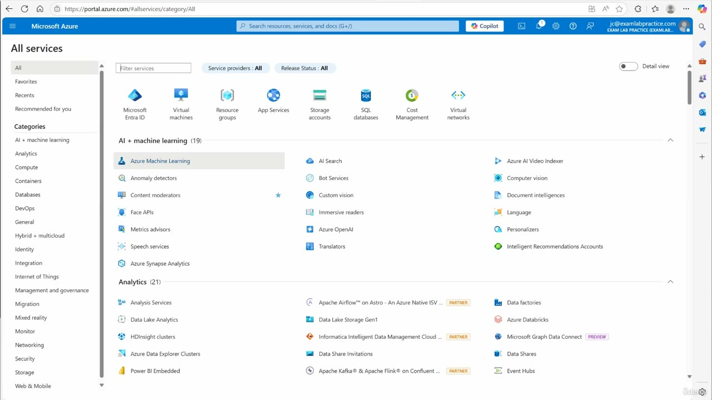
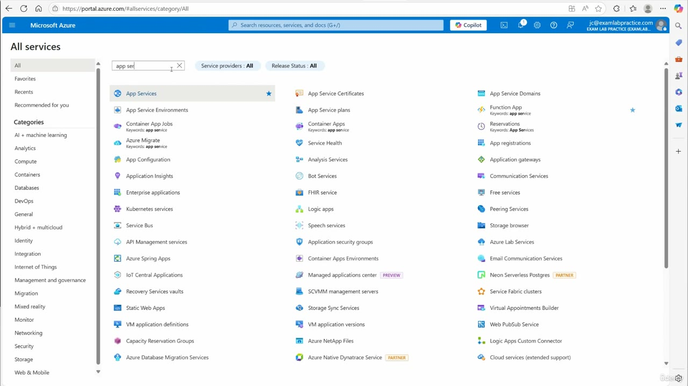
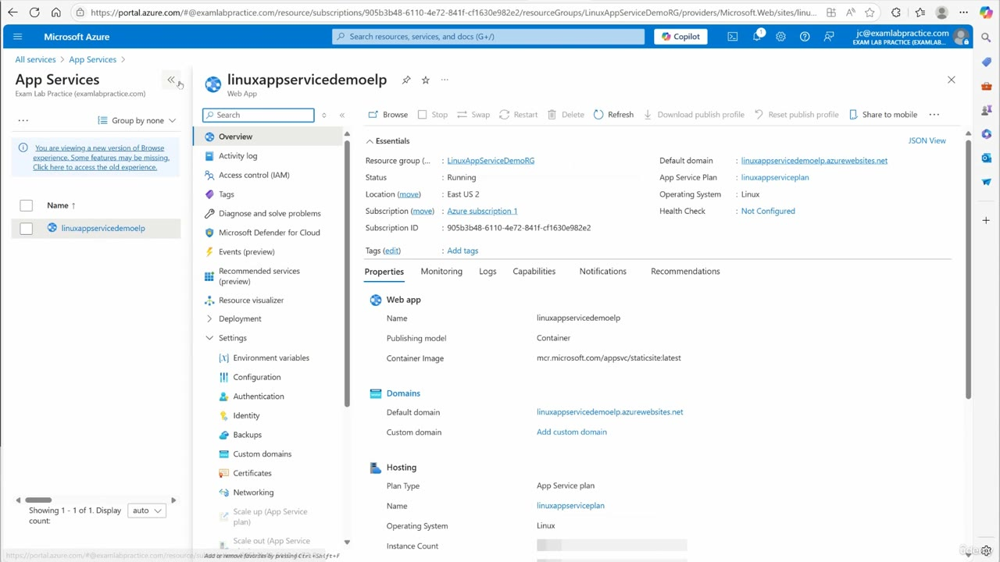
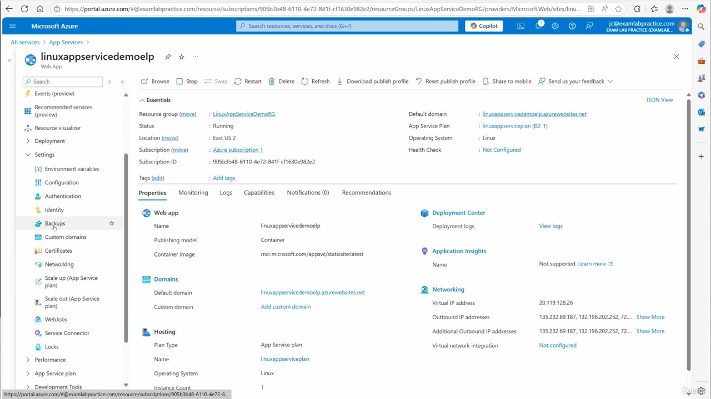
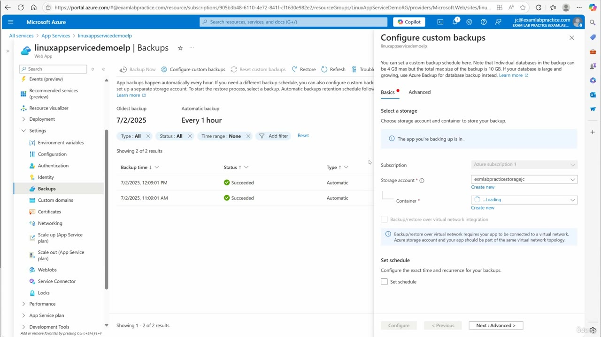

[Back to AZ-104: Microsoft Azure Administrator](../1.md)

# Chapter 86 — Configure backup for an App Service

## Table of Contents

- [Introduction](#introduction)
- [Detailed tutorial](#detailed-tutorial)
  - [Open All services](#open-all-services)
  - [Search for App Services](#search-for-app-services)
  - [The web app](#the-web-app)
  - [Backups in the menu](#backups-in-the-menu)
  - [Automatic backups](#automatic-backups)
  - [Custom backup storage](#custom-backup-storage)
  - [Schedule and retention](#schedule-and-retention)
  - [Database backup on Advanced](#database-backup-on-advanced)
  - [Restore and site configuration](#restore-and-site-configuration)
- [Summary](#summary)
- [References](#references)
- [Questions and Answers](#questions-and-answers)
  - [Question 1 — How he opens App Services](#question-1-how-he-opens-app-services)
  - [Question 2 — Which app](#question-2-which-app)
  - [Question 3 — Where Backups sits](#question-3-where-backups-sits)
  - [Question 4 — The automatic schedule](#question-4-the-automatic-schedule)
  - [Question 5 — Rows on the list](#question-5-rows-on-the-list)
  - [Question 6 — Storage on the form](#question-6-storage-on-the-form)
  - [Question 7 — The container he names](#question-7-the-container-he-names)
  - [Question 8 — Size limits on the panel](#question-8-size-limits-on-the-panel)
  - [Question 9 — The schedule checkbox](#question-9-the-schedule-checkbox)
  - [Question 10 — The Advanced tab](#question-10-the-advanced-tab)
  - [Question 11 — Why he stops](#question-11-why-he-stops)
  - [Question 12 — Restore site configuration](#question-12-restore-site-configuration)

## Introduction

Video chapter 86 of the AZ-104 course. Automatic backups are already running on `linuxappservicedemoelp`, once an hour. He opens **Configure custom backups**, walks through a storage account, a container, a daily schedule, and database backup on **Advanced**, and leaves **Configure** unclicked so the lab does not spend credit. He then describes a restore, including **Restore site configuration**.

## Detailed tutorial

**AZ-104 Microsoft Azure Administrator** · [86 - Configure backup for an App Service.mp4](../../../../../course_videos/Course%20AZ-104%20Microsoft%20Azure%20Administrator%20course%20with%20SIMULATIONS/86%20-%20Configure%20backup%20for%20an%20App%20Service.mp4) · [Transcript](../../../../../course_videos/Course%20AZ-104%20Microsoft%20Azure%20Administrator%20course%20with%20SIMULATIONS/86%20-%20Configure%20backup%20for%20an%20App%20Service.txt)

<strong>Open All services</strong>

He starts on portal.azure.com. The path he names is the menu, then **All services**. The opening frame is already that page.

*Figure: 00:00. portal.azure.com, All services, category All. The lab account is jc@examlabpractice.com. The service filter is empty.*

The same unfiltered All services page is still up a few seconds later. The next distinct step is the filter.

<strong>Search for App Services</strong>

He searches for app service. The filter box on this frame reads `app se`. **App Services** is the highlighted row, with a star. The same result set also lists App Service Environments, App Service Certificates, App Service plans, and Function App.

*Figure: 00:18. Filter `app se`. App Services is the selected row.*

He opens **App Services**, then the one web app in the lab.

<strong>The web app</strong>

The list shows 1 of 1. The app is `linuxappservicedemoelp`, a Linux web app, status **Running**, in **LinuxAppServiceDemoRG** and **East US 2**.

A banner on the list says this is a new version of the Browse experience and that some features may be missing. He does not use that banner.

*Figure: 00:22. App Services, one app. Overview of linuxappservicedemoelp. Backups is in the Settings group of the left menu.*

| Field | Value on the overview |
| --- | --- |
| Name | linuxappservicedemoelp |
| Resource group | LinuxAppServiceDemoRG |
| Status | Running |
| Location | East US 2 |
| Subscription | Azure subscription 1 |
| Subscription ID | 905b3b48-6110-4e72-841f-cf1630e982e2 |
| Default domain | linuxappservicedemoelp.azurewebsites.net |
| App Service plan | linuxappserviceplan |
| Operating system | Linux |
| Publishing model | Container |
| Container image | mcr.microsoft.com/appsvc/staticsite:latest |
| Health check | Not Configured |

<strong>Backups in the menu</strong>

**Backups** sits under **Settings**, under Identity and above Custom domains. He moves to that blade. This frame still shows the overview, with the cursor on **Backups**.

*Figure: 00:26. Backups is highlighted. The plan line now reads linuxappserviceplan (B2: 1). Virtual network integration is Not configured. Instance count is 1.*

The essentials that this frame adds:

- App Service plan **linuxappserviceplan (B2: 1)**.
- Virtual IP address **20.119.128.26**. The outbound address list starts `135.232.69.187` and `132.196.202.252` and continues off the line.
- **Virtual network integration: Not configured.**
- **Instance count: 1.**
- Application Insights: **Not supported.**

<strong>Automatic backups</strong>

The Backups page is already populated. He says backups are turned on and run every hour. The page says the same thing: **Automatic backup** is **Every 1 hour**, and the banner says app backups happen automatically every hour.

A different schedule is a custom backup to a separate storage account. A restore starts by selecting a backup. The banner then starts an automatic retention sentence and the rest is cut off on the frame.

The command bar is **Backup Now**, **Configure custom backups**, **Reset custom backups**, **Restore**, **Refresh**, and a Troubleshoot control that is cut off.

*Figure: 00:38. linuxappservicedemoelp, Backups. Oldest backup 7/2/2025. Automatic backup every 1 hour. Two succeeded automatic rows. Configure custom backups is open on Basics.*

| | |
| --- | --- |
| Oldest backup | 7/2/2025 |
| Automatic backup | Every 1 hour |

Filters are Type **All**, Status **All**, Time range **None**. The grid says **Showing 2 of 2 results**.

| Backup time | Status | Type |
| --- | --- | --- |
| 7/2/2025, 12:09:01 PM | Succeeded | Automatic |
| 7/2/2025, 11:09:01 AM | Succeeded | Automatic |

Both rows are an hour apart on the same date, which matches the hourly automatic schedule. No custom backup is in the list.

The [Back up an app](https://learn.microsoft.com/en-us/azure/app-service/manage-backup) article states that automatic backups are hourly and that their retention is 30 days and is not configurable: hourly copies for days 1–3, every third hourly backup for days 4–14, and every sixth hourly backup for days 15–30. That is the retention schedule the banner starts and does not finish on this frame. The same article says automatic backups do not use a storage account you pick. These two rows are already here before he configures one.

<strong>Custom backup storage</strong>

**Configure custom backups** is the panel on the right of that same frame. **Basics** is selected. **Advanced** is the other tab.

The panel says a custom backup schedule is set here, and it states the size limits in the note at the top:

- An individual database in the backup can be **4 GB** max.
- The total size of the backup is **10 GB**.
- If the database is large and growing, use **Azure Backup** for the database backup instead.

**Select a storage** asks for the storage account and container. The subscription box is **Azure subscription 1**. The storage account box already has **exmlabpracticestoragejc**, with **Create new** under it. The container dropdown says **Loading**. **Create new** is under the container as well.

He talks through the create path while this form is up. A new account here is general purpose. The name he gives that idea is "new storage for app service, ELP". An existing account is fine, and the form is already on one. The container he would create is named **backup**. **Create** is the button for that storage and container. The frame never shows that container created. The dropdown is still loading, and he does not leave Basics.

The virtual network note on the form:

> Backup/restore over virtual network integration requires your app to be connected to a virtual network. Azure storage account and your app should be part of the same virtual network topology.

The overview already shows virtual network integration as **Not configured**, so that note is the condition for a later VNet backup, and this app is outside it on this frame.

<strong>Schedule and retention</strong>

**Set schedule** is on Basics, under **Set schedule**. The checkbox is clear on the 00:38 frame. The section text says to configure the exact time and recurrence for the backups. The expanded schedule fields are not on the frame.

What he says you set once the checkbox is on:

1. Repeat every day.
2. Start time.
3. Time zone.
4. Retention, whatever retention you want.

**Configure** at the bottom of the panel is disabled. **Previous** is disabled. **Next: Advanced** is the enabled button.

He leaves the checkbox clear. The spoken schedule is the setup, and the form is still the empty schedule.

<strong>Database backup on Advanced</strong>

**Next: Advanced** is how the panel moves on. He says click **Advanced** and, if you have database backups, that is where you deal with them. The Advanced page itself is not in the frames.

He then says they are retiring some of this. The [Back up an app](https://learn.microsoft.com/en-us/azure/app-service/manage-backup) article dates that change: starting **3/31/2028**, App Service custom backups no longer support backing up linked databases. The 4 GB database cap and the 10 GB total cap on this panel are the limits that apply while linked database backup is still offered. Linked databases are a custom-backup feature. The automatic rows on the left do not include one.

He does not click **Configure**. He calls finishing it a waste of credit. **Backup Now** on the command bar is how he says you trigger a backup after the storage is in place. He does not click that either. The two rows stay the automatic ones from 7/2/2025.

<strong>Restore and site configuration</strong>

The restore blade is not opened. He describes it from the Backups page. **Restore** is on the command bar, and the banner says the restore starts when you select a backup.

The steps he names:

1. Choose the backup you want.
2. Specify the App Service to restore to.
3. Turn on **Restore site configuration** when the restore should include settings along with the app content.
4. Click **Restore** and let the portal process it.

With **Restore site configuration** on, he says Azure restores the site configuration settings and the app content. The settings list he gives:

- App settings.
- Connection strings.
- Authentication settings.
- Custom domain name bindings.
- TLS/SSL certificates and bindings.

The current [Back up an app](https://learn.microsoft.com/en-us/azure/app-service/manage-backup) article's configuration-restore table lists Authentication, Custom domains, and TLS/SSL among the settings a configuration restore leaves out. The same article says a custom backup also writes an XML file, and on restore the custom domains in that file are added when there is no DNS conflict. His list is what he says in this lesson. The article is the current restore matrix.

He stops on that description. The lab app is still `linuxappservicedemoelp`, and the backup list is unchanged.

## Summary

- Path: portal menu, **All services**, filter `app se`, **App Services**, then `linuxappservicedemoelp`.
- The app is Running, Linux, East US 2, resource group **LinuxAppServiceDemoRG**, plan **linuxappserviceplan (B2: 1)**, subscription **Azure subscription 1**. Publishing model is Container. Virtual network integration is Not configured.
- **Backups** is under **Settings**. Automatic backup is **Every 1 hour**. Oldest backup is **7/2/2025**. The two rows are 12:09:01 PM and 11:09:01 AM that day, both **Succeeded**, both **Automatic**.
- **Configure custom backups** needs a storage account and a container. The form already shows **exmlabpracticestoragejc**. The container list is still loading. He would create a general-purpose account and a container named **backup**, and he does not.
- The panel caps an individual database at **4 GB** and the whole backup at **10 GB**. A large, growing database is an Azure Backup job instead.
- **Set schedule** is unchecked. He says the schedule is every day, plus start time, time zone, and retention. **Configure** stays disabled.
- **Advanced** is the database backup step. He says some of that is being retired. The Back up an app article sets that date at **3/31/2028** for linked databases.
- **Backup Now** triggers a backup. **Restore** plus **Restore site configuration** is his path for content and settings together. He does not run either one.

## References

- [Lesson video](../../../../../course_videos/Course%20AZ-104%20Microsoft%20Azure%20Administrator%20course%20with%20SIMULATIONS/86%20-%20Configure%20backup%20for%20an%20App%20Service.mp4)
- [Transcript](../../../../../course_videos/Course%20AZ-104%20Microsoft%20Azure%20Administrator%20course%20with%20SIMULATIONS/86%20-%20Configure%20backup%20for%20an%20App%20Service.txt)
- [Study guide for Exam AZ-104](https://learn.microsoft.com/en-us/credentials/certifications/resources/study-guides/az-104)
- [Back up an app](https://learn.microsoft.com/en-us/azure/app-service/manage-backup)

## Questions and Answers

<strong>Question 1 — How he opens App Services</strong>

How does he get from the portal to the web app?

**Answer.** Menu, All services, filter for app service. The filter frame reads `app se`, and App Services is the highlighted row. He opens App Services, then the one app, `linuxappservicedemoelp`.

<strong>Question 2 — Which app</strong>

What is the web app, and what resource group, region, plan, and operating system does the overview show?

**Answer.** `linuxappservicedemoelp`, resource group LinuxAppServiceDemoRG, East US 2, plan linuxappserviceplan. The later essentials line is linuxappserviceplan (B2: 1). The operating system is Linux, and the status is Running.

<strong>Question 3 — Where Backups sits</strong>

Where is Backups in the app menu?

**Answer.** Under Settings, below Identity and above Custom domains.

<strong>Question 4 — The automatic schedule</strong>

What cadence and oldest-backup date does the Backups page show before he configures anything?

**Answer.** Automatic backup is Every 1 hour. The oldest backup is 7/2/2025. The banner says app backups happen automatically every hour.

<strong>Question 5 — Rows on the list</strong>

What does the backup grid contain, including status and type?

**Answer.** Two rows, showing 2 of 2. 7/2/2025, 12:09:01 PM and 7/2/2025, 11:09:01 AM. Both are Succeeded and Automatic. Filters are Type All, Status All, and Time range None.

<strong>Question 6 — Storage on the form</strong>

What subscription and storage account are filled in on Configure custom backups, and what is the container control doing?

**Answer.** Subscription is Azure subscription 1. Storage account is exmlabpracticestoragejc, with Create new under it. The container dropdown says Loading, and Create new is under that dropdown too.

<strong>Question 7 — The container he names</strong>

What storage account and container does he say he would create, and does the frame show them created?

**Answer.** A new general-purpose storage account, which he calls "new storage for app service, ELP", or an existing account. The container name he gives is backup. The frame stays on the existing account exmlabpracticestoragejc with the container list still loading. He does not finish that create.

<strong>Question 8 — Size limits on the panel</strong>

What size limits does the Configure custom backups note state, and what does it tell you to use when a database outgrows them?

**Answer.** An individual database can be 4 GB max. The total backup size is 10 GB. A database that is large and growing should use Azure Backup for the database backup instead.

<strong>Question 9 — The schedule checkbox</strong>

What does he say a schedule includes, and what is the state of Set schedule and Configure on the frame?

**Answer.** Repeat every day, a start time, a time zone, and the retention you want. Set schedule is unchecked. Configure is disabled. Next: Advanced is the button that is available.

<strong>Question 10 — The Advanced tab</strong>

What does he say Advanced is for, and what retirement does he mention?

**Answer.** Database backup, when the app has databases to include. He says they are retiring some of this. The Back up an app article dates that change: starting 3/31/2028, custom backups no longer support linked databases.

<strong>Question 11 — Why he stops</strong>

Why does he leave the custom backup unfinished, and which command would run a backup after storage is configured?

**Answer.** He calls finishing it a waste of credit. Backup Now, on the Backups command bar, is how he says you trigger the backup. He does not click it. The list stays the two automatic rows.

<strong>Question 12 — Restore site configuration</strong>

What does he say Restore site configuration restores along with the app content?

**Answer.** App settings, connection strings, authentication settings, custom domain name bindings, and TLS/SSL certificates and bindings. He would then click Restore. The current Back up an app article lists Authentication, Custom domains, and TLS/SSL among the settings a configuration restore leaves out. A custom backup's XML can still add custom domains when there is no DNS conflict.

