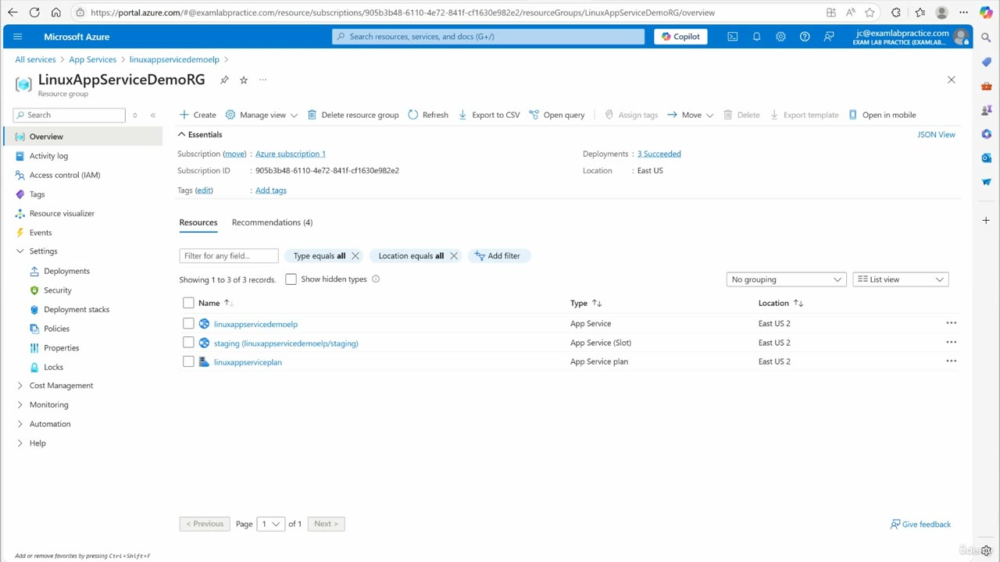
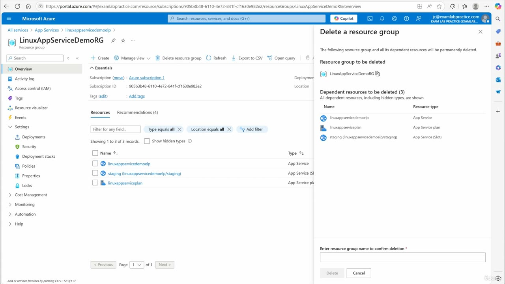
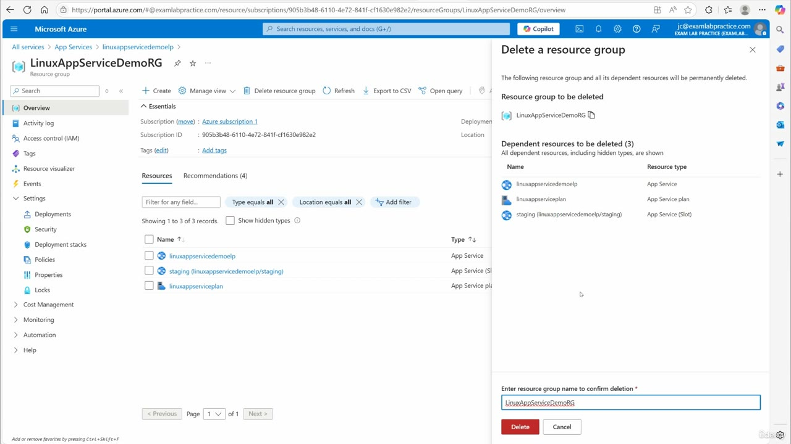

[Back to AZ-104: Microsoft Azure Administrator](../1.md)

# Chapter 89 — Removing App services that are no longer needed

## Table of Contents

- [Introduction](#introduction)
- [Detailed tutorial](#detailed-tutorial)
  - [What is still in the resource group](#what-is-still-in-the-resource-group)
  - [Delete the resource group](#delete-the-resource-group)
  - [You can keep yours](#you-can-keep-yours)
- [Summary](#summary)
- [References](#references)
- [Questions and Answers](#questions-and-answers)
  - [Question 1 — Why he deletes](#question-1-why-he-deletes)
  - [Question 2 — What he deletes](#question-2-what-he-deletes)
  - [Question 3 — Resource group name](#question-3-resource-group-name)
  - [Question 4 — App Service name](#question-4-app-service-name)
  - [Question 5 — The slot](#question-5-the-slot)
  - [Question 6 — The plan](#question-6-the-plan)
  - [Question 7 — Region on the list](#question-7-region-on-the-list)
  - [Question 8 — How the delete is confirmed](#question-8-how-the-delete-is-confirmed)
  - [Question 9 — May you keep the group](#question-9-may-you-keep-the-group)
  - [Question 10 — When he moves on](#question-10-when-he-moves-on)

## Introduction

The App Service demo is finished. He deletes the resource group that holds the app, the staging slot, and the plan, so the lab stops spending Azure credit. Deleting the group deletes the resources inside it. If you are still using the demo, he says to leave the group in place.

## Detailed tutorial

**AZ-104 Microsoft Azure Administrator** · [89 - Removing App services that are no longer needed.mp4](../../../../../course_videos/Course%20AZ-104%20Microsoft%20Azure%20Administrator%20course%20with%20SIMULATIONS/89%20-%20Removing%20App%20services%20that%20are%20no%20longer%20needed.mp4) · [Transcript](../../../../../course_videos/Course%20AZ-104%20Microsoft%20Azure%20Administrator%20course%20with%20SIMULATIONS/89%20-%20Removing%20App%20services%20that%20are%20no%20longer%20needed.txt)

<strong>What is still in the resource group</strong>

He is done with the app service, the plan, and the rest of that demo. The transcript's "this Linux app service demo RG" is the resource group **LinuxAppServiceDemoRG**, in subscription **Azure subscription 1**.

The resource list shows three resources, all in **East US 2**:

| Name | Type |
| --- | --- |
| linuxappservicedemoelp | App Service |
| staging (linuxappservicedemoelp/staging) | App Service (Slot) |
| linuxappserviceplan | App Service plan |

*Figure: 00:00. Overview of LinuxAppServiceDemoRG. Delete resource group is in the command bar. The list is filtered to East US 2 and shows the app, the staging slot, and the plan.*

<strong>Delete the resource group</strong>

He deletes the resource group rather than each resource. The portal warns that the group and its dependent resources will be permanently deleted. The dependent list matches the three resources on the overview.

Confirmation is the resource group name, typed into **Enter resource group name to confirm deletion**. On the last frame the name is entered and **Delete** is the red button.

*Figure: 00:18. Delete a resource group. LinuxAppServiceDemoRG is the group. The dependents are the app, the plan, and the staging slot. The name box is still empty.*

*Figure: 00:26. LinuxAppServiceDemoRG is typed into the confirmation box and Delete is active.*

<strong>You can keep yours</strong>

If you are following along and still want the app, he says to keep the group. He is removing his copy to conserve Azure credit. After the delete, he moves on.

## Summary

- The demo group is LinuxAppServiceDemoRG.
- It holds linuxappservicedemoelp, the staging slot, and linuxappserviceplan, in East US 2.
- Delete resource group removes the group and those dependents. You confirm by typing the group name.
- Keep the group if you are still using the demo. He deletes his to save credit.

## References

- [Lesson video](../../../../../course_videos/Course%20AZ-104%20Microsoft%20Azure%20Administrator%20course%20with%20SIMULATIONS/89%20-%20Removing%20App%20services%20that%20are%20no%20longer%20needed.mp4)
- [Transcript](../../../../../course_videos/Course%20AZ-104%20Microsoft%20Azure%20Administrator%20course%20with%20SIMULATIONS/89%20-%20Removing%20App%20services%20that%20are%20no%20longer%20needed.txt)
- [Study guide for Exam AZ-104](https://learn.microsoft.com/en-us/credentials/certifications/resources/study-guides/az-104)

## Questions and Answers

<strong>Question 1 — Why he deletes</strong>

Why does he remove the App Service demo at the end?

**Answer.** He no longer needs the app, the plan, or the related resources, and he wants to conserve Azure credit.

<strong>Question 2 — What he deletes</strong>

What does he delete instead of deleting each resource by itself?

**Answer.** The whole resource group. That also deletes the resources inside it.

<strong>Question 3 — Resource group name</strong>

What is the resource group name on the overview blade?

**Answer.** LinuxAppServiceDemoRG. The transcript's "Linux app service demo RG" is that name.

<strong>Question 4 — App Service name</strong>

What is the App Service in the group?

**Answer.** linuxappservicedemoelp.

<strong>Question 5 — The slot</strong>

What is the deployment slot listed under that app?

**Answer.** staging (linuxappservicedemoelp/staging), typed as an App Service slot.

<strong>Question 6 — The plan</strong>

What is the App Service plan in the group?

**Answer.** linuxappserviceplan.

<strong>Question 7 — Region on the list</strong>

Which region does the resource list show for those three resources?

**Answer.** East US 2.

<strong>Question 8 — How the delete is confirmed</strong>

What do you type before Delete becomes the action?

**Answer.** The resource group name, LinuxAppServiceDemoRG, in "Enter resource group name to confirm deletion".

<strong>Question 9 — May you keep the group</strong>

Does he require you to delete your copy if you are still practicing?

**Answer.** No. He says to keep it if you still want to use it. He deletes his own copy.

<strong>Question 10 — When he moves on</strong>

When does he say he is ready for the next topic?

**Answer.** Once the resource group has been deleted.

