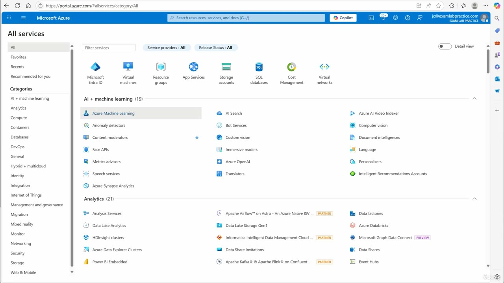
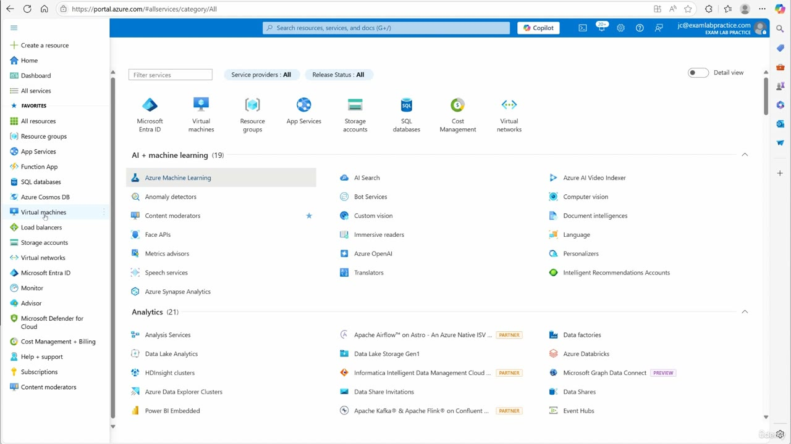
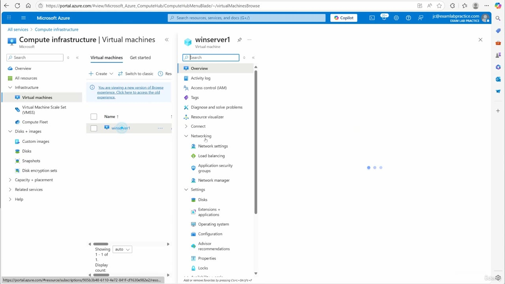
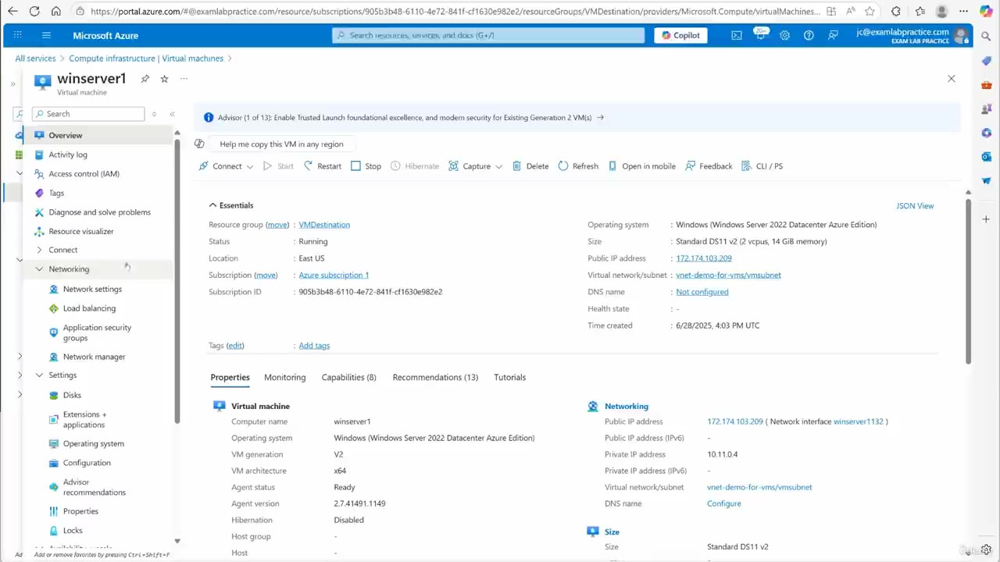
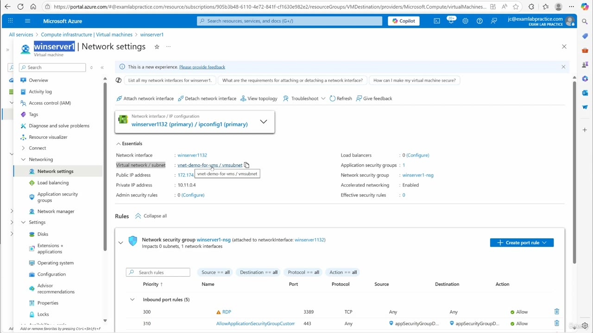

[Back to AZ-104: Microsoft Azure Administrator](../1.md)

# Chapter 101 — Configure service endpoints for Azure platform as a service (PaaS)

## Table of Contents

- [Introduction](#introduction)
- [Detailed tutorial](#detailed-tutorial)
  - [Start on the portal](#start-on-the-portal)
  - [Open Virtual machines](#open-virtual-machines)
  - [Open winserver1](#open-winserver1)
  - [Network settings and the subnet](#network-settings-and-the-subnet)
  - [Add the service endpoint](#add-the-service-endpoint)
  - [What he says the endpoint does](#what-he-says-the-endpoint-does)
- [Summary](#summary)
- [References](#references)
- [Questions and Answers](#questions-and-answers)
  - [Question 1 — How he opens the list](#question-1-how-he-opens-the-list)
  - [Question 2 — How many virtual machines](#question-2-how-many-virtual-machines)
  - [Question 3 — Overview placement](#question-3-overview-placement)
  - [Question 4 — Address and subnet on the overview](#question-4-address-and-subnet-on-the-overview)
  - [Question 5 — Spoken names and blade names](#question-5-spoken-names-and-blade-names)
  - [Question 6 — Which networking blade](#question-6-which-networking-blade)
  - [Question 7 — NSG and inbound rows](#question-7-nsg-and-inbound-rows)
  - [Question 8 — Where the endpoint is added](#question-8-where-the-endpoint-is-added)
  - [Question 9 — Service and subnet on Add](#question-9-service-and-subnet-on-add)
  - [Question 10 — What the save establishes](#question-10-what-the-save-establishes)

## Introduction

Video chapter 101 of AZ-104. He connects the subnet that holds one Windows virtual machine to Azure storage with a service endpoint. The virtual machine is winserver1. The virtual network on the blades is vnet-demo-for-vms, and the subnet is vmsubnet. He says other service endpoints exist, and this pass uses storage so the server can reach storage accounts without going out to the internet and back in.

The captured frames run from All services through Network settings on that virtual machine. The Add clicks are the last part of the narration, after he opens the virtual network. Read the blade names. The caption says "portal dot Azure calm", "WinServer1", "VNet demo for VMS", and "VM subnet".

## Detailed tutorial

**AZ-104 Microsoft Azure Administrator** · [video](../../../../../course_videos/Course%20AZ-104%20Microsoft%20Azure%20Administrator%20course%20with%20SIMULATIONS/101%20-%20Configure%20service%20endpoints%20for%20Azure%20platform%20as%20a%20service%20%28PaaS%29.mp4) · [Transcript](../../../../../course_videos/Course%20AZ-104%20Microsoft%20Azure%20Administrator%20course%20with%20SIMULATIONS/101%20-%20Configure%20service%20endpoints%20for%20Azure%20platform%20as%20a%20service%20%28PaaS%29.txt)

<strong>Start on the portal</strong>

He starts on portal.azure.com. The first frame is already All services. The session is the Exam Lab Practice portal, signed in as jc@examlabpractice.com.

*Figure: 00:00. All services, category All. Virtual machines is one of the top service tiles. The resource menu for a virtual machine is not open yet.*

The address bar is `https://portal.azure.com/#allservices/category/All`. The caption's "portal dot Azure calm" is this portal.

<strong>Open Virtual machines</strong>

He clicks the portal menu and goes to Virtual machines.

*Figure: 00:24. The portal menu is open. Virtual machines is highlighted under Favorites. The page behind the menu is still All services.*

Favorites on this frame also lists App Services, Function App, SQL databases, Azure Cosmos DB, Load balancers, Storage accounts, and Virtual networks. He uses Virtual machines.

<strong>Open winserver1</strong>

The virtual machine list has one row. He calls it WinServer1. The blade name is winserver1. At 00:28 the resource menu is open with Networking highlighted, and the right side is still loading. The overview is the next frame.

*Figure: 00:28. Compute infrastructure | Virtual machines. The list shows winserver1, 1–1 of 1. The resource menu is open and Networking is highlighted.*

*Figure: 00:30. winserver1 overview. Status is Running. Virtual network/subnet is vnet-demo-for-vms/vmsubnet. Networking is expanded in the resource menu.*

| | On this virtual machine |
| --- | --- |
| Name | winserver1 |
| Resource group | VMDestination |
| Subscription | Azure subscription 1 |
| Subscription ID | 905b3b48-6110-4e72-841f-c1f630e982e2 |
| Location | East US |
| Status | Running |
| Operating system | Windows (Windows Server 2022 Datacenter Azure Edition) |
| Size | Standard DS11 v2 (2 vcpus, 14 GiB memory) |
| Public IP address | 172.174.103.209 |
| Private IP address | 10.11.0.4 |
| Virtual network/subnet | vnet-demo-for-vms/vmsubnet |
| Network interface | winserver1132 |
| DNS name | Not configured |
| Time created | 6/28/2025, 4:03 PM UTC |

The properties card repeats the same placement: computer name winserver1, VM generation V2, architecture x64, agent status Ready, agent version 2.7.41491.1149, hibernation Disabled.

He says this virtual machine sits on that virtual network, and the subnet under it is the subnet the virtual machine is using.

<strong>Network settings and the subnet</strong>

Under Networking he opens Network settings. At 00:32 that blade is selected and the content area is still the three-dot loader. The values below are the loaded blade at 00:48.

*Figure: 00:48. winserver1 | Network settings. NIC winserver1132 (primary) / ipconfig1 (primary). The virtual network / subnet link is vnet-demo-for-vms / vmsubnet.*

| | Network settings |
| --- | --- |
| Network interface | winserver1132 |
| IP configuration | ipconfig1 (primary) |
| Virtual network / subnet | vnet-demo-for-vms / vmsubnet |
| Public IP address | 172.174.103.209, the same address as the overview |
| Private IP address | 10.11.0.4 |
| Admin security rules | 0 (Configure) |
| Load balancers | 0 (Configure) |
| Application security groups | 1 |
| Network security group | winserver1-nsg |
| Accelerated networking | Enabled |
| Effective security rules | 0 |

The NSG winserver1-nsg is attached to network interface winserver1132. The blade says it impacts 0 subnets and 1 network interface. The inbound heading is Inbound port rules (5). Two rows are readable on this frame:

| Priority | Name | Port | Protocol | Source | Destination | Action |
| --- | --- | --- | --- | --- | --- | --- |
| 300 | RDP | 3389 | TCP | Any | Any | Allow |
| 310 | AllowApplicationSecurityGroupCustom… | 443 | Any | appSecurityGroupD… | appSecurityGroupD… | Allow |

The remaining inbound rows are below the frame. He does not change these rules. The link he uses next is the virtual network / subnet value.

<strong>Add the service endpoint</strong>

He clicks that virtual network. He says the subnet on it is the subnet where the virtual machine sits. From there the clicks he describes are:

1. Open Settings.
2. Open Service endpoints.
3. Click Add.
4. Open the service list. He says this is the list of services he can connect as an endpoint.
5. Choose Azure storage, which connects the subnet to Azure storage accounts.
6. Connect the subnet the virtual machine uses. He calls it the VM subnet. On the blades that subnet is vmsubnet.
7. Click Add.
8. Wait for the save. He says that when the save finishes, the service endpoint is established.

The service endpoint overview names Azure Storage as Microsoft.Storage. His word on this recording is Azure storage. He says the dropdown has other services, and this lesson stays on storage. No storage account name is spoken, and no storage account blade is opened.

<strong>What he says the endpoint does</strong>

The endpoint is for a storage account he wants this Windows server to reach. He says the server can then connect to the storage area of Azure, to any storage accounts he has, without going out to the internet and back in.

That matches the subnet-side switch he just added: from vmsubnet, traffic to Azure storage uses the service endpoint. A virtual network rule that limits one storage account to this subnet is configured on the storage account. This lesson ends when the subnet endpoint is saved.

## Summary

- The work is a service endpoint from the virtual machine's subnet to Azure storage. He says other services can be endpoints, and this lesson uses storage.
- Portal path: portal.azure.com, menu, Virtual machines, winserver1, Networking, Network settings. The caption's "portal dot Azure calm" is portal.azure.com. The blade name is winserver1. He says WinServer1.
- winserver1 is Running in VMDestination, Azure subscription 1, East US, Standard DS11 v2, Windows Server 2022 Datacenter Azure Edition. Public IP 172.174.103.209, private IP 10.11.0.4, NIC winserver1132.
- The network he points at is vnet-demo-for-vms / vmsubnet. He says "VNet demo for VMS" and "VM subnet". Network settings shows that same pair on ipconfig1, plus NSG winserver1-nsg and accelerated networking enabled.
- On the virtual network: Settings, Service endpoints, Add, Azure storage, the VM subnet, Add. The endpoint exists after that save finishes.
- He says the server can then reach his storage accounts without going out to the internet and back in. The lesson stops on that subnet endpoint.

## References

- [Lesson video](../../../../../course_videos/Course%20AZ-104%20Microsoft%20Azure%20Administrator%20course%20with%20SIMULATIONS/101%20-%20Configure%20service%20endpoints%20for%20Azure%20platform%20as%20a%20service%20%28PaaS%29.mp4)
- [Transcript](../../../../../course_videos/Course%20AZ-104%20Microsoft%20Azure%20Administrator%20course%20with%20SIMULATIONS/101%20-%20Configure%20service%20endpoints%20for%20Azure%20platform%20as%20a%20service%20%28PaaS%29.txt)
- [Study guide for Exam AZ-104](https://learn.microsoft.com/en-us/credentials/certifications/resources/study-guides/az-104)
- [AZ-104: Manage virtual networks](https://learn.microsoft.com/en-us/training/paths/az-104-manage-virtual-networks/)
- [Azure virtual network service endpoints](https://learn.microsoft.com/en-us/azure/virtual-network/virtual-network-service-endpoints-overview)
- [Tutorial: Restrict access to PaaS resources with service endpoints](https://learn.microsoft.com/en-us/azure/virtual-network/tutorial-restrict-network-access-to-resources)
- [Azure Virtual Network integration for service network isolation](https://learn.microsoft.com/en-us/azure/virtual-network/vnet-integration-for-azure-services)

## Questions and Answers

<strong>Question 1 — How he opens the list</strong>

Where does he start, and how does he get to the virtual machine list?

**Answer.** portal.azure.com. The caption says "portal dot Azure calm." The first frame is All services. He clicks the portal menu and chooses Virtual machines. At 00:24, Virtual machines is highlighted in that menu.

<strong>Question 2 — How many virtual machines</strong>

How many virtual machines are in the list, and what name is on the row?

**Answer.** One. The list says 1–1 of 1. The row is winserver1. He calls it WinServer1.

<strong>Question 3 — Overview placement</strong>

What resource group, subscription, location, status, size, and operating system does the overview show?

**Answer.** Resource group VMDestination, Azure subscription 1, East US, Running, Standard DS11 v2 (2 vcpus, 14 GiB memory), Windows Server 2022 Datacenter Azure Edition. Time created is 6/28/2025, 4:03 PM UTC.

<strong>Question 4 — Address and subnet on the overview</strong>

What public IP, private IP, network interface, and virtual network/subnet does the overview show?

**Answer.** Public IP 172.174.103.209, private IP 10.11.0.4, network interface winserver1132, virtual network/subnet vnet-demo-for-vms/vmsubnet. DNS name is Not configured.

<strong>Question 5 — Spoken names and blade names</strong>

What does he call the virtual network and the subnet, and what do the blades show for those same objects?

**Answer.** He says "VNet demo for VMS" and "VM subnet". The overview and Network settings show vnet-demo-for-vms and vmsubnet. He says winserver1 is connected to that virtual network, and that this subnet is where the virtual machine sits.

<strong>Question 6 — Which networking blade</strong>

Which item under Networking does he open, and what IP configuration and subnet link are on the loaded blade?

**Answer.** Network settings. At 00:32 the blade is still the loader. At 00:48 the NIC is winserver1132 (primary) / ipconfig1 (primary), and the virtual network / subnet link is vnet-demo-for-vms / vmsubnet. Private IP is 10.11.0.4.

<strong>Question 7 — NSG and inbound rows</strong>

Which network security group is on Network settings, and what do the two readable inbound rules allow?

**Answer.** winserver1-nsg, attached to winserver1132. Accelerated networking is Enabled. The heading says Inbound port rules (5). The readable rows are priority 300, RDP, port 3389, TCP, Any to Any, Allow, and priority 310, a name beginning AllowApplicationSecurityGroupCustom, port 443, protocol Any, source and destination beginning appSecurityGroupD, Allow.

<strong>Question 8 — Where the endpoint is added</strong>

After he opens the virtual network, which settings area does he use, and what is the first button?

**Answer.** Service endpoints, under Settings. The first button is Add. He says the subnet on that virtual network is the subnet the virtual machine is sitting on.

<strong>Question 9 — Service and subnet on Add</strong>

Which service does he choose from the list, and which subnet does he connect before the second Add?

**Answer.** Azure storage, so the subnet connects to Azure storage accounts. He connects the VM subnet, vmsubnet, the subnet winserver1 uses. He says the list contains other services and this lesson uses storage. The service endpoint overview names that storage resource Microsoft.Storage.

<strong>Question 10 — What the save establishes</strong>

What does he say is true once the add finishes saving, and which path does he say the virtual machine no longer has to take?

**Answer.** The service endpoint is established. winserver1 can reach the storage accounts he has. He says that path no longer goes out to the internet and back in. This lesson ends on that subnet endpoint. He does not open a storage account.

