[Back to AZ-104: Microsoft Azure Administrator](../1.md)

# Chapter 108 — Configure inbound NAT rules

## Table of Contents

- [Introduction](#introduction)
- [Detailed tutorial](#detailed-tutorial)
  - [Find the load balancer](#find-the-load-balancer)
  - [What the overview already shows](#what-the-overview-already-shows)
  - [Open Add inbound NAT rule](#open-add-inbound-nat-rule)
  - [One virtual machine, not the pool](#one-virtual-machine-not-the-pool)
  - [The version warning on the blade](#the-version-warning-on-the-blade)
  - [Values he saves](#values-he-saves)
  - [Deployment of the rule](#deployment-of-the-rule)
  - [The first Remote Desktop app](#the-first-remote-desktop-app)
  - [Remote Desktop Connection](#remote-desktop-connection)
  - [Inside VM1](#inside-vm1)
  - [The rule that remains](#the-rule-that-remains)
- [Summary](#summary)
- [References](#references)
- [Questions and Answers](#questions-and-answers)
  - [Question 1 — What this rule does](#question-1-what-this-rule-does)
  - [Question 2 — How he opens load balancers](#question-2-how-he-opens-load-balancers)
  - [Question 3 — Which load balancer](#question-3-which-load-balancer)
  - [Question 4 — What the overview shows](#question-4-what-the-overview-shows)
  - [Question 5 — The sentence on the add blade](#question-5-the-sentence-on-the-add-blade)
  - [Question 6 — The warning on the blade](#question-6-the-warning-on-the-blade)
  - [Question 7 — The name he gives it](#question-7-the-name-he-gives-it)
  - [Question 8 — Type and target machine](#question-8-type-and-target-machine)
  - [Question 9 — Frontend and ports](#question-9-frontend-and-ports)
  - [Question 10 — Service tag and protocol](#question-10-service-tag-and-protocol)
  - [Question 11 — Values left alone](#question-11-values-left-alone)
  - [Question 12 — The first desktop app](#question-12-the-first-desktop-app)
  - [Question 13 — How the session proves the VM](#question-13-how-the-session-proves-the-vm)
  - [Question 14 — The row that remains](#question-14-the-row-that-remains)

## Introduction

Video chapter 108 of the AZ-104 course. The load balancer already sends TCP 80 to two virtual machines. This simulation adds an inbound NAT rule so Remote Desktop on the frontend public IP reaches only VM1. He saves the rule, opens Remote Desktop on his own computer, and uses the VM's computer name and private IP as the proof.

## Detailed tutorial

**AZ-104 Microsoft Azure Administrator** · [108 - Configure inbound NAT rules.mp4](../../../../../course_videos/Course%20AZ-104%20Microsoft%20Azure%20Administrator%20course%20with%20SIMULATIONS/108%20-%20Configure%20inbound%20NAT%20rules.mp4) · [Transcript](../../../../../course_videos/Course%20AZ-104%20Microsoft%20Azure%20Administrator%20course%20with%20SIMULATIONS/108%20-%20Configure%20inbound%20NAT%20rules.txt)

<strong>Find the load balancer</strong>

He starts on portal.azure.com. Menu, All services, then search for load balancers. The first frame is already the All services page. The search itself is not filled in on that frame. The next blade is the result.

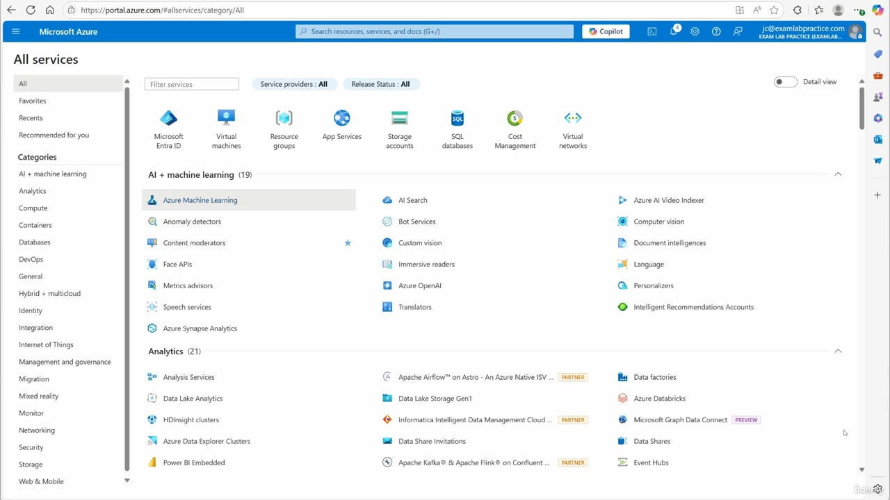

*Figure: 00:00. portal.azure.com, All services. The lab account is jc@examlabpractice.com in the EXAM LAB PRACTICE directory.*

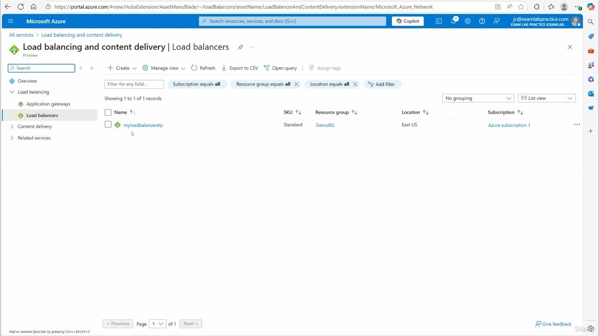

*Figure: 00:14. Load balancing and content delivery, Load balancers. One record.*

| Name | SKU | Resource group | Location | Subscription |
| --- | --- | --- | --- | --- |
| myloadbalancerelp | Standard | DemoRG | East US | Azure subscription 1 |

He opens `myloadbalancerelp`.

<strong>What the overview already shows</strong>

The overview is the load balancer before any NAT rule exists. Inbound NAT rules and outbound rules are both None. Port 80 is already load balanced across the pool.

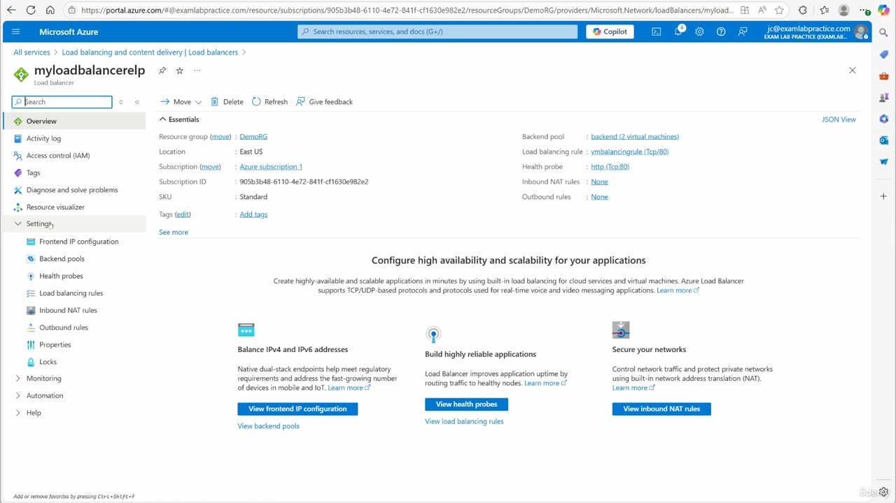

*Figure: 00:18. Overview of myloadbalancerelp. Inbound NAT rules is None.*

| Essentials | Value |
| --- | --- |
| Resource group | DemoRG |
| Location | East US |
| Subscription | Azure subscription 1 |
| Subscription ID | 905b3b48-6110-4e72-841f-c11630e982e2 |
| SKU | Standard |
| Backend pool | backend (2 virtual machines) |
| Load balancing rule | vmbalancingrule (Tcp/80) |
| Health probe | http (Tcp/80) |
| Inbound NAT rules | None |
| Outbound rules | None |

The page under that offers **View inbound NAT rules**. He uses the Settings menu instead.

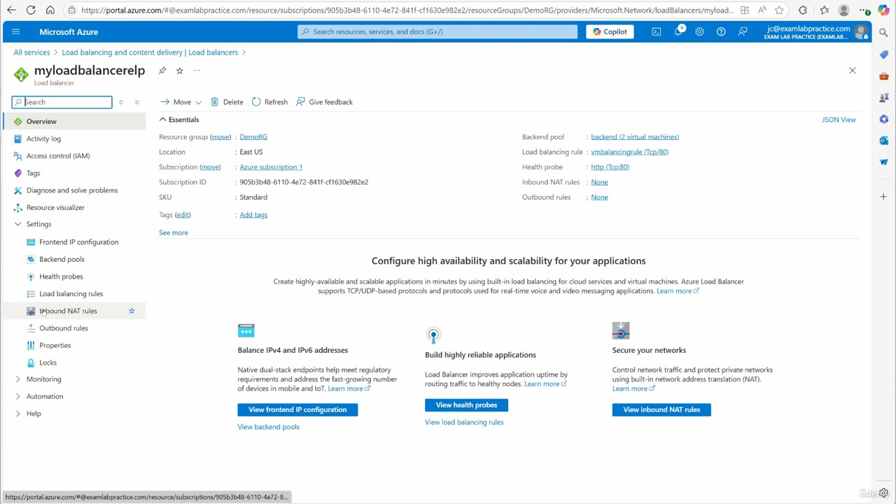

*Figure: 00:20. Settings is expanded. Inbound NAT rules is the selected item. Outbound rules sits under it.*

<strong>Open Add inbound NAT rule</strong>

Inbound NAT rules, then Add. The blade title is **Add inbound NAT rule**.

The sentence on the blade: an inbound NAT rule forwards incoming traffic sent to a selected IP address and port combination to a specific virtual machine. The transcript says "forged". The blade says forwards.

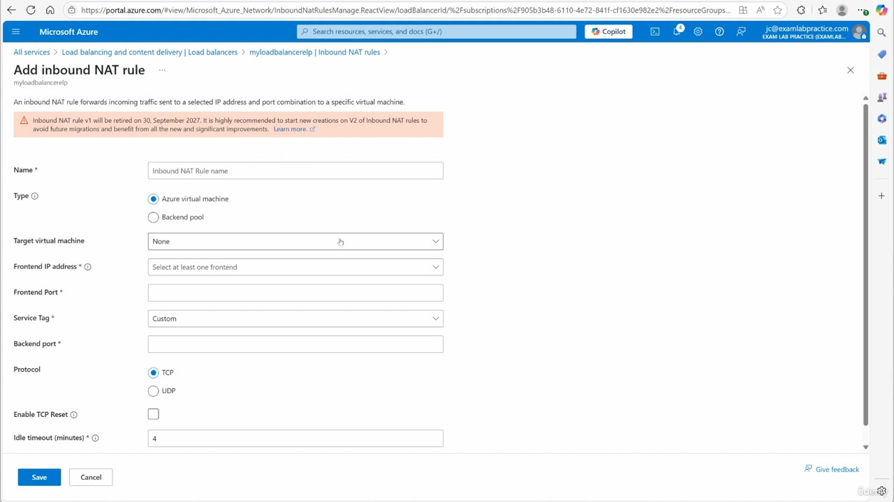

*Figure: 00:24. Add inbound NAT rule on myloadbalancerelp, before any values are filled. The warning sits under the description.*

Defaults on this empty blade:

| Field | Starting value |
| --- | --- |
| Name | placeholder, Inbound NAT Rule name |
| Type | Azure virtual machine |
| Target virtual machine | None |
| Frontend IP address | Select at least one frontend |
| Frontend Port | empty |
| Service Tag | Custom |
| Backend port | empty |
| Protocol | TCP |
| Enable TCP Reset | cleared |
| Idle timeout (minutes) | 4 |

The other Type radio is Backend pool. He leaves Azure virtual machine selected.

<strong>One virtual machine, not the pool</strong>

He walks the idea before the fields are filled. Someone connects to the frontend IP on port 3389. That traffic stays on 3389, and it goes to one machine, VM1, at that machine's private IP. It does not go to both virtual machines in the pool. The load balancing rule on TCP 80 is the thing he is distinguishing this from. Remote Desktop is the service, and the protocol is TCP.

<strong>The version warning on the blade</strong>

The warning on the Add blade, under the description:

> Inbound NAT rule v1 will be retired on 30, September 2027. It is highly recommended to start new creations on V2 of inbound NAT rules to avoid future migrations and benefit from all the new and significant improvements.

He reads that as the older NAT rules version 1 moving to version 2 by September 2027.

The current inbound NAT rules article draws a narrower line than this blade. Inbound NAT Pools, the virtual machine scale set feature of version 1, retire on September 30, 2027. A single-VM rule, Type set to Azure virtual machine, is not part of that retirement. This simulation still saves Type as Azure virtual machine and points it at VM1. He does not switch the radio to Backend pool.

<strong>Values he saves</strong>

He says the name is "NAT for RDP". The Name box is `inboundnatforRDP`.

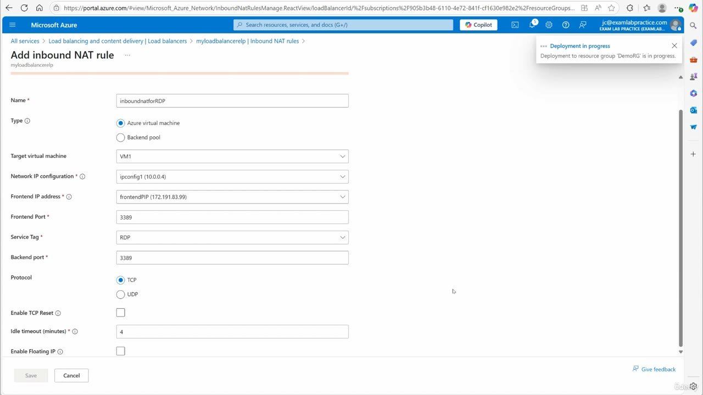

*Figure: 01:52. The completed rule, with Deployment in progress for resource group DemoRG.*

| Field | Value he saves |
| --- | --- |
| Name | inboundnatforRDP |
| Type | Azure virtual machine |
| Target virtual machine | VM1 |
| Network IP configuration | ipconfig1 (10.0.0.4) |
| Frontend IP address | frontendPIP (172.191.83.99) |
| Frontend Port | 3389 |
| Service Tag | RDP |
| Backend port | 3389 |
| Protocol | TCP |
| Enable TCP Reset | cleared |
| Idle timeout (minutes) | 4 |
| Enable Floating IP | cleared |

Network IP configuration and Enable Floating IP are on the blade once VM1 is the target. Service Tag has moved from Custom to RDP. He clicks Save. The same Add blade stays up while the deployment toast says deployment to resource group 'DemoRG' is in progress.

The mapping he wants from those fields:

- Public address `172.191.83.99` on port **3389**.
- That lands on VM1, NIC `ipconfig1`, private address **10.0.0.4**, port **3389**.
- TCP. RDP. One machine.

<strong>Deployment of the rule</strong>

By the time he is searching the desktop, the load balancer has returned to the Inbound NAT rules list and the deployment has succeeded.

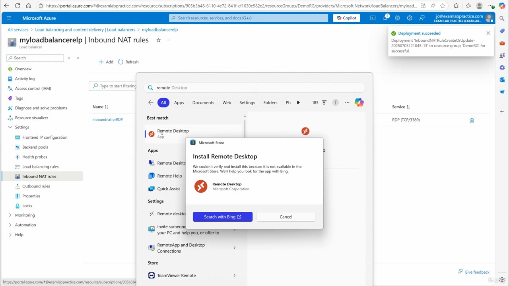

*Figure: 02:12. Success toast for InboundNATRuleCreateOrUpdate-20250705121045-13 in DemoRG. The new rule is already on the list behind the search window.*

The toast names the deployment `InboundNATRuleCreateOrUpdate-20250705121045-13` and the resource group DemoRG.

The row behind that window is the rule. A later frame shows the columns without the store dialog on top of them.

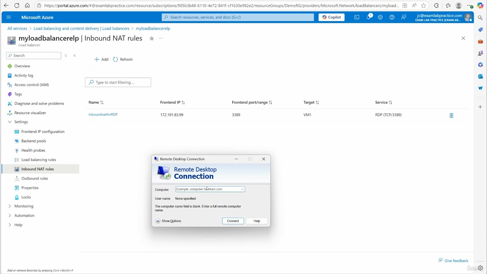

*Figure: 02:16. Inbound NAT rules on myloadbalancerelp. Remote Desktop Connection is open on top, and the rule row is fully readable.*

| Name | Frontend IP | Frontend port/range | Target | Service |
| --- | --- | --- | --- | --- |
| inboundnatforRDP | 172.191.83.99 | 3389 | VM1 | RDP (TCP/3389) |

The port column is labeled Frontend port/range. This rule uses a single port, 3389.

<strong>The first Remote Desktop app</strong>

He tests from his own computer. Windows search for `remote Desktop`. The best match is the Remote Desktop app.

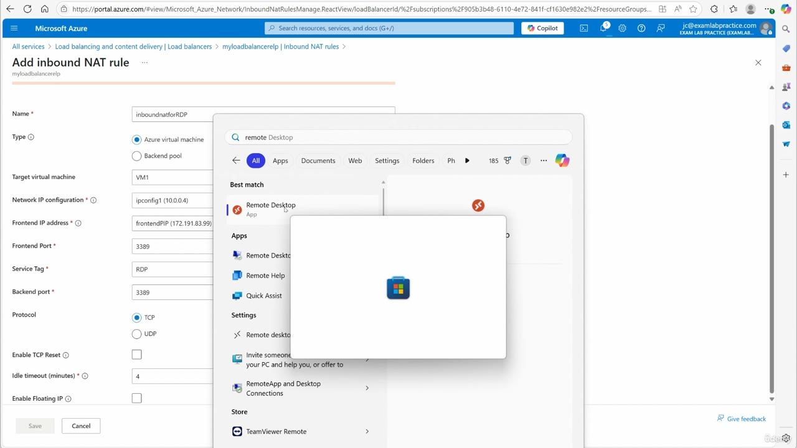

*Figure: 02:08. Search text is remote Desktop. Best match is the Remote Desktop app. The filled NAT rule is still the page underneath.*

That app opens the Microsoft Store install dialog, **Install Remote Desktop**. The store says it could not verify and install the app because it is not available in the Microsoft Store, and it offers **Search with Bing**. He says he opened the wrong one. The client he wants is Remote Desktop Connection.

<strong>Remote Desktop Connection</strong>

The next window is **Remote Desktop Connection**. The Computer box is still empty. The placeholder is `Example: computer.fabrikam.com`. User name is None specified. The dialog says the computer name field is blank and to enter a full remote computer name.

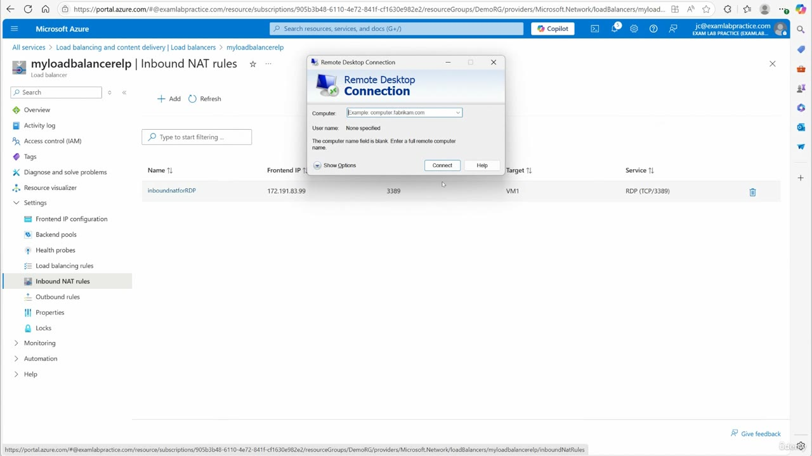

*Figure: 02:14. Remote Desktop Connection, Computer still empty, in front of the inboundnatforRDP row.*

He types the frontend address from the rule, `172.191.83.99`, and connects. He says he enters credentials and clicks Yes. The frames do not show that credential prompt. The next view of the desktop is the session itself.

<strong>Inside VM1</strong>

The session opens on Server Manager. A PowerShell window titled Select Administrator: Windows PowerShell is already on `ipconfig`, at `C:\Users\elpadmin>`.

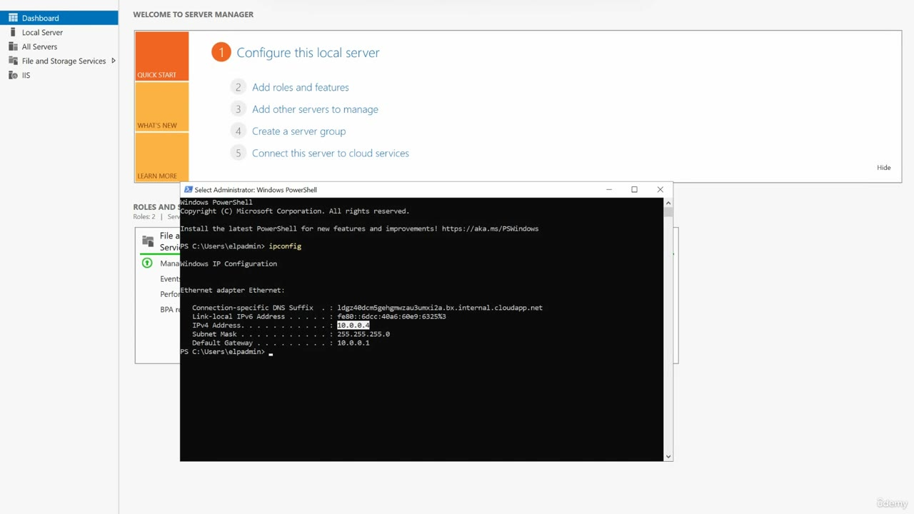

*Figure: 02:34. Server Manager behind an ipconfig window. The Ethernet IPv4 address is 10.0.0.4.*

Ethernet adapter from that command:

| ipconfig line | Value |
| --- | --- |
| IPv4 address | 10.0.0.4 |
| Subnet mask | 255.255.255.0 |
| Default gateway | 10.0.0.1 |

`10.0.0.4` is the same address as `ipconfig1` on the NAT rule. The frontend he connected to was `172.191.83.99`.

He then resizes the session. The window title is the address he typed.

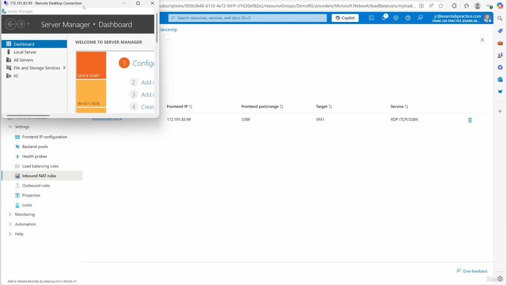

*Figure: 02:40. The Remote Desktop Connection title bar reads 172.191.83.99. The portal rule is still behind the window.*

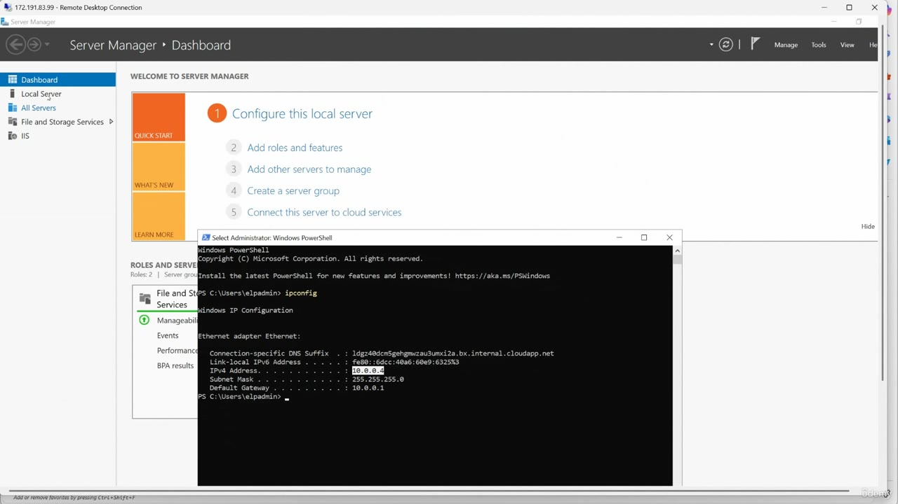

*Figure: 02:44. The session enlarged. ipconfig still shows 10.0.0.4, mask 255.255.255.0, gateway 10.0.0.1.*

He opens Local Server. The computer name is already VM1 while the rest of the properties are still Unknown.

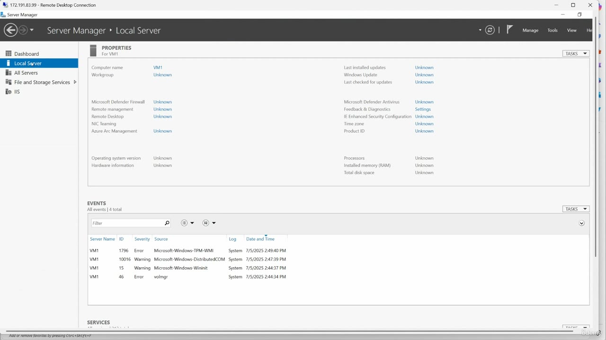

*Figure: 02:46. Server Manager, Local Server. Computer name is VM1. The other property values are still Unknown.*

The page then fills in. This is the screen he points at.

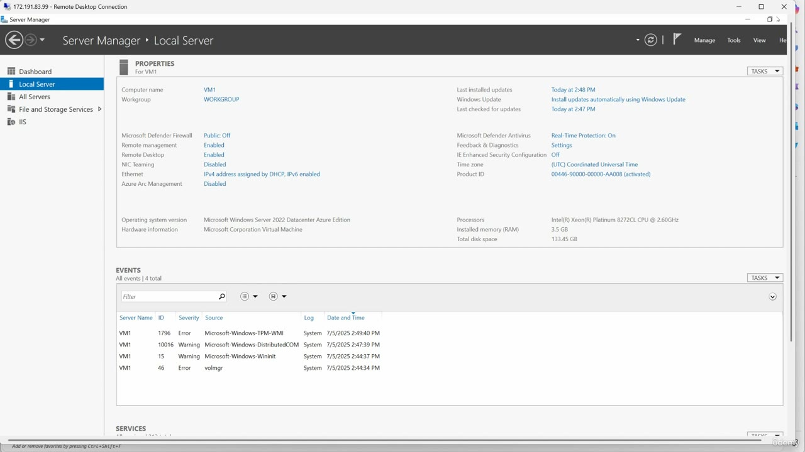

*Figure: 02:48. Local Server finished loading. Computer name VM1, workgroup WORKGROUP, Remote Desktop Enabled.*

| Property | Value on this frame |
| --- | --- |
| Computer name | VM1 |
| Workgroup | WORKGROUP |
| Remote Desktop | Enabled |
| Operating system | Microsoft Windows Server 2022 Datacenter Azure Edition |
| Hardware | Microsoft Corporation Virtual Machine |
| Microsoft Defender Firewall | Public: Off |
| NIC Teaming | Disabled |

He calls the closing idea an inbound NAT rule. The transcript hears the last line as "inbound net rule".

<strong>The rule that remains</strong>

The portal is back on the load balancer when the session is out of the way. One inbound NAT rule, aimed at VM1.

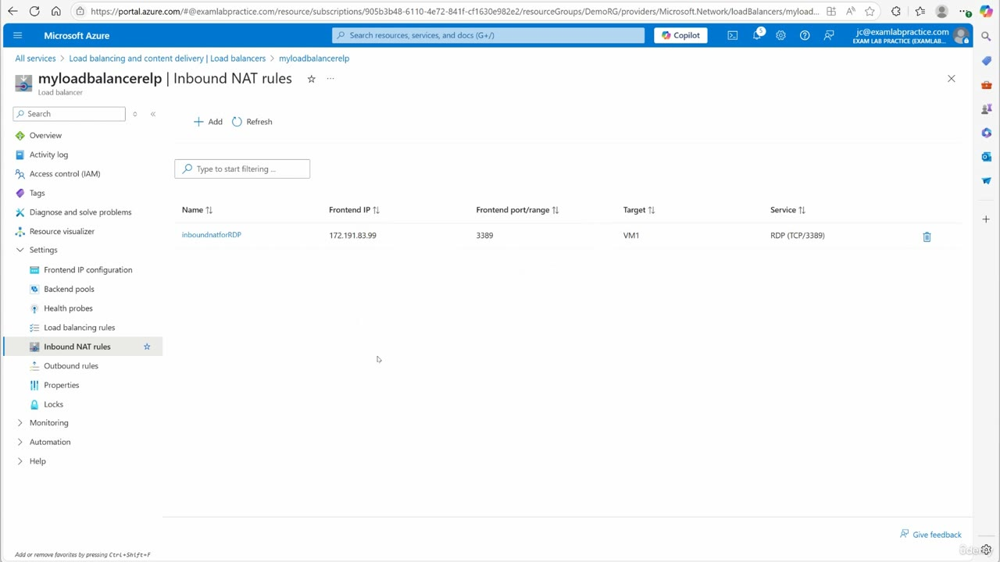

*Figure: 02:50. myloadbalancerelp, Inbound NAT rules. inboundnatforRDP, frontend 172.191.83.99, port 3389, target VM1, service RDP (TCP/3389).*

## Summary

- An inbound NAT rule forwards one frontend IP and port to one virtual machine. The load balancing rule `vmbalancingrule (Tcp/80)` still serves the pool of two machines. This rule does not.
- The load balancer is `myloadbalancerelp`, Standard, DemoRG, East US. Inbound NAT rules starts at None.
- The blade says the rule forwards traffic. The transcript says forged. The name he says is "NAT for RDP". The Name box is `inboundnatforRDP`.
- The warning on this blade says Inbound NAT rule v1 will be retired on 30 September 2027 and recommends V2 for new rules. He still saves Type as Azure virtual machine, target VM1.
- Frontend `frontendPIP (172.191.83.99)`, port 3389, service tag RDP, backend port 3389, protocol TCP, NIC `ipconfig1 (10.0.0.4)`. TCP Reset and Floating IP stay off. Idle timeout stays 4 minutes.
- The Remote Desktop app from search is the wrong client. Remote Desktop Connection to `172.191.83.99` opens VM1. `ipconfig` shows 10.0.0.4, and Local Server shows computer name VM1.
- The finished row is inboundnatforRDP, 172.191.83.99, port 3389, target VM1, service RDP (TCP/3389).

## References

- [Lesson video](../../../../../course_videos/Course%20AZ-104%20Microsoft%20Azure%20Administrator%20course%20with%20SIMULATIONS/108%20-%20Configure%20inbound%20NAT%20rules.mp4)
- [Transcript](../../../../../course_videos/Course%20AZ-104%20Microsoft%20Azure%20Administrator%20course%20with%20SIMULATIONS/108%20-%20Configure%20inbound%20NAT%20rules.txt)
- [Study guide for Exam AZ-104](https://learn.microsoft.com/en-us/credentials/certifications/resources/study-guides/az-104)
- [AZ-104: Manage virtual networks](https://learn.microsoft.com/en-us/training/paths/az-104-manage-virtual-networks/)
- [Inbound NAT rules](https://learn.microsoft.com/en-us/azure/load-balancer/inbound-nat-rules)
- [Manage inbound NAT rules](https://learn.microsoft.com/en-us/azure/load-balancer/manage-inbound-nat-rules)
- [Migrate from Inbound NAT rules version 1 to version 2](https://learn.microsoft.com/en-us/azure/load-balancer/load-balancer-nat-pool-migration)
- [Tutorial: Create a single virtual machine inbound NAT rule](https://learn.microsoft.com/en-us/azure/load-balancer/tutorial-load-balancer-port-forwarding-portal)

## Questions and Answers

<strong>Question 1 — What this rule does</strong>

What does he use an inbound NAT rule for on this load balancer?

**Answer.** It sends traffic for one frontend IP and port to one virtual machine. He uses it so port 3389 reaches VM1, and so that traffic is not load balanced to both machines in the pool.

<strong>Question 2 — How he opens load balancers</strong>

How does he get from the portal menu to the load balancer list?

**Answer.** Menu, All services, search for load balancers, then open the Load balancers resource. The blade that opens is Load balancing and content delivery.

<strong>Question 3 — Which load balancer</strong>

Which load balancer does he open, and what SKU, resource group, and region are on that row?

**Answer.** myloadbalancerelp, Standard, DemoRG, East US, in Azure subscription 1.

<strong>Question 4 — What the overview shows</strong>

Before he adds a rule, what do Inbound NAT rules and Outbound rules show, and what is already balancing traffic?

**Answer.** Both show None. The backend pool is backend (2 virtual machines). The load balancing rule is vmbalancingrule (Tcp/80). The health probe is http (Tcp/80).

<strong>Question 5 — The sentence on the add blade</strong>

What does the Add inbound NAT rule blade say the rule does with incoming traffic, and which word in the transcript does not match that sentence?

**Answer.** It forwards incoming traffic sent to a selected IP address and port combination to a specific virtual machine. The transcript says forged.

<strong>Question 6 — The warning on the blade</strong>

What retirement date is on the Add blade, and what does that warning tell you to use for new rules?

**Answer.** Inbound NAT rule v1 will be retired on 30 September 2027. It says to start new creations on V2 of inbound NAT rules. He still saves this rule with Type set to Azure virtual machine.

<strong>Question 7 — The name he gives it</strong>

What name does he say out loud, and what is in the Name box?

**Answer.** He says "NAT for RDP". The Name box is inboundnatforRDP.

<strong>Question 8 — Type and target machine</strong>

Which Type is selected, and which virtual machine and network IP configuration does the rule use?

**Answer.** Azure virtual machine. The other radio, Backend pool, stays clear. The target is VM1, and the network IP configuration is ipconfig1 (10.0.0.4).

<strong>Question 9 — Frontend and ports</strong>

Which frontend IP configuration does he select, and what are the frontend and backend ports?

**Answer.** frontendPIP (172.191.83.99). Frontend port 3389 and backend port 3389.

<strong>Question 10 — Service tag and protocol</strong>

What is the service tag when the blade first opens, what does he set it to, and which protocol is selected?

**Answer.** It starts at Custom. He sets it to RDP. Protocol is TCP. UDP stays clear.

<strong>Question 11 — Values left alone</strong>

Which timeout and which two checkboxes does he leave as they first appear?

**Answer.** Idle timeout stays 4 minutes. Enable TCP Reset stays cleared. Enable Floating IP stays cleared.

<strong>Question 12 — The first desktop app</strong>

What happens when he searches for Remote Desktop the first time, and which client does he use after that?

**Answer.** The Remote Desktop app opens a Microsoft Store install dialog that says the app is not available. He calls that the wrong tool. He then uses Remote Desktop Connection.

<strong>Question 13 — How the session proves the VM</strong>

Which address does he type into Remote Desktop Connection, and what on the session shows the rule reached the virtual machine he chose?

**Answer.** 172.191.83.99. The window title is that address. ipconfig shows IPv4 10.0.0.4, the same NIC as the rule. Local Server shows computer name VM1, and Remote Desktop is Enabled.

<strong>Question 14 — The row that remains</strong>

What does the finished Inbound NAT rules row show for name, frontend, port, target, and service, and which deployment name succeeds in DemoRG?

**Answer.** inboundnatforRDP, frontend IP 172.191.83.99, frontend port 3389, target VM1, service RDP (TCP/3389). The succeeded deployment is InboundNATRuleCreateOrUpdate-20250705121045-13.

