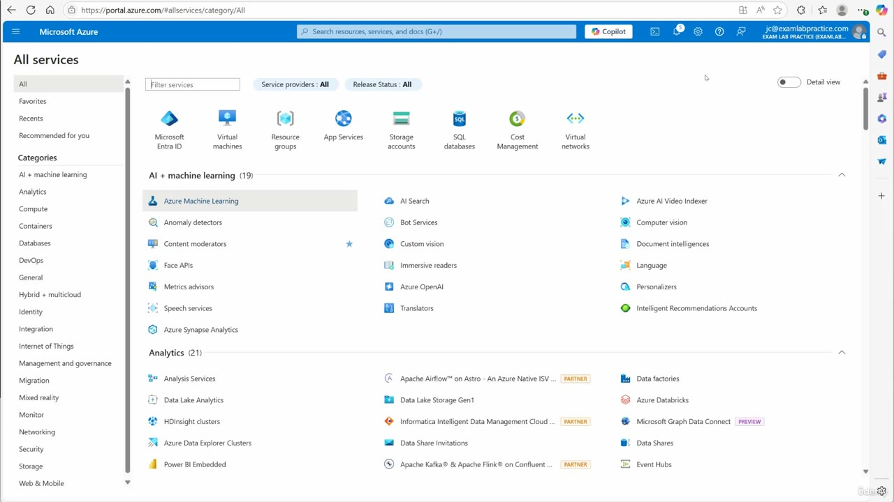
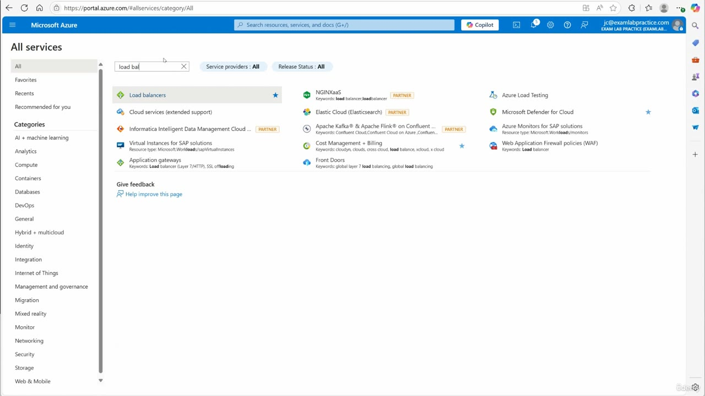
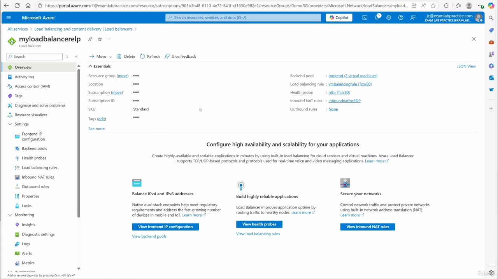
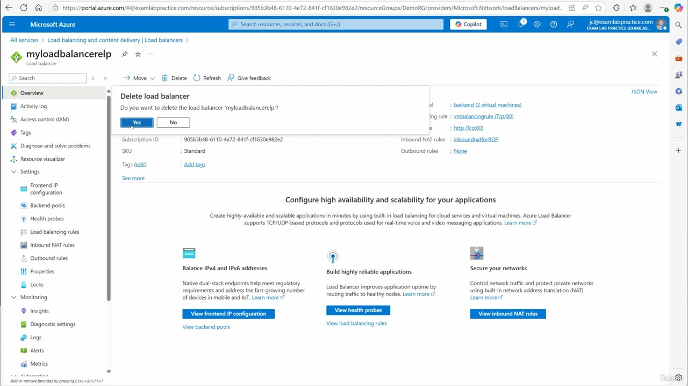

[Back to AZ-104: Microsoft Azure Administrator](../1.md)

# Chapter 112 — Removing the load balancer which is no longer needed

## Table of Contents

- [Introduction](#introduction)
- [Detailed tutorial](#detailed-tutorial)
  - [Find the load balancer](#find-the-load-balancer)
  - [What the overview shows](#what-the-overview-shows)
  - [Delete, then Yes](#delete-then-yes)
- [Summary](#summary)
- [References](#references)
- [Questions and Answers](#questions-and-answers)
  - [Question 1 — Why this delete](#question-1-why-this-delete)
  - [Question 2 — Where he starts](#question-2-where-he-starts)
  - [Question 3 — How he finds the service](#question-3-how-he-finds-the-service)
  - [Question 4 — Load balancer name](#question-4-load-balancer-name)
  - [Question 5 — SKU](#question-5-sku)
  - [Question 6 — Backend pool](#question-6-backend-pool)
  - [Question 7 — Rule and probe](#question-7-rule-and-probe)
  - [Question 8 — Inbound NAT](#question-8-inbound-nat)
  - [Question 9 — Confirming delete](#question-9-confirming-delete)
  - [Question 10 — Keeping yours](#question-10-keeping-yours)

## Introduction

The load balancer lab is over. He deletes that one resource from the Azure portal so it stops using credit. The overview still shows the backend pool, the HTTP rule, the health probe, and the RDP inbound NAT rule at the moment he deletes it. You can leave yours if you are still practicing.

## Detailed tutorial

**AZ-104 Microsoft Azure Administrator** · [112 - Removing the load balancer which is no longer needed.mp4](../../../../../course_videos/Course%20AZ-104%20Microsoft%20Azure%20Administrator%20course%20with%20SIMULATIONS/112%20-%20Removing%20the%20load%20balancer%20which%20is%20no%20longer%20needed.mp4) · [Transcript](../../../../../course_videos/Course%20AZ-104%20Microsoft%20Azure%20Administrator%20course%20with%20SIMULATIONS/112%20-%20Removing%20the%20load%20balancer%20which%20is%20no%20longer%20needed.txt)

<strong>Find the load balancer</strong>

He starts at portal.azure.com, opens the portal menu, goes to **All services**, and searches for the load balancer. The filter text on screen is `load bal`. **Load balancers** is the Microsoft service at the top of the results, not the partner results under it.

*Figure: 00:00. All services on portal.azure.com, before he filters.*

*Figure: 00:22. The filter is "load bal". Load balancers is the first result.*

<strong>What the overview shows</strong>

The load balancer is **myloadbalancerelp**. The resource group on the blade is **DemoRG**. The SKU is **Standard**. Outbound rules are **None**.

| Setting | Value on the overview |
| --- | --- |
| Backend pool | backend (2 virtual machines) |
| Load balancing rule | vmlbalancingrule (Tcp/80) |
| Health probe | http (Tcp/80) |
| Inbound NAT rules | inboundnatforRDP |
| Outbound rules | None |

*Figure: 00:28. Overview of myloadbalancerelp. Delete is in the command bar. The essentials list the pool, the port 80 rule, the HTTP probe, and the RDP NAT rule.*

<strong>Delete, then Yes</strong>

He clicks **Delete**. The portal asks "Do you want to delete the load balancer 'myloadbalancerelp'?" He clicks **Yes**. He says that once the delete finishes, he is ready to move on.

If you are still using your load balancer, he says to leave it. He is done with his.

*Figure: 00:30. The confirm dialog offers Yes and No. The pointer is on Yes.*

## Summary

- Open All services and search "load bal" to reach Load balancers.
- The demo resource is myloadbalancerelp in DemoRG, SKU Standard.
- It still has a two-VM backend, a TCP/80 rule, an HTTP probe, and inboundnatforRDP. Outbound rules are None.
- Delete, then Yes. Keep yours if you are still practicing. He deletes his to save Azure credit.

## References

- [Lesson video](../../../../../course_videos/Course%20AZ-104%20Microsoft%20Azure%20Administrator%20course%20with%20SIMULATIONS/112%20-%20Removing%20the%20load%20balancer%20which%20is%20no%20longer%20needed.mp4)
- [Transcript](../../../../../course_videos/Course%20AZ-104%20Microsoft%20Azure%20Administrator%20course%20with%20SIMULATIONS/112%20-%20Removing%20the%20load%20balancer%20which%20is%20no%20longer%20needed.txt)
- [Study guide for Exam AZ-104](https://learn.microsoft.com/en-us/credentials/certifications/resources/study-guides/az-104)
- [AZ-104: Configure and manage virtual networks](https://learn.microsoft.com/en-us/training/paths/az-104-manage-virtual-networks/)

## Questions and Answers

<strong>Question 1 — Why this delete</strong>

Why does he delete the load balancer?

**Answer.** He no longer needs it, and he wants to conserve Azure credits.

<strong>Question 2 — Where he starts</strong>

Which site does he start from?

**Answer.** portal.azure.com. He uses the portal menu and All services.

<strong>Question 3 — How he finds the service</strong>

What does he type in the All services filter?

**Answer.** "load bal", which surfaces Load balancers.

<strong>Question 4 — Load balancer name</strong>

What is the load balancer he opens?

**Answer.** myloadbalancerelp, in the resource group DemoRG.

<strong>Question 5 — SKU</strong>

Which SKU does the overview show?

**Answer.** Standard.

<strong>Question 6 — Backend pool</strong>

What does the backend pool contain?

**Answer.** A pool named backend with 2 virtual machines.

<strong>Question 7 — Rule and probe</strong>

Which load balancing rule and health probe are on the overview?

**Answer.** Rule vmlbalancingrule on TCP/80, and health probe http on TCP/80.

<strong>Question 8 — Inbound NAT</strong>

What inbound NAT rule is still configured, and what is set for outbound rules?

**Answer.** inboundnatforRDP is the inbound NAT rule. Outbound rules are None.

<strong>Question 9 — Confirming delete</strong>

What does he click to confirm the delete?

**Answer.** Delete, then Yes on "Do you want to delete the load balancer 'myloadbalancerelp'?"

<strong>Question 10 — Keeping yours</strong>

Can you leave your load balancer up while he deletes his?

**Answer.** Yes. He says that if you are still practicing, you can leave it longer.

