[Back to AZ-104: Microsoft Azure Administrator](../1.md)

# Chapter 130 — Configure and interpret reports and alerts for backups

## Table of Contents

- [Introduction](#introduction)
- [Detailed tutorial](#detailed-tutorial)
  - [Search All services for backup](#search-all-services-for-backup)
  - [Open the Recovery Services vault](#open-the-recovery-services-vault)
  - [Diagnostic settings on the Recovery Services vault](#diagnostic-settings-on-the-recovery-services-vault)
  - [The report event on that blade](#the-report-event-on-that-blade)
  - [Open the Backup vault](#open-the-backup-vault)
  - [Diagnostic settings on the Backup vault](#diagnostic-settings-on-the-backup-vault)
  - [Create the alert rule](#create-the-alert-rule)
  - [The signal on the Condition tab](#the-signal-on-the-condition-tab)
  - [Action groups, then Monitor](#action-groups-then-monitor)
  - [Query the logs](#query-the-logs)
  - [Empty until a backup runs](#empty-until-a-backup-runs)
- [Summary](#summary)
- [References](#references)
- [Questions and Answers](#questions-and-answers)
  - [Question 1 — Where the lesson starts](#question-1-where-the-lesson-starts)
  - [Question 2 — The first vault](#question-2-the-first-vault)
  - [Question 3 — Where diagnostics sit](#question-3-where-diagnostics-sit)
  - [Question 4 — The Recovery Services setting](#question-4-the-recovery-services-setting)
  - [Question 5 — The note on the blade](#question-5-the-note-on-the-blade)
  - [Question 6 — The Backup vault](#question-6-the-backup-vault)
  - [Question 7 — The setting he saves there](#question-7-the-setting-he-saves-there)
  - [Question 8 — How the two blades differ](#question-8-how-the-two-blades-differ)
  - [Question 9 — The alert signal](#question-9-the-alert-signal)
  - [Question 10 — The actions step](#question-10-the-actions-step)
  - [Question 11 — Where he queries](#question-11-where-he-queries)
  - [Question 12 — When the logs show up](#question-12-when-the-logs-show-up)

## Introduction

Video chapter 130 of the AZ-104 course. The study guide lists **Configure and interpret reports and alerts for backups** under Implement backup and recovery, in Monitor and maintain Azure resources. He sends diagnostic logs from a Recovery Services vault and from a Backup vault into one Log Analytics workspace, starts an alert rule on the Backup vault, and opens Monitor so those logs can be queried. Backup Reports stays on the vault menu. The alert wizard stops on Actions.

The report path and the alert path are separate clicks. Reports in this video mean the diagnostic categories that feed Backup reports, including the blade note about the AzureBackupReport event, and then Kusto Query Language (KQL) in Monitor. Alerts mean Create an alert rule on the Backup vault, with Backup Health Events (preview) as the signal.

## Detailed tutorial

**AZ-104 Microsoft Azure Administrator** · [130 - Configure and interpret reports and alerts for backups.mp4](../../../../../course_videos/Course%20AZ-104%20Microsoft%20Azure%20Administrator%20course%20with%20SIMULATIONS/130%20-%20Configure%20and%20interpret%20reports%20and%20alerts%20for%20backups.mp4) · [Transcript](../../../../../course_videos/Course%20AZ-104%20Microsoft%20Azure%20Administrator%20course%20with%20SIMULATIONS/130%20-%20Configure%20and%20interpret%20reports%20and%20alerts%20for%20backups.txt)

<strong>Search All services for backup</strong>

He starts on portal.azure.com. The account in the header is jc@examlabpractice.com, directory EXAM LAB PRACTICE. Menu, All services. The first frame is already that page. The filter box is still empty.

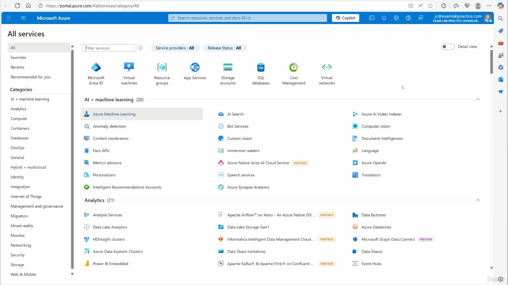

*Figure: 00:00. portal.azure.com, All services. The filter is empty. AI + machine learning and Analytics are the categories on screen.*

He types backup. Three services come back.

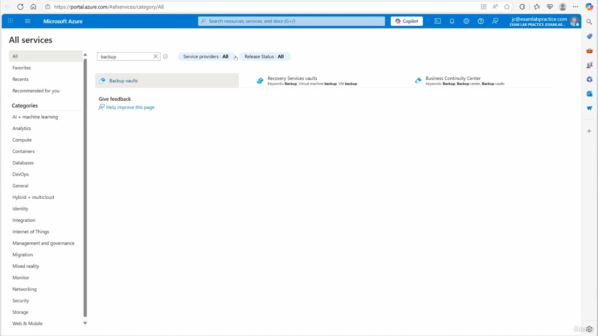

*Figure: 00:18. Filter text is backup. Three tiles: Backup vaults, Recovery Services vaults, and Business Continuity Center.*

| Tile | Keywords on the tile |
| --- | --- |
| Backup vaults | Backup vaults |
| Recovery Services vaults | Backup, Virtual machine backup, VM backup |
| Business Continuity Center | Backup, Backup center, Backup vaults |

He says "recovery service vault" and that he will click that one first. The service he opens is **Recovery Services vaults**. Backup vaults is the later half of the video. Business Continuity Center is the banner he leaves alone on the vault overview.

<strong>Open the Recovery Services vault</strong>

The vault that opens is **backupvaultdemo**, type Recovery Services vault. The address bar places it in resource group **StorageAcctDemo**, subscription **905b3b48-6110-4e72-841f-c11630e982e2**, provider Microsoft.RecoveryServices.

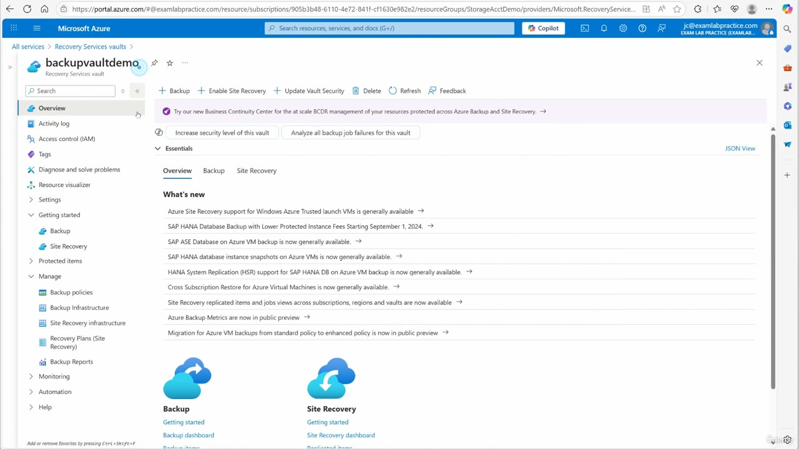

*Figure: 00:24. Recovery Services vault backupvaultdemo, Overview. The command bar is Backup, Enable Site Recovery, Update Vault Security, Delete, Refresh, and Feedback.*

The purple banner points at Business Continuity Center for at-scale business continuity and disaster recovery (BCDR) across Azure Backup and Site Recovery. Under that are **Increase security level of this vault** and **Analyze all backup job failures for this vault**. Essentials is collapsed on this frame. The body is a What's new list, then two cards: Backup (Getting started, Backup dashboard, Backup items) and Site Recovery (Site Recovery dashboard, Replicated items).

The left menu is the map for the rest of the vault:

| Group | Items on this vault |
| --- | --- |
| Getting started | Backup, Site Recovery |
| Protected items | Backup items, Replicated items |
| Manage | Backup policies, Backup Infrastructure, Site Recovery infrastructure, Recovery Plans (Site Recovery), **Backup Reports** |
| Monitoring | Alerts, Metrics, Diagnostic settings, Advisor recommendations, Backup jobs, Site Recovery events, Backup Alerts |

Backup Reports is the report entry on this menu. He scrolls past it and opens Diagnostic settings. That setting is how this video feeds report data into a workspace.

<strong>Diagnostic settings on the Recovery Services vault</strong>

Monitoring is expanded. Diagnostic settings is the selected item. Alerts and Metrics sit above it. Advisor recommendations, Backup jobs, Site Recovery events, and Backup Alerts sit below it. The settings list itself is still loading on that frame.

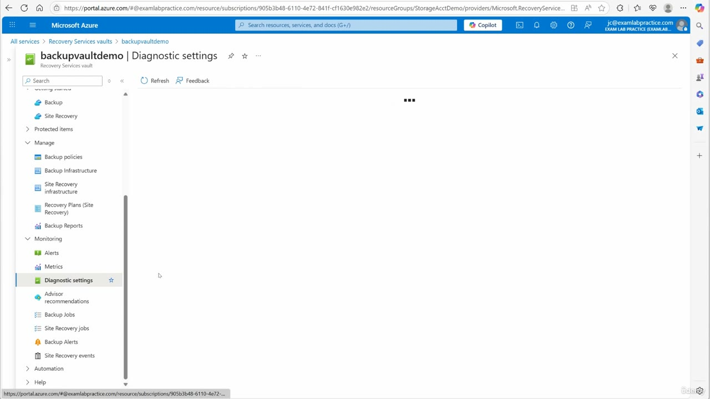

*Figure: 00:32. backupvaultdemo, Diagnostic settings, under Monitoring. The settings list has not finished loading.*

He adds a diagnostic setting. He says to generate logs for all of the items, name it "backup logs", and send it to a workspace he calls "log workspace demo". The form uses the names without spaces.

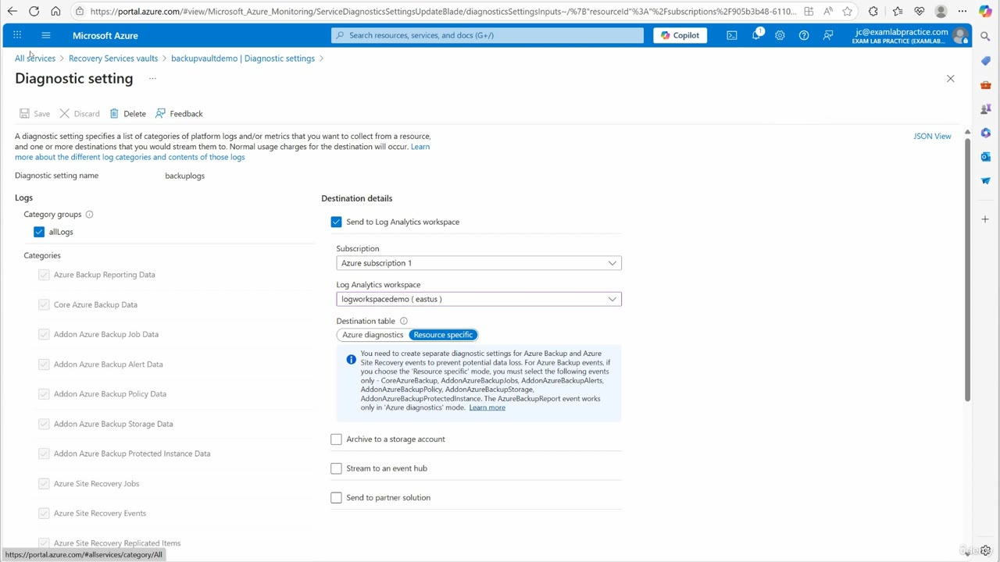

*Figure: 01:06. Diagnostic setting name backuplogs. Category group allLogs is checked. Send to Log Analytics workspace is checked. Destination table is Azure diagnostics.*

| Field | Value on this blade |
| --- | --- |
| Diagnostic setting name | backuplogs |
| Category group | allLogs, checked |
| Subscription | Azure subscription 1 |
| Log Analytics workspace | logworkspacedemo (eastus) |
| Destination table | Azure diagnostics |
| Archive to a storage account | clear |
| Stream to an event hub | clear |
| Send to partner solution | clear |

The category rows under allLogs are clear:

- Azure Backup Reporting Data
- Core Azure Backup Data
- Addon Azure Backup Job Data
- Addon Azure Backup Alert Data
- Addon Azure Backup Policy Data
- Addon Azure Backup Storage Data
- Addon Azure Backup Protected Instance Data
- Azure Site Recovery Jobs
- Azure Site Recovery Events
- Azure Site Recovery Replicated Items

He says a workspace can be created here if one does not already exist. This subscription already has logworkspacedemo. He saves. The video moves on before a success toast for backupvaultdemo. The toast that does appear later belongs to the Backup vault.

The diagnostic-events article tells you to choose **Resource specific** and the named backup events when the destination is Log Analytics, and it treats Azure Backup Reporting Data as the legacy event. This blade is the other choice: Destination table stays on **Azure diagnostics**, allLogs is the box that is checked, and the individual rows stay clear.

<strong>The report event on that blade</strong>

The blue note on the same Recovery Services form is the report instruction in this video:

> You need to create separate diagnostic settings for Azure Backup and Azure Site Recovery events to prevent potential data loss. For Azure Backup events, if you choose the "Resource specific" mode, you must select the following events only - CoreAzureBackup, AddonAzureBackupJobs, AddonAzureBackupAlerts, AddonAzureBackupPolicy, AddonAzureBackupStorage, AddonAzureBackupProtectedInstance. The AzureBackupReport event works only in Azure diagnostics mode.

Read that against the controls he left in place. Azure diagnostics is the selected destination table, which is the mode the note names for the AzureBackupReport event. Resource specific is the other pill, and it is clear. The category label for that report data, Azure Backup Reporting Data, is one of the clear rows. allLogs is the group that is checked.

He does not open the Backup Reports menu item, and he does not open a report workbook. Interpreting the data, in his words, is the same log query he has used before: Monitor, Logs, tables, KQL, after a backup has actually run.

<strong>Open the Backup vault</strong>

He goes back to the menu, All services, backup, and this time opens **Backup vaults**. That service is Microsoft.DataProtection, a different resource from the Recovery Services vault.

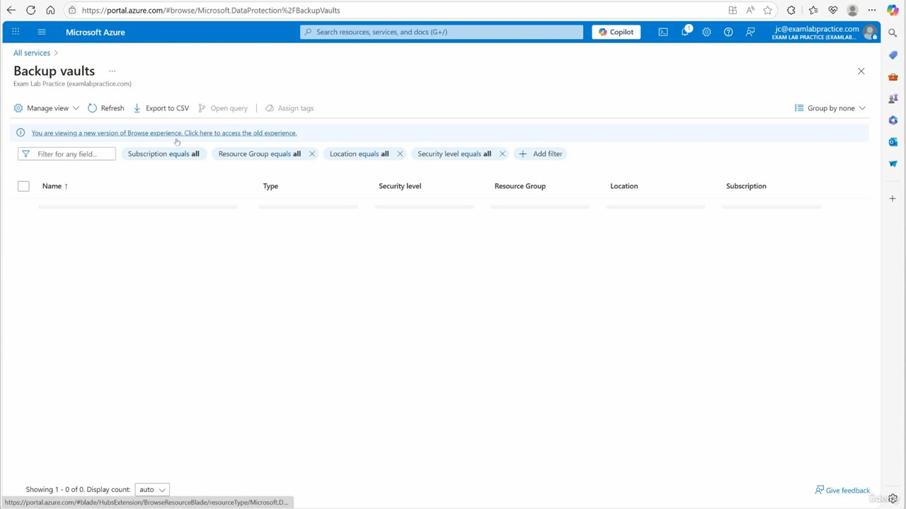

*Figure: 01:12. Backup vaults. The banner says you are viewing a new version of the Browse experience. The grid on this frame is Showing 1 - 0 of 0.*

Columns on that grid are Name, Type, Security level, Resource Group, Location, and Subscription. The filters are Subscription, Resource Group, Location, and Security level, each set to all. The directory line under the title is Exam Lab Practice (examlabpractice.com).

The next frame has the vault open. The list on the left shows one record.

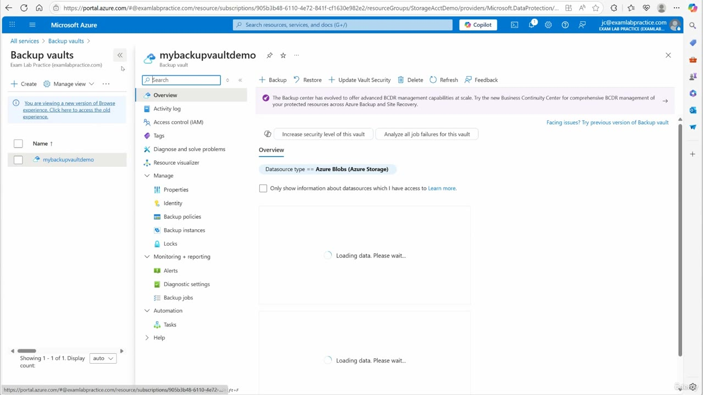

*Figure: 01:14. Backup vault mybackupvaultdemo. Datasource type is Azure Blobs (Azure Storage). Both overview panes still say Loading data. Please wait.*

| Item | What is on screen |
| --- | --- |
| Name | mybackupvaultdemo |
| Type | Backup vault |
| Resource group | StorageAcctDemo, from the address bar, same subscription ID as the Recovery Services vault |
| Datasource filter | Datasource type == Azure Blobs (Azure Storage) |
| Access checkbox | Only show information about datasources which I have access to, clear |
| Command bar | Backup, Restore, Update Vault Security, Delete, Refresh, Feedback |

The banner says the Backup center has evolved into at-scale BCDR in Business Continuity Center. A link on the right says **Facing issues? Try previous version of Backup vault**. **Increase security level of this vault** and **Analyze all job failures for this vault** sit under the banner.

Monitoring on this vault is labeled **Monitoring + reporting**, and it holds three items: Alerts, Diagnostic settings, and Backup jobs. There is no Backup Reports row and no Site Recovery group on this menu. Manage holds Properties, Identity, Backup policies, Backup instances, and Locks.

<strong>Diagnostic settings on the Backup vault</strong>

He says this is the same process. Monitoring + reporting, Diagnostic settings, Add. He calls the name "backup vault log".

The empty form is a shorter list than the Recovery Services blade, and it has a metrics preview the other vault did not show.

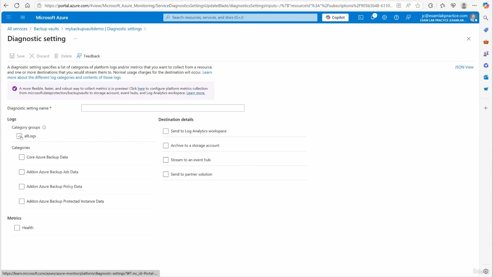

*Figure: 01:20. Diagnostic setting on mybackupvaultdemo, before a name or destination is set. The preview banner is for platform metrics on microsoft.dataprotection/backupvaults.*

The preview banner: a more flexible, faster, and robust way to collect metrics is in preview, with a link to configure platform metrics collection from microsoft.dataprotection/backupvaults to a storage account, an event hub, and a Log Analytics workspace.

Empty-form categories, all clear:

- Core Azure Backup Data
- Addon Azure Backup Job Data
- Addon Azure Backup Policy Data
- Addon Azure Backup Protected Instance Data

Metrics on this form is one box, **Health**, and it starts clear. allLogs starts clear. Every destination starts clear. There is no destination-table choice and no Site Recovery category on this blade.

He fills it and saves. The toast is the confirmation for this vault.

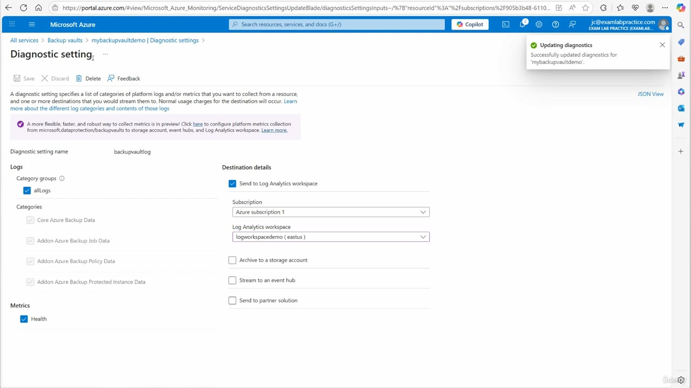

*Figure: 01:32. Name backupvaultlog. allLogs, the four backup categories, and Health are checked. The toast says diagnostics for mybackupvaultdemo were updated.*

| Field | Saved value |
| --- | --- |
| Diagnostic setting name | backupvaultlog |
| Category group | allLogs, checked |
| Categories | Core Azure Backup Data, Addon Azure Backup Job Data, Addon Azure Backup Policy Data, Addon Azure Backup Protected Instance Data, checked |
| Metric | Health, checked |
| Destination | Send to Log Analytics workspace |
| Subscription | Azure subscription 1 |
| Log Analytics workspace | logworkspacedemo (eastus) |
| Archive, event hub, partner solution | clear |

The toast title is **Updating diagnostics**. The body is **Successfully updated diagnostics for 'mybackupvaultdemo'**.

Same workspace as the Recovery Services setting. Different setting name, a Health metric, a shorter category list, and a success toast that names this vault.

<strong>Create the alert rule</strong>

Alerts are the second path, and they start on this Backup vault. He says click Alerts, then create an alert rule, and that the wizard is the same one used for any other resource: pick the signal you care about, set an action group, and create the rule.

The blade is **Create an alert rule**. The breadcrumb is Backup vaults > mybackupvaultdemo | Alerts. The tabs are Scope, Condition, Actions, Details, Tags, and Review + create. Condition is the active tab: "Configure when the alert rule should trigger by selecting a signal and defining its logic."

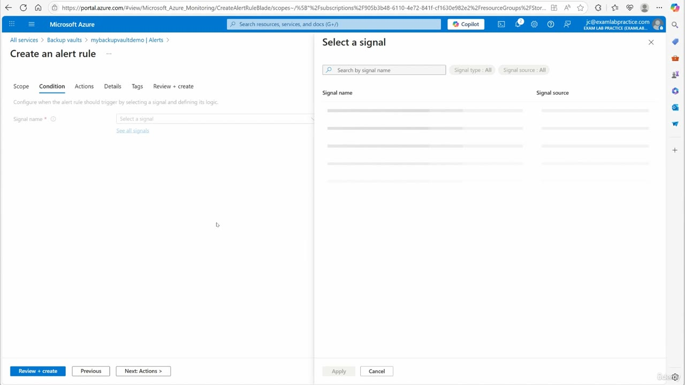

*Figure: 01:44. Condition is underlined. See all signals sits under the signal box. The Select a signal pane is open and the signal rows have not loaded.*

Signal name is required. The link under the box is **See all signals**. The transcript says "select all signals". The control on the blade is that link. The Select a signal pane has a name search, Signal type set to All, and Signal source set to All. The rows are still placeholders on this frame.

<strong>The signal on the Condition tab</strong>

He says you would select whichever signal you care about and then create the alert. The signal that is selected on the next frame is **Backup Health Events (preview)**.

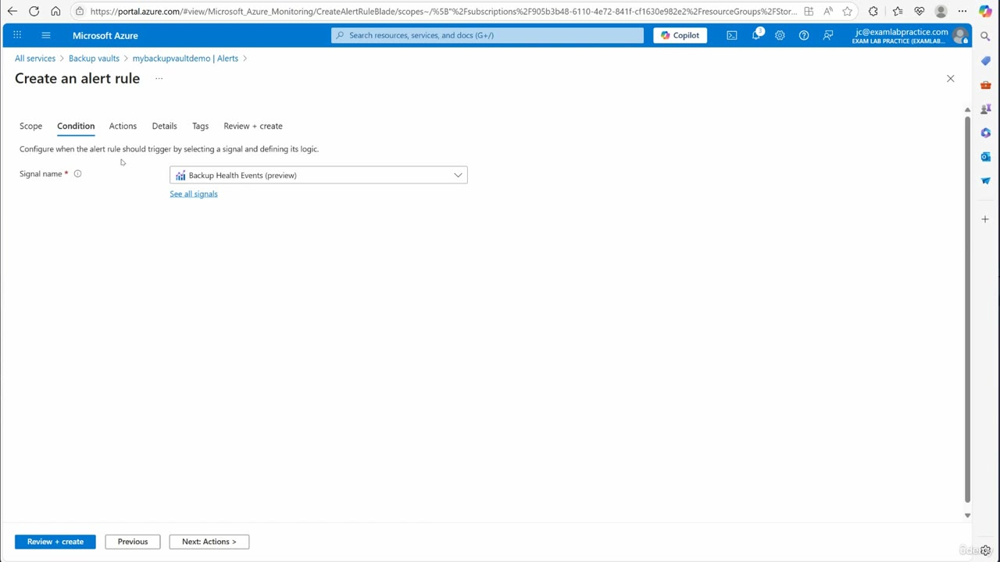

*Figure: 02:02. Create an alert rule, still on Condition. The signal dropdown reads Backup Health Events (preview).*

He does not show a threshold, a dimension, or an alert-rule name. The metrics article describes Backup Health Events as the count of backup-job health events for the vault, and it uses that signal when you build a metric alert. On this recording the only condition value he leaves on screen is the signal name.

<strong>Action groups, then Monitor</strong>

He says you set your action group up and then you are done. The Actions tab is as far as the wizard gets.

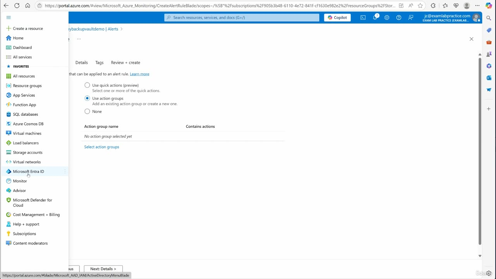

*Figure: 02:14. Actions on the alert rule for mybackupvaultdemo. Use action groups is selected. The portal menu is open, and the pointer is on Monitor.*

The three choices:

| Option | State |
| --- | --- |
| Use quick actions (preview) | clear |
| Use action groups | selected. The help text says to add an existing action group or create a new one |
| None | clear |

The grid says **No action group selected yet**, with a **Select action groups** link. He opens the portal menu from here. Monitor is the item under the pointer. Review + create is still a later tab. The rule is not created in this video.

<strong>Query the logs</strong>

Queries are the interpretation step, and he treats them as the same Monitor path from the earlier log lessons. Portal menu, Monitor, Logs.

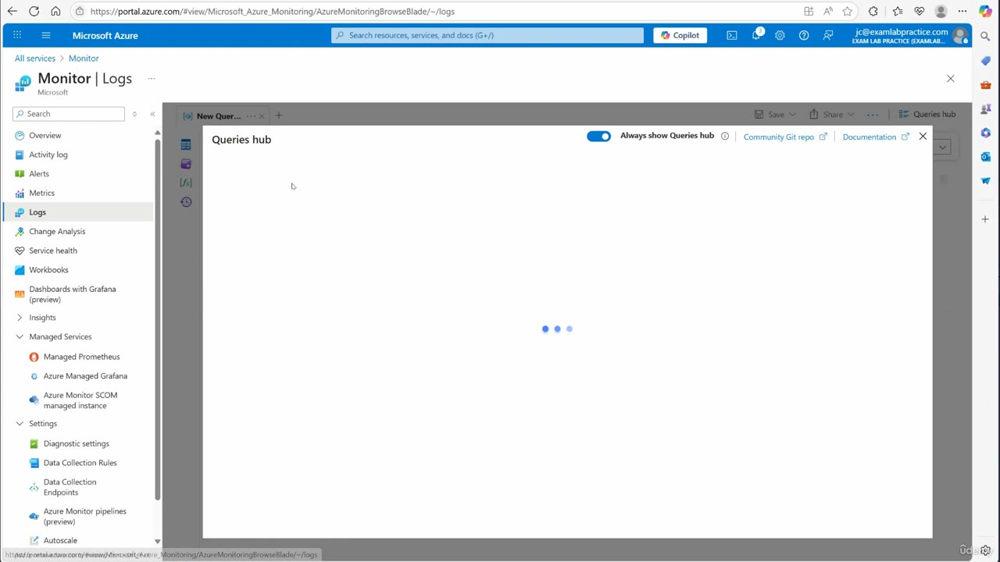

*Figure: 02:18. Monitor, Logs. Queries hub is open, Always show Queries hub is on, and the hub body has not finished loading. A New Query tab is started.*

The Monitor menu on that frame:

| Area | Items |
| --- | --- |
| Top | Overview, Activity log, Alerts, Metrics, **Logs** |
| Insights | Change Analysis, Service health, Workbooks, Dashboards with Grafana (preview), Insights |
| Managed | Managed Services, Managed Prometheus, Azure Managed Grafana, Azure Monitor SCOM managed instance |
| Settings | Diagnostic settings, Data Collection Rules, Data Collection endpoints, Azure Monitor pipelines (preview), Autoscale |

Queries hub shows **Always show Queries hub** switched on, plus Community Git repo and Documentation. He says to close that hub, look at the tables, and write KQL. He does not type a query, and the hub does not finish loading before the lesson ends.

<strong>Empty until a backup runs</strong>

He closes on the delay. Turning the diagnostic setting on does not fill the workspace by itself. Backups have to run, and only then does log data start to appear. Until that happens the tables are empty. He says this is the same logging and alerting process as the earlier lessons, pointed at backups.

The Azure Monitor logs article for Backup puts a lag on that data once backups do run: events reach the workspace about 20 to 30 minutes after the vault pushes them, and some items are pushed on a longer cycle. The configure-reports article says the first push can take up to 24 hours, and it suggests waiting two days before reading Backup reports, because the current partial day is omitted. Those intervals are the documentation. The line he wants from this video is the shorter one: the workspace is empty until a backup is triggered, and it takes a while after that.

## Summary

- Two vault types, one workspace. Recovery Services vault **backupvaultdemo** gets diagnostic setting **backuplogs**. Backup vault **mybackupvaultdemo** gets **backupvaultlog**. Both send to **logworkspacedemo (eastus)** in Azure subscription 1, resource group StorageAcctDemo.
- On the Recovery Services blade, allLogs is checked, the individual categories stay clear, and Destination table stays on **Azure diagnostics**. The note on that blade says the AzureBackupReport event works only in Azure diagnostics mode, and it lists the events required if you switch to Resource specific.
- Backup Reports is on the Recovery Services menu under Manage. He configures the diagnostic setting that feeds those reports and queries the workspace in Monitor. He does not open the report workbook.
- The Backup vault overview is filtered to datasource type Azure Blobs (Azure Storage). Its diagnostic blade adds the Health metric, checks four backup categories plus allLogs, and shows the metrics preview for microsoft.dataprotection/backupvaults. The toast confirms the update for mybackupvaultdemo.
- The alert is on the Backup vault. Condition signal is **Backup Health Events (preview)**. Actions has **Use action groups** selected and no action group chosen. The rule is not created.
- Monitor, Logs is the query step. Close Queries hub, use the tables, write KQL. The workspace stays empty until a backup runs.

## References

- [Lesson video](../../../../../course_videos/Course%20AZ-104%20Microsoft%20Azure%20Administrator%20course%20with%20SIMULATIONS/130%20-%20Configure%20and%20interpret%20reports%20and%20alerts%20for%20backups.mp4)
- [Transcript](../../../../../course_videos/Course%20AZ-104%20Microsoft%20Azure%20Administrator%20course%20with%20SIMULATIONS/130%20-%20Configure%20and%20interpret%20reports%20and%20alerts%20for%20backups.txt)
- [Study guide for Exam AZ-104](https://learn.microsoft.com/en-us/credentials/certifications/resources/study-guides/az-104)
- [Diagnostic Events for Azure Backup users](https://learn.microsoft.com/en-us/azure/backup/backup-azure-diagnostic-events)
- [Configure Azure Backup reports](https://learn.microsoft.com/en-us/azure/backup/configure-reports)
- [View reports for Azure Backup](https://learn.microsoft.com/en-us/azure/backup/view-reports)
- [Azure Monitor Logs in Azure Backup](https://learn.microsoft.com/en-us/azure/backup/backup-azure-monitoring-use-azuremonitor)
- [Monitoring and reporting solutions for Azure Backup](https://learn.microsoft.com/en-us/azure/backup/monitoring-and-alerts-overview)
- [Configure and manage Azure Monitor based alert notifications for Azure Backup](https://learn.microsoft.com/en-us/azure/backup/backup-azure-monitor-alerts-notification)
- [Monitor the health of your backups using Azure Backup Metrics (preview)](https://learn.microsoft.com/en-us/azure/backup/metrics-overview)
- [Diagnostic settings in Azure Monitor](https://learn.microsoft.com/en-us/azure/azure-monitor/data-collection/diagnostic-settings)

## Questions and Answers

<strong>Question 1 — Where the lesson starts</strong>

How does he reach the backup services, and which three tiles does the filter return?

**Answer.** He is on portal.azure.com as jc@examlabpractice.com in EXAM LAB PRACTICE. Menu, All services, filter backup. The tiles are Backup vaults, Recovery Services vaults, and Business Continuity Center. He opens Recovery Services vaults first.

<strong>Question 2 — The first vault</strong>

Which vault opens from that first click, and which resource group and subscription ID are in its address?

**Answer.** backupvaultdemo, a Recovery Services vault (Microsoft.RecoveryServices). Resource group StorageAcctDemo. Subscription ID 905b3b48-6110-4e72-841f-c11630e982e2. The command bar includes Backup, Enable Site Recovery, and Update Vault Security.

<strong>Question 3 — Where diagnostics sit</strong>

On the Recovery Services vault, which menu group contains Diagnostic settings, and where is Backup Reports?

**Answer.** Diagnostic settings is under Monitoring, with Alerts, Metrics, Advisor recommendations, Backup jobs, Site Recovery events, and Backup Alerts. Backup Reports is under Manage. He opens Diagnostic settings.

<strong>Question 4 — The Recovery Services setting</strong>

What name is in the diagnostic setting box, which category control is checked, and which workspace receives the logs?

**Answer.** The box is backuplogs. He says "backup logs". allLogs is checked, and the individual category rows stay clear. Send to Log Analytics workspace is checked, subscription Azure subscription 1, workspace logworkspacedemo (eastus). He says "log workspace demo". Destination table is Azure diagnostics. Archive to a storage account, Stream to an event hub, and Send to partner solution stay clear.

<strong>Question 5 — The note on the blade</strong>

What does the blue note say about the report event, and which destination table is selected while that note is on screen?

**Answer.** The AzureBackupReport event works only in Azure diagnostics mode. Azure diagnostics is the selected destination table. The same note says to use separate diagnostic settings for Azure Backup and Azure Site Recovery events, and it lists CoreAzureBackup, AddonAzureBackupJobs, AddonAzureBackupAlerts, AddonAzureBackupPolicy, AddonAzureBackupStorage, and AddonAzureBackupProtectedInstance as the events to select if the mode is Resource specific.

<strong>Question 6 — The Backup vault</strong>

Which Backup vault does he open, and what datasource type is on the overview?

**Answer.** mybackupvaultdemo. The filter reads Datasource type == Azure Blobs (Azure Storage). The overview panes still say Loading data. Please wait. Monitoring on this vault is labeled Monitoring + reporting and lists Alerts, Diagnostic settings, and Backup jobs.

<strong>Question 7 — The setting he saves there</strong>

What name does the Backup vault diagnostic setting get, which metric is checked, and what does the toast say?

**Answer.** backupvaultlog. He says "backup vault log". Health is checked, along with allLogs and the four backup categories. The destination is the same logworkspacedemo (eastus) workspace. The toast title is Updating diagnostics, and the body is Successfully updated diagnostics for 'mybackupvaultdemo'.

<strong>Question 8 — How the two blades differ</strong>

Which categories and which extra control show up on the Backup vault diagnostic blade, and which preview banner is only on that blade?

**Answer.** The Backup vault category list is Core Azure Backup Data, Addon Azure Backup Job Data, Addon Azure Backup Policy Data, and Addon Azure Backup Protected Instance Data, plus a Health metric. On the saved blade those boxes are checked. The preview banner is platform metrics collection from microsoft.dataprotection/backupvaults. The Recovery Services blade is the one with Azure Backup Reporting Data, the Site Recovery categories, Addon Azure Backup Alert Data, Addon Azure Backup Storage Data, and the Azure diagnostics / Resource specific destination table.

<strong>Question 9 — The alert signal</strong>

Which signal does the alert rule show, on which vault, and what is the link under the signal box?

**Answer.** Backup Health Events (preview), on Backup vault mybackupvaultdemo, Condition tab of Create an alert rule. The link is See all signals. The transcript says "select all signals". The signal list on the earlier frame had not finished loading.

<strong>Question 10 — The actions step</strong>

Which actions option is selected, and how far does he take the rule?

**Answer.** Use action groups is selected. The grid says No action group selected yet. Use quick actions (preview) and None are clear. He opens the portal menu on Monitor. He does not select an action group, and he does not pass Review + create.

<strong>Question 11 — Where he queries</strong>

Where does he go to query the backup logs, and what does he tell you to do with Queries hub?

**Answer.** Portal menu, Monitor, Logs. Queries hub is open with Always show Queries hub switched on, and the hub body has not loaded. He says to close that hub, look at the tables, and write KQL. He does not type a query in this video.

<strong>Question 12 — When the logs show up</strong>

What does he say you will see in the workspace right after the diagnostic setting is saved?

**Answer.** It is empty until backups are triggered. He says it takes a while before log data shows up, because something has to run a backup first. He calls the logging and the alerting the same process as the earlier lessons, used here for backups.

