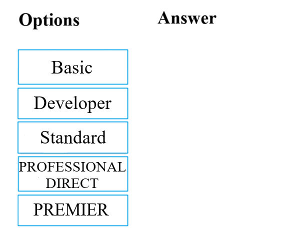

# Questions and Answers 1-10

[Back to AZ-900 Practice Exam](../az-900.md)

**Source:** [01-10.pdf](../files/01-10.pdf)

<strong>Question 1 - Support plans that open requests</strong>

DRAG DROP

Your company intends to subscribe to an Azure support plan.

The support plan must allow for new support requests to be opened.

Which of the following are support plans that will allow this? Drag the correct options from the list into the answer area.

_Figure: Options are Basic, Developer, Standard, Professional Direct, and Premier. The answer area is empty._

<strong>Answer 1</strong>

Basic, Developer, Standard, and Professional Direct. Premier stays in the options list.

_Figure: Basic, Developer, Standard, and Professional Direct are in the answer area. Premier is not._

Basic can open billing and subscription support requests. Developer, Standard, and Professional Direct can open technical support requests as well.

**Why the others are wrong**

- Premier is the option left out. It is not one of the Azure support plans on the current comparison (Basic, Developer, Standard, Professional Direct, and Unified Enterprise). The solution image does not place it in the answer area.

**Study further**

- [Compare Azure support plans](https://azure.microsoft.com/en-us/support/plans)
- [Create an Azure support request](https://learn.microsoft.com/en-us/azure/azure-portal/supportability/how-to-create-azure-support-request)

<strong>Question 2 - Storage readable in two regions</strong>

Your company has datacenters in Los Angeles and New York. The company has a Microsoft Azure subscription.

You are configuring the two datacenters as geo-clustered sites for site resiliency.

You need to recommend an Azure storage redundancy option.

You have the following data storage requirements:

- Data must be stored on multiple nodes.
- Data must be stored on nodes in separate geographic locations.
- Data can be read from the secondary location as well as from the primary location.

Which of the following Azure storage redundancy options should you recommend?

- A. Geo-redundant storage
- B. Read-only geo-redundant storage
- C. Zone-redundant storage
- D. Locally redundant storage

<strong>Answer 2</strong>

B. Read-only geo-redundant storage.

Read-only geo-redundant storage (RA-GRS) keeps a copy in a paired region and lets you read that copy. The question needs multiple nodes, a second geography, and reads from the secondary.

**Why the others are wrong**

- A. Geo-redundant storage copies data to a paired region, but the secondary is not readable until the account fails over.
- C. Zone-redundant storage copies data across availability zones in one region. It does not put a copy in a separate geography.
- D. Locally redundant storage keeps copies in one datacenter. It does not meet the separate-location or secondary-read requirements.

**Study further**

- [Azure Storage redundancy](https://learn.microsoft.com/en-us/azure/storage/common/storage-redundancy)

<strong>Question 3 - Cheapest plan for a design assessment</strong>

This item shares its setup with other questions. Each one proposes a different solution. Decide whether this solution meets the goal.

Your company's Azure subscription includes a Basic support plan.

They would like to request an assessment of an Azure environment's design from Microsoft. This is not supported by the existing plan.

You want the company to subscribe to a support plan that allows this, while keeping expenses to a minimum.

Solution: You recommend that the company subscribes to the Professional Direct support plan.

Does the solution meet the goal?

- A. Yes
- B. No

<strong>Answer 3</strong>

B. No.

The goal is a design assessment at the lowest cost. Developer and Standard both include general architecture guidance, and both cost less than Professional Direct ($29 and $100 a month versus $1,000). Professional Direct adds delivery-manager guidance, but it misses the minimum-cost requirement.

**Why the others are wrong**

- A. Yes would mean Professional Direct is the cheapest plan that allows a design assessment. General architecture guidance is already listed for Developer and Standard.

**Study further**

- [Compare Azure support plans](https://azure.microsoft.com/en-us/support/plans)
- [Azure Support: Professional Direct](https://azure.microsoft.com/en-us/support/plans/prodirect)

<strong>Question 4 - Virtual machines as SaaS</strong>

This item shares its setup with other questions. Each one proposes a different solution. Decide whether this solution meets the goal.

You are tasked with deploying Azure virtual machines for your company.

You need to make use of the appropriate cloud deployment solution.

Solution: You should make use of Software as a Service (SaaS).

Does the solution meet the goal?

- A. Yes
- B. No

<strong>Answer 4</strong>

B. No.

SaaS is a finished application you use, such as Microsoft 365. Deploying virtual machines means you rent the infrastructure and manage the operating system, which is Infrastructure as a Service.

**Why the others are wrong**

- A. Yes would mean SaaS is how you deploy virtual machines. In SaaS, Microsoft runs the application. You do not get a virtual machine to manage.

**Study further**

- [Describe cloud service types](https://learn.microsoft.com/en-us/training/modules/describe-cloud-service-types/)
- [Shared responsibility in the cloud](https://learn.microsoft.com/en-us/azure/security/fundamentals/shared-responsibility)

<strong>Question 5 - Virtual machines as PaaS</strong>

This item shares its setup with other questions. Each one proposes a different solution. Decide whether this solution meets the goal.

You are tasked with deploying Azure virtual machines for your company.

You need to make use of the appropriate cloud deployment solution.

Solution: You should make use of Platform as a Service (PaaS).

Does the solution meet the goal?

- A. Yes
- B. No

<strong>Answer 5</strong>

B. No.

PaaS supplies the runtime and hides the virtual machines. A requirement to deploy virtual machines is Infrastructure as a Service, where you manage the operating system.

**Why the others are wrong**

- A. Yes would mean PaaS is the model for deploying virtual machines. In PaaS you deploy the app and Microsoft manages the operating system, so you are not deploying VMs.

**Study further**

- [Describe cloud service types](https://learn.microsoft.com/en-us/training/modules/describe-cloud-service-types/)
- [Shared responsibility in the cloud](https://learn.microsoft.com/en-us/azure/security/fundamentals/shared-responsibility)

<strong>Question 6 - Virtual machines as IaaS</strong>

This item shares its setup with other questions. Each one proposes a different solution. Decide whether this solution meets the goal.

You are tasked with deploying Azure virtual machines for your company.

You need to make use of the appropriate cloud deployment solution.

Solution: You should make use of Infrastructure as a Service (IaaS).

Does the solution meet the goal?

- A. Yes
- B. No

<strong>Answer 6</strong>

A. Yes.

Infrastructure as a Service is the model for Azure virtual machines. You manage the operating system and the apps. Microsoft manages the hardware.

**Why the others are wrong**

- B. No would mean IaaS is the wrong model for virtual machines. Azure Virtual Machines are the IaaS example: you still manage the guest operating system.

**Study further**

- [Describe cloud service types](https://learn.microsoft.com/en-us/training/modules/describe-cloud-service-types/)
- [Shared responsibility in the cloud](https://learn.microsoft.com/en-us/azure/security/fundamentals/shared-responsibility)

<strong>Question 7 - Web tier for ten apps</strong>

Your developers have created 10 web applications that must be hosted on Azure.

You need to determine which Azure web tier plan to host the web apps. The web tier plan must meet the following requirements:

- The web apps will use custom domains.
- The web apps each require 10 GB of storage.
- The web apps must each run in dedicated compute instances.
- Load balancing between instances must be included.
- Costs must be minimized.

Which web tier plan should you use?

- A. Standard
- B. Basic
- C. Free
- D. Shared

<strong>Answer 7</strong>

A. Standard.

The source marks Standard. Free and Shared are shared compute with 1 GB of storage, so they miss dedicated instances and 10 GB. Standard has dedicated instances, custom domains, 50 GB, an integrated load balancer, and autoscale.

**Why the others are wrong**

- B. Basic has dedicated instances, custom domains, 10 GB, and an integrated load balancer, and it can scale to 3 instances. On the current limits table it meets the written requirements and costs less than Standard. The source still marks Standard. Autoscale is the feature that starts at Standard.
- C. Free is shared compute, 1 GB of storage, no custom domain, one instance, and no integrated load balancer.
- D. Shared allows custom domains and has an integrated load balancer, but it is shared compute, 1 GB of storage, and one instance.

**Study further**

- [App Service plans](https://learn.microsoft.com/en-us/azure/app-service/overview-hosting-plans)
- [App Service limits](https://learn.microsoft.com/en-us/azure/azure-resource-manager/management/azure-subscription-service-limits#azure-app-service-limits)

<strong>Question 8 - One directory or several</strong>

This item shares its setup with other questions. Each one proposes a different solution. Decide whether this solution meets the goal.

You are planning to migrate a company to Azure. Each of the company's numerous divisions will have an administrator in place to manage the Azure resources used by their respective division.

You want the Azure deployment to be segmented for the divisions, while keeping administrative effort to a minimum.

Solution: You plan to make use of several Azure Active Directory (Azure AD) directories.

Does the solution meet the goal?

- A. Yes
- B. No

<strong>Answer 8</strong>

B. No.

A separate directory is a separate tenant. Each tenant has its own identities, so several directories raise administrative effort. Segment the divisions with separate subscriptions in one directory, and give each division admin access to its own subscription.

**Why the others are wrong**

- A. Yes would mean several directories is the low-effort way to split divisions. A subscription can trust only one directory, but one directory can back many subscriptions. Extra directories add tenants to administer.

**Study further**

- [Associate a subscription with a directory](https://learn.microsoft.com/en-us/entra/fundamentals/how-subscriptions-associated-directory)
- [Multiple Microsoft Entra tenants](https://learn.microsoft.com/en-us/azure/cloud-adoption-framework/ready/landing-zone/design-area/multi-tenant/overview)

<strong>Question 9 - Web tier for the Miami site</strong>

Your developers have created a portal web app for users in the Miami branch office. The web app will be publicly accessible and used by the Miami users to retrieve customer and product information. The web app is currently running in an on-premises test environment.

You plan to host the web app on Azure.

You need to determine which Azure web tier plan to host the web app. The web tier plan must meet the following requirements:

- The website will use the miami.weyland.com URL.
- The website will be deployed to two instances.
- SSL support must be included.
- The website requires 12 GB of storage.
- Costs must be minimized.

Which web tier plan should you use?

- A. Standard
- B. Basic
- C. Free
- D. Shared

<strong>Answer 9</strong>

A. Standard.

The site needs a custom domain, two instances, SSL, and 12 GB. Standard has custom domains, SSL, up to 10 instances, and 50 GB of storage. It is the cheapest tier that fits 12 GB.

**Why the others are wrong**

- B. Basic has custom domains, SNI SSL, and up to 3 instances, but storage stops at 10 GB. This site needs 12 GB.
- C. Free has no custom domain, no custom SSL, 1 GB of storage, and one shared instance.
- D. Shared can use a custom domain, but custom SSL is not supported, storage is 1 GB, and it cannot scale past one shared instance.

**Study further**

- [App Service plans](https://learn.microsoft.com/en-us/azure/app-service/overview-hosting-plans)
- [App Service limits](https://learn.microsoft.com/en-us/azure/azure-resource-manager/management/azure-subscription-service-limits#azure-app-service-limits)

<strong>Question 10 - Pay-as-you-go expenditure model</strong>

This item shares its setup with other questions. Each one proposes a different solution. Decide whether this solution meets the goal.

Your company is planning to migrate all their virtual machines to an Azure pay-as-you-go subscription. The virtual machines are currently hosted on the Hyper-V hosts in a data center.

You are required to make sure that the intended Azure solution uses the correct expenditure model.

Solution: You should recommend the use of the elastic expenditure model.

Does the solution meet the goal?

- A. Yes
- B. No

<strong>Answer 10</strong>

B. No.

Pay-as-you-go is an operational expenditure (OpEx) model: you pay for what you use instead of buying the hardware. "Elastic expenditure" is not an Azure expenditure model. Elasticity describes scaling.

**Why the others are wrong**

- A. Yes would mean elastic expenditure is the model for a pay-as-you-go subscription. The models in this exam are capital expenditure (CapEx) and operational expenditure (OpEx). Moving virtual machines off owned Hyper-V hosts onto pay-as-you-go is OpEx.

**Study further**

- [Describe the consumption-based model](https://learn.microsoft.com/en-us/training/modules/describe-cloud-compute/6-describe-consumption-based-model)
- [Shift from CapEx to OpEx](https://learn.microsoft.com/en-us/azure/cloud-adoption-framework/strategy/inform/cost-efficiency)

