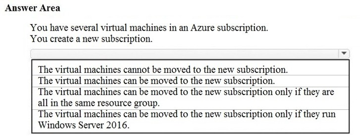
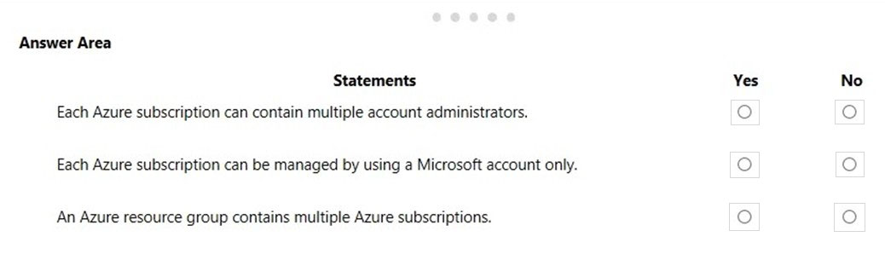
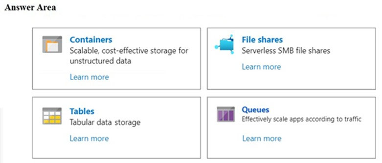
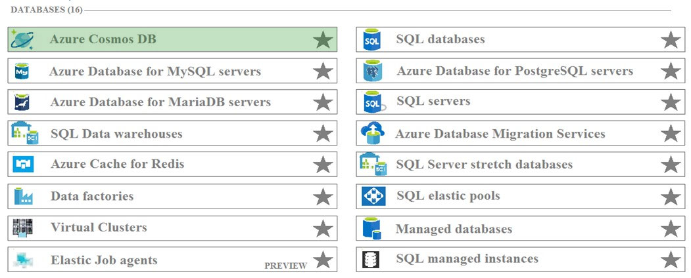

[Back to AZ-900: Azure Fundamentals Practice Exams](../az-900.md)

# Questions and Answers 101-110

**Source:** [101-110.pdf](../files/101-110.pdf)

<strong>Question 101 - Move virtual machines to a subscription</strong>

HOTSPOT

To complete the sentence, select the appropriate option in the answer area.

_Figure: "You have several virtual machines in an Azure subscription. You create a new subscription." The open list is: the virtual machines cannot be moved to the new subscription; the virtual machines can be moved to the new subscription; the virtual machines can be moved to the new subscription only if they are all in the same resource group; the virtual machines can be moved to the new subscription only if they run Windows Server 2016. Nothing is selected._

<strong>Answer 101</strong>

The virtual machines can be moved to the new subscription.

_Figure: "The virtual machines can be moved to the new subscription" is highlighted. Cannot be moved, same resource group only, and Windows Server 2016 only are not._

You can move a virtual machine and its related resources to another subscription in the Azure portal. The machine does not have to be started for the move, and it can keep running during the move. The explanation describes moving a machine from a personal subscription to a company subscription.

**Why the others are wrong**

- The virtual machines cannot be moved misses the portal move. Subscriptions are not a permanent lock on the virtual machines.
- The same resource group only misses the move rules in this key. The explanation says the virtual machines can be moved. It does not require them to start in one resource group.
- Windows Server 2016 only misses the move. The guest operating system is not the condition the explanation gives.

**Study further**

- [Move resources to a new resource group or subscription](https://learn.microsoft.com/en-us/azure/azure-resource-manager/management/move-resource-group-and-subscription)
- [What is Azure Virtual Machines?](https://learn.microsoft.com/en-us/azure/virtual-machines/overview)

<strong>Question 102 - Connect on-premises clients to VMs</strong>

You have an Azure environment that contains multiple Azure virtual machines.

You plan to implement a solution that enables the client computers on your on-premises network to communicate to the Azure virtual machines.

You need to recommend which Azure resources must be created for the planned solution.

Which two Azure resources should you include in the recommendation? Each correct answer presents part of the solution.

NOTE: Each correct selection is worth one point.

- A. A virtual network gateway
- B. A load balancer
- C. An application gateway
- D. A virtual network
- E. A gateway subnet

<strong>Answer 102</strong>

A. A virtual network gateway, and E. A gateway subnet.

On-premises clients reach the Azure virtual machines through a VPN. The Azure VPN device is a virtual network gateway. That gateway has to sit in a dedicated subnet named GatewaySubnet.

**Why the others are wrong**

- B. A load balancer spreads traffic among virtual machines that are already reachable. It does not connect the on-premises network.
- C. An application gateway is a web load balancer. It does not build the VPN to the office.
- D. A virtual network is required for the virtual machines, and the explanation says it is already in place because the virtual machines exist. The resources you still create are the gateway and the gateway subnet.

**Study further**

- [About Site-to-Site VPN](https://learn.microsoft.com/en-us/azure/vpn-gateway/vpn-gateway-about-vpngateways)
- [What is Azure Virtual Network?](https://learn.microsoft.com/en-us/azure/virtual-network/virtual-networks-overview)

<strong>Question 103 - Raise a SQL managed instance quota</strong>

You attempt to create several managed Microsoft SQL Server instances in an Azure environment and receive a message that you must increase your Azure subscription limits.

What should you do to increase the limits?

- A. Create a service health alert
- B. Upgrade your support plan
- C. Modify an Azure policy
- D. Create a new support request

<strong>Answer 103</strong>

D. Create a new support request.

SQL managed instance has a quota. You raise it by opening a support request, choosing service and subscription limits (quotas), and selecting SQL managed instance as the quota type.

**Why the others are wrong**

- A. A service health alert tells you about platform issues. It does not raise a quota.
- B. Upgrading the support plan changes response time and the types of cases you can open. The quota increase is the support request itself, not a higher plan.
- C. An Azure policy enforces rules on resources. It does not increase a subscription quota.

**Study further**

- [Create an Azure support request](https://learn.microsoft.com/en-us/azure/azure-portal/supportability/how-to-create-azure-support-request)
- [Resource limits for Azure SQL Managed Instance](https://learn.microsoft.com/en-us/azure/azure-sql/managed-instance/resource-limits)

<strong>Question 104 - Account administrators and resource groups</strong>

HOTSPOT

For each of the following statements, select Yes if the statement is true. Otherwise, select No.

NOTE: Each correct selection is worth one point.

_Figure: Three statements, each with an empty Yes and an empty No. Each Azure subscription can contain multiple account administrators. Each Azure subscription can be managed by using a Microsoft account only. An Azure resource group contains multiple Azure subscriptions._

<strong>Answer 104</strong>

No. No. No.

_Figure: Multiple account administrators is No. Management by a Microsoft account only is No. A resource group containing multiple subscriptions is No._

There is one account administrator for a subscription. You can add service administrators and co-administrators. The explanation says you manage a subscription with an Azure AD account, not with a Microsoft account alone. Subscriptions contain resource groups. Resource groups do not contain subscriptions.

**Why the others are wrong**

- Yes for multiple account administrators misses the single account administrator. Extra people are service administrators or co-administrators, not additional account administrators.
- Yes for a Microsoft account only misses the directory account. The explanation says management uses an Azure AD account created with the subscription.
- Yes for a resource group containing subscriptions reverses the hierarchy. A subscription contains resource groups.

**Study further**

- [Associate a subscription with a directory](https://learn.microsoft.com/en-us/entra/fundamentals/how-subscriptions-associated-directory)
- [What is Azure Resource Manager?](https://learn.microsoft.com/en-us/azure/azure-resource-manager/management/overview)

<strong>Question 105 - Where availability zones apply</strong>

HOTSPOT

For each of the following statements, select Yes if the statement is true. Otherwise, select No.

NOTE: Each correct selection is worth one point.

_Figure: Three statements, each with an empty Yes and an empty No. Availability zones can be implemented in all Azure regions. Only virtual machines that run Windows Server can be created in availability zones. Availability zones are used to replicate data and applications to multiple regions._

<strong>Answer 105</strong>

No. No. No.

_Figure: Zones in all regions is No. Windows Server only is No. Replication to multiple regions is No._

Not every region offers availability zones. Zones work with many services, including Linux virtual machines, not only Windows Server. A zone is a physical location inside one region. It does not copy the application to other regions.

**Why the others are wrong**

- Yes for zones in every region misses the regions that do not offer availability zones.
- Yes for Windows Server only misses Linux and the other services that can use zones. The explanation says zones are not limited to virtual machines.
- Yes for replication to multiple regions misses the boundary. The explanation says availability zones are unique physical locations within a single Azure region.

**Study further**

- [What are availability zones?](https://learn.microsoft.com/en-us/azure/reliability/availability-zones-overview)
- [Azure regions list](https://learn.microsoft.com/en-us/azure/reliability/regions-list)

<strong>Question 106 - Storage for unmanaged data disks</strong>

HOTSPOT

You plan to create an Azure virtual machine.

You need to identify which storage service must be used to store the unmanaged data disks of the virtual machine.

What should you identify? To answer, select the appropriate service in the answer area.

_Figure: Four storage services with nothing selected. Containers, for unstructured data. File shares, for serverless SMB file shares. Tables, for tabular data. Queues, for scaling apps according to traffic._

<strong>Answer 106</strong>

Containers.

_Figure: Containers is highlighted. File shares, Tables, and Queues are not._

Unmanaged disks are virtual hard disks stored as page blobs. Page blobs live in blob containers in a storage account. The explanation says Azure disks are persisted as page blobs in Azure Storage.

**Why the others are wrong**

- File shares are SMB shares you mount as a drive. An unmanaged data disk is a page blob, not a file share.
- Tables store structured rows. They do not store a virtual hard disk.
- Queues store messages between application components. They do not store a virtual hard disk.

**Study further**

- [Overview of page blobs](https://learn.microsoft.com/en-us/azure/storage/blobs/storage-blob-pageblob-overview)
- [Storage account overview](https://learn.microsoft.com/en-us/azure/storage/common/storage-account-overview)

<strong>Question 107 - Separate network for FinServer</strong>

Your company plans to move several servers to Azure.

The company's compliance policy states that a server named FinServer must be on a separate network segment.

You are evaluating which Azure services can be used to meet the compliance policy requirements.

Which Azure solution should you recommend?

- A. A resource group for FinServer and another resource group for all the other servers
- B. A virtual network for FinServer and another virtual network for all the other servers
- C. A VPN for FinServer and a virtual network gateway for each other server
- D. One resource group for all the servers and a resource lock for FinServer

<strong>Answer 107</strong>

B. A virtual network for FinServer and another virtual network for all the other servers.

Azure networks are virtual networks. Traffic routes between subnets inside one virtual network. A separate network segment for FinServer means a different virtual network from the other servers.

**Why the others are wrong**

- A. Resource groups are management containers. Two resource groups can still share one virtual network, so FinServer is not on a separate network segment.
- C. A VPN and a virtual network gateway per server connect networks. They do not, by themselves, put FinServer on its own segment and leave the other servers together.
- D. A resource lock stops accidental delete or change. It does not change which network FinServer is on.

**Study further**

- [What is Azure Virtual Network?](https://learn.microsoft.com/en-us/azure/virtual-network/virtual-networks-overview)
- [Network security groups](https://learn.microsoft.com/en-us/azure/virtual-network/network-security-groups-overview)

<strong>Question 108 - Mapped drive to Azure Storage</strong>

You plan to map a network drive from several computers that run Windows 10 to Azure Storage.

You need to create a storage solution in Azure for the planned mapped drive.

What should you create?

- A. An Azure SQL database
- B. A virtual machine data disk
- C. A File service in a storage account
- D. A Blob service in a storage account

<strong>Answer 108</strong>

C. A File service in a storage account.

Azure Files is an SMB file share. Windows can mount it with a drive letter or a UNC path, which is the mapped drive these computers need.

**Why the others are wrong**

- A. An Azure SQL database is a database engine. Windows cannot map it as a network drive.
- B. A virtual machine data disk is a disk attached to one virtual machine. It is not a share that several Windows 10 computers map.
- D. A Blob service stores objects. It does not present the SMB share these computers mount as a drive.

**Study further**

- [What is Azure Files?](https://learn.microsoft.com/en-us/azure/storage/files/storage-files-introduction)
- [Use an Azure file share with Windows](https://learn.microsoft.com/en-us/azure/storage/files/storage-how-to-use-files-windows)

<strong>Question 109 - JSON documents from many regions</strong>

HOTSPOT

You plan to implement an Azure database solution.

You need to implement a database solution that meets the following requirements:

- Can add data concurrently from multiple regions
- Can store JSON documents

Which database service should you deploy? To answer, select the appropriate service in the answer area.

_Figure: A databases list with nothing selected. The rows include Azure Cosmos DB, Azure Database for MySQL servers, Azure Database for MariaDB servers, SQL Data warehouses, Azure Cache for Redis, Data factories, Virtual Clusters, Elastic Job agents, SQL databases, Azure Database for PostgreSQL servers, SQL servers, Azure Database Migration Services, SQL Server stretch databases, SQL elastic pools, Managed databases, and SQL managed instances._

<strong>Answer 109</strong>

Azure Cosmos DB.

_Figure: Azure Cosmos DB is highlighted. The other database services are not._

The explanation names Azure Cosmos DB. It is a globally distributed database, and it stores JSON documents. Writes can come from more than one region.

**Why the others are wrong**

- Azure Database for MySQL servers is a relational MySQL service. It does not meet both multi-region concurrent writes and JSON documents the way this key assigns to Cosmos DB.
- Azure Database for MariaDB servers is a relational MariaDB service. It misses the same pair of requirements.
- SQL Data warehouses is an analytics warehouse. It is not the JSON document store the explanation names.
- Azure Cache for Redis is an in-memory cache. It is not the durable JSON document database in the explanation.
- Data factories move and transform data. They are not a database.
- Virtual Clusters are part of SQL managed instance hosting. They do not store JSON documents across regions.
- Elastic Job agents run jobs against Azure SQL databases. They are not the data store.
- SQL databases are Azure SQL Database, a relational service. The explanation names Cosmos DB for JSON and multi-region writes.
- Azure Database for PostgreSQL servers is a relational PostgreSQL service. The explanation does not select it for these two requirements.
- SQL servers in this list are the SQL virtual-machine or server resource. They are not the globally distributed JSON service the explanation names.
- Azure Database Migration Services moves databases into Azure. It does not store the documents.
- SQL Server stretch databases archive rows from SQL Server. They do not accept concurrent JSON writes from many regions.
- SQL elastic pools share compute among Azure SQL databases. They do not add the JSON and multi-region requirements.
- Managed databases is a generic portal label. The explanation names Cosmos DB specifically.
- SQL managed instances are a managed SQL Server. They miss the JSON document and multi-region write requirements this key gives to Cosmos DB.

**Study further**

- [What is Azure Cosmos DB?](https://learn.microsoft.com/en-us/azure/cosmos-db/overview)
- [What is Azure SQL Database?](https://learn.microsoft.com/en-us/azure/azure-sql/database/sql-database-paas-overview)

<strong>Question 110 - First resource when starting Azure</strong>

Your company plans to start using Azure and will migrate all its network resources to Azure.

You need to start the planning process by exploring Azure.

What should you create first?

- A. A subscription
- B. A resource group
- C. A virtual network
- D. A management group

<strong>Answer 110</strong>

A. A subscription.

The explanation says the first thing you create in Azure is a subscription. A subscription is the agreement you are billed on. Resource groups and virtual networks are created inside a subscription.

**Why the others are wrong**

- B. A resource group needs a subscription to live in. You cannot create the group until the subscription exists.
- C. A virtual network is a resource in a subscription. Exploring Azure starts with the subscription, then the network.
- D. A management group organizes subscriptions you already have. It is not the first object the explanation tells you to create.

**Study further**

- [Create an additional Azure subscription](https://learn.microsoft.com/en-us/azure/cost-management-billing/manage/create-subscription)
- [What are Azure management groups?](https://learn.microsoft.com/en-us/azure/governance/management-groups/overview)

