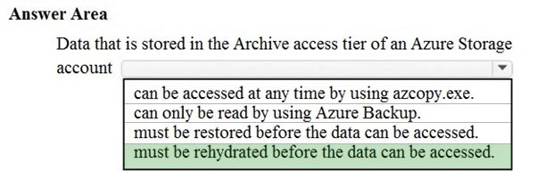
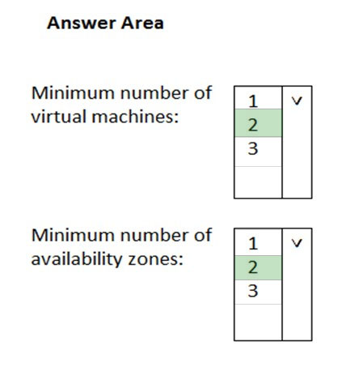
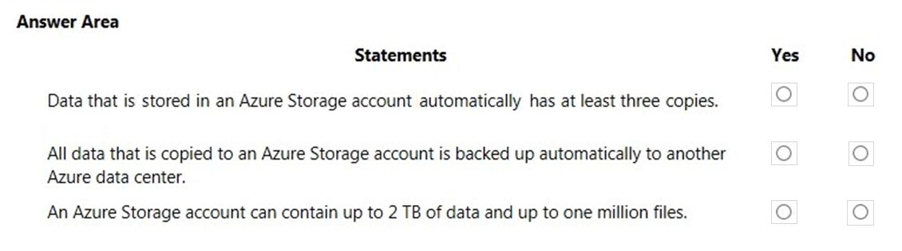
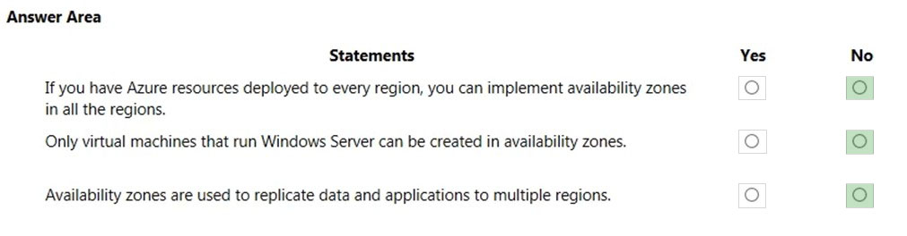
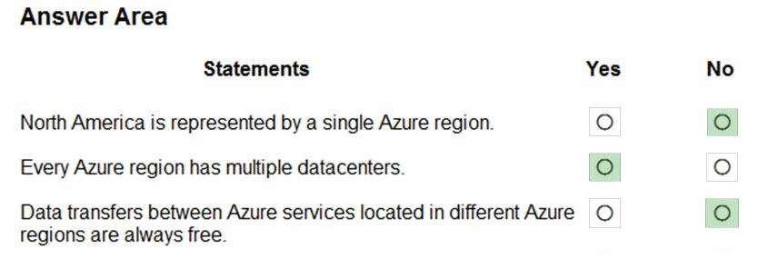

# Questions and Answers 111-120

[Back to AZ-900 Practice Exam](../az-900.md)

**Source:** [111-120.pdf](../files/111-120.pdf)

<strong>Question 111 - Regions, tags, and resource group access</strong>

HOTSPOT

For each of the following statements, select Yes if the statement is true. Otherwise, select No.

NOTE: Each correct selection is worth one point.

_Figure: Three statements, each with an empty Yes and an empty No. All the Azure resources deployed to a resource group must use the same Azure region. If you assign a tag to a resource group, all the Azure resources in that resource group are assigned to the same tag. If you assign permissions for a user to manage a resource group, the user can manage all the Azure resources in that resource group._

<strong>Answer 111</strong>

No. No. Yes.

_Figure: Every resource in a resource group using the same region is No. A tag on the resource group applying to every resource is No. Permissions on the resource group covering every resource in it is Yes._

Resources in one resource group can sit in different regions. The group's location is only where its metadata is stored. Tags on a resource group are not applied to the resources by default. Role assignments on the resource group are inherited by the resources in it, so a user who can manage the group can manage those resources.

**Why the others are wrong**

- Yes for one region misses the metadata model. The resource group has a location for its metadata. The resources can use other regions.
- Yes for tags spreading to every resource misses the default. Tags are not inherited from the resource group unless you copy them yourself.
- No for permissions on the resource group misses inheritance. Access you grant on the resource group applies to the resources it contains.

**Study further**

- [What is Azure Resource Manager?](https://learn.microsoft.com/en-us/azure/azure-resource-manager/management/overview)
- [Use tags to organize your Azure resources](https://learn.microsoft.com/en-us/azure/azure-resource-manager/management/tag-resources)

<strong>Question 112 - Reading archive tier data</strong>

HOTSPOT

To complete the sentence, select the appropriate option in the answer area.

_Figure: "Data that is stored in the Archive access tier of an Azure Storage account" and an open list: can be accessed at any time by using azcopy.exe; can only be read by using Azure Backup; must be restored before the data can be accessed; must be rehydrated before the data can be accessed. Nothing is selected._

<strong>Answer 112</strong>

Must be rehydrated before the data can be accessed.

_Figure: "Must be rehydrated before the data can be accessed" is highlighted. azcopy.exe at any time, Azure Backup only, and must be restored are not._

The archive tier has the lowest storage price and higher retrieval cost. The blob is offline. Reading it requires a rehydrate to the hot or cool tier, and that can take hours. The explanation names rehydration.

**Why the others are wrong**

- Access at any time with azcopy.exe misses the offline state. AzCopy cannot read the blob until it is rehydrated to an online tier.
- Read only by Azure Backup misses the tier. Archive is a blob access tier. Any tool can read the blob after rehydration. Azure Backup is not the only reader.
- Must be restored before the data can be accessed uses the wrong operation. The explanation says rehydrate, and the solution image highlights rehydrate. Restore is a backup operation.

**Study further**

- [Access tiers for blob data](https://learn.microsoft.com/en-us/azure/storage/blobs/access-tiers-overview)
- [Storage account overview](https://learn.microsoft.com/en-us/azure/storage/common/storage-account-overview)

<strong>Question 113 - Minimum VMs and zones for 99.99%</strong>

HOTSPOT

You plan to deploy a critical line-of-business application to Azure.

The application will run on an Azure virtual machine.

You need to recommend a deployment solution for the application. The solution must provide a guaranteed availability of 99.99 percent.

What is the minimum number of virtual machines and the minimum number of availability zones you should recommend for the deployment? To answer, select the appropriate options in the answer area.

NOTE: Each correct selection is worth one point.

_Figure: "Minimum number of virtual machines" and "Minimum number of availability zones" each have an open list of 1, 2, and 3. Nothing is selected._

<strong>Answer 113</strong>

Two virtual machines. Two availability zones.

_Figure: 2 is highlighted for the minimum number of virtual machines. 2 is highlighted for the minimum number of availability zones._

The 99.99 percent virtual machine SLA needs at least two virtual machines, each in a different availability zone. The explanation says that pair is the minimum. Zones protect the application from a datacenter failure inside the region.

**Why the others are wrong**

- One virtual machine cannot meet the 99.99 percent SLA in this key. A single machine has no second copy in another zone.
- Three virtual machines can raise resilience further. The requirement asks for the minimum, and the explanation says two.
- One availability zone puts both machines in one datacenter failure domain. The explanation requires each machine in a different zone.
- Three availability zones is more than the minimum. Two zones are enough for the two machines.

**Study further**

- [What are availability zones?](https://learn.microsoft.com/en-us/azure/reliability/availability-zones-overview)
- [Availability options for Azure virtual machines](https://learn.microsoft.com/en-us/azure/virtual-machines/availability)

<strong>Question 114 - Collect events in one repository</strong>

Which Azure service should you use to collect events from multiple resources into a centralized repository?

- A. Azure Event Hubs
- B. Azure Analysis Services
- C. Azure Monitor
- D. Azure Stream Analytics

<strong>Answer 114</strong>

A. Azure Event Hubs.

Event Hubs is the event ingestion service. It receives events from many sources into one stream, and that stream can be stored for later processing. The explanation names Event Hubs for collecting those events.

**Why the others are wrong**

- B. Azure Analysis Services is an analytics model for business intelligence queries. It does not ingest events from many resources into a repository.
- C. Azure Monitor collects metrics and logs about Azure resources. The explanation names Event Hubs as the centralized event repository for this requirement.
- D. Azure Stream Analytics queries a stream that is already being ingested. It does not replace the ingestion repository the explanation assigns to Event Hubs.

**Study further**

- [What is Azure Event Hubs?](https://learn.microsoft.com/en-us/azure/event-hubs/event-hubs-about)
- [Azure Monitor overview](https://learn.microsoft.com/en-us/azure/azure-monitor/fundamentals/overview)

<strong>Question 115 - Where an availability zone sits</strong>

HOTSPOT

To complete the sentence, select the appropriate option in the answer area.

_Figure: "An Availability Zone in Azure has physically separate locations" and an open list: across two continents, within a single Azure region, within multiple Azure regions, within a single Azure datacenter. Nothing is selected._

<strong>Answer 115</strong>

Within a single Azure region.

_Figure: Within a single Azure region is highlighted. Across two continents, within multiple Azure regions, and within a single Azure datacenter are not._

Availability zones are separate physical locations inside one region. Each zone has its own power, cooling, and networking. The explanation says they protect applications from a datacenter failure in that region. The solution image highlights the single region.

**Why the others are wrong**

- Across two continents is a geography or a paired-region design. A zone does not span continents.
- Within multiple Azure regions is a multi-region design. A zone stays inside one region.
- Within a single Azure datacenter is one datacenter. A zone is one or more datacenters, and the zones in a region are physically separate from each other.

**Study further**

- [What are availability zones?](https://learn.microsoft.com/en-us/azure/reliability/availability-zones-overview)
- [Availability options for Azure virtual machines](https://learn.microsoft.com/en-us/azure/virtual-machines/availability)

<strong>Question 116 - Storage copies, backup, and size</strong>

HOTSPOT

For each of the following statements, select Yes if the statement is true. Otherwise, select No.

NOTE: Each correct selection is worth one point.

_Figure: Three statements, each with an empty Yes and an empty No. Data that is stored in an Azure Storage account automatically has at least three copies. All data that is copied to an Azure Storage account is backed up automatically to another Azure data center. An Azure Storage account can contain up to 2 TB of data and up to one million files._

<strong>Answer 116</strong>

Yes. No. No.

_Figure: At least three copies is Yes. Automatic backup to another Azure data center is No. A 2 TB and one-million-file limit is No._

Locally redundant storage is the minimum, and it keeps three synchronous copies in the primary region. A copy in another datacenter happens only when you choose geo-redundant storage. It is not automatic for every account. The explanation says the account limits are far above 2 TB and one million files.

**Why the others are wrong**

- No for three copies misses locally redundant storage. Even the lowest redundancy option stores three copies in the primary region.
- Yes for an automatic backup to another datacenter misses the default. Locally redundant storage stays in one datacenter. Geo-redundant storage is a choice, not the default for every account.
- Yes for a 2 TB and one-million-file cap misses the real account size. The explanation says the limits are much higher and that there is no one-million-file cap.

**Study further**

- [Azure Storage redundancy](https://learn.microsoft.com/en-us/azure/storage/common/storage-redundancy)
- [Storage account overview](https://learn.microsoft.com/en-us/azure/storage/common/storage-account-overview)

<strong>Question 117 - Zones, Windows, and multiple regions</strong>

HOTSPOT

For each of the following statements, select Yes if the statement is true. Otherwise, select No.

NOTE: Each correct selection is worth one point.

_Figure: Three statements, each with an empty Yes and an empty No. If you have Azure resources deployed to every region, you can implement availability zones in all the regions. Only virtual machines that run Windows Server can be created in availability zones. Availability zones are used to replicate data and applications to multiple regions._

<strong>Answer 117</strong>

No. No. No.

_Figure: Availability zones in every region is No. Windows Server only is No. Replication to multiple regions is No._

The solution image highlights No on every row. The explanation says not every region supports availability zones, and regions that do support Linux virtual machines. It also describes zones as separate physical locations inside one region, with a 99.99 percent virtual machine SLA for datacenter failures in that region. The printed line "Box 3: Yes" does not match that description or the highlight. The third statement says zones replicate data to multiple regions, and the image marks No.

**Why the others are wrong**

- Yes for zones in every region where you already have resources misses the regions that do not offer availability zones. Deploying something in a region does not add zones to that region.
- Yes for Windows Server only misses Linux. The explanation says regions that support availability zones support Linux virtual machines.
- Yes for replicating to multiple regions misses the scope of a zone. The explanation says zones are unique physical locations within a single Azure region. The image highlights No.

**Study further**

- [What are availability zones?](https://learn.microsoft.com/en-us/azure/reliability/availability-zones-overview)
- [Azure regions list](https://learn.microsoft.com/en-us/azure/reliability/regions-list)

<strong>Question 118 - Regions, datacenters, and transfer cost</strong>

HOTSPOT

For each of the following statements, select Yes if the statement is true. Otherwise, select No.

NOTE: Each correct selection is worth one point.

_Figure: Three statements, each with an empty Yes and an empty No. North America is represented by a single Azure region. Every Azure region has multiple datacenters. Data transfers between Azure services located in different Azure regions are always free._

<strong>Answer 118</strong>

No. Yes. No.

_Figure: North America as a single region is No. Every region having multiple datacenters is Yes. Cross-region data transfer always being free is No._

North America has many regions, including East US, Central US, South Central US, West US, and Canada East. A region is a set of datacenters inside a latency boundary. Outbound data transfer between regions is billed. Inbound data transfer is free.

**Why the others are wrong**

- Yes for one North America region misses the list of regions. East US and West US are different regions in the same geography.
- No for multiple datacenters misses the definition in the explanation. A region is a set of datacenters connected by a low-latency network.
- Yes for free transfers between regions misses the bandwidth charge. The explanation says outbound transfer is charged at the normal rate.

**Study further**

- [Azure regions list](https://learn.microsoft.com/en-us/azure/reliability/regions-list)
- [Bandwidth pricing](https://azure.microsoft.com/en-us/pricing/details/bandwidth/)

<strong>Question 119 - Two scale sets across datacenters</strong>

This item shares its setup with other questions. Each one proposes a different solution. Decide whether this solution meets the goal.

You plan to deploy several Azure virtual machines.

You need to ensure that the services running on the virtual machines are available if a single data center fails.

Solution: You deploy the virtual machines to two or more scale sets.

Does this meet the goal?

- A. Yes
- B. No

<strong>Answer 119</strong>

B. No.

Two scale sets still do not say that the virtual machines are in different datacenters. A scale set can scale and can use fault domains. This proposal never places the machines across datacenters, so the explanation says it misses the goal.

**Why the others are wrong**

- A. Yes would mean two scale sets survive a datacenter failure. The proposal does not put those scale sets in two datacenters. Both can still live in one datacenter.

**Study further**

- [What are virtual machine scale sets?](https://learn.microsoft.com/en-us/azure/virtual-machine-scale-sets/overview)
- [Availability options for Azure virtual machines](https://learn.microsoft.com/en-us/azure/virtual-machines/availability)

<strong>Question 120 - Notice of planned maintenance</strong>

You need to be notified when Microsoft plans to perform maintenance that can affect the resources deployed to an Azure subscription.

What should you use?

- A. Azure Monitor
- B. Azure Service Health
- C. Azure Advisor
- D. Microsoft Trust Center

<strong>Answer 120</strong>

B. Azure Service Health.

Service Health is the personalized view of the Azure services and regions you use. It is where you read planned maintenance, outages, and other health notices for those resources.

**Why the others are wrong**

- A. Azure Monitor collects metrics, logs, and alerts about your resources. It is not the place the explanation names for Microsoft's planned maintenance notices.
- C. Azure Advisor recommends changes for cost, security, reliability, and performance. It does not notify you of Microsoft's maintenance window.
- D. Microsoft Trust Center publishes trust, privacy, and compliance information. It does not send maintenance notices for the resources in your subscription.

**Study further**

- [Azure Service Health overview](https://learn.microsoft.com/en-us/azure/service-health/overview)
- [Azure Monitor overview](https://learn.microsoft.com/en-us/azure/azure-monitor/fundamentals/overview)

