[Back to AZ-900: Azure Fundamentals Practice Exams](../az-900.md)

# Questions and Answers 121-130

**Source:** [121-130.pdf](../files/121-130.pdf)

<strong>Question 121 - IoT service descriptions</strong>

DRAG DROP

Match the Azure service to the correct description.

Instructions: To answer, drag the appropriate service from the column on the left to its description on the right. Each service may be used once, more than once, or not at all.

NOTE: Each correct selection is worth one point.

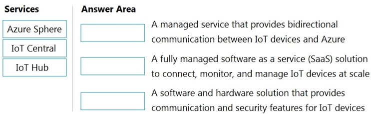

_Figure: Azure Sphere, IoT Central, and IoT Hub are in the services list. Three descriptions have empty boxes: bidirectional communication between IoT devices and Azure, a fully managed SaaS solution to connect and manage IoT devices at scale, and a software and hardware solution that provides communication and security features for IoT devices._

<strong>Answer 121</strong>

IoT Hub, IoT Central, and Azure Sphere, in that order.

_Figure: IoT Hub is on bidirectional communication. IoT Central is on the SaaS solution for managing devices at scale. Azure Sphere is on the software and hardware security solution._

IoT Hub is the device messaging service. IoT Central is the finished SaaS app for monitoring devices. Azure Sphere is the secured microcontroller, operating system, and cloud security service.

**Why the others are wrong**

- Azure Sphere does not provide the bidirectional device-to-cloud messaging service. That requirement is IoT Hub.
- IoT Hub is not the finished SaaS application for connecting and managing devices at scale. That requirement is IoT Central.
- IoT Central is not the hardware and software security platform. That requirement is Azure Sphere.

**Study further**

- [What is Azure IoT Hub?](https://learn.microsoft.com/en-us/azure/iot-hub/iot-concepts-and-iot-hub)
- [What is Azure IoT Central?](https://learn.microsoft.com/en-us/azure/iot-central/core/overview-iot-central)
- [What is Azure Sphere?](https://learn.microsoft.com/en-us/azure-sphere/product-overview/what-is-azure-sphere)

<strong>Question 122 - Windows Virtual Desktop statements</strong>

HOTSPOT

For each of the following statements, select Yes if the statement is true. Otherwise, select No.

NOTE: Each correct selection is worth one point.

_Figure: Three statements, each with an empty Yes and an empty No. A session host can run Windows 10 only. A host pool of 20 session hosts supports at most 20 simultaneous users. Windows Virtual Desktop supports desktop and app virtualization._

<strong>Answer 122</strong>

No. No. Yes.

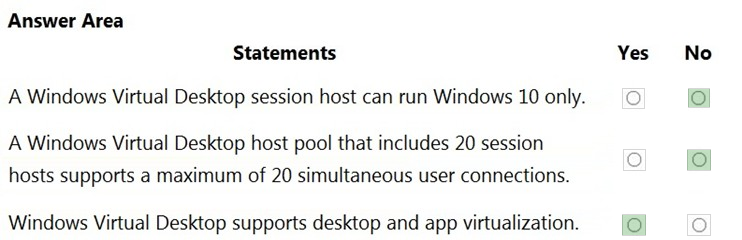

_Figure: Windows 10 only is No. A maximum of 20 users on 20 session hosts is No. Desktop and app virtualization is Yes._

A session host can run Windows client or Windows Server, and a multi-session host can serve more than one user. Azure Virtual Desktop (formerly Windows Virtual Desktop) delivers full desktops and individual apps.

**Why the others are wrong**

- Yes for "Windows 10 only" misses the other session-host images. Windows 11 and Windows Server are also supported.
- Yes for "20 hosts means 20 users" misses multi-session. One session host can take many simultaneous connections.
- No for desktop and app virtualization misses both delivery modes. You can publish a full desktop or a single remote app.

**Study further**

- [What is Azure Virtual Desktop?](https://learn.microsoft.com/en-us/azure/virtual-desktop/overview)

<strong>Question 123 - Tool for electricity savings</strong>

HOTSPOT

To complete the sentence, select the appropriate option in the answer area.

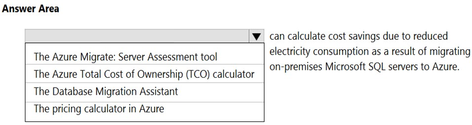

_Figure: The sentence says a tool can calculate cost savings from reduced electricity when on-premises Microsoft SQL servers move to Azure. The open list is the Azure Migrate: Server Assessment tool, the Azure Total Cost of Ownership (TCO) calculator, the Database Migration Assistant, and the pricing calculator in Azure. Nothing is selected._

<strong>Answer 123</strong>

The Azure Total Cost of Ownership (TCO) calculator.

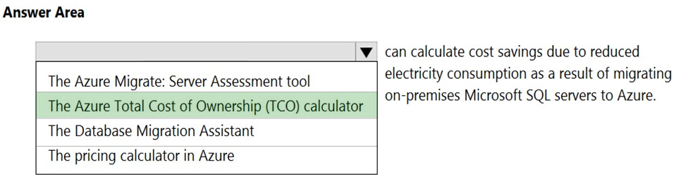

_Figure: The Azure Total Cost of Ownership (TCO) calculator is highlighted. Server Assessment, Database Migration Assistant, and the pricing calculator are not._

The requirement is savings from on-premises costs such as electricity after a SQL Server migration. The TCO calculator compares that on-premises spend with Azure.

**Why the others are wrong**

- The Azure Migrate: Server Assessment tool sizes Azure targets for discovered servers. It is not the tool this sentence uses for electricity savings.
- The Database Migration Assistant checks a database for migration blockers and compatibility. It does not calculate power savings.
- The pricing calculator estimates the price of Azure services you select. It does not start from your on-premises electricity cost.

**Study further**

- [Compare the pricing and TCO calculators](https://learn.microsoft.com/en-us/training/modules/describe-cost-management-azure/3-compare-pricing-total-cost-of-ownership-calculators)
- [Describe Azure cost management](https://learn.microsoft.com/en-us/training/modules/describe-cost-management-azure/)

<strong>Question 124 - Availability zone protection</strong>

HOTSPOT

For each of the following statements, select Yes if the statement is true. Otherwise, select No.

NOTE: Each correct selection is worth one point.

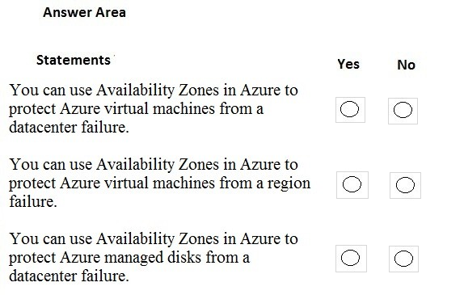

_Figure: Three statements, each with an empty Yes and an empty No. Availability Zones can protect virtual machines from a datacenter failure. Availability Zones can protect virtual machines from a region failure. Availability Zones can protect managed disks from a datacenter failure._

<strong>Answer 124</strong>

Yes. No. Yes.

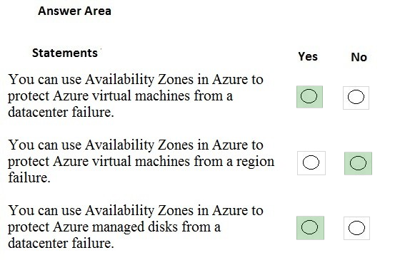

_Figure: Datacenter protection for virtual machines is Yes. Region protection is No. Datacenter protection for managed disks is Yes._

Zones are separate datacenters inside one region, so a zone-redundant virtual machine or managed disk survives the loss of one datacenter. They do not survive the loss of the whole region.

**Why the others are wrong**

- No for virtual machines and a datacenter failure misses the zone design. Each zone has its own power, cooling, and network.
- Yes for a region failure misses the boundary. All zones of a region are in that region. A regional outage needs another region.
- No for managed disks and a datacenter failure misses zone-redundant disks. Copies in other zones of the same region stay available.

**Study further**

- [Availability zones overview](https://learn.microsoft.com/en-us/azure/reliability/availability-zones-overview)
- [Availability options for Azure virtual machines](https://learn.microsoft.com/en-us/azure/virtual-machines/availability)

<strong>Question 125 - Subscription and resource groups</strong>

HOTSPOT

For each of the following statements, select Yes if the statement is true. Otherwise, select No.

NOTE: Each correct selection is worth one point.

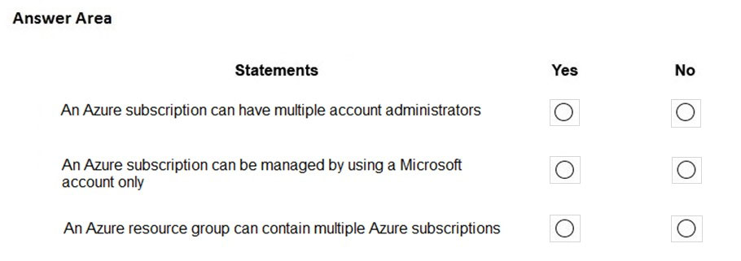

_Figure: Three statements, each with an empty Yes and an empty No. An Azure subscription can have multiple account administrators. An Azure subscription can be managed by using a Microsoft account only. An Azure resource group can contain multiple Azure subscriptions._

<strong>Answer 125</strong>

No. Yes. No.

_Figure: Multiple account administrators is No. Management by a Microsoft account only is Yes. A resource group that contains multiple subscriptions is No._

The solution allows one account administrator, treats that sign-in as a Microsoft account, and keeps each resource group inside a single subscription.

**Why the others are wrong**

- Yes for multiple account administrators misses the limit this solution uses. A subscription can have many administrators of other kinds, and only one account administrator.
- No for "Microsoft account only" is the choice the solution rejects. The highlighted answer says the subscription is managed with a Microsoft account only.
- Yes for a resource group that contains several subscriptions reverses the hierarchy. A subscription contains resource groups. A resource group belongs to one subscription.

**Study further**

- [Add or change Azure subscription administrators](https://learn.microsoft.com/en-us/azure/cost-management-billing/manage/add-change-subscription-administrator)
- [What is Azure Resource Manager?](https://learn.microsoft.com/en-us/azure/azure-resource-manager/management/overview)

<strong>Question 126 - Azure AD sign-in and groups</strong>

HOTSPOT

For each of the following statements, select Yes if the statement is true. Otherwise, select No.

NOTE: Each correct selection is worth one point.

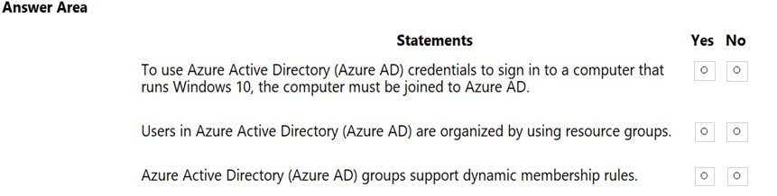

_Figure: Three statements, each with an empty Yes and an empty No. A Windows 10 computer must be joined to Azure AD to sign in with Azure AD credentials. Users in Azure AD are organized by using resource groups. Azure AD groups support dynamic membership rules._

<strong>Answer 126</strong>

Yes. No. Yes.

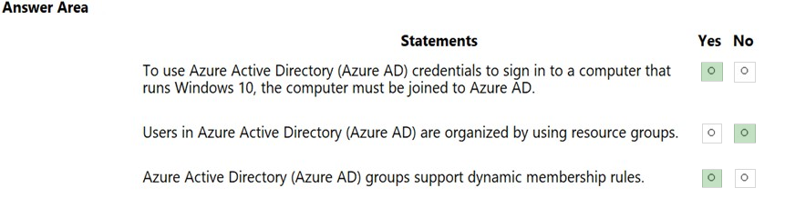

_Figure: The computer must be joined to Azure AD is Yes. Users organized by resource groups is No. Dynamic membership rules is Yes._

The highlighted answer requires an Azure AD join before that Windows 10 computer signs in with Azure AD credentials. Users are directory objects, not resource-group members. A dynamic group fills itself from a rule.

**Why the others are wrong**

- No for the join statement is the choice the solution rejects. The image marks Yes: the computer must be joined to Azure AD.
- Yes for resource groups misses the directory. Azure AD users are organized with users and groups, not with an Azure resource group.
- No for dynamic membership misses a group feature. A dynamic membership rule adds and removes members as attributes change.

**Study further**

- [Microsoft Entra joined devices](https://learn.microsoft.com/en-us/entra/identity/devices/concept-directory-join)
- [Dynamic membership rules for groups](https://learn.microsoft.com/en-us/entra/identity/users/groups-dynamic-membership)

<strong>Question 127 - Survive one datacenter failure</strong>

You plan to deploy several Azure virtual machines.

You need to ensure that the services running on the virtual machines remain available if a single data center fails.

What are two possible solutions? Each correct answer presents a complete solution.

- A. Deploy the virtual machines to two or more availability zones.
- B. Deploy the virtual machines to two or more resource groups.
- C. Deploy the virtual machines to a scale set.
- D. Deploy the virtual machines to two or more regions.

<strong>Answer 127</strong>

A and D. Two or more availability zones, or two or more regions.

A zone is a separate datacenter in the region, and a second region is another geography. Either placement keeps a copy running when one datacenter fails.

**Why the others are wrong**

- B. Two or more resource groups misses the failure domain. A resource group is a management container. Two groups can still sit in the same datacenter.
- C. A scale set misses the placement. A scale set does not, by itself, put virtual machines in a second datacenter.

**Study further**

- [Availability zones overview](https://learn.microsoft.com/en-us/azure/reliability/availability-zones-overview)
- [What are virtual machine scale sets?](https://learn.microsoft.com/en-us/azure/virtual-machine-scale-sets/overview)

<strong>Question 128 - Keep one VM off the network</strong>

HOTSPOT

To complete the sentence, select the appropriate option in the answer area.

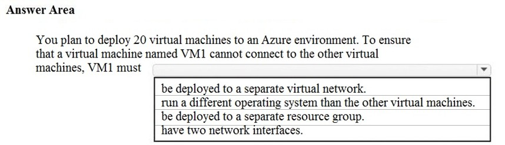

_Figure: You will deploy 20 virtual machines. To ensure VM1 cannot connect to the others, VM1 must be deployed to a separate virtual network, run a different operating system, be deployed to a separate resource group, or have two network interfaces. Nothing is selected._

<strong>Answer 128</strong>

Be deployed to a separate virtual network.

_Figure: "Be deployed to a separate virtual network" is highlighted. A different operating system, a separate resource group, and two network interfaces are not._

Virtual machines in the same virtual network can reach each other, including across subnets. A second virtual network removes that default path.

**Why the others are wrong**

- A different operating system misses the network. Connectivity does not depend on whether the guest is Windows or Linux.
- A separate resource group misses the network. Resource groups organize resources. They do not block traffic.
- Two network interfaces misses the isolation. Extra interfaces add connections. They do not cut VM1 off from the other machines.

**Study further**

- [What is Azure Virtual Network?](https://learn.microsoft.com/en-us/azure/virtual-network/virtual-networks-overview)

<strong>Question 129 - Data platform service match</strong>

DRAG DROP

Match the Azure service to the appropriate description.

To answer, drag the appropriate service from the column on the left to its description on the right. Each service may be used once, more than once, or not at all.

NOTE: Each correct match is worth one point.

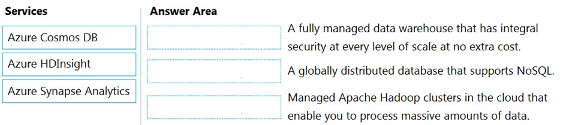

_Figure: Azure Cosmos DB, Azure HDInsight, and Azure Synapse Analytics are in the services list. The descriptions are a fully managed data warehouse with integral security at every level of scale at no extra cost, a globally distributed database that supports NoSQL, and managed Apache Hadoop clusters that process massive amounts of data. The answer boxes are empty._

<strong>Answer 129</strong>

Azure Synapse Analytics, Azure Cosmos DB, and Azure HDInsight, in that order.

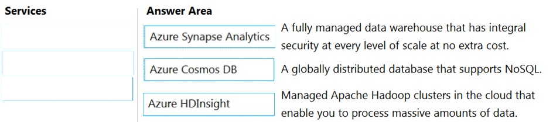

_Figure: Synapse Analytics is on the data warehouse. Cosmos DB is on the globally distributed NoSQL database. HDInsight is on managed Apache Hadoop clusters._

Synapse Analytics is the managed warehouse. Cosmos DB is the globally distributed NoSQL database. HDInsight runs managed Hadoop clusters for large-scale processing.

**Why the others are wrong**

- Cosmos DB is not the relational warehouse with security included at every scale. That requirement is Synapse Analytics.
- HDInsight is not the globally distributed NoSQL database. That requirement is Cosmos DB.
- Synapse Analytics is not the managed Hadoop cluster service. That requirement is HDInsight.

**Study further**

- [What is Azure Synapse Analytics?](https://learn.microsoft.com/en-us/azure/synapse-analytics/overview-what-is)
- [Azure Cosmos DB overview](https://learn.microsoft.com/en-us/azure/cosmos-db/overview)
- [What is Azure HDInsight?](https://learn.microsoft.com/en-us/azure/hdinsight/hdinsight-overview)

<strong>Question 130 - Blob access tier statements</strong>

HOTSPOT

For each of the following statements, select Yes if the statement is true. Otherwise, select No.

NOTE: Each correct selection is worth one point.

_Figure: Three statements, each with an empty Yes and an empty No. The Archive access tier is set at the storage account level. The Hot access tier is recommended for data that is accessed and modified frequently. The Cool access tier is recommended for long term backups._

<strong>Answer 130</strong>

No. Yes. No.

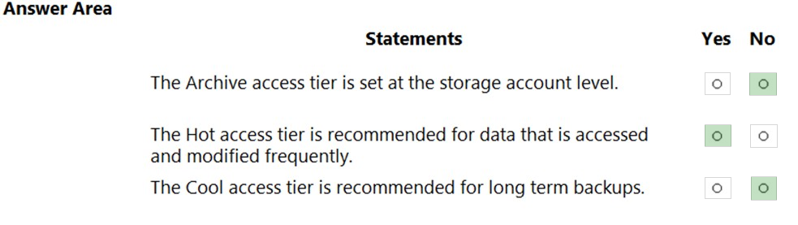

_Figure: Archive set at the storage account is No. Hot for data accessed and modified frequently is Yes. Cool for long-term backups is No._

Hot is for data you read and write often. Archive is a blob tier, not an account-wide switch. Long-term backup that you rarely read belongs on Archive, not Cool.

**Why the others are wrong**

- Yes for setting Archive on the storage account misses the scope. Archive is an access tier on a blob. The account does not have a single Archive setting that covers every object.
- No for the Hot tier misses the frequent-access requirement. Hot is the tier for data that is read and written often.
- Yes for Cool and long-term backups misses the tier. Cool is for data you still need immediately but do not use often. Long-term backup is an Archive scenario.

**Study further**

- [Hot, cool, and archive access tiers](https://learn.microsoft.com/en-us/azure/storage/blobs/access-tiers-overview)

