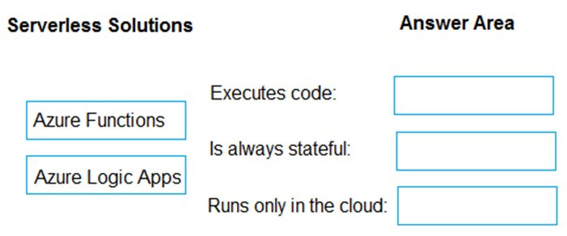
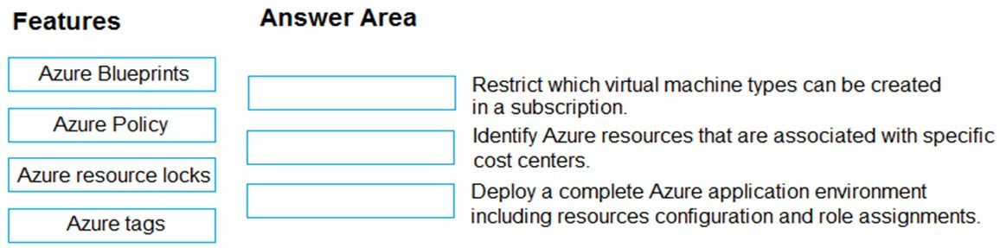
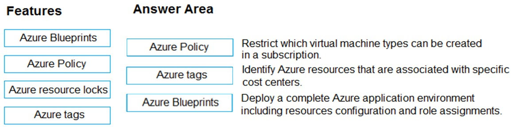
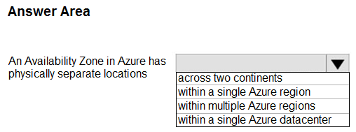
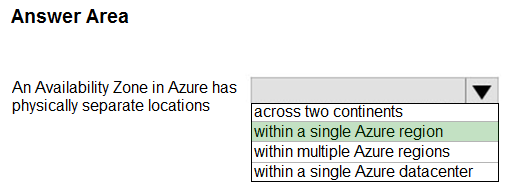
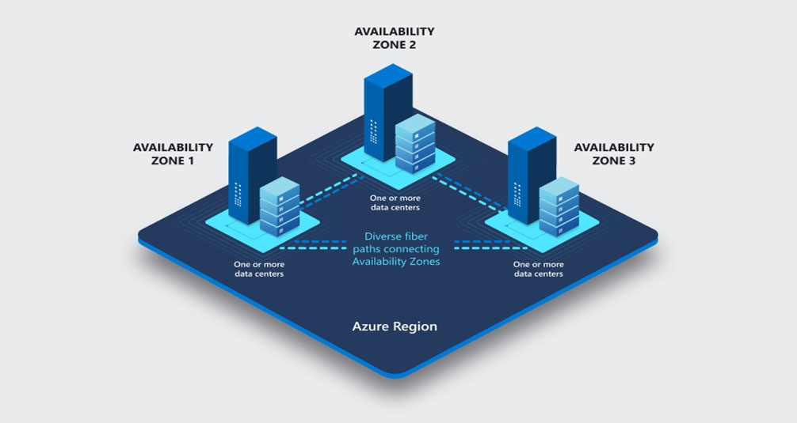
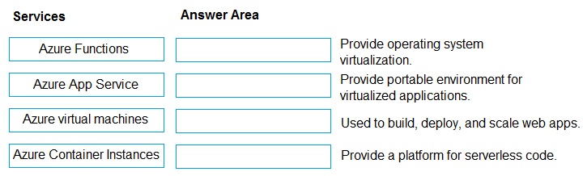
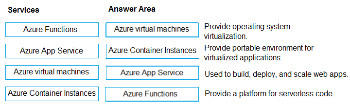
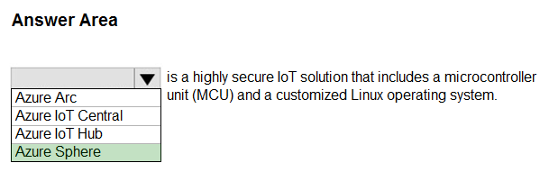

[Back to AZ-900: Azure Fundamentals Practice Exams](../az-900.md)

# Questions and Answers 131-140

**Source:** [131-140.pdf](../files/131-140.pdf)

<strong>Question 131 - Most severe failure a zone covers</strong>

What is the most severe failure from which an Azure Availability Zone can be used to protect access to Azure service?

- A. A physical server failure
- B. An Azure region failure
- C. A storage failure
- D. An Azure data center failure

<strong>Answer 131</strong>

D. An Azure data center failure.

A zone is a separate datacenter in the region, with its own power, network, and cooling. Replicas in other zones stay available when that datacenter is lost. That is the largest failure a zone is built to cover.

**Why the others are wrong**

- A. A physical server failure is smaller than a datacenter failure. A zone covers the server, and it also covers the building around it.
- B. An Azure region failure is larger than a zone can cover. Every zone of a region is inside that region.
- C. A storage failure of one disk or one server is smaller than the loss of the datacenter. The question asks for the most severe failure a zone protects against.

**Study further**

- [Availability options for Azure virtual machines](https://learn.microsoft.com/en-us/azure/virtual-machines/availability)
- [Availability zones overview](https://learn.microsoft.com/en-us/azure/reliability/availability-zones-overview)

<strong>Question 132 - Buy a third-party security appliance</strong>

You need to purchase a third-party virtual security appliance that you will deploy to an Azure subscription.

What should you use?

- A. Azure subscriptions
- B. Azure Security Center
- C. Azure Marketplace
- D. Microsoft Store

<strong>Answer 132</strong>

C. Azure Marketplace.

Marketplace is where you find and buy partner virtual appliances, including network security appliances, and deploy them into a subscription.

**Why the others are wrong**

- A. An Azure subscription is the billing and access boundary. It is not a catalog of third-party appliances.
- B. Azure Security Center (now Microsoft Defender for Cloud) assesses and recommends on your resources. It is not the store for a third-party virtual appliance.
- D. Microsoft Store sells Windows apps and devices. It does not deploy a virtual appliance into an Azure subscription.

**Study further**

- [Azure Marketplace overview](https://learn.microsoft.com/en-us/marketplace/marketplace-overview)

<strong>Question 133 - Serverless solution characteristics</strong>

DRAG DROP

Match the serverless solution to the correct characteristic.

To answer, drag the appropriate serverless solution from the column on the left to its characteristic on the right. Each serverless solution may be used once, more than once, or not at all.

NOTE: Each correct match is worth one point.

_Figure: Azure Functions and Azure Logic Apps are the serverless solutions. The characteristics are "Executes code," "Is always stateful," and "Runs only in the cloud." The answer boxes are empty._

<strong>Answer 133</strong>

Azure Functions, Azure Functions, and Azure Logic Apps.

_Figure: Executes code is Azure Functions. Is always stateful is Azure Functions. Runs only in the cloud is Azure Logic Apps. Both solutions remain in the list on the left._

The image places Azure Functions on "Executes code" and on "Is always stateful," and Azure Logic Apps on "Runs only in the cloud." The explanation labels the second box Azure Functions and says Logic Apps workflows can be stateful or stateless, so Logic Apps is not treated as always stateful.

**Why the others are wrong**

- Azure Logic Apps does not execute your own code blocks. It runs a workflow of connectors and actions. The code requirement is Azure Functions.
- Azure Logic Apps misses "always stateful." The explanation says its workflows can be stateful or stateless. The image highlights Azure Functions for that row.
- Azure Functions misses "runs only in the cloud." The image places Azure Logic Apps on that row.

**Study further**

- [What is Azure Functions?](https://learn.microsoft.com/en-us/azure/azure-functions/functions-overview)
- [What is Azure Logic Apps?](https://learn.microsoft.com/en-us/azure/logic-apps/logic-apps-overview)

<strong>Question 134 - Governance feature match</strong>

DRAG DROP

Match the Azure governance feature to the correct description.

Instructions: To answer, drag the appropriate feature from the column on the left to its description on the right. Each feature may be used once, more than once, or not at all.

NOTE: Each correct match is worth one point.

_Figure: Azure Blueprints, Azure Policy, Azure resource locks, and Azure tags are in the features list. The descriptions are restrict which virtual machine types can be created in a subscription, identify resources associated with specific cost centers, and deploy a complete Azure application environment including resources, configuration, and role assignments. The answer boxes are empty._

<strong>Answer 134</strong>

Azure Policy, Azure tags, and Azure Blueprints.

_Figure: Azure Policy restricts virtual machine types. Azure tags identify cost centers. Azure Blueprints deploys the application environment with configuration and role assignments. Resource locks stay in the features list._

Policy enforces what can be created. Tags label resources for a cost center. Blueprints package resources, configuration, and role assignments into one environment.

**Why the others are wrong**

- Azure resource locks are the option left out. A lock stops a resource from being changed or deleted. It does not limit virtual machine sizes, label a cost center, or deploy an environment.
- Azure Blueprints does not restrict virtual machine types. That requirement is a policy rule.
- Azure Policy does not identify which resources belong to a cost center. That requirement is a tag.
- Azure tags do not deploy resources, configuration, and role assignments together. That requirement is a blueprint.

**Study further**

- [What is Azure Policy?](https://learn.microsoft.com/en-us/azure/governance/policy/overview)
- [Use tags to organize Azure resources](https://learn.microsoft.com/en-us/azure/azure-resource-manager/management/tag-resources)
- [What is Azure Blueprints?](https://learn.microsoft.com/en-us/azure/governance/blueprints/overview)

<strong>Question 135 - Where an availability zone sits</strong>

HOTSPOT

Select the answer that correctly completes the sentence.

_Figure: "An Availability Zone in Azure has physically separate locations" and an open list: across two continents, within a single Azure region, within multiple Azure regions, within a single Azure datacenter. Nothing is selected._

<strong>Answer 135</strong>

Within a single Azure region.

_Figure: "Within a single Azure region" is highlighted. Two continents, multiple regions, and a single datacenter are not._

_Figure: Availability Zone 1, Zone 2, and Zone 3 sit on one platform labeled Azure Region. Each zone has one or more datacenters, and fiber paths connect the zones. The diagram is the illustration in the solution, not a second dropdown._

An availability zone is one or more datacenters inside a region. The zones are physically separate from each other and still belong to that one region.

**Why the others are wrong**

- Across two continents misses the region boundary. Zones do not span continents.
- Within multiple Azure regions misses the boundary. A zone belongs to one region. Another region is a different failure domain.
- Within a single Azure datacenter misses the separation. A zone is made of one or more datacenters, and the zones themselves are separate locations.

**Study further**

- [Availability zones overview](https://learn.microsoft.com/en-us/azure/reliability/availability-zones-overview)

<strong>Question 136 - Compute service descriptions</strong>

DRAG DROP

Match the Azure services to the correct descriptions.

Instructions: To answer, drag the appropriate Azure service from the column on the left to its description on the right. Each service may be used once, more than once, or not at all.

NOTE: Each correct match is worth one point.

_Figure: Azure Functions, Azure App Service, Azure virtual machines, and Azure Container Instances are in the services list. The descriptions are operating system virtualization, a portable environment for virtualized applications, build deploy and scale web apps, and a platform for serverless code. The answer boxes are empty._

<strong>Answer 136</strong>

Azure virtual machines, Azure Container Instances, Azure App Service, and Azure Functions.

_Figure: Operating system virtualization is Azure virtual machines. A portable environment for virtualized applications is Azure Container Instances. Build, deploy, and scale web apps is Azure App Service. Serverless code is Azure Functions._

A virtual machine virtualizes an operating system. Container Instances runs a container without a virtual machine you manage. App Service hosts web apps. Functions runs event-driven code without a server you provision.

**Why the others are wrong**

- Azure Functions does not provide operating system virtualization. That requirement is a virtual machine.
- Azure App Service does not give you a portable container environment without managing virtual machines. That requirement is Container Instances.
- Azure virtual machines are not the managed platform whose job is to build, deploy, and scale web apps. That requirement is App Service.
- Azure Container Instances is not the serverless code platform. That requirement is Azure Functions.

**Study further**

- [Introduction to Azure virtual machines](https://learn.microsoft.com/en-us/azure/virtual-machines/overview)
- [What is Azure Container Instances?](https://learn.microsoft.com/en-us/azure/container-instances/container-instances-overview)
- [App Service overview](https://learn.microsoft.com/en-us/azure/app-service/overview)
- [What is Azure Functions?](https://learn.microsoft.com/en-us/azure/azure-functions/functions-overview)

<strong>Question 137 - Move VMs to a new subscription</strong>

HOTSPOT

To answer, select the appropriate option in the answer area.

_Figure: You have several virtual machines in an Azure subscription and you create a new subscription. The open list is: the virtual machines cannot be moved, they can be moved, they can be moved only if they are all in the same resource group, and they can be moved only if they run Windows Server 2019. Nothing is selected._

<strong>Answer 137</strong>

The virtual machines can be moved to the new subscription.

_Figure: "The virtual machines can be moved to the new subscription" is highlighted. Cannot be moved, only if they share a resource group, and only if they run Windows Server 2019 are not._

You can move a virtual machine and its related resources to another subscription in the Azure portal. The operating system and the original resource group do not block the move.

**Why the others are wrong**

- The virtual machines cannot be moved misses the move operation. Move to another subscription is a supported resource move.
- Only if they are all in the same resource group misses the requirement. You repeat the move for each resource group. They do not have to start in one group.
- Only if they run Windows Server 2019 misses the requirement. The move is not limited to that operating system.

**Study further**

- [Move resources to a new resource group or subscription](https://learn.microsoft.com/en-us/azure/azure-resource-manager/management/move-resource-group-and-subscription)

<strong>Question 138 - Buy a third-party security appliance</strong>

You need to purchase a third-party virtual security appliance that you will deploy to an Azure subscription.

What should you use?

- A. Azure subscriptions
- B. Microsoft Defender for Cloud
- C. Azure Marketplace
- D. Microsoft Store

<strong>Answer 138</strong>

C. Azure Marketplace.

Partner network security appliances are listed in Azure Marketplace. You deploy the one you buy into the subscription.

**Why the others are wrong**

- A. An Azure subscription is where the appliance lands. It is not the catalog you buy it from.
- B. Microsoft Defender for Cloud reports security posture and recommendations. It is not the store for a third-party virtual appliance.
- D. Microsoft Store does not deploy a virtual security appliance into an Azure subscription.

**Study further**

- [Azure Marketplace overview](https://learn.microsoft.com/en-us/marketplace/marketplace-overview)

<strong>Question 139 - Secure IoT microcontroller solution</strong>

HOTSPOT

Select the answer that correctly completes the sentence.

_Figure: A blank service name "is a highly secure IoT solution that includes a microcontroller unit (MCU) and a customized Linux operating system." The open list is Azure Arc, Azure IoT Central, Azure IoT Hub, and Azure Sphere. Nothing is selected._

<strong>Answer 139</strong>

Azure Sphere.

_Figure: Azure Sphere is highlighted. Azure Arc, Azure IoT Central, and Azure IoT Hub are not._

Azure Sphere is the secured microcontroller, the Linux-based Sphere operating system, and the Sphere cloud security service.

**Why the others are wrong**

- Azure Arc misses the hardware. Arc projects existing servers and Kubernetes clusters into Azure management. It is not a microcontroller and a custom Linux operating system.
- Azure IoT Central misses the hardware. It is a SaaS application for monitoring devices you already have.
- Azure IoT Hub misses the hardware. It is the cloud messaging hub for devices. It does not include the microcontroller or the operating system.

**Study further**

- [What is Azure Sphere?](https://learn.microsoft.com/en-us/azure-sphere/product-overview/what-is-azure-sphere)

<strong>Question 140 - VM service survives a datacenter</strong>

You plan to deploy a service to Azure virtual machines.

You need to ensure that the service will be available if a datacenter fails.

What should you use as part of the virtual machine deployment?

- A. Availability sets
- B. Proximity placement groups
- C. Host groups
- D. Availability zones

<strong>Answer 140</strong>

D. Availability zones.

Zones are physically separate locations in a region. A copy in another zone stays up when one datacenter fails.

**Why the others are wrong**

- A. Availability sets miss a datacenter failure. Fault domains and update domains share one datacenter.
- B. Proximity placement groups miss the failure. They place machines close together for low latency, which is the opposite of spreading them across datacenters.
- C. Host groups miss the failure. A dedicated host group is still a host placement choice. It does not put the service in a second datacenter.

**Study further**

- [Availability zones overview](https://learn.microsoft.com/en-us/azure/reliability/availability-zones-overview)
- [Availability options for Azure virtual machines](https://learn.microsoft.com/en-us/azure/virtual-machines/availability)

