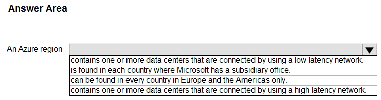
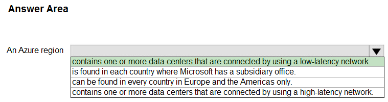
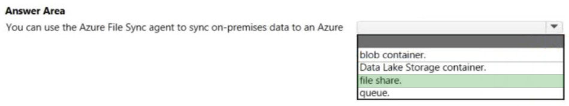
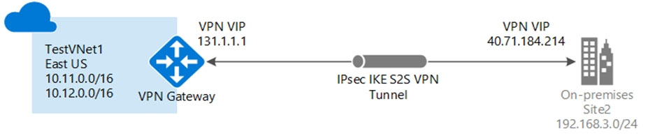
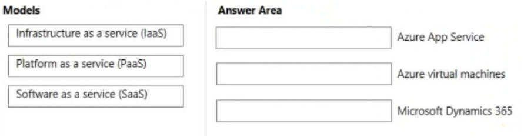
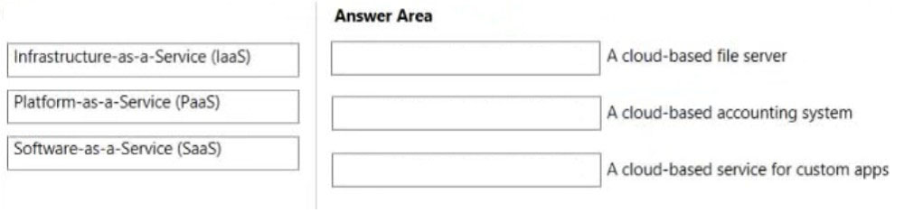
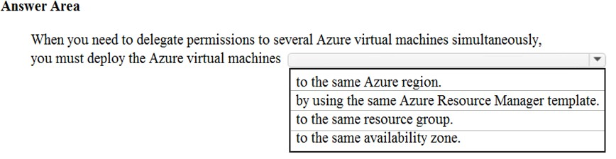

# Questions and Answers 141-150

[Back to AZ-900 Practice Exam](../az-900.md)

**Source:** [141-150.pdf](../files/141-150.pdf)

<strong>Question 141 - Limit creation to regions</strong>

Your company has an Azure subscription that contains resources in several regions.

You need to ensure that administrators can only create resources in those regions.

What should you use?

- A. A read-only lock
- B. An Azure policy
- C. A management group
- D. A reservation

<strong>Answer 141</strong>

B. An Azure policy.

A policy can deny a deployment whose region is not on the allowed list. Administrators then create resources only in the regions you already use.

**Why the others are wrong**

- A. A read-only lock misses the region rule. It blocks changes to an existing resource. It does not say which regions a new resource may use.
- C. A management group misses the region rule. It groups subscriptions so you can assign policy and access above them. The group itself does not limit regions.
- D. A reservation misses the region rule. A reservation is a commitment that discounts compute you already plan to run.

**Study further**

- [What is Azure Policy?](https://learn.microsoft.com/en-us/azure/governance/policy/overview)
- [Management groups overview](https://learn.microsoft.com/en-us/azure/governance/management-groups/overview)

<strong>Question 142 - What an Azure region contains</strong>

HOTSPOT

Select the answer that correctly completes the sentence.

_Figure: "An Azure region" and an open list: contains one or more data centers connected by a low-latency network, is found in each country where Microsoft has a subsidiary office, can be found in every country in Europe and the Americas only, or contains one or more data centers connected by a high-latency network. Nothing is selected._

<strong>Answer 142</strong>

Contains one or more data centers that are connected by using a low-latency network.

_Figure: "Contains one or more data centers that are connected by using a low-latency network" is highlighted. A subsidiary office in every country, Europe and the Americas only, and a high-latency network are not._

A region is a set of datacenters inside a latency boundary, linked by a dedicated low-latency network.

**Why the others are wrong**

- A subsidiary office in each country misses the definition. Regions are datacenter locations, not a sales office in every country.
- Every country in Europe and the Americas only misses the map. Regions exist outside those two areas.
- A high-latency network misses the design. Datacenters in one region are connected for low latency.

**Study further**

- [Azure regions](https://learn.microsoft.com/en-us/azure/reliability/regions-overview)
- [Availability zones overview](https://learn.microsoft.com/en-us/azure/reliability/availability-zones-overview)

<strong>Question 143 - Azure File Sync destination</strong>

HOTSPOT

Select the answer that correctly completes the sentence.

_Figure: "You can use the Azure File Sync agent to sync on-premises data to an Azure" and an open list: blob container, Data Lake Storage container, file share, or queue. Nothing is selected._

<strong>Answer 143</strong>

File share.

_Figure: File share is highlighted. Blob container, Data Lake Storage container, and queue are not._

The Azure File Sync agent synchronizes a Windows Server folder with an Azure file share.

**Why the others are wrong**

- A blob container misses the sync target. File Sync uses Azure Files, not a blob container.
- A Data Lake Storage container misses the sync target. Data Lake is blob storage with a hierarchical namespace, not the file share the agent syncs.
- A queue misses the sync target. A queue holds messages. It does not store the files the agent synchronizes.

**Study further**

- [What is Azure File Sync?](https://learn.microsoft.com/en-us/azure/storage/file-sync/file-sync-introduction)
- [Introduction to Azure Files](https://learn.microsoft.com/en-us/azure/storage/files/storage-files-introduction)

<strong>Question 144 - Function of a Site-to-Site VPN</strong>

What is the function of a Site-to-Site VPN?

- A. Provides a secure connection between a computer on a public network and the corporate network
- B. Provides a dedicated private connection to Azure that does NOT travel over the internet
- C. Provides a connection from an on-premises VPN device to an Azure VPN gateway

<strong>Answer 144</strong>

C. A connection from an on-premises VPN device to an Azure VPN gateway.

A Site-to-Site VPN is an IPsec/IKE tunnel from a VPN device on your network to a VPN gateway in Azure. The device needs a public IP address.

_Figure: An on-premises site connects through an IPsec IKE site-to-site VPN tunnel to a VPN gateway in a virtual network in East US. Each side has a VPN public IP._

**Why the others are wrong**

- A. A secure connection from one computer on a public network is a point-to-site VPN, or a user VPN. Site-to-site connects a site, not one laptop.
- B. A dedicated private connection that does not travel over the internet is ExpressRoute. A Site-to-Site VPN travels over the internet.

**Study further**

- [About Azure VPN Gateway](https://learn.microsoft.com/en-us/azure/vpn-gateway/vpn-gateway-about-vpngateways)
- [Create a site-to-site VPN](https://learn.microsoft.com/en-us/azure/vpn-gateway/tutorial-site-to-site-portal)

<strong>Question 145 - Service model for each offering</strong>

DRAG DROP

Match the cloud service models to the appropriate offerings.

To answer, drag the appropriate model from the column on the left to its offering on the right. Each model may be used once, more than once, or not at all.

NOTE: Each correct match is worth one point.

_Figure: Infrastructure as a service, Platform as a service, and Software as a service are in the models list. The offerings are Azure App Service, Azure virtual machines, and Microsoft Dynamics 365. The answer boxes are empty._

<strong>Answer 145</strong>

Platform as a service, Infrastructure as a service, and Software as a service.

_Figure: Azure App Service is Platform as a service. Azure virtual machines is Infrastructure as a service. Microsoft Dynamics 365 is Software as a service._

App Service is a managed platform for the application you deploy. A virtual machine is rented infrastructure, including the operating system. Dynamics 365 is a finished application you use.

**Why the others are wrong**

- Infrastructure as a service misses App Service. You do not patch the platform that hosts the web app.
- Software as a service misses App Service. You still bring your own application.
- Platform as a service misses virtual machines. You manage the guest operating system.
- Software as a service misses virtual machines. A virtual machine is not a finished business application.
- Infrastructure as a service misses Dynamics 365. You do not manage its servers.
- Platform as a service misses Dynamics 365. You use the application. You do not deploy your own code onto its platform.

**Study further**

- [Describe cloud service types](https://learn.microsoft.com/en-us/training/modules/describe-cloud-service-types/)
- [App Service overview](https://learn.microsoft.com/en-us/azure/app-service/overview)
- [Introduction to Azure virtual machines](https://learn.microsoft.com/en-us/azure/virtual-machines/overview)

<strong>Question 146 - Service model for each solution</strong>

DRAG DROP

Match the cloud service models to the appropriate solutions.

To answer, drag the appropriate cloud service model from the column on the left to its solution on the right. Each cloud service model may be used once, more than once, or not at all.

NOTE: Each correct match is worth one point.

_Figure: Infrastructure-as-a-Service, Platform-as-a-Service, and Software-as-a-Service are in the list. The solutions are a cloud-based file server, a cloud-based accounting system, and a cloud-based service for custom apps. The answer boxes are empty._

<strong>Answer 146</strong>

Infrastructure as a service, Software as a service, and Platform as a service.

_Figure: A cloud-based file server is Infrastructure-as-a-Service. A cloud-based accounting system is Software-as-a-Service. A cloud-based service for custom apps is Platform-as-a-Service._

The solution treats the file server as infrastructure, the accounting system as a finished application, and the custom-app service as a platform you build on. The explanation uses Azure Files for the file server, Dynamics 365 for accounting, and a platform environment for custom apps.

**Why the others are wrong**

- Platform as a service for the file server is not the model the solution uses. The image places Infrastructure as a service on that row.
- Software as a service for the file server misses the requirement. A file server is shared storage, not a finished business application.
- Infrastructure as a service for the accounting system misses the requirement. You do not manage the servers behind Dynamics 365.
- Platform as a service for the accounting system misses the requirement. You use the accounting application. You do not deploy it as your own code.
- Infrastructure as a service for custom apps misses the requirement. A platform for custom apps removes the operating system work.
- Software as a service for custom apps misses the requirement. SaaS is the finished application, not the place you build your own apps.

**Study further**

- [Describe cloud service types](https://learn.microsoft.com/en-us/training/modules/describe-cloud-service-types/)
- [Introduction to Azure Files](https://learn.microsoft.com/en-us/azure/storage/files/storage-files-introduction)

<strong>Question 147 - Services that manage containers</strong>

You need to manage containers.

Which two services can you use? Each correct answer presents a complete solution.

NOTE: Each correct selection is worth one point.

- A. Azure Virtual Desktop
- B. Azure virtual machines
- C. Azure Functions
- D. Azure Container Instances
- E. Azure Kubernetes Service (AKS)

<strong>Answer 147</strong>

D and E. Azure Container Instances and Azure Kubernetes Service (AKS).

Container Instances runs a container without a virtual machine you manage. AKS is the managed Kubernetes service for containers at scale.

**Why the others are wrong**

- A. Azure Virtual Desktop misses containers. It publishes Windows desktops and apps to users.
- B. Azure virtual machines miss the managed container service. You can install a container runtime yourself, and you then manage the machine. The solution selects the two container services.
- C. Azure Functions misses container management. It runs event-driven code. It is not the service you use to manage containers.

**Study further**

- [What is Azure Container Instances?](https://learn.microsoft.com/en-us/azure/container-instances/container-instances-overview)
- [What is Azure Kubernetes Service?](https://learn.microsoft.com/en-us/azure/aks/what-is-aks)

<strong>Question 148 - Delegate permissions to several VMs</strong>

HOTSPOT

To complete the sentence, select the appropriate option in the answer area.

_Figure: "When you need to delegate permissions to several Azure virtual machines simultaneously, you must deploy the Azure virtual machines" to the same Azure region, by using the same Azure Resource Manager template, to the same resource group, or to the same availability zone. Nothing is selected._

<strong>Answer 148</strong>

To the same resource group.

_Figure: "To the same resource group" is highlighted. The same region, the same Resource Manager template, and the same availability zone are not._

A resource group is the scope for access. A role assignment on the group applies to the virtual machines inside it, so one assignment covers all of them.

**Why the others are wrong**

- The same Azure region misses the permission scope. Machines in one region can sit in many resource groups, and a region is not the scope you assign a role to for this requirement.
- The same Azure Resource Manager template misses the permission scope. A template defines how a resource is deployed. It does not grant access to the running machines.
- The same availability zone misses the permission scope. A zone is a physical location. It is not an access boundary.

**Study further**

- [What is Azure Resource Manager?](https://learn.microsoft.com/en-us/azure/azure-resource-manager/management/overview)
- [What is Azure role-based access control?](https://learn.microsoft.com/en-us/azure/role-based-access-control/overview)

<strong>Question 149 - Zones for a datacenter failure</strong>

This item shares its setup with other questions. Each one proposes a different solution. Decide whether this solution meets the goal.

You plan to deploy several Azure virtual machines.

You need to ensure that the services running on the virtual machines are available if a single data center fails.

Solution: You deploy the virtual machines to two or more availability zones.

Does this meet the goal?

- A. Yes
- B. No

<strong>Answer 149</strong>

A. Yes.

Zones are separate datacenters in the region, each with its own power, network, and cooling. A copy in another zone stays available when one datacenter fails.

**Why the others are wrong**

- B. No misses the zone design. Two or more zones are exactly a second datacenter for the virtual machines.

**Study further**

- [Availability zones overview](https://learn.microsoft.com/en-us/azure/reliability/availability-zones-overview)
- [Availability options for Azure virtual machines](https://learn.microsoft.com/en-us/azure/virtual-machines/availability)

<strong>Question 150 - High availability in SQL Data Warehouse</strong>

This question requires that you evaluate the underlined text to determine if it is correct.

One of the benefits of Azure SQL Data Warehouse is that high availability is built into the platform.

Instructions: Review the underlined text. If it makes the statement correct, select "No change is needed." If the statement is incorrect, select the answer choice that makes the statement correct.

- A. No change is needed
- B. Automatic scaling
- C. Data compression
- D. Versioning

<strong>Answer 150</strong>

A. No change is needed.

Azure SQL Data Warehouse, now Azure Synapse Analytics, is a platform service with high availability built in. The underlined phrase already states that benefit. The stated answer keeps it. The vote leans toward automatic scaling.

**Why the others are wrong**

- B. Automatic scaling replaces a true statement. The benefit in the sentence is high availability, which the platform already includes.
- C. Data compression replaces a true statement. Compression saves storage. It is not the built-in availability the sentence names.
- D. Versioning replaces a true statement. Versioning is not the high-availability feature built into the warehouse platform.

**Study further**

- [What is Azure Synapse Analytics?](https://learn.microsoft.com/en-us/azure/synapse-analytics/overview-what-is)
- [What is dedicated SQL pool (formerly SQL DW)?](https://learn.microsoft.com/en-us/azure/synapse-analytics/sql-data-warehouse/sql-data-warehouse-overview-what-is)

