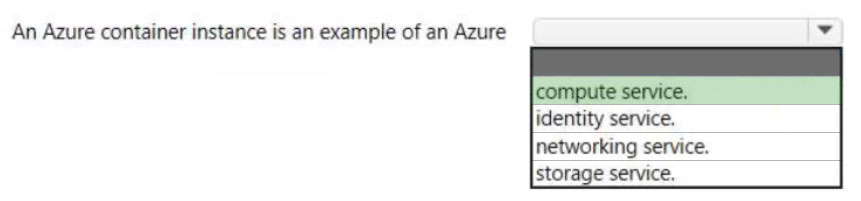
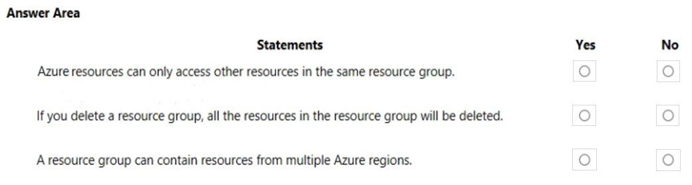
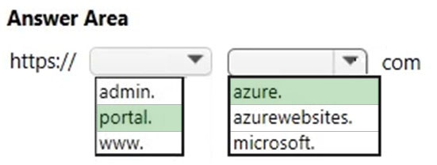
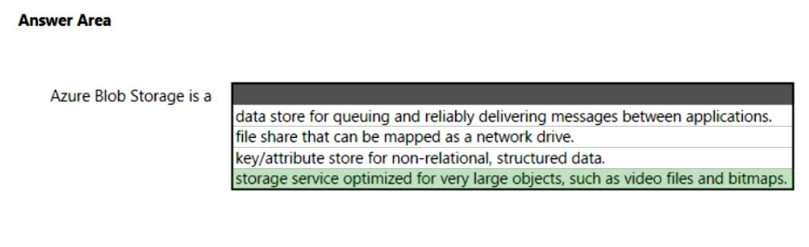

[Back to AZ-900: Azure Fundamentals Practice Exams](../az-900.md)

# Questions and Answers 151-160

**Source:** [151-160.pdf](../files/151-160.pdf)

<strong>Question 151 - Regions for a datacenter failure</strong>

This item shares its setup with other questions. Each one proposes a different solution. Decide whether this solution meets the goal.

You plan to deploy several Azure virtual machines.

You need to ensure that the services running on the virtual machines are available if a single data center fails.

Solution: You deploy the virtual machines to two or more regions.

Does this meet the goal?

- A. Yes
- B. No

<strong>Answer 151</strong>

A. Yes.

A region is a group of datacenters. Two regions put the virtual machines in more than one datacenter, so a single datacenter failure does not take the service down.

**Why the others are wrong**

- B. No misses the geography. A second region is another set of datacenters, which meets the single-datacenter requirement.

**Study further**

- [Azure regions](https://learn.microsoft.com/en-us/azure/reliability/regions-overview)
- [Availability options for Azure virtual machines](https://learn.microsoft.com/en-us/azure/virtual-machines/availability)

<strong>Question 152 - What a container instance is</strong>

HOTSPOT

Select the answer that correctly completes the sentence.

_Figure: "An Azure container instance is an example of an Azure" and an open list: compute service, identity service, networking service, or storage service. Nothing is selected._

<strong>Answer 152</strong>

Compute service.

_Figure: Compute service is highlighted. Identity, networking, and storage are not._

Azure Container Instances runs a container. That is compute: the hosting model for the application, without a virtual machine you provision.

**Why the others are wrong**

- An identity service misses the workload. Identity is Microsoft Entra ID and related sign-in services, not a running container.
- A networking service misses the workload. Virtual networks and gateways move traffic. They do not run the container.
- A storage service misses the workload. Storage holds data. The container instance is the compute that uses that data.

**Study further**

- [What is Azure Container Instances?](https://learn.microsoft.com/en-us/azure/container-instances/container-instances-overview)
- [Choose an Azure compute service](https://learn.microsoft.com/en-us/azure/architecture/guide/technology-choices/compute-decision-tree)

<strong>Question 153 - OSI layer for ExpressRoute</strong>

At which OSI layer does ExpressRoute operate?

- A. Layer 2
- B. Layer 3
- C. Layer 5
- D. Layer 7

<strong>Answer 153</strong>

B. Layer 3.

The marked answer is Layer 3. The explanation describes an ExpressRoute circuit as a provider connection that can be a layer 2 circuit or a managed layer 3 service, and it calls that managed provider solution a layer 3 service. The selected choice is Layer 3.

**Why the others are wrong**

- A. Layer 2 is mentioned in the explanation as one way a provider can present the circuit. The marked choice is Layer 3, the managed network service.
- C. Layer 5 is the session layer. ExpressRoute is a network connection between your network and Microsoft, not a session protocol.
- D. Layer 7 is the application layer. ExpressRoute does not operate as an application protocol.

**Study further**

- [What is Azure ExpressRoute?](https://learn.microsoft.com/en-us/azure/expressroute/expressroute-introduction)
- [ExpressRoute circuit peerings](https://learn.microsoft.com/en-us/azure/expressroute/expressroute-circuit-peerings)

<strong>Question 154 - Where Application Insights belongs</strong>

HOTSPOT

Select the answer that correctly completes the sentence.

_Figure: "Application Insights is a feature of" and an open list: Azure Advisor, Azure Application Gateway, Azure Arc, or Azure Monitor. Nothing is selected._

<strong>Answer 154</strong>

Azure Monitor.

_Figure: Azure Monitor is highlighted. Azure Advisor, Azure Application Gateway, and Azure Arc are not._

Application Insights is the application performance monitoring feature of Azure Monitor. It watches a live web app.

**Why the others are wrong**

- Azure Advisor misses the telemetry product. Advisor recommends improvements. It does not collect application performance data.
- Azure Application Gateway misses the monitoring product. It is a web traffic load balancer.
- Azure Arc misses the monitoring product. Arc projects external machines and clusters into Azure management.

**Study further**

- [Application Insights overview](https://learn.microsoft.com/en-us/azure/azure-monitor/app/app-insights-overview)
- [Azure Monitor overview](https://learn.microsoft.com/en-us/azure/azure-monitor/fundamentals/overview)

<strong>Question 155 - Resource group statements</strong>

HOTSPOT

For each of the following statements, select Yes if the statement is true. Otherwise, select No.

NOTE: Each correct selection is worth one point.

_Figure: Three statements, each with an empty Yes and an empty No. Azure resources can only access other resources in the same resource group. Deleting a resource group deletes all the resources in it. A resource group can contain resources from multiple Azure regions._

<strong>Answer 155</strong>

No. Yes. Yes.

_Figure: Access limited to the same resource group is No. Deleting the group deletes its resources is Yes. Resources from multiple regions is Yes._

A resource group is a management container. Resources in it can talk to resources elsewhere, they are deleted with the group, and they can live in different regions. The group stores metadata about them.

**Why the others are wrong**

- Yes for "only the same resource group" misses networking and identity. A resource group does not wall off traffic or API calls.
- No for deleting the group misses the cascade. Delete the group and the resources in it are deleted with it.
- No for multiple regions misses the metadata. The group can list resources that are deployed in more than one region.

**Study further**

- [What is Azure Resource Manager?](https://learn.microsoft.com/en-us/azure/azure-resource-manager/management/overview)

<strong>Question 156 - Store 20 TB for Power BI</strong>

You plan to store 20 TB of data in Azure. The data will be accessed infrequently and visualized by using Microsoft Power BI.

You need to recommend a storage solution for the data.

Which two solutions should you recommend? Each correct answer presents a complete solution.

NOTE: Each correct selection is worth one point.

- A. Azure Data Lake
- B. Azure Cosmos DB
- C. Azure SQL Data Warehouse
- D. Azure SQL Database
- E. Azure Database for PostgreSQL

<strong>Answer 156</strong>

A and C. Azure Data Lake and Azure SQL Data Warehouse.

Both hold large analytical data and can feed Power BI. Data Lake stores data of many shapes at that scale. SQL Data Warehouse, now a dedicated SQL pool in Synapse Analytics, is the warehouse Power BI can query.

**Why the others are wrong**

- B. Azure Cosmos DB misses the analytical store. It is an operational NoSQL database, not the store this solution pairs with Power BI for 20 TB of infrequently used data.
- D. Azure SQL Database misses the scale and the access pattern. It is a transactional database, not the data lake or the warehouse named in the solution.
- E. Azure Database for PostgreSQL misses the same requirement. It is a transactional open-source database, not the analytical store Power BI is pointed at here.

**Study further**

- [Introduction to Azure Data Lake Storage](https://learn.microsoft.com/en-us/azure/storage/blobs/data-lake-storage-introduction)
- [What is dedicated SQL pool (formerly SQL DW)?](https://learn.microsoft.com/en-us/azure/synapse-analytics/sql-data-warehouse/sql-data-warehouse-overview-what-is)
- [Azure and Power BI](https://learn.microsoft.com/en-us/power-bi/connect-data/service-azure-and-power-bi)

<strong>Question 157 - URL that manages all resources</strong>

HOTSPOT

You have an Azure environment that contains 10 web apps.

To which URL should you connect to manage all the Azure resources? To answer, select the appropriate options in the answer area.

NOTE: Each correct selection is worth one point.

_Figure: The address is https:// then an open list (admin, portal, or www), then an open list (azure, azurewebsites, or microsoft), then com. Nothing is selected._

<strong>Answer 157</strong>

https://portal.azure.com

_Figure: The first list highlights portal. The second list highlights azure. The address reads https://portal.azure.com. admin, www, azurewebsites, and microsoft are not highlighted._

The Azure portal is the web hub for every resource in the subscription, including the 10 web apps. Its address is https://portal.azure.com.

**Why the others are wrong**

- admin. misses the portal host. The management site is portal.azure.com.
- www. misses the portal host. www is not the Azure portal name.
- azurewebsites. misses the management site. That suffix is used by App Service host names, not by the portal that manages every resource.
- microsoft. misses the portal domain. The portal is portal.azure.com.

**Study further**

- [Azure portal overview](https://learn.microsoft.com/en-us/azure/azure-portal/azure-portal-overview)

<strong>Question 158 - Redundancy from least to most</strong>

DRAG DROP

Arrange the storage account redundancy options from the least redundant to the most redundant.

To answer, move all options from the list of options to the answer area and arrange them in the correct order.

_Figure: Zone-redundant storage (ZRS), Geo-redundant storage (GRS), and Locally-redundant storage (LRS) are in the options list. The answer area is empty and has up and down controls._

<strong>Answer 158</strong>

Locally redundant storage (LRS), then zone-redundant storage (ZRS), then geo-redundant storage (GRS).

_Figure: The answer area lists Locally-redundant storage (LRS), then Zone-redundant storage (ZRS), then Geo-redundant storage (GRS). The options list is empty._

LRS keeps copies in one datacenter. ZRS spreads copies across zones in one region. GRS adds a copy in the paired region, so it is the most redundant of the three.

**Why the others are wrong**

- Geo-redundant storage is not the least redundant. It copies data to a second region.
- Locally redundant storage is not the most redundant. Its copies stay in one datacenter.
- Zone-redundant storage is not at either end of this list. It survives a zone failure in one region, which is more than LRS and less than a second region.

**Study further**

- [Data redundancy in Azure Storage](https://learn.microsoft.com/en-us/azure/storage/common/storage-redundancy)

<strong>Question 159 - What Blob Storage is</strong>

HOTSPOT

Select the answer that correctly completes the sentence.

_Figure: "Azure Blob Storage is a" and an open list: a data store for queuing and delivering messages, a file share that can be mapped as a network drive, a key/attribute store for non-relational structured data, or a storage service optimized for very large objects such as video files and bitmaps. Nothing is selected._

<strong>Answer 159</strong>

A storage service optimized for very large objects, such as video files and bitmaps.

_Figure: "Storage service optimized for very large objects, such as video files and bitmaps" is highlighted. A message queue, a file share, and a key/attribute store are not._

Blob Storage holds unstructured objects. Video files and bitmaps are the kind of large object it is built for.

**Why the others are wrong**

- A data store for queuing messages is Queue Storage. Blob Storage does not deliver messages between applications.
- A file share mapped as a network drive is Azure Files. Blob Storage is not an SMB or NFS share.
- A key/attribute store for non-relational structured data is Table Storage. Blob Storage stores objects, not attribute rows.

**Study further**

- [Introduction to Azure Blob Storage](https://learn.microsoft.com/en-us/azure/storage/blobs/storage-blobs-introduction)
- [Storage account overview](https://learn.microsoft.com/en-us/azure/storage/common/storage-account-overview)

<strong>Question 160 - Linux with Azure CLI for PowerShell</strong>

This item shares its setup with other questions. Each one proposes a different solution. Decide whether this solution meets the goal.

An Azure administrator plans to run a PowerShell script that creates Azure resources.

You need to recommend which computer configuration to use to run the script.

Solution: Run the script from a computer that runs Linux and has the Azure CLI tools installed.

Does this meet the goal?

- A. Yes
- B. No

<strong>Answer 160</strong>

B. No.

A PowerShell script has to run in PowerShell. This computer has the Azure CLI tools installed, not PowerShell, so the script cannot run there.

**Why the others are wrong**

- A. Yes misses the runtime. The Azure CLI accepts `az` commands. It does not run a PowerShell script.

**Study further**

- [Install PowerShell](https://learn.microsoft.com/en-us/powershell/scripting/install/installing-powershell)
- [What is Azure Cloud Shell?](https://learn.microsoft.com/en-us/azure/cloud-shell/overview)

