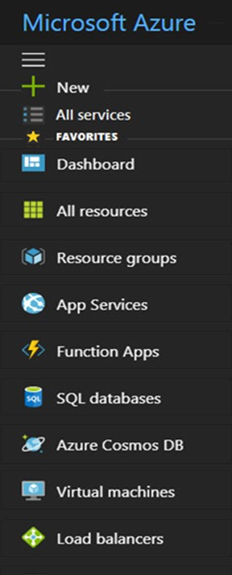
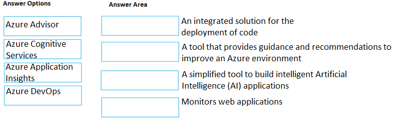

[Back to AZ-900: Azure Fundamentals Practice Exams](../az-900.md)

# Questions and Answers 161-170

**Source:** [161-170.pdf](../files/161-170.pdf)

<strong>Question 161 - Chrome OS with Cloud Shell</strong>

This item shares its setup with other questions. Each one proposes a different solution. Decide whether this solution meets the goal.

An Azure administrator plans to run a PowerShell script that creates Azure resources.

You need to recommend which computer configuration to use to run the script.

Solution: Run the script from a computer that runs Chrome OS and uses Azure Cloud Shell.

Does this meet the goal?

- A. Yes
- B. No

<strong>Answer 161</strong>

A. Yes.

Cloud Shell opens a PowerShell session in the browser, and the Azure PowerShell module is already installed. Chrome OS only has to reach that browser session.

**Why the others are wrong**

- B. No misses Cloud Shell. The script does not need a local PowerShell install when Cloud Shell provides it.

**Study further**

- [What is Azure Cloud Shell?](https://learn.microsoft.com/en-us/azure/cloud-shell/overview)

<strong>Question 162 - Azure Service Health statements</strong>

HOTSPOT

For each of the following statements, select Yes if the statement is true. Otherwise, select No.

NOTE: Each correct selection is worth one point.

_Figure: Three statements, each with an empty Yes and an empty No. From Azure Service Health, an administrator can view the health of all the services in an Azure environment. From Azure Service Health, an administrator can create a rule to be alerted if an Azure service fails. From Azure Service Health, an administrator can prevent a service failure._

<strong>Answer 162</strong>

Yes. Yes. No.

_Figure: View the health of the services in the environment is Yes. Create an alert rule if a service fails is Yes. Prevent a service failure is No._

Service Health shows the health of the Azure services you use and can alert you about incidents, maintenance, and advisories. It does not stop a failure from happening.

**Why the others are wrong**

- No for viewing service health misses the product. Service Health is the personalized view of service issues that affect your environment.
- No for an alert rule misses Service Health alerts. You can be notified when a service issue, planned maintenance, or another advisory affects you.
- Yes for preventing a service failure misses the limit. Service Health reports and alerts. It does not stop the failure. Resource Health can show a virtual machine's health, and it also cannot prevent the failure.

**Study further**

- [Azure Service Health overview](https://learn.microsoft.com/en-us/azure/service-health/overview)

<strong>Question 163 - macOS with PowerShell Core</strong>

This item shares its setup with other questions. Each one proposes a different solution. Decide whether this solution meets the goal.

An Azure administrator plans to run a PowerShell script that creates Azure resources.

You need to recommend which computer configuration to use to run the script.

Solution: Run the script from a computer that runs macOS and has PowerShell Core 6.0 installed.

Does this meet the goal?

- A. Yes
- B. No

<strong>Answer 163</strong>

A. Yes.

The script needs PowerShell. PowerShell Core 6.0 is installed on this Mac, so the script can run. Creating Azure resources also means importing the Azure PowerShell module.

**Why the others are wrong**

- B. No misses the install. The computer already has PowerShell, which is the runtime the script requires.

**Study further**

- [Install PowerShell](https://learn.microsoft.com/en-us/powershell/scripting/install/installing-powershell)

<strong>Question 164 - Blade for planned maintenance</strong>

HOTSPOT

You need to view a list of planned maintenance events that can affect the availability of an Azure subscription.

Which blade should you use from the Azure portal? To answer, select the appropriate blade in the answer area.

_Figure: The portal menu lists New, All services, and favorites: Dashboard, All resources, Resource groups, App Services, Function Apps, SQL databases, Azure Cosmos DB, Virtual machines, and Load balancers. No blade is highlighted._

<strong>Answer 164</strong>

Help and Support, then Service Health, then Planned maintenance.

_Figure: The screenshot shows the same favorites menu, from Dashboard through Load balancers. It does not highlight Help and Support. The written solution uses the Help and Support blade._

On Help and Support there is a Service Health option. Service Health opens a blade that includes Planned maintenance, which lists maintenance that can affect the subscription.

**Why the others are wrong**

- Dashboard misses the maintenance list. It is a home view of tiles, not the planned-maintenance list.
- All resources misses the platform schedule. It lists your resources. It does not list Azure maintenance events.
- Resource groups, App Services, Function Apps, SQL databases, Azure Cosmos DB, Virtual machines, and Load balancers each open one kind of resource. None of them is the subscription's planned-maintenance list.

**Study further**

- [Azure Service Health overview](https://learn.microsoft.com/en-us/azure/service-health/overview)
- [Planned maintenance notifications](https://learn.microsoft.com/en-us/azure/service-health/service-health-planned-maintenance)

<strong>Question 165 - Service to definition match</strong>

DRAG DROP

Match the Azure service to the correct definition.

Instructions: To answer, drag the appropriate Azure service from the column on the left to its description on the right. Each service may be used once, more than once, or not at all.

NOTE: Each correct match is worth one point.

_Figure: Azure Advisor, Azure Cognitive Services, Azure Application Insights, and Azure DevOps are the options. The descriptions are an integrated solution for the deployment of code, a tool that provides guidance and recommendations to improve an Azure environment, a simplified tool to build intelligent AI applications, and monitors web applications. The answer boxes are empty._

<strong>Answer 165</strong>

Azure DevOps, Azure Advisor, Azure Cognitive Services, and Azure Application Insights.

_Figure: Deployment of code is Azure DevOps. Guidance and recommendations is Azure Advisor. A simplified tool for intelligent AI applications is Azure Cognitive Services. Monitors web applications is Azure Application Insights._

DevOps covers the path from plan through deploy. Advisor recommends improvements for cost, security, reliability, and performance. Cognitive Services (now Azure AI services) adds vision, speech, and language to an app. Application Insights watches a live web app.

**Why the others are wrong**

- Azure Advisor does not deploy code. That requirement is Azure DevOps.
- Azure DevOps is not the recommendation engine for an existing Azure environment. That requirement is Advisor.
- Application Insights does not build intelligent AI features into an app. That requirement is Cognitive Services.
- Cognitive Services does not monitor what users do in a live web app. That requirement is Application Insights.

**Study further**

- [What is Azure DevOps?](https://learn.microsoft.com/en-us/azure/devops/user-guide/what-is-azure-devops)
- [Introduction to Azure Advisor](https://learn.microsoft.com/en-us/azure/advisor/advisor-overview)
- [What are Azure AI services?](https://learn.microsoft.com/en-us/azure/ai-services/what-are-ai-services)
- [Application Insights overview](https://learn.microsoft.com/en-us/azure/azure-monitor/app/app-insights-overview)

<strong>Question 166 - Data service descriptions</strong>

DRAG DROP

Match the Azure service to the correct description.

Instructions: To answer, drag the appropriate Azure service from the column on the left to its description on the right. Each service may be used once, more than once, or not at all.

NOTE: Each correct match is worth one point.

_Figure: Azure HDInsight, Azure Data Lake Analytics, Azure SQL Synapse Analytics, and Azure SQL Database are the options. The descriptions are a managed relational cloud database service, a cloud service that uses massively parallel processing to run complex queries across petabytes in a relational database, a service that can run massively parallel data transformation across petabytes, and an open-source framework for distributed processing of big data sets in clusters. The answer boxes are empty._

<strong>Answer 166</strong>

Azure SQL Database, Azure SQL Synapse Analytics, Azure Data Lake Analytics, and Azure HDInsight.

_Figure: The managed relational database is Azure SQL Database. Massively parallel queries on a relational store of petabytes is Azure SQL Synapse Analytics. Massively parallel transformation across petabytes is Azure Data Lake Analytics. The open-source cluster framework is Azure HDInsight._

Azure SQL Database is managed SQL Server for applications. Synapse Analytics is the massively parallel relational warehouse. Data Lake Analytics runs large parallel processing jobs over a data lake. HDInsight is the managed Hadoop-family cluster service.

**Why the others are wrong**

- Azure HDInsight is not the managed relational database for an application. That requirement is Azure SQL Database.
- Azure SQL Database is not the massively parallel warehouse for petabyte queries. That requirement is Synapse Analytics.
- Azure SQL Synapse Analytics is not the job service the solution uses for massively parallel transformation programs across a data lake. That requirement is Data Lake Analytics.
- Azure Data Lake Analytics is not the open-source cluster framework. That requirement is HDInsight.

**Study further**

- [What is Azure SQL Database?](https://learn.microsoft.com/en-us/azure/azure-sql/database/sql-database-paas-overview)
- [What is Azure Synapse Analytics?](https://learn.microsoft.com/en-us/azure/synapse-analytics/overview-what-is)
- [What is Azure Data Lake Analytics?](https://learn.microsoft.com/en-us/azure/data-lake-analytics/data-lake-analytics-overview)
- [What is Azure HDInsight?](https://learn.microsoft.com/en-us/azure/hdinsight/hdinsight-overview)

<strong>Question 167 - Blades for three portal tasks</strong>

HOTSPOT

You need to identify which blades in the Azure portal must be used to perform the following tasks:

- View security recommendations.
- Monitor the health of Azure services.
- Browse available virtual machine images.

Which blade should you identify for each task? To answer, select the appropriate options in the answer area.

NOTE: Each correct selection is worth one point.

_Figure: Monitor the health of Azure services, browse available virtual machine images, and view security recommendations. Each row has the same open list: Monitor, Subscriptions, Marketplace, and Advisor. Nothing is selected._

<strong>Answer 167</strong>

Monitor, Marketplace, and Advisor.

_Figure: Monitor the health of Azure services highlights Monitor. Browse available virtual machine images highlights Marketplace. View security recommendations highlights Advisor._

The image order is health, then virtual machine images, then security recommendations. Monitor collects health and telemetry. Marketplace is the catalog of virtual machine images. Advisor shows security recommendations, including those brought in from Microsoft Defender for Cloud.

**Why the others are wrong**

- Subscriptions for service health misses the telemetry product. A subscription blade manages the subscription. Monitor is the health view.
- Marketplace for service health misses the catalog's job. Marketplace lists offers. It does not monitor service health.
- Advisor for service health misses the monitor. Advisor recommends changes. It is not the health monitor.
- Monitor for virtual machine images misses the catalog. Monitor does not browse images you can deploy.
- Subscriptions for virtual machine images misses the catalog. Images are offered in Marketplace.
- Advisor for virtual machine images misses the catalog. Advisor does not list images to deploy.
- Monitor for security recommendations misses Advisor. Monitor collects signals. The security recommendation list in this solution is Advisor.
- Marketplace for security recommendations misses Advisor. Marketplace is where you obtain offers, not where this solution reads security recommendations.
- Subscriptions for security recommendations misses Advisor. The subscription blade does not list those recommendations.

**Study further**

- [Azure Monitor overview](https://learn.microsoft.com/en-us/azure/azure-monitor/fundamentals/overview)
- [Azure Marketplace overview](https://learn.microsoft.com/en-us/marketplace/marketplace-overview)
- [Introduction to Azure Advisor](https://learn.microsoft.com/en-us/azure/advisor/advisor-overview)

<strong>Question 168 - Android tablet with Bash Cloud Shell</strong>

This item shares its setup with other questions. Each one proposes a different solution. Decide whether this solution meets the goal.

You have an Azure environment. You need to create a new Azure virtual machine from a tablet that runs the Android operating system.

Solution: You use Bash in Azure Cloud Shell.

Does this meet the goal?

- A. Yes
- B. No

<strong>Answer 168</strong>

A. Yes.

Cloud Shell runs in the browser, and Bash in Cloud Shell can create a virtual machine. The Android tablet only needs that browser.

**Why the others are wrong**

- B. No misses the browser shell. Creating the virtual machine does not require a desktop Azure CLI install.

**Study further**

- [What is Azure Cloud Shell?](https://learn.microsoft.com/en-us/azure/cloud-shell/overview)

<strong>Question 169 - Serverless email notifications</strong>

You have an on-premises application that sends email notifications automatically based on a rule.

You plan to migrate the application to Azure.

You need to recommend a serverless computing solution for the application.

What should you include in the recommendation?

- A. A web app
- B. A server image in Azure Marketplace
- C. A logic app
- D. An API app

<strong>Answer 169</strong>

C. A logic app.

Logic Apps is the serverless workflow service. A workflow can send email when a rule or an event says to, without a server you manage.

**Why the others are wrong**

- A. A web app misses the serverless workflow. App Service hosts an application you still deploy. It is not the workflow that sends the mail when a rule fires.
- B. A server image in Azure Marketplace misses serverless. An image becomes a virtual machine you operate.
- D. An API app misses the notification workflow. An API app exposes an HTTP API. It does not, by itself, replace a rule that sends email.

**Study further**

- [What is Azure Logic Apps?](https://learn.microsoft.com/en-us/azure/logic-apps/logic-apps-overview)

<strong>Question 170 - Best playback for worldwide video</strong>

You plan to deploy a website to Azure. The website will be accessed by users worldwide and will host large video files.

You need to recommend which Azure feature must be used to provide the best video playback experience.

What should you recommend?

- A. An application gateway
- B. An Azure ExpressRoute circuit
- C. A content delivery network (CDN)
- D. An Azure Traffic Manager profile

<strong>Answer 170</strong>

C. A content delivery network (CDN).

Users are worldwide and the files are large. A CDN caches the video at edge sites near those users, so playback does not pull every byte from one origin.

**Why the others are wrong**

- A. An application gateway misses global playback. It load-balances HTTP into one region. It does not cache video beside users on other continents.
- B. An ExpressRoute circuit misses the audience. ExpressRoute is a private link from your site to Microsoft. It does not speed up public users around the world.
- D. A Traffic Manager profile misses the cache. It sends each user to an endpoint. It does not store the video close to them.

**Study further**

- [What is a content delivery network on Azure?](https://learn.microsoft.com/en-us/azure/cdn/cdn-overview)
- [What is Azure Front Door?](https://learn.microsoft.com/en-us/azure/frontdoor/front-door-overview)

