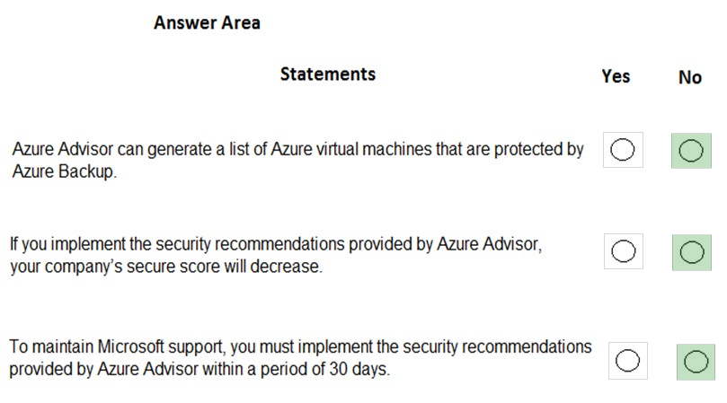
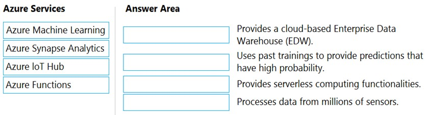
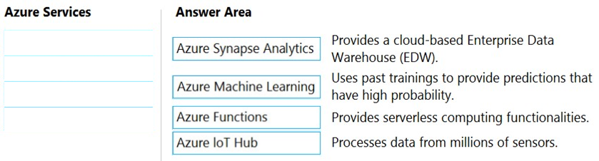
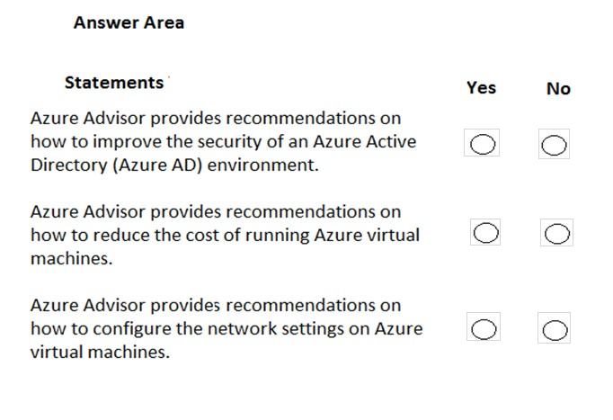
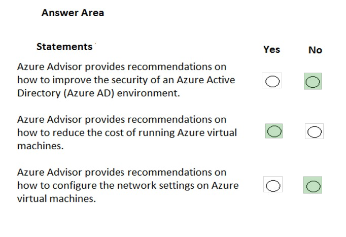

[Back to AZ-900: Azure Fundamentals Practice Exams](../az-900.md)

# Questions and Answers 171-180

**Source:** [171-180.pdf](../files/171-180.pdf)

<strong>Question 171 - Resources for millions of sensors</strong>

Your company plans to deploy several million sensors that will upload data to Azure.

You need to identify which Azure resources must be created to support the planned solution.

Which two Azure resources should you identify? Each correct answer presents part of the solution.

NOTE: Each correct selection is worth one point.

- A. Azure Data Lake
- B. Azure Queue storage
- C. Azure File Storage
- D. Azure IoT Hub
- E. Azure Notification Hubs

<strong>Answer 171</strong>

A and D. Azure Data Lake and Azure IoT Hub.

IoT Hub is the message hub for millions of devices. IoT Hub can route those messages to Azure Data Lake Storage, which keeps the uploaded data.

**Why the others are wrong**

- B. Azure Queue storage misses both parts. A queue is a small-message buffer between app components. It is not the device hub, and it is not the store IoT Hub routes sensor data into here.
- C. Azure File Storage misses both parts. A file share is not the ingress for millions of sensors, and it is not the route target named in the solution.
- E. Azure Notification Hubs misses both parts. Notification Hubs pushes messages out to mobile apps. It does not ingest sensor uploads.

**Study further**

- [What is Azure IoT Hub?](https://learn.microsoft.com/en-us/azure/iot-hub/iot-concepts-and-iot-hub)
- [IoT Hub message routing](https://learn.microsoft.com/en-us/azure/iot-hub/iot-hub-devguide-messages-d2c)
- [Introduction to Azure Data Lake Storage](https://learn.microsoft.com/en-us/azure/storage/blobs/data-lake-storage-introduction)

<strong>Question 172 - Manage a web app from an iPhone</strong>

You have an Azure web app.

You need to manage the settings of the web app from an iPhone.

What are two Azure management tools that you can use? Each correct answer presents a complete solution.

NOTE: Each correct selection is worth one point.

- A. Azure CLI
- B. The Azure portal
- C. Azure Cloud Shell
- D. Windows PowerShell
- E. Azure Storage Explorer

<strong>Answer 172</strong>

B and C. The Azure portal and Azure Cloud Shell.

Both are web-based. The iPhone browser can open the portal, and Cloud Shell opens from that portal, so either one can change the web app settings.

**Why the others are wrong**

- A. Azure CLI misses the phone. It installs on a computer. It does not install on an iPhone.
- D. Windows PowerShell misses the phone. It does not install on an iPhone.
- E. Azure Storage Explorer misses the web app. It browses storage accounts. It does not manage web app settings, and it is not an iPhone app for this task.

**Study further**

- [Azure portal overview](https://learn.microsoft.com/en-us/azure/azure-portal/azure-portal-overview)
- [What is Azure Cloud Shell?](https://learn.microsoft.com/en-us/azure/cloud-shell/overview)

<strong>Question 173 - Build and deploy predictive analytics</strong>

Your company plans to deploy an Artificial Intelligence (AI) solution in Azure.

What should the company use to build, test, and deploy predictive analytics solutions?

- A. Azure Logic Apps
- B. Azure Machine Learning Designer
- C. Azure Batch
- D. Azure Cosmos DB

<strong>Answer 173</strong>

B. Azure Machine Learning Designer.

Designer is the visual canvas where you connect datasets and modules, train a model, and deploy it. That is the build, test, and deploy path for predictive analytics.

**Why the others are wrong**

- A. Azure Logic Apps misses the model. It automates workflows. It does not train and deploy a predictive model.
- C. Azure Batch misses the model. It runs large parallel jobs. It does not provide the designer for predictive analytics.
- D. Azure Cosmos DB misses the model. It stores data. It does not build, test, or deploy the analytics solution.

**Study further**

- [What is Azure Machine Learning designer?](https://learn.microsoft.com/en-us/azure/machine-learning/concept-designer)
- [What is Azure Machine Learning?](https://learn.microsoft.com/en-us/azure/machine-learning/overview-what-is-azure-machine-learning)

<strong>Question 174 - Azure Advisor statements</strong>

HOTSPOT

For each of the following statements, select Yes if the statement is true. Otherwise, select No.

NOTE: Each correct selection is worth one point.

_Figure: Three statements, each with an empty Yes and an empty No. Azure Advisor can generate a list of Azure virtual machines that are protected by Azure Backup. Implementing Advisor security recommendations makes the company's secure score decrease. To maintain Microsoft support, you must implement the Advisor security recommendations within 30 days._

<strong>Answer 174</strong>

No. No. No.

_Figure: A list of virtual machines protected by Azure Backup is No. Secure score will decrease is No. A 30-day requirement to keep Microsoft support is No._

Advisor can point out virtual machines that are not protected by Backup. Following a security recommendation raises the secure score. The recommendations are optional.

**Why the others are wrong**

- Yes for a list of protected virtual machines misses what Advisor generates. It recommends machines that are not backed up. Protected items are listed in the Recovery Services vault.
- Yes for a decreasing secure score misses the direction. Implementing the recommendations increases the score.
- Yes for a 30-day support requirement misses the word recommendation. Microsoft support does not depend on finishing Advisor items within 30 days.

**Study further**

- [Introduction to Azure Advisor](https://learn.microsoft.com/en-us/azure/advisor/advisor-overview)

<strong>Question 175 - Alert when an administrator stops a VM</strong>

What can you use to automatically send an alert if an administrator stops an Azure virtual machine?

- A. Azure Advisor
- B. Azure Service Health
- C. Azure Monitor
- D. Azure Network Watcher

<strong>Answer 175</strong>

C. Azure Monitor.

Azure Monitor alerts fire on signals from the virtual machine, including an administrator stopping it.

**Why the others are wrong**

- A. Azure Advisor misses the alert. Advisor recommends configuration changes. It does not send an alert when someone stops a virtual machine.
- B. Azure Service Health misses the operator action. Service Health reports Azure platform issues and maintenance, not an administrator stopping one virtual machine.
- D. Azure Network Watcher misses the power action. It diagnoses network reachability. It does not alert on a stop operation.

**Study further**

- [Alerts in Azure Monitor](https://learn.microsoft.com/en-us/azure/azure-monitor/alerts/alerts-overview)
- [VM insights alerts](https://learn.microsoft.com/en-us/azure/azure-monitor/vm/monitor-virtual-machine-alerts)

<strong>Question 176 - Match services to descriptions</strong>

DRAG DROP

Match the Azure services to the correct descriptions.

Instructions: To answer, drag the appropriate Azure service from the column on the left to its description on the right. Each service may be used once, more than once, or not at all.

NOTE: Each correct match is worth one point.

_Figure: Azure Machine Learning, Azure Synapse Analytics, Azure IoT Hub, and Azure Functions are the options. The descriptions are a cloud enterprise data warehouse, predictions from past training, serverless computing, and processing data from millions of sensors. The answer boxes are empty._

<strong>Answer 176</strong>

Azure Synapse Analytics, Azure Machine Learning, Azure Functions, and Azure IoT Hub.

_Figure: The enterprise data warehouse is Azure Synapse Analytics. Predictions from past training is Azure Machine Learning. Serverless computing is Azure Functions. Data from millions of sensors is Azure IoT Hub._

Synapse Analytics is the massively parallel warehouse. Machine Learning uses existing data to predict later outcomes. Functions runs code without a server you manage. IoT Hub takes messages from millions of devices.

**Why the others are wrong**

- Azure Machine Learning is not the enterprise data warehouse. That requirement is Synapse Analytics.
- Azure Functions does not turn past training into predictions. That requirement is Machine Learning.
- Azure IoT Hub is not the serverless code platform. That requirement is Azure Functions.
- Azure Synapse Analytics does not ingest data from millions of sensors. That requirement is IoT Hub.

**Study further**

- [What is Azure Synapse Analytics?](https://learn.microsoft.com/en-us/azure/synapse-analytics/overview-what-is)
- [What is Azure Machine Learning?](https://learn.microsoft.com/en-us/azure/machine-learning/overview-what-is-azure-machine-learning)
- [What is Azure Functions?](https://learn.microsoft.com/en-us/azure/azure-functions/functions-overview)
- [What is Azure IoT Hub?](https://learn.microsoft.com/en-us/azure/iot-hub/iot-concepts-and-iot-hub)

<strong>Question 177 - Create a VM from an Android tablet</strong>

You have an Azure environment.

You need to create a new Azure virtual machine from a tablet that runs the Android operating system.

What are three possible solutions? Each correct answer presents a complete solution.

NOTE: Each correct selection is worth one point.

- A. Use Bash in Azure Cloud Shell.
- B. Use PowerShell in Azure Cloud Shell.
- C. Use the PowerApps portal.
- D. Use the Security & Compliance admin center.
- E. Use the Azure portal.

<strong>Answer 177</strong>

A, B, and E. Bash in Azure Cloud Shell, PowerShell in Azure Cloud Shell, and the Azure portal.

The tablet has a browser. The portal can create the virtual machine from the graphical pages, and Cloud Shell in that browser can create it with Bash or with PowerShell.

**Why the others are wrong**

- C. The PowerApps portal misses virtual machine creation. Power Apps builds business applications. It is not one of the three ways this solution creates the virtual machine.
- D. The Security & Compliance admin center misses virtual machine creation. It is a Microsoft 365 compliance site, not an Azure virtual machine tool.

**Study further**

- [Azure portal overview](https://learn.microsoft.com/en-us/azure/azure-portal/azure-portal-overview)
- [What is Azure Cloud Shell?](https://learn.microsoft.com/en-us/azure/cloud-shell/overview)

<strong>Question 178 - Deploy and remove 50 VMs each week</strong>

A team of developers at your company plans to deploy, and then remove, 50 virtual machines each week. All the virtual machines are configured by using Azure Resource Manager templates.

You need to recommend which Azure service will minimize the administrative effort required to deploy and remove the virtual machines.

What should you recommend?

- A. Azure Reserved Virtual Machine (VM) Instances
- B. Azure DevTest Labs
- C. Azure virtual machine scale sets
- D. Azure Virtual Desktop

<strong>Answer 178</strong>

B. Azure DevTest Labs.

DevTest Labs builds labs from Resource Manager templates and artifacts, then lets the team create and delete those environments with less manual work.

**Why the others are wrong**

- A. Reserved Virtual Machine Instances miss the weekly create-and-delete cycle. A reservation discounts virtual machines you keep. It does not deploy and remove 50 machines from templates.
- C. Virtual machine scale sets miss the lab workflow. A scale set runs a set of identical instances. It is not the service that minimizes effort for a template lab that is created and removed every week.
- D. Azure Virtual Desktop misses the lab workflow. It publishes desktops to users. It does not deploy and delete a weekly set of template virtual machines.

**Study further**

- [What is Azure DevTest Labs?](https://learn.microsoft.com/en-us/azure/devtest-labs/devtest-lab-overview)
- [What are ARM templates?](https://learn.microsoft.com/en-us/azure/azure-resource-manager/templates/overview)

<strong>Question 179 - Advisor recommendation statements</strong>

HOTSPOT

For each of the following statements, select Yes if the statement is true. Otherwise, select No.

NOTE: Each correct selection is worth one point.

_Figure: Three statements, each with an empty Yes and an empty No. Azure Advisor provides recommendations on how to improve the security of an Azure Active Directory environment. Azure Advisor provides recommendations on how to reduce the cost of running Azure virtual machines. Azure Advisor provides recommendations on how to configure the network settings on Azure virtual machines._

<strong>Answer 179</strong>

No. Yes. No.

_Figure: Security recommendations for an Azure AD environment is No. Cost recommendations for virtual machines is Yes. Network settings on virtual machines is No._

Advisor's cost view finds idle and underused virtual machines. The solution says it does not recommend how to secure an Azure AD environment, and it does not recommend how to configure a virtual machine's network settings.

**Why the others are wrong**

- Yes for Azure AD security misses the scope in this solution. Advisor security recommendations cover Azure resources, such as network security groups and encryption. They do not tell you how to improve the Azure AD environment.
- No for virtual machine cost misses the Cost tab. Advisor lists idle and underused resources so you can lower the bill.
- Yes for network settings misses the limit in this solution. Advisor does not provide recommendations on how to configure the network settings of Azure virtual machines.

**Study further**

- [Reduce service costs by using Azure Advisor](https://learn.microsoft.com/en-us/azure/advisor/advisor-cost-recommendations)
- [Introduction to Azure Advisor](https://learn.microsoft.com/en-us/azure/advisor/advisor-overview)

<strong>Question 180 - Cloud Shell PowerShell for the az command</strong>

This item shares its setup with other questions. Each one proposes a different solution. Decide whether this solution meets the goal.

You have an Azure subscription named Subscription1. You sign in to the Azure portal and create a resource group named RG1.

From Azure documentation, you have the following command that creates a virtual machine named VM1.

`az vm create --resource-group RG1 --name VM1 --image UbuntuLTS --generate-ssh-keys`

You need to create VM1 in Subscription1 by using the command.

Solution: From the Azure portal, launch Azure Cloud Shell and select PowerShell. Run the command in Cloud Shell.

Does this meet the goal?

- A. Yes
- B. No

<strong>Answer 180</strong>

A. Yes.

The stated answer is Yes. The vote leans toward No. Cloud Shell already has the Azure CLI, and the `az` command runs in the PowerShell experience as well as in Bash. Cloud Shell is signed in to the subscription, and RG1 is already there.

**Why the others are wrong**

- B. No treats the PowerShell window as unable to run `az`. The solution says the Azure CLI commands work in Cloud Shell PowerShell.

**Study further**

- [What is Azure Cloud Shell?](https://learn.microsoft.com/en-us/azure/cloud-shell/overview)
- [Create a Linux virtual machine with the Azure CLI](https://learn.microsoft.com/en-us/azure/virtual-machines/linux/quick-create-cli)

