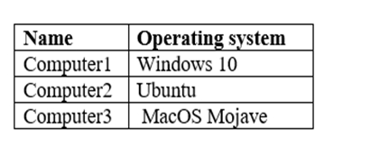
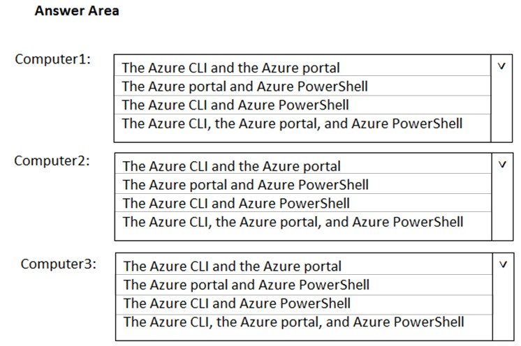
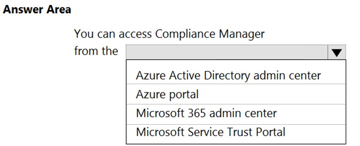
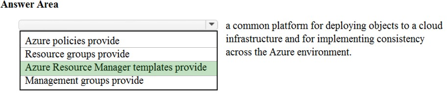
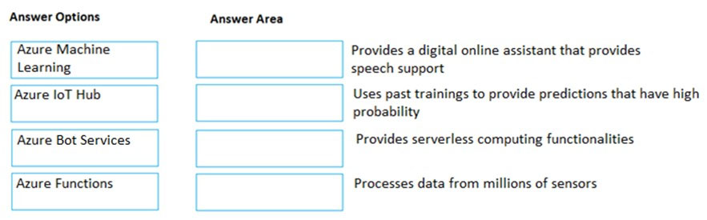
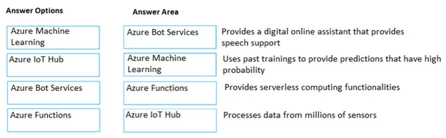
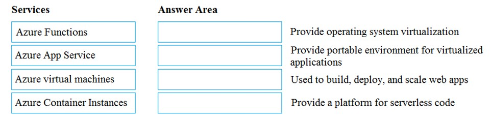
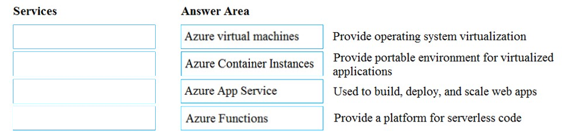

# Questions and Answers 181-190

[Back to AZ-900 Practice Exam](../az-900.md)

**Source:** [181-190.pdf](../files/181-190.pdf)

<strong>Question 181 - CLI from PowerShell</strong>

This item shares its setup with other questions. Each one proposes a different solution. Decide whether this solution meets the goal.

You have an Azure subscription named Subscription1. You sign in to the Azure portal and create a resource group named RG1.

From Azure documentation, you have the following command that creates a virtual machine named VM1:

`az vm create --resource-group RG1 --name VM1 --image UbuntuLTS --generate-ssh-keys`

You need to create VM1 in Subscription1 by using the command.

Solution: From a computer that runs Windows 10, install Azure CLI. From PowerShell, sign in to Azure and then run the command.

Does this meet the goal?

- A. Yes
- B. No

<strong>Answer 181</strong>

A. Yes.

The Azure CLI runs inside PowerShell after it is installed. Sign in, then run `az vm create` against RG1 in Subscription1.

**Why the others are wrong**

- B. No would mean PowerShell cannot host the Azure CLI. The CLI is a command you can run from PowerShell once it is installed and you are signed in.

**Study further**

- [Install the Azure CLI on Windows](https://learn.microsoft.com/en-us/cli/azure/install-azure-cli-windows)
- [Get started with Azure Command-Line Interface (CLI)](https://learn.microsoft.com/en-us/cli/azure/get-started-with-azure-cli)

<strong>Question 182 - CLI from Command Prompt</strong>

This item shares its setup with other questions. Each one proposes a different solution. Decide whether this solution meets the goal.

You have an Azure subscription named Subscription1. You sign in to the Azure portal and create a resource group named RG1.

From Azure documentation, you have the following command that creates a virtual machine named VM1:

`az vm create --resource-group RG1 --name VM1 --image UbuntuLTS --generate-ssh-keys`

You need to create VM1 in Subscription1 by using the command.

Solution: From a computer that runs Windows 10, install Azure CLI. From a command prompt, sign in to Azure and then run the command.

Does this meet the goal?

- A. Yes
- B. No

<strong>Answer 182</strong>

A. Yes.

The same `az` command runs from Command Prompt. Install the Azure CLI, sign in, and create VM1 in RG1.

**Why the others are wrong**

- B. No would mean the Azure CLI works only in PowerShell. On Windows the CLI is available from Command Prompt and from PowerShell.

**Study further**

- [Install the Azure CLI on Windows](https://learn.microsoft.com/en-us/cli/azure/install-azure-cli-windows)
- [Get started with Azure Command-Line Interface (CLI)](https://learn.microsoft.com/en-us/cli/azure/get-started-with-azure-cli)

<strong>Question 183 - Tools for each computer</strong>

HOTSPOT

Several support engineers plan to manage Azure by using the computers shown in the following table:

_Figure: Computer1 runs Windows 10, Computer2 runs Ubuntu, and Computer3 runs MacOS Mojave._

You need to identify which Azure management tools can be used from each computer.

What should you identify for each computer? To answer, select the appropriate options in the answer area.

NOTE: Each correct selection is worth one point.

_Figure: Computer1, Computer2, and Computer3 each have the same open list. The choices are the Azure CLI and the Azure portal; the Azure portal and Azure PowerShell; the Azure CLI and Azure PowerShell; and the Azure CLI, the Azure portal, and Azure PowerShell. Nothing is selected._

<strong>Answer 183</strong>

The Azure CLI, the Azure portal, and Azure PowerShell on every computer.

_Figure: For Computer1, Computer2, and Computer3, the highlighted choice is the Azure CLI, the Azure portal, and Azure PowerShell._

The Azure CLI and Azure PowerShell both run on Windows, Linux, and macOS. The Azure portal is a website, so a browser on any of these three operating systems can open it.

**Why the others are wrong**

- The Azure CLI and the Azure portal leaves out Azure PowerShell, which also installs on Windows 10, Ubuntu, and macOS.
- The Azure portal and Azure PowerShell leaves out the Azure CLI, which also runs on all three operating systems.
- The Azure CLI and Azure PowerShell leaves out the Azure portal, which only needs a browser.

**Study further**

- [How to install the Azure CLI](https://learn.microsoft.com/en-us/cli/azure/install-azure-cli)
- [How to install Azure PowerShell](https://learn.microsoft.com/en-us/powershell/azure/install-azure-powershell)
- [What is the Azure portal?](https://learn.microsoft.com/en-us/azure/azure-portal/azure-portal-overview)

<strong>Question 184 - Where to open Compliance Manager</strong>

HOTSPOT

To complete the sentence, select the appropriate option in the answer area.

_Figure: "You can access Compliance Manager from the (blank)." The open list is Azure Active Directory admin center, Azure portal, Microsoft 365 admin center, and Microsoft Service Trust Portal. Nothing is selected._

<strong>Answer 184</strong>

Azure portal.

_Figure: Azure portal is highlighted. Azure Active Directory admin center, Microsoft 365 admin center, and Microsoft Service Trust Portal are not._

The solution image selects the Azure portal as the place to open Compliance Manager.

**Why the others are wrong**

- Azure Active Directory admin center is the directory and identity admin site. The solution image does not select it for Compliance Manager.
- Microsoft 365 admin center is not the highlighted choice.
- Microsoft Service Trust Portal publishes trust and compliance documents for customers to read. The solution image does not select it as the place you open Compliance Manager.

**Study further**

- [Microsoft Purview Compliance Manager](https://learn.microsoft.com/en-us/purview/compliance-manager)

<strong>Question 185 - Platform for consistent deployment</strong>

HOTSPOT

To complete the sentence, select the appropriate option in the answer area.

_Figure: The open list is "Azure policies provide," "Resource groups provide," "Azure Resource Manager templates provide," and "Management groups provide." The rest of the sentence is "a common platform for deploying objects to a cloud infrastructure and for implementing consistency across the Azure environment." Nothing is selected._

<strong>Answer 185</strong>

Azure Resource Manager templates provide a common platform for deploying objects to a cloud infrastructure and for implementing consistency across the Azure environment.

_Figure: Azure Resource Manager templates provide is highlighted. Azure policies, resource groups, and management groups are not._

An Azure Resource Manager template is the file that declares the resources to deploy and the properties they get, so the same deployment can be repeated.

**Why the others are wrong**

- Azure policies provide rules for what may be deployed and how. They do not deploy the objects.
- Resource groups provide a container that holds resources. They do not define the deployment.
- Management groups provide a scope above subscriptions for governance. They do not deploy resources.

**Study further**

- [Templates overview](https://learn.microsoft.com/en-us/azure/azure-resource-manager/templates/overview)
- [Overview of Azure Policy](https://learn.microsoft.com/en-us/azure/governance/policy/overview)

<strong>Question 186 - Match services to descriptions</strong>

DRAG DROP

Match the Azure service to the correct description.

Instructions: To answer, drag the appropriate Azure service from the column on the left to its description on the right. Each service may be used once, more than once, or not at all.

NOTE: Each correct selection is worth one point.

_Figure: Options are Azure Machine Learning, Azure IoT Hub, Azure Bot Services, and Azure Functions. The descriptions, with empty boxes, are: a digital online assistant that provides speech support; uses past trainings to provide predictions that have high probability; provides serverless computing functionalities; processes data from millions of sensors._

<strong>Answer 186</strong>

Azure Bot Services. Azure Machine Learning. Azure Functions. Azure IoT Hub.

_Figure: Azure Bot Services is matched to the speech assistant. Azure Machine Learning is matched to predictions from past trainings. Azure Functions is matched to serverless computing. Azure IoT Hub is matched to data from millions of sensors._

A bot is the assistant people talk to, including by speech. Machine learning scores new outcomes from earlier training data. Azure Functions runs code without a server you manage. IoT Hub is the message hub for large numbers of devices and sensors.

**Why the others are wrong**

- Azure Machine Learning, Azure IoT Hub, and Azure Functions do not provide the conversational assistant. That description is Azure Bot Services.
- Azure Bot Services, Azure IoT Hub, and Azure Functions do not forecast from past training data. That description is Azure Machine Learning.
- Azure Machine Learning, Azure IoT Hub, and Azure Bot Services do not provide the serverless compute platform. That description is Azure Functions.
- Azure Machine Learning, Azure Bot Services, and Azure Functions do not ingest telemetry from millions of sensors. That description is Azure IoT Hub.

**Study further**

- [Choose the right chatbot solution for your use case](https://learn.microsoft.com/en-us/azure/bot-service/bot-overview)
- [What is Azure Machine Learning?](https://learn.microsoft.com/en-us/azure/machine-learning/overview-what-is-azure-machine-learning)
- [Azure Functions Overview](https://learn.microsoft.com/en-us/azure/azure-functions/functions-overview)
- [What is Azure IoT Hub?](https://learn.microsoft.com/en-us/azure/iot-hub/iot-concepts-and-iot-hub)

<strong>Question 187 - PowerShell module on Windows</strong>

This item shares its setup with other questions. Each one proposes a different solution. Decide whether this solution meets the goal.

An Azure administrator plans to run a PowerShell script that creates Azure resources.

You need to recommend which computer configuration to use to run the script.

Solution: Run the script from a computer that runs Windows 10 and has the Azure PowerShell module installed.

Does this meet the goal?

- A. Yes
- B. No

<strong>Answer 187</strong>

A. Yes.

A PowerShell script has to run in PowerShell. Windows 10 with the Azure PowerShell module installed can run the cmdlets that create the Azure resources.

**Why the others are wrong**

- B. No would mean that computer cannot run the script. The module is what adds the Azure cmdlets to PowerShell on that Windows 10 computer.

**Study further**

- [What is Azure PowerShell](https://learn.microsoft.com/en-us/powershell/azure/what-is-azure-powershell)
- [How to install Azure PowerShell](https://learn.microsoft.com/en-us/powershell/azure/install-azure-powershell)

<strong>Question 188 - Match compute services</strong>

DRAG DROP

Match the Azure services to the correct description.

Instructions: To answer, drag the appropriate Azure service from the column on the left to its description on the right. Each service may be used once, more than once, or not at all.

NOTE: Each correct selection is worth one point.

_Figure: Options are Azure Functions, Azure App Service, Azure virtual machines, and Azure Container Instances. The descriptions, with empty boxes, are: provide operating system virtualization; provide a portable environment for virtualized applications; used to build, deploy, and scale web apps; provide a platform for serverless code._

<strong>Answer 188</strong>

Azure virtual machines. Azure Container Instances. Azure App Service. Azure Functions.

_Figure: Azure virtual machines is matched to operating system virtualization. Azure Container Instances is matched to a portable environment for virtualized applications. Azure App Service is matched to building, deploying, and scaling web apps. Azure Functions is matched to a platform for serverless code. The options column is empty._

A virtual machine is a virtualized operating system. A container is the portable package for an application. App Service is the platform for web apps. Azure Functions is the serverless platform.

**Why the others are wrong**

- Azure Functions, Azure App Service, and Azure Container Instances do not give you an operating system to manage. That description is Azure virtual machines.
- Azure Functions, Azure App Service, and Azure virtual machines do not provide the portable container environment. That description is Azure Container Instances.
- Azure Functions, Azure virtual machines, and Azure Container Instances are not the web-app hosting platform in this match. That description is Azure App Service.
- Azure App Service, Azure virtual machines, and Azure Container Instances are not the serverless code platform. That description is Azure Functions.

**Study further**

- [Overview of virtual machines in Azure](https://learn.microsoft.com/en-us/azure/virtual-machines/overview)
- [Serverless containers in Azure](https://learn.microsoft.com/en-us/azure/container-instances/container-instances-overview)
- [Overview of Azure App Service](https://learn.microsoft.com/en-us/azure/app-service/overview)
- [Azure Functions Overview](https://learn.microsoft.com/en-us/azure/azure-functions/functions-overview)

<strong>Question 189 - Serverless computing service</strong>

Which service provides serverless computing in Azure?

- A. Azure Virtual Machines
- B. Azure Functions
- C. Azure storage account
- D. Azure dedicated hosts

<strong>Answer 189</strong>

B. Azure Functions.

Azure Functions runs your code when an event fires. You do not provision or manage the servers.

**Why the others are wrong**

- A. Azure Virtual Machines is a server you size, start, and patch. That is not serverless computing.
- C. An Azure storage account stores blobs, files, queues, or tables. It does not run your application code as a serverless compute platform.
- D. Azure dedicated hosts is a physical server reserved for your virtual machines. You still manage those machines.

**Study further**

- [Azure Functions Overview](https://learn.microsoft.com/en-us/azure/azure-functions/functions-overview)
- [Overview of Azure Dedicated Hosts for virtual machines](https://learn.microsoft.com/en-us/azure/virtual-machines/dedicated-hosts)

<strong>Question 190 - Computers that run the script</strong>

An Azure administrator plans to run a PowerShell script that creates Azure resources.

You need to recommend which computer configuration to use to run the script.

Which three computers can run the script? Each correct answer presents a complete solution.

NOTE: Each correct selection is worth one point.

- A. A computer that runs macOS and has PowerShell Core 6.0 installed.
- B. A computer that runs Windows 10 and has the Azure PowerShell module installed.
- C. A computer that runs Linux and has the Azure PowerShell module installed.
- D. A computer that runs Linux and has the Azure CLI tools installed.
- E. A computer that runs Chrome OS and uses Azure Cloud Shell.

<strong>Answer 190</strong>

A, B, and E. macOS with PowerShell Core 6.0, Windows 10 with the Azure PowerShell module, and Chrome OS using Azure Cloud Shell.

The source answer is those three. A PowerShell script has to run in PowerShell: PowerShell Core on macOS, the Azure PowerShell module on Windows 10, or PowerShell in Cloud Shell from the Chrome OS browser.

**Why the others are wrong**

- C. Linux with the Azure PowerShell module is not one of the three the source marks. The marked set is macOS with PowerShell Core, Windows 10 with the Azure PowerShell module, and Chrome OS with Cloud Shell.
- D. Linux with the Azure CLI can run `az` commands. It does not run a PowerShell script. The script needs PowerShell.

**Study further**

- [What is Azure PowerShell](https://learn.microsoft.com/en-us/powershell/azure/what-is-azure-powershell)
- [What is Azure Cloud Shell?](https://learn.microsoft.com/en-us/azure/cloud-shell/overview)

