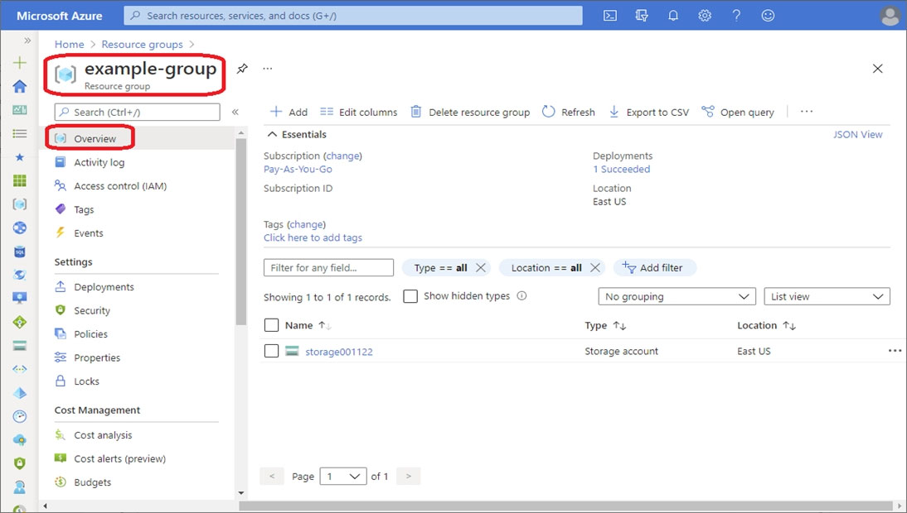
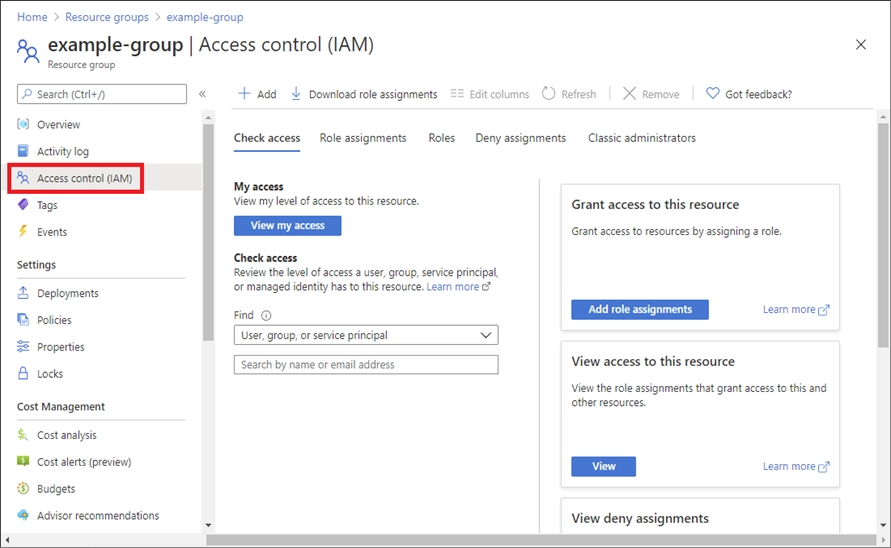
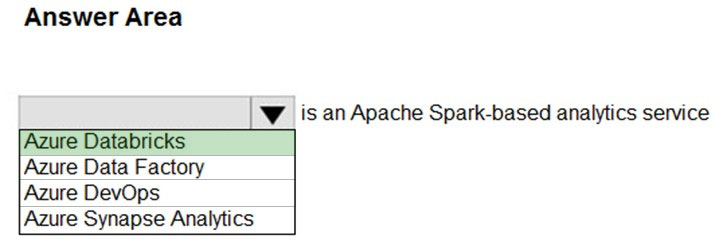
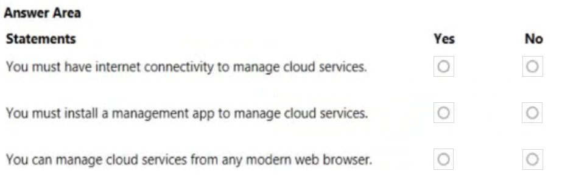
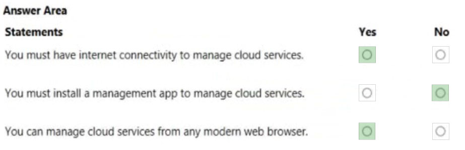

[Back to AZ-900: Azure Fundamentals Practice Exams](../az-900.md)

# Questions and Answers 191-200

**Source:** [191-200.pdf](../files/191-200.pdf)

<strong>Question 191 - CLI in Cloud Shell Bash</strong>

This item shares its setup with other questions. Each one proposes a different solution. Decide whether this solution meets the goal.

You have an Azure subscription named Subscription1. You sign in to the Azure portal and create a resource group named RG1.

From Azure documentation, you have the following command that creates a virtual machine named VM1:

`az vm create --resource-group RG1 --name VM1 --image UbuntuLTS --generate-ssh-keys`

You need to create VM1 in Subscription1 by using the command.

Solution: From the Azure portal, launch Azure Cloud Shell and select Bash. Run the command in Cloud Shell.

Does this meet the goal?

- A. Yes
- B. No

<strong>Answer 191</strong>

A. Yes.

Cloud Shell already has the Azure CLI and is signed in with your account. Bash in Cloud Shell can run `az vm create` for VM1 in RG1.

**Why the others are wrong**

- B. No would mean Cloud Shell cannot run an Azure CLI command. Bash in Cloud Shell is one of the places that command is meant to run.

**Study further**

- [What is Azure Cloud Shell?](https://learn.microsoft.com/en-us/azure/cloud-shell/overview)
- [Quickstart: Use the Azure CLI to create a Linux Virtual Machine](https://learn.microsoft.com/en-us/azure/virtual-machines/linux/quick-create-cli)

<strong>Question 192 - Automate repeated resources</strong>

Your company has several business units.

Each business unit requires 20 different Azure resources for daily operation. All the business units require the same type of Azure resources.

You need to recommend a solution to automate the creation of the Azure resources.

What should you include in the recommendations?

- A. Azure Resource Manager templates
- B. virtual machine scale sets
- C. the Azure API Management service
- D. management groups

<strong>Answer 192</strong>

A. Azure Resource Manager templates.

Each business unit needs the same 20 kinds of resources. A template declares those resources once and deploys that set again for the next business unit.

**Why the others are wrong**

- B. Virtual machine scale sets deploy identical virtual machine instances. They do not create 20 different resource types.
- C. Azure API Management publishes and secures APIs. It does not create the daily resource set for each business unit.
- D. Management groups organize subscriptions for policy and access. They do not deploy the 20 resources.

**Study further**

- [Templates overview](https://learn.microsoft.com/en-us/azure/azure-resource-manager/templates/overview)
- [Organize your resources with management groups](https://learn.microsoft.com/en-us/azure/governance/management-groups/overview)

<strong>Question 193 - Cost Management statements</strong>

HOTSPOT

For each of the following statements, select Yes if the statement is true. Otherwise, select No.

NOTE: Each correct selection is worth one point.

_Figure: Three statements, each with an empty Yes and an empty No. Azure Cost Management can view costs for management groups. It can view costs for resource groups. It can view virtual machine usage for the last three months._

<strong>Answer 193</strong>

No. Yes. Yes.

_Figure: Management-group costs is No. Resource-group costs is Yes. Virtual machine usage for the last three months is Yes._

The solution image marks management-group cost view as No. Cost analysis in this item covers resource-group costs and virtual machine usage over the last three months.

**Why the others are wrong**

- Yes for management groups is the opposite of the solution image. This item does not treat a management group as a cost-analysis scope.
- No for resource groups misses cost analysis filtered to a resource group.
- No for three months of virtual machine usage misses cost analysis over a past date range for those machines.

**Study further**

- [Overview of Cost Management](https://learn.microsoft.com/en-us/azure/cost-management-billing/costs/overview-cost-management)
- [Common cost analysis uses in Cost Management](https://learn.microsoft.com/en-us/azure/cost-management-billing/costs/cost-analysis-common-uses)

<strong>Question 194 - Find unused virtual machines</strong>

What can you use to identify underutilized or unused Azure virtual machines?

- A. Azure Advisor
- B. Azure Cost Management + Billing
- C. Azure reservations
- D. Azure Policy

<strong>Answer 194</strong>

A. Azure Advisor.

Advisor's cost recommendations call out idle and underutilized virtual machines so you can resize or shut them down.

**Why the others are wrong**

- B. Azure Cost Management + Billing shows what you spent. It does not identify an underutilized virtual machine the way Advisor's cost recommendations do.
- C. Azure reservations are a commit-and-save purchase for steady compute. They do not find unused machines.
- D. Azure Policy enforces rules on what can be deployed. It does not report idle virtual machines.

**Study further**

- [Introduction to Azure Advisor](https://learn.microsoft.com/en-us/azure/advisor/advisor-overview)
- [Optimize virtual machine (VM) or virtual machine scale set (VMSS) spend by resizing or shutting down underutilized instances](https://learn.microsoft.com/en-us/azure/advisor/advisor-cost-recommendations)

<strong>Question 195 - Assign Reader on a resource group</strong>

HOTSPOT

Which node in the Azure portal should you use to assign a user the Reader role for a resource group? To answer, select the node in the answer area.

NOTE: Each correct selection is worth one point.

_Figure: A resource group menu with nothing selected. The nodes are Overview, Activity log, Access control (IAM), Tags, Resource visualizer, and Events. Under Settings are Resource costs, Deployments, Security, Policies, and Properties._

<strong>Answer 195</strong>

Overview and Access control (IAM).

_Figure: Overview and Access control (IAM) are highlighted. Activity log, Tags, Resource visualizer, Events, Resource costs, Deployments, Security, Policies, and Properties are not._

Open the resource group, then use Access control (IAM) to add a role assignment. Reader at that scope lets the user view the resource group and the resources in it.

_Figure: The solution's portal example opens the example-group resource group. Overview is marked in the left menu, and the resource group name is marked at the top._

_Figure: The solution's portal example is the Access control (IAM) page for example-group. Access control (IAM) is marked in the left menu. The page includes Add role assignments._

**Why the others are wrong**

- Activity log shows who changed resources. It does not assign the Reader role.
- Tags stores name-value labels. It does not grant access.
- Resource visualizer draws resource relationships. It does not assign roles.
- Events is not the role-assignment page.
- Resource costs shows spending. It does not grant Reader.
- Deployments shows template deployment history. It does not assign roles.
- Security is not the page used to add a role assignment.
- Policies shows Azure Policy assignments. Reader is an RBAC role, assigned under Access control (IAM).
- Properties shows resource group settings such as the subscription and the ID. It does not assign Reader.

**Study further**

- [Assign Azure roles using the Azure portal](https://learn.microsoft.com/en-us/azure/role-based-access-control/role-assignments-portal)
- [What is Azure role-based access control (Azure RBAC)?](https://learn.microsoft.com/en-us/azure/role-based-access-control/overview)

<strong>Question 196 - Spark-based analytics service</strong>

HOTSPOT

Select the answer that correctly completes the sentence.

_Figure: The open list is Azure Databricks, Azure Data Factory, Azure DevOps, and Azure Synapse Analytics. The rest of the sentence is "is an Apache Spark-based analytics service." Nothing is selected._

<strong>Answer 196</strong>

Azure Databricks is an Apache Spark-based analytics service.

_Figure: Azure Databricks is highlighted. Azure Data Factory, Azure DevOps, and Azure Synapse Analytics are not._

Azure Databricks is the Apache Spark analytics platform in this item, used for data science and data engineering.

**Why the others are wrong**

- Azure Data Factory moves and transforms data in pipelines. It is not the Spark analytics service named here.
- Azure DevOps is the service for repos, boards, and pipelines. It is not an Apache Spark analytics service.
- Azure Synapse Analytics is not the service the solution image selects for this sentence.

**Study further**

- [What is Azure Databricks?](https://learn.microsoft.com/en-us/azure/databricks/introduction/)

<strong>Question 197 - Managing cloud services</strong>

HOTSPOT

For each of the following statements, select Yes if the statement is true. Otherwise, select No.

NOTE: Each correct selection is worth one point.

_Figure: Three statements, each with an empty Yes and an empty No. You must have internet connectivity to manage cloud services. You must install a management app to manage cloud services. You can manage cloud services from any modern web browser._

<strong>Answer 197</strong>

Yes. No. Yes.

_Figure: Internet connectivity is Yes. A required management app is No. Any modern web browser is Yes._

You reach Azure over the internet. The portal at portal.azure.com runs in a browser, so a separate management app is not required, and a current browser is enough.

**Why the others are wrong**

- No for internet connectivity misses how you reach the portal and the management APIs. Those endpoints are on the internet.
- Yes for a required management app misses the browser portal. Cloud Shell in the portal is another browser path.
- No for any modern web browser misses the portal, which is a website.

**Study further**

- [What is the Azure portal?](https://learn.microsoft.com/en-us/azure/azure-portal/azure-portal-overview)
- [What is Azure Cloud Shell?](https://learn.microsoft.com/en-us/azure/cloud-shell/overview)

<strong>Question 198 - Match services to definitions</strong>

DRAG DROP

Match the Azure service to the correct definition.

Instructions: To answer, drag the appropriate Azure service from the column on the left to its description on the right. Each service may be used once, more than once, or not at all.

NOTE: Each correct selection is worth one point.

_Figure: Options are Azure Databricks, Azure Functions, Azure App Service, and Azure Application Insights. The descriptions, with empty boxes, are: provides the platform for serverless code; a big data analysis service for machine learning; detects and diagnoses anomalies in web apps; hosts web apps._

<strong>Answer 198</strong>

Azure Functions. Azure Databricks. Azure Application Insights. Azure App Service.

_Figure: Azure Functions is matched to serverless code. Azure Databricks is matched to big data analysis for machine learning. Azure Application Insights is matched to detecting and diagnosing anomalies in web apps. Azure App Service is matched to hosting web apps._

Azure Functions is the serverless platform. Databricks is the Spark analytics platform, including its machine learning library. Application Insights detects performance anomalies in a live app. App Service hosts the web app.

**Why the others are wrong**

- Azure Databricks, Azure App Service, and Azure Application Insights do not provide the serverless code platform. That definition is Azure Functions.
- Azure Functions, Azure App Service, and Azure Application Insights are not the big-data machine learning service. That definition is Azure Databricks.
- Azure Databricks, Azure Functions, and Azure App Service do not detect anomalies in a running web app. That definition is Azure Application Insights.
- Azure Databricks, Azure Functions, and Azure Application Insights do not host the web app. That definition is Azure App Service.

**Study further**

- [Azure Functions Overview](https://learn.microsoft.com/en-us/azure/azure-functions/functions-overview)
- [What is Azure Databricks?](https://learn.microsoft.com/en-us/azure/databricks/introduction/)
- [Application Insights OpenTelemetry observability overview](https://learn.microsoft.com/en-us/azure/azure-monitor/app/app-insights-overview)
- [Overview of Azure App Service](https://learn.microsoft.com/en-us/azure/app-service/overview)

<strong>Question 199 - Deploy and remove test VMs</strong>

A team of developers at your company plans to deploy, and then remove, 50 customized virtual machines each week. Thirty of the virtual machines run Windows Server 2016 and 20 of the virtual machines run Ubuntu Linux.

You need to recommend which Azure service will minimize the administrative effort required to deploy and remove the virtual machines.

What should you recommend?

- A. Azure Reserved Virtual Machines (VM) Instances
- B. Azure virtual machine scale sets
- C. Azure DevTest Labs
- D. Microsoft Managed Desktop

<strong>Answer 199</strong>

C. Azure DevTest Labs.

DevTest Labs builds labs from reusable bases and Azure Resource Manager templates, so the team can provision the Windows and Ubuntu machines and remove them with less manual work each week.

**Why the others are wrong**

- A. Reserved Virtual Machine Instances is a billing discount for keeping machines for one or three years. It does not reduce the work of creating and deleting 50 customized machines every week.
- B. A virtual machine scale set is a set of identical instances behind a scale rule. This workload is 30 customized Windows machines and 20 customized Ubuntu machines that are removed each week.
- D. Microsoft Managed Desktop manages physical end-user devices. It does not deploy these Azure virtual machines.

**Study further**

- [Azure DevTest Labs overview: Features, scenarios, and benefits](https://learn.microsoft.com/en-us/azure/devtest-labs/devtest-lab-overview)

<strong>Question 200 - PowerShell, Cloud Shell, and portal</strong>

HOTSPOT

For each of the following statements, select Yes if the statement is true. Otherwise, select No.

NOTE: Each correct selection is worth one point.

_Figure: Three statements, each with an empty Yes and an empty No. Azure PowerShell modules can be installed on macOS. Azure Cloud Shell can be accessed from a web browser on a Linux computer. The Azure portal can only be accessed from a Windows device._

<strong>Answer 200</strong>

Yes. Yes. No.

_Figure: PowerShell on macOS is Yes. Cloud Shell from a browser on Linux is Yes. The portal only from Windows is No._

The Az PowerShell module installs on Windows, macOS, and Linux. Cloud Shell opens in a browser, including a browser on Linux. The portal is a website, so it is not limited to Windows.

**Why the others are wrong**

- No for PowerShell on macOS misses the Az module, which installs on macOS.
- No for Cloud Shell on Linux misses the browser. Cloud Shell does not require a Windows client.
- Yes for "portal only from Windows" misses every other operating system with a modern browser, including Linux.

**Study further**

- [What is Azure PowerShell](https://learn.microsoft.com/en-us/powershell/azure/what-is-azure-powershell)
- [What is the Azure portal?](https://learn.microsoft.com/en-us/azure/azure-portal/azure-portal-overview)

