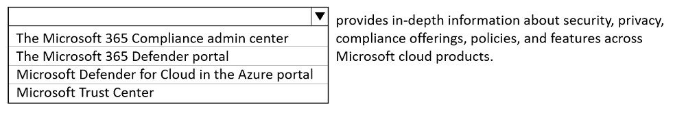
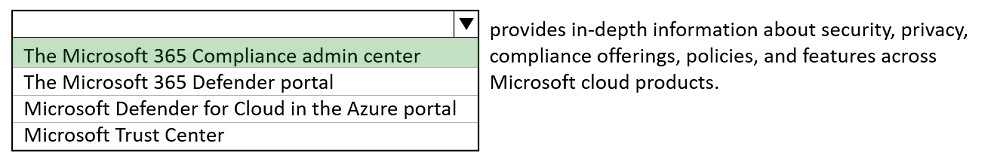
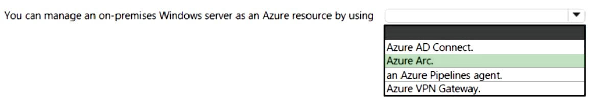
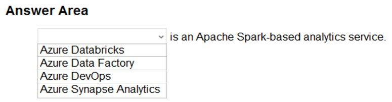
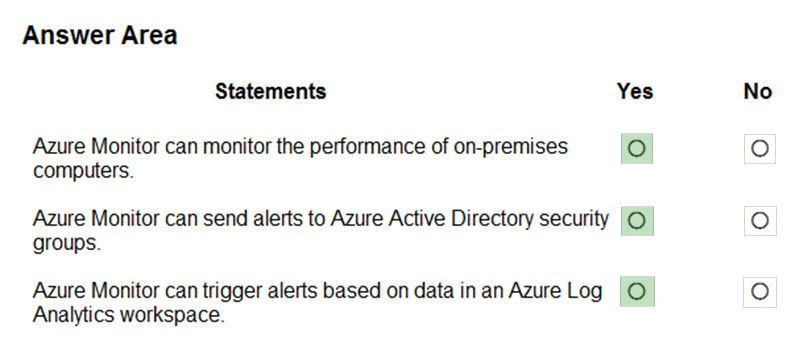

# Questions and Answers 201-210

[Back to AZ-900 Practice Exam](../az-900.md)

**Source:** [201-210.pdf](../files/201-210.pdf)

<strong>Question 201 - Tools that run the Azure CLI</strong>

A support engineer plans to perform several Azure management tasks by using the Azure CLI.

You install the CLI on a computer.

You need to tell the support engineer which tools to use to run the CLI.

Which two tools should you instruct the support engineer to use? Each correct answer presents a complete solution.

NOTE: Each correct selection is worth one point.

- A. Command Prompt
- B. Azure Resource Explorer
- C. Windows PowerShell
- D. Windows Defender Firewall
- E. Network and Sharing Center

<strong>Answer 201</strong>

A and C. Command Prompt and Windows PowerShell.

On Windows the Azure CLI setup adds `az` to Command Prompt and to PowerShell. Either shell can run the management commands.

**Why the others are wrong**

- B. Azure Resource Explorer browses resource templates and providers. It is not a shell that runs the Azure CLI.
- D. Windows Defender Firewall filters network traffic. It does not run `az` commands.
- E. Network and Sharing Center configures network adapters and sharing. It does not run the Azure CLI.

**Study further**

- [Install the Azure CLI on Windows](https://learn.microsoft.com/en-us/cli/azure/install-azure-cli-windows)

<strong>Question 202 - Cloud Shell on an Android tablet</strong>

This item shares its setup with other questions. Each one proposes a different solution. Decide whether this solution meets the goal.

You have an Azure environment. You need to create a new Azure virtual machine from a tablet that runs the Android operating system.

Solution: You use PowerShell in Azure Cloud Shell.

Does this meet the goal?

- A. Yes
- B. No

<strong>Answer 202</strong>

A. Yes.

Cloud Shell is a browser shell with Azure tools already signed in. An Android tablet's browser can open it, and PowerShell in Cloud Shell can create the virtual machine.

**Why the others are wrong**

- B. No would mean an Android tablet cannot use Cloud Shell. Cloud Shell only needs a browser.

**Study further**

- [What is Azure Cloud Shell?](https://learn.microsoft.com/en-us/azure/cloud-shell/overview)

<strong>Question 203 - Power Apps on an Android tablet</strong>

This item shares its setup with other questions. Each one proposes a different solution. Decide whether this solution meets the goal.

You have an Azure environment. You need to create a new Azure virtual machine from a tablet that runs the Android operating system.

Solution: You use the Power Apps portal.

Does this meet the goal?

- A. Yes
- B. No

<strong>Answer 203</strong>

B. No.

Power Apps builds business applications and portals with little or no code. It does not create an Azure virtual machine, so this solution misses the goal.

**Why the others are wrong**

- A. Yes would mean the Power Apps portal deploys Azure virtual machines. Power Apps creates apps and sites, not virtual machines.

**Study further**

- [What is Power Apps?](https://learn.microsoft.com/en-us/power-apps/powerapps-overview)
- [Overview of virtual machines in Azure](https://learn.microsoft.com/en-us/azure/virtual-machines/overview)

<strong>Question 204 - Azure portal on an Android tablet</strong>

This item shares its setup with other questions. Each one proposes a different solution. Decide whether this solution meets the goal.

You have an Azure environment. You need to create a new Azure virtual machine from a tablet that runs the Android operating system.

Solution: You use the Azure portal.

Does this meet the goal?

- A. Yes
- B. No

<strong>Answer 204</strong>

A. Yes.

The Azure portal is a website for creating and managing resources, including virtual machines. An Android tablet opens it in a browser.

**Why the others are wrong**

- B. No would mean the portal requires a Windows PC. The portal runs in a browser on the tablet.

**Study further**

- [What is the Azure portal?](https://learn.microsoft.com/en-us/azure/azure-portal/azure-portal-overview)

<strong>Question 205 - Security and compliance information</strong>

HOTSPOT

Select the answer that correctly completes the sentence.

_Figure: The open list is the Microsoft 365 Compliance admin center, the Microsoft 365 Defender portal, Microsoft Defender for Cloud in the Azure portal, and Microsoft Trust Center. The rest of the sentence is "provides in-depth information about security, privacy, compliance offerings, policies, and features across Microsoft cloud products." Nothing is selected._

<strong>Answer 205</strong>

The Microsoft 365 Compliance admin center.

_Figure: The Microsoft 365 Compliance admin center is highlighted. The Microsoft 365 Defender portal, Microsoft Defender for Cloud in the Azure portal, and Microsoft Trust Center are not._

The solution image selects the Microsoft 365 Compliance admin center. The source explanation says that compliance experience is now Microsoft Purview, and its home page summarizes compliance, available solutions, and active alerts across Microsoft cloud products.

**Why the others are wrong**

- The Microsoft 365 Defender portal is the threat-protection portal. The solution image does not select it for this compliance summary.
- Microsoft Defender for Cloud in the Azure portal secures Azure and hybrid workloads. It is not the highlighted compliance admin center.
- Microsoft Trust Center is the public site for Microsoft's own trust documents. It is not your organization's compliance admin center.

**Study further**

- [Microsoft Purview Compliance Manager](https://learn.microsoft.com/en-us/purview/compliance-manager)
- [Learn about the Microsoft Purview portal](https://learn.microsoft.com/en-us/purview/purview-portal)

<strong>Question 206 - Manage an on-premises server</strong>

HOTSPOT

Select the answer that correctly completes the sentence.

_Figure: "You can manage an on-premises Windows server as an Azure resource by using (blank)." The open list is Azure AD Connect, Azure Arc, an Azure Pipelines agent, and Azure VPN Gateway. Nothing is selected._

<strong>Answer 206</strong>

Azure Arc.

_Figure: Azure Arc is highlighted. Azure AD Connect, an Azure Pipelines agent, and Azure VPN Gateway are not._

Azure Arc projects the on-premises Windows server into Azure Resource Manager so you manage it with the same tools as an Azure resource.

**Why the others are wrong**

- Azure AD Connect syncs on-premises identities to Microsoft Entra ID. It does not project the Windows server into Azure Resource Manager.
- An Azure Pipelines agent runs a pipeline job. It does not make the server an Azure resource.
- Azure VPN Gateway encrypts traffic between an Azure virtual network and another network. It does not register the server as an Azure resource.

**Study further**

- [Azure Arc overview](https://learn.microsoft.com/en-us/azure/azure-arc/overview)
- [Azure Arc-enabled servers Overview](https://learn.microsoft.com/en-us/azure/azure-arc/servers/overview)

<strong>Question 207 - Ways to manage cloud services</strong>

HOTSPOT

For each of the following statements, select Yes if the statement is true. Otherwise, select No.

NOTE: Each correct selection is worth one point.

_Figure: Three statements, each with an empty Yes and an empty No. You can only manage cloud services from Windows devices. You can manage cloud services from the command line. You can manage cloud services by using a web browser._

<strong>Answer 207</strong>

No. Yes. Yes.

_Figure: Windows-only management is No. Command-line management is Yes. Web-browser management is Yes._

Azure Storage Explorer runs on Windows, macOS, and Linux, so management is not limited to Windows. Azure PowerShell covers the command line. The Azure portal covers the browser.

**Why the others are wrong**

- Yes for Windows-only management misses Storage Explorer on macOS and Linux, and it misses Cloud Shell in a browser.
- No for the command line misses Azure PowerShell, which the source cites for managing cloud services from the command line.
- No for a web browser misses the Azure portal.

**Study further**

- [Azure Storage Explorer – cloud storage management](https://azure.microsoft.com/en-us/products/storage/storage-explorer)
- [What is Azure PowerShell](https://learn.microsoft.com/en-us/powershell/azure/what-is-azure-powershell)

<strong>Question 208 - Spark analytics service</strong>

HOTSPOT

To complete the sentence, select the appropriate option in the answer area.

_Figure: The open list is Azure Databricks, Azure Data Factory, Azure DevOps, and Azure Synapse Analytics. The rest of the sentence is "is an Apache Spark-based analytics service." Nothing is selected._

<strong>Answer 208</strong>

Azure Databricks is an Apache Spark-based analytics service.

_Figure: Azure Databricks is highlighted. Azure Data Factory, Azure DevOps, and Azure Synapse Analytics are not._

Azure Databricks is the Apache Spark platform in this item. Its machine learning library supports classification, regression, clustering, and related algorithms.

**Why the others are wrong**

- Azure Data Factory builds data pipelines. It is not the Spark analytics service the solution image selects.
- Azure DevOps manages code, work items, and pipelines. It is not an Apache Spark analytics service.
- Azure Synapse Analytics is not the highlighted choice for this sentence.

**Study further**

- [What is Azure Databricks?](https://learn.microsoft.com/en-us/azure/databricks/introduction/)

<strong>Question 209 - Azure Monitor statements</strong>

HOTSPOT

For each of the following statements, select Yes if the statement is true. Otherwise, select No.

NOTE: Each correct selection is worth one point.

_Figure: Three statements, each with an empty Yes and an empty No. Azure Monitor can monitor the performance of on-premises computers. Azure Monitor can send alerts to Azure Active Directory security groups. Azure Monitor can trigger alerts based on data in an Azure Log Analytics workspace._

<strong>Answer 209</strong>

Yes. Yes. Yes.

_Figure: On-premises performance monitoring is Yes. Alerts to Azure Active Directory security groups is Yes. Alerts from a Log Analytics workspace is Yes._

The solution image marks all three Yes. Azure Monitor collects telemetry from cloud and on-premises computers, alerts can notify an Azure Active Directory security group, and a Log Analytics workspace is a target whose data can raise an alert.

**Why the others are wrong**

- No for on-premises computers misses Azure Monitor's support for on-premises telemetry, which the solution image marks Yes.
- No for Azure Active Directory security groups misses the solution image, which marks Yes for sending those alerts to a security group.
- No for a Log Analytics workspace misses alert rules scoped to that workspace. The solution image marks Yes.

**Study further**

- [Azure Monitor overview](https://learn.microsoft.com/en-us/azure/azure-monitor/fundamentals/overview)
- [Overview of Azure Monitor alerts](https://learn.microsoft.com/en-us/azure/azure-monitor/alerts/alerts-overview)

<strong>Question 210 - Version control for code</strong>

Which Azure service provides a set of version control tools to manage code?

- A. Azure Repos
- B. Azure DevTest Labs
- C. Azure Storage
- D. Azure Cosmos DB

<strong>Answer 210</strong>

A. Azure Repos.

Azure Repos is the version-control service for your code, with Git repos and related review tools.

**Why the others are wrong**

- B. Azure DevTest Labs creates labs from bases and templates so you can spin up test environments. It does not version your source code.
- C. Azure Storage stores blobs, files, queues, and tables. It is not a version-control system for code.
- D. Azure Cosmos DB is a globally distributed database. It does not manage source code history.

**Study further**

- [Collaborate on code - Azure Repos](https://learn.microsoft.com/en-us/azure/devops/repos/get-started/what-is-repos)
- [Azure DevTest Labs overview: Features, scenarios, and benefits](https://learn.microsoft.com/en-us/azure/devtest-labs/devtest-lab-overview)

