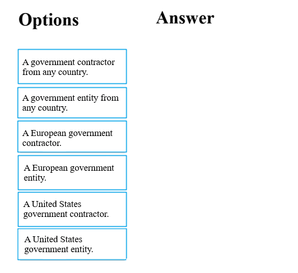
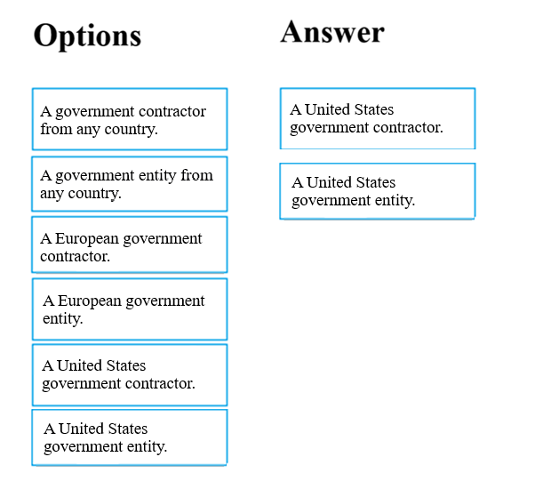

# Questions and Answers 21-30

[Back to AZ-900 Practice Exam](../az-900.md)

**Source:** [21-30.pdf](../files/21-30.pdf)

<strong>Question 21 - Two VMs, two zones</strong>

This item shares its setup with other questions. Each one proposes a different solution. Decide whether this solution meets the goal.

You are tasked with deploying a critical line-of-business application, which will be installed on a virtual machine, to Azure.

You are informed that the application deployment strategy should allow for a guaranteed availability of 99.99 percent. You need to make sure that the strategy requires as few virtual machines and availability zones as possible.

Solution: You include two virtual machines and two availability zones in your strategy.

Does the solution meet the goal?

- A. Yes
- B. No

<strong>Answer 21</strong>

A. Yes.

Two virtual machines in two availability zones is the smallest layout that qualifies for the 99.99 percent virtual machine SLA. Each machine sits in a separate zone.

**Why the others are wrong**

- B. No would mean this layout misses 99.99 percent or uses more than the minimum. Two machines and two zones is the minimum for that SLA.

**Study further**

- [Availability options for Azure virtual machines](https://learn.microsoft.com/en-us/azure/virtual-machines/availability)
- [What are availability zones?](https://learn.microsoft.com/en-us/azure/reliability/availability-zones-overview)

<strong>Question 22 - Microsoft Managed Desktop</strong>

This item shares its setup with other questions. Each one proposes a different solution. Decide whether this solution meets the goal.

Your company's developers intend to deploy a large number of custom virtual machines on a weekly basis. They will also be removing these virtual machines during the same week they were deployed. Sixty percent of the virtual machines have Windows Server 2016 installed, while the other forty percent have Ubuntu Linux installed.

You are required to make sure that the administrative effort needed for this process is reduced by employing a suitable Azure service.

Solution: You recommend the use of Microsoft Managed Desktop.

Does the solution meet the goal?

- A. Yes
- B. No

<strong>Answer 22</strong>

B. No.

Microsoft Managed Desktop is a service for managing physical Windows desktops. It does not deploy and delete custom Windows Server and Ubuntu virtual machines each week. Azure DevTest Labs is the service that does that with less administration.

**Why the others are wrong**

- A. Yes would mean Microsoft Managed Desktop creates and removes these mixed virtual machines. It does not manage Azure virtual machine lifecycles.

**Study further**

- [What is Azure DevTest Labs?](https://learn.microsoft.com/en-us/azure/devtest-labs/devtest-lab-overview)
- [Create a virtual machine in a lab](https://learn.microsoft.com/en-us/azure/devtest-labs/devtest-lab-add-vm)

<strong>Question 23 - Reserved VM instances</strong>

This item shares its setup with other questions. Each one proposes a different solution. Decide whether this solution meets the goal.

Your company's developers intend to deploy a large number of custom virtual machines on a weekly basis. They will also be removing these virtual machines during the same week they were deployed. Sixty percent of the virtual machines have Windows Server 2016 installed, while the other forty percent have Ubuntu Linux installed.

You are required to make sure that the administrative effort needed for this process is reduced by employing a suitable Azure service.

Solution: You recommend the use of Azure Reserved Virtual Machine Instances.

Does the solution meet the goal?

- A. Yes
- B. No

<strong>Answer 23</strong>

B. No.

Reserved Virtual Machine Instances cut the cost of machines you keep for one or three years. These machines are deleted the same week they are created, and a reservation does not reduce the work of deploying custom Windows and Linux images. Azure DevTest Labs does.

**Why the others are wrong**

- A. Yes would mean reservations lower the administrative effort of weekly create-and-delete. A reservation is a billing commitment, not a deployment service.

**Study further**

- [What are Azure Reservations?](https://learn.microsoft.com/en-us/azure/cost-management-billing/reservations/save-compute-costs-reservations)
- [What is Azure DevTest Labs?](https://learn.microsoft.com/en-us/azure/devtest-labs/devtest-lab-overview)

<strong>Question 24 - Azure DevTest Labs</strong>

This item shares its setup with other questions. Each one proposes a different solution. Decide whether this solution meets the goal.

Your company's developers intend to deploy a large number of custom virtual machines on a weekly basis. They will also be removing these virtual machines during the same week they were deployed. Sixty percent of the virtual machines have Windows Server 2016 installed, while the other forty percent have Ubuntu Linux installed.

You are required to make sure that the administrative effort needed for this process is reduced by employing a suitable Azure service.

Solution: You recommend the use of Azure DevTest Labs.

Does the solution meet the goal?

- A. Yes
- B. No

<strong>Answer 24</strong>

A. Yes.

Azure DevTest Labs gives developers reusable custom images, formulas, and policies so they can create and delete Windows and Linux lab machines without repeating the full setup each week.

**Why the others are wrong**

- B. No would mean DevTest Labs does not reduce that administrative effort. Formulas and custom images are how a lab repeats both the Windows Server and Ubuntu deployments.

**Study further**

- [What is Azure DevTest Labs?](https://learn.microsoft.com/en-us/azure/devtest-labs/devtest-lab-overview)
- [Create a virtual machine in a lab](https://learn.microsoft.com/en-us/azure/devtest-labs/devtest-lab-add-vm)

<strong>Question 25 - Remote access to VNet1</strong>

Your company has virtual machines (VMs) hosted in Microsoft Azure. The VMs are located in a single Azure virtual network named VNet1.

The company has users that work remotely. The remote workers require access to the VMs on VNet1.

You need to provide access for the remote workers.

What should you do?

- A. Configure a Site-to-Site (S2S) VPN.
- B. Configure a VNet-to-VNet VPN.
- C. Configure a Point-to-Site (P2S) VPN.
- D. Configure DirectAccess on a Windows Server 2012 server VM.
- E. Configure a Multi-Site VPN.

<strong>Answer 25</strong>

C. Configure a Point-to-Site (P2S) VPN.

Point-to-Site connects individual remote computers to an Azure virtual network. The workers are remote users, not another office network.

**Why the others are wrong**

- A. Site-to-Site connects a whole on-premises network to Azure. The requirement is remote workers, not a site.
- B. VNet-to-VNet connects two Azure virtual networks. The users are not in a second virtual network.
- D. DirectAccess is a Windows Server remote-access role. It is not the Azure service for reaching VNet1, and the question does not ask you to deploy a Windows Server remote-access server.
- E. Multi-site VPN connects more than one on-premises site. There is one virtual network and a set of remote users.

**Study further**

- [About Point-to-Site VPN](https://learn.microsoft.com/en-us/azure/vpn-gateway/point-to-site-about)
- [About Site-to-Site VPN](https://learn.microsoft.com/en-us/azure/vpn-gateway/vpn-gateway-about-vpngateways)

<strong>Question 26 - Information Protection for credentials</strong>

This item shares its setup with other questions. Each one proposes a different solution. Decide whether this solution meets the goal.

You have been informed by your superiors of the company's intentions to automate server deployment to Azure. There is, however, some concern that administrative credentials could be uncovered during this process.

You are required to make sure that during the deployment, the administrative credentials are encrypted using a suitable Azure solution.

Solution: You recommend the use of Azure Information Protection.

Does the solution meet the goal?

- A. Yes
- B. No

<strong>Answer 26</strong>

B. No.

Azure Information Protection (now Microsoft Purview Information Protection) classifies and labels documents and email. It does not store deployment secrets. Encrypt the administrative credentials in Azure Key Vault and reference that vault from the deployment.

**Why the others are wrong**

- A. Yes would mean Information Protection encrypts credentials while servers are deployed. It protects files with sensitivity labels, not automation secrets.

**Study further**

- [About Azure Key Vault](https://learn.microsoft.com/en-us/azure/key-vault/general/overview)
- [Learn about sensitivity labels](https://learn.microsoft.com/en-us/purview/sensitivity-labels)

<strong>Question 27 - MFA for deployment credentials</strong>

This item shares its setup with other questions. Each one proposes a different solution. Decide whether this solution meets the goal.

You have been informed by your superiors of the company's intentions to automate server deployment to Azure. There is, however, some concern that administrative credentials could be uncovered during this process.

You are required to make sure that during the deployment, the administrative credentials are encrypted using a suitable Azure solution.

Solution: You recommend the use of Azure Multi-Factor Authentication (MFA).

Does the solution meet the goal?

- A. Yes
- B. No

<strong>Answer 27</strong>

B. No.

Multi-factor authentication asks a person for a second sign-in check. It does not encrypt credentials stored for an automated deployment. Azure Key Vault is the service that holds those secrets encrypted.

**Why the others are wrong**

- A. Yes would mean MFA encrypts the credentials used during deployment. MFA challenges a sign-in. It does not encrypt a secret the template needs.

**Study further**

- [About Azure Key Vault](https://learn.microsoft.com/en-us/azure/key-vault/general/overview)
- [How Microsoft Entra multifactor authentication works](https://learn.microsoft.com/en-us/entra/identity/authentication/concept-mfa-howitworks)

<strong>Question 28 - Who can use Azure Government</strong>

DRAG DROP

The company would like to develop a cloud solution by making use of Azure Government. Azure Government can only be used by certain types of clients to develop cloud solutions.

Which of the following are the types of customers that can make use of Azure Government in this situation? Answer by dragging the correct option from the list to the answer area.

_Figure: Options are a government contractor from any country, a government entity from any country, a European government contractor, a European government entity, a United States government contractor, and a United States government entity. The answer area is empty._

<strong>Answer 28</strong>

A United States government contractor, and a United States government entity.

_Figure: A United States government contractor and a United States government entity are in the answer area. The other four options stay in the list._

Azure Government is the United States government cloud. US federal, state, local, and tribal entities can use it, and so can the partners and contractors who work with them. Customers outside the United States use other Azure clouds.

**Why the others are wrong**

- A government contractor from any country is left out. Azure Government is not open to contractors worldwide.
- A government entity from any country is left out. A non-US government entity is not an Azure Government customer.
- A European government contractor is left out. European government work uses other sovereign clouds, not Azure Government.
- A European government entity is left out. Azure Government is for United States government customers.

**Study further**

- [What is Azure Government?](https://learn.microsoft.com/en-us/azure/azure-government/documentation-government-welcome)
- [Azure Government isolation guidelines](https://learn.microsoft.com/en-us/azure/azure-government/documentation-government-plan-compliance)

<strong>Question 29 - Identity Protection for unknown IPs</strong>

This item shares its setup with other questions. Each one proposes a different solution. Decide whether this solution meets the goal.

Your company has an Azure Active Directory (Azure AD) environment. Users occasionally connect to Azure AD via the Internet.

You have been tasked with making sure that users who connect to Azure AD via the internet from an unidentified IP address are automatically encouraged to change passwords.

Solution: You configure the use of Azure AD Identity Protection.

Does the solution meet the goal?

- A. Yes
- B. No

<strong>Answer 29</strong>

A. Yes.

Microsoft Entra ID Protection (formerly Azure AD Identity Protection) can treat a sign-in from an unfamiliar IP address as user risk and require a password change. That is the automatic prompt the requirement describes.

**Why the others are wrong**

- B. No would mean Identity Protection cannot require a password change for a risky sign-in. A user-risk policy can require a secure password change.

**Study further**

- [What is Microsoft Entra ID Protection?](https://learn.microsoft.com/en-us/entra/id-protection/overview-identity-protection)
- [User risk policy](https://learn.microsoft.com/en-us/entra/id-protection/concept-identity-protection-policies#user-risk-policy)

<strong>Question 30 - Privileged Identity Management</strong>

This item shares its setup with other questions. Each one proposes a different solution. Decide whether this solution meets the goal.

Your company has an Azure Active Directory (Azure AD) environment. Users occasionally connect to Azure AD via the Internet.

You have been tasked with making sure that users who connect to Azure AD via the internet from an unidentified IP address are automatically encouraged to change passwords.

Solution: You configure the use of Azure AD Privileged Identity Management.

Does the solution meet the goal?

- A. Yes
- B. No

<strong>Answer 30</strong>

B. No.

Privileged Identity Management controls just-in-time activation of privileged roles. It does not detect an unfamiliar IP address or prompt a password change. Microsoft Entra ID Protection does.

**Why the others are wrong**

- A. Yes would mean PIM responds to unidentified IP addresses with a password change. PIM manages role activation, not sign-in risk.

**Study further**

- [What is Privileged Identity Management?](https://learn.microsoft.com/en-us/entra/id-governance/privileged-identity-management/pim-configure)
- [What is Microsoft Entra ID Protection?](https://learn.microsoft.com/en-us/entra/id-protection/overview-identity-protection)

