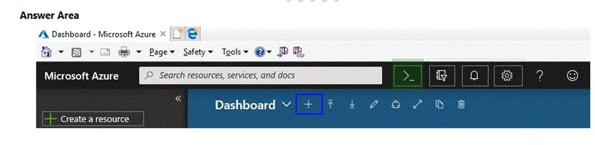
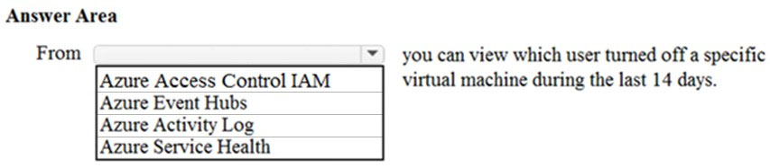
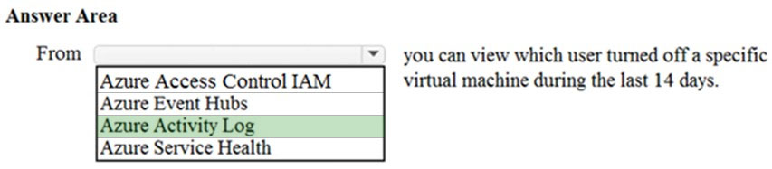

# Questions and Answers 211-220

[Back to AZ-900 Practice Exam](../az-900.md)

**Source:** [211-220.pdf](../files/211-220.pdf)

<strong>Question 211 - Cloud Shell portal icon</strong>

HOTSPOT

You need to manage Azure by using Azure Cloud Shell.

Which Azure portal icon should you select? To answer, select the appropriate icon in the answer area.

_Figure: The Azure portal header in a browser. A blue square sits on the plus next to Dashboard. The Cloud Shell icon in the top bar is not highlighted._

<strong>Answer 211</strong>

The Cloud Shell icon in the portal header.

_Figure: The solution image highlights the Cloud Shell prompt icon in the top bar. The blue square on the dashboard plus is unchanged from the question image._

That icon opens Cloud Shell in the portal. Cloud Shell is the browser command line, in Bash or PowerShell, for Azure management.

**Why the others are wrong**

- The plus next to Dashboard customizes the dashboard. The blue square is already on the unanswered image. The added highlight is the Cloud Shell icon.
- Create a resource starts a deployment. It does not open Cloud Shell.
- The bell is notifications, the gear is settings, and the question mark is help. None of them opens Cloud Shell.

**Study further**

- [What is Azure Cloud Shell?](https://learn.microsoft.com/en-us/azure/cloud-shell/overview)

<strong>Question 212 - Service failure notifications</strong>

You have a virtual machine named VM1 that runs Windows Server 2016. VM1 is in the East US Azure region.

Which Azure service should you use from the Azure portal to view service failure notifications that can affect the availability of VM1?

- A. Azure Service Fabric
- B. Azure Monitor
- C. Azure virtual machines
- D. Azure Advisor

<strong>Answer 212</strong>

B. Azure Monitor.

The source marks Azure Monitor. Its explanation is about service issues and host maintenance that can affect VM1, which is the availability signal this item wants you to review.

**Why the others are wrong**

- A. Azure Service Fabric hosts microservices. It does not show service-failure notifications for this Windows virtual machine.
- C. Azure virtual machines is the resource VM1 already is. The source marks Azure Monitor as the service that surfaces the failure and maintenance notices.
- D. Azure Advisor gives optimization recommendations. It is not the service-failure notification view for VM1.

**Study further**

- [Azure Monitor overview](https://learn.microsoft.com/en-us/azure/azure-monitor/fundamentals/overview)
- [Maintenance and updates](https://learn.microsoft.com/en-us/azure/virtual-machines/maintenance-and-updates)

<strong>Question 213 - Traffic Manager for HTTP access</strong>

This item shares its setup with other questions. Each one proposes a different solution. Decide whether this solution meets the goal.

Your Azure environment contains multiple Azure virtual machines.

You need to ensure that a virtual machine named VM1 is accessible from the Internet over HTTP.

Solution: You modify an Azure Traffic Manager profile.

Does this meet the goal?

- A. Yes
- B. No

<strong>Answer 213</strong>

B. No.

Traffic Manager is DNS load balancing across endpoints. It does not open HTTP to VM1. Allow inbound TCP port 80 with a network security group rule or an Azure Firewall rule.

**Why the others are wrong**

- A. Yes would mean a Traffic Manager profile makes VM1 reachable on HTTP. Traffic Manager chooses an endpoint by DNS. It does not allow the HTTP connection.

**Study further**

- [Azure Traffic Manager overview](https://learn.microsoft.com/en-us/azure/traffic-manager/traffic-manager-overview)
- [Azure network security groups overview](https://learn.microsoft.com/en-us/azure/virtual-network/network-security-groups-overview)

<strong>Question 214 - Limit connections to databases</strong>

Your company plans to deploy several web servers and several database servers to Azure.

You need to recommend an Azure solution to limit the types of connections from the web servers to the database servers.

What should you include in the recommendation?

- A. network security groups (NSGs)
- B. Azure Service Bus
- C. a local network gateway
- D. a route filter

<strong>Answer 214</strong>

A. Network security groups (NSGs).

An NSG allows or denies traffic by port, protocol, and address. Attach rules so the web servers can use only the database ports you choose.

**Why the others are wrong**

- B. Azure Service Bus is a message broker. It does not filter network connections from the web tier to the database tier.
- C. A local network gateway describes the on-premises address space for a VPN connection. It does not limit web-to-database traffic inside Azure.
- D. A route filter controls which BGP routes an ExpressRoute circuit advertises. It does not limit connection types between these servers.

**Study further**

- [Azure network security groups overview](https://learn.microsoft.com/en-us/azure/virtual-network/network-security-groups-overview)

<strong>Question 215 - Who turned off a virtual machine</strong>

HOTSPOT

To complete the sentence, select the appropriate option in the answer area.

_Figure: "From (blank) you can view which user turned off a specific virtual machine during the last 14 days." The open list is Azure Access Control IAM, Azure Event Hubs, Azure Activity Log, and Azure Service Health. Nothing is selected._

<strong>Answer 215</strong>

Azure Activity Log.

_Figure: Azure Activity Log is highlighted. Azure Access Control IAM, Azure Event Hubs, and Azure Service Health are not._

The activity log records control-plane operations, including who shut the virtual machine down. It keeps that history for 90 days, which covers the last 14 days in this item.

**Why the others are wrong**

- Azure Access Control IAM assigns roles. It does not record who turned the virtual machine off.
- Azure Event Hubs ingests event streams. It is not the 14-day record of who shut the machine down.
- Azure Service Health reports Azure platform issues. It does not name the user who turned this virtual machine off.

**Study further**

- [Activity Log in Azure Monitor](https://learn.microsoft.com/en-us/azure/azure-monitor/fundamentals/activity-log)

<strong>Question 216 - Filter traffic across subscriptions</strong>

Which service provides network traffic filtering across multiple Azure subscriptions and virtual networks?

- A. Azure Firewall
- B. an application security group
- C. Azure DDoS protection
- D. a network security group (NSG)

<strong>Answer 216</strong>

A. Azure Firewall.

One Azure Firewall policy can filter application and network traffic for many virtual networks in many subscriptions.

**Why the others are wrong**

- B. An application security group groups network interfaces so NSG rules can target them. It does not filter traffic across subscriptions by itself.
- C. Azure DDoS protection absorbs large denial-of-service attacks. It does not apply your allow and deny rules across virtual networks.
- D. A network security group filters a subnet or a network interface. It is not the single policy the source describes across multiple subscriptions and virtual networks.

**Study further**

- [What is Azure Firewall?](https://learn.microsoft.com/en-us/azure/firewall/overview)

<strong>Question 217 - Store certificates</strong>

Which Azure service should you use to store certificates?

- A. Azure Security Center
- B. an Azure Storage account
- C. Azure Key Vault
- D. Azure Information Protection

<strong>Answer 217</strong>

C. Azure Key Vault.

Key Vault is the store for certificates, keys, and secrets, with access controlled on the vault.

**Why the others are wrong**

- A. Azure Security Center, now Microsoft Defender for Cloud, assesses security posture. It is not the certificate store.
- B. An Azure Storage account can hold files. It is not the service this item uses to store and control certificates.
- D. Azure Information Protection classifies and labels documents. It does not store certificates for your applications.

**Study further**

- [Azure Key Vault Overview](https://learn.microsoft.com/en-us/azure/key-vault/general/overview)

<strong>Question 218 - SIEM solution</strong>

Which Azure service can you use as a security information and event management (SIEM) solution?

- A. Azure Analysis Services
- B. Azure Sentinel
- C. Azure Information Protection
- D. Azure Cognitive Services

<strong>Answer 218</strong>

B. Azure Sentinel.

Azure Sentinel, now Microsoft Sentinel, is the cloud SIEM that collects security events, detects threats, and investigates them.

**Why the others are wrong**

- A. Azure Analysis Services is an analytics engine for business models. It is not a SIEM.
- C. Azure Information Protection classifies and protects documents. It does not collect and correlate security events as a SIEM.
- D. Azure Cognitive Services, now Azure AI services, is a set of AI APIs. It is not a SIEM.

**Study further**

- [What is Microsoft Sentinel SIEM?](https://learn.microsoft.com/en-us/azure/sentinel/overview)

<strong>Question 219 - Sentinel statements</strong>

HOTSPOT

For each of the following statements, select Yes if the statement is true. Otherwise, select No.

NOTE: Each correct selection is worth one point.

_Figure: Three statements, each with an empty Yes and an empty No. Azure Sentinel stores collected events in an Azure Storage account. Azure Sentinel can remediate incidents automatically. Azure Sentinel can collect Windows Defender Firewall logs from Azure virtual machines._

<strong>Answer 219</strong>

Yes. Yes. Yes.

_Figure: Storing collected events in an Azure Storage account is Yes. Automatic remediation is Yes. Collecting Windows Defender Firewall logs from Azure virtual machines is Yes._

The solution image marks all three Yes. Collected events can be kept in an Azure Storage account, playbooks can remediate incidents, and Sentinel can collect Windows Defender Firewall logs from Azure virtual machines.

**Why the others are wrong**

- No for a storage account is the opposite of the solution image, which marks Yes for storing collected events in an Azure Storage account.
- No for automatic remediation misses playbooks, which the solution image treats as able to remediate incidents.
- No for Windows Defender Firewall logs misses the data connector the solution image marks Yes.

**Study further**

- [What is Microsoft Sentinel SIEM?](https://learn.microsoft.com/en-us/azure/sentinel/overview)

<strong>Question 220 - Match security services</strong>

DRAG DROP

Match the Azure service to the correct descriptions.

Instructions: To answer, drag the appropriate service from the column on the left to its description on the right. Each service may be used once, more than once, or not at all.

NOTE: Each correct match is worth one point.

_Figure: Options are Azure Active Directory (Azure AD), Azure Key Vault, Azure Lighthouse, Azure Security Center, and Azure Sentinel. The descriptions, with empty boxes, are: analyze security log files from Azure virtual machines; display the secure score for an Azure subscription; store passwords for use by Azure Function applications._

<strong>Answer 220</strong>

Azure Sentinel. Azure Security Center. Azure Key Vault.

The PDF states those three matches and does not include a separate filled diagram. Analyze security log files from Azure virtual machines is Azure Sentinel. Display the secure score for an Azure subscription is Azure Security Center. Store passwords for use by Azure Function applications is Azure Key Vault.

Sentinel analyzes the security logs. Security Center, now Microsoft Defender for Cloud, shows the secure score. Key Vault holds the passwords a function app retrieves at runtime.

**Why the others are wrong**

- Azure Active Directory (Azure AD) is left out. It signs employees in and controls access. It does not analyze VM security logs, show the subscription secure score, or store function-app passwords.
- Azure Lighthouse is left out. It is for managing resources across tenants. It does not match any of the three descriptions.

**Study further**

- [What is Microsoft Sentinel SIEM?](https://learn.microsoft.com/en-us/azure/sentinel/overview)
- [Cloud Secure Score in Microsoft Defender for Cloud](https://learn.microsoft.com/en-us/azure/defender-for-cloud/secure-score-security-controls)
- [Azure Key Vault Overview](https://learn.microsoft.com/en-us/azure/key-vault/general/overview)

