# Questions and Answers 221-230

[Back to AZ-900 Practice Exam](../az-900.md)

**Source:** [221-230.pdf](../files/221-230.pdf)

<strong>Question 221 - Encrypt traffic to the Internet</strong>

HOTSPOT

For each of the following statements, select Yes if the statement is true. Otherwise, select No.

NOTE: Each correct selection is worth one point.

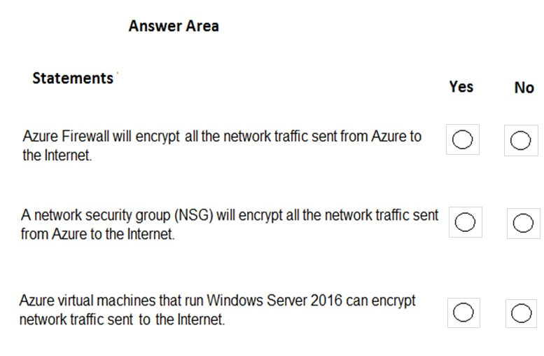

_Figure: Three statements, each with an empty Yes and an empty No. Azure Firewall encrypts all network traffic sent from Azure to the Internet. A network security group encrypts all network traffic sent from Azure to the Internet. Azure virtual machines that run Windows Server 2016 can encrypt network traffic sent to the Internet._

<strong>Answer 221</strong>

No. No. No.

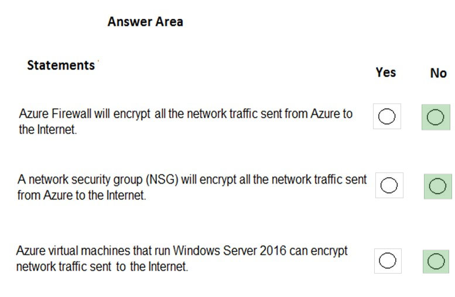

_Figure: Azure Firewall encrypts all Internet traffic is No. A network security group encrypts all Internet traffic is No. Windows Server 2016 virtual machines encrypt traffic sent to the Internet is No._

Azure Firewall and a network security group allow or block traffic by address, port, and protocol. They do not encrypt it. A Windows Server 2016 virtual machine does not encrypt traffic to an Internet host that is not set up to require that encryption.

**Why the others are wrong**

- Yes for Azure Firewall misses what a firewall does in this item. It filters traffic. It does not encrypt every flow to the Internet.
- Yes for a network security group misses the same point. An NSG allows or denies. It does not encrypt the traffic.
- Yes for Windows Server 2016 misses the source explanation. The guest can use a VPN, IPsec, or TLS only when the Internet host is configured for it. The virtual machine does not encrypt traffic to a host that does not require encryption.

**Study further**

- [Azure encryption overview](https://learn.microsoft.com/en-us/azure/security/fundamentals/encryption-overview)
- [What is Azure Firewall?](https://learn.microsoft.com/en-us/azure/firewall/overview)

<strong>Question 222 - Security Center statements</strong>

HOTSPOT

For each of the following statements, select Yes if the statement is true. Otherwise, select No.

NOTE: Each correct selection is worth one point.

_Figure: Three statements, each with an empty Yes and an empty No. Azure Security Center can monitor Azure resources and on-premises resources. All Azure Security Center features are free. From Azure Security Center, you can download a Regulatory Compliance report._

<strong>Answer 222</strong>

Yes. No. Yes.

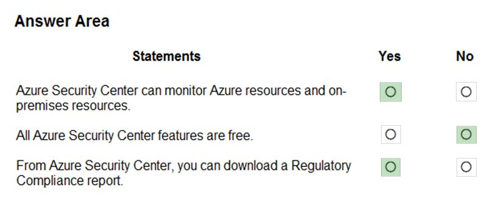

_Figure: Monitoring Azure and on-premises resources is Yes. All features are free is No. Downloading a Regulatory Compliance report is Yes._

Security Center, now Microsoft Defender for Cloud, monitors Azure and on-premises resources. The source says only continuous assessment with security recommendations, and the secure score, are free. The compliance view can produce a regulatory compliance report.

**Why the others are wrong**

- No for Azure and on-premises monitoring misses Defender for Cloud coverage of both, which the solution image marks Yes.
- Yes for "all features are free" misses paid advanced features. The source limits the free set to continuous assessment, recommendations, and the secure score.
- No for a Regulatory Compliance report misses the compliance report the solution image marks Yes.

**Study further**

- [Microsoft Defender for Cloud Overview](https://learn.microsoft.com/en-us/azure/defender-for-cloud/defender-for-cloud-introduction)
- [Improve regulatory compliance in Microsoft Defender for Cloud](https://learn.microsoft.com/en-us/azure/defender-for-cloud/regulatory-compliance-dashboard)

<strong>Question 223 - Defense-in-depth layers</strong>

DRAG DROP

You need to complete the defense-in-depth strategy used in a datacenter.

What should you do? To answer, drag the appropriate layers to the correct positions in the model. Each layer may be used once, more than once, or not at all.

You may need to drag the split bar between panes or scroll to view content.

NOTE: Each correct selection is worth one point.

_Figure: Options are Perimeter, Application, and Physical Security. The diagram is a stack of layers. From the outside in, the labels already shown are Identity & Access, Network, Compute, and Data. Three dashed boxes labeled Layer are still empty: the outermost band, the band under Identity & Access, and the band just above Data._

<strong>Answer 223</strong>

Physical Security on the outside, Perimeter under Identity & Access, and Application just above Data.

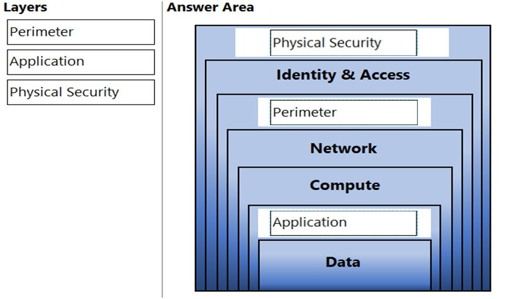

_Figure: The outermost layer is Physical Security. Under Identity & Access is Perimeter. Just above Data is Application. Identity & Access, Network, Compute, and Data were already labeled._

From the outside in, the completed stack is Physical Security, Identity & Access, Perimeter, Network, Compute, Application, and Data. The source lists the same order from the data outward: Data, Application, Compute, Networking, Perimeter, Identity and access, Physical security.

**Why the others are wrong**

- Perimeter does not belong on the outermost band. That band is physical security of the building and the hardware. Perimeter is the DDoS and firewall layer inside identity and access.
- Application does not belong on the outermost band or on the perimeter band. Application sits next to the data it protects.
- Physical Security does not belong next to Data or on the perimeter band. The source calls it the first line of defense, which is the outer layer of this diagram.

**Study further**

- [Describe defense in depth](https://learn.microsoft.com/en-us/training/modules/describe-security-concepts-methodologies/3-describe-defense-depth)

<strong>Question 224 - Disk encryption prerequisite</strong>

You have an Azure virtual machine named VM1.

You plan to encrypt VM1 by using Azure Disk Encryption.

Which Azure resource must you create first?

- A. an Azure Storage account
- B. an Azure Key Vault
- C. an Azure Information Protection policy
- D. an Encryption key

<strong>Answer 224</strong>

B. an Azure Key Vault.

Azure Disk Encryption stores and controls the disk encryption keys and secrets in a key vault. Create the vault before you encrypt VM1.

**Why the others are wrong**

- A. An Azure Storage account stores data. It is not the resource Azure Disk Encryption uses to hold the keys.
- C. An Azure Information Protection policy labels documents. It is not required before disk encryption.
- D. An encryption key is what the vault will hold. The resource you create first is the key vault that stores that key.

**Study further**

- [Enable Azure Disk Encryption for Windows VMs](https://learn.microsoft.com/en-us/azure/virtual-machines/windows/disk-encryption-overview)
- [Azure Key Vault Overview](https://learn.microsoft.com/en-us/azure/key-vault/general/overview)

<strong>Question 225 - NSG inbound rule sources</strong>

Which resources can be used as a source for a network security group inbound security rule?

- A. Service Tags only
- B. IP Addresses, Service tags and Application security groups
- C. Application security groups only
- D. IP Addresses only

<strong>Answer 225</strong>

B. IP Addresses, Service tags and Application security groups.

An inbound rule's source can be Any, an IP address, a CIDR block, a service tag, or an application security group.

**Why the others are wrong**

- A. Service tags only leaves out IP addresses and application security groups, which a rule can also use as the source.
- C. Application security groups only leaves out IP addresses and service tags.
- D. IP addresses only leaves out service tags and application security groups.

**Study further**

- [Azure network security groups overview](https://learn.microsoft.com/en-us/azure/virtual-network/network-security-groups-overview)
- [Azure Application Security Groups Overview](https://learn.microsoft.com/en-us/azure/virtual-network/application-security-groups)

<strong>Question 226 - What Sentinel playbooks do</strong>

HOTSPOT

To complete the sentence, select the appropriate option in the answer area.

_Figure: "Azure Sentinel uses playbooks to (blank)." The open list is automatically respond to threats, collect data from Azure services, specify how long data is retained, and store passwords and certificates. Nothing is selected._

<strong>Answer 226</strong>

Automatically respond to threats.

_Figure: Automatically respond to threats is highlighted. Collect data from Azure services, specify how long data is retained, and store passwords and certificates are not._

A Sentinel playbook is the automated response that runs when an incident or alert matches, so the response does not wait for someone to start it.

**Why the others are wrong**

- Collect data from Azure services is what data connectors do. A playbook responds after the data is already in Sentinel.
- Specify how long data is retained is a workspace retention setting. A playbook does not set that period.
- Store passwords and certificates is Azure Key Vault. A playbook does not replace the vault.

**Study further**

- [Automate Threat Response with Playbooks in Microsoft Sentinel](https://learn.microsoft.com/en-us/azure/sentinel/automation/automate-responses-with-playbooks)

<strong>Question 227 - Inbound access through Firewall</strong>

HOTSPOT

To complete the sentence, select the appropriate option in the answer area.

_Figure: The open list is Application rules, Network Address Translation (NAT) rules, Network rules, and Service tags. The rest of the sentence is "in Azure Firewall enables users on the internet to access a server on a virtual network." Nothing is selected._

<strong>Answer 227</strong>

Network Address Translation (NAT) rules.

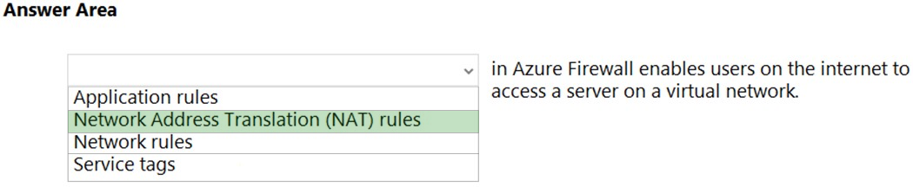

_Figure: Network Address Translation (NAT) rules is highlighted. Application rules, Network rules, and Service tags are not._

A DNAT rule on Azure Firewall publishes an internal server to a public address so users on the internet can reach it.

**Why the others are wrong**

- Application rules filter outbound application traffic by FQDN. They do not publish an internal server to the internet.
- Network rules filter traffic by IP address, port, and protocol. They do not provide the inbound translation this sentence describes.
- Service tags are labels for groups of Azure addresses used in rules. A service tag is not the inbound publishing rule.

**Study further**

- [Filter inbound Internet traffic with Azure Firewall DNAT using the portal](https://learn.microsoft.com/en-us/azure/firewall/tutorial-firewall-dnat)
- [What is Azure Firewall?](https://learn.microsoft.com/en-us/azure/firewall/overview)

<strong>Question 228 - More instances means more scalable</strong>

HOTSPOT

Select the answer that correctly completes the sentence.

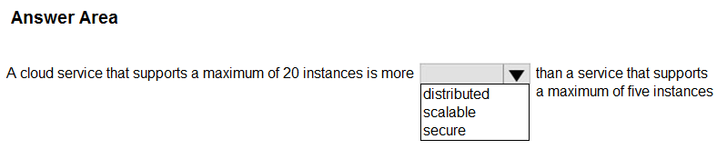

_Figure: "A cloud service that supports a maximum of 20 instances is more (blank) than a service that supports a maximum of five instances." The open list is distributed, scalable, and secure. Nothing is selected._

<strong>Answer 228</strong>

Scalable.

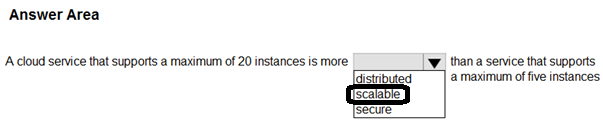

_Figure: The solution image circles scalable. Distributed and secure are not circled._

A higher instance limit is a larger scale-out ceiling. Twenty instances can take more load than five.

**Why the others are wrong**

- Distributed describes spreading work across places. A higher maximum instance count does not by itself make the service distributed.
- Secure describes protection of the service. Supporting 20 instances instead of five does not make it more secure.

**Study further**

- [Describe the benefits of using cloud services](https://learn.microsoft.com/en-us/training/modules/describe-benefits-use-cloud-services/)

<strong>Question 229 - Sync on-premises storage</strong>

HOTSPOT

Select the answer that correctly completes the sentence.

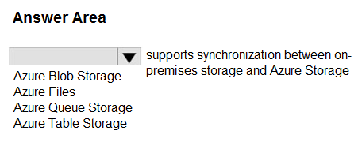

_Figure: The open list is Azure Blob Storage, Azure Files, Azure Queue Storage, and Azure Table Storage. The rest of the sentence is "supports synchronization between on-premises storage and Azure Storage." Nothing is selected._

<strong>Answer 229</strong>

Azure Files.

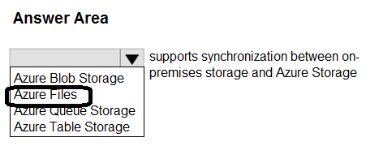

_Figure: The solution image circles Azure Files. Azure Blob Storage, Azure Queue Storage, and Azure Table Storage are not circled._

Azure File Sync keeps an on-premises Windows file server in sync with an Azure file share.

**Why the others are wrong**

- Azure Blob Storage stores objects. It does not provide the file-share sync with an on-premises file server that this sentence describes.
- Azure Queue Storage stores messages for decoupled processing. It does not sync on-premises storage.
- Azure Table Storage stores structured NoSQL data. It does not sync a file server.

**Study further**

- [What is Azure Files?](https://learn.microsoft.com/en-us/azure/storage/files/storage-files-introduction)
- [What is Azure File Sync?](https://learn.microsoft.com/en-us/azure/storage/file-sync/file-sync-introduction)

<strong>Question 230 - Assign to every resource</strong>

HOTSPOT

Select the answer that correctly completes the sentence.

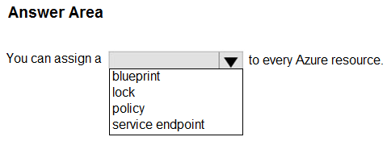

_Figure: "You can assign a (blank) to every Azure resource." The open list is blueprint, lock, policy, and service endpoint. Nothing is selected._

<strong>Answer 230</strong>

Lock.

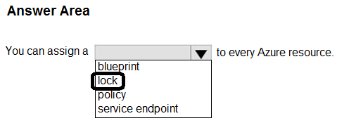

_Figure: The solution image circles lock. Blueprint, policy, and service endpoint are not circled._

A lock can be set on an individual resource, as well as on a resource group or a subscription, to block delete or change.

**Why the others are wrong**

- A blueprint is assigned to a subscription. It is not a setting you place on every individual resource.
- A policy is assigned to a scope such as a management group, subscription, or resource group. The solution image does not select policy for "every Azure resource."
- A service endpoint is configured on a subnet so traffic to an Azure service stays on the Azure network. It is not assigned to every resource.

**Study further**

- [Lock your Azure resources to protect your infrastructure](https://learn.microsoft.com/en-us/azure/azure-resource-manager/management/lock-resources)
- [Overview of Azure Policy](https://learn.microsoft.com/en-us/azure/governance/policy/overview)

