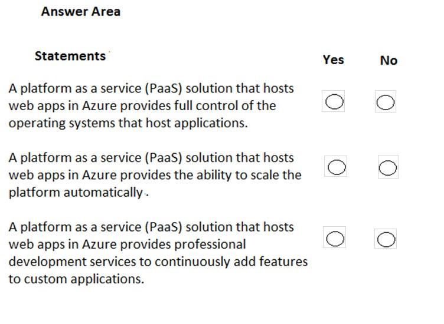
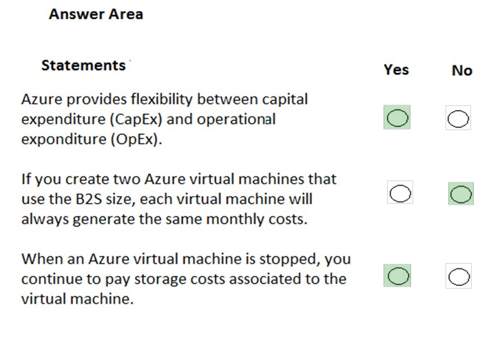
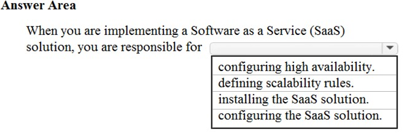
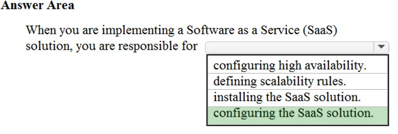
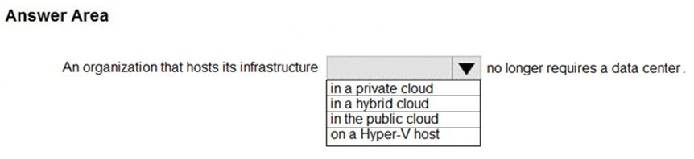
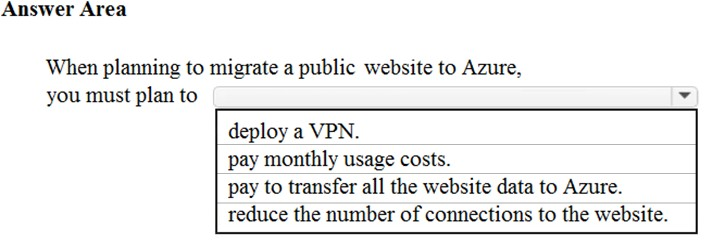

# Questions and Answers 31-40

[Back to AZ-900 Practice Exam](../az-900.md)

**Source:** [31-40.pdf](../files/31-40.pdf)

<strong>Question 31 - NSGs between web and database</strong>

This item shares its setup with other questions. Each one proposes a different solution. Decide whether this solution meets the goal.

You are planning a strategy to deploy numerous web servers and database servers to Azure.

This strategy should allow for connection types between the web servers and database servers to be controlled.

Solution: You include network security groups (NSGs) in your strategy.

Does the solution meet the goal?

- A. Yes
- B. No

<strong>Answer 31</strong>

A. Yes.

A network security group filters inbound and outbound traffic by port, protocol, and source or destination. That is how you control which connection types are allowed between the web tier and the database tier.

**Why the others are wrong**

- B. No would mean an NSG cannot control those connections. NSG security rules are the filter for traffic between the two tiers.

**Study further**

- [Network security groups](https://learn.microsoft.com/en-us/azure/virtual-network/network-security-groups-overview)
- [How network security groups filter network traffic](https://learn.microsoft.com/en-us/azure/virtual-network/network-security-group-how-it-works)

<strong>Question 32 - Local network gateway</strong>

This item shares its setup with other questions. Each one proposes a different solution. Decide whether this solution meets the goal.

You are planning a strategy to deploy numerous web servers and database servers to Azure.

This strategy should allow for connection types between the web servers and database servers to be controlled.

Solution: You include a local network gateway in your strategy.

Does the solution meet the goal?

- A. Yes
- B. No

<strong>Answer 32</strong>

B. No.

A local network gateway represents an on-premises network for a Site-to-Site VPN. It does not filter connection types between web servers and database servers in Azure. A network security group does.

**Why the others are wrong**

- A. Yes would mean a local network gateway controls traffic between the two server tiers. It only describes the on-premises address space for a gateway connection.

**Study further**

- [About local network gateways](https://learn.microsoft.com/en-us/azure/vpn-gateway/vpn-gateway-about-vpn-gateway-settings)
- [Network security groups](https://learn.microsoft.com/en-us/azure/virtual-network/network-security-groups-overview)

<strong>Question 33 - MFA after the datacenter closes</strong>

This item shares its setup with other questions. Each one proposes a different solution. Decide whether this solution meets the goal.

Your company's Active Directory forest includes thousands of user accounts.

You have been informed that all network resources will be migrated to Azure. Thereafter, the on-premises data center will be retired.

You are required to employ a strategy that reduces the effect on users, once the planned migration has been completed.

Solution: You plan to require Azure Multi-Factor Authentication (MFA).

Does the solution meet the goal?

- A. Yes
- B. No

<strong>Answer 33</strong>

B. No.

Requiring MFA adds a sign-in check. It does not move the thousands of Active Directory accounts into the cloud, so it does not reduce the impact of retiring the data center. Sync the accounts to Microsoft Entra ID.

**Why the others are wrong**

- A. Yes would mean MFA preserves users' identities through the migration. MFA does not copy or replace the directory.

**Study further**

- [What is Microsoft Entra Connect?](https://learn.microsoft.com/en-us/entra/identity/hybrid/connect/whatis-azure-ad-connect)
- [How Microsoft Entra multifactor authentication works](https://learn.microsoft.com/en-us/entra/identity/authentication/concept-mfa-howitworks)

<strong>Question 34 - PaaS web app statements</strong>

HOTSPOT

For each of the following statements, select Yes if the statement is true. Otherwise, select No.

NOTE: Each correct selection is worth one point.

_Figure: Three statements about a platform as a service solution that hosts web apps in Azure. Each row has an empty Yes and an empty No. The statements are full control of the operating systems, automatic platform scaling, and professional development services that add features to custom applications._

<strong>Answer 34</strong>

No. Yes. Yes.

_Figure: Full control of the operating systems is No. Automatic platform scaling is Yes. Professional development services that add features is Yes._

In platform as a service, Microsoft runs the operating system. Azure App Service can scale the platform automatically, and the platform includes services developers use to keep adding features.

**Why the others are wrong**

- Yes for full control of the operating systems misses how PaaS works. You deploy the app. You do not manage the host operating system.
- No for automatic scaling misses App Service autoscale, which adds instances as load changes.
- No for professional development services misses the platform services PaaS includes, such as authentication, deployment, and application components you build on.

**Study further**

- [App Service overview](https://learn.microsoft.com/en-us/azure/app-service/overview)
- [Describe cloud service types](https://learn.microsoft.com/en-us/training/modules/describe-cloud-service-types/)

<strong>Question 35 - CapEx, OpEx, and stopped VMs</strong>

HOTSPOT

For each of the following statements, select Yes if the statement is true. Otherwise, select No.

NOTE: Each correct selection is worth one point.

_Figure: Three statements, each with an empty Yes and an empty No. Azure provides flexibility between capital expenditure (CapEx) and operational expenditure (OpEx). Two B2S virtual machines always generate the same monthly costs. A stopped virtual machine still incurs its storage costs._

<strong>Answer 35</strong>

Yes. No. Yes.

_Figure: CapEx and OpEx flexibility is Yes. Identical monthly costs for two B2S virtual machines is No. Storage costs for a stopped virtual machine is Yes._

Azure lets you shift from buying hardware up front to paying as you go. Two virtual machines of the same size can still differ in disks, and those disks are billed when the machine is stopped.

**Why the others are wrong**

- No for CapEx and OpEx flexibility misses the consumption model. You can keep some spending as capital expenditure and move other workloads to operational expenditure.
- Yes for identical B2S monthly costs misses disks, licenses, and other attached resources. The size sets the compute price, not the whole bill.
- No for storage costs on a stopped machine misses managed disks. Stopped (deallocated) compute is not billed. The disks are.

**Study further**

- [States and billing status of Azure Virtual Machines](https://learn.microsoft.com/en-us/azure/virtual-machines/states-billing)
- [Describe the consumption-based model](https://learn.microsoft.com/en-us/training/modules/describe-cloud-compute/6-describe-consumption-based-model)

<strong>Question 36 - SaaS customer responsibility</strong>

HOTSPOT

To complete the sentence, select the appropriate option in the answer area.

_Figure: "When you are implementing a Software as a Service (SaaS) solution, you are responsible for" and an open list: configuring high availability, defining scalability rules, installing the SaaS solution, configuring the SaaS solution. Nothing is selected._

<strong>Answer 36</strong>

Configuring the SaaS solution.

_Figure: Configuring the SaaS solution is highlighted. The other three options are not._

In SaaS you rent a finished application. You configure how your organization uses it. The provider installs it and runs availability and scale.

**Why the others are wrong**

- Configuring high availability is the provider's responsibility. You do not place the SaaS application across zones.
- Defining scalability rules is the provider's responsibility. You do not scale the platform underneath a SaaS app.
- Installing the SaaS solution is the provider's responsibility. You connect to the application. You do not install it.

**Study further**

- [Describe cloud service types](https://learn.microsoft.com/en-us/training/modules/describe-cloud-service-types/)
- [Shared responsibility in the cloud](https://learn.microsoft.com/en-us/azure/security/fundamentals/shared-responsibility)

<strong>Question 37 - Survive a datacenter outage</strong>

You have an on-premises network that contains several servers.

You plan to migrate all the servers to Azure.

You need to recommend a solution to ensure that some of the servers are available if a single Azure data center goes offline for an extended period.

What should you include in the recommendation?

- A. Fault tolerance
- B. Elasticity
- C. Scalability
- D. Low latency

<strong>Answer 37</strong>

A. Fault tolerance.

Fault tolerance is continuing to run after part of the system fails. Availability zones place copies in separate datacenters so a datacenter outage does not take every server offline.

**Why the others are wrong**

- B. Elasticity is growing and shrinking with demand. It does not keep servers available through a datacenter failure.
- C. Scalability is handling more load by adding capacity. Extra capacity in the same datacenter still fails with that datacenter.
- D. Low latency is a short network delay. It does not survive an extended datacenter outage.

**Study further**

- [Availability options for Azure virtual machines](https://learn.microsoft.com/en-us/azure/virtual-machines/availability)
- [What are availability zones?](https://learn.microsoft.com/en-us/azure/reliability/availability-zones-overview)

<strong>Question 38 - Close the data center</strong>

HOTSPOT

To complete the sentence, select the appropriate option in the answer area.

_Figure: "An organization that hosts its infrastructure _____ no longer requires a data center." The open list is: in a private cloud, in a hybrid cloud, in the public cloud, on a Hyper-V host. Nothing is selected._

<strong>Answer 38</strong>

In the public cloud.

_Figure: In the public cloud is highlighted. Private cloud, hybrid cloud, and a Hyper-V host are not._

A public cloud such as Azure runs on the provider's hardware. The organization can close its own data center. A private cloud and a Hyper-V host are that data center. A hybrid cloud still keeps a private portion.

**Why the others are wrong**

- In a private cloud still needs the organization's data center. The organization owns the hardware.
- In a hybrid cloud keeps some infrastructure on-premises, so the data center remains.
- On a Hyper-V host is the on-premises virtualization platform. Those hosts live in the data center.

**Study further**

- [Describe public, private, and hybrid cloud](https://learn.microsoft.com/en-us/training/modules/describe-cloud-compute/5-define-cloud-models)
- [What is cloud computing?](https://azure.microsoft.com/en-us/resources/cloud-computing-dictionary/what-is-cloud-computing)

<strong>Question 39 - Public cloud characteristics</strong>

What are two characteristics of the public cloud? Each correct answer presents a complete solution.

NOTE: Each correct selection is worth one point.

- A. Dedicated hardware
- B. Unsecured connections
- C. Limited storage
- D. Metered pricing
- E. Self-service management

<strong>Answer 39</strong>

D. Metered pricing, and E. Self-service management.

Public cloud uses pay-as-you-go pricing, and you deploy and configure resources yourself. The provider owns the shared hardware underneath.

**Why the others are wrong**

- A. Dedicated hardware misses the public cloud model. The physical hosts are shared by customers unless you buy a separate dedicated offer.
- B. Unsecured connections misses the platform. Traffic to Azure is protected with encryption and identity. Public does not mean unsecured.
- C. Limited storage misses consumption-based capacity. You add storage as you need it.

**Study further**

- [Describe public, private, and hybrid cloud](https://learn.microsoft.com/en-us/training/modules/describe-cloud-compute/5-define-cloud-models)
- [Describe the consumption-based model](https://learn.microsoft.com/en-us/training/modules/describe-cloud-compute/6-describe-consumption-based-model)

<strong>Question 40 - Migrate a public website</strong>

HOTSPOT

To complete the sentence, select the appropriate option in the answer area.

_Figure: "When planning to migrate a public website to Azure, you must plan to" and an open list: deploy a VPN, pay monthly usage costs, pay to transfer all the website data to Azure, reduce the number of connections to the website. Nothing is selected._

<strong>Answer 40</strong>

Pay monthly usage costs.

_Figure: Pay monthly usage costs is highlighted. Deploy a VPN, pay to transfer all the website data, and reduce the number of connections are not._

A public website on Azure is billed for the compute, bandwidth, and storage it uses. That is the pay-as-you-go plan you have to make. Inbound data transfer into Azure is not the charge this sentence is pointing at, and a public site does not need a VPN or fewer visitors.

**Why the others are wrong**

- Deploy a VPN is for private connectivity. A public website is reached over the internet.
- Pay to transfer all the website data to Azure misses the pricing direction. Ingress into Azure is free. The ongoing cost is monthly usage.
- Reduce the number of connections to the website is the opposite of hosting a public site. Azure is built to accept the site's traffic.

**Study further**

- [Describe the consumption-based model](https://learn.microsoft.com/en-us/training/modules/describe-cloud-compute/6-describe-consumption-based-model)
- [Bandwidth pricing](https://azure.microsoft.com/en-us/pricing/details/bandwidth/)

