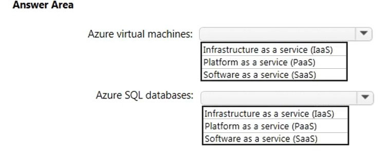
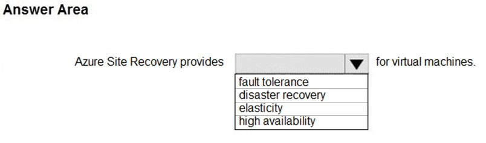

# Questions and Answers 41-50

[Back to AZ-900 Practice Exam](../az-900.md)

**Source:** [41-50.pdf](../files/41-50.pdf)

<strong>Question 41 - App Service and Azure SQL</strong>

This item shares its setup with other questions. Each one proposes a different solution. Decide whether this solution meets the goal.

Your company plans to migrate all its data and resources to Azure.

The company's migration plan states that only Platform as a Service (PaaS) solutions must be used in Azure.

You need to deploy an Azure environment that meets the company migration plan.

Solution: You create an Azure App Service and Azure SQL databases.

Does this meet the goal?

- A. Yes
- B. No

<strong>Answer 41</strong>

A. Yes.

Azure App Service and Azure SQL Database are both platform as a service. The plan allows only PaaS, and this solution stays inside that boundary.

**Why the others are wrong**

- B. No would mean one of these services is not PaaS. App Service hosts the app without a virtual machine to manage, and Azure SQL Database is a managed database engine.

**Study further**

- [App Service overview](https://learn.microsoft.com/en-us/azure/app-service/overview)
- [What is Azure SQL Database?](https://learn.microsoft.com/en-us/azure/azure-sql/database/sql-database-paas-overview)

<strong>Question 42 - App Service and SQL on VMs</strong>

This item shares its setup with other questions. Each one proposes a different solution. Decide whether this solution meets the goal.

Your company plans to migrate all its data and resources to Azure.

The company's migration plan states that only Platform as a Service (PaaS) solutions must be used in Azure.

You need to deploy an Azure environment that meets the company migration plan.

Solution: You create an Azure App Service and Azure virtual machines that have Microsoft SQL Server installed.

Does this meet the goal?

- A. Yes
- B. No

<strong>Answer 42</strong>

B. No.

App Service is platform as a service. A virtual machine with SQL Server installed is infrastructure as a service, because you manage the operating system and SQL Server. The plan allows only PaaS, so the virtual machines miss the requirement.

**Why the others are wrong**

- A. Yes would mean those virtual machines are platform as a service. Installing SQL Server on a virtual machine leaves the operating system and the database software with you.

**Study further**

- [App Service overview](https://learn.microsoft.com/en-us/azure/app-service/overview)
- [What is Azure Virtual Machines?](https://learn.microsoft.com/en-us/azure/virtual-machines/overview)

<strong>Question 43 - App Service and storage accounts</strong>

This item shares its setup with other questions. Each one proposes a different solution. Decide whether this solution meets the goal.

Your company plans to migrate all its data and resources to Azure.

The company's migration plan states that only Platform as a Service (PaaS) solutions must be used in Azure.

You need to deploy an Azure environment that meets the company migration plan.

Solution: You create an Azure App Service and Azure Storage accounts.

Does this meet the goal?

- A. Yes
- B. No

<strong>Answer 43</strong>

B. No.

The source marks No. App Service is platform as a service. On this exam, an Azure Storage account is infrastructure as a service: you manage the data, and the account is the storage you rent. The plan allows only PaaS.

**Why the others are wrong**

- A. Yes would mean a storage account counts as platform as a service here. The stated answer treats storage as infrastructure, so the pair fails the PaaS-only plan.

**Study further**

- [Storage account overview](https://learn.microsoft.com/en-us/azure/storage/common/storage-account-overview)
- [Describe cloud service types](https://learn.microsoft.com/en-us/training/modules/describe-cloud-service-types/)

<strong>Question 44 - Elasticity for a monthly spike</strong>

Your company hosts an accounting application named App1 that is used by all the customers of the company.

App1 has low usage during the first three weeks of each month and very high usage during the last week of each month.

Which benefit of Azure Cloud Services supports cost management for this type of usage pattern?

- A. High availability
- B. High latency
- C. Elasticity
- D. Load balancing

<strong>Answer 44</strong>

C. Elasticity.

Elasticity adds compute when the last week of the month is busy and removes it when usage drops. You pay for the spike, then stop paying for idle capacity.

**Why the others are wrong**

- A. High availability keeps the app running through failures. It does not match a monthly usage spike to the bill.
- B. High latency is a long delay. It is not a cost-management benefit, and it is not a benefit you want.
- D. Load balancing spreads requests across instances. It does not add and remove those instances as the month changes.

**Study further**

- [Describe the benefits of using cloud services](https://learn.microsoft.com/en-us/training/modules/describe-benefits-use-cloud-services/)
- [Describe the consumption-based model](https://learn.microsoft.com/en-us/training/modules/describe-cloud-compute/6-describe-consumption-based-model)

<strong>Question 45 - Least admin for a web app</strong>

You plan to migrate a web application to Azure. The web application is accessed by external users.

You need to recommend a cloud deployment solution to minimize the amount of administrative effort used to manage the web application.

What should you include in the recommendation?

- A. Software as a Service (SaaS)
- B. Platform as a Service (PaaS)
- C. Infrastructure as a Service (IaaS)
- D. Database as a Service (DaaS)

<strong>Answer 45</strong>

B. Platform as a Service (PaaS).

The source marks PaaS. You are migrating your own web application, so you still bring the app. App Service runs the platform and leaves you the application to manage. That is less administration than a virtual machine.

**Why the others are wrong**

- A. Software as a Service is a finished application you rent, such as Microsoft 365. It is not where you migrate your own web application. The vote leans this way. The stated answer is PaaS.
- C. Infrastructure as a Service gives you the virtual machine, the operating system, and the web server to patch. That is more administrative effort, not less.
- D. Database as a Service covers the database. It does not host the web application the external users open.

**Study further**

- [App Service overview](https://learn.microsoft.com/en-us/azure/app-service/overview)
- [Describe cloud service types](https://learn.microsoft.com/en-us/training/modules/describe-cloud-service-types/)

<strong>Question 46 - VMs and SQL service types</strong>

HOTSPOT

Which cloud deployment solution is used for Azure virtual machines and Azure SQL databases? To answer, select the appropriate options in the answer area.

NOTE: Each correct selection is worth one point.

_Figure: Azure virtual machines and Azure SQL databases each have an open list: Infrastructure as a service (IaaS), Platform as a service (PaaS), and Software as a service (SaaS). Nothing is selected._

<strong>Answer 46</strong>

Azure virtual machines: Infrastructure as a service (IaaS). Azure SQL databases: Platform as a service (PaaS).

_Figure: Infrastructure as a service is highlighted for Azure virtual machines. Platform as a service is highlighted for Azure SQL databases._

A virtual machine is rented infrastructure: you manage the operating system. Azure SQL Database is a managed database engine: Microsoft patches the platform.

**Why the others are wrong**

- Platform as a service for virtual machines misses the operating system. You still manage that guest.
- Software as a service for virtual machines misses the model. SaaS is a finished application, not a machine you configure.
- Infrastructure as a service for Azure SQL databases misses the managed engine. You do not patch that SQL Server.
- Software as a service for Azure SQL databases misses the model. You still design and query the database. You do not get a finished application.

**Study further**

- [Describe cloud service types](https://learn.microsoft.com/en-us/training/modules/describe-cloud-service-types/)
- [What is Azure SQL Database?](https://learn.microsoft.com/en-us/azure/azure-sql/database/sql-database-paas-overview)

<strong>Question 47 - More capacity at minimum cost</strong>

You have an on-premises network that contains 100 servers.

You need to recommend a solution that provides additional resources to your users. The solution must minimize capital and operational expenditure costs.

What should you include in the recommendation?

- A. A complete migration to the public cloud
- B. An additional data center
- C. A private cloud
- D. A hybrid cloud

<strong>Answer 47</strong>

D. A hybrid cloud.

Keep the 100 servers you already own, and add capacity in the public cloud when users need more. You avoid buying another data center, and you avoid the cost of moving every server.

**Why the others are wrong**

- A. A complete migration to the public cloud turns the existing servers into a migration project and an ongoing operational cost for all 100 workloads. The requirement is additional resources, not a full move.
- B. An additional data center is new buildings, power, and hardware. That is capital expenditure.
- C. A private cloud still runs on hardware you buy and maintain. Extra private capacity is capital expenditure.

**Study further**

- [Define cloud models](https://learn.microsoft.com/en-us/training/modules/describe-cloud-compute/5-define-cloud-models)
- [Shift from CapEx to OpEx](https://learn.microsoft.com/en-us/azure/cloud-adoption-framework/strategy/inform/cost-efficiency)

<strong>Question 48 - Hybrid and public cloud statements</strong>

HOTSPOT

For each of the following statements, select Yes if the statement is true. Otherwise, select No.

NOTE: Each correct selection is worth one point.

_Figure: Three statements, each with an empty Yes and an empty No. A hybrid cloud always starts by migrating from a private cloud. A company can extend its internal network with the public cloud. In a public cloud, only guest users can access the resources._

<strong>Answer 48</strong>

No. Yes. No.

_Figure: Migrating from a private cloud is No. Extending the internal network with the public cloud is Yes. Only guest users can access public cloud resources is No._

A hybrid cloud is any mix of private and public. You can start from either side. Public cloud capacity is how you extend an internal network. Access is granted to identities you choose, not only guests.

**Why the others are wrong**

- Yes for "must always migrate from a private cloud" misses the other path. You can start in the public cloud and connect an on-premises network later.
- No for extending the internal network misses a common hybrid pattern. Add public cloud capacity and connect it, instead of buying more on-premises servers.
- Yes for "only guest users" misses members of your own directory. Employees, applications, and synced accounts can all be allowed in. A guest is only one kind of user.

**Study further**

- [Define cloud models](https://learn.microsoft.com/en-us/training/modules/describe-cloud-compute/5-define-cloud-models)
- [What is Microsoft Entra Connect?](https://learn.microsoft.com/en-us/entra/identity/hybrid/connect/whatis-azure-ad-connect)

<strong>Question 49 - Advantage of the public cloud</strong>

You plan to migrate several servers from an on-premises network to Azure.

What is an advantage of using a public cloud service for the servers over an on-premises network?

- A. The public cloud is owned by the public, not a private corporation.
- B. The public cloud is a crowd-sourcing solution that provides corporations with the ability to enhance the cloud.
- C. All public cloud resources can be freely accessed by every member of the public.
- D. The public cloud is a shared entity whereby multiple corporations each use a portion of the resources in the cloud.

<strong>Answer 49</strong>

D. The public cloud is a shared entity whereby multiple corporations each use a portion of the resources in the cloud.

Microsoft owns the hardware. Many customers each create their own virtual machines and networks on that shared platform. You do not buy the servers.

**Why the others are wrong**

- A. The public is not the owner. Microsoft owns Azure.
- B. The public cloud is not a crowd-sourcing project. Customers do not collectively build the platform.
- C. Resources are not freely open to everyone. You pay for a subscription, and only the identities you authorize can reach your resources.

**Study further**

- [Define cloud models](https://learn.microsoft.com/en-us/training/modules/describe-cloud-compute/5-define-cloud-models)
- [What is cloud computing?](https://azure.microsoft.com/en-us/resources/cloud-computing-dictionary/what-is-cloud-computing)

<strong>Question 50 - What Site Recovery provides</strong>

HOTSPOT

To complete the sentence, select the appropriate option in the answer area.

_Figure: "Azure Site Recovery provides _____ for virtual machines." The open list is fault tolerance, disaster recovery, elasticity, and high availability. Nothing is selected._

<strong>Answer 50</strong>

Disaster recovery.

_Figure: The solution image highlights fault tolerance. Disaster recovery, elasticity, and high availability are not highlighted._

The source explanation describes Site Recovery replicating virtual machines to a secondary site so workloads can run during an outage. That is disaster recovery. Microsoft documents Azure Site Recovery as disaster recovery. The solution image highlights fault tolerance instead, which does not match that explanation.

**Why the others are wrong**

- Fault tolerance means the workload keeps running through a failure without a failover. Site Recovery fails a copy over to another site, and that failover takes time. This is the row the solution image highlights.
- Elasticity is adding or removing capacity with demand. Site Recovery does not scale the virtual machine.
- High availability keeps a workload up through smaller faults in a region, such as a restart or a zone failure. Site Recovery is the plan for losing a site.

**Study further**

- [About Azure Site Recovery](https://learn.microsoft.com/en-us/azure/site-recovery/site-recovery-overview)
- [What are business continuity, high availability, and disaster recovery?](https://learn.microsoft.com/en-us/azure/reliability/concept-business-continuity-high-availability-disaster-recovery)

