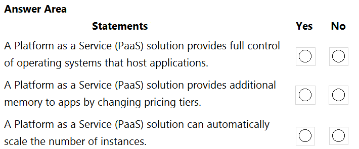
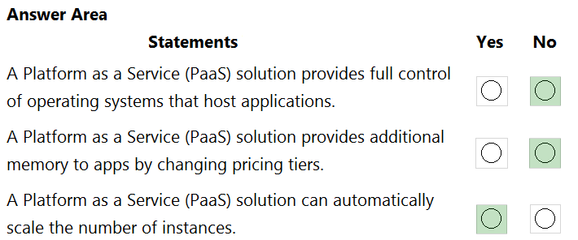
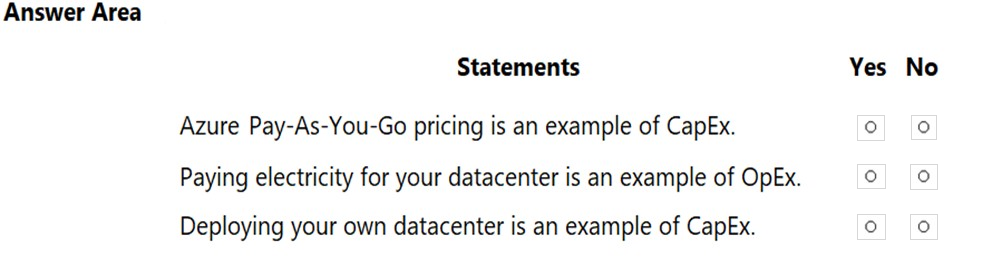
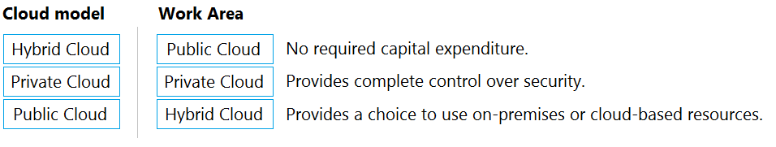

[Back to AZ-900: Azure Fundamentals Practice Exams](../az-900.md)

# Questions and Answers 51-60

**Source:** [51-60.pdf](../files/51-60.pdf)

<strong>Question 51 - Hardware owned by a third party</strong>

In which type of cloud model are all the hardware resources owned by a third party and shared between multiple tenants?

- A. Private
- B. Hybrid
- C. Public

<strong>Answer 51</strong>

C. Public.

In a public cloud, the provider owns the hardware and many customers share it. Azure, Amazon Web Services, and Google Cloud are public clouds. The customers are the tenants.

**Why the others are wrong**

- A. Private cloud hardware is dedicated to one organization. That organization, or a host it hires for its exclusive use, owns or controls it. It is not shared by multiple tenants.
- B. Hybrid cloud still includes a private portion. Not all of the hardware is owned by a third party and shared.

**Study further**

- [Define cloud models](https://learn.microsoft.com/en-us/training/modules/describe-cloud-compute/5-define-cloud-models)
- [What is cloud computing?](https://azure.microsoft.com/en-us/resources/cloud-computing-dictionary/what-is-cloud-computing)

<strong>Question 52 - Expenditure model for pay-as-you-go</strong>

You have 1,000 virtual machines hosted on the Hyper-V hosts in a data center.

You plan to migrate all the virtual machines to an Azure pay-as-you-go subscription.

You need to identify which expenditure model to use for the planned Azure solution.

Which expenditure model should you identify?

- A. Operational
- B. Elastic
- C. Capital
- D. Scalable

<strong>Answer 52</strong>

A. Operational.

Pay-as-you-go replaces the capital cost of the Hyper-V hosts with an operating cost. You pay for the virtual machines as you use them, and you can stop paying for a machine you shut down.

**Why the others are wrong**

- B. Elastic describes scaling. It is not an expenditure model.
- C. Capital expenditure is buying the hardware up front. That is the data center model you are leaving.
- D. Scalable describes capacity. It is not an expenditure model.

**Study further**

- [Describe the consumption-based model](https://learn.microsoft.com/en-us/training/modules/describe-cloud-compute/6-describe-consumption-based-model)
- [Shift from CapEx to OpEx](https://learn.microsoft.com/en-us/azure/cloud-adoption-framework/strategy/inform/cost-efficiency)

<strong>Question 53 - Match cloud benefits</strong>

DRAG DROP

Match the Azure service benefits to the correct descriptions.

To answer, drag the appropriate benefit from the column on the left to its description on the right. Each benefit may be used once, more than once, or not at all.

NOTE: Each correct match is worth one point.

_Figure: Benefits are Disaster recovery, Fault tolerance, Low latency, and Dynamic scalability. The descriptions, with empty boxes, are: remains available after a failure; can be recovered after a failure; performs quickly when demand increases; can be accessed quickly from the internet._

<strong>Answer 53</strong>

Fault tolerance. Disaster recovery. Dynamic scalability. Low latency.

_Figure: Fault tolerance is matched to remaining available after a failure. Disaster recovery is matched to being recovered after a failure. Dynamic scalability is matched to performing quickly when demand increases. Low latency is matched to being accessed quickly from the internet._

Fault tolerance keeps the service up when one part fails. Disaster recovery restores it after the failure. Dynamic scalability adds capacity under load. Low latency is a short response time.

**Why the others are wrong**

- Disaster recovery does not belong on "remains available after a failure." Recovery happens after the outage. Staying available through the failure is fault tolerance.
- Fault tolerance does not belong on "can be recovered after a failure." That is the restore step, which is disaster recovery.
- Low latency does not belong on "performs quickly when demand increases." Handling growth by adding resources is dynamic scalability.
- Dynamic scalability does not belong on "accessed quickly from the internet." A short response time is low latency.

**Study further**

- [Reliability terminology](https://learn.microsoft.com/en-us/azure/reliability/concept-business-continuity-high-availability-disaster-recovery)
- [Describe the benefits of using cloud services](https://learn.microsoft.com/en-us/training/modules/describe-benefits-use-cloud-services/)

<strong>Question 54 - Hybrid cloud requirements</strong>

HOTSPOT

For each of the following statements, select Yes if the statement is true. Otherwise, select No.

NOTE: Each correct selection is worth one point.

_Figure: Three statements, each with an empty Yes and an empty No. A hybrid cloud requires an internal network. A company can extend its internal network by using a hybrid cloud. In a public cloud, only guest users can access the resources._

<strong>Answer 54</strong>

No. Yes. No.

_Figure: An internal network is required for hybrid is No. Extending the internal network with a hybrid cloud is Yes. Only guest users can access public cloud resources is No._

The source marks the first statement No: you can start in the public cloud and add a private environment later, rather than beginning with an internal network. A hybrid cloud is how you add public capacity beside what you already run. Public cloud access is for the accounts you allow, not only guests.

**Why the others are wrong**

- Yes for "must have an internal network" is the opposite of the source mark. The source treats a public-cloud start, with private infrastructure added afterward, as a valid hybrid path.
- No for extending the internal network misses the hybrid pattern. You add cloud resources and connect them instead of buying more on-premises servers.
- Yes for "only guest users" misses employees and applications in your own directory. A guest account is optional.

**Study further**

- [Define cloud models](https://learn.microsoft.com/en-us/training/modules/describe-cloud-compute/5-define-cloud-models)
- [What is Microsoft Entra Connect?](https://learn.microsoft.com/en-us/entra/identity/hybrid/connect/whatis-azure-ad-connect)

<strong>Question 55 - PaaS control, memory, and scale</strong>

HOTSPOT

For each of the following statements, select Yes if the statement is true. Otherwise, select No.

NOTE: Each correct selection is worth one point.

_Figure: Three statements, each with an empty Yes and an empty No. A PaaS solution provides full control of the operating systems. A PaaS solution provides additional memory to apps by changing pricing tiers. A PaaS solution can automatically scale the number of instances._

<strong>Answer 55</strong>

No. No. Yes.

_Figure: Full control of the operating systems is No. Additional memory by changing pricing tiers is No. Automatically scaling the number of instances is Yes._

Platform as a service hides the operating system, and it can add instances as load grows. The source also marks the pricing-tier statement No.

**Why the others are wrong**

- Yes for full control of the operating systems misses PaaS. You deploy the application. Microsoft manages the host operating system.
- Yes for additional memory by changing pricing tiers is the opposite of the source mark. Moving up an App Service plan does increase the plan's memory in the current service. This item still marks the statement No.
- No for automatic scale-out misses autoscale. PaaS can add instances without you deploying new virtual machines.

**Study further**

- [App Service overview](https://learn.microsoft.com/en-us/azure/app-service/overview)
- [Describe cloud service types](https://learn.microsoft.com/en-us/training/modules/describe-cloud-service-types/)

<strong>Question 56 - Work Azure removes from VMs</strong>

Your company has an on-premises network that contains multiple servers.

The company plans to reduce the following administrative responsibilities:

- Backing up application data
- Replacing failed server hardware
- Managing physical server security
- Updating server operating systems
- Managing permissions to shared documents

The company plans to migrate servers to Azure virtual machines.

You need to identify which administrative responsibilities will be eliminated after the planned migration.

Which two responsibilities should you identify? Each correct answer presents a complete solution.

NOTE: Each correct selection is worth one point.

- A. Replacing failed server hardware
- B. Backing up application data
- C. Managing physical server security
- D. Updating server operating systems
- E. Managing permissions to shared documents

<strong>Answer 56</strong>

A. Replacing failed server hardware, and C. Managing physical server security.

Azure virtual machines run on physical hosts that Microsoft owns. Microsoft replaces failed hardware and secures those hosts. You never see the physical servers.

**Why the others are wrong**

- B. Backing up application data stays with you. Microsoft does not back up the application data inside your virtual machines unless you configure a backup service.
- D. Updating server operating systems stays with you. Infrastructure as a service leaves the guest operating system in your hands.
- E. Managing permissions to shared documents stays with you. Microsoft does not set the permissions on folders you host.

**Study further**

- [Shared responsibility in the cloud](https://learn.microsoft.com/en-us/azure/security/fundamentals/shared-responsibility)
- [What is Azure Virtual Machines?](https://learn.microsoft.com/en-us/azure/virtual-machines/overview)

<strong>Question 57 - CapEx and OpEx statements</strong>

HOTSPOT

For each of the following statements, select Yes if the statement is true. Otherwise, select No.

NOTE: Each correct selection is worth one point.

_Figure: Three statements, each with an empty Yes and an empty No. Azure pay-as-you-go pricing is CapEx. Paying electricity for your datacenter is OpEx. Deploying your own datacenter is CapEx._

<strong>Answer 57</strong>

No. No. Yes.

_Figure: Pay-as-you-go is CapEx is No. Datacenter electricity is OpEx is No. Deploying your own datacenter is CapEx is Yes._

Pay-as-you-go is an operating cost, not capital expenditure. Buying and building a datacenter is capital expenditure because you pay for the infrastructure before you use it. The source also marks datacenter electricity as not OpEx and calls that cost CapEx.

**Why the others are wrong**

- Yes for pay-as-you-go as CapEx misses the consumption model. You pay as you go, which is operational expenditure.
- Yes for datacenter electricity as OpEx is the opposite of the source mark. The source classes power for your own datacenter with the capital cost of running that datacenter. In ordinary accounting, power is often an operating cost. This item still marks the statement No.
- No for deploying your own datacenter misses the upfront purchase of buildings, power and cooling, and servers. That purchase is capital expenditure.

**Study further**

- [Describe the consumption-based model](https://learn.microsoft.com/en-us/training/modules/describe-cloud-compute/6-describe-consumption-based-model)
- [Shift from CapEx to OpEx](https://learn.microsoft.com/en-us/azure/cloud-adoption-framework/strategy/inform/cost-efficiency)

<strong>Question 58 - Which resource is IaaS</strong>

You plan to provision Infrastructure as a Service (IaaS) resources in Azure.

Which resource is an example of IaaS?

- A. An Azure web app
- B. An Azure virtual machine
- C. An Azure logic app
- D. An Azure SQL database

<strong>Answer 58</strong>

B. An Azure virtual machine.

A virtual machine is rented infrastructure. You manage the operating system and what you install on it. Microsoft manages the physical host.

**Why the others are wrong**

- A. An Azure web app is platform as a service. App Service runs the platform under the application.
- C. An Azure logic app is platform as a service. You design the workflow. Microsoft runs the engine.
- D. An Azure SQL database is platform as a service. Microsoft manages the database engine.

**Study further**

- [Describe cloud service types](https://learn.microsoft.com/en-us/training/modules/describe-cloud-service-types/)
- [What is Azure Logic Apps?](https://learn.microsoft.com/en-us/azure/logic-apps/logic-apps-overview)

<strong>Question 59 - Where physical servers can go</strong>

To which cloud models can you deploy physical servers?

- A. Private cloud and hybrid cloud only
- B. Private cloud only
- C. Private cloud, hybrid cloud, and public cloud
- D. Hybrid cloud only

<strong>Answer 59</strong>

A. Private cloud and hybrid cloud only.

You can rack a physical server in a private cloud, and in the private half of a hybrid cloud. A public cloud does not accept your hardware. The provider owns those hosts.

**Why the others are wrong**

- B. Private cloud only leaves out hybrid. A hybrid cloud still has an on-premises side where your servers run.
- C. Private, hybrid, and public includes the public cloud. You do not deploy your own physical servers into Azure's public regions.
- D. Hybrid cloud only leaves out a private cloud that has no public half. That private cloud is exactly where physical servers are deployed.

**Study further**

- [Define cloud models](https://learn.microsoft.com/en-us/training/modules/describe-cloud-compute/5-define-cloud-models)
- [What is cloud computing?](https://azure.microsoft.com/en-us/resources/cloud-computing-dictionary/what-is-cloud-computing)

<strong>Question 60 - Match cloud models to advantages</strong>

DRAG DROP

Match the cloud model to the correct advantage.

To answer, drag the appropriate cloud model from the column on the left to its advantage on the right. Each cloud model may be used once, more than once, or not at all.

NOTE: Each correct match is worth one point.

_Figure: Models are Hybrid Cloud, Private Cloud, and Public Cloud. The advantages, with empty boxes, are no required capital expenditure, complete control over security, and a choice to use on-premises or cloud-based resources._

<strong>Answer 60</strong>

Public Cloud. Private Cloud. Hybrid Cloud.

_Figure: Public Cloud is matched to no required capital expenditure. Private Cloud is matched to complete control over security. Hybrid Cloud is matched to a choice of on-premises or cloud-based resources._

Public cloud is pay-as-you-go, so you do not buy the servers. A private cloud stays on infrastructure you control. Hybrid cloud keeps both, and you choose where each workload runs.

**Why the others are wrong**

- Hybrid Cloud and Private Cloud do not remove capital expenditure. Both still include hardware you buy. No required capital expenditure is the public cloud.
- Public Cloud and Hybrid Cloud do not give complete control over security. The provider controls the public portion. Complete control is the private cloud.
- Public Cloud does not offer an on-premises choice, and Private Cloud does not offer a public cloud choice. The choice of either is hybrid.

**Study further**

- [Define cloud models](https://learn.microsoft.com/en-us/training/modules/describe-cloud-compute/5-define-cloud-models)
- [Describe the consumption-based model](https://learn.microsoft.com/en-us/training/modules/describe-cloud-compute/6-describe-consumption-based-model)

