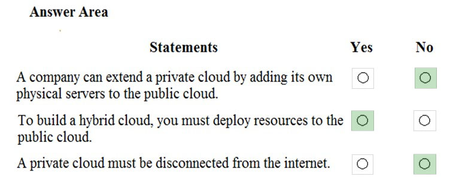
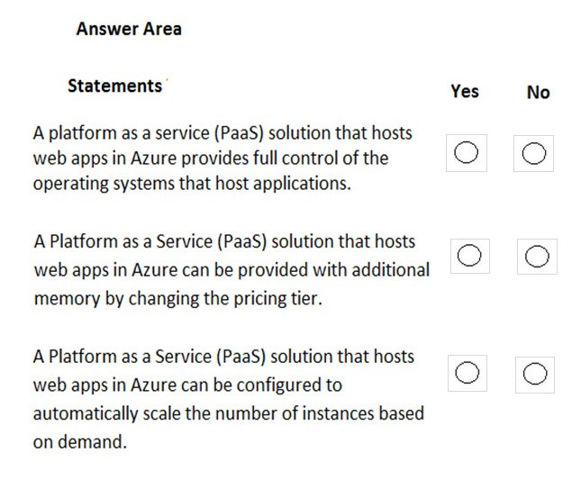
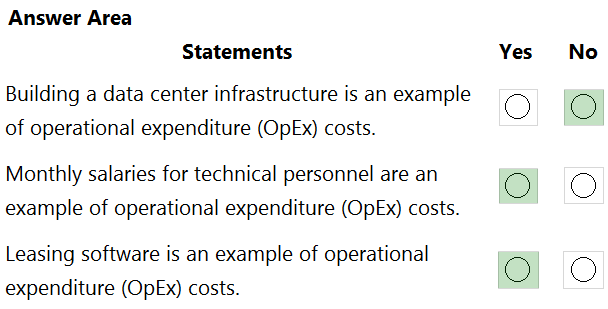
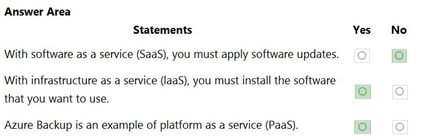

[Back to AZ-900: Azure Fundamentals Practice Exams](../az-900.md)

# Questions and Answers 61-70

**Source:** [61-70.pdf](../files/61-70.pdf)

<strong>Question 61 - Private, hybrid, and public clouds</strong>

HOTSPOT

For each of the following statements, select Yes if the statement is true. Otherwise, select No.

NOTE: Each correct selection is worth one point.

_Figure: Three statements, each with an empty Yes and an empty No. A company can extend a private cloud by adding its own physical servers to the public cloud. To build a hybrid cloud, you must deploy resources to the public cloud. A private cloud must be disconnected from the internet._

<strong>Answer 61</strong>

No. Yes. No.

_Figure: Adding physical servers to the public cloud is No. Deploying resources to the public cloud to build a hybrid cloud is Yes. A private cloud disconnected from the internet is No._

A public cloud accepts virtual machines, not your own hardware. A hybrid cloud is a private cloud plus resources in a public cloud. A private cloud is hardware you manage, and that network can stay connected to the internet.

**Why the others are wrong**

- Yes for adding physical servers to the public cloud misses how a public cloud works. You deploy virtual servers there. Putting your own hardware in the provider's cloud is not an extension of a private cloud. Virtual servers in a public cloud, next to a private cloud, are what create a hybrid cloud.
- No for deploying resources to the public cloud misses the definition of hybrid. A hybrid cloud combines a private cloud and a public cloud, so the public side has to exist.
- Yes for a private cloud disconnected from the internet misses the definition. Private means you manage the physical servers. It does not mean the network has no internet connection.

**Study further**

- [Define cloud models](https://learn.microsoft.com/en-us/training/modules/describe-cloud-compute/5-define-cloud-models)
- [Describe the benefits of using cloud services](https://learn.microsoft.com/en-us/training/modules/describe-benefits-use-cloud-services/)

<strong>Question 62 - Connected on-premises and Azure VMs</strong>

You have 50 virtual machines hosted on-premises and 50 virtual machines hosted in Azure. The on-premises virtual machines and the Azure virtual machines connect to each other.

Which type of cloud model is this?

- A. Hybrid
- B. Private
- C. Public

<strong>Answer 62</strong>

A. Hybrid.

The machines run in two places and they connect to each other. The on-premises side is the private cloud. The Azure side is the public cloud. Together that is a hybrid cloud.

**Why the others are wrong**

- B. Private would mean every machine stays on hardware you manage. Half of these machines are in Azure.
- C. Public would mean every machine is in the provider's cloud. Half of these machines stay on-premises.

**Study further**

- [Define cloud models](https://learn.microsoft.com/en-us/training/modules/describe-cloud-compute/5-define-cloud-models)
- [Describe the benefits of using cloud services](https://learn.microsoft.com/en-us/training/modules/describe-benefits-use-cloud-services/)

<strong>Question 63 - PaaS web app control and scale</strong>

HOTSPOT

For each of the following statements, select Yes if the statement is true. Otherwise, select No.

NOTE: Each correct selection is worth one point.

_Figure: Three statements, each with an empty Yes and an empty No. A PaaS solution that hosts web apps in Azure provides full control of the operating systems that host the applications. A PaaS solution that hosts web apps in Azure can be provided with additional memory by changing the pricing tier. A PaaS solution that hosts web apps in Azure can be configured to automatically scale the number of instances based on demand._

<strong>Answer 63</strong>

No. Yes. Yes.

_Figure: Full control of the host operating systems is No. Additional memory by changing the pricing tier is Yes. Automatically scaling the number of instances is Yes._

Azure App Service hosts the web apps. You do not sign in to the virtual machines or IIS underneath them. A higher pricing tier adds memory, and autoscale adds instances when demand rises.

**Why the others are wrong**

- Yes for full control of the operating systems misses PaaS. The provider runs the host. You deploy the app.
- No for additional memory by changing the pricing tier misses App Service plans. The plan size is how you add memory without touching the operating system.
- No for automatic scale-out misses autoscale. App Service can add load-balanced instances as demand changes.

**Study further**

- [App Service overview](https://learn.microsoft.com/en-us/azure/app-service/overview)
- [Describe cloud service types](https://learn.microsoft.com/en-us/training/modules/describe-cloud-service-types/)

<strong>Question 64 - VMs, SQL, and storage as PaaS</strong>

This item shares its setup with other questions. Each one proposes a different solution. Decide whether this solution meets the goal.

Your company plans to migrate all its data and resources to Azure.

The company's migration plan states that only Platform as a Service (PaaS) solutions must be used in Azure.

You need to deploy an Azure environment that meets the company migration plan.

Solution: You create Azure virtual machines, Azure SQL databases, and Azure Storage accounts.

Does this meet the goal?

- A. Yes
- B. No

<strong>Answer 64</strong>

B. No.

The plan allows only PaaS. Azure SQL Database is PaaS. Azure virtual machines are infrastructure as a service: you manage the operating system. A design that includes virtual machines misses the PaaS-only plan.

**Why the others are wrong**

- A. Yes would mean virtual machines, Azure SQL databases, and storage accounts are all PaaS. Virtual machines are IaaS, so the set fails the plan.

**Study further**

- [Describe cloud service types](https://learn.microsoft.com/en-us/training/modules/describe-cloud-service-types/)
- [What is Azure Virtual Machines?](https://learn.microsoft.com/en-us/azure/virtual-machines/overview)

<strong>Question 65 - Custom apps with prerequisites</strong>

Your company plans to deploy several custom applications to Azure. The applications will provide invoicing services to the customers of the company. Each application will have several prerequisite applications and services installed.

You need to recommend a cloud deployment solution for all the applications.

What should you recommend?

- A. Software as a Service (SaaS)
- B. Platform as a Service (PaaS)
- C. Infrastructure as a Service (IaaS)

<strong>Answer 65</strong>

C. Infrastructure as a Service (IaaS).

Each custom application needs prerequisite software installed. IaaS gives you virtual machines where you install, configure, and manage that software. The provider manages the infrastructure underneath.

**Why the others are wrong**

- A. Software as a Service is a finished application you connect to, such as mail or an office suite. These are the company's own invoicing applications, and they need extra software installed.
- B. Platform as a Service supplies the runtime and middleware. It does not give you a machine on which to install arbitrary prerequisite applications and services.

**Study further**

- [Describe cloud service types](https://learn.microsoft.com/en-us/training/modules/describe-cloud-service-types/)
- [What is Azure Virtual Machines?](https://learn.microsoft.com/en-us/azure/virtual-machines/overview)

<strong>Question 66 - CapEx and OpEx examples</strong>

HOTSPOT

For each of the following statements, select Yes if the statement is true. Otherwise, select No.

NOTE: Each correct selection is worth one point.

_Figure: Three statements, each with an empty Yes and an empty No. Building a data center infrastructure is an example of operational expenditure (OpEx) costs. Monthly salaries for technical personnel are an example of operational expenditure (OpEx) costs. Leasing software is an example of operational expenditure (OpEx) costs._

<strong>Answer 66</strong>

No. Yes. Yes.

_Figure: Building a data center as operational expenditure is No. Monthly salaries as operational expenditure is Yes. Leasing software as operational expenditure is Yes._

Building a data center is capital expenditure: you buy an asset up front. Monthly salaries and a software lease are ongoing operating costs.

**Why the others are wrong**

- Yes for building a data center as operational expenditure misses capital expenditure. The building, power gear, and servers are purchased assets.
- No for monthly salaries misses operating cost. Pay for technical staff is an ongoing cost of running the business.
- No for leasing software misses operating cost. A one-time software purchase can be capital expenditure. A lease continues, so it is operational expenditure.

**Study further**

- [Describe the consumption-based model](https://learn.microsoft.com/en-us/training/modules/describe-cloud-compute/6-describe-consumption-based-model)
- [Shift from CapEx to OpEx](https://learn.microsoft.com/en-us/azure/cloud-adoption-framework/strategy/inform/cost-efficiency)

<strong>Question 67 - Cosmos DB service model</strong>

HOTSPOT

To complete the sentence, select the appropriate option in the answer area.

_Figure: "Azure Cosmos DB is an example of a _____ offering." The open list is platform as a service (PaaS), infrastructure as a service (IaaS), serverless, and software as a service (SaaS). Nothing is selected._

<strong>Answer 67</strong>

Platform as a service (PaaS).

_Figure: Platform as a service (PaaS) is highlighted. Infrastructure as a service, serverless, and software as a service are not._

Azure Cosmos DB is a managed cloud database. You create databases and choose a consistency and throughput model. Microsoft runs the servers and the database platform.

**Why the others are wrong**

- Infrastructure as a service would leave you managing the virtual machines that host the database. Cosmos DB does not give you those machines.
- Serverless is a capacity mode Cosmos DB can use. The service model of the product is platform as a service.
- Software as a service would be a finished application. Cosmos DB is a database platform you build on.

**Study further**

- [What is Azure Cosmos DB?](https://learn.microsoft.com/en-us/azure/cosmos-db/overview)
- [Describe cloud service types](https://learn.microsoft.com/en-us/training/modules/describe-cloud-service-types/)

<strong>Question 68 - SaaS, IaaS, and Azure Backup</strong>

HOTSPOT

For each of the following statements, select Yes if the statement is true. Otherwise, select No.

NOTE: Each correct selection is worth one point.

_Figure: Three statements, each with an empty Yes and an empty No. With software as a service (SaaS), you must apply software updates. With infrastructure as a service (IaaS), you must install the software that you want to use. Azure Backup is an example of platform as a service (PaaS)._

<strong>Answer 68</strong>

No. Yes. Yes.

_Figure: Applying software updates in SaaS is No. Installing the software you want in IaaS is Yes. Azure Backup as platform as a service is Yes._

In SaaS the provider updates the application. In IaaS you install the software on the virtual machines. The solution image classifies Azure Backup as platform as a service: it is a Microsoft-managed backup platform rather than a product you install yourself.

**Why the others are wrong**

- Yes for applying SaaS updates yourself misses the provider's role. You configure the application. The provider patches it.
- No for installing software in IaaS misses the model. The provider supplies the machine. You install the operating-system roles and applications you need.
- No for Azure Backup as platform as a service misses the solution image. The image marks Yes for that statement.

**Study further**

- [What is Azure Backup?](https://learn.microsoft.com/en-us/azure/backup/backup-overview)
- [Describe cloud service types](https://learn.microsoft.com/en-us/training/modules/describe-cloud-service-types/)

<strong>Question 69 - Resource group nesting and regions</strong>

HOTSPOT

For each of the following statements, select Yes if the statement is true. Otherwise, select No.

NOTE: Each correct selection is worth one point.

_Figure: Three statements, each with an empty Yes and an empty No. You can create a resource group inside another resource group. An Azure virtual machine can be in multiple resource groups. A resource group can contain resources from multiple Azure regions._

<strong>Answer 69</strong>

No. No. Yes.

_Figure: A resource group inside another resource group is No. A virtual machine in multiple resource groups is No. Resources from multiple regions in one resource group is Yes._

Resource groups are a flat container. A resource, including a virtual machine, belongs to one resource group. The group stores metadata, and the resources inside it can sit in different regions.

**Why the others are wrong**

- Yes for nesting resource groups misses the model. A resource group cannot contain another resource group.
- Yes for a virtual machine in multiple resource groups misses the rule that each resource exists in only one resource group.
- No for multiple regions misses metadata. The resource group's own location is where its metadata is stored. The resources it lists can be in other regions.

**Study further**

- [What is Azure Resource Manager?](https://learn.microsoft.com/en-us/azure/azure-resource-manager/management/overview)
- [Move resources to a new resource group or subscription](https://learn.microsoft.com/en-us/azure/azure-resource-manager/management/move-resource-group-and-subscription)

<strong>Question 70 - SQL VM, Azure SQL, and Cosmos DB</strong>

HOTSPOT

For each of the following statements, select Yes if the statement is true. Otherwise, select No.

NOTE: Each correct selection is worth one point.

_Figure: Three statements, each with an empty Yes and an empty No. Microsoft SQL Server 2019 installed on an Azure virtual machine is an example of platform as a service (PaaS). Azure SQL Database is an example of platform as a service (PaaS). Azure Cosmos DB is an example of software as a service (SaaS)._

<strong>Answer 70</strong>

No. Yes. No.

_Figure: SQL Server 2019 on an Azure virtual machine as platform as a service is No. Azure SQL Database as platform as a service is Yes. Azure Cosmos DB as software as a service is No._

SQL Server on a virtual machine is infrastructure as a service: you manage the operating system and SQL Server. Azure SQL Database is a managed database engine, which is platform as a service. Cosmos DB is also a database platform, so calling it software as a service is false.

**Why the others are wrong**

- Yes for SQL Server on a virtual machine as PaaS misses the operating system. You patch that guest and you patch SQL Server. That is IaaS.
- No for Azure SQL Database as PaaS misses the managed engine. Microsoft patches the platform. You design and query the database.
- Yes for Cosmos DB as SaaS misses the model. Cosmos DB is a database platform you build on, which is PaaS, not a finished application.

**Study further**

- [What is Azure SQL Database?](https://learn.microsoft.com/en-us/azure/azure-sql/database/sql-database-paas-overview)
- [What is Azure Cosmos DB?](https://learn.microsoft.com/en-us/azure/cosmos-db/overview)

