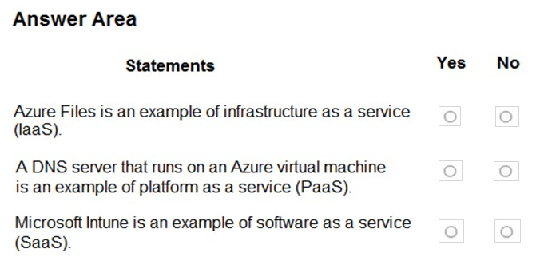
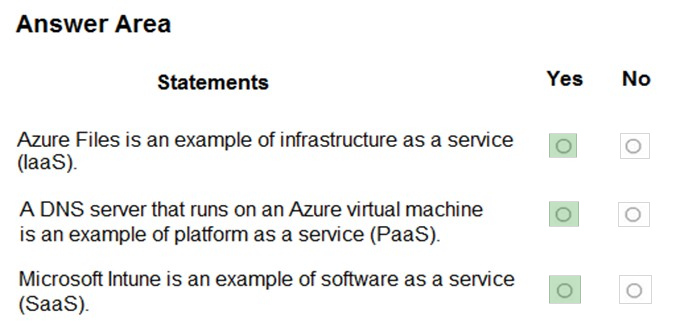
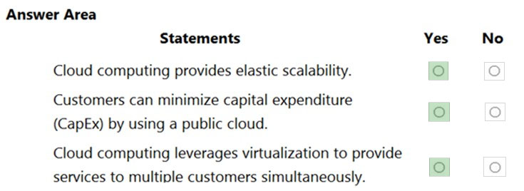
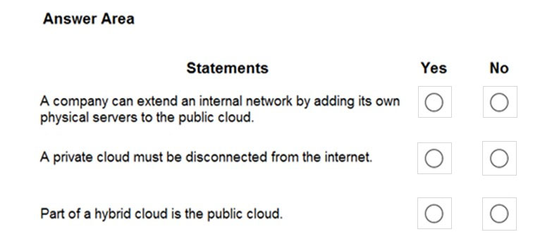
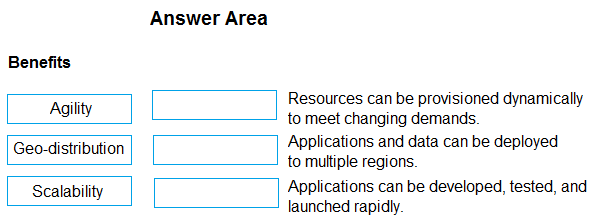
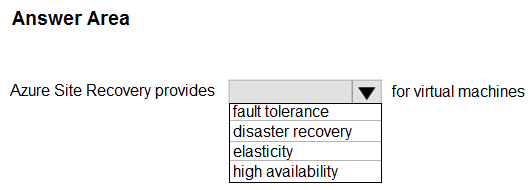
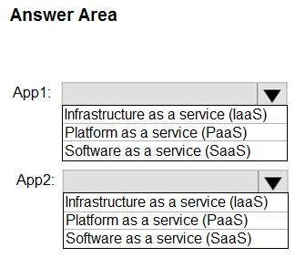
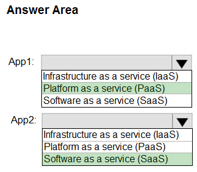
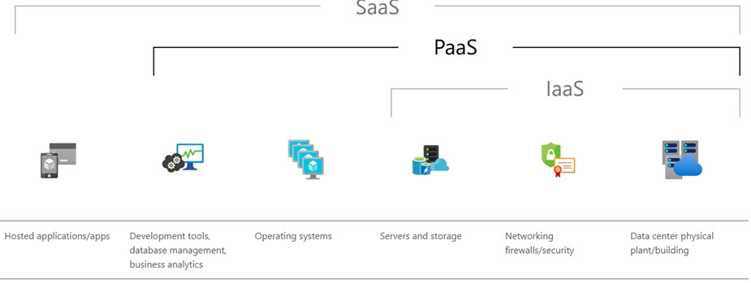

[Back to AZ-900: Azure Fundamentals Practice Exams](../az-900.md)

# Questions and Answers 71-80

**Source:** [71-80.pdf](../files/71-80.pdf)

<strong>Question 71 - PaaS app and database pair</strong>

Your company plans to migrate all its data and resources to Azure.

The company's migration plan states that only Platform as a Service (PaaS) solutions must be used in Azure.

You need to deploy an Azure environment that meets the company's migration plan.

What should you create?

- A. Azure virtual machines, Azure SQL databases, and Azure Storage accounts
- B. An Azure App Service and Azure virtual machines that have Microsoft SQL Server installed
- C. An Azure App Service and Azure SQL databases
- D. Azure Storage accounts and web servers in Azure virtual machines

<strong>Answer 71</strong>

C. An Azure App Service and Azure SQL databases.

App Service and Azure SQL Database are both PaaS. You deploy the web app and the database. Microsoft runs the operating systems underneath them. That set meets a PaaS-only plan.

**Why the others are wrong**

- A. Azure virtual machines are IaaS. Azure SQL Database is PaaS, and the virtual machines still break a PaaS-only plan.
- B. App Service is PaaS. Virtual machines with SQL Server installed are IaaS, because you manage that operating system and SQL Server.
- D. Web servers on virtual machines are IaaS. Storage accounts do not turn those virtual machines into PaaS.

**Study further**

- [App Service overview](https://learn.microsoft.com/en-us/azure/app-service/overview)
- [What is Azure SQL Database?](https://learn.microsoft.com/en-us/azure/azure-sql/database/sql-database-paas-overview)

<strong>Question 72 - What the SaaS customer provides</strong>

What does a customer provide in a software as a service (SaaS) model?

- A. Application data
- B. Data storage
- C. Compute resources
- D. Application software

<strong>Answer 72</strong>

A. Application data.

In SaaS you rent a finished application and connect to it, usually in a browser. You supply the business data that application stores. The provider supplies the application software, the compute, and the storage platform, and hosts that data in its data center.

**Why the others are wrong**

- B. Data storage is the provider's platform. You do not bring the disks.
- C. Compute resources are the provider's servers. You do not size or patch them.
- D. Application software is the SaaS application itself. You use it. You do not install it.

**Study further**

- [Describe cloud service types](https://learn.microsoft.com/en-us/training/modules/describe-cloud-service-types/)
- [Shared responsibility in the cloud](https://learn.microsoft.com/en-us/azure/security/fundamentals/shared-responsibility)

<strong>Question 73 - Files, DNS, and Intune models</strong>

HOTSPOT

For each of the following statements, select Yes if the statement is true. Otherwise, select No.

NOTE: Each correct selection is worth one point.

_Figure: Three statements, each with an empty Yes and an empty No. Azure Files is an example of infrastructure as a service (IaaS). A DNS server that runs on an Azure virtual machine is an example of platform as a service (PaaS). Microsoft Intune is an example of software as a service (SaaS)._

<strong>Answer 73</strong>

Yes. Yes. Yes.

_Figure: Azure Files as infrastructure as a service is Yes. A DNS server on a virtual machine as platform as a service is Yes. Microsoft Intune as software as a service is Yes._

The solution image marks Yes on every row. It classifies the Azure Files share as infrastructure as a service, the DNS server running on a virtual machine as platform as a service, and Microsoft Intune as software as a service. Intune is a device-management application Microsoft operates and you configure.

**Why the others are wrong**

- No for Azure Files as infrastructure as a service misses the solution image, which marks that statement Yes.
- No for the DNS server as platform as a service misses the solution image, which marks that statement Yes.
- No for Microsoft Intune as software as a service misses a finished Microsoft cloud application. You do not install Intune on servers you manage.

**Study further**

- [What is Microsoft Intune?](https://learn.microsoft.com/en-us/intune/fundamentals/what-is-intune)
- [Describe cloud service types](https://learn.microsoft.com/en-us/training/modules/describe-cloud-service-types/)

<strong>Question 74 - Elasticity, CapEx, and multitenancy</strong>

HOTSPOT

For each of the following statements, select Yes if the statement is true. Otherwise, select No.

NOTE: Each correct selection is worth one point.

_Figure: Three statements, each with an empty Yes and an empty No. Cloud computing provides elastic scalability. Customers can minimize capital expenditure (CapEx) by using a public cloud. Cloud computing leverages virtualization to provide services to multiple customers simultaneously._

<strong>Answer 74</strong>

Yes. Yes. Yes.

_Figure: Elastic scalability is Yes. Minimizing capital expenditure with a public cloud is Yes. Virtualization serving multiple customers is Yes._

Cloud capacity grows and shrinks with demand. A public cloud turns hardware purchases into a bill you pay as you go. Virtualization lets the provider run many customers on the same physical hosts.

**Why the others are wrong**

- No for elastic scalability misses the consumption model. You add and remove capacity as demand changes.
- No for minimizing capital expenditure misses the public cloud shift. The provider owns the hardware, so you avoid buying the data center.
- No for serving many customers through virtualization misses multitenancy. Isolation is logical. The physical hosts are shared.

**Study further**

- [Describe the benefits of using cloud services](https://learn.microsoft.com/en-us/training/modules/describe-benefits-use-cloud-services/)
- [Describe the consumption-based model](https://learn.microsoft.com/en-us/training/modules/describe-cloud-compute/6-describe-consumption-based-model)

<strong>Question 75 - First stage of cloud adoption</strong>

What is the first stage in the Microsoft Cloud Adoption Framework for Azure?

- A. Adopt the cloud.
- B. Make a plan.
- C. Ready your organization.
- D. Define your strategy.

<strong>Answer 75</strong>

D. Define your strategy.

_Figure: The framework diagram starts at Define Strategy, then Plan, Ready, and Adopt. Adopt splits into Migrate and Innovate. Govern and Manage run underneath the whole path._

The framework starts with why the organization is moving: motivations, business outcomes, and which project comes first. Plan, Ready, and Adopt come after that strategy.

**Why the others are wrong**

- A. Adopt the cloud is a later stage. Migrate and Innovate happen after the strategy, the plan, and the landing zone exist.
- B. Make a plan comes after the strategy. The plan covers the digital estate, skills, and the adoption plan.
- C. Ready your organization is the landing-zone stage. You prepare Azure after you know the strategy and the plan.

**Study further**

- [Microsoft Cloud Adoption Framework for Azure](https://learn.microsoft.com/en-us/azure/cloud-adoption-framework/overview)
- [Define cloud models](https://learn.microsoft.com/en-us/training/modules/describe-cloud-compute/5-define-cloud-models)

<strong>Question 76 - Extending a network into the cloud</strong>

HOTSPOT

For each of the following statements, select Yes if the statement is true. Otherwise, select No.

NOTE: Each correct selection is worth one point.

_Figure: Three statements, each with an empty Yes and an empty No. A company can extend an internal network by adding its own physical servers to the public cloud. A private cloud must be disconnected from the internet. Part of a hybrid cloud is the public cloud._

<strong>Answer 76</strong>

No. No. Yes.

_Figure: Adding physical servers to the public cloud is No. A private cloud disconnected from the internet is No. Part of a hybrid cloud being the public cloud is Yes._

You extend into a public cloud with virtual servers, not by installing your own hardware there. A private cloud can have an internet connection. A hybrid cloud is a private cloud combined with a public cloud.

**Why the others are wrong**

- Yes for adding physical servers to the public cloud misses the public cloud. You deploy virtual machines. Your own servers stay in the private portion.
- Yes for a private cloud disconnected from the internet misses the definition. Private means you manage the servers. The explanation describes a private cloud as existing on a network you reach over the internet.
- No for the public cloud as part of hybrid misses the definition. Hybrid is private plus public.

**Study further**

- [Define cloud models](https://learn.microsoft.com/en-us/training/modules/describe-cloud-compute/5-define-cloud-models)
- [Describe the benefits of using cloud services](https://learn.microsoft.com/en-us/training/modules/describe-benefits-use-cloud-services/)

<strong>Question 77 - Requirements for cloud computing</strong>

HOTSPOT

For each of the following statements, select Yes if the statement is true. Otherwise, select No.

NOTE: Each correct selection is worth one point.

_Figure: Three statements, each with an empty Yes and an empty No. You must have physical servers to use cloud computing. You must have internet connectivity to use cloud computing. The costs to increase cloud computing capacity are less than the costs to increase the computing capacity of an on-premises datacenter._

<strong>Answer 77</strong>

No. Yes. Yes.

_Figure: Owning physical servers is No. Internet connectivity is Yes. Lower cost to add cloud capacity than to expand an on-premises datacenter is Yes._

Cloud computing delivers servers, storage, and software over the internet. You use virtual machines rather than buying the hosts. Adding cloud capacity is an operating bill. Expanding your own datacenter means buying more building, power, and hardware.

**Why the others are wrong**

- Yes for owning physical servers misses the provider's hardware. You consume virtual machines and other services. The provider owns the hosts.
- No for internet connectivity misses how you reach the cloud. The services are delivered over the internet.
- No for a lower cost to add cloud capacity misses the comparison with a datacenter expansion. Cloud capacity is added without a new capital project for the building and the servers.

**Study further**

- [Describe the benefits of using cloud services](https://learn.microsoft.com/en-us/training/modules/describe-benefits-use-cloud-services/)
- [Describe the consumption-based model](https://learn.microsoft.com/en-us/training/modules/describe-cloud-compute/6-describe-consumption-based-model)

<strong>Question 78 - Match benefits to demand, regions, speed</strong>

DRAG DROP

Match the cloud computing benefits to the correct descriptions.

To answer, drag the appropriate benefit from the column on the left to its description on the right. Each benefit may be used once, more than once, or not at all.

NOTE: Each correct match is worth one point.

_Figure: Benefits are Agility, Geo-distribution, and Scalability. Three empty boxes sit beside: resources can be provisioned dynamically to meet changing demands; applications and data can be deployed to multiple regions; applications can be developed, tested, and launched rapidly._

<strong>Answer 78</strong>

Scalability. Geo-distribution. Agility.

_Figure: Scalability is matched to provisioning resources dynamically for changing demand. Geo-distribution is matched to deploying applications and data to multiple regions. Agility is matched to developing, testing, and launching applications rapidly._

Every benefit is used once. Scalability is adding or removing capacity as demand changes. Geo-distribution is placing applications and data in more than one region. Agility is how quickly you can build and release.

**Why the others are wrong**

- Agility for dynamic capacity misses scale. Agility is the speed of developing, testing, and launching.
- Geo-distribution for rapid launch misses regions. Geo-distribution is where the application runs, not how fast you build it.
- Scalability for many regions misses capacity. Scalability changes how much compute you have. Placing that compute near users is geo-distribution.

**Study further**

- [Describe the benefits of using cloud services](https://learn.microsoft.com/en-us/training/modules/describe-benefits-use-cloud-services/)
- [Describe the consumption-based model](https://learn.microsoft.com/en-us/training/modules/describe-cloud-compute/6-describe-consumption-based-model)

<strong>Question 79 - What Site Recovery provides</strong>

HOTSPOT

Select the answer that correctly completes the sentence.

_Figure: "Azure Site Recovery provides _____ for virtual machines." The open list is fault tolerance, disaster recovery, elasticity, and high availability. Nothing is selected._

<strong>Answer 79</strong>

Disaster recovery.

_Figure: Disaster recovery is highlighted. Fault tolerance, elasticity, and high availability are not._

The explanation says you set up disaster recovery for Azure virtual machines with Azure Site Recovery. Site Recovery replicates machines so they can run from a secondary site after an outage. The solution image highlights disaster recovery.

**Why the others are wrong**

- Fault tolerance means the workload keeps running through a failure without a failover. Site Recovery fails a copy over to another site.
- Elasticity is adding or removing capacity with demand. Site Recovery does not scale the virtual machine.
- High availability keeps a workload up through smaller faults, such as a restart or a zone failure. Site Recovery is the plan for losing a site.

**Study further**

- [About Azure Site Recovery](https://learn.microsoft.com/en-us/azure/site-recovery/site-recovery-overview)
- [What are business continuity, high availability, and disaster recovery?](https://learn.microsoft.com/en-us/azure/reliability/concept-business-continuity-high-availability-disaster-recovery)

<strong>Question 80 - Service model for two apps</strong>

HOTSPOT

You plan to use Azure to host two apps named App1 and App2. The apps must meet the following requirements:

- You must be able to modify the code of App1.
- Administrative effort to manage the operating system of App1 must be minimized.
- App2 must run interactively with the operating system of the server.

Which type of cloud service should you use for each app?

To answer, select the appropriate options in the answer area.

NOTE: Each correct selection is worth one point.

_Figure: App1 and App2 each have an open list: Infrastructure as a service (IaaS), Platform as a service (PaaS), and Software as a service (SaaS). Nothing is selected._

<strong>Answer 80</strong>

Platform as a service (PaaS) for App1. Software as a service (SaaS) for App2.

_Figure: Platform as a service (PaaS) is highlighted for App1. Software as a service (SaaS) is highlighted for App2._

App1 has to accept code changes, and the operating-system work has to stay small. That is PaaS: you build on the platform, and the provider runs the operating system. The explanation names software as a service for App2 and describes a finished application users open over the internet. The solution image highlights SaaS for App2.

_Figure: A stack diagram labeled SaaS, PaaS, and IaaS. The items along the stack are hosted applications, development tools and business analytics, operating systems, servers and storage, networking, and the data center._

**Why the others are wrong**

- Infrastructure as a service for App1 leaves you managing the operating system. The requirement is to minimize that work.
- Software as a service for App1 is a finished application. You cannot modify its code.
- Infrastructure as a service for App2 is a server you administer. The solution image highlights SaaS, and the explanation names SaaS.
- Platform as a service for App2 is a platform where you deploy your own application. The solution image highlights SaaS, and the explanation names SaaS.

**Study further**

- [Describe cloud service types](https://learn.microsoft.com/en-us/training/modules/describe-cloud-service-types/)
- [Shared responsibility in the cloud](https://learn.microsoft.com/en-us/azure/security/fundamentals/shared-responsibility)

