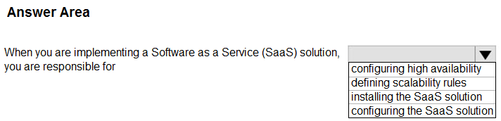
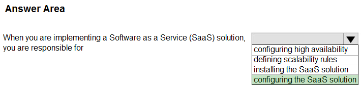
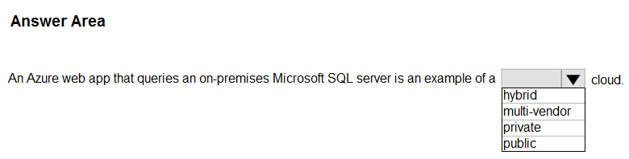
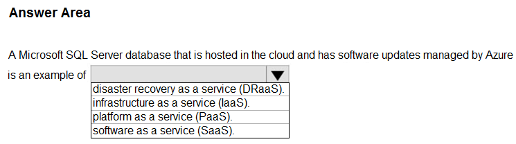
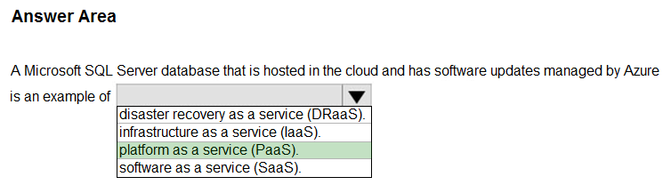
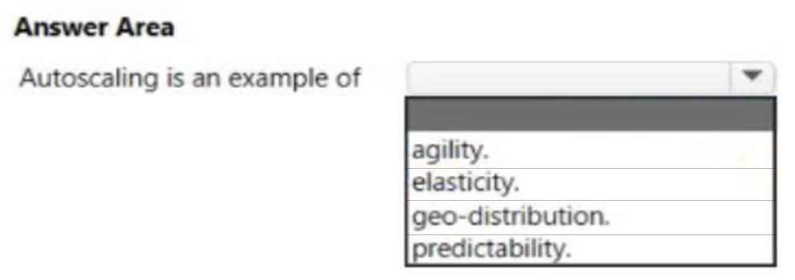
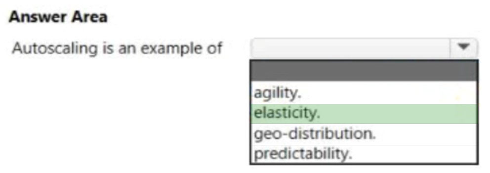
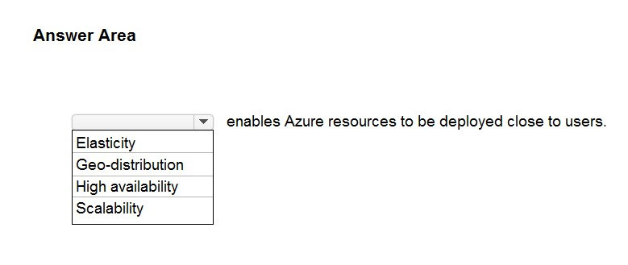
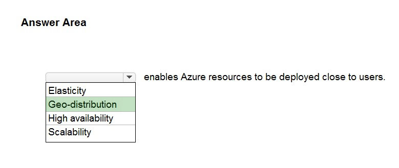

# Questions and Answers 81-90

[Back to AZ-900 Practice Exam](../az-900.md)

**Source:** [81-90.pdf](../files/81-90.pdf)

<strong>Question 81 - Lift and shift a legacy app</strong>

You have an accounting application named App1 that uses a legacy database.

You plan to move App1 to the cloud.

Which service model should you use?

- A. Platform as a service (PaaS)
- B. Infrastructure as a service (IaaS)
- C. Software as a service (SaaS)

<strong>Answer 81</strong>

B. Infrastructure as a service (IaaS).

App1 and its legacy database already exist. Moving them onto cloud virtual machines is a lift-and-shift. The application stays the application it was. IaaS is the model that hosts that move.

**Why the others are wrong**

- A. Platform as a service would mean rebuilding App1 on a managed runtime and a managed database. A legacy database is the reason this move stays on virtual machines.
- C. Software as a service would replace App1 with a finished accounting application. The plan is to move App1, not to throw it away.

**Study further**

- [What is Azure Virtual Machines?](https://learn.microsoft.com/en-us/azure/virtual-machines/overview)
- [Describe cloud service types](https://learn.microsoft.com/en-us/training/modules/describe-cloud-service-types/)

<strong>Question 82 - SaaS customer responsibility</strong>

HOTSPOT

Select the answer that correctly completes the sentence.

_Figure: "When you are implementing a Software as a Service (SaaS) solution, you are responsible for" and an open list: configuring high availability, defining scalability rules, installing the SaaS solution, configuring the SaaS solution. Nothing is selected._

<strong>Answer 82</strong>

Configuring the SaaS solution.

_Figure: Configuring the SaaS solution is highlighted. Configuring high availability, defining scalability rules, and installing the SaaS solution are not._

The explanation names configuring the SaaS solution. You access the application over the internet. The provider runs the servers and manages security, availability, and performance. You configure how your organization uses the application.

**Why the others are wrong**

- Configuring high availability is the provider's responsibility. You do not place the SaaS application across zones.
- Defining scalability rules is the provider's responsibility. You do not scale the platform underneath a SaaS app.
- Installing the SaaS solution is the provider's responsibility. You connect to the application. You do not install it.

**Study further**

- [Describe cloud service types](https://learn.microsoft.com/en-us/training/modules/describe-cloud-service-types/)
- [Shared responsibility in the cloud](https://learn.microsoft.com/en-us/azure/security/fundamentals/shared-responsibility)

<strong>Question 83 - Web app with on-premises data</strong>

HOTSPOT

Select the answer that correctly completes the sentence.

_Figure: "An Azure web app that queries an on-premises Microsoft SQL server is an example of a _____ cloud." The open list is hybrid, multi-vendor, private, and public. Nothing is selected._

<strong>Answer 83</strong>

Hybrid.

_Figure: Hybrid is highlighted. Multi-vendor, private, and public are not._

The web app runs in Azure. The SQL Server stays on-premises. One application that uses both is a hybrid cloud. The explanation describes a hybrid app with on-premises data that scales across the cloud.

**Why the others are wrong**

- Multi-vendor means more than one cloud provider. This design is Azure plus your own datacenter, not two public clouds.
- Private would keep the web app on hardware you own. The web app is in Azure.
- Public would keep the database in the public cloud as well. The SQL Server stays on-premises.

**Study further**

- [Define cloud models](https://learn.microsoft.com/en-us/training/modules/describe-cloud-compute/5-define-cloud-models)
- [App Service overview](https://learn.microsoft.com/en-us/azure/app-service/overview)

<strong>Question 84 - SQL with Azure-managed updates</strong>

HOTSPOT

Select the answer that correctly completes the sentence.

_Figure: "A Microsoft SQL Server database that is hosted in the cloud and has software updates managed by Azure is an example of" an open list: disaster recovery as a service (DRaaS), infrastructure (IaaS), platform as a service (PaaS), software as a service (SaaS). Nothing is selected._

<strong>Answer 84</strong>

Platform as a service (PaaS).

_Figure: Platform as a service (PaaS) is highlighted. Disaster recovery as a service, infrastructure as a service, and software as a service are not._

Azure applies the software updates, so you are not patching a SQL Server virtual machine. You still use it as a database platform: schema, queries, and data. That is PaaS, the same model as Azure SQL Database.

**Why the others are wrong**

- Disaster recovery as a service is a failover product. Managed SQL updates do not, by themselves, make this a recovery service.
- Infrastructure as a service would leave the software updates to you. Azure managing those updates is the detail that leaves IaaS.
- Software as a service would be a finished application. This is still a database engine you build on.

**Study further**

- [What is Azure SQL Database?](https://learn.microsoft.com/en-us/azure/azure-sql/database/sql-database-paas-overview)
- [Describe cloud service types](https://learn.microsoft.com/en-us/training/modules/describe-cloud-service-types/)

<strong>Question 85 - Model with on-premises and cloud</strong>

Which cloud computing model includes on-premises and cloud-based resources?

- A. Hybrid
- B. Public
- C. Private

<strong>Answer 85</strong>

A. Hybrid.

A hybrid cloud combines an on-premises datacenter, also called a private cloud, with a public cloud, and shares data and applications between them.

**Why the others are wrong**

- B. Public uses only the provider's cloud. It does not include the on-premises resources.
- C. Private uses only hardware you manage. It does not include the public cloud resources.

**Study further**

- [Define cloud models](https://learn.microsoft.com/en-us/training/modules/describe-cloud-compute/5-define-cloud-models)
- [Describe the benefits of using cloud services](https://learn.microsoft.com/en-us/training/modules/describe-benefits-use-cloud-services/)

<strong>Question 86 - What autoscaling demonstrates</strong>

HOTSPOT

Select the answer that correctly completes the sentence.

_Figure: "Autoscaling is an example of" an open list: agility, elasticity, geo-distribution, and predictability. Nothing is selected._

<strong>Answer 86</strong>

Elasticity.

_Figure: Elasticity is highlighted. Agility, geo-distribution, and predictability are not._

A virtual machine scale set can increase or decrease the number of instances that run an application. That automatic change with demand is elasticity. The explanation names that behavior.

**Why the others are wrong**

- Agility is how quickly you can develop, test, and launch. Autoscaling changes capacity of an application that is already running.
- Geo-distribution places the application in regions near users. Autoscaling does not choose a region.
- Predictability is a steady, known cost or load. Autoscaling exists because demand changes.

**Study further**

- [What are virtual machine scale sets?](https://learn.microsoft.com/en-us/azure/virtual-machine-scale-sets/overview)
- [Describe the consumption-based model](https://learn.microsoft.com/en-us/training/modules/describe-cloud-compute/6-describe-consumption-based-model)

<strong>Question 87 - Add memory or CPUs</strong>

Which term represents the ability to increase the computing capacity of a virtual machine by adding memory or CPUs?

- A. Agility
- B. Vertical scaling
- C. Horizontal scaling
- D. Elasticity

<strong>Answer 87</strong>

B. Vertical scaling.

Vertical scaling, also called scale up and scale down, changes the size of the virtual machine. Adding memory or CPUs is a bigger size. Horizontal scaling changes how many virtual machines you have.

**Why the others are wrong**

- A. Agility is how quickly you can build and release. It does not resize a virtual machine.
- C. Horizontal scaling adds or removes virtual machine instances. It does not add memory or CPUs to one machine.
- D. Elasticity is growing and shrinking with demand, often by changing the number of instances. The action in this question is a larger machine.

**Study further**

- [What are virtual machine scale sets?](https://learn.microsoft.com/en-us/azure/virtual-machine-scale-sets/overview)
- [Describe the benefits of using cloud services](https://learn.microsoft.com/en-us/training/modules/describe-benefits-use-cloud-services/)

<strong>Question 88 - Two benefits of cloud computing</strong>

What are two benefits of cloud computing? Each correct answer presents a complete solution.

NOTE: Each correct selection is worth one point.

- A. Enables the rapid provisioning of resources
- B. Has increased administrative complexity
- C. Has the same configuration options as on-premises
- D. Shifts capital expenditures (CapEx) to operating expenditures (OpEx)

<strong>Answer 88</strong>

A. Enables the rapid provisioning of resources, and D. Shifts capital expenditures (CapEx) to operating expenditures (OpEx).

Azure lets you deploy resources quickly without buying the hardware first. Pay-as-you-go spending is operating expenditure. Buying the datacenter up front is capital expenditure.

**Why the others are wrong**

- B. Increased administrative complexity is not a benefit. Cloud services are meant to remove the work of running the underlying infrastructure.
- C. The same configuration options as on-premises is not the benefit named here. Some on-premises options are different in Azure. The benefits in the key are speed of provisioning and the shift from CapEx to OpEx.

**Study further**

- [Describe the benefits of using cloud services](https://learn.microsoft.com/en-us/training/modules/describe-benefits-use-cloud-services/)
- [Shift from CapEx to OpEx](https://learn.microsoft.com/en-us/azure/cloud-adoption-framework/strategy/inform/cost-efficiency)

<strong>Question 89 - Feature of a virtual network</strong>

What is a feature of an Azure virtual network?

- A. Resource cost analysis
- B. Packet inspection
- C. Geo-redundancy
- D. Isolation and segmentation

<strong>Answer 89</strong>

D. Isolation and segmentation.

A virtual network is the boundary where you group related resources and separate them from other networks. Segmentation supports isolation and the organization's access rules.

**Why the others are wrong**

- A. Resource cost analysis is Cost Management. A virtual network does not analyze spend.
- B. Packet inspection is a firewall or network security group behavior. It is not the feature that defines a virtual network.
- C. Geo-redundancy copies data to another region. A virtual network lives in one region.

**Study further**

- [What is Azure Virtual Network?](https://learn.microsoft.com/en-us/azure/virtual-network/virtual-networks-overview)
- [Network security groups](https://learn.microsoft.com/en-us/azure/virtual-network/network-security-groups-overview)

<strong>Question 90 - Deploying close to users</strong>

HOTSPOT

Select the answer that correctly completes the sentence.

_Figure: "_____ enables Azure resources to be deployed close to users." The open list is Elasticity, Geo-distribution, High availability, and Scalability. Nothing is selected._

<strong>Answer 90</strong>

Geo-distribution.

_Figure: Geo-distribution is highlighted. Elasticity, high availability, and scalability are not._

Geo-distribution lets you deploy apps and data to regional datacenters around the globe so customers get the best performance in their own region. The explanation names geo-distribution for that result.

**Why the others are wrong**

- Elasticity grows and shrinks capacity with demand. It does not choose a region near the user.
- High availability keeps the application up through faults. It does not place it close to users.
- Scalability adds compute capacity. Extra capacity in a distant region is still distant.

**Study further**

- [Describe the benefits of using cloud services](https://learn.microsoft.com/en-us/training/modules/describe-benefits-use-cloud-services/)
- [Azure geographies](https://azure.microsoft.com/en-us/explore/global-infrastructure/geographies)

