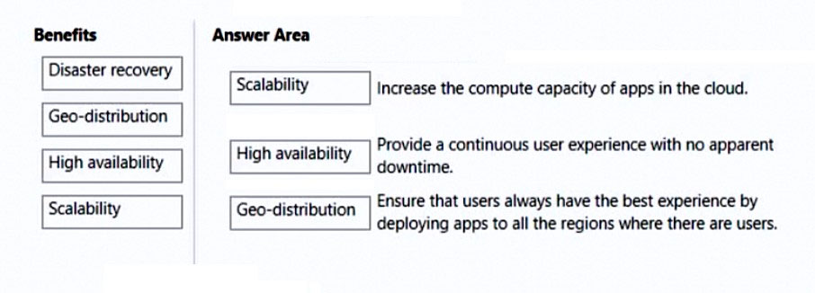
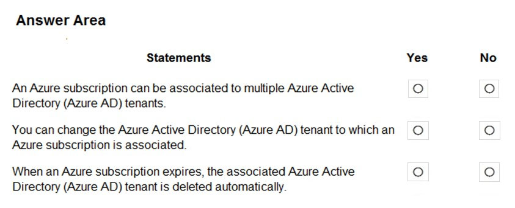
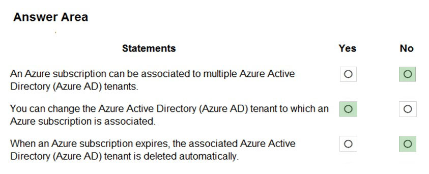
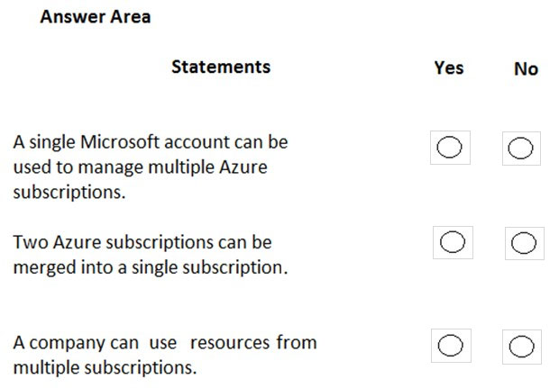
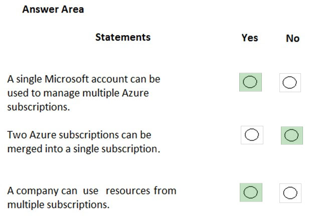

# Questions and Answers 91-100

[Back to AZ-900 Practice Exam](../az-900.md)

**Source:** [91-100.pdf](../files/91-100.pdf)

<strong>Question 91 - Match benefits to descriptions</strong>

DRAG DROP

Match the cloud computing benefits to the appropriate descriptions.

To answer, drag the appropriate benefit from the column on the left to its description on the right. Each benefit may be used once, more than once, or not at all.

NOTE: Each correct match is worth one point.

_Figure: Benefits are Disaster recovery, Geo-distribution, High availability, and Scalability. Three empty boxes sit beside: increase the compute capacity of apps in the cloud; provide a continuous user experience with no apparent downtime; ensure that users always have the best experience by deploying apps to all the regions where there are users._

<strong>Answer 91</strong>

Scalability. High availability. Geo-distribution. Disaster recovery stays in the benefits list.

_Figure: Scalability is matched to increasing compute capacity. High availability is matched to a continuous experience with no apparent downtime. Geo-distribution is matched to deploying apps to every region where there are users. Disaster recovery is not placed._

Scalability adds compute. High availability keeps the application responding through faults. Geo-distribution puts a copy in each region where users are.

**Why the others are wrong**

- Disaster recovery is the option left out. It is the plan for running from another site after an outage. These descriptions are about more capacity, staying online, and placing apps near users.

**Study further**

- [Describe the benefits of using cloud services](https://learn.microsoft.com/en-us/training/modules/describe-benefits-use-cloud-services/)
- [What are business continuity, high availability, and disaster recovery?](https://learn.microsoft.com/en-us/azure/reliability/concept-business-continuity-high-availability-disaster-recovery)

<strong>Question 92 - Continuous access, minimal downtime</strong>

Which cloud computing benefit provides continuous user access to a cloud-based application with minimal downtime?

- A. Agility
- B. Scalability
- C. Elasticity
- D. High availability

<strong>Answer 92</strong>

D. High availability.

High availability is the design that keeps the application reachable through faults, so users see little or no downtime.

**Why the others are wrong**

- A. Agility is how quickly you can build and release. It does not keep an application online.
- B. Scalability is handling more load by adding capacity. Extra capacity can still go offline together.
- C. Elasticity grows and shrinks with demand. It does not, by itself, keep the application up during a failure.

**Study further**

- [What are business continuity, high availability, and disaster recovery?](https://learn.microsoft.com/en-us/azure/reliability/concept-business-continuity-high-availability-disaster-recovery)
- [Availability options for Azure virtual machines](https://learn.microsoft.com/en-us/azure/virtual-machines/availability)

<strong>Question 93 - Failure an availability zone covers</strong>

You need to identify the type of failure for which an Azure Availability Zone can be used to protect access to Azure services.

What should you identify?

- A. A physical server failure
- B. An Azure region failure
- C. A storage failure
- D. An Azure data center failure

<strong>Answer 93</strong>

D. An Azure data center failure.

An availability zone is a separate group of datacenters in one region, with its own power, network, and cooling. Replicas in two zones stay available when one datacenter is lost.

**Why the others are wrong**

- A. A physical server failure is a smaller fault. A single virtual machine can restart on another host without a second zone.
- B. An Azure region failure takes every zone in that region with it. Zones do not protect you from losing the whole region.
- C. A storage failure is a disk or storage-account problem. A zone protects the datacenter location of the service, not every storage fault inside a healthy zone.

**Study further**

- [What are availability zones?](https://learn.microsoft.com/en-us/azure/reliability/availability-zones-overview)
- [Availability options for Azure virtual machines](https://learn.microsoft.com/en-us/azure/virtual-machines/availability)

<strong>Question 94 - Resource for an on-premises VPN</strong>

HOTSPOT

You plan to extend your company's network to Azure.

The network contains a VPN appliance that uses an IP address of 131.107.200.1.

You need to create an Azure resource that defines the VPN appliance in Azure.

Which Azure resource should you create? To answer, select the appropriate resource in the answer area.

_Figure: A services list with nothing selected. The rows are NAT gateways, Application gateways, Local network gateways, Virtual network gateways, On-premises Data Gateways, Azure Data Box Gateway, Azure Stack Edge / Data Box Gateway, and Web Application Firewall policies._

<strong>Answer 94</strong>

Local network gateways.

_Figure: Local network gateways is highlighted. The other seven services are not._

A local network gateway is the Azure object for the on-premises VPN device. You give it the public IP address 131.107.200.1 and the on-premises address prefixes. The virtual network gateway is the Azure end of the VPN. The connection joins the two.

**Why the others are wrong**

- NAT gateways give outbound internet addresses to a subnet. They do not represent a VPN appliance.
- Application gateways are a web traffic load balancer. They do not define an on-premises VPN device.
- Virtual network gateways are the VPN endpoint inside Azure. They are not the object that records the on-premises appliance at 131.107.200.1.
- On-premises Data Gateways connect Power BI, Power Apps, and Logic Apps to on-premises data. They are not the site-to-site VPN object.
- Azure Data Box Gateway is an appliance for moving data into Storage. It does not define this VPN device.
- Azure Stack Edge / Data Box Gateway is an edge device for local compute and data transfer. It is not the VPN definition.
- Web Application Firewall policies filter HTTP traffic. They do not describe a VPN appliance.

**Study further**

- [About local network gateways](https://learn.microsoft.com/en-us/azure/vpn-gateway/vpn-gateway-about-vpn-gateway-settings)
- [About Site-to-Site VPN](https://learn.microsoft.com/en-us/azure/vpn-gateway/vpn-gateway-about-vpngateways)

<strong>Question 95 - Resource groups across datacenters</strong>

This item shares its setup with other questions. Each one proposes a different solution. Decide whether this solution meets the goal.

You plan to deploy several Azure virtual machines.

You need to ensure that the services running on the virtual machines are available if a single data center fails.

Solution: You deploy the virtual machines to two or more resource groups.

Does this meet the goal?

- A. Yes
- B. No

<strong>Answer 95</strong>

B. No.

A resource group is a logical container. Its location is where the group's metadata is stored. Virtual machines in that group can still sit in one datacenter. Two resource groups do not place the machines in two datacenters.

**Why the others are wrong**

- A. Yes would mean separate resource groups survive a datacenter failure. A resource group does not choose a separate physical datacenter for the virtual machines.

**Study further**

- [What is Azure Resource Manager?](https://learn.microsoft.com/en-us/azure/azure-resource-manager/management/overview)
- [What are availability zones?](https://learn.microsoft.com/en-us/azure/reliability/availability-zones-overview)

<strong>Question 96 - One scale set across datacenters</strong>

This item shares its setup with other questions. Each one proposes a different solution. Decide whether this solution meets the goal.

You plan to deploy several Azure virtual machines.

You need to ensure that the services running on the virtual machines are available if a single data center fails.

Solution: You deploy the virtual machines to a scale set.

Does this meet the goal?

- A. Yes
- B. No

<strong>Answer 96</strong>

B. No.

The solution does not say the scale set spans more than one datacenter. A scale set can balance and scale virtual machines, and it can use fault domains, but this proposal never places the machines in separate datacenters. The explanation says that is why it misses the goal.

**Why the others are wrong**

- A. Yes would mean any scale set survives a datacenter failure. The proposal only says "a scale set." It does not put instances in more than one datacenter.

**Study further**

- [What are virtual machine scale sets?](https://learn.microsoft.com/en-us/azure/virtual-machine-scale-sets/overview)
- [Availability options for Azure virtual machines](https://learn.microsoft.com/en-us/azure/virtual-machines/availability)

<strong>Question 97 - Subscriptions and Azure AD tenants</strong>

HOTSPOT

For each of the following statements, select Yes if the statement is true. Otherwise, select No.

NOTE: Each correct selection is worth one point.

_Figure: Three statements, each with an empty Yes and an empty No. An Azure subscription can be associated to multiple Azure Active Directory (Azure AD) tenants. You can change the Azure Active Directory (Azure AD) tenant to which an Azure subscription is associated. When an Azure subscription expires, the associated Azure Active Directory (Azure AD) tenant is deleted automatically._

<strong>Answer 97</strong>

No. Yes. No.

_Figure: A subscription associated to multiple tenants is No. Changing the tenant a subscription is associated to is Yes. Automatic deletion of the tenant when the subscription expires is No._

One subscription trusts one Azure AD tenant. A tenant can hold many subscriptions. You can associate the subscription with a different tenant. When the subscription expires you lose the resources in it. The directory remains, and another subscription can manage it.

**Why the others are wrong**

- Yes for multiple tenants misses the rule that a subscription is associated with one directory at a time. The tenant can contain multiple subscriptions. The subscription does not join multiple tenants.
- No for changing the tenant misses the transfer. You can associate a subscription with a different Azure AD tenant.
- Yes for deleting the tenant when the subscription expires misses the directory. Access to the subscription's resources ends. The Azure AD tenant stays.

**Study further**

- [Associate a subscription with a directory](https://learn.microsoft.com/en-us/entra/fundamentals/how-subscriptions-associated-directory)
- [Create an additional Azure subscription](https://learn.microsoft.com/en-us/azure/cost-management-billing/manage/create-subscription)

<strong>Question 98 - Compliance across subscriptions</strong>

This question requires that you evaluate the underlined text to determine if it is correct.

<u>Resource groups</u> provide organizations with the ability to manage the compliance of Azure resources across multiple subscriptions.

Instructions: Review the underlined text. If it makes the statement correct, select "No change is needed". If the statement is incorrect, select the answer choice that makes the statement correct.

- A. No change is needed
- B. Management groups
- C. Azure policies
- D. Azure App Service plans

<strong>Answer 98</strong>

C. Azure policies.

Azure Policy evaluates resource properties, such as allowed sizes and locations, against rules you assign. New and existing resources are checked so they stay compliant with company standards. The explanation names Azure Policy for compliance across the resources you govern.

**Why the others are wrong**

- A. No change is needed leaves resource groups as the compliance tool. A resource group is a container in a subscription. It does not evaluate compliance across subscriptions.
- B. Management groups organize subscriptions into a hierarchy. They can be a place to assign policy. The explanation names Azure Policy as the service that evaluates the rules.
- D. Azure App Service plans choose the compute for web apps. They do not check compliance of resources across subscriptions.

**Study further**

- [What is Azure Policy?](https://learn.microsoft.com/en-us/azure/governance/policy/overview)
- [What are Azure management groups?](https://learn.microsoft.com/en-us/azure/governance/management-groups/overview)

<strong>Question 99 - Segment Azure by department</strong>

Your company plans to migrate to Azure.

The company has several departments. All the Azure resources used by each department will be managed by a department administrator.

What are two possible techniques to segment Azure for the departments? Each correct answer presents a complete solution.

NOTE: Each correct selection is worth one point.

- A. Multiple subscriptions
- B. Multiple Azure Active Directory (Azure AD) directories
- C. Multiple regions
- D. Multiple resource groups

<strong>Answer 99</strong>

A. Multiple subscriptions, and D. Multiple resource groups.

A subscription is a boundary for permissions and for billing. A separate subscription per department lets you make that department's administrator the administrator of its resources. A resource group is a container of related resources, and you can assign the department administrator at that scope as well.

**Why the others are wrong**

- B. Multiple Azure AD directories split identity into separate tenants. One directory can hold every department's subscriptions. The requirement is a management boundary for resources, not a second directory.
- C. Multiple regions place resources in different geographies. A region does not give a department administrator a permissions boundary.

**Study further**

- [Create an additional Azure subscription](https://learn.microsoft.com/en-us/azure/cost-management-billing/manage/create-subscription)
- [What is Azure Resource Manager?](https://learn.microsoft.com/en-us/azure/azure-resource-manager/management/overview)

<strong>Question 100 - Microsoft accounts and subscriptions</strong>

HOTSPOT

For each of the following statements, select Yes if the statement is true. Otherwise, select No.

NOTE: Each correct selection is worth one point.

_Figure: Three statements, each with an empty Yes and an empty No. A single Microsoft account can be used to manage multiple Azure subscriptions. Two Azure subscriptions can be merged into a single subscription. A company can use resources from multiple subscriptions._

<strong>Answer 100</strong>

Yes. No. Yes.

_Figure: One Microsoft account managing multiple subscriptions is Yes. Merging two subscriptions into one is No. A company using resources from multiple subscriptions is Yes._

The same account can create and manage more than one subscription, for example to separate environments or stay under a limit. You cannot merge two subscriptions into one. You can move some resources between them. A resource itself lives in only one subscription, and a company can still use resources that sit in several subscriptions.

**Why the others are wrong**

- No for one Microsoft account managing multiple subscriptions misses the portal. You can add another subscription to the same account.
- Yes for merging two subscriptions misses the limit. You can move resources and transfer ownership. You cannot combine the two subscriptions into a single subscription.
- No for using resources from multiple subscriptions misses how companies split environments. Each resource stays in one subscription, and the company can still own several subscriptions.

**Study further**

- [Create an additional Azure subscription](https://learn.microsoft.com/en-us/azure/cost-management-billing/manage/create-subscription)
- [Move resources to a new resource group or subscription](https://learn.microsoft.com/en-us/azure/azure-resource-manager/management/move-resource-group-and-subscription)

