# AZ-900: Azure Fundamentals Practice Exams

- [ ] [Examtopics Prep AZ-900](https://www.examtopics.com/exams/microsoft/az-900/)
- [ ] [Examice Prep AZ-900](https://examice.com/exams/microsoft/az-900)
- [ ] [Secexams Prep AZ-900](https://www.secexams.com/exams/Microsoft/az-900/view/)

## Questions and Answers

**Source:** [01-10.pdf](files/01-10.pdf)

<strong>Question 1 - Support plans that open requests</strong>

DRAG DROP

Your company intends to subscribe to an Azure support plan.

The support plan must allow for new support requests to be opened.

Which of the following are support plans that will allow this? Drag the correct options from the list into the answer area.

_Figure: Options are Basic, Developer, Standard, Professional Direct, and Premier. The answer area is empty._

<strong>Answer 1</strong>

Basic, Developer, Standard, and Professional Direct. Premier stays in the options list.

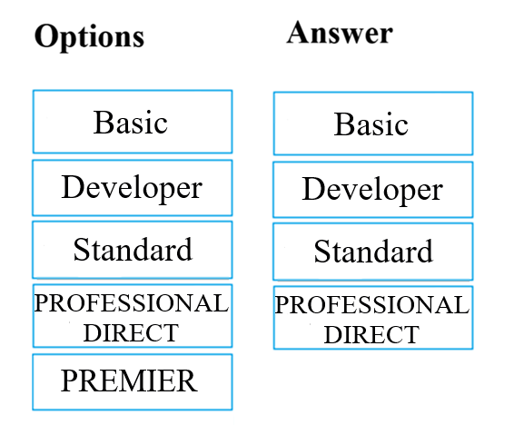

_Figure: Basic, Developer, Standard, and Professional Direct are in the answer area. Premier is not._

Basic can open billing and subscription support requests. Developer, Standard, and Professional Direct can open technical support requests as well.

**Why the others are wrong**

- Premier is the option left out. It is not one of the Azure support plans on the current comparison (Basic, Developer, Standard, Professional Direct, and Unified Enterprise). The solution image does not place it in the answer area.

**Study further**

- [Compare Azure support plans](https://azure.microsoft.com/en-us/support/plans)
- [Create an Azure support request](https://learn.microsoft.com/en-us/azure/azure-portal/supportability/how-to-create-azure-support-request)

<strong>Question 2 - Storage readable in two regions</strong>

Your company has datacenters in Los Angeles and New York. The company has a Microsoft Azure subscription.

You are configuring the two datacenters as geo-clustered sites for site resiliency.

You need to recommend an Azure storage redundancy option.

You have the following data storage requirements:

- Data must be stored on multiple nodes.
- Data must be stored on nodes in separate geographic locations.
- Data can be read from the secondary location as well as from the primary location.

Which of the following Azure storage redundancy options should you recommend?

- A. Geo-redundant storage
- B. Read-only geo-redundant storage
- C. Zone-redundant storage
- D. Locally redundant storage

<strong>Answer 2</strong>

B. Read-only geo-redundant storage.

Read-only geo-redundant storage (RA-GRS) keeps a copy in a paired region and lets you read that copy. The question needs multiple nodes, a second geography, and reads from the secondary.

**Why the others are wrong**

- A. Geo-redundant storage copies data to a paired region, but the secondary is not readable until the account fails over.
- C. Zone-redundant storage copies data across availability zones in one region. It does not put a copy in a separate geography.
- D. Locally redundant storage keeps copies in one datacenter. It does not meet the separate-location or secondary-read requirements.

**Study further**

- [Azure Storage redundancy](https://learn.microsoft.com/en-us/azure/storage/common/storage-redundancy)

<strong>Question 3 - Cheapest plan for a design assessment</strong>

This item shares its setup with other questions. Each one proposes a different solution. Decide whether this solution meets the goal.

Your company's Azure subscription includes a Basic support plan.

They would like to request an assessment of an Azure environment's design from Microsoft. This is not supported by the existing plan.

You want the company to subscribe to a support plan that allows this, while keeping expenses to a minimum.

Solution: You recommend that the company subscribes to the Professional Direct support plan.

Does the solution meet the goal?

- A. Yes
- B. No

<strong>Answer 3</strong>

B. No.

The goal is a design assessment at the lowest cost. Developer and Standard both include general architecture guidance, and both cost less than Professional Direct ($29 and $100 a month versus $1,000). Professional Direct adds delivery-manager guidance, but it misses the minimum-cost requirement.

**Why the others are wrong**

- A. Yes would mean Professional Direct is the cheapest plan that allows a design assessment. General architecture guidance is already listed for Developer and Standard.

**Study further**

- [Compare Azure support plans](https://azure.microsoft.com/en-us/support/plans)
- [Azure Support: Professional Direct](https://azure.microsoft.com/en-us/support/plans/prodirect)

<strong>Question 4 - Virtual machines as SaaS</strong>

This item shares its setup with other questions. Each one proposes a different solution. Decide whether this solution meets the goal.

You are tasked with deploying Azure virtual machines for your company.

You need to make use of the appropriate cloud deployment solution.

Solution: You should make use of Software as a Service (SaaS).

Does the solution meet the goal?

- A. Yes
- B. No

<strong>Answer 4</strong>

B. No.

SaaS is a finished application you use, such as Microsoft 365. Deploying virtual machines means you rent the infrastructure and manage the operating system, which is Infrastructure as a Service.

**Why the others are wrong**

- A. Yes would mean SaaS is how you deploy virtual machines. In SaaS, Microsoft runs the application. You do not get a virtual machine to manage.

**Study further**

- [Describe cloud service types](https://learn.microsoft.com/en-us/training/modules/describe-cloud-service-types/)
- [Shared responsibility in the cloud](https://learn.microsoft.com/en-us/azure/security/fundamentals/shared-responsibility)

<strong>Question 5 - Virtual machines as PaaS</strong>

This item shares its setup with other questions. Each one proposes a different solution. Decide whether this solution meets the goal.

You are tasked with deploying Azure virtual machines for your company.

You need to make use of the appropriate cloud deployment solution.

Solution: You should make use of Platform as a Service (PaaS).

Does the solution meet the goal?

- A. Yes
- B. No

<strong>Answer 5</strong>

B. No.

PaaS supplies the runtime and hides the virtual machines. A requirement to deploy virtual machines is Infrastructure as a Service, where you manage the operating system.

**Why the others are wrong**

- A. Yes would mean PaaS is the model for deploying virtual machines. In PaaS you deploy the app and Microsoft manages the operating system, so you are not deploying VMs.

**Study further**

- [Describe cloud service types](https://learn.microsoft.com/en-us/training/modules/describe-cloud-service-types/)
- [Shared responsibility in the cloud](https://learn.microsoft.com/en-us/azure/security/fundamentals/shared-responsibility)

<strong>Question 6 - Virtual machines as IaaS</strong>

This item shares its setup with other questions. Each one proposes a different solution. Decide whether this solution meets the goal.

You are tasked with deploying Azure virtual machines for your company.

You need to make use of the appropriate cloud deployment solution.

Solution: You should make use of Infrastructure as a Service (IaaS).

Does the solution meet the goal?

- A. Yes
- B. No

<strong>Answer 6</strong>

A. Yes.

Infrastructure as a Service is the model for Azure virtual machines. You manage the operating system and the apps. Microsoft manages the hardware.

**Why the others are wrong**

- B. No would mean IaaS is the wrong model for virtual machines. Azure Virtual Machines are the IaaS example: you still manage the guest operating system.

**Study further**

- [Describe cloud service types](https://learn.microsoft.com/en-us/training/modules/describe-cloud-service-types/)
- [Shared responsibility in the cloud](https://learn.microsoft.com/en-us/azure/security/fundamentals/shared-responsibility)

<strong>Question 7 - Web tier for ten apps</strong>

Your developers have created 10 web applications that must be hosted on Azure.

You need to determine which Azure web tier plan to host the web apps. The web tier plan must meet the following requirements:

- The web apps will use custom domains.
- The web apps each require 10 GB of storage.
- The web apps must each run in dedicated compute instances.
- Load balancing between instances must be included.
- Costs must be minimized.

Which web tier plan should you use?

- A. Standard
- B. Basic
- C. Free
- D. Shared

<strong>Answer 7</strong>

A. Standard.

The source marks Standard. Free and Shared are shared compute with 1 GB of storage, so they miss dedicated instances and 10 GB. Standard has dedicated instances, custom domains, 50 GB, an integrated load balancer, and autoscale.

**Why the others are wrong**

- B. Basic has dedicated instances, custom domains, 10 GB, and an integrated load balancer, and it can scale to 3 instances. On the current limits table it meets the written requirements and costs less than Standard. The source still marks Standard. Autoscale is the feature that starts at Standard.
- C. Free is shared compute, 1 GB of storage, no custom domain, one instance, and no integrated load balancer.
- D. Shared allows custom domains and has an integrated load balancer, but it is shared compute, 1 GB of storage, and one instance.

**Study further**

- [App Service plans](https://learn.microsoft.com/en-us/azure/app-service/overview-hosting-plans)
- [App Service limits](https://learn.microsoft.com/en-us/azure/azure-resource-manager/management/azure-subscription-service-limits#azure-app-service-limits)

<strong>Question 8 - One directory or several</strong>

This item shares its setup with other questions. Each one proposes a different solution. Decide whether this solution meets the goal.

You are planning to migrate a company to Azure. Each of the company's numerous divisions will have an administrator in place to manage the Azure resources used by their respective division.

You want the Azure deployment to be segmented for the divisions, while keeping administrative effort to a minimum.

Solution: You plan to make use of several Azure Active Directory (Azure AD) directories.

Does the solution meet the goal?

- A. Yes
- B. No

<strong>Answer 8</strong>

B. No.

A separate directory is a separate tenant. Each tenant has its own identities, so several directories raise administrative effort. Segment the divisions with separate subscriptions in one directory, and give each division admin access to its own subscription.

**Why the others are wrong**

- A. Yes would mean several directories is the low-effort way to split divisions. A subscription can trust only one directory, but one directory can back many subscriptions. Extra directories add tenants to administer.

**Study further**

- [Associate a subscription with a directory](https://learn.microsoft.com/en-us/entra/fundamentals/how-subscriptions-associated-directory)
- [Multiple Microsoft Entra tenants](https://learn.microsoft.com/en-us/azure/cloud-adoption-framework/ready/landing-zone/design-area/multi-tenant/overview)

<strong>Question 9 - Web tier for the Miami site</strong>

Your developers have created a portal web app for users in the Miami branch office. The web app will be publicly accessible and used by the Miami users to retrieve customer and product information. The web app is currently running in an on-premises test environment.

You plan to host the web app on Azure.

You need to determine which Azure web tier plan to host the web app. The web tier plan must meet the following requirements:

- The website will use the miami.weyland.com URL.
- The website will be deployed to two instances.
- SSL support must be included.
- The website requires 12 GB of storage.
- Costs must be minimized.

Which web tier plan should you use?

- A. Standard
- B. Basic
- C. Free
- D. Shared

<strong>Answer 9</strong>

A. Standard.

The site needs a custom domain, two instances, SSL, and 12 GB. Standard has custom domains, SSL, up to 10 instances, and 50 GB of storage. It is the cheapest tier that fits 12 GB.

**Why the others are wrong**

- B. Basic has custom domains, SNI SSL, and up to 3 instances, but storage stops at 10 GB. This site needs 12 GB.
- C. Free has no custom domain, no custom SSL, 1 GB of storage, and one shared instance.
- D. Shared can use a custom domain, but custom SSL is not supported, storage is 1 GB, and it cannot scale past one shared instance.

**Study further**

- [App Service plans](https://learn.microsoft.com/en-us/azure/app-service/overview-hosting-plans)
- [App Service limits](https://learn.microsoft.com/en-us/azure/azure-resource-manager/management/azure-subscription-service-limits#azure-app-service-limits)

<strong>Question 10 - Pay-as-you-go expenditure model</strong>

This item shares its setup with other questions. Each one proposes a different solution. Decide whether this solution meets the goal.

Your company is planning to migrate all their virtual machines to an Azure pay-as-you-go subscription. The virtual machines are currently hosted on the Hyper-V hosts in a data center.

You are required to make sure that the intended Azure solution uses the correct expenditure model.

Solution: You should recommend the use of the elastic expenditure model.

Does the solution meet the goal?

- A. Yes
- B. No

<strong>Answer 10</strong>

B. No.

Pay-as-you-go is an operational expenditure (OpEx) model: you pay for what you use instead of buying the hardware. "Elastic expenditure" is not an Azure expenditure model. Elasticity describes scaling.

**Why the others are wrong**

- A. Yes would mean elastic expenditure is the model for a pay-as-you-go subscription. The models in this exam are capital expenditure (CapEx) and operational expenditure (OpEx). Moving virtual machines off owned Hyper-V hosts onto pay-as-you-go is OpEx.

**Study further**

- [Describe the consumption-based model](https://learn.microsoft.com/en-us/training/modules/describe-cloud-compute/6-describe-consumption-based-model)
- [Shift from CapEx to OpEx](https://learn.microsoft.com/en-us/azure/cloud-adoption-framework/strategy/inform/cost-efficiency)

**Source:** [11-20.pdf](files/11-20.pdf)

<strong>Question 11 - Scalable expenditure model</strong>

This item shares its setup with other questions. Each one proposes a different solution. Decide whether this solution meets the goal.

Your company is planning to migrate all their virtual machines to an Azure pay-as-you-go subscription. The virtual machines are currently hosted on the Hyper-V hosts in a data center.

You are required to make sure that the intended Azure solution uses the correct expenditure model.

Solution: You should recommend the use of the scalable expenditure model.

Does the solution meet the goal?

- A. Yes
- B. No

<strong>Answer 11</strong>

B. No.

Pay-as-you-go is an operational expenditure (OpEx) model. "Scalable expenditure" is not an Azure expenditure model. Scalability describes adding or removing capacity.

**Why the others are wrong**

- A. Yes would mean scalable expenditure is the model for a pay-as-you-go subscription. Moving virtual machines off owned Hyper-V hosts onto pay-as-you-go is OpEx.

**Study further**

- [Describe the consumption-based model](https://learn.microsoft.com/en-us/training/modules/describe-cloud-compute/6-describe-consumption-based-model)
- [Shift from CapEx to OpEx](https://learn.microsoft.com/en-us/azure/cloud-adoption-framework/strategy/inform/cost-efficiency)

<strong>Question 12 - Operational expenditure model</strong>

This item shares its setup with other questions. Each one proposes a different solution. Decide whether this solution meets the goal.

Your company is planning to migrate all their virtual machines to an Azure pay-as-you-go subscription. The virtual machines are currently hosted on the Hyper-V hosts in a data center.

You are required to make sure that the intended Azure solution uses the correct expenditure model.

Solution: You should recommend the use of the operational expenditure model.

Does the solution meet the goal?

- A. Yes
- B. No

<strong>Answer 12</strong>

A. Yes.

Operational expenditure (OpEx) is paying for what you use. A pay-as-you-go subscription replaces the capital cost of the Hyper-V hosts with an ongoing operating cost.

**Why the others are wrong**

- B. No would mean OpEx is the wrong model for pay-as-you-go. Owning the hosts is capital expenditure. Renting them in Azure is operational expenditure.

**Study further**

- [Describe the consumption-based model](https://learn.microsoft.com/en-us/training/modules/describe-cloud-compute/6-describe-consumption-based-model)
- [Shift from CapEx to OpEx](https://learn.microsoft.com/en-us/azure/cloud-adoption-framework/strategy/inform/cost-efficiency)

<strong>Question 13 - Cosmos DB for predictive analytics</strong>

This item shares its setup with other questions. Each one proposes a different solution. Decide whether this solution meets the goal.

You are required to deploy an Artificial Intelligence (AI) solution in Azure.

You want to make sure that you are able to build, test, and deploy predictive analytics for the solution.

Solution: You should make use of Azure Cosmos DB.

Does the solution meet the goal?

- A. Yes
- B. No

<strong>Answer 13</strong>

B. No.

Azure Cosmos DB is a globally distributed database. It stores data. It does not build, test, or deploy predictive models. That work belongs in Azure Machine Learning.

**Why the others are wrong**

- A. Yes would mean Cosmos DB is the service for predictive analytics. Cosmos DB has no model training or deployment workflow.

**Study further**

- [What is Azure Cosmos DB?](https://learn.microsoft.com/en-us/azure/cosmos-db/introduction)
- [What is Azure Machine Learning?](https://learn.microsoft.com/en-us/azure/machine-learning/overview-what-is-azure-machine-learning)

<strong>Question 14 - Sync accounts to Azure AD</strong>

This item shares its setup with other questions. Each one proposes a different solution. Decide whether this solution meets the goal.

Your company's Active Directory forest includes thousands of user accounts.

You have been informed that all network resources will be migrated to Azure. Thereafter, the on-premises data center will be retired.

You are required to employ a strategy that reduces the effect on users, once the planned migration has been completed.

Solution: You plan to sync all the Active Directory user accounts to Azure Active Directory (Azure AD).

Does the solution meet the goal?

- A. Yes
- B. No

<strong>Answer 14</strong>

A. Yes.

Syncing the forest to Microsoft Entra ID (formerly Azure AD) keeps the same user identities when the data center is retired. Users are not asked to start over with new accounts.

**Why the others are wrong**

- B. No would mean a directory sync fails the "reduce the effect on users" requirement. The sync is what carries those thousands of accounts into the cloud before the forest is turned off.

**Study further**

- [What is Microsoft Entra Connect?](https://learn.microsoft.com/en-us/entra/identity/hybrid/connect/whatis-azure-ad-connect)
- [Microsoft Entra Cloud Sync](https://learn.microsoft.com/en-us/entra/identity/hybrid/cloud-sync/what-is-cloud-sync)

<strong>Question 15 - Machine Learning Studio</strong>

This item shares its setup with other questions. Each one proposes a different solution. Decide whether this solution meets the goal.

You are required to deploy an Artificial Intelligence (AI) solution in Azure.

You want to make sure that you are able to build, test, and deploy predictive analytics for the solution.

Solution: You should make use of Azure Machine Learning Studio.

Does the solution meet the goal?

- A. Yes
- B. No

<strong>Answer 15</strong>

A. Yes.

The source marks Yes. Azure Machine Learning is the service for building, training, and deploying predictive models. Machine Learning Studio is the workspace used for that work.

**Why the others are wrong**

- B. No would mean Machine Learning Studio cannot build, test, and deploy predictive analytics. That is the purpose of the service. A database such as Cosmos DB does not replace it.

**Study further**

- [What is Azure Machine Learning?](https://learn.microsoft.com/en-us/azure/machine-learning/overview-what-is-azure-machine-learning)
- [What is an Azure Machine Learning workspace?](https://learn.microsoft.com/en-us/azure/machine-learning/concept-workspace)

<strong>Question 16 - API Management creates resources</strong>

This item shares its setup with other questions. Each one proposes a different solution. Decide whether this solution meets the goal.

Your company's infrastructure includes a number of business units that each need a large number of various Azure resources for everyday operation.

The resources required by each business unit are identical.

You are required to sanction a strategy to create Azure resources automatically.

Solution: You recommend that the Azure API Management service be included in the strategy.

Does the solution meet the goal?

- A. Yes
- B. No

<strong>Answer 16</strong>

B. No.

API Management publishes and secures APIs. It does not create a repeated set of Azure resources. Identical resources are created from an Azure Resource Manager template.

**Why the others are wrong**

- A. Yes would mean API Management is the automation tool for deploying the same resources to each business unit. It manages API calls, not resource deployment.

**Study further**

- [What is Azure API Management?](https://learn.microsoft.com/en-us/azure/api-management/api-management-key-concepts)
- [What are ARM templates?](https://learn.microsoft.com/en-us/azure/azure-resource-manager/templates/overview)

<strong>Question 17 - Management groups create resources</strong>

This item shares its setup with other questions. Each one proposes a different solution. Decide whether this solution meets the goal.

Your company's infrastructure includes a number of business units that each need a large number of various Azure resources for everyday operation.

The resources required by each business unit are identical.

You are required to sanction a strategy to create Azure resources automatically.

Solution: You recommend that management groups be included in the strategy.

Does the solution meet the goal?

- A. Yes
- B. No

<strong>Answer 17</strong>

B. No.

Management groups organize subscriptions so you can apply governance above them. They do not create virtual machines, storage, or other resources. The requirement is automatic creation of identical resources, which is an Azure Resource Manager template.

**Why the others are wrong**

- A. Yes would mean a management group deploys the business units' resources. A management group is a scope for policy and access, not a deployment engine.

**Study further**

- [What are Azure management groups?](https://learn.microsoft.com/en-us/azure/governance/management-groups/overview)
- [What are ARM templates?](https://learn.microsoft.com/en-us/azure/azure-resource-manager/templates/overview)

<strong>Question 18 - Resource Manager templates</strong>

This item shares its setup with other questions. Each one proposes a different solution. Decide whether this solution meets the goal.

Your company's infrastructure includes a number of business units that each need a large number of various Azure resources for everyday operation.

The resources required by each business unit are identical.

You are required to sanction a strategy to create Azure resources automatically.

Solution: You recommend that the Azure Resource Manager templates be included in the strategy.

Does the solution meet the goal?

- A. Yes
- B. No

<strong>Answer 18</strong>

A. Yes.

An Azure Resource Manager template declares a set of resources and can be deployed again for each business unit. The units need the same resources, so one template creates them without repeating the portal work.

**Why the others are wrong**

- B. No would mean templates do not create identical resources automatically. A template is the repeatable deployment for this requirement.

**Study further**

- [What are ARM templates?](https://learn.microsoft.com/en-us/azure/azure-resource-manager/templates/overview)
- [Template deployment modes](https://learn.microsoft.com/en-us/azure/azure-resource-manager/templates/deployment-modes)

<strong>Question 19 - Two VMs, one zone</strong>

This item shares its setup with other questions. Each one proposes a different solution. Decide whether this solution meets the goal.

You are tasked with deploying a critical line-of-business application, which will be installed on a virtual machine, to Azure.

You are informed that the application deployment strategy should allow for a guaranteed availability of 99.99 percent. You need to make sure that the strategy requires as few virtual machines and availability zones as possible.

Solution: You include two virtual machines and one availability zone in your strategy.

Does the solution meet the goal?

- A. Yes
- B. No

<strong>Answer 19</strong>

B. No.

The 99.99 percent virtual machine SLA needs at least two virtual machines spread across two availability zones. Two machines in one zone do not meet that SLA. One zone is also a single datacenter failure domain.

**Why the others are wrong**

- A. Yes would mean two virtual machines in one zone satisfy 99.99 percent. That arrangement can meet the 99.95 percent availability-set SLA, not the zone SLA.

**Study further**

- [Availability options for Azure virtual machines](https://learn.microsoft.com/en-us/azure/virtual-machines/availability)
- [SLA for Virtual Machines](https://azure.microsoft.com/en-us/support/legal/sla/virtual-machines/)

<strong>Question 20 - One VM, two zones</strong>

This item shares its setup with other questions. Each one proposes a different solution. Decide whether this solution meets the goal.

You are tasked with deploying a critical line-of-business application, which will be installed on a virtual machine, to Azure.

You are informed that the application deployment strategy should allow for a guaranteed availability of 99.99 percent. You need to make sure that the strategy requires as few virtual machines and availability zones as possible.

Solution: You include one virtual machine and two availability zones in your strategy.

Does the solution meet the goal?

- A. Yes
- B. No

<strong>Answer 20</strong>

B. No.

A single virtual machine runs in one place. It cannot occupy two availability zones, and one virtual machine does not qualify for the 99.99 percent SLA. The minimum is two virtual machines in two zones.

**Why the others are wrong**

- A. Yes would mean one virtual machine spread across two zones meets 99.99 percent. A virtual machine is deployed to one zone.

**Study further**

- [Availability options for Azure virtual machines](https://learn.microsoft.com/en-us/azure/virtual-machines/availability)
- [What are availability zones?](https://learn.microsoft.com/en-us/azure/reliability/availability-zones-overview)

**Source:** [21-30.pdf](files/21-30.pdf)

<strong>Question 21 - Two VMs, two zones</strong>

This item shares its setup with other questions. Each one proposes a different solution. Decide whether this solution meets the goal.

You are tasked with deploying a critical line-of-business application, which will be installed on a virtual machine, to Azure.

You are informed that the application deployment strategy should allow for a guaranteed availability of 99.99 percent. You need to make sure that the strategy requires as few virtual machines and availability zones as possible.

Solution: You include two virtual machines and two availability zones in your strategy.

Does the solution meet the goal?

- A. Yes
- B. No

<strong>Answer 21</strong>

A. Yes.

Two virtual machines in two availability zones is the smallest layout that qualifies for the 99.99 percent virtual machine SLA. Each machine sits in a separate zone.

**Why the others are wrong**

- B. No would mean this layout misses 99.99 percent or uses more than the minimum. Two machines and two zones is the minimum for that SLA.

**Study further**

- [Availability options for Azure virtual machines](https://learn.microsoft.com/en-us/azure/virtual-machines/availability)
- [What are availability zones?](https://learn.microsoft.com/en-us/azure/reliability/availability-zones-overview)

<strong>Question 22 - Microsoft Managed Desktop</strong>

This item shares its setup with other questions. Each one proposes a different solution. Decide whether this solution meets the goal.

Your company's developers intend to deploy a large number of custom virtual machines on a weekly basis. They will also be removing these virtual machines during the same week they were deployed. Sixty percent of the virtual machines have Windows Server 2016 installed, while the other forty percent have Ubuntu Linux installed.

You are required to make sure that the administrative effort needed for this process is reduced by employing a suitable Azure service.

Solution: You recommend the use of Microsoft Managed Desktop.

Does the solution meet the goal?

- A. Yes
- B. No

<strong>Answer 22</strong>

B. No.

Microsoft Managed Desktop is a service for managing physical Windows desktops. It does not deploy and delete custom Windows Server and Ubuntu virtual machines each week. Azure DevTest Labs is the service that does that with less administration.

**Why the others are wrong**

- A. Yes would mean Microsoft Managed Desktop creates and removes these mixed virtual machines. It does not manage Azure virtual machine lifecycles.

**Study further**

- [What is Azure DevTest Labs?](https://learn.microsoft.com/en-us/azure/devtest-labs/devtest-lab-overview)
- [Create a virtual machine in a lab](https://learn.microsoft.com/en-us/azure/devtest-labs/devtest-lab-add-vm)

<strong>Question 23 - Reserved VM instances</strong>

This item shares its setup with other questions. Each one proposes a different solution. Decide whether this solution meets the goal.

Your company's developers intend to deploy a large number of custom virtual machines on a weekly basis. They will also be removing these virtual machines during the same week they were deployed. Sixty percent of the virtual machines have Windows Server 2016 installed, while the other forty percent have Ubuntu Linux installed.

You are required to make sure that the administrative effort needed for this process is reduced by employing a suitable Azure service.

Solution: You recommend the use of Azure Reserved Virtual Machine Instances.

Does the solution meet the goal?

- A. Yes
- B. No

<strong>Answer 23</strong>

B. No.

Reserved Virtual Machine Instances cut the cost of machines you keep for one or three years. These machines are deleted the same week they are created, and a reservation does not reduce the work of deploying custom Windows and Linux images. Azure DevTest Labs does.

**Why the others are wrong**

- A. Yes would mean reservations lower the administrative effort of weekly create-and-delete. A reservation is a billing commitment, not a deployment service.

**Study further**

- [What are Azure Reservations?](https://learn.microsoft.com/en-us/azure/cost-management-billing/reservations/save-compute-costs-reservations)
- [What is Azure DevTest Labs?](https://learn.microsoft.com/en-us/azure/devtest-labs/devtest-lab-overview)

<strong>Question 24 - Azure DevTest Labs</strong>

This item shares its setup with other questions. Each one proposes a different solution. Decide whether this solution meets the goal.

Your company's developers intend to deploy a large number of custom virtual machines on a weekly basis. They will also be removing these virtual machines during the same week they were deployed. Sixty percent of the virtual machines have Windows Server 2016 installed, while the other forty percent have Ubuntu Linux installed.

You are required to make sure that the administrative effort needed for this process is reduced by employing a suitable Azure service.

Solution: You recommend the use of Azure DevTest Labs.

Does the solution meet the goal?

- A. Yes
- B. No

<strong>Answer 24</strong>

A. Yes.

Azure DevTest Labs gives developers reusable custom images, formulas, and policies so they can create and delete Windows and Linux lab machines without repeating the full setup each week.

**Why the others are wrong**

- B. No would mean DevTest Labs does not reduce that administrative effort. Formulas and custom images are how a lab repeats both the Windows Server and Ubuntu deployments.

**Study further**

- [What is Azure DevTest Labs?](https://learn.microsoft.com/en-us/azure/devtest-labs/devtest-lab-overview)
- [Create a virtual machine in a lab](https://learn.microsoft.com/en-us/azure/devtest-labs/devtest-lab-add-vm)

<strong>Question 25 - Remote access to VNet1</strong>

Your company has virtual machines (VMs) hosted in Microsoft Azure. The VMs are located in a single Azure virtual network named VNet1.

The company has users that work remotely. The remote workers require access to the VMs on VNet1.

You need to provide access for the remote workers.

What should you do?

- A. Configure a Site-to-Site (S2S) VPN.
- B. Configure a VNet-to-VNet VPN.
- C. Configure a Point-to-Site (P2S) VPN.
- D. Configure DirectAccess on a Windows Server 2012 server VM.
- E. Configure a Multi-Site VPN.

<strong>Answer 25</strong>

C. Configure a Point-to-Site (P2S) VPN.

Point-to-Site connects individual remote computers to an Azure virtual network. The workers are remote users, not another office network.

**Why the others are wrong**

- A. Site-to-Site connects a whole on-premises network to Azure. The requirement is remote workers, not a site.
- B. VNet-to-VNet connects two Azure virtual networks. The users are not in a second virtual network.
- D. DirectAccess is a Windows Server remote-access role. It is not the Azure service for reaching VNet1, and the question does not ask you to deploy a Windows Server remote-access server.
- E. Multi-site VPN connects more than one on-premises site. There is one virtual network and a set of remote users.

**Study further**

- [About Point-to-Site VPN](https://learn.microsoft.com/en-us/azure/vpn-gateway/point-to-site-about)
- [About Site-to-Site VPN](https://learn.microsoft.com/en-us/azure/vpn-gateway/vpn-gateway-about-vpngateways)

<strong>Question 26 - Information Protection for credentials</strong>

This item shares its setup with other questions. Each one proposes a different solution. Decide whether this solution meets the goal.

You have been informed by your superiors of the company's intentions to automate server deployment to Azure. There is, however, some concern that administrative credentials could be uncovered during this process.

You are required to make sure that during the deployment, the administrative credentials are encrypted using a suitable Azure solution.

Solution: You recommend the use of Azure Information Protection.

Does the solution meet the goal?

- A. Yes
- B. No

<strong>Answer 26</strong>

B. No.

Azure Information Protection (now Microsoft Purview Information Protection) classifies and labels documents and email. It does not store deployment secrets. Encrypt the administrative credentials in Azure Key Vault and reference that vault from the deployment.

**Why the others are wrong**

- A. Yes would mean Information Protection encrypts credentials while servers are deployed. It protects files with sensitivity labels, not automation secrets.

**Study further**

- [About Azure Key Vault](https://learn.microsoft.com/en-us/azure/key-vault/general/overview)
- [Learn about sensitivity labels](https://learn.microsoft.com/en-us/purview/sensitivity-labels)

<strong>Question 27 - MFA for deployment credentials</strong>

This item shares its setup with other questions. Each one proposes a different solution. Decide whether this solution meets the goal.

You have been informed by your superiors of the company's intentions to automate server deployment to Azure. There is, however, some concern that administrative credentials could be uncovered during this process.

You are required to make sure that during the deployment, the administrative credentials are encrypted using a suitable Azure solution.

Solution: You recommend the use of Azure Multi-Factor Authentication (MFA).

Does the solution meet the goal?

- A. Yes
- B. No

<strong>Answer 27</strong>

B. No.

Multi-factor authentication asks a person for a second sign-in check. It does not encrypt credentials stored for an automated deployment. Azure Key Vault is the service that holds those secrets encrypted.

**Why the others are wrong**

- A. Yes would mean MFA encrypts the credentials used during deployment. MFA challenges a sign-in. It does not encrypt a secret the template needs.

**Study further**

- [About Azure Key Vault](https://learn.microsoft.com/en-us/azure/key-vault/general/overview)
- [How Microsoft Entra multifactor authentication works](https://learn.microsoft.com/en-us/entra/identity/authentication/concept-mfa-howitworks)

<strong>Question 28 - Who can use Azure Government</strong>

DRAG DROP

The company would like to develop a cloud solution by making use of Azure Government. Azure Government can only be used by certain types of clients to develop cloud solutions.

Which of the following are the types of customers that can make use of Azure Government in this situation? Answer by dragging the correct option from the list to the answer area.

_Figure: Options are a government contractor from any country, a government entity from any country, a European government contractor, a European government entity, a United States government contractor, and a United States government entity. The answer area is empty._

<strong>Answer 28</strong>

A United States government contractor, and a United States government entity.

_Figure: A United States government contractor and a United States government entity are in the answer area. The other four options stay in the list._

Azure Government is the United States government cloud. US federal, state, local, and tribal entities can use it, and so can the partners and contractors who work with them. Customers outside the United States use other Azure clouds.

**Why the others are wrong**

- A government contractor from any country is left out. Azure Government is not open to contractors worldwide.
- A government entity from any country is left out. A non-US government entity is not an Azure Government customer.
- A European government contractor is left out. European government work uses other sovereign clouds, not Azure Government.
- A European government entity is left out. Azure Government is for United States government customers.

**Study further**

- [What is Azure Government?](https://learn.microsoft.com/en-us/azure/azure-government/documentation-government-welcome)
- [Azure Government isolation guidelines](https://learn.microsoft.com/en-us/azure/azure-government/documentation-government-plan-compliance)

<strong>Question 29 - Identity Protection for unknown IPs</strong>

This item shares its setup with other questions. Each one proposes a different solution. Decide whether this solution meets the goal.

Your company has an Azure Active Directory (Azure AD) environment. Users occasionally connect to Azure AD via the Internet.

You have been tasked with making sure that users who connect to Azure AD via the internet from an unidentified IP address are automatically encouraged to change passwords.

Solution: You configure the use of Azure AD Identity Protection.

Does the solution meet the goal?

- A. Yes
- B. No

<strong>Answer 29</strong>

A. Yes.

Microsoft Entra ID Protection (formerly Azure AD Identity Protection) can treat a sign-in from an unfamiliar IP address as user risk and require a password change. That is the automatic prompt the requirement describes.

**Why the others are wrong**

- B. No would mean Identity Protection cannot require a password change for a risky sign-in. A user-risk policy can require a secure password change.

**Study further**

- [What is Microsoft Entra ID Protection?](https://learn.microsoft.com/en-us/entra/id-protection/overview-identity-protection)
- [User risk policy](https://learn.microsoft.com/en-us/entra/id-protection/concept-identity-protection-policies#user-risk-policy)

<strong>Question 30 - Privileged Identity Management</strong>

This item shares its setup with other questions. Each one proposes a different solution. Decide whether this solution meets the goal.

Your company has an Azure Active Directory (Azure AD) environment. Users occasionally connect to Azure AD via the Internet.

You have been tasked with making sure that users who connect to Azure AD via the internet from an unidentified IP address are automatically encouraged to change passwords.

Solution: You configure the use of Azure AD Privileged Identity Management.

Does the solution meet the goal?

- A. Yes
- B. No

<strong>Answer 30</strong>

B. No.

Privileged Identity Management controls just-in-time activation of privileged roles. It does not detect an unfamiliar IP address or prompt a password change. Microsoft Entra ID Protection does.

**Why the others are wrong**

- A. Yes would mean PIM responds to unidentified IP addresses with a password change. PIM manages role activation, not sign-in risk.

**Study further**

- [What is Privileged Identity Management?](https://learn.microsoft.com/en-us/entra/id-governance/privileged-identity-management/pim-configure)
- [What is Microsoft Entra ID Protection?](https://learn.microsoft.com/en-us/entra/id-protection/overview-identity-protection)

**Source:** [31-40.pdf](files/31-40.pdf)

<strong>Question 31 - NSGs between web and database</strong>

This item shares its setup with other questions. Each one proposes a different solution. Decide whether this solution meets the goal.

You are planning a strategy to deploy numerous web servers and database servers to Azure.

This strategy should allow for connection types between the web servers and database servers to be controlled.

Solution: You include network security groups (NSGs) in your strategy.

Does the solution meet the goal?

- A. Yes
- B. No

<strong>Answer 31</strong>

A. Yes.

A network security group filters inbound and outbound traffic by port, protocol, and source or destination. That is how you control which connection types are allowed between the web tier and the database tier.

**Why the others are wrong**

- B. No would mean an NSG cannot control those connections. NSG security rules are the filter for traffic between the two tiers.

**Study further**

- [Network security groups](https://learn.microsoft.com/en-us/azure/virtual-network/network-security-groups-overview)
- [How network security groups filter network traffic](https://learn.microsoft.com/en-us/azure/virtual-network/network-security-group-how-it-works)

<strong>Question 32 - Local network gateway</strong>

This item shares its setup with other questions. Each one proposes a different solution. Decide whether this solution meets the goal.

You are planning a strategy to deploy numerous web servers and database servers to Azure.

This strategy should allow for connection types between the web servers and database servers to be controlled.

Solution: You include a local network gateway in your strategy.

Does the solution meet the goal?

- A. Yes
- B. No

<strong>Answer 32</strong>

B. No.

A local network gateway represents an on-premises network for a Site-to-Site VPN. It does not filter connection types between web servers and database servers in Azure. A network security group does.

**Why the others are wrong**

- A. Yes would mean a local network gateway controls traffic between the two server tiers. It only describes the on-premises address space for a gateway connection.

**Study further**

- [About local network gateways](https://learn.microsoft.com/en-us/azure/vpn-gateway/vpn-gateway-about-vpn-gateway-settings)
- [Network security groups](https://learn.microsoft.com/en-us/azure/virtual-network/network-security-groups-overview)

<strong>Question 33 - MFA after the datacenter closes</strong>

This item shares its setup with other questions. Each one proposes a different solution. Decide whether this solution meets the goal.

Your company's Active Directory forest includes thousands of user accounts.

You have been informed that all network resources will be migrated to Azure. Thereafter, the on-premises data center will be retired.

You are required to employ a strategy that reduces the effect on users, once the planned migration has been completed.

Solution: You plan to require Azure Multi-Factor Authentication (MFA).

Does the solution meet the goal?

- A. Yes
- B. No

<strong>Answer 33</strong>

B. No.

Requiring MFA adds a sign-in check. It does not move the thousands of Active Directory accounts into the cloud, so it does not reduce the impact of retiring the data center. Sync the accounts to Microsoft Entra ID.

**Why the others are wrong**

- A. Yes would mean MFA preserves users' identities through the migration. MFA does not copy or replace the directory.

**Study further**

- [What is Microsoft Entra Connect?](https://learn.microsoft.com/en-us/entra/identity/hybrid/connect/whatis-azure-ad-connect)
- [How Microsoft Entra multifactor authentication works](https://learn.microsoft.com/en-us/entra/identity/authentication/concept-mfa-howitworks)

<strong>Question 34 - PaaS web app statements</strong>

HOTSPOT

For each of the following statements, select Yes if the statement is true. Otherwise, select No.

NOTE: Each correct selection is worth one point.

_Figure: Three statements about a platform as a service solution that hosts web apps in Azure. Each row has an empty Yes and an empty No. The statements are full control of the operating systems, automatic platform scaling, and professional development services that add features to custom applications._

<strong>Answer 34</strong>

No. Yes. Yes.

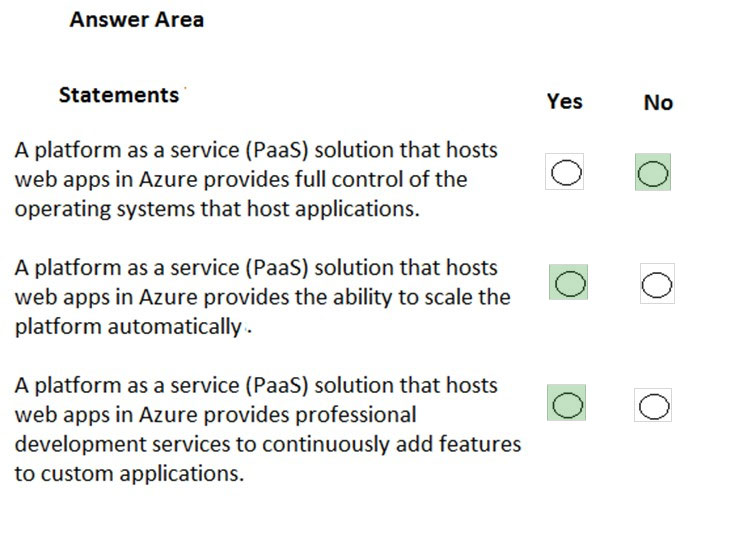

_Figure: Full control of the operating systems is No. Automatic platform scaling is Yes. Professional development services that add features is Yes._

In platform as a service, Microsoft runs the operating system. Azure App Service can scale the platform automatically, and the platform includes services developers use to keep adding features.

**Why the others are wrong**

- Yes for full control of the operating systems misses how PaaS works. You deploy the app. You do not manage the host operating system.
- No for automatic scaling misses App Service autoscale, which adds instances as load changes.
- No for professional development services misses the platform services PaaS includes, such as authentication, deployment, and application components you build on.

**Study further**

- [App Service overview](https://learn.microsoft.com/en-us/azure/app-service/overview)
- [Describe cloud service types](https://learn.microsoft.com/en-us/training/modules/describe-cloud-service-types/)

<strong>Question 35 - CapEx, OpEx, and stopped VMs</strong>

HOTSPOT

For each of the following statements, select Yes if the statement is true. Otherwise, select No.

NOTE: Each correct selection is worth one point.

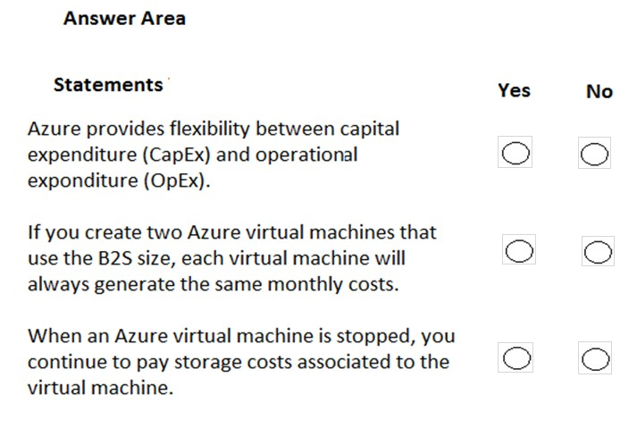

_Figure: Three statements, each with an empty Yes and an empty No. Azure provides flexibility between capital expenditure (CapEx) and operational expenditure (OpEx). Two B2S virtual machines always generate the same monthly costs. A stopped virtual machine still incurs its storage costs._

<strong>Answer 35</strong>

Yes. No. Yes.

_Figure: CapEx and OpEx flexibility is Yes. Identical monthly costs for two B2S virtual machines is No. Storage costs for a stopped virtual machine is Yes._

Azure lets you shift from buying hardware up front to paying as you go. Two virtual machines of the same size can still differ in disks, and those disks are billed when the machine is stopped.

**Why the others are wrong**

- No for CapEx and OpEx flexibility misses the consumption model. You can keep some spending as capital expenditure and move other workloads to operational expenditure.
- Yes for identical B2S monthly costs misses disks, licenses, and other attached resources. The size sets the compute price, not the whole bill.
- No for storage costs on a stopped machine misses managed disks. Stopped (deallocated) compute is not billed. The disks are.

**Study further**

- [States and billing status of Azure Virtual Machines](https://learn.microsoft.com/en-us/azure/virtual-machines/states-billing)
- [Describe the consumption-based model](https://learn.microsoft.com/en-us/training/modules/describe-cloud-compute/6-describe-consumption-based-model)

<strong>Question 36 - SaaS customer responsibility</strong>

HOTSPOT

To complete the sentence, select the appropriate option in the answer area.

_Figure: "When you are implementing a Software as a Service (SaaS) solution, you are responsible for" and an open list: configuring high availability, defining scalability rules, installing the SaaS solution, configuring the SaaS solution. Nothing is selected._

<strong>Answer 36</strong>

Configuring the SaaS solution.

_Figure: Configuring the SaaS solution is highlighted. The other three options are not._

In SaaS you rent a finished application. You configure how your organization uses it. The provider installs it and runs availability and scale.

**Why the others are wrong**

- Configuring high availability is the provider's responsibility. You do not place the SaaS application across zones.
- Defining scalability rules is the provider's responsibility. You do not scale the platform underneath a SaaS app.
- Installing the SaaS solution is the provider's responsibility. You connect to the application. You do not install it.

**Study further**

- [Describe cloud service types](https://learn.microsoft.com/en-us/training/modules/describe-cloud-service-types/)
- [Shared responsibility in the cloud](https://learn.microsoft.com/en-us/azure/security/fundamentals/shared-responsibility)

<strong>Question 37 - Survive a datacenter outage</strong>

You have an on-premises network that contains several servers.

You plan to migrate all the servers to Azure.

You need to recommend a solution to ensure that some of the servers are available if a single Azure data center goes offline for an extended period.

What should you include in the recommendation?

- A. Fault tolerance
- B. Elasticity
- C. Scalability
- D. Low latency

<strong>Answer 37</strong>

A. Fault tolerance.

Fault tolerance is continuing to run after part of the system fails. Availability zones place copies in separate datacenters so a datacenter outage does not take every server offline.

**Why the others are wrong**

- B. Elasticity is growing and shrinking with demand. It does not keep servers available through a datacenter failure.
- C. Scalability is handling more load by adding capacity. Extra capacity in the same datacenter still fails with that datacenter.
- D. Low latency is a short network delay. It does not survive an extended datacenter outage.

**Study further**

- [Availability options for Azure virtual machines](https://learn.microsoft.com/en-us/azure/virtual-machines/availability)
- [What are availability zones?](https://learn.microsoft.com/en-us/azure/reliability/availability-zones-overview)

<strong>Question 38 - Close the data center</strong>

HOTSPOT

To complete the sentence, select the appropriate option in the answer area.

_Figure: "An organization that hosts its infrastructure _____ no longer requires a data center." The open list is: in a private cloud, in a hybrid cloud, in the public cloud, on a Hyper-V host. Nothing is selected._

<strong>Answer 38</strong>

In the public cloud.

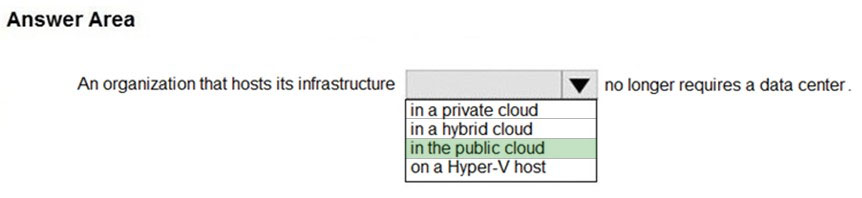

_Figure: In the public cloud is highlighted. Private cloud, hybrid cloud, and a Hyper-V host are not._

A public cloud such as Azure runs on the provider's hardware. The organization can close its own data center. A private cloud and a Hyper-V host are that data center. A hybrid cloud still keeps a private portion.

**Why the others are wrong**

- In a private cloud still needs the organization's data center. The organization owns the hardware.
- In a hybrid cloud keeps some infrastructure on-premises, so the data center remains.
- On a Hyper-V host is the on-premises virtualization platform. Those hosts live in the data center.

**Study further**

- [Describe public, private, and hybrid cloud](https://learn.microsoft.com/en-us/training/modules/describe-cloud-compute/5-define-cloud-models)
- [What is cloud computing?](https://azure.microsoft.com/en-us/resources/cloud-computing-dictionary/what-is-cloud-computing)

<strong>Question 39 - Public cloud characteristics</strong>

What are two characteristics of the public cloud? Each correct answer presents a complete solution.

NOTE: Each correct selection is worth one point.

- A. Dedicated hardware
- B. Unsecured connections
- C. Limited storage
- D. Metered pricing
- E. Self-service management

<strong>Answer 39</strong>

D. Metered pricing, and E. Self-service management.

Public cloud uses pay-as-you-go pricing, and you deploy and configure resources yourself. The provider owns the shared hardware underneath.

**Why the others are wrong**

- A. Dedicated hardware misses the public cloud model. The physical hosts are shared by customers unless you buy a separate dedicated offer.
- B. Unsecured connections misses the platform. Traffic to Azure is protected with encryption and identity. Public does not mean unsecured.
- C. Limited storage misses consumption-based capacity. You add storage as you need it.

**Study further**

- [Describe public, private, and hybrid cloud](https://learn.microsoft.com/en-us/training/modules/describe-cloud-compute/5-define-cloud-models)
- [Describe the consumption-based model](https://learn.microsoft.com/en-us/training/modules/describe-cloud-compute/6-describe-consumption-based-model)

<strong>Question 40 - Migrate a public website</strong>

HOTSPOT

To complete the sentence, select the appropriate option in the answer area.

_Figure: "When planning to migrate a public website to Azure, you must plan to" and an open list: deploy a VPN, pay monthly usage costs, pay to transfer all the website data to Azure, reduce the number of connections to the website. Nothing is selected._

<strong>Answer 40</strong>

Pay monthly usage costs.

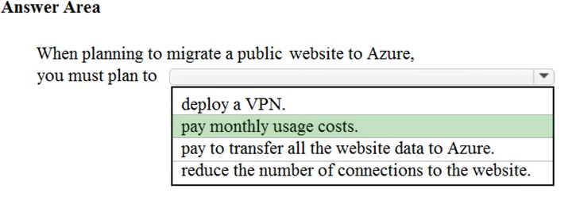

_Figure: Pay monthly usage costs is highlighted. Deploy a VPN, pay to transfer all the website data, and reduce the number of connections are not._

A public website on Azure is billed for the compute, bandwidth, and storage it uses. That is the pay-as-you-go plan you have to make. Inbound data transfer into Azure is not the charge this sentence is pointing at, and a public site does not need a VPN or fewer visitors.

**Why the others are wrong**

- Deploy a VPN is for private connectivity. A public website is reached over the internet.
- Pay to transfer all the website data to Azure misses the pricing direction. Ingress into Azure is free. The ongoing cost is monthly usage.
- Reduce the number of connections to the website is the opposite of hosting a public site. Azure is built to accept the site's traffic.

**Study further**

- [Describe the consumption-based model](https://learn.microsoft.com/en-us/training/modules/describe-cloud-compute/6-describe-consumption-based-model)
- [Bandwidth pricing](https://azure.microsoft.com/en-us/pricing/details/bandwidth/)

**Source:** [41-50.pdf](files/41-50.pdf)

<strong>Question 41 - App Service and Azure SQL</strong>

This item shares its setup with other questions. Each one proposes a different solution. Decide whether this solution meets the goal.

Your company plans to migrate all its data and resources to Azure.

The company's migration plan states that only Platform as a Service (PaaS) solutions must be used in Azure.

You need to deploy an Azure environment that meets the company migration plan.

Solution: You create an Azure App Service and Azure SQL databases.

Does this meet the goal?

- A. Yes
- B. No

<strong>Answer 41</strong>

A. Yes.

Azure App Service and Azure SQL Database are both platform as a service. The plan allows only PaaS, and this solution stays inside that boundary.

**Why the others are wrong**

- B. No would mean one of these services is not PaaS. App Service hosts the app without a virtual machine to manage, and Azure SQL Database is a managed database engine.

**Study further**

- [App Service overview](https://learn.microsoft.com/en-us/azure/app-service/overview)
- [What is Azure SQL Database?](https://learn.microsoft.com/en-us/azure/azure-sql/database/sql-database-paas-overview)

<strong>Question 42 - App Service and SQL on VMs</strong>

This item shares its setup with other questions. Each one proposes a different solution. Decide whether this solution meets the goal.

Your company plans to migrate all its data and resources to Azure.

The company's migration plan states that only Platform as a Service (PaaS) solutions must be used in Azure.

You need to deploy an Azure environment that meets the company migration plan.

Solution: You create an Azure App Service and Azure virtual machines that have Microsoft SQL Server installed.

Does this meet the goal?

- A. Yes
- B. No

<strong>Answer 42</strong>

B. No.

App Service is platform as a service. A virtual machine with SQL Server installed is infrastructure as a service, because you manage the operating system and SQL Server. The plan allows only PaaS, so the virtual machines miss the requirement.

**Why the others are wrong**

- A. Yes would mean those virtual machines are platform as a service. Installing SQL Server on a virtual machine leaves the operating system and the database software with you.

**Study further**

- [App Service overview](https://learn.microsoft.com/en-us/azure/app-service/overview)
- [What is Azure Virtual Machines?](https://learn.microsoft.com/en-us/azure/virtual-machines/overview)

<strong>Question 43 - App Service and storage accounts</strong>

This item shares its setup with other questions. Each one proposes a different solution. Decide whether this solution meets the goal.

Your company plans to migrate all its data and resources to Azure.

The company's migration plan states that only Platform as a Service (PaaS) solutions must be used in Azure.

You need to deploy an Azure environment that meets the company migration plan.

Solution: You create an Azure App Service and Azure Storage accounts.

Does this meet the goal?

- A. Yes
- B. No

<strong>Answer 43</strong>

B. No.

The source marks No. App Service is platform as a service. On this exam, an Azure Storage account is infrastructure as a service: you manage the data, and the account is the storage you rent. The plan allows only PaaS.

**Why the others are wrong**

- A. Yes would mean a storage account counts as platform as a service here. The stated answer treats storage as infrastructure, so the pair fails the PaaS-only plan.

**Study further**

- [Storage account overview](https://learn.microsoft.com/en-us/azure/storage/common/storage-account-overview)
- [Describe cloud service types](https://learn.microsoft.com/en-us/training/modules/describe-cloud-service-types/)

<strong>Question 44 - Elasticity for a monthly spike</strong>

Your company hosts an accounting application named App1 that is used by all the customers of the company.

App1 has low usage during the first three weeks of each month and very high usage during the last week of each month.

Which benefit of Azure Cloud Services supports cost management for this type of usage pattern?

- A. High availability
- B. High latency
- C. Elasticity
- D. Load balancing

<strong>Answer 44</strong>

C. Elasticity.

Elasticity adds compute when the last week of the month is busy and removes it when usage drops. You pay for the spike, then stop paying for idle capacity.

**Why the others are wrong**

- A. High availability keeps the app running through failures. It does not match a monthly usage spike to the bill.
- B. High latency is a long delay. It is not a cost-management benefit, and it is not a benefit you want.
- D. Load balancing spreads requests across instances. It does not add and remove those instances as the month changes.

**Study further**

- [Describe the benefits of using cloud services](https://learn.microsoft.com/en-us/training/modules/describe-benefits-use-cloud-services/)
- [Describe the consumption-based model](https://learn.microsoft.com/en-us/training/modules/describe-cloud-compute/6-describe-consumption-based-model)

<strong>Question 45 - Least admin for a web app</strong>

You plan to migrate a web application to Azure. The web application is accessed by external users.

You need to recommend a cloud deployment solution to minimize the amount of administrative effort used to manage the web application.

What should you include in the recommendation?

- A. Software as a Service (SaaS)
- B. Platform as a Service (PaaS)
- C. Infrastructure as a Service (IaaS)
- D. Database as a Service (DaaS)

<strong>Answer 45</strong>

B. Platform as a Service (PaaS).

The source marks PaaS. You are migrating your own web application, so you still bring the app. App Service runs the platform and leaves you the application to manage. That is less administration than a virtual machine.

**Why the others are wrong**

- A. Software as a Service is a finished application you rent, such as Microsoft 365. It is not where you migrate your own web application. The vote leans this way. The stated answer is PaaS.
- C. Infrastructure as a Service gives you the virtual machine, the operating system, and the web server to patch. That is more administrative effort, not less.
- D. Database as a Service covers the database. It does not host the web application the external users open.

**Study further**

- [App Service overview](https://learn.microsoft.com/en-us/azure/app-service/overview)
- [Describe cloud service types](https://learn.microsoft.com/en-us/training/modules/describe-cloud-service-types/)

<strong>Question 46 - VMs and SQL service types</strong>

HOTSPOT

Which cloud deployment solution is used for Azure virtual machines and Azure SQL databases? To answer, select the appropriate options in the answer area.

NOTE: Each correct selection is worth one point.

_Figure: Azure virtual machines and Azure SQL databases each have an open list: Infrastructure as a service (IaaS), Platform as a service (PaaS), and Software as a service (SaaS). Nothing is selected._

<strong>Answer 46</strong>

Azure virtual machines: Infrastructure as a service (IaaS). Azure SQL databases: Platform as a service (PaaS).

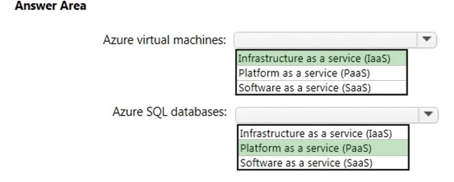

_Figure: Infrastructure as a service is highlighted for Azure virtual machines. Platform as a service is highlighted for Azure SQL databases._

A virtual machine is rented infrastructure: you manage the operating system. Azure SQL Database is a managed database engine: Microsoft patches the platform.

**Why the others are wrong**

- Platform as a service for virtual machines misses the operating system. You still manage that guest.
- Software as a service for virtual machines misses the model. SaaS is a finished application, not a machine you configure.
- Infrastructure as a service for Azure SQL databases misses the managed engine. You do not patch that SQL Server.
- Software as a service for Azure SQL databases misses the model. You still design and query the database. You do not get a finished application.

**Study further**

- [Describe cloud service types](https://learn.microsoft.com/en-us/training/modules/describe-cloud-service-types/)
- [What is Azure SQL Database?](https://learn.microsoft.com/en-us/azure/azure-sql/database/sql-database-paas-overview)

<strong>Question 47 - More capacity at minimum cost</strong>

You have an on-premises network that contains 100 servers.

You need to recommend a solution that provides additional resources to your users. The solution must minimize capital and operational expenditure costs.

What should you include in the recommendation?

- A. A complete migration to the public cloud
- B. An additional data center
- C. A private cloud
- D. A hybrid cloud

<strong>Answer 47</strong>

D. A hybrid cloud.

Keep the 100 servers you already own, and add capacity in the public cloud when users need more. You avoid buying another data center, and you avoid the cost of moving every server.

**Why the others are wrong**

- A. A complete migration to the public cloud turns the existing servers into a migration project and an ongoing operational cost for all 100 workloads. The requirement is additional resources, not a full move.
- B. An additional data center is new buildings, power, and hardware. That is capital expenditure.
- C. A private cloud still runs on hardware you buy and maintain. Extra private capacity is capital expenditure.

**Study further**

- [Define cloud models](https://learn.microsoft.com/en-us/training/modules/describe-cloud-compute/5-define-cloud-models)
- [Shift from CapEx to OpEx](https://learn.microsoft.com/en-us/azure/cloud-adoption-framework/strategy/inform/cost-efficiency)

<strong>Question 48 - Hybrid and public cloud statements</strong>

HOTSPOT

For each of the following statements, select Yes if the statement is true. Otherwise, select No.

NOTE: Each correct selection is worth one point.

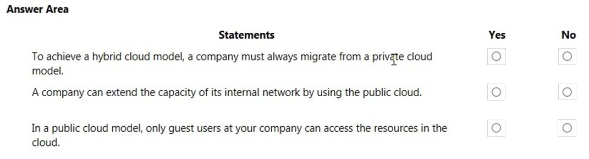

_Figure: Three statements, each with an empty Yes and an empty No. A hybrid cloud always starts by migrating from a private cloud. A company can extend its internal network with the public cloud. In a public cloud, only guest users can access the resources._

<strong>Answer 48</strong>

No. Yes. No.

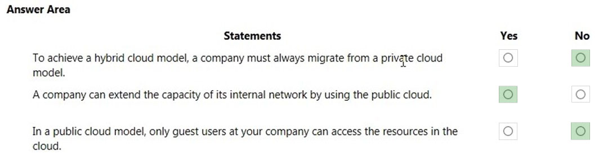

_Figure: Migrating from a private cloud is No. Extending the internal network with the public cloud is Yes. Only guest users can access public cloud resources is No._

A hybrid cloud is any mix of private and public. You can start from either side. Public cloud capacity is how you extend an internal network. Access is granted to identities you choose, not only guests.

**Why the others are wrong**

- Yes for "must always migrate from a private cloud" misses the other path. You can start in the public cloud and connect an on-premises network later.
- No for extending the internal network misses a common hybrid pattern. Add public cloud capacity and connect it, instead of buying more on-premises servers.
- Yes for "only guest users" misses members of your own directory. Employees, applications, and synced accounts can all be allowed in. A guest is only one kind of user.

**Study further**

- [Define cloud models](https://learn.microsoft.com/en-us/training/modules/describe-cloud-compute/5-define-cloud-models)
- [What is Microsoft Entra Connect?](https://learn.microsoft.com/en-us/entra/identity/hybrid/connect/whatis-azure-ad-connect)

<strong>Question 49 - Advantage of the public cloud</strong>

You plan to migrate several servers from an on-premises network to Azure.

What is an advantage of using a public cloud service for the servers over an on-premises network?

- A. The public cloud is owned by the public, not a private corporation.
- B. The public cloud is a crowd-sourcing solution that provides corporations with the ability to enhance the cloud.
- C. All public cloud resources can be freely accessed by every member of the public.
- D. The public cloud is a shared entity whereby multiple corporations each use a portion of the resources in the cloud.

<strong>Answer 49</strong>

D. The public cloud is a shared entity whereby multiple corporations each use a portion of the resources in the cloud.

Microsoft owns the hardware. Many customers each create their own virtual machines and networks on that shared platform. You do not buy the servers.

**Why the others are wrong**

- A. The public is not the owner. Microsoft owns Azure.
- B. The public cloud is not a crowd-sourcing project. Customers do not collectively build the platform.
- C. Resources are not freely open to everyone. You pay for a subscription, and only the identities you authorize can reach your resources.

**Study further**

- [Define cloud models](https://learn.microsoft.com/en-us/training/modules/describe-cloud-compute/5-define-cloud-models)
- [What is cloud computing?](https://azure.microsoft.com/en-us/resources/cloud-computing-dictionary/what-is-cloud-computing)

<strong>Question 50 - What Site Recovery provides</strong>

HOTSPOT

To complete the sentence, select the appropriate option in the answer area.

_Figure: "Azure Site Recovery provides _____ for virtual machines." The open list is fault tolerance, disaster recovery, elasticity, and high availability. Nothing is selected._

<strong>Answer 50</strong>

Disaster recovery.

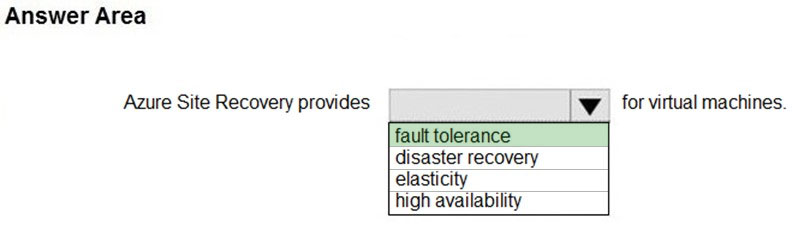

_Figure: The solution image highlights fault tolerance. Disaster recovery, elasticity, and high availability are not highlighted._

The source explanation describes Site Recovery replicating virtual machines to a secondary site so workloads can run during an outage. That is disaster recovery. Microsoft documents Azure Site Recovery as disaster recovery. The solution image highlights fault tolerance instead, which does not match that explanation.

**Why the others are wrong**

- Fault tolerance means the workload keeps running through a failure without a failover. Site Recovery fails a copy over to another site, and that failover takes time. This is the row the solution image highlights.
- Elasticity is adding or removing capacity with demand. Site Recovery does not scale the virtual machine.
- High availability keeps a workload up through smaller faults in a region, such as a restart or a zone failure. Site Recovery is the plan for losing a site.

**Study further**

- [About Azure Site Recovery](https://learn.microsoft.com/en-us/azure/site-recovery/site-recovery-overview)
- [What are business continuity, high availability, and disaster recovery?](https://learn.microsoft.com/en-us/azure/reliability/concept-business-continuity-high-availability-disaster-recovery)

**Source:** [51-60.pdf](files/51-60.pdf)

<strong>Question 51 - Hardware owned by a third party</strong>

In which type of cloud model are all the hardware resources owned by a third party and shared between multiple tenants?

- A. Private
- B. Hybrid
- C. Public

<strong>Answer 51</strong>

C. Public.

In a public cloud, the provider owns the hardware and many customers share it. Azure, Amazon Web Services, and Google Cloud are public clouds. The customers are the tenants.

**Why the others are wrong**

- A. Private cloud hardware is dedicated to one organization. That organization, or a host it hires for its exclusive use, owns or controls it. It is not shared by multiple tenants.
- B. Hybrid cloud still includes a private portion. Not all of the hardware is owned by a third party and shared.

**Study further**

- [Define cloud models](https://learn.microsoft.com/en-us/training/modules/describe-cloud-compute/5-define-cloud-models)
- [What is cloud computing?](https://azure.microsoft.com/en-us/resources/cloud-computing-dictionary/what-is-cloud-computing)

<strong>Question 52 - Expenditure model for pay-as-you-go</strong>

You have 1,000 virtual machines hosted on the Hyper-V hosts in a data center.

You plan to migrate all the virtual machines to an Azure pay-as-you-go subscription.

You need to identify which expenditure model to use for the planned Azure solution.

Which expenditure model should you identify?

- A. Operational
- B. Elastic
- C. Capital
- D. Scalable

<strong>Answer 52</strong>

A. Operational.

Pay-as-you-go replaces the capital cost of the Hyper-V hosts with an operating cost. You pay for the virtual machines as you use them, and you can stop paying for a machine you shut down.

**Why the others are wrong**

- B. Elastic describes scaling. It is not an expenditure model.
- C. Capital expenditure is buying the hardware up front. That is the data center model you are leaving.
- D. Scalable describes capacity. It is not an expenditure model.

**Study further**

- [Describe the consumption-based model](https://learn.microsoft.com/en-us/training/modules/describe-cloud-compute/6-describe-consumption-based-model)
- [Shift from CapEx to OpEx](https://learn.microsoft.com/en-us/azure/cloud-adoption-framework/strategy/inform/cost-efficiency)

<strong>Question 53 - Match cloud benefits</strong>

DRAG DROP

Match the Azure service benefits to the correct descriptions.

To answer, drag the appropriate benefit from the column on the left to its description on the right. Each benefit may be used once, more than once, or not at all.

NOTE: Each correct match is worth one point.

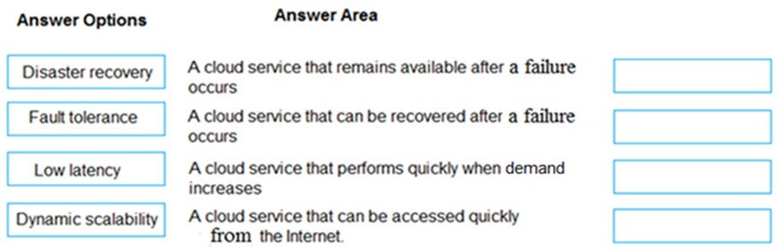

_Figure: Benefits are Disaster recovery, Fault tolerance, Low latency, and Dynamic scalability. The descriptions, with empty boxes, are: remains available after a failure; can be recovered after a failure; performs quickly when demand increases; can be accessed quickly from the internet._

<strong>Answer 53</strong>

Fault tolerance. Disaster recovery. Dynamic scalability. Low latency.

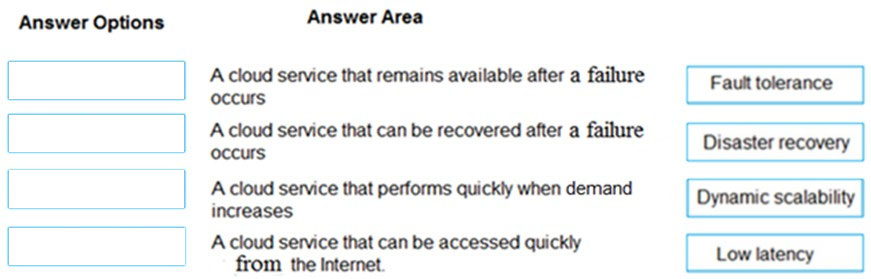

_Figure: Fault tolerance is matched to remaining available after a failure. Disaster recovery is matched to being recovered after a failure. Dynamic scalability is matched to performing quickly when demand increases. Low latency is matched to being accessed quickly from the internet._

Fault tolerance keeps the service up when one part fails. Disaster recovery restores it after the failure. Dynamic scalability adds capacity under load. Low latency is a short response time.

**Why the others are wrong**

- Disaster recovery does not belong on "remains available after a failure." Recovery happens after the outage. Staying available through the failure is fault tolerance.
- Fault tolerance does not belong on "can be recovered after a failure." That is the restore step, which is disaster recovery.
- Low latency does not belong on "performs quickly when demand increases." Handling growth by adding resources is dynamic scalability.
- Dynamic scalability does not belong on "accessed quickly from the internet." A short response time is low latency.

**Study further**

- [Reliability terminology](https://learn.microsoft.com/en-us/azure/reliability/concept-business-continuity-high-availability-disaster-recovery)
- [Describe the benefits of using cloud services](https://learn.microsoft.com/en-us/training/modules/describe-benefits-use-cloud-services/)

<strong>Question 54 - Hybrid cloud requirements</strong>

HOTSPOT

For each of the following statements, select Yes if the statement is true. Otherwise, select No.

NOTE: Each correct selection is worth one point.

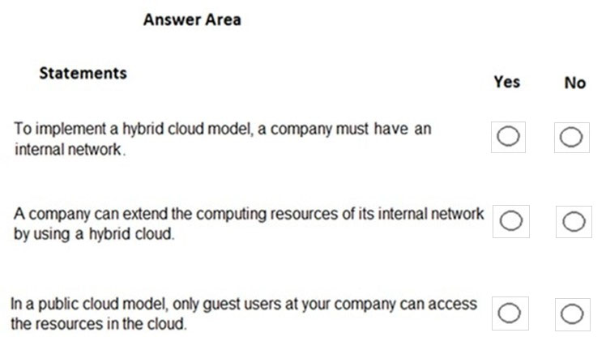

_Figure: Three statements, each with an empty Yes and an empty No. A hybrid cloud requires an internal network. A company can extend its internal network by using a hybrid cloud. In a public cloud, only guest users can access the resources._

<strong>Answer 54</strong>

No. Yes. No.

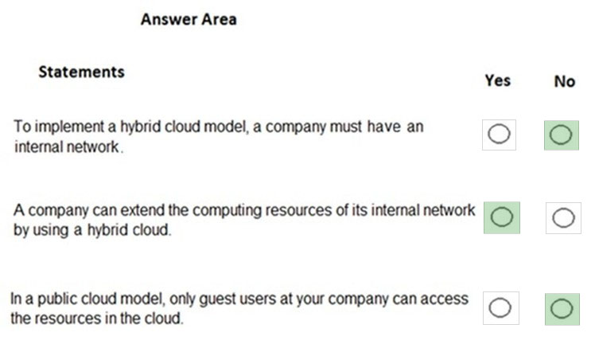

_Figure: An internal network is required for hybrid is No. Extending the internal network with a hybrid cloud is Yes. Only guest users can access public cloud resources is No._

The source marks the first statement No: you can start in the public cloud and add a private environment later, rather than beginning with an internal network. A hybrid cloud is how you add public capacity beside what you already run. Public cloud access is for the accounts you allow, not only guests.

**Why the others are wrong**

- Yes for "must have an internal network" is the opposite of the source mark. The source treats a public-cloud start, with private infrastructure added afterward, as a valid hybrid path.
- No for extending the internal network misses the hybrid pattern. You add cloud resources and connect them instead of buying more on-premises servers.
- Yes for "only guest users" misses employees and applications in your own directory. A guest account is optional.

**Study further**

- [Define cloud models](https://learn.microsoft.com/en-us/training/modules/describe-cloud-compute/5-define-cloud-models)
- [What is Microsoft Entra Connect?](https://learn.microsoft.com/en-us/entra/identity/hybrid/connect/whatis-azure-ad-connect)

<strong>Question 55 - PaaS control, memory, and scale</strong>

HOTSPOT

For each of the following statements, select Yes if the statement is true. Otherwise, select No.

NOTE: Each correct selection is worth one point.

_Figure: Three statements, each with an empty Yes and an empty No. A PaaS solution provides full control of the operating systems. A PaaS solution provides additional memory to apps by changing pricing tiers. A PaaS solution can automatically scale the number of instances._

<strong>Answer 55</strong>

No. No. Yes.

_Figure: Full control of the operating systems is No. Additional memory by changing pricing tiers is No. Automatically scaling the number of instances is Yes._

Platform as a service hides the operating system, and it can add instances as load grows. The source also marks the pricing-tier statement No.

**Why the others are wrong**

- Yes for full control of the operating systems misses PaaS. You deploy the application. Microsoft manages the host operating system.
- Yes for additional memory by changing pricing tiers is the opposite of the source mark. Moving up an App Service plan does increase the plan's memory in the current service. This item still marks the statement No.
- No for automatic scale-out misses autoscale. PaaS can add instances without you deploying new virtual machines.

**Study further**

- [App Service overview](https://learn.microsoft.com/en-us/azure/app-service/overview)
- [Describe cloud service types](https://learn.microsoft.com/en-us/training/modules/describe-cloud-service-types/)

<strong>Question 56 - Work Azure removes from VMs</strong>

Your company has an on-premises network that contains multiple servers.

The company plans to reduce the following administrative responsibilities:

- Backing up application data
- Replacing failed server hardware
- Managing physical server security
- Updating server operating systems
- Managing permissions to shared documents

The company plans to migrate servers to Azure virtual machines.

You need to identify which administrative responsibilities will be eliminated after the planned migration.

Which two responsibilities should you identify? Each correct answer presents a complete solution.

NOTE: Each correct selection is worth one point.

- A. Replacing failed server hardware
- B. Backing up application data
- C. Managing physical server security
- D. Updating server operating systems
- E. Managing permissions to shared documents

<strong>Answer 56</strong>

A. Replacing failed server hardware, and C. Managing physical server security.

Azure virtual machines run on physical hosts that Microsoft owns. Microsoft replaces failed hardware and secures those hosts. You never see the physical servers.

**Why the others are wrong**

- B. Backing up application data stays with you. Microsoft does not back up the application data inside your virtual machines unless you configure a backup service.
- D. Updating server operating systems stays with you. Infrastructure as a service leaves the guest operating system in your hands.
- E. Managing permissions to shared documents stays with you. Microsoft does not set the permissions on folders you host.

**Study further**

- [Shared responsibility in the cloud](https://learn.microsoft.com/en-us/azure/security/fundamentals/shared-responsibility)
- [What is Azure Virtual Machines?](https://learn.microsoft.com/en-us/azure/virtual-machines/overview)

<strong>Question 57 - CapEx and OpEx statements</strong>

HOTSPOT

For each of the following statements, select Yes if the statement is true. Otherwise, select No.

NOTE: Each correct selection is worth one point.

_Figure: Three statements, each with an empty Yes and an empty No. Azure pay-as-you-go pricing is CapEx. Paying electricity for your datacenter is OpEx. Deploying your own datacenter is CapEx._

<strong>Answer 57</strong>

No. No. Yes.

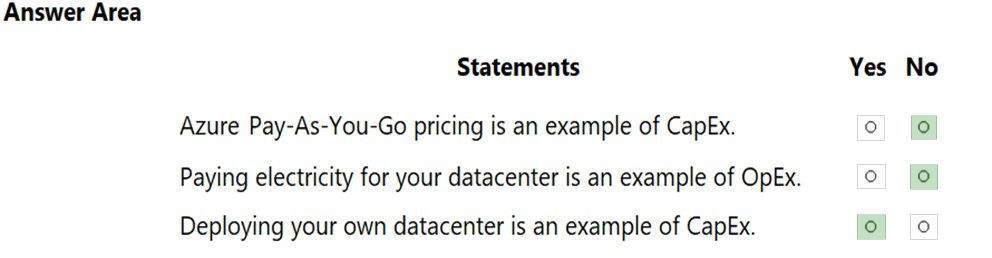

_Figure: Pay-as-you-go is CapEx is No. Datacenter electricity is OpEx is No. Deploying your own datacenter is CapEx is Yes._

Pay-as-you-go is an operating cost, not capital expenditure. Buying and building a datacenter is capital expenditure because you pay for the infrastructure before you use it. The source also marks datacenter electricity as not OpEx and calls that cost CapEx.

**Why the others are wrong**

- Yes for pay-as-you-go as CapEx misses the consumption model. You pay as you go, which is operational expenditure.
- Yes for datacenter electricity as OpEx is the opposite of the source mark. The source classes power for your own datacenter with the capital cost of running that datacenter. In ordinary accounting, power is often an operating cost. This item still marks the statement No.
- No for deploying your own datacenter misses the upfront purchase of buildings, power and cooling, and servers. That purchase is capital expenditure.

**Study further**

- [Describe the consumption-based model](https://learn.microsoft.com/en-us/training/modules/describe-cloud-compute/6-describe-consumption-based-model)
- [Shift from CapEx to OpEx](https://learn.microsoft.com/en-us/azure/cloud-adoption-framework/strategy/inform/cost-efficiency)

<strong>Question 58 - Which resource is IaaS</strong>

You plan to provision Infrastructure as a Service (IaaS) resources in Azure.

Which resource is an example of IaaS?

- A. An Azure web app
- B. An Azure virtual machine
- C. An Azure logic app
- D. An Azure SQL database

<strong>Answer 58</strong>

B. An Azure virtual machine.

A virtual machine is rented infrastructure. You manage the operating system and what you install on it. Microsoft manages the physical host.

**Why the others are wrong**

- A. An Azure web app is platform as a service. App Service runs the platform under the application.
- C. An Azure logic app is platform as a service. You design the workflow. Microsoft runs the engine.
- D. An Azure SQL database is platform as a service. Microsoft manages the database engine.

**Study further**

- [Describe cloud service types](https://learn.microsoft.com/en-us/training/modules/describe-cloud-service-types/)
- [What is Azure Logic Apps?](https://learn.microsoft.com/en-us/azure/logic-apps/logic-apps-overview)

<strong>Question 59 - Where physical servers can go</strong>

To which cloud models can you deploy physical servers?

- A. Private cloud and hybrid cloud only
- B. Private cloud only
- C. Private cloud, hybrid cloud, and public cloud
- D. Hybrid cloud only

<strong>Answer 59</strong>

A. Private cloud and hybrid cloud only.

You can rack a physical server in a private cloud, and in the private half of a hybrid cloud. A public cloud does not accept your hardware. The provider owns those hosts.

**Why the others are wrong**

- B. Private cloud only leaves out hybrid. A hybrid cloud still has an on-premises side where your servers run.
- C. Private, hybrid, and public includes the public cloud. You do not deploy your own physical servers into Azure's public regions.
- D. Hybrid cloud only leaves out a private cloud that has no public half. That private cloud is exactly where physical servers are deployed.

**Study further**

- [Define cloud models](https://learn.microsoft.com/en-us/training/modules/describe-cloud-compute/5-define-cloud-models)
- [What is cloud computing?](https://azure.microsoft.com/en-us/resources/cloud-computing-dictionary/what-is-cloud-computing)

<strong>Question 60 - Match cloud models to advantages</strong>

DRAG DROP

Match the cloud model to the correct advantage.

To answer, drag the appropriate cloud model from the column on the left to its advantage on the right. Each cloud model may be used once, more than once, or not at all.

NOTE: Each correct match is worth one point.

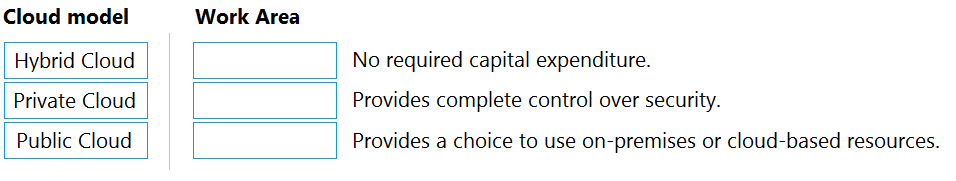

_Figure: Models are Hybrid Cloud, Private Cloud, and Public Cloud. The advantages, with empty boxes, are no required capital expenditure, complete control over security, and a choice to use on-premises or cloud-based resources._

<strong>Answer 60</strong>

Public Cloud. Private Cloud. Hybrid Cloud.

_Figure: Public Cloud is matched to no required capital expenditure. Private Cloud is matched to complete control over security. Hybrid Cloud is matched to a choice of on-premises or cloud-based resources._

Public cloud is pay-as-you-go, so you do not buy the servers. A private cloud stays on infrastructure you control. Hybrid cloud keeps both, and you choose where each workload runs.

**Why the others are wrong**

- Hybrid Cloud and Private Cloud do not remove capital expenditure. Both still include hardware you buy. No required capital expenditure is the public cloud.
- Public Cloud and Hybrid Cloud do not give complete control over security. The provider controls the public portion. Complete control is the private cloud.
- Public Cloud does not offer an on-premises choice, and Private Cloud does not offer a public cloud choice. The choice of either is hybrid.

**Study further**

- [Define cloud models](https://learn.microsoft.com/en-us/training/modules/describe-cloud-compute/5-define-cloud-models)
- [Describe the consumption-based model](https://learn.microsoft.com/en-us/training/modules/describe-cloud-compute/6-describe-consumption-based-model)

**Source:** [61-70.pdf](files/61-70.pdf)

<strong>Question 61 - Private, hybrid, and public clouds</strong>

HOTSPOT

For each of the following statements, select Yes if the statement is true. Otherwise, select No.

NOTE: Each correct selection is worth one point.

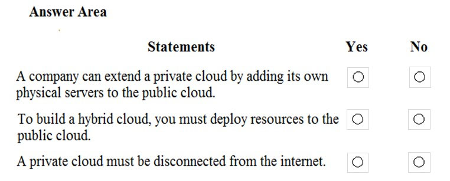

_Figure: Three statements, each with an empty Yes and an empty No. A company can extend a private cloud by adding its own physical servers to the public cloud. To build a hybrid cloud, you must deploy resources to the public cloud. A private cloud must be disconnected from the internet._

<strong>Answer 61</strong>

No. Yes. No.

_Figure: Adding physical servers to the public cloud is No. Deploying resources to the public cloud to build a hybrid cloud is Yes. A private cloud disconnected from the internet is No._

A public cloud accepts virtual machines, not your own hardware. A hybrid cloud is a private cloud plus resources in a public cloud. A private cloud is hardware you manage, and that network can stay connected to the internet.

**Why the others are wrong**

- Yes for adding physical servers to the public cloud misses how a public cloud works. You deploy virtual servers there. Putting your own hardware in the provider's cloud is not an extension of a private cloud. Virtual servers in a public cloud, next to a private cloud, are what create a hybrid cloud.
- No for deploying resources to the public cloud misses the definition of hybrid. A hybrid cloud combines a private cloud and a public cloud, so the public side has to exist.
- Yes for a private cloud disconnected from the internet misses the definition. Private means you manage the physical servers. It does not mean the network has no internet connection.

**Study further**

- [Define cloud models](https://learn.microsoft.com/en-us/training/modules/describe-cloud-compute/5-define-cloud-models)
- [Describe the benefits of using cloud services](https://learn.microsoft.com/en-us/training/modules/describe-benefits-use-cloud-services/)

<strong>Question 62 - Connected on-premises and Azure VMs</strong>

You have 50 virtual machines hosted on-premises and 50 virtual machines hosted in Azure. The on-premises virtual machines and the Azure virtual machines connect to each other.

Which type of cloud model is this?

- A. Hybrid
- B. Private
- C. Public

<strong>Answer 62</strong>

A. Hybrid.

The machines run in two places and they connect to each other. The on-premises side is the private cloud. The Azure side is the public cloud. Together that is a hybrid cloud.

**Why the others are wrong**

- B. Private would mean every machine stays on hardware you manage. Half of these machines are in Azure.
- C. Public would mean every machine is in the provider's cloud. Half of these machines stay on-premises.

**Study further**

- [Define cloud models](https://learn.microsoft.com/en-us/training/modules/describe-cloud-compute/5-define-cloud-models)
- [Describe the benefits of using cloud services](https://learn.microsoft.com/en-us/training/modules/describe-benefits-use-cloud-services/)

<strong>Question 63 - PaaS web app control and scale</strong>

HOTSPOT

For each of the following statements, select Yes if the statement is true. Otherwise, select No.

NOTE: Each correct selection is worth one point.

_Figure: Three statements, each with an empty Yes and an empty No. A PaaS solution that hosts web apps in Azure provides full control of the operating systems that host the applications. A PaaS solution that hosts web apps in Azure can be provided with additional memory by changing the pricing tier. A PaaS solution that hosts web apps in Azure can be configured to automatically scale the number of instances based on demand._

<strong>Answer 63</strong>

No. Yes. Yes.

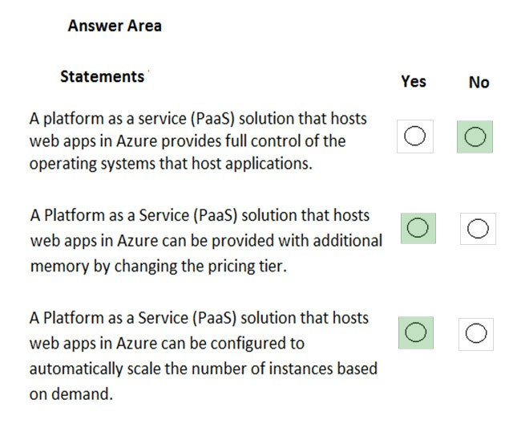

_Figure: Full control of the host operating systems is No. Additional memory by changing the pricing tier is Yes. Automatically scaling the number of instances is Yes._

Azure App Service hosts the web apps. You do not sign in to the virtual machines or IIS underneath them. A higher pricing tier adds memory, and autoscale adds instances when demand rises.

**Why the others are wrong**

- Yes for full control of the operating systems misses PaaS. The provider runs the host. You deploy the app.
- No for additional memory by changing the pricing tier misses App Service plans. The plan size is how you add memory without touching the operating system.
- No for automatic scale-out misses autoscale. App Service can add load-balanced instances as demand changes.

**Study further**

- [App Service overview](https://learn.microsoft.com/en-us/azure/app-service/overview)
- [Describe cloud service types](https://learn.microsoft.com/en-us/training/modules/describe-cloud-service-types/)

<strong>Question 64 - VMs, SQL, and storage as PaaS</strong>

This item shares its setup with other questions. Each one proposes a different solution. Decide whether this solution meets the goal.

Your company plans to migrate all its data and resources to Azure.

The company's migration plan states that only Platform as a Service (PaaS) solutions must be used in Azure.

You need to deploy an Azure environment that meets the company migration plan.

Solution: You create Azure virtual machines, Azure SQL databases, and Azure Storage accounts.

Does this meet the goal?

- A. Yes
- B. No

<strong>Answer 64</strong>

B. No.

The plan allows only PaaS. Azure SQL Database is PaaS. Azure virtual machines are infrastructure as a service: you manage the operating system. A design that includes virtual machines misses the PaaS-only plan.

**Why the others are wrong**

- A. Yes would mean virtual machines, Azure SQL databases, and storage accounts are all PaaS. Virtual machines are IaaS, so the set fails the plan.

**Study further**

- [Describe cloud service types](https://learn.microsoft.com/en-us/training/modules/describe-cloud-service-types/)
- [What is Azure Virtual Machines?](https://learn.microsoft.com/en-us/azure/virtual-machines/overview)

<strong>Question 65 - Custom apps with prerequisites</strong>

Your company plans to deploy several custom applications to Azure. The applications will provide invoicing services to the customers of the company. Each application will have several prerequisite applications and services installed.

You need to recommend a cloud deployment solution for all the applications.

What should you recommend?

- A. Software as a Service (SaaS)
- B. Platform as a Service (PaaS)
- C. Infrastructure as a Service (IaaS)

<strong>Answer 65</strong>

C. Infrastructure as a Service (IaaS).

Each custom application needs prerequisite software installed. IaaS gives you virtual machines where you install, configure, and manage that software. The provider manages the infrastructure underneath.

**Why the others are wrong**

- A. Software as a Service is a finished application you connect to, such as mail or an office suite. These are the company's own invoicing applications, and they need extra software installed.
- B. Platform as a Service supplies the runtime and middleware. It does not give you a machine on which to install arbitrary prerequisite applications and services.

**Study further**

- [Describe cloud service types](https://learn.microsoft.com/en-us/training/modules/describe-cloud-service-types/)
- [What is Azure Virtual Machines?](https://learn.microsoft.com/en-us/azure/virtual-machines/overview)

<strong>Question 66 - CapEx and OpEx examples</strong>

HOTSPOT

For each of the following statements, select Yes if the statement is true. Otherwise, select No.

NOTE: Each correct selection is worth one point.

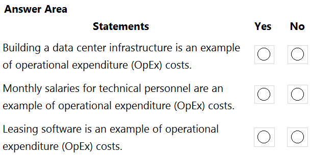

_Figure: Three statements, each with an empty Yes and an empty No. Building a data center infrastructure is an example of operational expenditure (OpEx) costs. Monthly salaries for technical personnel are an example of operational expenditure (OpEx) costs. Leasing software is an example of operational expenditure (OpEx) costs._

<strong>Answer 66</strong>

No. Yes. Yes.

_Figure: Building a data center as operational expenditure is No. Monthly salaries as operational expenditure is Yes. Leasing software as operational expenditure is Yes._

Building a data center is capital expenditure: you buy an asset up front. Monthly salaries and a software lease are ongoing operating costs.

**Why the others are wrong**

- Yes for building a data center as operational expenditure misses capital expenditure. The building, power gear, and servers are purchased assets.
- No for monthly salaries misses operating cost. Pay for technical staff is an ongoing cost of running the business.
- No for leasing software misses operating cost. A one-time software purchase can be capital expenditure. A lease continues, so it is operational expenditure.

**Study further**

- [Describe the consumption-based model](https://learn.microsoft.com/en-us/training/modules/describe-cloud-compute/6-describe-consumption-based-model)
- [Shift from CapEx to OpEx](https://learn.microsoft.com/en-us/azure/cloud-adoption-framework/strategy/inform/cost-efficiency)

<strong>Question 67 - Cosmos DB service model</strong>

HOTSPOT

To complete the sentence, select the appropriate option in the answer area.

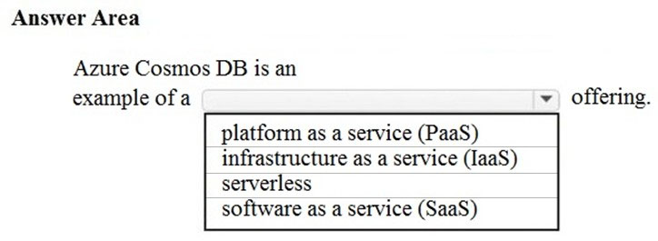

_Figure: "Azure Cosmos DB is an example of a _____ offering." The open list is platform as a service (PaaS), infrastructure as a service (IaaS), serverless, and software as a service (SaaS). Nothing is selected._

<strong>Answer 67</strong>

Platform as a service (PaaS).

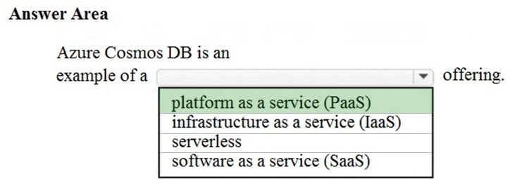

_Figure: Platform as a service (PaaS) is highlighted. Infrastructure as a service, serverless, and software as a service are not._

Azure Cosmos DB is a managed cloud database. You create databases and choose a consistency and throughput model. Microsoft runs the servers and the database platform.

**Why the others are wrong**

- Infrastructure as a service would leave you managing the virtual machines that host the database. Cosmos DB does not give you those machines.
- Serverless is a capacity mode Cosmos DB can use. The service model of the product is platform as a service.
- Software as a service would be a finished application. Cosmos DB is a database platform you build on.

**Study further**

- [What is Azure Cosmos DB?](https://learn.microsoft.com/en-us/azure/cosmos-db/overview)
- [Describe cloud service types](https://learn.microsoft.com/en-us/training/modules/describe-cloud-service-types/)

<strong>Question 68 - SaaS, IaaS, and Azure Backup</strong>

HOTSPOT

For each of the following statements, select Yes if the statement is true. Otherwise, select No.

NOTE: Each correct selection is worth one point.

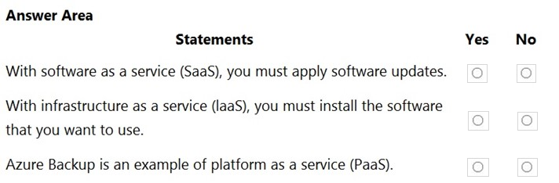

_Figure: Three statements, each with an empty Yes and an empty No. With software as a service (SaaS), you must apply software updates. With infrastructure as a service (IaaS), you must install the software that you want to use. Azure Backup is an example of platform as a service (PaaS)._

<strong>Answer 68</strong>

No. Yes. Yes.

_Figure: Applying software updates in SaaS is No. Installing the software you want in IaaS is Yes. Azure Backup as platform as a service is Yes._

In SaaS the provider updates the application. In IaaS you install the software on the virtual machines. The solution image classifies Azure Backup as platform as a service: it is a Microsoft-managed backup platform rather than a product you install yourself.

**Why the others are wrong**

- Yes for applying SaaS updates yourself misses the provider's role. You configure the application. The provider patches it.
- No for installing software in IaaS misses the model. The provider supplies the machine. You install the operating-system roles and applications you need.
- No for Azure Backup as platform as a service misses the solution image. The image marks Yes for that statement.

**Study further**

- [What is Azure Backup?](https://learn.microsoft.com/en-us/azure/backup/backup-overview)
- [Describe cloud service types](https://learn.microsoft.com/en-us/training/modules/describe-cloud-service-types/)

<strong>Question 69 - Resource group nesting and regions</strong>

HOTSPOT

For each of the following statements, select Yes if the statement is true. Otherwise, select No.

NOTE: Each correct selection is worth one point.

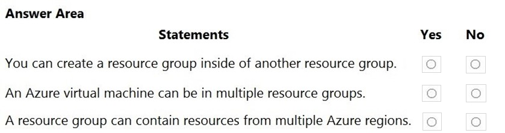

_Figure: Three statements, each with an empty Yes and an empty No. You can create a resource group inside another resource group. An Azure virtual machine can be in multiple resource groups. A resource group can contain resources from multiple Azure regions._

<strong>Answer 69</strong>

No. No. Yes.

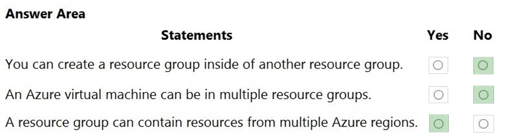

_Figure: A resource group inside another resource group is No. A virtual machine in multiple resource groups is No. Resources from multiple regions in one resource group is Yes._

Resource groups are a flat container. A resource, including a virtual machine, belongs to one resource group. The group stores metadata, and the resources inside it can sit in different regions.

**Why the others are wrong**

- Yes for nesting resource groups misses the model. A resource group cannot contain another resource group.
- Yes for a virtual machine in multiple resource groups misses the rule that each resource exists in only one resource group.
- No for multiple regions misses metadata. The resource group's own location is where its metadata is stored. The resources it lists can be in other regions.

**Study further**

- [What is Azure Resource Manager?](https://learn.microsoft.com/en-us/azure/azure-resource-manager/management/overview)
- [Move resources to a new resource group or subscription](https://learn.microsoft.com/en-us/azure/azure-resource-manager/management/move-resource-group-and-subscription)

<strong>Question 70 - SQL VM, Azure SQL, and Cosmos DB</strong>

HOTSPOT

For each of the following statements, select Yes if the statement is true. Otherwise, select No.

NOTE: Each correct selection is worth one point.

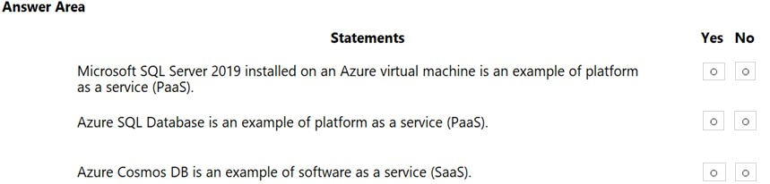

_Figure: Three statements, each with an empty Yes and an empty No. Microsoft SQL Server 2019 installed on an Azure virtual machine is an example of platform as a service (PaaS). Azure SQL Database is an example of platform as a service (PaaS). Azure Cosmos DB is an example of software as a service (SaaS)._

<strong>Answer 70</strong>

No. Yes. No.

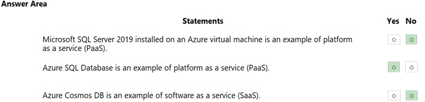

_Figure: SQL Server 2019 on an Azure virtual machine as platform as a service is No. Azure SQL Database as platform as a service is Yes. Azure Cosmos DB as software as a service is No._

SQL Server on a virtual machine is infrastructure as a service: you manage the operating system and SQL Server. Azure SQL Database is a managed database engine, which is platform as a service. Cosmos DB is also a database platform, so calling it software as a service is false.

**Why the others are wrong**

- Yes for SQL Server on a virtual machine as PaaS misses the operating system. You patch that guest and you patch SQL Server. That is IaaS.
- No for Azure SQL Database as PaaS misses the managed engine. Microsoft patches the platform. You design and query the database.
- Yes for Cosmos DB as SaaS misses the model. Cosmos DB is a database platform you build on, which is PaaS, not a finished application.

**Study further**

- [What is Azure SQL Database?](https://learn.microsoft.com/en-us/azure/azure-sql/database/sql-database-paas-overview)
- [What is Azure Cosmos DB?](https://learn.microsoft.com/en-us/azure/cosmos-db/overview)

**Source:** [71-80.pdf](files/71-80.pdf)

<strong>Question 71 - PaaS app and database pair</strong>

Your company plans to migrate all its data and resources to Azure.

The company's migration plan states that only Platform as a Service (PaaS) solutions must be used in Azure.

You need to deploy an Azure environment that meets the company's migration plan.

What should you create?

- A. Azure virtual machines, Azure SQL databases, and Azure Storage accounts
- B. An Azure App Service and Azure virtual machines that have Microsoft SQL Server installed
- C. An Azure App Service and Azure SQL databases
- D. Azure Storage accounts and web servers in Azure virtual machines

<strong>Answer 71</strong>

C. An Azure App Service and Azure SQL databases.

App Service and Azure SQL Database are both PaaS. You deploy the web app and the database. Microsoft runs the operating systems underneath them. That set meets a PaaS-only plan.

**Why the others are wrong**

- A. Azure virtual machines are IaaS. Azure SQL Database is PaaS, and the virtual machines still break a PaaS-only plan.
- B. App Service is PaaS. Virtual machines with SQL Server installed are IaaS, because you manage that operating system and SQL Server.
- D. Web servers on virtual machines are IaaS. Storage accounts do not turn those virtual machines into PaaS.

**Study further**

- [App Service overview](https://learn.microsoft.com/en-us/azure/app-service/overview)
- [What is Azure SQL Database?](https://learn.microsoft.com/en-us/azure/azure-sql/database/sql-database-paas-overview)

<strong>Question 72 - What the SaaS customer provides</strong>

What does a customer provide in a software as a service (SaaS) model?

- A. Application data
- B. Data storage
- C. Compute resources
- D. Application software

<strong>Answer 72</strong>

A. Application data.

In SaaS you rent a finished application and connect to it, usually in a browser. You supply the business data that application stores. The provider supplies the application software, the compute, and the storage platform, and hosts that data in its data center.

**Why the others are wrong**

- B. Data storage is the provider's platform. You do not bring the disks.
- C. Compute resources are the provider's servers. You do not size or patch them.
- D. Application software is the SaaS application itself. You use it. You do not install it.

**Study further**

- [Describe cloud service types](https://learn.microsoft.com/en-us/training/modules/describe-cloud-service-types/)
- [Shared responsibility in the cloud](https://learn.microsoft.com/en-us/azure/security/fundamentals/shared-responsibility)

<strong>Question 73 - Files, DNS, and Intune models</strong>

HOTSPOT

For each of the following statements, select Yes if the statement is true. Otherwise, select No.

NOTE: Each correct selection is worth one point.

_Figure: Three statements, each with an empty Yes and an empty No. Azure Files is an example of infrastructure as a service (IaaS). A DNS server that runs on an Azure virtual machine is an example of platform as a service (PaaS). Microsoft Intune is an example of software as a service (SaaS)._

<strong>Answer 73</strong>

Yes. Yes. Yes.

_Figure: Azure Files as infrastructure as a service is Yes. A DNS server on a virtual machine as platform as a service is Yes. Microsoft Intune as software as a service is Yes._

The solution image marks Yes on every row. It classifies the Azure Files share as infrastructure as a service, the DNS server running on a virtual machine as platform as a service, and Microsoft Intune as software as a service. Intune is a device-management application Microsoft operates and you configure.

**Why the others are wrong**

- No for Azure Files as infrastructure as a service misses the solution image, which marks that statement Yes.
- No for the DNS server as platform as a service misses the solution image, which marks that statement Yes.
- No for Microsoft Intune as software as a service misses a finished Microsoft cloud application. You do not install Intune on servers you manage.

**Study further**

- [What is Microsoft Intune?](https://learn.microsoft.com/en-us/intune/fundamentals/what-is-intune)
- [Describe cloud service types](https://learn.microsoft.com/en-us/training/modules/describe-cloud-service-types/)

<strong>Question 74 - Elasticity, CapEx, and multitenancy</strong>

HOTSPOT

For each of the following statements, select Yes if the statement is true. Otherwise, select No.

NOTE: Each correct selection is worth one point.

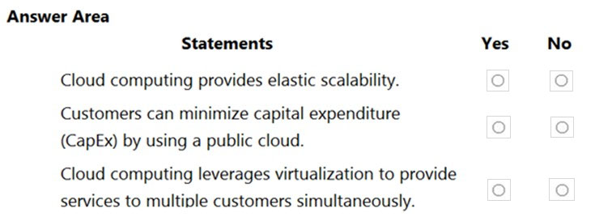

_Figure: Three statements, each with an empty Yes and an empty No. Cloud computing provides elastic scalability. Customers can minimize capital expenditure (CapEx) by using a public cloud. Cloud computing leverages virtualization to provide services to multiple customers simultaneously._

<strong>Answer 74</strong>

Yes. Yes. Yes.

_Figure: Elastic scalability is Yes. Minimizing capital expenditure with a public cloud is Yes. Virtualization serving multiple customers is Yes._

Cloud capacity grows and shrinks with demand. A public cloud turns hardware purchases into a bill you pay as you go. Virtualization lets the provider run many customers on the same physical hosts.

**Why the others are wrong**

- No for elastic scalability misses the consumption model. You add and remove capacity as demand changes.
- No for minimizing capital expenditure misses the public cloud shift. The provider owns the hardware, so you avoid buying the data center.
- No for serving many customers through virtualization misses multitenancy. Isolation is logical. The physical hosts are shared.

**Study further**

- [Describe the benefits of using cloud services](https://learn.microsoft.com/en-us/training/modules/describe-benefits-use-cloud-services/)
- [Describe the consumption-based model](https://learn.microsoft.com/en-us/training/modules/describe-cloud-compute/6-describe-consumption-based-model)

<strong>Question 75 - First stage of cloud adoption</strong>

What is the first stage in the Microsoft Cloud Adoption Framework for Azure?

- A. Adopt the cloud.
- B. Make a plan.
- C. Ready your organization.
- D. Define your strategy.

<strong>Answer 75</strong>

D. Define your strategy.

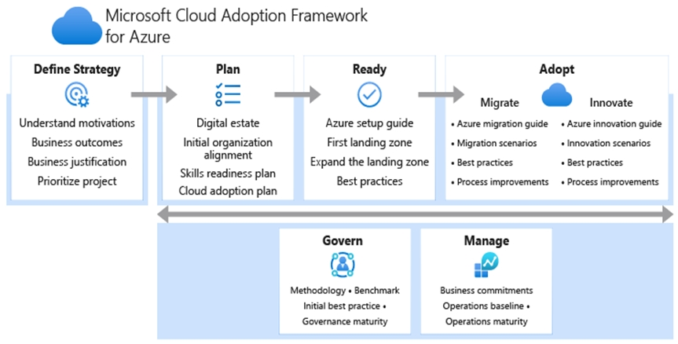

_Figure: The framework diagram starts at Define Strategy, then Plan, Ready, and Adopt. Adopt splits into Migrate and Innovate. Govern and Manage run underneath the whole path._

The framework starts with why the organization is moving: motivations, business outcomes, and which project comes first. Plan, Ready, and Adopt come after that strategy.

**Why the others are wrong**

- A. Adopt the cloud is a later stage. Migrate and Innovate happen after the strategy, the plan, and the landing zone exist.
- B. Make a plan comes after the strategy. The plan covers the digital estate, skills, and the adoption plan.
- C. Ready your organization is the landing-zone stage. You prepare Azure after you know the strategy and the plan.

**Study further**

- [Microsoft Cloud Adoption Framework for Azure](https://learn.microsoft.com/en-us/azure/cloud-adoption-framework/overview)
- [Define cloud models](https://learn.microsoft.com/en-us/training/modules/describe-cloud-compute/5-define-cloud-models)

<strong>Question 76 - Extending a network into the cloud</strong>

HOTSPOT

For each of the following statements, select Yes if the statement is true. Otherwise, select No.

NOTE: Each correct selection is worth one point.

_Figure: Three statements, each with an empty Yes and an empty No. A company can extend an internal network by adding its own physical servers to the public cloud. A private cloud must be disconnected from the internet. Part of a hybrid cloud is the public cloud._

<strong>Answer 76</strong>

No. No. Yes.

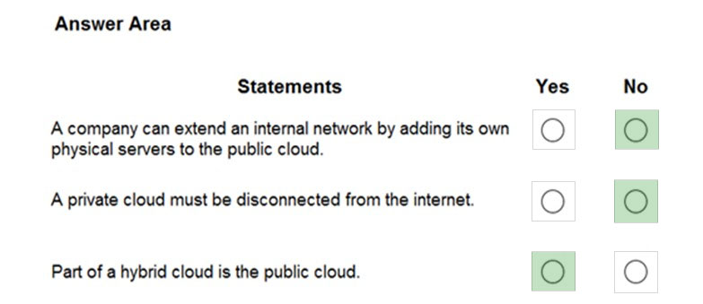

_Figure: Adding physical servers to the public cloud is No. A private cloud disconnected from the internet is No. Part of a hybrid cloud being the public cloud is Yes._

You extend into a public cloud with virtual servers, not by installing your own hardware there. A private cloud can have an internet connection. A hybrid cloud is a private cloud combined with a public cloud.

**Why the others are wrong**

- Yes for adding physical servers to the public cloud misses the public cloud. You deploy virtual machines. Your own servers stay in the private portion.
- Yes for a private cloud disconnected from the internet misses the definition. Private means you manage the servers. The explanation describes a private cloud as existing on a network you reach over the internet.
- No for the public cloud as part of hybrid misses the definition. Hybrid is private plus public.

**Study further**

- [Define cloud models](https://learn.microsoft.com/en-us/training/modules/describe-cloud-compute/5-define-cloud-models)
- [Describe the benefits of using cloud services](https://learn.microsoft.com/en-us/training/modules/describe-benefits-use-cloud-services/)

<strong>Question 77 - Requirements for cloud computing</strong>

HOTSPOT

For each of the following statements, select Yes if the statement is true. Otherwise, select No.

NOTE: Each correct selection is worth one point.

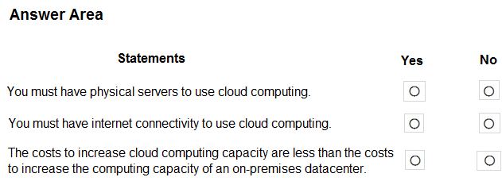

_Figure: Three statements, each with an empty Yes and an empty No. You must have physical servers to use cloud computing. You must have internet connectivity to use cloud computing. The costs to increase cloud computing capacity are less than the costs to increase the computing capacity of an on-premises datacenter._

<strong>Answer 77</strong>

No. Yes. Yes.

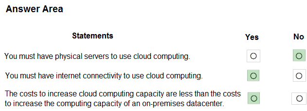

_Figure: Owning physical servers is No. Internet connectivity is Yes. Lower cost to add cloud capacity than to expand an on-premises datacenter is Yes._

Cloud computing delivers servers, storage, and software over the internet. You use virtual machines rather than buying the hosts. Adding cloud capacity is an operating bill. Expanding your own datacenter means buying more building, power, and hardware.

**Why the others are wrong**

- Yes for owning physical servers misses the provider's hardware. You consume virtual machines and other services. The provider owns the hosts.
- No for internet connectivity misses how you reach the cloud. The services are delivered over the internet.
- No for a lower cost to add cloud capacity misses the comparison with a datacenter expansion. Cloud capacity is added without a new capital project for the building and the servers.

**Study further**

- [Describe the benefits of using cloud services](https://learn.microsoft.com/en-us/training/modules/describe-benefits-use-cloud-services/)
- [Describe the consumption-based model](https://learn.microsoft.com/en-us/training/modules/describe-cloud-compute/6-describe-consumption-based-model)

<strong>Question 78 - Match benefits to demand, regions, speed</strong>

DRAG DROP

Match the cloud computing benefits to the correct descriptions.

To answer, drag the appropriate benefit from the column on the left to its description on the right. Each benefit may be used once, more than once, or not at all.

NOTE: Each correct match is worth one point.

_Figure: Benefits are Agility, Geo-distribution, and Scalability. Three empty boxes sit beside: resources can be provisioned dynamically to meet changing demands; applications and data can be deployed to multiple regions; applications can be developed, tested, and launched rapidly._

<strong>Answer 78</strong>

Scalability. Geo-distribution. Agility.

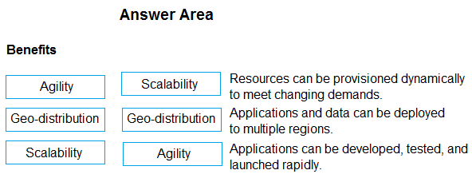

_Figure: Scalability is matched to provisioning resources dynamically for changing demand. Geo-distribution is matched to deploying applications and data to multiple regions. Agility is matched to developing, testing, and launching applications rapidly._

Every benefit is used once. Scalability is adding or removing capacity as demand changes. Geo-distribution is placing applications and data in more than one region. Agility is how quickly you can build and release.

**Why the others are wrong**

- Agility for dynamic capacity misses scale. Agility is the speed of developing, testing, and launching.
- Geo-distribution for rapid launch misses regions. Geo-distribution is where the application runs, not how fast you build it.
- Scalability for many regions misses capacity. Scalability changes how much compute you have. Placing that compute near users is geo-distribution.

**Study further**

- [Describe the benefits of using cloud services](https://learn.microsoft.com/en-us/training/modules/describe-benefits-use-cloud-services/)
- [Describe the consumption-based model](https://learn.microsoft.com/en-us/training/modules/describe-cloud-compute/6-describe-consumption-based-model)

<strong>Question 79 - What Site Recovery provides</strong>

HOTSPOT

Select the answer that correctly completes the sentence.

_Figure: "Azure Site Recovery provides _____ for virtual machines." The open list is fault tolerance, disaster recovery, elasticity, and high availability. Nothing is selected._

<strong>Answer 79</strong>

Disaster recovery.

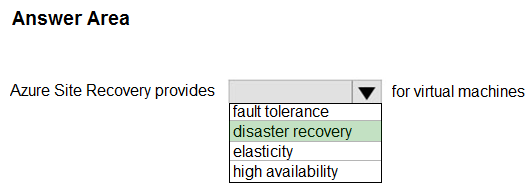

_Figure: Disaster recovery is highlighted. Fault tolerance, elasticity, and high availability are not._

The explanation says you set up disaster recovery for Azure virtual machines with Azure Site Recovery. Site Recovery replicates machines so they can run from a secondary site after an outage. The solution image highlights disaster recovery.

**Why the others are wrong**

- Fault tolerance means the workload keeps running through a failure without a failover. Site Recovery fails a copy over to another site.
- Elasticity is adding or removing capacity with demand. Site Recovery does not scale the virtual machine.
- High availability keeps a workload up through smaller faults, such as a restart or a zone failure. Site Recovery is the plan for losing a site.

**Study further**

- [About Azure Site Recovery](https://learn.microsoft.com/en-us/azure/site-recovery/site-recovery-overview)
- [What are business continuity, high availability, and disaster recovery?](https://learn.microsoft.com/en-us/azure/reliability/concept-business-continuity-high-availability-disaster-recovery)

<strong>Question 80 - Service model for two apps</strong>

HOTSPOT

You plan to use Azure to host two apps named App1 and App2. The apps must meet the following requirements:

- You must be able to modify the code of App1.
- Administrative effort to manage the operating system of App1 must be minimized.
- App2 must run interactively with the operating system of the server.

Which type of cloud service should you use for each app?

To answer, select the appropriate options in the answer area.

NOTE: Each correct selection is worth one point.

_Figure: App1 and App2 each have an open list: Infrastructure as a service (IaaS), Platform as a service (PaaS), and Software as a service (SaaS). Nothing is selected._

<strong>Answer 80</strong>

Platform as a service (PaaS) for App1. Software as a service (SaaS) for App2.

_Figure: Platform as a service (PaaS) is highlighted for App1. Software as a service (SaaS) is highlighted for App2._

App1 has to accept code changes, and the operating-system work has to stay small. That is PaaS: you build on the platform, and the provider runs the operating system. The explanation names software as a service for App2 and describes a finished application users open over the internet. The solution image highlights SaaS for App2.

_Figure: A stack diagram labeled SaaS, PaaS, and IaaS. The items along the stack are hosted applications, development tools and business analytics, operating systems, servers and storage, networking, and the data center._

**Why the others are wrong**

- Infrastructure as a service for App1 leaves you managing the operating system. The requirement is to minimize that work.
- Software as a service for App1 is a finished application. You cannot modify its code.
- Infrastructure as a service for App2 is a server you administer. The solution image highlights SaaS, and the explanation names SaaS.
- Platform as a service for App2 is a platform where you deploy your own application. The solution image highlights SaaS, and the explanation names SaaS.

**Study further**

- [Describe cloud service types](https://learn.microsoft.com/en-us/training/modules/describe-cloud-service-types/)
- [Shared responsibility in the cloud](https://learn.microsoft.com/en-us/azure/security/fundamentals/shared-responsibility)

**Source:** [81-90.pdf](files/81-90.pdf)

<strong>Question 81 - Lift and shift a legacy app</strong>

You have an accounting application named App1 that uses a legacy database.

You plan to move App1 to the cloud.

Which service model should you use?

- A. Platform as a service (PaaS)
- B. Infrastructure as a service (IaaS)
- C. Software as a service (SaaS)

<strong>Answer 81</strong>

B. Infrastructure as a service (IaaS).

App1 and its legacy database already exist. Moving them onto cloud virtual machines is a lift-and-shift. The application stays the application it was. IaaS is the model that hosts that move.

**Why the others are wrong**

- A. Platform as a service would mean rebuilding App1 on a managed runtime and a managed database. A legacy database is the reason this move stays on virtual machines.
- C. Software as a service would replace App1 with a finished accounting application. The plan is to move App1, not to throw it away.

**Study further**

- [What is Azure Virtual Machines?](https://learn.microsoft.com/en-us/azure/virtual-machines/overview)
- [Describe cloud service types](https://learn.microsoft.com/en-us/training/modules/describe-cloud-service-types/)

<strong>Question 82 - SaaS customer responsibility</strong>

HOTSPOT

Select the answer that correctly completes the sentence.

_Figure: "When you are implementing a Software as a Service (SaaS) solution, you are responsible for" and an open list: configuring high availability, defining scalability rules, installing the SaaS solution, configuring the SaaS solution. Nothing is selected._

<strong>Answer 82</strong>

Configuring the SaaS solution.

_Figure: Configuring the SaaS solution is highlighted. Configuring high availability, defining scalability rules, and installing the SaaS solution are not._

The explanation names configuring the SaaS solution. You access the application over the internet. The provider runs the servers and manages security, availability, and performance. You configure how your organization uses the application.

**Why the others are wrong**

- Configuring high availability is the provider's responsibility. You do not place the SaaS application across zones.
- Defining scalability rules is the provider's responsibility. You do not scale the platform underneath a SaaS app.
- Installing the SaaS solution is the provider's responsibility. You connect to the application. You do not install it.

**Study further**

- [Describe cloud service types](https://learn.microsoft.com/en-us/training/modules/describe-cloud-service-types/)
- [Shared responsibility in the cloud](https://learn.microsoft.com/en-us/azure/security/fundamentals/shared-responsibility)

<strong>Question 83 - Web app with on-premises data</strong>

HOTSPOT

Select the answer that correctly completes the sentence.

_Figure: "An Azure web app that queries an on-premises Microsoft SQL server is an example of a _____ cloud." The open list is hybrid, multi-vendor, private, and public. Nothing is selected._

<strong>Answer 83</strong>

Hybrid.

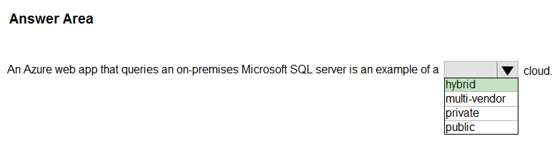

_Figure: Hybrid is highlighted. Multi-vendor, private, and public are not._

The web app runs in Azure. The SQL Server stays on-premises. One application that uses both is a hybrid cloud. The explanation describes a hybrid app with on-premises data that scales across the cloud.

**Why the others are wrong**

- Multi-vendor means more than one cloud provider. This design is Azure plus your own datacenter, not two public clouds.
- Private would keep the web app on hardware you own. The web app is in Azure.
- Public would keep the database in the public cloud as well. The SQL Server stays on-premises.

**Study further**

- [Define cloud models](https://learn.microsoft.com/en-us/training/modules/describe-cloud-compute/5-define-cloud-models)
- [App Service overview](https://learn.microsoft.com/en-us/azure/app-service/overview)

<strong>Question 84 - SQL with Azure-managed updates</strong>

HOTSPOT

Select the answer that correctly completes the sentence.

_Figure: "A Microsoft SQL Server database that is hosted in the cloud and has software updates managed by Azure is an example of" an open list: disaster recovery as a service (DRaaS), infrastructure (IaaS), platform as a service (PaaS), software as a service (SaaS). Nothing is selected._

<strong>Answer 84</strong>

Platform as a service (PaaS).

_Figure: Platform as a service (PaaS) is highlighted. Disaster recovery as a service, infrastructure as a service, and software as a service are not._

Azure applies the software updates, so you are not patching a SQL Server virtual machine. You still use it as a database platform: schema, queries, and data. That is PaaS, the same model as Azure SQL Database.

**Why the others are wrong**

- Disaster recovery as a service is a failover product. Managed SQL updates do not, by themselves, make this a recovery service.
- Infrastructure as a service would leave the software updates to you. Azure managing those updates is the detail that leaves IaaS.
- Software as a service would be a finished application. This is still a database engine you build on.

**Study further**

- [What is Azure SQL Database?](https://learn.microsoft.com/en-us/azure/azure-sql/database/sql-database-paas-overview)
- [Describe cloud service types](https://learn.microsoft.com/en-us/training/modules/describe-cloud-service-types/)

<strong>Question 85 - Model with on-premises and cloud</strong>

Which cloud computing model includes on-premises and cloud-based resources?

- A. Hybrid
- B. Public
- C. Private

<strong>Answer 85</strong>

A. Hybrid.

A hybrid cloud combines an on-premises datacenter, also called a private cloud, with a public cloud, and shares data and applications between them.

**Why the others are wrong**

- B. Public uses only the provider's cloud. It does not include the on-premises resources.
- C. Private uses only hardware you manage. It does not include the public cloud resources.

**Study further**

- [Define cloud models](https://learn.microsoft.com/en-us/training/modules/describe-cloud-compute/5-define-cloud-models)
- [Describe the benefits of using cloud services](https://learn.microsoft.com/en-us/training/modules/describe-benefits-use-cloud-services/)

<strong>Question 86 - What autoscaling demonstrates</strong>

HOTSPOT

Select the answer that correctly completes the sentence.

_Figure: "Autoscaling is an example of" an open list: agility, elasticity, geo-distribution, and predictability. Nothing is selected._

<strong>Answer 86</strong>

Elasticity.

_Figure: Elasticity is highlighted. Agility, geo-distribution, and predictability are not._

A virtual machine scale set can increase or decrease the number of instances that run an application. That automatic change with demand is elasticity. The explanation names that behavior.

**Why the others are wrong**

- Agility is how quickly you can develop, test, and launch. Autoscaling changes capacity of an application that is already running.
- Geo-distribution places the application in regions near users. Autoscaling does not choose a region.
- Predictability is a steady, known cost or load. Autoscaling exists because demand changes.

**Study further**

- [What are virtual machine scale sets?](https://learn.microsoft.com/en-us/azure/virtual-machine-scale-sets/overview)
- [Describe the consumption-based model](https://learn.microsoft.com/en-us/training/modules/describe-cloud-compute/6-describe-consumption-based-model)

<strong>Question 87 - Add memory or CPUs</strong>

Which term represents the ability to increase the computing capacity of a virtual machine by adding memory or CPUs?

- A. Agility
- B. Vertical scaling
- C. Horizontal scaling
- D. Elasticity

<strong>Answer 87</strong>

B. Vertical scaling.

Vertical scaling, also called scale up and scale down, changes the size of the virtual machine. Adding memory or CPUs is a bigger size. Horizontal scaling changes how many virtual machines you have.

**Why the others are wrong**

- A. Agility is how quickly you can build and release. It does not resize a virtual machine.
- C. Horizontal scaling adds or removes virtual machine instances. It does not add memory or CPUs to one machine.
- D. Elasticity is growing and shrinking with demand, often by changing the number of instances. The action in this question is a larger machine.

**Study further**

- [What are virtual machine scale sets?](https://learn.microsoft.com/en-us/azure/virtual-machine-scale-sets/overview)
- [Describe the benefits of using cloud services](https://learn.microsoft.com/en-us/training/modules/describe-benefits-use-cloud-services/)

<strong>Question 88 - Two benefits of cloud computing</strong>

What are two benefits of cloud computing? Each correct answer presents a complete solution.

NOTE: Each correct selection is worth one point.

- A. Enables the rapid provisioning of resources
- B. Has increased administrative complexity
- C. Has the same configuration options as on-premises
- D. Shifts capital expenditures (CapEx) to operating expenditures (OpEx)

<strong>Answer 88</strong>

A. Enables the rapid provisioning of resources, and D. Shifts capital expenditures (CapEx) to operating expenditures (OpEx).

Azure lets you deploy resources quickly without buying the hardware first. Pay-as-you-go spending is operating expenditure. Buying the datacenter up front is capital expenditure.

**Why the others are wrong**

- B. Increased administrative complexity is not a benefit. Cloud services are meant to remove the work of running the underlying infrastructure.
- C. The same configuration options as on-premises is not the benefit named here. Some on-premises options are different in Azure. The benefits in the key are speed of provisioning and the shift from CapEx to OpEx.

**Study further**

- [Describe the benefits of using cloud services](https://learn.microsoft.com/en-us/training/modules/describe-benefits-use-cloud-services/)
- [Shift from CapEx to OpEx](https://learn.microsoft.com/en-us/azure/cloud-adoption-framework/strategy/inform/cost-efficiency)

<strong>Question 89 - Feature of a virtual network</strong>

What is a feature of an Azure virtual network?

- A. Resource cost analysis
- B. Packet inspection
- C. Geo-redundancy
- D. Isolation and segmentation

<strong>Answer 89</strong>

D. Isolation and segmentation.

A virtual network is the boundary where you group related resources and separate them from other networks. Segmentation supports isolation and the organization's access rules.

**Why the others are wrong**

- A. Resource cost analysis is Cost Management. A virtual network does not analyze spend.
- B. Packet inspection is a firewall or network security group behavior. It is not the feature that defines a virtual network.
- C. Geo-redundancy copies data to another region. A virtual network lives in one region.

**Study further**

- [What is Azure Virtual Network?](https://learn.microsoft.com/en-us/azure/virtual-network/virtual-networks-overview)
- [Network security groups](https://learn.microsoft.com/en-us/azure/virtual-network/network-security-groups-overview)

<strong>Question 90 - Deploying close to users</strong>

HOTSPOT

Select the answer that correctly completes the sentence.

_Figure: "_____ enables Azure resources to be deployed close to users." The open list is Elasticity, Geo-distribution, High availability, and Scalability. Nothing is selected._

<strong>Answer 90</strong>

Geo-distribution.

_Figure: Geo-distribution is highlighted. Elasticity, high availability, and scalability are not._

Geo-distribution lets you deploy apps and data to regional datacenters around the globe so customers get the best performance in their own region. The explanation names geo-distribution for that result.

**Why the others are wrong**

- Elasticity grows and shrinks capacity with demand. It does not choose a region near the user.
- High availability keeps the application up through faults. It does not place it close to users.
- Scalability adds compute capacity. Extra capacity in a distant region is still distant.

**Study further**

- [Describe the benefits of using cloud services](https://learn.microsoft.com/en-us/training/modules/describe-benefits-use-cloud-services/)
- [Azure geographies](https://azure.microsoft.com/en-us/explore/global-infrastructure/geographies)

**Source:** [91-100.pdf](files/91-100.pdf)

<strong>Question 91 - Match benefits to descriptions</strong>

DRAG DROP

Match the cloud computing benefits to the appropriate descriptions.

To answer, drag the appropriate benefit from the column on the left to its description on the right. Each benefit may be used once, more than once, or not at all.

NOTE: Each correct match is worth one point.

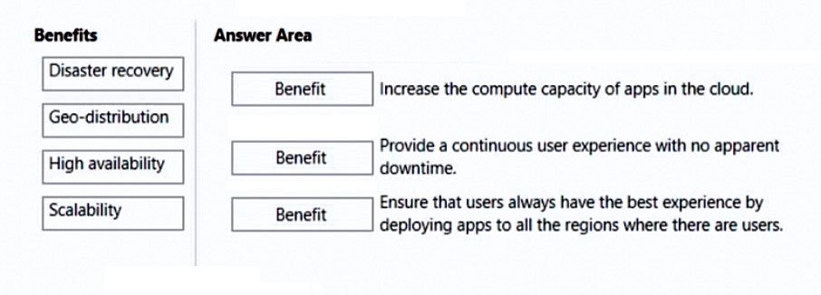

_Figure: Benefits are Disaster recovery, Geo-distribution, High availability, and Scalability. Three empty boxes sit beside: increase the compute capacity of apps in the cloud; provide a continuous user experience with no apparent downtime; ensure that users always have the best experience by deploying apps to all the regions where there are users._

<strong>Answer 91</strong>

Scalability. High availability. Geo-distribution. Disaster recovery stays in the benefits list.

_Figure: Scalability is matched to increasing compute capacity. High availability is matched to a continuous experience with no apparent downtime. Geo-distribution is matched to deploying apps to every region where there are users. Disaster recovery is not placed._

Scalability adds compute. High availability keeps the application responding through faults. Geo-distribution puts a copy in each region where users are.

**Why the others are wrong**

- Disaster recovery is the option left out. It is the plan for running from another site after an outage. These descriptions are about more capacity, staying online, and placing apps near users.

**Study further**

- [Describe the benefits of using cloud services](https://learn.microsoft.com/en-us/training/modules/describe-benefits-use-cloud-services/)
- [What are business continuity, high availability, and disaster recovery?](https://learn.microsoft.com/en-us/azure/reliability/concept-business-continuity-high-availability-disaster-recovery)

<strong>Question 92 - Continuous access, minimal downtime</strong>

Which cloud computing benefit provides continuous user access to a cloud-based application with minimal downtime?

- A. Agility
- B. Scalability
- C. Elasticity
- D. High availability

<strong>Answer 92</strong>

D. High availability.

High availability is the design that keeps the application reachable through faults, so users see little or no downtime.

**Why the others are wrong**

- A. Agility is how quickly you can build and release. It does not keep an application online.
- B. Scalability is handling more load by adding capacity. Extra capacity can still go offline together.
- C. Elasticity grows and shrinks with demand. It does not, by itself, keep the application up during a failure.

**Study further**

- [What are business continuity, high availability, and disaster recovery?](https://learn.microsoft.com/en-us/azure/reliability/concept-business-continuity-high-availability-disaster-recovery)
- [Availability options for Azure virtual machines](https://learn.microsoft.com/en-us/azure/virtual-machines/availability)

<strong>Question 93 - Failure an availability zone covers</strong>

You need to identify the type of failure for which an Azure Availability Zone can be used to protect access to Azure services.

What should you identify?

- A. A physical server failure
- B. An Azure region failure
- C. A storage failure
- D. An Azure data center failure

<strong>Answer 93</strong>

D. An Azure data center failure.

An availability zone is a separate group of datacenters in one region, with its own power, network, and cooling. Replicas in two zones stay available when one datacenter is lost.

**Why the others are wrong**

- A. A physical server failure is a smaller fault. A single virtual machine can restart on another host without a second zone.
- B. An Azure region failure takes every zone in that region with it. Zones do not protect you from losing the whole region.
- C. A storage failure is a disk or storage-account problem. A zone protects the datacenter location of the service, not every storage fault inside a healthy zone.

**Study further**

- [What are availability zones?](https://learn.microsoft.com/en-us/azure/reliability/availability-zones-overview)
- [Availability options for Azure virtual machines](https://learn.microsoft.com/en-us/azure/virtual-machines/availability)

<strong>Question 94 - Resource for an on-premises VPN</strong>

HOTSPOT

You plan to extend your company's network to Azure.

The network contains a VPN appliance that uses an IP address of 131.107.200.1.

You need to create an Azure resource that defines the VPN appliance in Azure.

Which Azure resource should you create? To answer, select the appropriate resource in the answer area.

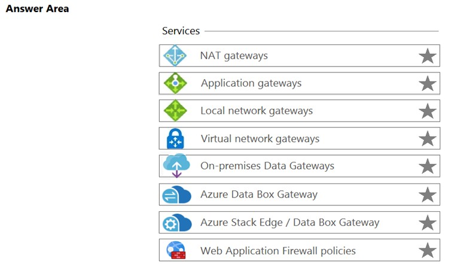

_Figure: A services list with nothing selected. The rows are NAT gateways, Application gateways, Local network gateways, Virtual network gateways, On-premises Data Gateways, Azure Data Box Gateway, Azure Stack Edge / Data Box Gateway, and Web Application Firewall policies._

<strong>Answer 94</strong>

Local network gateways.

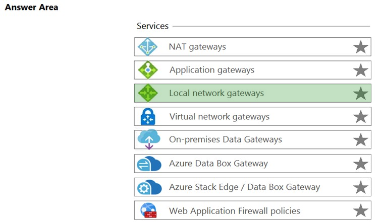

_Figure: Local network gateways is highlighted. The other seven services are not._

A local network gateway is the Azure object for the on-premises VPN device. You give it the public IP address 131.107.200.1 and the on-premises address prefixes. The virtual network gateway is the Azure end of the VPN. The connection joins the two.

**Why the others are wrong**

- NAT gateways give outbound internet addresses to a subnet. They do not represent a VPN appliance.
- Application gateways are a web traffic load balancer. They do not define an on-premises VPN device.
- Virtual network gateways are the VPN endpoint inside Azure. They are not the object that records the on-premises appliance at 131.107.200.1.
- On-premises Data Gateways connect Power BI, Power Apps, and Logic Apps to on-premises data. They are not the site-to-site VPN object.
- Azure Data Box Gateway is an appliance for moving data into Storage. It does not define this VPN device.
- Azure Stack Edge / Data Box Gateway is an edge device for local compute and data transfer. It is not the VPN definition.
- Web Application Firewall policies filter HTTP traffic. They do not describe a VPN appliance.

**Study further**

- [About local network gateways](https://learn.microsoft.com/en-us/azure/vpn-gateway/vpn-gateway-about-vpn-gateway-settings)
- [About Site-to-Site VPN](https://learn.microsoft.com/en-us/azure/vpn-gateway/vpn-gateway-about-vpngateways)

<strong>Question 95 - Resource groups across datacenters</strong>

This item shares its setup with other questions. Each one proposes a different solution. Decide whether this solution meets the goal.

You plan to deploy several Azure virtual machines.

You need to ensure that the services running on the virtual machines are available if a single data center fails.

Solution: You deploy the virtual machines to two or more resource groups.

Does this meet the goal?

- A. Yes
- B. No

<strong>Answer 95</strong>

B. No.

A resource group is a logical container. Its location is where the group's metadata is stored. Virtual machines in that group can still sit in one datacenter. Two resource groups do not place the machines in two datacenters.

**Why the others are wrong**

- A. Yes would mean separate resource groups survive a datacenter failure. A resource group does not choose a separate physical datacenter for the virtual machines.

**Study further**

- [What is Azure Resource Manager?](https://learn.microsoft.com/en-us/azure/azure-resource-manager/management/overview)
- [What are availability zones?](https://learn.microsoft.com/en-us/azure/reliability/availability-zones-overview)

<strong>Question 96 - One scale set across datacenters</strong>

This item shares its setup with other questions. Each one proposes a different solution. Decide whether this solution meets the goal.

You plan to deploy several Azure virtual machines.

You need to ensure that the services running on the virtual machines are available if a single data center fails.

Solution: You deploy the virtual machines to a scale set.

Does this meet the goal?

- A. Yes
- B. No

<strong>Answer 96</strong>

B. No.

The solution does not say the scale set spans more than one datacenter. A scale set can balance and scale virtual machines, and it can use fault domains, but this proposal never places the machines in separate datacenters. The explanation says that is why it misses the goal.

**Why the others are wrong**

- A. Yes would mean any scale set survives a datacenter failure. The proposal only says "a scale set." It does not put instances in more than one datacenter.

**Study further**

- [What are virtual machine scale sets?](https://learn.microsoft.com/en-us/azure/virtual-machine-scale-sets/overview)
- [Availability options for Azure virtual machines](https://learn.microsoft.com/en-us/azure/virtual-machines/availability)

<strong>Question 97 - Subscriptions and Azure AD tenants</strong>

HOTSPOT

For each of the following statements, select Yes if the statement is true. Otherwise, select No.

NOTE: Each correct selection is worth one point.

_Figure: Three statements, each with an empty Yes and an empty No. An Azure subscription can be associated to multiple Azure Active Directory (Azure AD) tenants. You can change the Azure Active Directory (Azure AD) tenant to which an Azure subscription is associated. When an Azure subscription expires, the associated Azure Active Directory (Azure AD) tenant is deleted automatically._

<strong>Answer 97</strong>

No. Yes. No.

_Figure: A subscription associated to multiple tenants is No. Changing the tenant a subscription is associated to is Yes. Automatic deletion of the tenant when the subscription expires is No._

One subscription trusts one Azure AD tenant. A tenant can hold many subscriptions. You can associate the subscription with a different tenant. When the subscription expires you lose the resources in it. The directory remains, and another subscription can manage it.

**Why the others are wrong**

- Yes for multiple tenants misses the rule that a subscription is associated with one directory at a time. The tenant can contain multiple subscriptions. The subscription does not join multiple tenants.
- No for changing the tenant misses the transfer. You can associate a subscription with a different Azure AD tenant.
- Yes for deleting the tenant when the subscription expires misses the directory. Access to the subscription's resources ends. The Azure AD tenant stays.

**Study further**

- [Associate a subscription with a directory](https://learn.microsoft.com/en-us/entra/fundamentals/how-subscriptions-associated-directory)
- [Create an additional Azure subscription](https://learn.microsoft.com/en-us/azure/cost-management-billing/manage/create-subscription)

<strong>Question 98 - Compliance across subscriptions</strong>

This question requires that you evaluate the underlined text to determine if it is correct.

<u>Resource groups</u> provide organizations with the ability to manage the compliance of Azure resources across multiple subscriptions.

Instructions: Review the underlined text. If it makes the statement correct, select "No change is needed". If the statement is incorrect, select the answer choice that makes the statement correct.

- A. No change is needed
- B. Management groups
- C. Azure policies
- D. Azure App Service plans

<strong>Answer 98</strong>

C. Azure policies.

Azure Policy evaluates resource properties, such as allowed sizes and locations, against rules you assign. New and existing resources are checked so they stay compliant with company standards. The explanation names Azure Policy for compliance across the resources you govern.

**Why the others are wrong**

- A. No change is needed leaves resource groups as the compliance tool. A resource group is a container in a subscription. It does not evaluate compliance across subscriptions.
- B. Management groups organize subscriptions into a hierarchy. They can be a place to assign policy. The explanation names Azure Policy as the service that evaluates the rules.
- D. Azure App Service plans choose the compute for web apps. They do not check compliance of resources across subscriptions.

**Study further**

- [What is Azure Policy?](https://learn.microsoft.com/en-us/azure/governance/policy/overview)
- [What are Azure management groups?](https://learn.microsoft.com/en-us/azure/governance/management-groups/overview)

<strong>Question 99 - Segment Azure by department</strong>

Your company plans to migrate to Azure.

The company has several departments. All the Azure resources used by each department will be managed by a department administrator.

What are two possible techniques to segment Azure for the departments? Each correct answer presents a complete solution.

NOTE: Each correct selection is worth one point.

- A. Multiple subscriptions
- B. Multiple Azure Active Directory (Azure AD) directories
- C. Multiple regions
- D. Multiple resource groups

<strong>Answer 99</strong>

A. Multiple subscriptions, and D. Multiple resource groups.

A subscription is a boundary for permissions and for billing. A separate subscription per department lets you make that department's administrator the administrator of its resources. A resource group is a container of related resources, and you can assign the department administrator at that scope as well.

**Why the others are wrong**

- B. Multiple Azure AD directories split identity into separate tenants. One directory can hold every department's subscriptions. The requirement is a management boundary for resources, not a second directory.
- C. Multiple regions place resources in different geographies. A region does not give a department administrator a permissions boundary.

**Study further**

- [Create an additional Azure subscription](https://learn.microsoft.com/en-us/azure/cost-management-billing/manage/create-subscription)
- [What is Azure Resource Manager?](https://learn.microsoft.com/en-us/azure/azure-resource-manager/management/overview)

<strong>Question 100 - Microsoft accounts and subscriptions</strong>

HOTSPOT

For each of the following statements, select Yes if the statement is true. Otherwise, select No.

NOTE: Each correct selection is worth one point.

_Figure: Three statements, each with an empty Yes and an empty No. A single Microsoft account can be used to manage multiple Azure subscriptions. Two Azure subscriptions can be merged into a single subscription. A company can use resources from multiple subscriptions._

<strong>Answer 100</strong>

Yes. No. Yes.

_Figure: One Microsoft account managing multiple subscriptions is Yes. Merging two subscriptions into one is No. A company using resources from multiple subscriptions is Yes._

The same account can create and manage more than one subscription, for example to separate environments or stay under a limit. You cannot merge two subscriptions into one. You can move some resources between them. A resource itself lives in only one subscription, and a company can still use resources that sit in several subscriptions.

**Why the others are wrong**

- No for one Microsoft account managing multiple subscriptions misses the portal. You can add another subscription to the same account.
- Yes for merging two subscriptions misses the limit. You can move resources and transfer ownership. You cannot combine the two subscriptions into a single subscription.
- No for using resources from multiple subscriptions misses how companies split environments. Each resource stays in one subscription, and the company can still own several subscriptions.

**Study further**

- [Create an additional Azure subscription](https://learn.microsoft.com/en-us/azure/cost-management-billing/manage/create-subscription)
- [Move resources to a new resource group or subscription](https://learn.microsoft.com/en-us/azure/azure-resource-manager/management/move-resource-group-and-subscription)

**Source:** [101-110.pdf](files/101-110.pdf)

<strong>Question 101 - Move virtual machines to a subscription</strong>

HOTSPOT

To complete the sentence, select the appropriate option in the answer area.

_Figure: "You have several virtual machines in an Azure subscription. You create a new subscription." The open list is: the virtual machines cannot be moved to the new subscription; the virtual machines can be moved to the new subscription; the virtual machines can be moved to the new subscription only if they are all in the same resource group; the virtual machines can be moved to the new subscription only if they run Windows Server 2016. Nothing is selected._

<strong>Answer 101</strong>

The virtual machines can be moved to the new subscription.

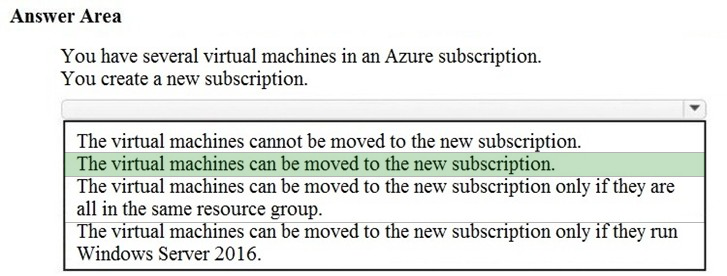

_Figure: "The virtual machines can be moved to the new subscription" is highlighted. Cannot be moved, same resource group only, and Windows Server 2016 only are not._

You can move a virtual machine and its related resources to another subscription in the Azure portal. The machine does not have to be started for the move, and it can keep running during the move. The explanation describes moving a machine from a personal subscription to a company subscription.

**Why the others are wrong**

- The virtual machines cannot be moved misses the portal move. Subscriptions are not a permanent lock on the virtual machines.
- The same resource group only misses the move rules in this key. The explanation says the virtual machines can be moved. It does not require them to start in one resource group.
- Windows Server 2016 only misses the move. The guest operating system is not the condition the explanation gives.

**Study further**

- [Move resources to a new resource group or subscription](https://learn.microsoft.com/en-us/azure/azure-resource-manager/management/move-resource-group-and-subscription)
- [What is Azure Virtual Machines?](https://learn.microsoft.com/en-us/azure/virtual-machines/overview)

<strong>Question 102 - Connect on-premises clients to VMs</strong>

You have an Azure environment that contains multiple Azure virtual machines.

You plan to implement a solution that enables the client computers on your on-premises network to communicate to the Azure virtual machines.

You need to recommend which Azure resources must be created for the planned solution.

Which two Azure resources should you include in the recommendation? Each correct answer presents part of the solution.

NOTE: Each correct selection is worth one point.

- A. A virtual network gateway
- B. A load balancer
- C. An application gateway
- D. A virtual network
- E. A gateway subnet

<strong>Answer 102</strong>

A. A virtual network gateway, and E. A gateway subnet.

On-premises clients reach the Azure virtual machines through a VPN. The Azure VPN device is a virtual network gateway. That gateway has to sit in a dedicated subnet named GatewaySubnet.

**Why the others are wrong**

- B. A load balancer spreads traffic among virtual machines that are already reachable. It does not connect the on-premises network.
- C. An application gateway is a web load balancer. It does not build the VPN to the office.
- D. A virtual network is required for the virtual machines, and the explanation says it is already in place because the virtual machines exist. The resources you still create are the gateway and the gateway subnet.

**Study further**

- [About Site-to-Site VPN](https://learn.microsoft.com/en-us/azure/vpn-gateway/vpn-gateway-about-vpngateways)
- [What is Azure Virtual Network?](https://learn.microsoft.com/en-us/azure/virtual-network/virtual-networks-overview)

<strong>Question 103 - Raise a SQL managed instance quota</strong>

You attempt to create several managed Microsoft SQL Server instances in an Azure environment and receive a message that you must increase your Azure subscription limits.

What should you do to increase the limits?

- A. Create a service health alert
- B. Upgrade your support plan
- C. Modify an Azure policy
- D. Create a new support request

<strong>Answer 103</strong>

D. Create a new support request.

SQL managed instance has a quota. You raise it by opening a support request, choosing service and subscription limits (quotas), and selecting SQL managed instance as the quota type.

**Why the others are wrong**

- A. A service health alert tells you about platform issues. It does not raise a quota.
- B. Upgrading the support plan changes response time and the types of cases you can open. The quota increase is the support request itself, not a higher plan.
- C. An Azure policy enforces rules on resources. It does not increase a subscription quota.

**Study further**

- [Create an Azure support request](https://learn.microsoft.com/en-us/azure/azure-portal/supportability/how-to-create-azure-support-request)
- [Resource limits for Azure SQL Managed Instance](https://learn.microsoft.com/en-us/azure/azure-sql/managed-instance/resource-limits)

<strong>Question 104 - Account administrators and resource groups</strong>

HOTSPOT

For each of the following statements, select Yes if the statement is true. Otherwise, select No.

NOTE: Each correct selection is worth one point.

_Figure: Three statements, each with an empty Yes and an empty No. Each Azure subscription can contain multiple account administrators. Each Azure subscription can be managed by using a Microsoft account only. An Azure resource group contains multiple Azure subscriptions._

<strong>Answer 104</strong>

No. No. No.

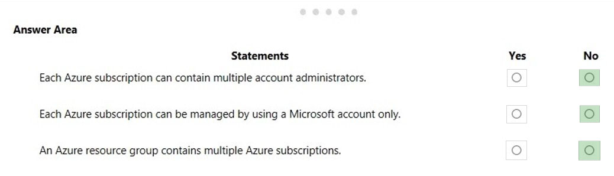

_Figure: Multiple account administrators is No. Management by a Microsoft account only is No. A resource group containing multiple subscriptions is No._

There is one account administrator for a subscription. You can add service administrators and co-administrators. The explanation says you manage a subscription with an Azure AD account, not with a Microsoft account alone. Subscriptions contain resource groups. Resource groups do not contain subscriptions.

**Why the others are wrong**

- Yes for multiple account administrators misses the single account administrator. Extra people are service administrators or co-administrators, not additional account administrators.
- Yes for a Microsoft account only misses the directory account. The explanation says management uses an Azure AD account created with the subscription.
- Yes for a resource group containing subscriptions reverses the hierarchy. A subscription contains resource groups.

**Study further**

- [Associate a subscription with a directory](https://learn.microsoft.com/en-us/entra/fundamentals/how-subscriptions-associated-directory)
- [What is Azure Resource Manager?](https://learn.microsoft.com/en-us/azure/azure-resource-manager/management/overview)

<strong>Question 105 - Where availability zones apply</strong>

HOTSPOT

For each of the following statements, select Yes if the statement is true. Otherwise, select No.

NOTE: Each correct selection is worth one point.

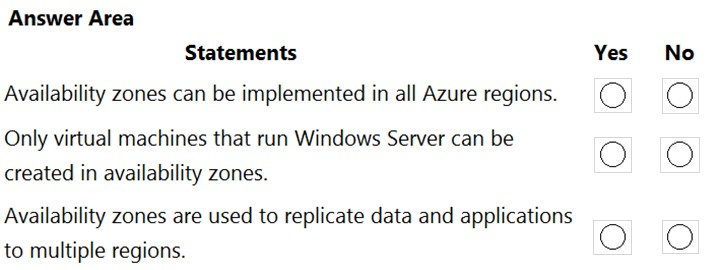

_Figure: Three statements, each with an empty Yes and an empty No. Availability zones can be implemented in all Azure regions. Only virtual machines that run Windows Server can be created in availability zones. Availability zones are used to replicate data and applications to multiple regions._

<strong>Answer 105</strong>

No. No. No.

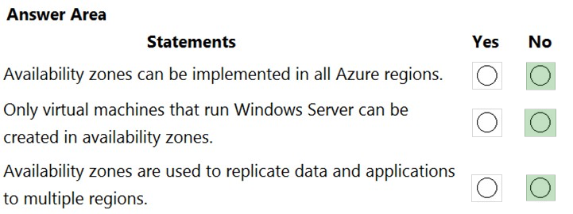

_Figure: Zones in all regions is No. Windows Server only is No. Replication to multiple regions is No._

Not every region offers availability zones. Zones work with many services, including Linux virtual machines, not only Windows Server. A zone is a physical location inside one region. It does not copy the application to other regions.

**Why the others are wrong**

- Yes for zones in every region misses the regions that do not offer availability zones.
- Yes for Windows Server only misses Linux and the other services that can use zones. The explanation says zones are not limited to virtual machines.
- Yes for replication to multiple regions misses the boundary. The explanation says availability zones are unique physical locations within a single Azure region.

**Study further**

- [What are availability zones?](https://learn.microsoft.com/en-us/azure/reliability/availability-zones-overview)
- [Azure regions list](https://learn.microsoft.com/en-us/azure/reliability/regions-list)

<strong>Question 106 - Storage for unmanaged data disks</strong>

HOTSPOT

You plan to create an Azure virtual machine.

You need to identify which storage service must be used to store the unmanaged data disks of the virtual machine.

What should you identify? To answer, select the appropriate service in the answer area.

_Figure: Four storage services with nothing selected. Containers, for unstructured data. File shares, for serverless SMB file shares. Tables, for tabular data. Queues, for scaling apps according to traffic._

<strong>Answer 106</strong>

Containers.

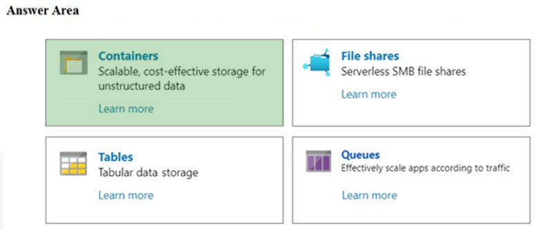

_Figure: Containers is highlighted. File shares, Tables, and Queues are not._

Unmanaged disks are virtual hard disks stored as page blobs. Page blobs live in blob containers in a storage account. The explanation says Azure disks are persisted as page blobs in Azure Storage.

**Why the others are wrong**

- File shares are SMB shares you mount as a drive. An unmanaged data disk is a page blob, not a file share.
- Tables store structured rows. They do not store a virtual hard disk.
- Queues store messages between application components. They do not store a virtual hard disk.

**Study further**

- [Overview of page blobs](https://learn.microsoft.com/en-us/azure/storage/blobs/storage-blob-pageblob-overview)
- [Storage account overview](https://learn.microsoft.com/en-us/azure/storage/common/storage-account-overview)

<strong>Question 107 - Separate network for FinServer</strong>

Your company plans to move several servers to Azure.

The company's compliance policy states that a server named FinServer must be on a separate network segment.

You are evaluating which Azure services can be used to meet the compliance policy requirements.

Which Azure solution should you recommend?

- A. A resource group for FinServer and another resource group for all the other servers
- B. A virtual network for FinServer and another virtual network for all the other servers
- C. A VPN for FinServer and a virtual network gateway for each other server
- D. One resource group for all the servers and a resource lock for FinServer

<strong>Answer 107</strong>

B. A virtual network for FinServer and another virtual network for all the other servers.

Azure networks are virtual networks. Traffic routes between subnets inside one virtual network. A separate network segment for FinServer means a different virtual network from the other servers.

**Why the others are wrong**

- A. Resource groups are management containers. Two resource groups can still share one virtual network, so FinServer is not on a separate network segment.
- C. A VPN and a virtual network gateway per server connect networks. They do not, by themselves, put FinServer on its own segment and leave the other servers together.
- D. A resource lock stops accidental delete or change. It does not change which network FinServer is on.

**Study further**

- [What is Azure Virtual Network?](https://learn.microsoft.com/en-us/azure/virtual-network/virtual-networks-overview)
- [Network security groups](https://learn.microsoft.com/en-us/azure/virtual-network/network-security-groups-overview)

<strong>Question 108 - Mapped drive to Azure Storage</strong>

You plan to map a network drive from several computers that run Windows 10 to Azure Storage.

You need to create a storage solution in Azure for the planned mapped drive.

What should you create?

- A. An Azure SQL database
- B. A virtual machine data disk
- C. A File service in a storage account
- D. A Blob service in a storage account

<strong>Answer 108</strong>

C. A File service in a storage account.

Azure Files is an SMB file share. Windows can mount it with a drive letter or a UNC path, which is the mapped drive these computers need.

**Why the others are wrong**

- A. An Azure SQL database is a database engine. Windows cannot map it as a network drive.
- B. A virtual machine data disk is a disk attached to one virtual machine. It is not a share that several Windows 10 computers map.
- D. A Blob service stores objects. It does not present the SMB share these computers mount as a drive.

**Study further**

- [What is Azure Files?](https://learn.microsoft.com/en-us/azure/storage/files/storage-files-introduction)
- [Use an Azure file share with Windows](https://learn.microsoft.com/en-us/azure/storage/files/storage-how-to-use-files-windows)

<strong>Question 109 - JSON documents from many regions</strong>

HOTSPOT

You plan to implement an Azure database solution.

You need to implement a database solution that meets the following requirements:

- Can add data concurrently from multiple regions
- Can store JSON documents

Which database service should you deploy? To answer, select the appropriate service in the answer area.

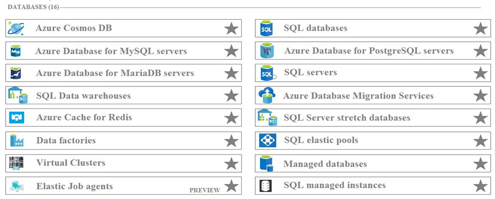

_Figure: A databases list with nothing selected. The rows include Azure Cosmos DB, Azure Database for MySQL servers, Azure Database for MariaDB servers, SQL Data warehouses, Azure Cache for Redis, Data factories, Virtual Clusters, Elastic Job agents, SQL databases, Azure Database for PostgreSQL servers, SQL servers, Azure Database Migration Services, SQL Server stretch databases, SQL elastic pools, Managed databases, and SQL managed instances._

<strong>Answer 109</strong>

Azure Cosmos DB.

_Figure: Azure Cosmos DB is highlighted. The other database services are not._

The explanation names Azure Cosmos DB. It is a globally distributed database, and it stores JSON documents. Writes can come from more than one region.

**Why the others are wrong**

- Azure Database for MySQL servers is a relational MySQL service. It does not meet both multi-region concurrent writes and JSON documents the way this key assigns to Cosmos DB.
- Azure Database for MariaDB servers is a relational MariaDB service. It misses the same pair of requirements.
- SQL Data warehouses is an analytics warehouse. It is not the JSON document store the explanation names.
- Azure Cache for Redis is an in-memory cache. It is not the durable JSON document database in the explanation.
- Data factories move and transform data. They are not a database.
- Virtual Clusters are part of SQL managed instance hosting. They do not store JSON documents across regions.
- Elastic Job agents run jobs against Azure SQL databases. They are not the data store.
- SQL databases are Azure SQL Database, a relational service. The explanation names Cosmos DB for JSON and multi-region writes.
- Azure Database for PostgreSQL servers is a relational PostgreSQL service. The explanation does not select it for these two requirements.
- SQL servers in this list are the SQL virtual-machine or server resource. They are not the globally distributed JSON service the explanation names.
- Azure Database Migration Services moves databases into Azure. It does not store the documents.
- SQL Server stretch databases archive rows from SQL Server. They do not accept concurrent JSON writes from many regions.
- SQL elastic pools share compute among Azure SQL databases. They do not add the JSON and multi-region requirements.
- Managed databases is a generic portal label. The explanation names Cosmos DB specifically.
- SQL managed instances are a managed SQL Server. They miss the JSON document and multi-region write requirements this key gives to Cosmos DB.

**Study further**

- [What is Azure Cosmos DB?](https://learn.microsoft.com/en-us/azure/cosmos-db/overview)
- [What is Azure SQL Database?](https://learn.microsoft.com/en-us/azure/azure-sql/database/sql-database-paas-overview)

<strong>Question 110 - First resource when starting Azure</strong>

Your company plans to start using Azure and will migrate all its network resources to Azure.

You need to start the planning process by exploring Azure.

What should you create first?

- A. A subscription
- B. A resource group
- C. A virtual network
- D. A management group

<strong>Answer 110</strong>

A. A subscription.

The explanation says the first thing you create in Azure is a subscription. A subscription is the agreement you are billed on. Resource groups and virtual networks are created inside a subscription.

**Why the others are wrong**

- B. A resource group needs a subscription to live in. You cannot create the group until the subscription exists.
- C. A virtual network is a resource in a subscription. Exploring Azure starts with the subscription, then the network.
- D. A management group organizes subscriptions you already have. It is not the first object the explanation tells you to create.

**Study further**

- [Create an additional Azure subscription](https://learn.microsoft.com/en-us/azure/cost-management-billing/manage/create-subscription)
- [What are Azure management groups?](https://learn.microsoft.com/en-us/azure/governance/management-groups/overview)

**Source:** [111-120.pdf](files/111-120.pdf)

<strong>Question 111 - Regions, tags, and resource group access</strong>

HOTSPOT

For each of the following statements, select Yes if the statement is true. Otherwise, select No.

NOTE: Each correct selection is worth one point.

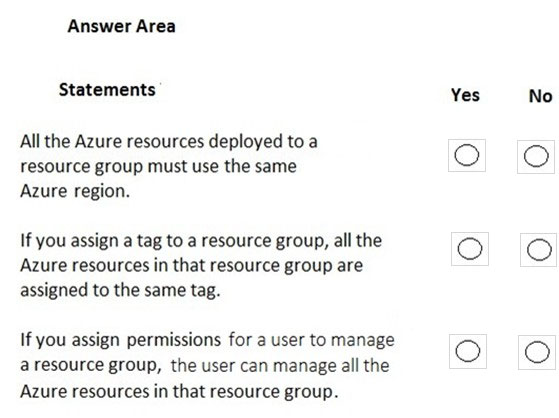

_Figure: Three statements, each with an empty Yes and an empty No. All the Azure resources deployed to a resource group must use the same Azure region. If you assign a tag to a resource group, all the Azure resources in that resource group are assigned to the same tag. If you assign permissions for a user to manage a resource group, the user can manage all the Azure resources in that resource group._

<strong>Answer 111</strong>

No. No. Yes.

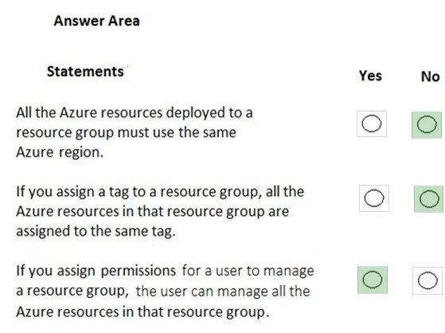

_Figure: Every resource in a resource group using the same region is No. A tag on the resource group applying to every resource is No. Permissions on the resource group covering every resource in it is Yes._

Resources in one resource group can sit in different regions. The group's location is only where its metadata is stored. Tags on a resource group are not applied to the resources by default. Role assignments on the resource group are inherited by the resources in it, so a user who can manage the group can manage those resources.

**Why the others are wrong**

- Yes for one region misses the metadata model. The resource group has a location for its metadata. The resources can use other regions.
- Yes for tags spreading to every resource misses the default. Tags are not inherited from the resource group unless you copy them yourself.
- No for permissions on the resource group misses inheritance. Access you grant on the resource group applies to the resources it contains.

**Study further**

- [What is Azure Resource Manager?](https://learn.microsoft.com/en-us/azure/azure-resource-manager/management/overview)
- [Use tags to organize your Azure resources](https://learn.microsoft.com/en-us/azure/azure-resource-manager/management/tag-resources)

<strong>Question 112 - Reading archive tier data</strong>

HOTSPOT

To complete the sentence, select the appropriate option in the answer area.

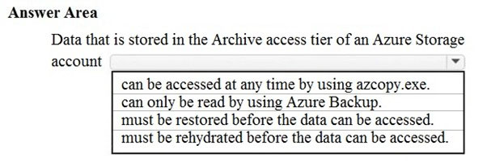

_Figure: "Data that is stored in the Archive access tier of an Azure Storage account" and an open list: can be accessed at any time by using azcopy.exe; can only be read by using Azure Backup; must be restored before the data can be accessed; must be rehydrated before the data can be accessed. Nothing is selected._

<strong>Answer 112</strong>

Must be rehydrated before the data can be accessed.

_Figure: "Must be rehydrated before the data can be accessed" is highlighted. azcopy.exe at any time, Azure Backup only, and must be restored are not._

The archive tier has the lowest storage price and higher retrieval cost. The blob is offline. Reading it requires a rehydrate to the hot or cool tier, and that can take hours. The explanation names rehydration.

**Why the others are wrong**

- Access at any time with azcopy.exe misses the offline state. AzCopy cannot read the blob until it is rehydrated to an online tier.
- Read only by Azure Backup misses the tier. Archive is a blob access tier. Any tool can read the blob after rehydration. Azure Backup is not the only reader.
- Must be restored before the data can be accessed uses the wrong operation. The explanation says rehydrate, and the solution image highlights rehydrate. Restore is a backup operation.

**Study further**

- [Access tiers for blob data](https://learn.microsoft.com/en-us/azure/storage/blobs/access-tiers-overview)
- [Storage account overview](https://learn.microsoft.com/en-us/azure/storage/common/storage-account-overview)

<strong>Question 113 - Minimum VMs and zones for 99.99%</strong>

HOTSPOT

You plan to deploy a critical line-of-business application to Azure.

The application will run on an Azure virtual machine.

You need to recommend a deployment solution for the application. The solution must provide a guaranteed availability of 99.99 percent.

What is the minimum number of virtual machines and the minimum number of availability zones you should recommend for the deployment? To answer, select the appropriate options in the answer area.

NOTE: Each correct selection is worth one point.

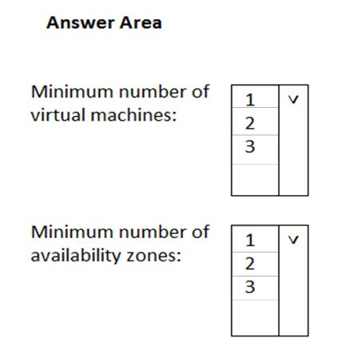

_Figure: "Minimum number of virtual machines" and "Minimum number of availability zones" each have an open list of 1, 2, and 3. Nothing is selected._

<strong>Answer 113</strong>

Two virtual machines. Two availability zones.

_Figure: 2 is highlighted for the minimum number of virtual machines. 2 is highlighted for the minimum number of availability zones._

The 99.99 percent virtual machine SLA needs at least two virtual machines, each in a different availability zone. The explanation says that pair is the minimum. Zones protect the application from a datacenter failure inside the region.

**Why the others are wrong**

- One virtual machine cannot meet the 99.99 percent SLA in this key. A single machine has no second copy in another zone.
- Three virtual machines can raise resilience further. The requirement asks for the minimum, and the explanation says two.
- One availability zone puts both machines in one datacenter failure domain. The explanation requires each machine in a different zone.
- Three availability zones is more than the minimum. Two zones are enough for the two machines.

**Study further**

- [What are availability zones?](https://learn.microsoft.com/en-us/azure/reliability/availability-zones-overview)
- [Availability options for Azure virtual machines](https://learn.microsoft.com/en-us/azure/virtual-machines/availability)

<strong>Question 114 - Collect events in one repository</strong>

Which Azure service should you use to collect events from multiple resources into a centralized repository?

- A. Azure Event Hubs
- B. Azure Analysis Services
- C. Azure Monitor
- D. Azure Stream Analytics

<strong>Answer 114</strong>

A. Azure Event Hubs.

Event Hubs is the event ingestion service. It receives events from many sources into one stream, and that stream can be stored for later processing. The explanation names Event Hubs for collecting those events.

**Why the others are wrong**

- B. Azure Analysis Services is an analytics model for business intelligence queries. It does not ingest events from many resources into a repository.
- C. Azure Monitor collects metrics and logs about Azure resources. The explanation names Event Hubs as the centralized event repository for this requirement.
- D. Azure Stream Analytics queries a stream that is already being ingested. It does not replace the ingestion repository the explanation assigns to Event Hubs.

**Study further**

- [What is Azure Event Hubs?](https://learn.microsoft.com/en-us/azure/event-hubs/event-hubs-about)
- [Azure Monitor overview](https://learn.microsoft.com/en-us/azure/azure-monitor/fundamentals/overview)

<strong>Question 115 - Where an availability zone sits</strong>

HOTSPOT

To complete the sentence, select the appropriate option in the answer area.

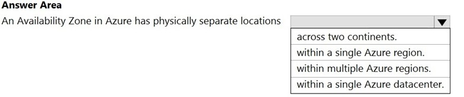

_Figure: "An Availability Zone in Azure has physically separate locations" and an open list: across two continents, within a single Azure region, within multiple Azure regions, within a single Azure datacenter. Nothing is selected._

<strong>Answer 115</strong>

Within a single Azure region.

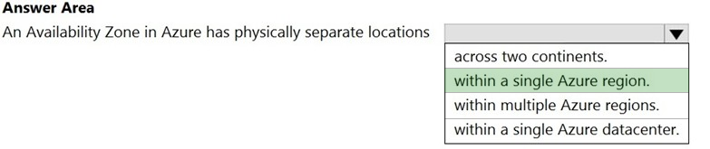

_Figure: Within a single Azure region is highlighted. Across two continents, within multiple Azure regions, and within a single Azure datacenter are not._

Availability zones are separate physical locations inside one region. Each zone has its own power, cooling, and networking. The explanation says they protect applications from a datacenter failure in that region. The solution image highlights the single region.

**Why the others are wrong**

- Across two continents is a geography or a paired-region design. A zone does not span continents.
- Within multiple Azure regions is a multi-region design. A zone stays inside one region.
- Within a single Azure datacenter is one datacenter. A zone is one or more datacenters, and the zones in a region are physically separate from each other.

**Study further**

- [What are availability zones?](https://learn.microsoft.com/en-us/azure/reliability/availability-zones-overview)
- [Availability options for Azure virtual machines](https://learn.microsoft.com/en-us/azure/virtual-machines/availability)

<strong>Question 116 - Storage copies, backup, and size</strong>

HOTSPOT

For each of the following statements, select Yes if the statement is true. Otherwise, select No.

NOTE: Each correct selection is worth one point.

_Figure: Three statements, each with an empty Yes and an empty No. Data that is stored in an Azure Storage account automatically has at least three copies. All data that is copied to an Azure Storage account is backed up automatically to another Azure data center. An Azure Storage account can contain up to 2 TB of data and up to one million files._

<strong>Answer 116</strong>

Yes. No. No.

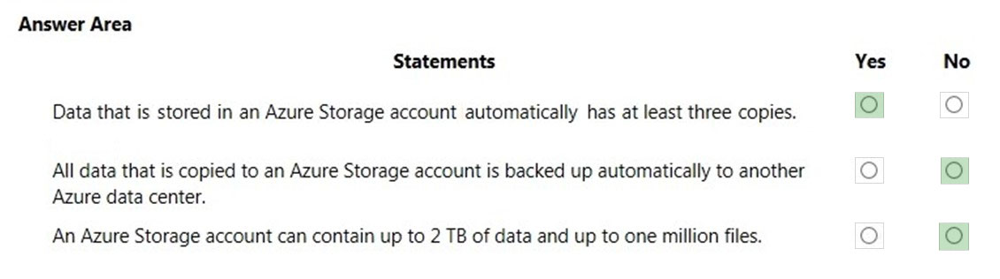

_Figure: At least three copies is Yes. Automatic backup to another Azure data center is No. A 2 TB and one-million-file limit is No._

Locally redundant storage is the minimum, and it keeps three synchronous copies in the primary region. A copy in another datacenter happens only when you choose geo-redundant storage. It is not automatic for every account. The explanation says the account limits are far above 2 TB and one million files.

**Why the others are wrong**

- No for three copies misses locally redundant storage. Even the lowest redundancy option stores three copies in the primary region.
- Yes for an automatic backup to another datacenter misses the default. Locally redundant storage stays in one datacenter. Geo-redundant storage is a choice, not the default for every account.
- Yes for a 2 TB and one-million-file cap misses the real account size. The explanation says the limits are much higher and that there is no one-million-file cap.

**Study further**

- [Azure Storage redundancy](https://learn.microsoft.com/en-us/azure/storage/common/storage-redundancy)
- [Storage account overview](https://learn.microsoft.com/en-us/azure/storage/common/storage-account-overview)

<strong>Question 117 - Zones, Windows, and multiple regions</strong>

HOTSPOT

For each of the following statements, select Yes if the statement is true. Otherwise, select No.

NOTE: Each correct selection is worth one point.

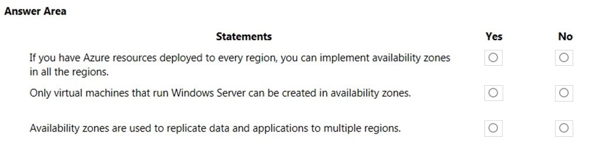

_Figure: Three statements, each with an empty Yes and an empty No. If you have Azure resources deployed to every region, you can implement availability zones in all the regions. Only virtual machines that run Windows Server can be created in availability zones. Availability zones are used to replicate data and applications to multiple regions._

<strong>Answer 117</strong>

No. No. No.

_Figure: Availability zones in every region is No. Windows Server only is No. Replication to multiple regions is No._

The solution image highlights No on every row. The explanation says not every region supports availability zones, and regions that do support Linux virtual machines. It also describes zones as separate physical locations inside one region, with a 99.99 percent virtual machine SLA for datacenter failures in that region. The printed line "Box 3: Yes" does not match that description or the highlight. The third statement says zones replicate data to multiple regions, and the image marks No.

**Why the others are wrong**

- Yes for zones in every region where you already have resources misses the regions that do not offer availability zones. Deploying something in a region does not add zones to that region.
- Yes for Windows Server only misses Linux. The explanation says regions that support availability zones support Linux virtual machines.
- Yes for replicating to multiple regions misses the scope of a zone. The explanation says zones are unique physical locations within a single Azure region. The image highlights No.

**Study further**

- [What are availability zones?](https://learn.microsoft.com/en-us/azure/reliability/availability-zones-overview)
- [Azure regions list](https://learn.microsoft.com/en-us/azure/reliability/regions-list)

<strong>Question 118 - Regions, datacenters, and transfer cost</strong>

HOTSPOT

For each of the following statements, select Yes if the statement is true. Otherwise, select No.

NOTE: Each correct selection is worth one point.

_Figure: Three statements, each with an empty Yes and an empty No. North America is represented by a single Azure region. Every Azure region has multiple datacenters. Data transfers between Azure services located in different Azure regions are always free._

<strong>Answer 118</strong>

No. Yes. No.

_Figure: North America as a single region is No. Every region having multiple datacenters is Yes. Cross-region data transfer always being free is No._

North America has many regions, including East US, Central US, South Central US, West US, and Canada East. A region is a set of datacenters inside a latency boundary. Outbound data transfer between regions is billed. Inbound data transfer is free.

**Why the others are wrong**

- Yes for one North America region misses the list of regions. East US and West US are different regions in the same geography.
- No for multiple datacenters misses the definition in the explanation. A region is a set of datacenters connected by a low-latency network.
- Yes for free transfers between regions misses the bandwidth charge. The explanation says outbound transfer is charged at the normal rate.

**Study further**

- [Azure regions list](https://learn.microsoft.com/en-us/azure/reliability/regions-list)
- [Bandwidth pricing](https://azure.microsoft.com/en-us/pricing/details/bandwidth/)

<strong>Question 119 - Two scale sets across datacenters</strong>

This item shares its setup with other questions. Each one proposes a different solution. Decide whether this solution meets the goal.

You plan to deploy several Azure virtual machines.

You need to ensure that the services running on the virtual machines are available if a single data center fails.

Solution: You deploy the virtual machines to two or more scale sets.

Does this meet the goal?

- A. Yes
- B. No

<strong>Answer 119</strong>

B. No.

Two scale sets still do not say that the virtual machines are in different datacenters. A scale set can scale and can use fault domains. This proposal never places the machines across datacenters, so the explanation says it misses the goal.

**Why the others are wrong**

- A. Yes would mean two scale sets survive a datacenter failure. The proposal does not put those scale sets in two datacenters. Both can still live in one datacenter.

**Study further**

- [What are virtual machine scale sets?](https://learn.microsoft.com/en-us/azure/virtual-machine-scale-sets/overview)
- [Availability options for Azure virtual machines](https://learn.microsoft.com/en-us/azure/virtual-machines/availability)

<strong>Question 120 - Notice of planned maintenance</strong>

You need to be notified when Microsoft plans to perform maintenance that can affect the resources deployed to an Azure subscription.

What should you use?

- A. Azure Monitor
- B. Azure Service Health
- C. Azure Advisor
- D. Microsoft Trust Center

<strong>Answer 120</strong>

B. Azure Service Health.

Service Health is the personalized view of the Azure services and regions you use. It is where you read planned maintenance, outages, and other health notices for those resources.

**Why the others are wrong**

- A. Azure Monitor collects metrics, logs, and alerts about your resources. It is not the place the explanation names for Microsoft's planned maintenance notices.
- C. Azure Advisor recommends changes for cost, security, reliability, and performance. It does not notify you of Microsoft's maintenance window.
- D. Microsoft Trust Center publishes trust, privacy, and compliance information. It does not send maintenance notices for the resources in your subscription.

**Study further**

- [Azure Service Health overview](https://learn.microsoft.com/en-us/azure/service-health/overview)
- [Azure Monitor overview](https://learn.microsoft.com/en-us/azure/azure-monitor/fundamentals/overview)

**Source:** [121-130.pdf](files/121-130.pdf)

<strong>Question 121 - IoT service descriptions</strong>

DRAG DROP

Match the Azure service to the correct description.

Instructions: To answer, drag the appropriate service from the column on the left to its description on the right. Each service may be used once, more than once, or not at all.

NOTE: Each correct selection is worth one point.

_Figure: Azure Sphere, IoT Central, and IoT Hub are in the services list. Three descriptions have empty boxes: bidirectional communication between IoT devices and Azure, a fully managed SaaS solution to connect and manage IoT devices at scale, and a software and hardware solution that provides communication and security features for IoT devices._

<strong>Answer 121</strong>

IoT Hub, IoT Central, and Azure Sphere, in that order.

_Figure: IoT Hub is on bidirectional communication. IoT Central is on the SaaS solution for managing devices at scale. Azure Sphere is on the software and hardware security solution._

IoT Hub is the device messaging service. IoT Central is the finished SaaS app for monitoring devices. Azure Sphere is the secured microcontroller, operating system, and cloud security service.

**Why the others are wrong**

- Azure Sphere does not provide the bidirectional device-to-cloud messaging service. That requirement is IoT Hub.
- IoT Hub is not the finished SaaS application for connecting and managing devices at scale. That requirement is IoT Central.
- IoT Central is not the hardware and software security platform. That requirement is Azure Sphere.

**Study further**

- [What is Azure IoT Hub?](https://learn.microsoft.com/en-us/azure/iot-hub/iot-concepts-and-iot-hub)
- [What is Azure IoT Central?](https://learn.microsoft.com/en-us/azure/iot-central/core/overview-iot-central)
- [What is Azure Sphere?](https://learn.microsoft.com/en-us/azure-sphere/product-overview/what-is-azure-sphere)

<strong>Question 122 - Windows Virtual Desktop statements</strong>

HOTSPOT

For each of the following statements, select Yes if the statement is true. Otherwise, select No.

NOTE: Each correct selection is worth one point.

_Figure: Three statements, each with an empty Yes and an empty No. A session host can run Windows 10 only. A host pool of 20 session hosts supports at most 20 simultaneous users. Windows Virtual Desktop supports desktop and app virtualization._

<strong>Answer 122</strong>

No. No. Yes.

_Figure: Windows 10 only is No. A maximum of 20 users on 20 session hosts is No. Desktop and app virtualization is Yes._

A session host can run Windows client or Windows Server, and a multi-session host can serve more than one user. Azure Virtual Desktop (formerly Windows Virtual Desktop) delivers full desktops and individual apps.

**Why the others are wrong**

- Yes for "Windows 10 only" misses the other session-host images. Windows 11 and Windows Server are also supported.
- Yes for "20 hosts means 20 users" misses multi-session. One session host can take many simultaneous connections.
- No for desktop and app virtualization misses both delivery modes. You can publish a full desktop or a single remote app.

**Study further**

- [What is Azure Virtual Desktop?](https://learn.microsoft.com/en-us/azure/virtual-desktop/overview)

<strong>Question 123 - Tool for electricity savings</strong>

HOTSPOT

To complete the sentence, select the appropriate option in the answer area.

_Figure: The sentence says a tool can calculate cost savings from reduced electricity when on-premises Microsoft SQL servers move to Azure. The open list is the Azure Migrate: Server Assessment tool, the Azure Total Cost of Ownership (TCO) calculator, the Database Migration Assistant, and the pricing calculator in Azure. Nothing is selected._

<strong>Answer 123</strong>

The Azure Total Cost of Ownership (TCO) calculator.

_Figure: The Azure Total Cost of Ownership (TCO) calculator is highlighted. Server Assessment, Database Migration Assistant, and the pricing calculator are not._

The requirement is savings from on-premises costs such as electricity after a SQL Server migration. The TCO calculator compares that on-premises spend with Azure.

**Why the others are wrong**

- The Azure Migrate: Server Assessment tool sizes Azure targets for discovered servers. It is not the tool this sentence uses for electricity savings.
- The Database Migration Assistant checks a database for migration blockers and compatibility. It does not calculate power savings.
- The pricing calculator estimates the price of Azure services you select. It does not start from your on-premises electricity cost.

**Study further**

- [Compare the pricing and TCO calculators](https://learn.microsoft.com/en-us/training/modules/describe-cost-management-azure/3-compare-pricing-total-cost-of-ownership-calculators)
- [Describe Azure cost management](https://learn.microsoft.com/en-us/training/modules/describe-cost-management-azure/)

<strong>Question 124 - Availability zone protection</strong>

HOTSPOT

For each of the following statements, select Yes if the statement is true. Otherwise, select No.

NOTE: Each correct selection is worth one point.

_Figure: Three statements, each with an empty Yes and an empty No. Availability Zones can protect virtual machines from a datacenter failure. Availability Zones can protect virtual machines from a region failure. Availability Zones can protect managed disks from a datacenter failure._

<strong>Answer 124</strong>

Yes. No. Yes.

_Figure: Datacenter protection for virtual machines is Yes. Region protection is No. Datacenter protection for managed disks is Yes._

Zones are separate datacenters inside one region, so a zone-redundant virtual machine or managed disk survives the loss of one datacenter. They do not survive the loss of the whole region.

**Why the others are wrong**

- No for virtual machines and a datacenter failure misses the zone design. Each zone has its own power, cooling, and network.
- Yes for a region failure misses the boundary. All zones of a region are in that region. A regional outage needs another region.
- No for managed disks and a datacenter failure misses zone-redundant disks. Copies in other zones of the same region stay available.

**Study further**

- [Availability zones overview](https://learn.microsoft.com/en-us/azure/reliability/availability-zones-overview)
- [Availability options for Azure virtual machines](https://learn.microsoft.com/en-us/azure/virtual-machines/availability)

<strong>Question 125 - Subscription and resource groups</strong>

HOTSPOT

For each of the following statements, select Yes if the statement is true. Otherwise, select No.

NOTE: Each correct selection is worth one point.

_Figure: Three statements, each with an empty Yes and an empty No. An Azure subscription can have multiple account administrators. An Azure subscription can be managed by using a Microsoft account only. An Azure resource group can contain multiple Azure subscriptions._

<strong>Answer 125</strong>

No. Yes. No.

_Figure: Multiple account administrators is No. Management by a Microsoft account only is Yes. A resource group that contains multiple subscriptions is No._

The solution allows one account administrator, treats that sign-in as a Microsoft account, and keeps each resource group inside a single subscription.

**Why the others are wrong**

- Yes for multiple account administrators misses the limit this solution uses. A subscription can have many administrators of other kinds, and only one account administrator.
- No for "Microsoft account only" is the choice the solution rejects. The highlighted answer says the subscription is managed with a Microsoft account only.
- Yes for a resource group that contains several subscriptions reverses the hierarchy. A subscription contains resource groups. A resource group belongs to one subscription.

**Study further**

- [Add or change Azure subscription administrators](https://learn.microsoft.com/en-us/azure/cost-management-billing/manage/add-change-subscription-administrator)
- [What is Azure Resource Manager?](https://learn.microsoft.com/en-us/azure/azure-resource-manager/management/overview)

<strong>Question 126 - Azure AD sign-in and groups</strong>

HOTSPOT

For each of the following statements, select Yes if the statement is true. Otherwise, select No.

NOTE: Each correct selection is worth one point.

_Figure: Three statements, each with an empty Yes and an empty No. A Windows 10 computer must be joined to Azure AD to sign in with Azure AD credentials. Users in Azure AD are organized by using resource groups. Azure AD groups support dynamic membership rules._

<strong>Answer 126</strong>

Yes. No. Yes.

_Figure: The computer must be joined to Azure AD is Yes. Users organized by resource groups is No. Dynamic membership rules is Yes._

The highlighted answer requires an Azure AD join before that Windows 10 computer signs in with Azure AD credentials. Users are directory objects, not resource-group members. A dynamic group fills itself from a rule.

**Why the others are wrong**

- No for the join statement is the choice the solution rejects. The image marks Yes: the computer must be joined to Azure AD.
- Yes for resource groups misses the directory. Azure AD users are organized with users and groups, not with an Azure resource group.
- No for dynamic membership misses a group feature. A dynamic membership rule adds and removes members as attributes change.

**Study further**

- [Microsoft Entra joined devices](https://learn.microsoft.com/en-us/entra/identity/devices/concept-directory-join)
- [Dynamic membership rules for groups](https://learn.microsoft.com/en-us/entra/identity/users/groups-dynamic-membership)

<strong>Question 127 - Survive one datacenter failure</strong>

You plan to deploy several Azure virtual machines.

You need to ensure that the services running on the virtual machines remain available if a single data center fails.

What are two possible solutions? Each correct answer presents a complete solution.

- A. Deploy the virtual machines to two or more availability zones.
- B. Deploy the virtual machines to two or more resource groups.
- C. Deploy the virtual machines to a scale set.
- D. Deploy the virtual machines to two or more regions.

<strong>Answer 127</strong>

A and D. Two or more availability zones, or two or more regions.

A zone is a separate datacenter in the region, and a second region is another geography. Either placement keeps a copy running when one datacenter fails.

**Why the others are wrong**

- B. Two or more resource groups misses the failure domain. A resource group is a management container. Two groups can still sit in the same datacenter.
- C. A scale set misses the placement. A scale set does not, by itself, put virtual machines in a second datacenter.

**Study further**

- [Availability zones overview](https://learn.microsoft.com/en-us/azure/reliability/availability-zones-overview)
- [What are virtual machine scale sets?](https://learn.microsoft.com/en-us/azure/virtual-machine-scale-sets/overview)

<strong>Question 128 - Keep one VM off the network</strong>

HOTSPOT

To complete the sentence, select the appropriate option in the answer area.

_Figure: You will deploy 20 virtual machines. To ensure VM1 cannot connect to the others, VM1 must be deployed to a separate virtual network, run a different operating system, be deployed to a separate resource group, or have two network interfaces. Nothing is selected._

<strong>Answer 128</strong>

Be deployed to a separate virtual network.

_Figure: "Be deployed to a separate virtual network" is highlighted. A different operating system, a separate resource group, and two network interfaces are not._

Virtual machines in the same virtual network can reach each other, including across subnets. A second virtual network removes that default path.

**Why the others are wrong**

- A different operating system misses the network. Connectivity does not depend on whether the guest is Windows or Linux.
- A separate resource group misses the network. Resource groups organize resources. They do not block traffic.
- Two network interfaces misses the isolation. Extra interfaces add connections. They do not cut VM1 off from the other machines.

**Study further**

- [What is Azure Virtual Network?](https://learn.microsoft.com/en-us/azure/virtual-network/virtual-networks-overview)

<strong>Question 129 - Data platform service match</strong>

DRAG DROP

Match the Azure service to the appropriate description.

To answer, drag the appropriate service from the column on the left to its description on the right. Each service may be used once, more than once, or not at all.

NOTE: Each correct match is worth one point.

_Figure: Azure Cosmos DB, Azure HDInsight, and Azure Synapse Analytics are in the services list. The descriptions are a fully managed data warehouse with integral security at every level of scale at no extra cost, a globally distributed database that supports NoSQL, and managed Apache Hadoop clusters that process massive amounts of data. The answer boxes are empty._

<strong>Answer 129</strong>

Azure Synapse Analytics, Azure Cosmos DB, and Azure HDInsight, in that order.

_Figure: Synapse Analytics is on the data warehouse. Cosmos DB is on the globally distributed NoSQL database. HDInsight is on managed Apache Hadoop clusters._

Synapse Analytics is the managed warehouse. Cosmos DB is the globally distributed NoSQL database. HDInsight runs managed Hadoop clusters for large-scale processing.

**Why the others are wrong**

- Cosmos DB is not the relational warehouse with security included at every scale. That requirement is Synapse Analytics.
- HDInsight is not the globally distributed NoSQL database. That requirement is Cosmos DB.
- Synapse Analytics is not the managed Hadoop cluster service. That requirement is HDInsight.

**Study further**

- [What is Azure Synapse Analytics?](https://learn.microsoft.com/en-us/azure/synapse-analytics/overview-what-is)
- [Azure Cosmos DB overview](https://learn.microsoft.com/en-us/azure/cosmos-db/overview)
- [What is Azure HDInsight?](https://learn.microsoft.com/en-us/azure/hdinsight/hdinsight-overview)

<strong>Question 130 - Blob access tier statements</strong>

HOTSPOT

For each of the following statements, select Yes if the statement is true. Otherwise, select No.

NOTE: Each correct selection is worth one point.

_Figure: Three statements, each with an empty Yes and an empty No. The Archive access tier is set at the storage account level. The Hot access tier is recommended for data that is accessed and modified frequently. The Cool access tier is recommended for long term backups._

<strong>Answer 130</strong>

No. Yes. No.

_Figure: Archive set at the storage account is No. Hot for data accessed and modified frequently is Yes. Cool for long-term backups is No._

Hot is for data you read and write often. Archive is a blob tier, not an account-wide switch. Long-term backup that you rarely read belongs on Archive, not Cool.

**Why the others are wrong**

- Yes for setting Archive on the storage account misses the scope. Archive is an access tier on a blob. The account does not have a single Archive setting that covers every object.
- No for the Hot tier misses the frequent-access requirement. Hot is the tier for data that is read and written often.
- Yes for Cool and long-term backups misses the tier. Cool is for data you still need immediately but do not use often. Long-term backup is an Archive scenario.

**Study further**

- [Hot, cool, and archive access tiers](https://learn.microsoft.com/en-us/azure/storage/blobs/access-tiers-overview)

**Source:** [131-140.pdf](files/131-140.pdf)

<strong>Question 131 - Most severe failure a zone covers</strong>

What is the most severe failure from which an Azure Availability Zone can be used to protect access to Azure service?

- A. A physical server failure
- B. An Azure region failure
- C. A storage failure
- D. An Azure data center failure

<strong>Answer 131</strong>

D. An Azure data center failure.

A zone is a separate datacenter in the region, with its own power, network, and cooling. Replicas in other zones stay available when that datacenter is lost. That is the largest failure a zone is built to cover.

**Why the others are wrong**

- A. A physical server failure is smaller than a datacenter failure. A zone covers the server, and it also covers the building around it.
- B. An Azure region failure is larger than a zone can cover. Every zone of a region is inside that region.
- C. A storage failure of one disk or one server is smaller than the loss of the datacenter. The question asks for the most severe failure a zone protects against.

**Study further**

- [Availability options for Azure virtual machines](https://learn.microsoft.com/en-us/azure/virtual-machines/availability)
- [Availability zones overview](https://learn.microsoft.com/en-us/azure/reliability/availability-zones-overview)

<strong>Question 132 - Buy a third-party security appliance</strong>

You need to purchase a third-party virtual security appliance that you will deploy to an Azure subscription.

What should you use?

- A. Azure subscriptions
- B. Azure Security Center
- C. Azure Marketplace
- D. Microsoft Store

<strong>Answer 132</strong>

C. Azure Marketplace.

Marketplace is where you find and buy partner virtual appliances, including network security appliances, and deploy them into a subscription.

**Why the others are wrong**

- A. An Azure subscription is the billing and access boundary. It is not a catalog of third-party appliances.
- B. Azure Security Center (now Microsoft Defender for Cloud) assesses and recommends on your resources. It is not the store for a third-party virtual appliance.
- D. Microsoft Store sells Windows apps and devices. It does not deploy a virtual appliance into an Azure subscription.

**Study further**

- [Azure Marketplace overview](https://learn.microsoft.com/en-us/marketplace/marketplace-overview)

<strong>Question 133 - Serverless solution characteristics</strong>

DRAG DROP

Match the serverless solution to the correct characteristic.

To answer, drag the appropriate serverless solution from the column on the left to its characteristic on the right. Each serverless solution may be used once, more than once, or not at all.

NOTE: Each correct match is worth one point.

_Figure: Azure Functions and Azure Logic Apps are the serverless solutions. The characteristics are "Executes code," "Is always stateful," and "Runs only in the cloud." The answer boxes are empty._

<strong>Answer 133</strong>

Azure Functions, Azure Functions, and Azure Logic Apps.

_Figure: Executes code is Azure Functions. Is always stateful is Azure Functions. Runs only in the cloud is Azure Logic Apps. Both solutions remain in the list on the left._

The image places Azure Functions on "Executes code" and on "Is always stateful," and Azure Logic Apps on "Runs only in the cloud." The explanation labels the second box Azure Functions and says Logic Apps workflows can be stateful or stateless, so Logic Apps is not treated as always stateful.

**Why the others are wrong**

- Azure Logic Apps does not execute your own code blocks. It runs a workflow of connectors and actions. The code requirement is Azure Functions.
- Azure Logic Apps misses "always stateful." The explanation says its workflows can be stateful or stateless. The image highlights Azure Functions for that row.
- Azure Functions misses "runs only in the cloud." The image places Azure Logic Apps on that row.

**Study further**

- [What is Azure Functions?](https://learn.microsoft.com/en-us/azure/azure-functions/functions-overview)
- [What is Azure Logic Apps?](https://learn.microsoft.com/en-us/azure/logic-apps/logic-apps-overview)

<strong>Question 134 - Governance feature match</strong>

DRAG DROP

Match the Azure governance feature to the correct description.

Instructions: To answer, drag the appropriate feature from the column on the left to its description on the right. Each feature may be used once, more than once, or not at all.

NOTE: Each correct match is worth one point.

_Figure: Azure Blueprints, Azure Policy, Azure resource locks, and Azure tags are in the features list. The descriptions are restrict which virtual machine types can be created in a subscription, identify resources associated with specific cost centers, and deploy a complete Azure application environment including resources, configuration, and role assignments. The answer boxes are empty._

<strong>Answer 134</strong>

Azure Policy, Azure tags, and Azure Blueprints.

_Figure: Azure Policy restricts virtual machine types. Azure tags identify cost centers. Azure Blueprints deploys the application environment with configuration and role assignments. Resource locks stay in the features list._

Policy enforces what can be created. Tags label resources for a cost center. Blueprints package resources, configuration, and role assignments into one environment.

**Why the others are wrong**

- Azure resource locks are the option left out. A lock stops a resource from being changed or deleted. It does not limit virtual machine sizes, label a cost center, or deploy an environment.
- Azure Blueprints does not restrict virtual machine types. That requirement is a policy rule.
- Azure Policy does not identify which resources belong to a cost center. That requirement is a tag.
- Azure tags do not deploy resources, configuration, and role assignments together. That requirement is a blueprint.

**Study further**

- [What is Azure Policy?](https://learn.microsoft.com/en-us/azure/governance/policy/overview)
- [Use tags to organize Azure resources](https://learn.microsoft.com/en-us/azure/azure-resource-manager/management/tag-resources)
- [What is Azure Blueprints?](https://learn.microsoft.com/en-us/azure/governance/blueprints/overview)

<strong>Question 135 - Where an availability zone sits</strong>

HOTSPOT

Select the answer that correctly completes the sentence.

_Figure: "An Availability Zone in Azure has physically separate locations" and an open list: across two continents, within a single Azure region, within multiple Azure regions, within a single Azure datacenter. Nothing is selected._

<strong>Answer 135</strong>

Within a single Azure region.

_Figure: "Within a single Azure region" is highlighted. Two continents, multiple regions, and a single datacenter are not._

_Figure: Availability Zone 1, Zone 2, and Zone 3 sit on one platform labeled Azure Region. Each zone has one or more datacenters, and fiber paths connect the zones. The diagram is the illustration in the solution, not a second dropdown._

An availability zone is one or more datacenters inside a region. The zones are physically separate from each other and still belong to that one region.

**Why the others are wrong**

- Across two continents misses the region boundary. Zones do not span continents.
- Within multiple Azure regions misses the boundary. A zone belongs to one region. Another region is a different failure domain.
- Within a single Azure datacenter misses the separation. A zone is made of one or more datacenters, and the zones themselves are separate locations.

**Study further**

- [Availability zones overview](https://learn.microsoft.com/en-us/azure/reliability/availability-zones-overview)

<strong>Question 136 - Compute service descriptions</strong>

DRAG DROP

Match the Azure services to the correct descriptions.

Instructions: To answer, drag the appropriate Azure service from the column on the left to its description on the right. Each service may be used once, more than once, or not at all.

NOTE: Each correct match is worth one point.

_Figure: Azure Functions, Azure App Service, Azure virtual machines, and Azure Container Instances are in the services list. The descriptions are operating system virtualization, a portable environment for virtualized applications, build deploy and scale web apps, and a platform for serverless code. The answer boxes are empty._

<strong>Answer 136</strong>

Azure virtual machines, Azure Container Instances, Azure App Service, and Azure Functions.

_Figure: Operating system virtualization is Azure virtual machines. A portable environment for virtualized applications is Azure Container Instances. Build, deploy, and scale web apps is Azure App Service. Serverless code is Azure Functions._

A virtual machine virtualizes an operating system. Container Instances runs a container without a virtual machine you manage. App Service hosts web apps. Functions runs event-driven code without a server you provision.

**Why the others are wrong**

- Azure Functions does not provide operating system virtualization. That requirement is a virtual machine.
- Azure App Service does not give you a portable container environment without managing virtual machines. That requirement is Container Instances.
- Azure virtual machines are not the managed platform whose job is to build, deploy, and scale web apps. That requirement is App Service.
- Azure Container Instances is not the serverless code platform. That requirement is Azure Functions.

**Study further**

- [Introduction to Azure virtual machines](https://learn.microsoft.com/en-us/azure/virtual-machines/overview)
- [What is Azure Container Instances?](https://learn.microsoft.com/en-us/azure/container-instances/container-instances-overview)
- [App Service overview](https://learn.microsoft.com/en-us/azure/app-service/overview)
- [What is Azure Functions?](https://learn.microsoft.com/en-us/azure/azure-functions/functions-overview)

<strong>Question 137 - Move VMs to a new subscription</strong>

HOTSPOT

To answer, select the appropriate option in the answer area.

_Figure: You have several virtual machines in an Azure subscription and you create a new subscription. The open list is: the virtual machines cannot be moved, they can be moved, they can be moved only if they are all in the same resource group, and they can be moved only if they run Windows Server 2019. Nothing is selected._

<strong>Answer 137</strong>

The virtual machines can be moved to the new subscription.

_Figure: "The virtual machines can be moved to the new subscription" is highlighted. Cannot be moved, only if they share a resource group, and only if they run Windows Server 2019 are not._

You can move a virtual machine and its related resources to another subscription in the Azure portal. The operating system and the original resource group do not block the move.

**Why the others are wrong**

- The virtual machines cannot be moved misses the move operation. Move to another subscription is a supported resource move.
- Only if they are all in the same resource group misses the requirement. You repeat the move for each resource group. They do not have to start in one group.
- Only if they run Windows Server 2019 misses the requirement. The move is not limited to that operating system.

**Study further**

- [Move resources to a new resource group or subscription](https://learn.microsoft.com/en-us/azure/azure-resource-manager/management/move-resource-group-and-subscription)

<strong>Question 138 - Buy a third-party security appliance</strong>

You need to purchase a third-party virtual security appliance that you will deploy to an Azure subscription.

What should you use?

- A. Azure subscriptions
- B. Microsoft Defender for Cloud
- C. Azure Marketplace
- D. Microsoft Store

<strong>Answer 138</strong>

C. Azure Marketplace.

Partner network security appliances are listed in Azure Marketplace. You deploy the one you buy into the subscription.

**Why the others are wrong**

- A. An Azure subscription is where the appliance lands. It is not the catalog you buy it from.
- B. Microsoft Defender for Cloud reports security posture and recommendations. It is not the store for a third-party virtual appliance.
- D. Microsoft Store does not deploy a virtual security appliance into an Azure subscription.

**Study further**

- [Azure Marketplace overview](https://learn.microsoft.com/en-us/marketplace/marketplace-overview)

<strong>Question 139 - Secure IoT microcontroller solution</strong>

HOTSPOT

Select the answer that correctly completes the sentence.

_Figure: A blank service name "is a highly secure IoT solution that includes a microcontroller unit (MCU) and a customized Linux operating system." The open list is Azure Arc, Azure IoT Central, Azure IoT Hub, and Azure Sphere. Nothing is selected._

<strong>Answer 139</strong>

Azure Sphere.

_Figure: Azure Sphere is highlighted. Azure Arc, Azure IoT Central, and Azure IoT Hub are not._

Azure Sphere is the secured microcontroller, the Linux-based Sphere operating system, and the Sphere cloud security service.

**Why the others are wrong**

- Azure Arc misses the hardware. Arc projects existing servers and Kubernetes clusters into Azure management. It is not a microcontroller and a custom Linux operating system.
- Azure IoT Central misses the hardware. It is a SaaS application for monitoring devices you already have.
- Azure IoT Hub misses the hardware. It is the cloud messaging hub for devices. It does not include the microcontroller or the operating system.

**Study further**

- [What is Azure Sphere?](https://learn.microsoft.com/en-us/azure-sphere/product-overview/what-is-azure-sphere)

<strong>Question 140 - VM service survives a datacenter</strong>

You plan to deploy a service to Azure virtual machines.

You need to ensure that the service will be available if a datacenter fails.

What should you use as part of the virtual machine deployment?

- A. Availability sets
- B. Proximity placement groups
- C. Host groups
- D. Availability zones

<strong>Answer 140</strong>

D. Availability zones.

Zones are physically separate locations in a region. A copy in another zone stays up when one datacenter fails.

**Why the others are wrong**

- A. Availability sets miss a datacenter failure. Fault domains and update domains share one datacenter.
- B. Proximity placement groups miss the failure. They place machines close together for low latency, which is the opposite of spreading them across datacenters.
- C. Host groups miss the failure. A dedicated host group is still a host placement choice. It does not put the service in a second datacenter.

**Study further**

- [Availability zones overview](https://learn.microsoft.com/en-us/azure/reliability/availability-zones-overview)
- [Availability options for Azure virtual machines](https://learn.microsoft.com/en-us/azure/virtual-machines/availability)

**Source:** [141-150.pdf](files/141-150.pdf)

<strong>Question 141 - Limit creation to regions</strong>

Your company has an Azure subscription that contains resources in several regions.

You need to ensure that administrators can only create resources in those regions.

What should you use?

- A. A read-only lock
- B. An Azure policy
- C. A management group
- D. A reservation

<strong>Answer 141</strong>

B. An Azure policy.

A policy can deny a deployment whose region is not on the allowed list. Administrators then create resources only in the regions you already use.

**Why the others are wrong**

- A. A read-only lock misses the region rule. It blocks changes to an existing resource. It does not say which regions a new resource may use.
- C. A management group misses the region rule. It groups subscriptions so you can assign policy and access above them. The group itself does not limit regions.
- D. A reservation misses the region rule. A reservation is a commitment that discounts compute you already plan to run.

**Study further**

- [What is Azure Policy?](https://learn.microsoft.com/en-us/azure/governance/policy/overview)
- [Management groups overview](https://learn.microsoft.com/en-us/azure/governance/management-groups/overview)

<strong>Question 142 - What an Azure region contains</strong>

HOTSPOT

Select the answer that correctly completes the sentence.

_Figure: "An Azure region" and an open list: contains one or more data centers connected by a low-latency network, is found in each country where Microsoft has a subsidiary office, can be found in every country in Europe and the Americas only, or contains one or more data centers connected by a high-latency network. Nothing is selected._

<strong>Answer 142</strong>

Contains one or more data centers that are connected by using a low-latency network.

_Figure: "Contains one or more data centers that are connected by using a low-latency network" is highlighted. A subsidiary office in every country, Europe and the Americas only, and a high-latency network are not._

A region is a set of datacenters inside a latency boundary, linked by a dedicated low-latency network.

**Why the others are wrong**

- A subsidiary office in each country misses the definition. Regions are datacenter locations, not a sales office in every country.
- Every country in Europe and the Americas only misses the map. Regions exist outside those two areas.
- A high-latency network misses the design. Datacenters in one region are connected for low latency.

**Study further**

- [Azure regions](https://learn.microsoft.com/en-us/azure/reliability/regions-overview)
- [Availability zones overview](https://learn.microsoft.com/en-us/azure/reliability/availability-zones-overview)

<strong>Question 143 - Azure File Sync destination</strong>

HOTSPOT

Select the answer that correctly completes the sentence.

_Figure: "You can use the Azure File Sync agent to sync on-premises data to an Azure" and an open list: blob container, Data Lake Storage container, file share, or queue. Nothing is selected._

<strong>Answer 143</strong>

File share.

_Figure: File share is highlighted. Blob container, Data Lake Storage container, and queue are not._

The Azure File Sync agent synchronizes a Windows Server folder with an Azure file share.

**Why the others are wrong**

- A blob container misses the sync target. File Sync uses Azure Files, not a blob container.
- A Data Lake Storage container misses the sync target. Data Lake is blob storage with a hierarchical namespace, not the file share the agent syncs.
- A queue misses the sync target. A queue holds messages. It does not store the files the agent synchronizes.

**Study further**

- [What is Azure File Sync?](https://learn.microsoft.com/en-us/azure/storage/file-sync/file-sync-introduction)
- [Introduction to Azure Files](https://learn.microsoft.com/en-us/azure/storage/files/storage-files-introduction)

<strong>Question 144 - Function of a Site-to-Site VPN</strong>

What is the function of a Site-to-Site VPN?

- A. Provides a secure connection between a computer on a public network and the corporate network
- B. Provides a dedicated private connection to Azure that does NOT travel over the internet
- C. Provides a connection from an on-premises VPN device to an Azure VPN gateway

<strong>Answer 144</strong>

C. A connection from an on-premises VPN device to an Azure VPN gateway.

A Site-to-Site VPN is an IPsec/IKE tunnel from a VPN device on your network to a VPN gateway in Azure. The device needs a public IP address.

_Figure: An on-premises site connects through an IPsec IKE site-to-site VPN tunnel to a VPN gateway in a virtual network in East US. Each side has a VPN public IP._

**Why the others are wrong**

- A. A secure connection from one computer on a public network is a point-to-site VPN, or a user VPN. Site-to-site connects a site, not one laptop.
- B. A dedicated private connection that does not travel over the internet is ExpressRoute. A Site-to-Site VPN travels over the internet.

**Study further**

- [About Azure VPN Gateway](https://learn.microsoft.com/en-us/azure/vpn-gateway/vpn-gateway-about-vpngateways)
- [Create a site-to-site VPN](https://learn.microsoft.com/en-us/azure/vpn-gateway/tutorial-site-to-site-portal)

<strong>Question 145 - Service model for each offering</strong>

DRAG DROP

Match the cloud service models to the appropriate offerings.

To answer, drag the appropriate model from the column on the left to its offering on the right. Each model may be used once, more than once, or not at all.

NOTE: Each correct match is worth one point.

_Figure: Infrastructure as a service, Platform as a service, and Software as a service are in the models list. The offerings are Azure App Service, Azure virtual machines, and Microsoft Dynamics 365. The answer boxes are empty._

<strong>Answer 145</strong>

Platform as a service, Infrastructure as a service, and Software as a service.

_Figure: Azure App Service is Platform as a service. Azure virtual machines is Infrastructure as a service. Microsoft Dynamics 365 is Software as a service._

App Service is a managed platform for the application you deploy. A virtual machine is rented infrastructure, including the operating system. Dynamics 365 is a finished application you use.

**Why the others are wrong**

- Infrastructure as a service misses App Service. You do not patch the platform that hosts the web app.
- Software as a service misses App Service. You still bring your own application.
- Platform as a service misses virtual machines. You manage the guest operating system.
- Software as a service misses virtual machines. A virtual machine is not a finished business application.
- Infrastructure as a service misses Dynamics 365. You do not manage its servers.
- Platform as a service misses Dynamics 365. You use the application. You do not deploy your own code onto its platform.

**Study further**

- [Describe cloud service types](https://learn.microsoft.com/en-us/training/modules/describe-cloud-service-types/)
- [App Service overview](https://learn.microsoft.com/en-us/azure/app-service/overview)
- [Introduction to Azure virtual machines](https://learn.microsoft.com/en-us/azure/virtual-machines/overview)

<strong>Question 146 - Service model for each solution</strong>

DRAG DROP

Match the cloud service models to the appropriate solutions.

To answer, drag the appropriate cloud service model from the column on the left to its solution on the right. Each cloud service model may be used once, more than once, or not at all.

NOTE: Each correct match is worth one point.

_Figure: Infrastructure-as-a-Service, Platform-as-a-Service, and Software-as-a-Service are in the list. The solutions are a cloud-based file server, a cloud-based accounting system, and a cloud-based service for custom apps. The answer boxes are empty._

<strong>Answer 146</strong>

Infrastructure as a service, Software as a service, and Platform as a service.

_Figure: A cloud-based file server is Infrastructure-as-a-Service. A cloud-based accounting system is Software-as-a-Service. A cloud-based service for custom apps is Platform-as-a-Service._

The solution treats the file server as infrastructure, the accounting system as a finished application, and the custom-app service as a platform you build on. The explanation uses Azure Files for the file server, Dynamics 365 for accounting, and a platform environment for custom apps.

**Why the others are wrong**

- Platform as a service for the file server is not the model the solution uses. The image places Infrastructure as a service on that row.
- Software as a service for the file server misses the requirement. A file server is shared storage, not a finished business application.
- Infrastructure as a service for the accounting system misses the requirement. You do not manage the servers behind Dynamics 365.
- Platform as a service for the accounting system misses the requirement. You use the accounting application. You do not deploy it as your own code.
- Infrastructure as a service for custom apps misses the requirement. A platform for custom apps removes the operating system work.
- Software as a service for custom apps misses the requirement. SaaS is the finished application, not the place you build your own apps.

**Study further**

- [Describe cloud service types](https://learn.microsoft.com/en-us/training/modules/describe-cloud-service-types/)
- [Introduction to Azure Files](https://learn.microsoft.com/en-us/azure/storage/files/storage-files-introduction)

<strong>Question 147 - Services that manage containers</strong>

You need to manage containers.

Which two services can you use? Each correct answer presents a complete solution.

NOTE: Each correct selection is worth one point.

- A. Azure Virtual Desktop
- B. Azure virtual machines
- C. Azure Functions
- D. Azure Container Instances
- E. Azure Kubernetes Service (AKS)

<strong>Answer 147</strong>

D and E. Azure Container Instances and Azure Kubernetes Service (AKS).

Container Instances runs a container without a virtual machine you manage. AKS is the managed Kubernetes service for containers at scale.

**Why the others are wrong**

- A. Azure Virtual Desktop misses containers. It publishes Windows desktops and apps to users.
- B. Azure virtual machines miss the managed container service. You can install a container runtime yourself, and you then manage the machine. The solution selects the two container services.
- C. Azure Functions misses container management. It runs event-driven code. It is not the service you use to manage containers.

**Study further**

- [What is Azure Container Instances?](https://learn.microsoft.com/en-us/azure/container-instances/container-instances-overview)
- [What is Azure Kubernetes Service?](https://learn.microsoft.com/en-us/azure/aks/what-is-aks)

<strong>Question 148 - Delegate permissions to several VMs</strong>

HOTSPOT

To complete the sentence, select the appropriate option in the answer area.

_Figure: "When you need to delegate permissions to several Azure virtual machines simultaneously, you must deploy the Azure virtual machines" to the same Azure region, by using the same Azure Resource Manager template, to the same resource group, or to the same availability zone. Nothing is selected._

<strong>Answer 148</strong>

To the same resource group.

_Figure: "To the same resource group" is highlighted. The same region, the same Resource Manager template, and the same availability zone are not._

A resource group is the scope for access. A role assignment on the group applies to the virtual machines inside it, so one assignment covers all of them.

**Why the others are wrong**

- The same Azure region misses the permission scope. Machines in one region can sit in many resource groups, and a region is not the scope you assign a role to for this requirement.
- The same Azure Resource Manager template misses the permission scope. A template defines how a resource is deployed. It does not grant access to the running machines.
- The same availability zone misses the permission scope. A zone is a physical location. It is not an access boundary.

**Study further**

- [What is Azure Resource Manager?](https://learn.microsoft.com/en-us/azure/azure-resource-manager/management/overview)
- [What is Azure role-based access control?](https://learn.microsoft.com/en-us/azure/role-based-access-control/overview)

<strong>Question 149 - Zones for a datacenter failure</strong>

This item shares its setup with other questions. Each one proposes a different solution. Decide whether this solution meets the goal.

You plan to deploy several Azure virtual machines.

You need to ensure that the services running on the virtual machines are available if a single data center fails.

Solution: You deploy the virtual machines to two or more availability zones.

Does this meet the goal?

- A. Yes
- B. No

<strong>Answer 149</strong>

A. Yes.

Zones are separate datacenters in the region, each with its own power, network, and cooling. A copy in another zone stays available when one datacenter fails.

**Why the others are wrong**

- B. No misses the zone design. Two or more zones are exactly a second datacenter for the virtual machines.

**Study further**

- [Availability zones overview](https://learn.microsoft.com/en-us/azure/reliability/availability-zones-overview)
- [Availability options for Azure virtual machines](https://learn.microsoft.com/en-us/azure/virtual-machines/availability)

<strong>Question 150 - High availability in SQL Data Warehouse</strong>

This question requires that you evaluate the underlined text to determine if it is correct.

One of the benefits of Azure SQL Data Warehouse is that high availability is built into the platform.

Instructions: Review the underlined text. If it makes the statement correct, select "No change is needed." If the statement is incorrect, select the answer choice that makes the statement correct.

- A. No change is needed
- B. Automatic scaling
- C. Data compression
- D. Versioning

<strong>Answer 150</strong>

A. No change is needed.

Azure SQL Data Warehouse, now Azure Synapse Analytics, is a platform service with high availability built in. The underlined phrase already states that benefit. The stated answer keeps it. The vote leans toward automatic scaling.

**Why the others are wrong**

- B. Automatic scaling replaces a true statement. The benefit in the sentence is high availability, which the platform already includes.
- C. Data compression replaces a true statement. Compression saves storage. It is not the built-in availability the sentence names.
- D. Versioning replaces a true statement. Versioning is not the high-availability feature built into the warehouse platform.

**Study further**

- [What is Azure Synapse Analytics?](https://learn.microsoft.com/en-us/azure/synapse-analytics/overview-what-is)
- [What is dedicated SQL pool (formerly SQL DW)?](https://learn.microsoft.com/en-us/azure/synapse-analytics/sql-data-warehouse/sql-data-warehouse-overview-what-is)

**Source:** [151-160.pdf](files/151-160.pdf)

<strong>Question 151 - Regions for a datacenter failure</strong>

This item shares its setup with other questions. Each one proposes a different solution. Decide whether this solution meets the goal.

You plan to deploy several Azure virtual machines.

You need to ensure that the services running on the virtual machines are available if a single data center fails.

Solution: You deploy the virtual machines to two or more regions.

Does this meet the goal?

- A. Yes
- B. No

<strong>Answer 151</strong>

A. Yes.

A region is a group of datacenters. Two regions put the virtual machines in more than one datacenter, so a single datacenter failure does not take the service down.

**Why the others are wrong**

- B. No misses the geography. A second region is another set of datacenters, which meets the single-datacenter requirement.

**Study further**

- [Azure regions](https://learn.microsoft.com/en-us/azure/reliability/regions-overview)
- [Availability options for Azure virtual machines](https://learn.microsoft.com/en-us/azure/virtual-machines/availability)

<strong>Question 152 - What a container instance is</strong>

HOTSPOT

Select the answer that correctly completes the sentence.

_Figure: "An Azure container instance is an example of an Azure" and an open list: compute service, identity service, networking service, or storage service. Nothing is selected._

<strong>Answer 152</strong>

Compute service.

_Figure: Compute service is highlighted. Identity, networking, and storage are not._

Azure Container Instances runs a container. That is compute: the hosting model for the application, without a virtual machine you provision.

**Why the others are wrong**

- An identity service misses the workload. Identity is Microsoft Entra ID and related sign-in services, not a running container.
- A networking service misses the workload. Virtual networks and gateways move traffic. They do not run the container.
- A storage service misses the workload. Storage holds data. The container instance is the compute that uses that data.

**Study further**

- [What is Azure Container Instances?](https://learn.microsoft.com/en-us/azure/container-instances/container-instances-overview)
- [Choose an Azure compute service](https://learn.microsoft.com/en-us/azure/architecture/guide/technology-choices/compute-decision-tree)

<strong>Question 153 - OSI layer for ExpressRoute</strong>

At which OSI layer does ExpressRoute operate?

- A. Layer 2
- B. Layer 3
- C. Layer 5
- D. Layer 7

<strong>Answer 153</strong>

B. Layer 3.

The marked answer is Layer 3. The explanation describes an ExpressRoute circuit as a provider connection that can be a layer 2 circuit or a managed layer 3 service, and it calls that managed provider solution a layer 3 service. The selected choice is Layer 3.

**Why the others are wrong**

- A. Layer 2 is mentioned in the explanation as one way a provider can present the circuit. The marked choice is Layer 3, the managed network service.
- C. Layer 5 is the session layer. ExpressRoute is a network connection between your network and Microsoft, not a session protocol.
- D. Layer 7 is the application layer. ExpressRoute does not operate as an application protocol.

**Study further**

- [What is Azure ExpressRoute?](https://learn.microsoft.com/en-us/azure/expressroute/expressroute-introduction)
- [ExpressRoute circuit peerings](https://learn.microsoft.com/en-us/azure/expressroute/expressroute-circuit-peerings)

<strong>Question 154 - Where Application Insights belongs</strong>

HOTSPOT

Select the answer that correctly completes the sentence.

_Figure: "Application Insights is a feature of" and an open list: Azure Advisor, Azure Application Gateway, Azure Arc, or Azure Monitor. Nothing is selected._

<strong>Answer 154</strong>

Azure Monitor.

_Figure: Azure Monitor is highlighted. Azure Advisor, Azure Application Gateway, and Azure Arc are not._

Application Insights is the application performance monitoring feature of Azure Monitor. It watches a live web app.

**Why the others are wrong**

- Azure Advisor misses the telemetry product. Advisor recommends improvements. It does not collect application performance data.
- Azure Application Gateway misses the monitoring product. It is a web traffic load balancer.
- Azure Arc misses the monitoring product. Arc projects external machines and clusters into Azure management.

**Study further**

- [Application Insights overview](https://learn.microsoft.com/en-us/azure/azure-monitor/app/app-insights-overview)
- [Azure Monitor overview](https://learn.microsoft.com/en-us/azure/azure-monitor/fundamentals/overview)

<strong>Question 155 - Resource group statements</strong>

HOTSPOT

For each of the following statements, select Yes if the statement is true. Otherwise, select No.

NOTE: Each correct selection is worth one point.

_Figure: Three statements, each with an empty Yes and an empty No. Azure resources can only access other resources in the same resource group. Deleting a resource group deletes all the resources in it. A resource group can contain resources from multiple Azure regions._

<strong>Answer 155</strong>

No. Yes. Yes.

_Figure: Access limited to the same resource group is No. Deleting the group deletes its resources is Yes. Resources from multiple regions is Yes._

A resource group is a management container. Resources in it can talk to resources elsewhere, they are deleted with the group, and they can live in different regions. The group stores metadata about them.

**Why the others are wrong**

- Yes for "only the same resource group" misses networking and identity. A resource group does not wall off traffic or API calls.
- No for deleting the group misses the cascade. Delete the group and the resources in it are deleted with it.
- No for multiple regions misses the metadata. The group can list resources that are deployed in more than one region.

**Study further**

- [What is Azure Resource Manager?](https://learn.microsoft.com/en-us/azure/azure-resource-manager/management/overview)

<strong>Question 156 - Store 20 TB for Power BI</strong>

You plan to store 20 TB of data in Azure. The data will be accessed infrequently and visualized by using Microsoft Power BI.

You need to recommend a storage solution for the data.

Which two solutions should you recommend? Each correct answer presents a complete solution.

NOTE: Each correct selection is worth one point.

- A. Azure Data Lake
- B. Azure Cosmos DB
- C. Azure SQL Data Warehouse
- D. Azure SQL Database
- E. Azure Database for PostgreSQL

<strong>Answer 156</strong>

A and C. Azure Data Lake and Azure SQL Data Warehouse.

Both hold large analytical data and can feed Power BI. Data Lake stores data of many shapes at that scale. SQL Data Warehouse, now a dedicated SQL pool in Synapse Analytics, is the warehouse Power BI can query.

**Why the others are wrong**

- B. Azure Cosmos DB misses the analytical store. It is an operational NoSQL database, not the store this solution pairs with Power BI for 20 TB of infrequently used data.
- D. Azure SQL Database misses the scale and the access pattern. It is a transactional database, not the data lake or the warehouse named in the solution.
- E. Azure Database for PostgreSQL misses the same requirement. It is a transactional open-source database, not the analytical store Power BI is pointed at here.

**Study further**

- [Introduction to Azure Data Lake Storage](https://learn.microsoft.com/en-us/azure/storage/blobs/data-lake-storage-introduction)
- [What is dedicated SQL pool (formerly SQL DW)?](https://learn.microsoft.com/en-us/azure/synapse-analytics/sql-data-warehouse/sql-data-warehouse-overview-what-is)
- [Azure and Power BI](https://learn.microsoft.com/en-us/power-bi/connect-data/service-azure-and-power-bi)

<strong>Question 157 - URL that manages all resources</strong>

HOTSPOT

You have an Azure environment that contains 10 web apps.

To which URL should you connect to manage all the Azure resources? To answer, select the appropriate options in the answer area.

NOTE: Each correct selection is worth one point.

_Figure: The address is https:// then an open list (admin, portal, or www), then an open list (azure, azurewebsites, or microsoft), then com. Nothing is selected._

<strong>Answer 157</strong>

https://portal.azure.com

_Figure: The first list highlights portal. The second list highlights azure. The address reads https://portal.azure.com. admin, www, azurewebsites, and microsoft are not highlighted._

The Azure portal is the web hub for every resource in the subscription, including the 10 web apps. Its address is https://portal.azure.com.

**Why the others are wrong**

- admin. misses the portal host. The management site is portal.azure.com.
- www. misses the portal host. www is not the Azure portal name.
- azurewebsites. misses the management site. That suffix is used by App Service host names, not by the portal that manages every resource.
- microsoft. misses the portal domain. The portal is portal.azure.com.

**Study further**

- [Azure portal overview](https://learn.microsoft.com/en-us/azure/azure-portal/azure-portal-overview)

<strong>Question 158 - Redundancy from least to most</strong>

DRAG DROP

Arrange the storage account redundancy options from the least redundant to the most redundant.

To answer, move all options from the list of options to the answer area and arrange them in the correct order.

_Figure: Zone-redundant storage (ZRS), Geo-redundant storage (GRS), and Locally-redundant storage (LRS) are in the options list. The answer area is empty and has up and down controls._

<strong>Answer 158</strong>

Locally redundant storage (LRS), then zone-redundant storage (ZRS), then geo-redundant storage (GRS).

_Figure: The answer area lists Locally-redundant storage (LRS), then Zone-redundant storage (ZRS), then Geo-redundant storage (GRS). The options list is empty._

LRS keeps copies in one datacenter. ZRS spreads copies across zones in one region. GRS adds a copy in the paired region, so it is the most redundant of the three.

**Why the others are wrong**

- Geo-redundant storage is not the least redundant. It copies data to a second region.
- Locally redundant storage is not the most redundant. Its copies stay in one datacenter.
- Zone-redundant storage is not at either end of this list. It survives a zone failure in one region, which is more than LRS and less than a second region.

**Study further**

- [Data redundancy in Azure Storage](https://learn.microsoft.com/en-us/azure/storage/common/storage-redundancy)

<strong>Question 159 - What Blob Storage is</strong>

HOTSPOT

Select the answer that correctly completes the sentence.

_Figure: "Azure Blob Storage is a" and an open list: a data store for queuing and delivering messages, a file share that can be mapped as a network drive, a key/attribute store for non-relational structured data, or a storage service optimized for very large objects such as video files and bitmaps. Nothing is selected._

<strong>Answer 159</strong>

A storage service optimized for very large objects, such as video files and bitmaps.

_Figure: "Storage service optimized for very large objects, such as video files and bitmaps" is highlighted. A message queue, a file share, and a key/attribute store are not._

Blob Storage holds unstructured objects. Video files and bitmaps are the kind of large object it is built for.

**Why the others are wrong**

- A data store for queuing messages is Queue Storage. Blob Storage does not deliver messages between applications.
- A file share mapped as a network drive is Azure Files. Blob Storage is not an SMB or NFS share.
- A key/attribute store for non-relational structured data is Table Storage. Blob Storage stores objects, not attribute rows.

**Study further**

- [Introduction to Azure Blob Storage](https://learn.microsoft.com/en-us/azure/storage/blobs/storage-blobs-introduction)
- [Storage account overview](https://learn.microsoft.com/en-us/azure/storage/common/storage-account-overview)

<strong>Question 160 - Linux with Azure CLI for PowerShell</strong>

This item shares its setup with other questions. Each one proposes a different solution. Decide whether this solution meets the goal.

An Azure administrator plans to run a PowerShell script that creates Azure resources.

You need to recommend which computer configuration to use to run the script.

Solution: Run the script from a computer that runs Linux and has the Azure CLI tools installed.

Does this meet the goal?

- A. Yes
- B. No

<strong>Answer 160</strong>

B. No.

A PowerShell script has to run in PowerShell. This computer has the Azure CLI tools installed, not PowerShell, so the script cannot run there.

**Why the others are wrong**

- A. Yes misses the runtime. The Azure CLI accepts `az` commands. It does not run a PowerShell script.

**Study further**

- [Install PowerShell](https://learn.microsoft.com/en-us/powershell/scripting/install/installing-powershell)
- [What is Azure Cloud Shell?](https://learn.microsoft.com/en-us/azure/cloud-shell/overview)

**Source:** [161-170.pdf](files/161-170.pdf)

<strong>Question 161 - Chrome OS with Cloud Shell</strong>

This item shares its setup with other questions. Each one proposes a different solution. Decide whether this solution meets the goal.

An Azure administrator plans to run a PowerShell script that creates Azure resources.

You need to recommend which computer configuration to use to run the script.

Solution: Run the script from a computer that runs Chrome OS and uses Azure Cloud Shell.

Does this meet the goal?

- A. Yes
- B. No

<strong>Answer 161</strong>

A. Yes.

Cloud Shell opens a PowerShell session in the browser, and the Azure PowerShell module is already installed. Chrome OS only has to reach that browser session.

**Why the others are wrong**

- B. No misses Cloud Shell. The script does not need a local PowerShell install when Cloud Shell provides it.

**Study further**

- [What is Azure Cloud Shell?](https://learn.microsoft.com/en-us/azure/cloud-shell/overview)

<strong>Question 162 - Azure Service Health statements</strong>

HOTSPOT

For each of the following statements, select Yes if the statement is true. Otherwise, select No.

NOTE: Each correct selection is worth one point.

_Figure: Three statements, each with an empty Yes and an empty No. From Azure Service Health, an administrator can view the health of all the services in an Azure environment. From Azure Service Health, an administrator can create a rule to be alerted if an Azure service fails. From Azure Service Health, an administrator can prevent a service failure._

<strong>Answer 162</strong>

Yes. Yes. No.

_Figure: View the health of the services in the environment is Yes. Create an alert rule if a service fails is Yes. Prevent a service failure is No._

Service Health shows the health of the Azure services you use and can alert you about incidents, maintenance, and advisories. It does not stop a failure from happening.

**Why the others are wrong**

- No for viewing service health misses the product. Service Health is the personalized view of service issues that affect your environment.
- No for an alert rule misses Service Health alerts. You can be notified when a service issue, planned maintenance, or another advisory affects you.
- Yes for preventing a service failure misses the limit. Service Health reports and alerts. It does not stop the failure. Resource Health can show a virtual machine's health, and it also cannot prevent the failure.

**Study further**

- [Azure Service Health overview](https://learn.microsoft.com/en-us/azure/service-health/overview)

<strong>Question 163 - macOS with PowerShell Core</strong>

This item shares its setup with other questions. Each one proposes a different solution. Decide whether this solution meets the goal.

An Azure administrator plans to run a PowerShell script that creates Azure resources.

You need to recommend which computer configuration to use to run the script.

Solution: Run the script from a computer that runs macOS and has PowerShell Core 6.0 installed.

Does this meet the goal?

- A. Yes
- B. No

<strong>Answer 163</strong>

A. Yes.

The script needs PowerShell. PowerShell Core 6.0 is installed on this Mac, so the script can run. Creating Azure resources also means importing the Azure PowerShell module.

**Why the others are wrong**

- B. No misses the install. The computer already has PowerShell, which is the runtime the script requires.

**Study further**

- [Install PowerShell](https://learn.microsoft.com/en-us/powershell/scripting/install/installing-powershell)

<strong>Question 164 - Blade for planned maintenance</strong>

HOTSPOT

You need to view a list of planned maintenance events that can affect the availability of an Azure subscription.

Which blade should you use from the Azure portal? To answer, select the appropriate blade in the answer area.

_Figure: The portal menu lists New, All services, and favorites: Dashboard, All resources, Resource groups, App Services, Function Apps, SQL databases, Azure Cosmos DB, Virtual machines, and Load balancers. No blade is highlighted._

<strong>Answer 164</strong>

Help and Support, then Service Health, then Planned maintenance.

_Figure: The screenshot shows the same favorites menu, from Dashboard through Load balancers. It does not highlight Help and Support. The written solution uses the Help and Support blade._

On Help and Support there is a Service Health option. Service Health opens a blade that includes Planned maintenance, which lists maintenance that can affect the subscription.

**Why the others are wrong**

- Dashboard misses the maintenance list. It is a home view of tiles, not the planned-maintenance list.
- All resources misses the platform schedule. It lists your resources. It does not list Azure maintenance events.
- Resource groups, App Services, Function Apps, SQL databases, Azure Cosmos DB, Virtual machines, and Load balancers each open one kind of resource. None of them is the subscription's planned-maintenance list.

**Study further**

- [Azure Service Health overview](https://learn.microsoft.com/en-us/azure/service-health/overview)
- [Planned maintenance notifications](https://learn.microsoft.com/en-us/azure/service-health/service-health-planned-maintenance)

<strong>Question 165 - Service to definition match</strong>

DRAG DROP

Match the Azure service to the correct definition.

Instructions: To answer, drag the appropriate Azure service from the column on the left to its description on the right. Each service may be used once, more than once, or not at all.

NOTE: Each correct match is worth one point.

_Figure: Azure Advisor, Azure Cognitive Services, Azure Application Insights, and Azure DevOps are the options. The descriptions are an integrated solution for the deployment of code, a tool that provides guidance and recommendations to improve an Azure environment, a simplified tool to build intelligent AI applications, and monitors web applications. The answer boxes are empty._

<strong>Answer 165</strong>

Azure DevOps, Azure Advisor, Azure Cognitive Services, and Azure Application Insights.

_Figure: Deployment of code is Azure DevOps. Guidance and recommendations is Azure Advisor. A simplified tool for intelligent AI applications is Azure Cognitive Services. Monitors web applications is Azure Application Insights._

DevOps covers the path from plan through deploy. Advisor recommends improvements for cost, security, reliability, and performance. Cognitive Services (now Azure AI services) adds vision, speech, and language to an app. Application Insights watches a live web app.

**Why the others are wrong**

- Azure Advisor does not deploy code. That requirement is Azure DevOps.
- Azure DevOps is not the recommendation engine for an existing Azure environment. That requirement is Advisor.
- Application Insights does not build intelligent AI features into an app. That requirement is Cognitive Services.
- Cognitive Services does not monitor what users do in a live web app. That requirement is Application Insights.

**Study further**

- [What is Azure DevOps?](https://learn.microsoft.com/en-us/azure/devops/user-guide/what-is-azure-devops)
- [Introduction to Azure Advisor](https://learn.microsoft.com/en-us/azure/advisor/advisor-overview)
- [What are Azure AI services?](https://learn.microsoft.com/en-us/azure/ai-services/what-are-ai-services)
- [Application Insights overview](https://learn.microsoft.com/en-us/azure/azure-monitor/app/app-insights-overview)

<strong>Question 166 - Data service descriptions</strong>

DRAG DROP

Match the Azure service to the correct description.

Instructions: To answer, drag the appropriate Azure service from the column on the left to its description on the right. Each service may be used once, more than once, or not at all.

NOTE: Each correct match is worth one point.

_Figure: Azure HDInsight, Azure Data Lake Analytics, Azure SQL Synapse Analytics, and Azure SQL Database are the options. The descriptions are a managed relational cloud database service, a cloud service that uses massively parallel processing to run complex queries across petabytes in a relational database, a service that can run massively parallel data transformation across petabytes, and an open-source framework for distributed processing of big data sets in clusters. The answer boxes are empty._

<strong>Answer 166</strong>

Azure SQL Database, Azure SQL Synapse Analytics, Azure Data Lake Analytics, and Azure HDInsight.

_Figure: The managed relational database is Azure SQL Database. Massively parallel queries on a relational store of petabytes is Azure SQL Synapse Analytics. Massively parallel transformation across petabytes is Azure Data Lake Analytics. The open-source cluster framework is Azure HDInsight._

Azure SQL Database is managed SQL Server for applications. Synapse Analytics is the massively parallel relational warehouse. Data Lake Analytics runs large parallel processing jobs over a data lake. HDInsight is the managed Hadoop-family cluster service.

**Why the others are wrong**

- Azure HDInsight is not the managed relational database for an application. That requirement is Azure SQL Database.
- Azure SQL Database is not the massively parallel warehouse for petabyte queries. That requirement is Synapse Analytics.
- Azure SQL Synapse Analytics is not the job service the solution uses for massively parallel transformation programs across a data lake. That requirement is Data Lake Analytics.
- Azure Data Lake Analytics is not the open-source cluster framework. That requirement is HDInsight.

**Study further**

- [What is Azure SQL Database?](https://learn.microsoft.com/en-us/azure/azure-sql/database/sql-database-paas-overview)
- [What is Azure Synapse Analytics?](https://learn.microsoft.com/en-us/azure/synapse-analytics/overview-what-is)
- [What is Azure Data Lake Analytics?](https://learn.microsoft.com/en-us/azure/data-lake-analytics/data-lake-analytics-overview)
- [What is Azure HDInsight?](https://learn.microsoft.com/en-us/azure/hdinsight/hdinsight-overview)

<strong>Question 167 - Blades for three portal tasks</strong>

HOTSPOT

You need to identify which blades in the Azure portal must be used to perform the following tasks:

- View security recommendations.
- Monitor the health of Azure services.
- Browse available virtual machine images.

Which blade should you identify for each task? To answer, select the appropriate options in the answer area.

NOTE: Each correct selection is worth one point.

_Figure: Monitor the health of Azure services, browse available virtual machine images, and view security recommendations. Each row has the same open list: Monitor, Subscriptions, Marketplace, and Advisor. Nothing is selected._

<strong>Answer 167</strong>

Monitor, Marketplace, and Advisor.

_Figure: Monitor the health of Azure services highlights Monitor. Browse available virtual machine images highlights Marketplace. View security recommendations highlights Advisor._

The image order is health, then virtual machine images, then security recommendations. Monitor collects health and telemetry. Marketplace is the catalog of virtual machine images. Advisor shows security recommendations, including those brought in from Microsoft Defender for Cloud.

**Why the others are wrong**

- Subscriptions for service health misses the telemetry product. A subscription blade manages the subscription. Monitor is the health view.
- Marketplace for service health misses the catalog's job. Marketplace lists offers. It does not monitor service health.
- Advisor for service health misses the monitor. Advisor recommends changes. It is not the health monitor.
- Monitor for virtual machine images misses the catalog. Monitor does not browse images you can deploy.
- Subscriptions for virtual machine images misses the catalog. Images are offered in Marketplace.
- Advisor for virtual machine images misses the catalog. Advisor does not list images to deploy.
- Monitor for security recommendations misses Advisor. Monitor collects signals. The security recommendation list in this solution is Advisor.
- Marketplace for security recommendations misses Advisor. Marketplace is where you obtain offers, not where this solution reads security recommendations.
- Subscriptions for security recommendations misses Advisor. The subscription blade does not list those recommendations.

**Study further**

- [Azure Monitor overview](https://learn.microsoft.com/en-us/azure/azure-monitor/fundamentals/overview)
- [Azure Marketplace overview](https://learn.microsoft.com/en-us/marketplace/marketplace-overview)
- [Introduction to Azure Advisor](https://learn.microsoft.com/en-us/azure/advisor/advisor-overview)

<strong>Question 168 - Android tablet with Bash Cloud Shell</strong>

This item shares its setup with other questions. Each one proposes a different solution. Decide whether this solution meets the goal.

You have an Azure environment. You need to create a new Azure virtual machine from a tablet that runs the Android operating system.

Solution: You use Bash in Azure Cloud Shell.

Does this meet the goal?

- A. Yes
- B. No

<strong>Answer 168</strong>

A. Yes.

Cloud Shell runs in the browser, and Bash in Cloud Shell can create a virtual machine. The Android tablet only needs that browser.

**Why the others are wrong**

- B. No misses the browser shell. Creating the virtual machine does not require a desktop Azure CLI install.

**Study further**

- [What is Azure Cloud Shell?](https://learn.microsoft.com/en-us/azure/cloud-shell/overview)

<strong>Question 169 - Serverless email notifications</strong>

You have an on-premises application that sends email notifications automatically based on a rule.

You plan to migrate the application to Azure.

You need to recommend a serverless computing solution for the application.

What should you include in the recommendation?

- A. A web app
- B. A server image in Azure Marketplace
- C. A logic app
- D. An API app

<strong>Answer 169</strong>

C. A logic app.

Logic Apps is the serverless workflow service. A workflow can send email when a rule or an event says to, without a server you manage.

**Why the others are wrong**

- A. A web app misses the serverless workflow. App Service hosts an application you still deploy. It is not the workflow that sends the mail when a rule fires.
- B. A server image in Azure Marketplace misses serverless. An image becomes a virtual machine you operate.
- D. An API app misses the notification workflow. An API app exposes an HTTP API. It does not, by itself, replace a rule that sends email.

**Study further**

- [What is Azure Logic Apps?](https://learn.microsoft.com/en-us/azure/logic-apps/logic-apps-overview)

<strong>Question 170 - Best playback for worldwide video</strong>

You plan to deploy a website to Azure. The website will be accessed by users worldwide and will host large video files.

You need to recommend which Azure feature must be used to provide the best video playback experience.

What should you recommend?

- A. An application gateway
- B. An Azure ExpressRoute circuit
- C. A content delivery network (CDN)
- D. An Azure Traffic Manager profile

<strong>Answer 170</strong>

C. A content delivery network (CDN).

Users are worldwide and the files are large. A CDN caches the video at edge sites near those users, so playback does not pull every byte from one origin.

**Why the others are wrong**

- A. An application gateway misses global playback. It load-balances HTTP into one region. It does not cache video beside users on other continents.
- B. An ExpressRoute circuit misses the audience. ExpressRoute is a private link from your site to Microsoft. It does not speed up public users around the world.
- D. A Traffic Manager profile misses the cache. It sends each user to an endpoint. It does not store the video close to them.

**Study further**

- [What is a content delivery network on Azure?](https://learn.microsoft.com/en-us/azure/cdn/cdn-overview)
- [What is Azure Front Door?](https://learn.microsoft.com/en-us/azure/frontdoor/front-door-overview)

**Source:** [171-180.pdf](files/171-180.pdf)

<strong>Question 171 - Resources for millions of sensors</strong>

Your company plans to deploy several million sensors that will upload data to Azure.

You need to identify which Azure resources must be created to support the planned solution.

Which two Azure resources should you identify? Each correct answer presents part of the solution.

NOTE: Each correct selection is worth one point.

- A. Azure Data Lake
- B. Azure Queue storage
- C. Azure File Storage
- D. Azure IoT Hub
- E. Azure Notification Hubs

<strong>Answer 171</strong>

A and D. Azure Data Lake and Azure IoT Hub.

IoT Hub is the message hub for millions of devices. IoT Hub can route those messages to Azure Data Lake Storage, which keeps the uploaded data.

**Why the others are wrong**

- B. Azure Queue storage misses both parts. A queue is a small-message buffer between app components. It is not the device hub, and it is not the store IoT Hub routes sensor data into here.
- C. Azure File Storage misses both parts. A file share is not the ingress for millions of sensors, and it is not the route target named in the solution.
- E. Azure Notification Hubs misses both parts. Notification Hubs pushes messages out to mobile apps. It does not ingest sensor uploads.

**Study further**

- [What is Azure IoT Hub?](https://learn.microsoft.com/en-us/azure/iot-hub/iot-concepts-and-iot-hub)
- [IoT Hub message routing](https://learn.microsoft.com/en-us/azure/iot-hub/iot-hub-devguide-messages-d2c)
- [Introduction to Azure Data Lake Storage](https://learn.microsoft.com/en-us/azure/storage/blobs/data-lake-storage-introduction)

<strong>Question 172 - Manage a web app from an iPhone</strong>

You have an Azure web app.

You need to manage the settings of the web app from an iPhone.

What are two Azure management tools that you can use? Each correct answer presents a complete solution.

NOTE: Each correct selection is worth one point.

- A. Azure CLI
- B. The Azure portal
- C. Azure Cloud Shell
- D. Windows PowerShell
- E. Azure Storage Explorer

<strong>Answer 172</strong>

B and C. The Azure portal and Azure Cloud Shell.

Both are web-based. The iPhone browser can open the portal, and Cloud Shell opens from that portal, so either one can change the web app settings.

**Why the others are wrong**

- A. Azure CLI misses the phone. It installs on a computer. It does not install on an iPhone.
- D. Windows PowerShell misses the phone. It does not install on an iPhone.
- E. Azure Storage Explorer misses the web app. It browses storage accounts. It does not manage web app settings, and it is not an iPhone app for this task.

**Study further**

- [Azure portal overview](https://learn.microsoft.com/en-us/azure/azure-portal/azure-portal-overview)
- [What is Azure Cloud Shell?](https://learn.microsoft.com/en-us/azure/cloud-shell/overview)

<strong>Question 173 - Build and deploy predictive analytics</strong>

Your company plans to deploy an Artificial Intelligence (AI) solution in Azure.

What should the company use to build, test, and deploy predictive analytics solutions?

- A. Azure Logic Apps
- B. Azure Machine Learning Designer
- C. Azure Batch
- D. Azure Cosmos DB

<strong>Answer 173</strong>

B. Azure Machine Learning Designer.

Designer is the visual canvas where you connect datasets and modules, train a model, and deploy it. That is the build, test, and deploy path for predictive analytics.

**Why the others are wrong**

- A. Azure Logic Apps misses the model. It automates workflows. It does not train and deploy a predictive model.
- C. Azure Batch misses the model. It runs large parallel jobs. It does not provide the designer for predictive analytics.
- D. Azure Cosmos DB misses the model. It stores data. It does not build, test, or deploy the analytics solution.

**Study further**

- [What is Azure Machine Learning designer?](https://learn.microsoft.com/en-us/azure/machine-learning/concept-designer)
- [What is Azure Machine Learning?](https://learn.microsoft.com/en-us/azure/machine-learning/overview-what-is-azure-machine-learning)

<strong>Question 174 - Azure Advisor statements</strong>

HOTSPOT

For each of the following statements, select Yes if the statement is true. Otherwise, select No.

NOTE: Each correct selection is worth one point.

_Figure: Three statements, each with an empty Yes and an empty No. Azure Advisor can generate a list of Azure virtual machines that are protected by Azure Backup. Implementing Advisor security recommendations makes the company's secure score decrease. To maintain Microsoft support, you must implement the Advisor security recommendations within 30 days._

<strong>Answer 174</strong>

No. No. No.

_Figure: A list of virtual machines protected by Azure Backup is No. Secure score will decrease is No. A 30-day requirement to keep Microsoft support is No._

Advisor can point out virtual machines that are not protected by Backup. Following a security recommendation raises the secure score. The recommendations are optional.

**Why the others are wrong**

- Yes for a list of protected virtual machines misses what Advisor generates. It recommends machines that are not backed up. Protected items are listed in the Recovery Services vault.
- Yes for a decreasing secure score misses the direction. Implementing the recommendations increases the score.
- Yes for a 30-day support requirement misses the word recommendation. Microsoft support does not depend on finishing Advisor items within 30 days.

**Study further**

- [Introduction to Azure Advisor](https://learn.microsoft.com/en-us/azure/advisor/advisor-overview)

<strong>Question 175 - Alert when an administrator stops a VM</strong>

What can you use to automatically send an alert if an administrator stops an Azure virtual machine?

- A. Azure Advisor
- B. Azure Service Health
- C. Azure Monitor
- D. Azure Network Watcher

<strong>Answer 175</strong>

C. Azure Monitor.

Azure Monitor alerts fire on signals from the virtual machine, including an administrator stopping it.

**Why the others are wrong**

- A. Azure Advisor misses the alert. Advisor recommends configuration changes. It does not send an alert when someone stops a virtual machine.
- B. Azure Service Health misses the operator action. Service Health reports Azure platform issues and maintenance, not an administrator stopping one virtual machine.
- D. Azure Network Watcher misses the power action. It diagnoses network reachability. It does not alert on a stop operation.

**Study further**

- [Alerts in Azure Monitor](https://learn.microsoft.com/en-us/azure/azure-monitor/alerts/alerts-overview)
- [VM insights alerts](https://learn.microsoft.com/en-us/azure/azure-monitor/vm/monitor-virtual-machine-alerts)

<strong>Question 176 - Match services to descriptions</strong>

DRAG DROP

Match the Azure services to the correct descriptions.

Instructions: To answer, drag the appropriate Azure service from the column on the left to its description on the right. Each service may be used once, more than once, or not at all.

NOTE: Each correct match is worth one point.

_Figure: Azure Machine Learning, Azure Synapse Analytics, Azure IoT Hub, and Azure Functions are the options. The descriptions are a cloud enterprise data warehouse, predictions from past training, serverless computing, and processing data from millions of sensors. The answer boxes are empty._

<strong>Answer 176</strong>

Azure Synapse Analytics, Azure Machine Learning, Azure Functions, and Azure IoT Hub.

_Figure: The enterprise data warehouse is Azure Synapse Analytics. Predictions from past training is Azure Machine Learning. Serverless computing is Azure Functions. Data from millions of sensors is Azure IoT Hub._

Synapse Analytics is the massively parallel warehouse. Machine Learning uses existing data to predict later outcomes. Functions runs code without a server you manage. IoT Hub takes messages from millions of devices.

**Why the others are wrong**

- Azure Machine Learning is not the enterprise data warehouse. That requirement is Synapse Analytics.
- Azure Functions does not turn past training into predictions. That requirement is Machine Learning.
- Azure IoT Hub is not the serverless code platform. That requirement is Azure Functions.
- Azure Synapse Analytics does not ingest data from millions of sensors. That requirement is IoT Hub.

**Study further**

- [What is Azure Synapse Analytics?](https://learn.microsoft.com/en-us/azure/synapse-analytics/overview-what-is)
- [What is Azure Machine Learning?](https://learn.microsoft.com/en-us/azure/machine-learning/overview-what-is-azure-machine-learning)
- [What is Azure Functions?](https://learn.microsoft.com/en-us/azure/azure-functions/functions-overview)
- [What is Azure IoT Hub?](https://learn.microsoft.com/en-us/azure/iot-hub/iot-concepts-and-iot-hub)

<strong>Question 177 - Create a VM from an Android tablet</strong>

You have an Azure environment.

You need to create a new Azure virtual machine from a tablet that runs the Android operating system.

What are three possible solutions? Each correct answer presents a complete solution.

NOTE: Each correct selection is worth one point.

- A. Use Bash in Azure Cloud Shell.
- B. Use PowerShell in Azure Cloud Shell.
- C. Use the PowerApps portal.
- D. Use the Security & Compliance admin center.
- E. Use the Azure portal.

<strong>Answer 177</strong>

A, B, and E. Bash in Azure Cloud Shell, PowerShell in Azure Cloud Shell, and the Azure portal.

The tablet has a browser. The portal can create the virtual machine from the graphical pages, and Cloud Shell in that browser can create it with Bash or with PowerShell.

**Why the others are wrong**

- C. The PowerApps portal misses virtual machine creation. Power Apps builds business applications. It is not one of the three ways this solution creates the virtual machine.
- D. The Security & Compliance admin center misses virtual machine creation. It is a Microsoft 365 compliance site, not an Azure virtual machine tool.

**Study further**

- [Azure portal overview](https://learn.microsoft.com/en-us/azure/azure-portal/azure-portal-overview)
- [What is Azure Cloud Shell?](https://learn.microsoft.com/en-us/azure/cloud-shell/overview)

<strong>Question 178 - Deploy and remove 50 VMs each week</strong>

A team of developers at your company plans to deploy, and then remove, 50 virtual machines each week. All the virtual machines are configured by using Azure Resource Manager templates.

You need to recommend which Azure service will minimize the administrative effort required to deploy and remove the virtual machines.

What should you recommend?

- A. Azure Reserved Virtual Machine (VM) Instances
- B. Azure DevTest Labs
- C. Azure virtual machine scale sets
- D. Azure Virtual Desktop

<strong>Answer 178</strong>

B. Azure DevTest Labs.

DevTest Labs builds labs from Resource Manager templates and artifacts, then lets the team create and delete those environments with less manual work.

**Why the others are wrong**

- A. Reserved Virtual Machine Instances miss the weekly create-and-delete cycle. A reservation discounts virtual machines you keep. It does not deploy and remove 50 machines from templates.
- C. Virtual machine scale sets miss the lab workflow. A scale set runs a set of identical instances. It is not the service that minimizes effort for a template lab that is created and removed every week.
- D. Azure Virtual Desktop misses the lab workflow. It publishes desktops to users. It does not deploy and delete a weekly set of template virtual machines.

**Study further**

- [What is Azure DevTest Labs?](https://learn.microsoft.com/en-us/azure/devtest-labs/devtest-lab-overview)
- [What are ARM templates?](https://learn.microsoft.com/en-us/azure/azure-resource-manager/templates/overview)

<strong>Question 179 - Advisor recommendation statements</strong>

HOTSPOT

For each of the following statements, select Yes if the statement is true. Otherwise, select No.

NOTE: Each correct selection is worth one point.

_Figure: Three statements, each with an empty Yes and an empty No. Azure Advisor provides recommendations on how to improve the security of an Azure Active Directory environment. Azure Advisor provides recommendations on how to reduce the cost of running Azure virtual machines. Azure Advisor provides recommendations on how to configure the network settings on Azure virtual machines._

<strong>Answer 179</strong>

No. Yes. No.

_Figure: Security recommendations for an Azure AD environment is No. Cost recommendations for virtual machines is Yes. Network settings on virtual machines is No._

Advisor's cost view finds idle and underused virtual machines. The solution says it does not recommend how to secure an Azure AD environment, and it does not recommend how to configure a virtual machine's network settings.

**Why the others are wrong**

- Yes for Azure AD security misses the scope in this solution. Advisor security recommendations cover Azure resources, such as network security groups and encryption. They do not tell you how to improve the Azure AD environment.
- No for virtual machine cost misses the Cost tab. Advisor lists idle and underused resources so you can lower the bill.
- Yes for network settings misses the limit in this solution. Advisor does not provide recommendations on how to configure the network settings of Azure virtual machines.

**Study further**

- [Reduce service costs by using Azure Advisor](https://learn.microsoft.com/en-us/azure/advisor/advisor-cost-recommendations)
- [Introduction to Azure Advisor](https://learn.microsoft.com/en-us/azure/advisor/advisor-overview)

<strong>Question 180 - Cloud Shell PowerShell for the az command</strong>

This item shares its setup with other questions. Each one proposes a different solution. Decide whether this solution meets the goal.

You have an Azure subscription named Subscription1. You sign in to the Azure portal and create a resource group named RG1.

From Azure documentation, you have the following command that creates a virtual machine named VM1.

`az vm create --resource-group RG1 --name VM1 --image UbuntuLTS --generate-ssh-keys`

You need to create VM1 in Subscription1 by using the command.

Solution: From the Azure portal, launch Azure Cloud Shell and select PowerShell. Run the command in Cloud Shell.

Does this meet the goal?

- A. Yes
- B. No

<strong>Answer 180</strong>

A. Yes.

The stated answer is Yes. The vote leans toward No. Cloud Shell already has the Azure CLI, and the `az` command runs in the PowerShell experience as well as in Bash. Cloud Shell is signed in to the subscription, and RG1 is already there.

**Why the others are wrong**

- B. No treats the PowerShell window as unable to run `az`. The solution says the Azure CLI commands work in Cloud Shell PowerShell.

**Study further**

- [What is Azure Cloud Shell?](https://learn.microsoft.com/en-us/azure/cloud-shell/overview)
- [Create a Linux virtual machine with the Azure CLI](https://learn.microsoft.com/en-us/azure/virtual-machines/linux/quick-create-cli)

**Source:** [181-190.pdf](files/181-190.pdf)

<strong>Question 181 - CLI from PowerShell</strong>

This item shares its setup with other questions. Each one proposes a different solution. Decide whether this solution meets the goal.

You have an Azure subscription named Subscription1. You sign in to the Azure portal and create a resource group named RG1.

From Azure documentation, you have the following command that creates a virtual machine named VM1:

`az vm create --resource-group RG1 --name VM1 --image UbuntuLTS --generate-ssh-keys`

You need to create VM1 in Subscription1 by using the command.

Solution: From a computer that runs Windows 10, install Azure CLI. From PowerShell, sign in to Azure and then run the command.

Does this meet the goal?

- A. Yes
- B. No

<strong>Answer 181</strong>

A. Yes.

The Azure CLI runs inside PowerShell after it is installed. Sign in, then run `az vm create` against RG1 in Subscription1.

**Why the others are wrong**

- B. No would mean PowerShell cannot host the Azure CLI. The CLI is a command you can run from PowerShell once it is installed and you are signed in.

**Study further**

- [Install the Azure CLI on Windows](https://learn.microsoft.com/en-us/cli/azure/install-azure-cli-windows)
- [Get started with Azure Command-Line Interface (CLI)](https://learn.microsoft.com/en-us/cli/azure/get-started-with-azure-cli)

<strong>Question 182 - CLI from Command Prompt</strong>

This item shares its setup with other questions. Each one proposes a different solution. Decide whether this solution meets the goal.

You have an Azure subscription named Subscription1. You sign in to the Azure portal and create a resource group named RG1.

From Azure documentation, you have the following command that creates a virtual machine named VM1:

`az vm create --resource-group RG1 --name VM1 --image UbuntuLTS --generate-ssh-keys`

You need to create VM1 in Subscription1 by using the command.

Solution: From a computer that runs Windows 10, install Azure CLI. From a command prompt, sign in to Azure and then run the command.

Does this meet the goal?

- A. Yes
- B. No

<strong>Answer 182</strong>

A. Yes.

The same `az` command runs from Command Prompt. Install the Azure CLI, sign in, and create VM1 in RG1.

**Why the others are wrong**

- B. No would mean the Azure CLI works only in PowerShell. On Windows the CLI is available from Command Prompt and from PowerShell.

**Study further**

- [Install the Azure CLI on Windows](https://learn.microsoft.com/en-us/cli/azure/install-azure-cli-windows)
- [Get started with Azure Command-Line Interface (CLI)](https://learn.microsoft.com/en-us/cli/azure/get-started-with-azure-cli)

<strong>Question 183 - Tools for each computer</strong>

HOTSPOT

Several support engineers plan to manage Azure by using the computers shown in the following table:

_Figure: Computer1 runs Windows 10, Computer2 runs Ubuntu, and Computer3 runs MacOS Mojave._

You need to identify which Azure management tools can be used from each computer.

What should you identify for each computer? To answer, select the appropriate options in the answer area.

NOTE: Each correct selection is worth one point.

_Figure: Computer1, Computer2, and Computer3 each have the same open list. The choices are the Azure CLI and the Azure portal; the Azure portal and Azure PowerShell; the Azure CLI and Azure PowerShell; and the Azure CLI, the Azure portal, and Azure PowerShell. Nothing is selected._

<strong>Answer 183</strong>

The Azure CLI, the Azure portal, and Azure PowerShell on every computer.

_Figure: For Computer1, Computer2, and Computer3, the highlighted choice is the Azure CLI, the Azure portal, and Azure PowerShell._

The Azure CLI and Azure PowerShell both run on Windows, Linux, and macOS. The Azure portal is a website, so a browser on any of these three operating systems can open it.

**Why the others are wrong**

- The Azure CLI and the Azure portal leaves out Azure PowerShell, which also installs on Windows 10, Ubuntu, and macOS.
- The Azure portal and Azure PowerShell leaves out the Azure CLI, which also runs on all three operating systems.
- The Azure CLI and Azure PowerShell leaves out the Azure portal, which only needs a browser.

**Study further**

- [How to install the Azure CLI](https://learn.microsoft.com/en-us/cli/azure/install-azure-cli)
- [How to install Azure PowerShell](https://learn.microsoft.com/en-us/powershell/azure/install-azure-powershell)
- [What is the Azure portal?](https://learn.microsoft.com/en-us/azure/azure-portal/azure-portal-overview)

<strong>Question 184 - Where to open Compliance Manager</strong>

HOTSPOT

To complete the sentence, select the appropriate option in the answer area.

_Figure: "You can access Compliance Manager from the (blank)." The open list is Azure Active Directory admin center, Azure portal, Microsoft 365 admin center, and Microsoft Service Trust Portal. Nothing is selected._

<strong>Answer 184</strong>

Azure portal.

_Figure: Azure portal is highlighted. Azure Active Directory admin center, Microsoft 365 admin center, and Microsoft Service Trust Portal are not._

The solution image selects the Azure portal as the place to open Compliance Manager.

**Why the others are wrong**

- Azure Active Directory admin center is the directory and identity admin site. The solution image does not select it for Compliance Manager.
- Microsoft 365 admin center is not the highlighted choice.
- Microsoft Service Trust Portal publishes trust and compliance documents for customers to read. The solution image does not select it as the place you open Compliance Manager.

**Study further**

- [Microsoft Purview Compliance Manager](https://learn.microsoft.com/en-us/purview/compliance-manager)

<strong>Question 185 - Platform for consistent deployment</strong>

HOTSPOT

To complete the sentence, select the appropriate option in the answer area.

_Figure: The open list is "Azure policies provide," "Resource groups provide," "Azure Resource Manager templates provide," and "Management groups provide." The rest of the sentence is "a common platform for deploying objects to a cloud infrastructure and for implementing consistency across the Azure environment." Nothing is selected._

<strong>Answer 185</strong>

Azure Resource Manager templates provide a common platform for deploying objects to a cloud infrastructure and for implementing consistency across the Azure environment.

_Figure: Azure Resource Manager templates provide is highlighted. Azure policies, resource groups, and management groups are not._

An Azure Resource Manager template is the file that declares the resources to deploy and the properties they get, so the same deployment can be repeated.

**Why the others are wrong**

- Azure policies provide rules for what may be deployed and how. They do not deploy the objects.
- Resource groups provide a container that holds resources. They do not define the deployment.
- Management groups provide a scope above subscriptions for governance. They do not deploy resources.

**Study further**

- [Templates overview](https://learn.microsoft.com/en-us/azure/azure-resource-manager/templates/overview)
- [Overview of Azure Policy](https://learn.microsoft.com/en-us/azure/governance/policy/overview)

<strong>Question 186 - Match services to descriptions</strong>

DRAG DROP

Match the Azure service to the correct description.

Instructions: To answer, drag the appropriate Azure service from the column on the left to its description on the right. Each service may be used once, more than once, or not at all.

NOTE: Each correct selection is worth one point.

_Figure: Options are Azure Machine Learning, Azure IoT Hub, Azure Bot Services, and Azure Functions. The descriptions, with empty boxes, are: a digital online assistant that provides speech support; uses past trainings to provide predictions that have high probability; provides serverless computing functionalities; processes data from millions of sensors._

<strong>Answer 186</strong>

Azure Bot Services. Azure Machine Learning. Azure Functions. Azure IoT Hub.

_Figure: Azure Bot Services is matched to the speech assistant. Azure Machine Learning is matched to predictions from past trainings. Azure Functions is matched to serverless computing. Azure IoT Hub is matched to data from millions of sensors._

A bot is the assistant people talk to, including by speech. Machine learning scores new outcomes from earlier training data. Azure Functions runs code without a server you manage. IoT Hub is the message hub for large numbers of devices and sensors.

**Why the others are wrong**

- Azure Machine Learning, Azure IoT Hub, and Azure Functions do not provide the conversational assistant. That description is Azure Bot Services.
- Azure Bot Services, Azure IoT Hub, and Azure Functions do not forecast from past training data. That description is Azure Machine Learning.
- Azure Machine Learning, Azure IoT Hub, and Azure Bot Services do not provide the serverless compute platform. That description is Azure Functions.
- Azure Machine Learning, Azure Bot Services, and Azure Functions do not ingest telemetry from millions of sensors. That description is Azure IoT Hub.

**Study further**

- [Choose the right chatbot solution for your use case](https://learn.microsoft.com/en-us/azure/bot-service/bot-overview)
- [What is Azure Machine Learning?](https://learn.microsoft.com/en-us/azure/machine-learning/overview-what-is-azure-machine-learning)
- [Azure Functions Overview](https://learn.microsoft.com/en-us/azure/azure-functions/functions-overview)
- [What is Azure IoT Hub?](https://learn.microsoft.com/en-us/azure/iot-hub/iot-concepts-and-iot-hub)

<strong>Question 187 - PowerShell module on Windows</strong>

This item shares its setup with other questions. Each one proposes a different solution. Decide whether this solution meets the goal.

An Azure administrator plans to run a PowerShell script that creates Azure resources.

You need to recommend which computer configuration to use to run the script.

Solution: Run the script from a computer that runs Windows 10 and has the Azure PowerShell module installed.

Does this meet the goal?

- A. Yes
- B. No

<strong>Answer 187</strong>

A. Yes.

A PowerShell script has to run in PowerShell. Windows 10 with the Azure PowerShell module installed can run the cmdlets that create the Azure resources.

**Why the others are wrong**

- B. No would mean that computer cannot run the script. The module is what adds the Azure cmdlets to PowerShell on that Windows 10 computer.

**Study further**

- [What is Azure PowerShell](https://learn.microsoft.com/en-us/powershell/azure/what-is-azure-powershell)
- [How to install Azure PowerShell](https://learn.microsoft.com/en-us/powershell/azure/install-azure-powershell)

<strong>Question 188 - Match compute services</strong>

DRAG DROP

Match the Azure services to the correct description.

Instructions: To answer, drag the appropriate Azure service from the column on the left to its description on the right. Each service may be used once, more than once, or not at all.

NOTE: Each correct selection is worth one point.

_Figure: Options are Azure Functions, Azure App Service, Azure virtual machines, and Azure Container Instances. The descriptions, with empty boxes, are: provide operating system virtualization; provide a portable environment for virtualized applications; used to build, deploy, and scale web apps; provide a platform for serverless code._

<strong>Answer 188</strong>

Azure virtual machines. Azure Container Instances. Azure App Service. Azure Functions.

_Figure: Azure virtual machines is matched to operating system virtualization. Azure Container Instances is matched to a portable environment for virtualized applications. Azure App Service is matched to building, deploying, and scaling web apps. Azure Functions is matched to a platform for serverless code. The options column is empty._

A virtual machine is a virtualized operating system. A container is the portable package for an application. App Service is the platform for web apps. Azure Functions is the serverless platform.

**Why the others are wrong**

- Azure Functions, Azure App Service, and Azure Container Instances do not give you an operating system to manage. That description is Azure virtual machines.
- Azure Functions, Azure App Service, and Azure virtual machines do not provide the portable container environment. That description is Azure Container Instances.
- Azure Functions, Azure virtual machines, and Azure Container Instances are not the web-app hosting platform in this match. That description is Azure App Service.
- Azure App Service, Azure virtual machines, and Azure Container Instances are not the serverless code platform. That description is Azure Functions.

**Study further**

- [Overview of virtual machines in Azure](https://learn.microsoft.com/en-us/azure/virtual-machines/overview)
- [Serverless containers in Azure](https://learn.microsoft.com/en-us/azure/container-instances/container-instances-overview)
- [Overview of Azure App Service](https://learn.microsoft.com/en-us/azure/app-service/overview)
- [Azure Functions Overview](https://learn.microsoft.com/en-us/azure/azure-functions/functions-overview)

<strong>Question 189 - Serverless computing service</strong>

Which service provides serverless computing in Azure?

- A. Azure Virtual Machines
- B. Azure Functions
- C. Azure storage account
- D. Azure dedicated hosts

<strong>Answer 189</strong>

B. Azure Functions.

Azure Functions runs your code when an event fires. You do not provision or manage the servers.

**Why the others are wrong**

- A. Azure Virtual Machines is a server you size, start, and patch. That is not serverless computing.
- C. An Azure storage account stores blobs, files, queues, or tables. It does not run your application code as a serverless compute platform.
- D. Azure dedicated hosts is a physical server reserved for your virtual machines. You still manage those machines.

**Study further**

- [Azure Functions Overview](https://learn.microsoft.com/en-us/azure/azure-functions/functions-overview)
- [Overview of Azure Dedicated Hosts for virtual machines](https://learn.microsoft.com/en-us/azure/virtual-machines/dedicated-hosts)

<strong>Question 190 - Computers that run the script</strong>

An Azure administrator plans to run a PowerShell script that creates Azure resources.

You need to recommend which computer configuration to use to run the script.

Which three computers can run the script? Each correct answer presents a complete solution.

NOTE: Each correct selection is worth one point.

- A. A computer that runs macOS and has PowerShell Core 6.0 installed.
- B. A computer that runs Windows 10 and has the Azure PowerShell module installed.
- C. A computer that runs Linux and has the Azure PowerShell module installed.
- D. A computer that runs Linux and has the Azure CLI tools installed.
- E. A computer that runs Chrome OS and uses Azure Cloud Shell.

<strong>Answer 190</strong>

A, B, and E. macOS with PowerShell Core 6.0, Windows 10 with the Azure PowerShell module, and Chrome OS using Azure Cloud Shell.

The source answer is those three. A PowerShell script has to run in PowerShell: PowerShell Core on macOS, the Azure PowerShell module on Windows 10, or PowerShell in Cloud Shell from the Chrome OS browser.

**Why the others are wrong**

- C. Linux with the Azure PowerShell module is not one of the three the source marks. The marked set is macOS with PowerShell Core, Windows 10 with the Azure PowerShell module, and Chrome OS with Cloud Shell.
- D. Linux with the Azure CLI can run `az` commands. It does not run a PowerShell script. The script needs PowerShell.

**Study further**

- [What is Azure PowerShell](https://learn.microsoft.com/en-us/powershell/azure/what-is-azure-powershell)
- [What is Azure Cloud Shell?](https://learn.microsoft.com/en-us/azure/cloud-shell/overview)

**Source:** [191-200.pdf](files/191-200.pdf)

<strong>Question 191 - CLI in Cloud Shell Bash</strong>

This item shares its setup with other questions. Each one proposes a different solution. Decide whether this solution meets the goal.

You have an Azure subscription named Subscription1. You sign in to the Azure portal and create a resource group named RG1.

From Azure documentation, you have the following command that creates a virtual machine named VM1:

`az vm create --resource-group RG1 --name VM1 --image UbuntuLTS --generate-ssh-keys`

You need to create VM1 in Subscription1 by using the command.

Solution: From the Azure portal, launch Azure Cloud Shell and select Bash. Run the command in Cloud Shell.

Does this meet the goal?

- A. Yes
- B. No

<strong>Answer 191</strong>

A. Yes.

Cloud Shell already has the Azure CLI and is signed in with your account. Bash in Cloud Shell can run `az vm create` for VM1 in RG1.

**Why the others are wrong**

- B. No would mean Cloud Shell cannot run an Azure CLI command. Bash in Cloud Shell is one of the places that command is meant to run.

**Study further**

- [What is Azure Cloud Shell?](https://learn.microsoft.com/en-us/azure/cloud-shell/overview)
- [Quickstart: Use the Azure CLI to create a Linux Virtual Machine](https://learn.microsoft.com/en-us/azure/virtual-machines/linux/quick-create-cli)

<strong>Question 192 - Automate repeated resources</strong>

Your company has several business units.

Each business unit requires 20 different Azure resources for daily operation. All the business units require the same type of Azure resources.

You need to recommend a solution to automate the creation of the Azure resources.

What should you include in the recommendations?

- A. Azure Resource Manager templates
- B. virtual machine scale sets
- C. the Azure API Management service
- D. management groups

<strong>Answer 192</strong>

A. Azure Resource Manager templates.

Each business unit needs the same 20 kinds of resources. A template declares those resources once and deploys that set again for the next business unit.

**Why the others are wrong**

- B. Virtual machine scale sets deploy identical virtual machine instances. They do not create 20 different resource types.
- C. Azure API Management publishes and secures APIs. It does not create the daily resource set for each business unit.
- D. Management groups organize subscriptions for policy and access. They do not deploy the 20 resources.

**Study further**

- [Templates overview](https://learn.microsoft.com/en-us/azure/azure-resource-manager/templates/overview)
- [Organize your resources with management groups](https://learn.microsoft.com/en-us/azure/governance/management-groups/overview)

<strong>Question 193 - Cost Management statements</strong>

HOTSPOT

For each of the following statements, select Yes if the statement is true. Otherwise, select No.

NOTE: Each correct selection is worth one point.

_Figure: Three statements, each with an empty Yes and an empty No. Azure Cost Management can view costs for management groups. It can view costs for resource groups. It can view virtual machine usage for the last three months._

<strong>Answer 193</strong>

No. Yes. Yes.

_Figure: Management-group costs is No. Resource-group costs is Yes. Virtual machine usage for the last three months is Yes._

The solution image marks management-group cost view as No. Cost analysis in this item covers resource-group costs and virtual machine usage over the last three months.

**Why the others are wrong**

- Yes for management groups is the opposite of the solution image. This item does not treat a management group as a cost-analysis scope.
- No for resource groups misses cost analysis filtered to a resource group.
- No for three months of virtual machine usage misses cost analysis over a past date range for those machines.

**Study further**

- [Overview of Cost Management](https://learn.microsoft.com/en-us/azure/cost-management-billing/costs/overview-cost-management)
- [Common cost analysis uses in Cost Management](https://learn.microsoft.com/en-us/azure/cost-management-billing/costs/cost-analysis-common-uses)

<strong>Question 194 - Find unused virtual machines</strong>

What can you use to identify underutilized or unused Azure virtual machines?

- A. Azure Advisor
- B. Azure Cost Management + Billing
- C. Azure reservations
- D. Azure Policy

<strong>Answer 194</strong>

A. Azure Advisor.

Advisor's cost recommendations call out idle and underutilized virtual machines so you can resize or shut them down.

**Why the others are wrong**

- B. Azure Cost Management + Billing shows what you spent. It does not identify an underutilized virtual machine the way Advisor's cost recommendations do.
- C. Azure reservations are a commit-and-save purchase for steady compute. They do not find unused machines.
- D. Azure Policy enforces rules on what can be deployed. It does not report idle virtual machines.

**Study further**

- [Introduction to Azure Advisor](https://learn.microsoft.com/en-us/azure/advisor/advisor-overview)
- [Optimize virtual machine (VM) or virtual machine scale set (VMSS) spend by resizing or shutting down underutilized instances](https://learn.microsoft.com/en-us/azure/advisor/advisor-cost-recommendations)

<strong>Question 195 - Assign Reader on a resource group</strong>

HOTSPOT

Which node in the Azure portal should you use to assign a user the Reader role for a resource group? To answer, select the node in the answer area.

NOTE: Each correct selection is worth one point.

_Figure: A resource group menu with nothing selected. The nodes are Overview, Activity log, Access control (IAM), Tags, Resource visualizer, and Events. Under Settings are Resource costs, Deployments, Security, Policies, and Properties._

<strong>Answer 195</strong>

Overview and Access control (IAM).

_Figure: Overview and Access control (IAM) are highlighted. Activity log, Tags, Resource visualizer, Events, Resource costs, Deployments, Security, Policies, and Properties are not._

Open the resource group, then use Access control (IAM) to add a role assignment. Reader at that scope lets the user view the resource group and the resources in it.

_Figure: The solution's portal example opens the example-group resource group. Overview is marked in the left menu, and the resource group name is marked at the top._

_Figure: The solution's portal example is the Access control (IAM) page for example-group. Access control (IAM) is marked in the left menu. The page includes Add role assignments._

**Why the others are wrong**

- Activity log shows who changed resources. It does not assign the Reader role.
- Tags stores name-value labels. It does not grant access.
- Resource visualizer draws resource relationships. It does not assign roles.
- Events is not the role-assignment page.
- Resource costs shows spending. It does not grant Reader.
- Deployments shows template deployment history. It does not assign roles.
- Security is not the page used to add a role assignment.
- Policies shows Azure Policy assignments. Reader is an RBAC role, assigned under Access control (IAM).
- Properties shows resource group settings such as the subscription and the ID. It does not assign Reader.

**Study further**

- [Assign Azure roles using the Azure portal](https://learn.microsoft.com/en-us/azure/role-based-access-control/role-assignments-portal)
- [What is Azure role-based access control (Azure RBAC)?](https://learn.microsoft.com/en-us/azure/role-based-access-control/overview)

<strong>Question 196 - Spark-based analytics service</strong>

HOTSPOT

Select the answer that correctly completes the sentence.

_Figure: The open list is Azure Databricks, Azure Data Factory, Azure DevOps, and Azure Synapse Analytics. The rest of the sentence is "is an Apache Spark-based analytics service." Nothing is selected._

<strong>Answer 196</strong>

Azure Databricks is an Apache Spark-based analytics service.

_Figure: Azure Databricks is highlighted. Azure Data Factory, Azure DevOps, and Azure Synapse Analytics are not._

Azure Databricks is the Apache Spark analytics platform in this item, used for data science and data engineering.

**Why the others are wrong**

- Azure Data Factory moves and transforms data in pipelines. It is not the Spark analytics service named here.
- Azure DevOps is the service for repos, boards, and pipelines. It is not an Apache Spark analytics service.
- Azure Synapse Analytics is not the service the solution image selects for this sentence.

**Study further**

- [What is Azure Databricks?](https://learn.microsoft.com/en-us/azure/databricks/introduction/)

<strong>Question 197 - Managing cloud services</strong>

HOTSPOT

For each of the following statements, select Yes if the statement is true. Otherwise, select No.

NOTE: Each correct selection is worth one point.

_Figure: Three statements, each with an empty Yes and an empty No. You must have internet connectivity to manage cloud services. You must install a management app to manage cloud services. You can manage cloud services from any modern web browser._

<strong>Answer 197</strong>

Yes. No. Yes.

_Figure: Internet connectivity is Yes. A required management app is No. Any modern web browser is Yes._

You reach Azure over the internet. The portal at portal.azure.com runs in a browser, so a separate management app is not required, and a current browser is enough.

**Why the others are wrong**

- No for internet connectivity misses how you reach the portal and the management APIs. Those endpoints are on the internet.
- Yes for a required management app misses the browser portal. Cloud Shell in the portal is another browser path.
- No for any modern web browser misses the portal, which is a website.

**Study further**

- [What is the Azure portal?](https://learn.microsoft.com/en-us/azure/azure-portal/azure-portal-overview)
- [What is Azure Cloud Shell?](https://learn.microsoft.com/en-us/azure/cloud-shell/overview)

<strong>Question 198 - Match services to definitions</strong>

DRAG DROP

Match the Azure service to the correct definition.

Instructions: To answer, drag the appropriate Azure service from the column on the left to its description on the right. Each service may be used once, more than once, or not at all.

NOTE: Each correct selection is worth one point.

_Figure: Options are Azure Databricks, Azure Functions, Azure App Service, and Azure Application Insights. The descriptions, with empty boxes, are: provides the platform for serverless code; a big data analysis service for machine learning; detects and diagnoses anomalies in web apps; hosts web apps._

<strong>Answer 198</strong>

Azure Functions. Azure Databricks. Azure Application Insights. Azure App Service.

_Figure: Azure Functions is matched to serverless code. Azure Databricks is matched to big data analysis for machine learning. Azure Application Insights is matched to detecting and diagnosing anomalies in web apps. Azure App Service is matched to hosting web apps._

Azure Functions is the serverless platform. Databricks is the Spark analytics platform, including its machine learning library. Application Insights detects performance anomalies in a live app. App Service hosts the web app.

**Why the others are wrong**

- Azure Databricks, Azure App Service, and Azure Application Insights do not provide the serverless code platform. That definition is Azure Functions.
- Azure Functions, Azure App Service, and Azure Application Insights are not the big-data machine learning service. That definition is Azure Databricks.
- Azure Databricks, Azure Functions, and Azure App Service do not detect anomalies in a running web app. That definition is Azure Application Insights.
- Azure Databricks, Azure Functions, and Azure Application Insights do not host the web app. That definition is Azure App Service.

**Study further**

- [Azure Functions Overview](https://learn.microsoft.com/en-us/azure/azure-functions/functions-overview)
- [What is Azure Databricks?](https://learn.microsoft.com/en-us/azure/databricks/introduction/)
- [Application Insights OpenTelemetry observability overview](https://learn.microsoft.com/en-us/azure/azure-monitor/app/app-insights-overview)
- [Overview of Azure App Service](https://learn.microsoft.com/en-us/azure/app-service/overview)

<strong>Question 199 - Deploy and remove test VMs</strong>

A team of developers at your company plans to deploy, and then remove, 50 customized virtual machines each week. Thirty of the virtual machines run Windows Server 2016 and 20 of the virtual machines run Ubuntu Linux.

You need to recommend which Azure service will minimize the administrative effort required to deploy and remove the virtual machines.

What should you recommend?

- A. Azure Reserved Virtual Machines (VM) Instances
- B. Azure virtual machine scale sets
- C. Azure DevTest Labs
- D. Microsoft Managed Desktop

<strong>Answer 199</strong>

C. Azure DevTest Labs.

DevTest Labs builds labs from reusable bases and Azure Resource Manager templates, so the team can provision the Windows and Ubuntu machines and remove them with less manual work each week.

**Why the others are wrong**

- A. Reserved Virtual Machine Instances is a billing discount for keeping machines for one or three years. It does not reduce the work of creating and deleting 50 customized machines every week.
- B. A virtual machine scale set is a set of identical instances behind a scale rule. This workload is 30 customized Windows machines and 20 customized Ubuntu machines that are removed each week.
- D. Microsoft Managed Desktop manages physical end-user devices. It does not deploy these Azure virtual machines.

**Study further**

- [Azure DevTest Labs overview: Features, scenarios, and benefits](https://learn.microsoft.com/en-us/azure/devtest-labs/devtest-lab-overview)

<strong>Question 200 - PowerShell, Cloud Shell, and portal</strong>

HOTSPOT

For each of the following statements, select Yes if the statement is true. Otherwise, select No.

NOTE: Each correct selection is worth one point.

_Figure: Three statements, each with an empty Yes and an empty No. Azure PowerShell modules can be installed on macOS. Azure Cloud Shell can be accessed from a web browser on a Linux computer. The Azure portal can only be accessed from a Windows device._

<strong>Answer 200</strong>

Yes. Yes. No.

_Figure: PowerShell on macOS is Yes. Cloud Shell from a browser on Linux is Yes. The portal only from Windows is No._

The Az PowerShell module installs on Windows, macOS, and Linux. Cloud Shell opens in a browser, including a browser on Linux. The portal is a website, so it is not limited to Windows.

**Why the others are wrong**

- No for PowerShell on macOS misses the Az module, which installs on macOS.
- No for Cloud Shell on Linux misses the browser. Cloud Shell does not require a Windows client.
- Yes for "portal only from Windows" misses every other operating system with a modern browser, including Linux.

**Study further**

- [What is Azure PowerShell](https://learn.microsoft.com/en-us/powershell/azure/what-is-azure-powershell)
- [What is the Azure portal?](https://learn.microsoft.com/en-us/azure/azure-portal/azure-portal-overview)

**Source:** [201-210.pdf](files/201-210.pdf)

<strong>Question 201 - Tools that run the Azure CLI</strong>

A support engineer plans to perform several Azure management tasks by using the Azure CLI.

You install the CLI on a computer.

You need to tell the support engineer which tools to use to run the CLI.

Which two tools should you instruct the support engineer to use? Each correct answer presents a complete solution.

NOTE: Each correct selection is worth one point.

- A. Command Prompt
- B. Azure Resource Explorer
- C. Windows PowerShell
- D. Windows Defender Firewall
- E. Network and Sharing Center

<strong>Answer 201</strong>

A and C. Command Prompt and Windows PowerShell.

On Windows the Azure CLI setup adds `az` to Command Prompt and to PowerShell. Either shell can run the management commands.

**Why the others are wrong**

- B. Azure Resource Explorer browses resource templates and providers. It is not a shell that runs the Azure CLI.
- D. Windows Defender Firewall filters network traffic. It does not run `az` commands.
- E. Network and Sharing Center configures network adapters and sharing. It does not run the Azure CLI.

**Study further**

- [Install the Azure CLI on Windows](https://learn.microsoft.com/en-us/cli/azure/install-azure-cli-windows)

<strong>Question 202 - Cloud Shell on an Android tablet</strong>

This item shares its setup with other questions. Each one proposes a different solution. Decide whether this solution meets the goal.

You have an Azure environment. You need to create a new Azure virtual machine from a tablet that runs the Android operating system.

Solution: You use PowerShell in Azure Cloud Shell.

Does this meet the goal?

- A. Yes
- B. No

<strong>Answer 202</strong>

A. Yes.

Cloud Shell is a browser shell with Azure tools already signed in. An Android tablet's browser can open it, and PowerShell in Cloud Shell can create the virtual machine.

**Why the others are wrong**

- B. No would mean an Android tablet cannot use Cloud Shell. Cloud Shell only needs a browser.

**Study further**

- [What is Azure Cloud Shell?](https://learn.microsoft.com/en-us/azure/cloud-shell/overview)

<strong>Question 203 - Power Apps on an Android tablet</strong>

This item shares its setup with other questions. Each one proposes a different solution. Decide whether this solution meets the goal.

You have an Azure environment. You need to create a new Azure virtual machine from a tablet that runs the Android operating system.

Solution: You use the Power Apps portal.

Does this meet the goal?

- A. Yes
- B. No

<strong>Answer 203</strong>

B. No.

Power Apps builds business applications and portals with little or no code. It does not create an Azure virtual machine, so this solution misses the goal.

**Why the others are wrong**

- A. Yes would mean the Power Apps portal deploys Azure virtual machines. Power Apps creates apps and sites, not virtual machines.

**Study further**

- [What is Power Apps?](https://learn.microsoft.com/en-us/power-apps/powerapps-overview)
- [Overview of virtual machines in Azure](https://learn.microsoft.com/en-us/azure/virtual-machines/overview)

<strong>Question 204 - Azure portal on an Android tablet</strong>

This item shares its setup with other questions. Each one proposes a different solution. Decide whether this solution meets the goal.

You have an Azure environment. You need to create a new Azure virtual machine from a tablet that runs the Android operating system.

Solution: You use the Azure portal.

Does this meet the goal?

- A. Yes
- B. No

<strong>Answer 204</strong>

A. Yes.

The Azure portal is a website for creating and managing resources, including virtual machines. An Android tablet opens it in a browser.

**Why the others are wrong**

- B. No would mean the portal requires a Windows PC. The portal runs in a browser on the tablet.

**Study further**

- [What is the Azure portal?](https://learn.microsoft.com/en-us/azure/azure-portal/azure-portal-overview)

<strong>Question 205 - Security and compliance information</strong>

HOTSPOT

Select the answer that correctly completes the sentence.

_Figure: The open list is the Microsoft 365 Compliance admin center, the Microsoft 365 Defender portal, Microsoft Defender for Cloud in the Azure portal, and Microsoft Trust Center. The rest of the sentence is "provides in-depth information about security, privacy, compliance offerings, policies, and features across Microsoft cloud products." Nothing is selected._

<strong>Answer 205</strong>

The Microsoft 365 Compliance admin center.

_Figure: The Microsoft 365 Compliance admin center is highlighted. The Microsoft 365 Defender portal, Microsoft Defender for Cloud in the Azure portal, and Microsoft Trust Center are not._

The solution image selects the Microsoft 365 Compliance admin center. The source explanation says that compliance experience is now Microsoft Purview, and its home page summarizes compliance, available solutions, and active alerts across Microsoft cloud products.

**Why the others are wrong**

- The Microsoft 365 Defender portal is the threat-protection portal. The solution image does not select it for this compliance summary.
- Microsoft Defender for Cloud in the Azure portal secures Azure and hybrid workloads. It is not the highlighted compliance admin center.
- Microsoft Trust Center is the public site for Microsoft's own trust documents. It is not your organization's compliance admin center.

**Study further**

- [Microsoft Purview Compliance Manager](https://learn.microsoft.com/en-us/purview/compliance-manager)
- [Learn about the Microsoft Purview portal](https://learn.microsoft.com/en-us/purview/purview-portal)

<strong>Question 206 - Manage an on-premises server</strong>

HOTSPOT

Select the answer that correctly completes the sentence.

_Figure: "You can manage an on-premises Windows server as an Azure resource by using (blank)." The open list is Azure AD Connect, Azure Arc, an Azure Pipelines agent, and Azure VPN Gateway. Nothing is selected._

<strong>Answer 206</strong>

Azure Arc.

_Figure: Azure Arc is highlighted. Azure AD Connect, an Azure Pipelines agent, and Azure VPN Gateway are not._

Azure Arc projects the on-premises Windows server into Azure Resource Manager so you manage it with the same tools as an Azure resource.

**Why the others are wrong**

- Azure AD Connect syncs on-premises identities to Microsoft Entra ID. It does not project the Windows server into Azure Resource Manager.
- An Azure Pipelines agent runs a pipeline job. It does not make the server an Azure resource.
- Azure VPN Gateway encrypts traffic between an Azure virtual network and another network. It does not register the server as an Azure resource.

**Study further**

- [Azure Arc overview](https://learn.microsoft.com/en-us/azure/azure-arc/overview)
- [Azure Arc-enabled servers Overview](https://learn.microsoft.com/en-us/azure/azure-arc/servers/overview)

<strong>Question 207 - Ways to manage cloud services</strong>

HOTSPOT

For each of the following statements, select Yes if the statement is true. Otherwise, select No.

NOTE: Each correct selection is worth one point.

_Figure: Three statements, each with an empty Yes and an empty No. You can only manage cloud services from Windows devices. You can manage cloud services from the command line. You can manage cloud services by using a web browser._

<strong>Answer 207</strong>

No. Yes. Yes.

_Figure: Windows-only management is No. Command-line management is Yes. Web-browser management is Yes._

Azure Storage Explorer runs on Windows, macOS, and Linux, so management is not limited to Windows. Azure PowerShell covers the command line. The Azure portal covers the browser.

**Why the others are wrong**

- Yes for Windows-only management misses Storage Explorer on macOS and Linux, and it misses Cloud Shell in a browser.
- No for the command line misses Azure PowerShell, which the source cites for managing cloud services from the command line.
- No for a web browser misses the Azure portal.

**Study further**

- [Azure Storage Explorer – cloud storage management](https://azure.microsoft.com/en-us/products/storage/storage-explorer)
- [What is Azure PowerShell](https://learn.microsoft.com/en-us/powershell/azure/what-is-azure-powershell)

<strong>Question 208 - Spark analytics service</strong>

HOTSPOT

To complete the sentence, select the appropriate option in the answer area.

_Figure: The open list is Azure Databricks, Azure Data Factory, Azure DevOps, and Azure Synapse Analytics. The rest of the sentence is "is an Apache Spark-based analytics service." Nothing is selected._

<strong>Answer 208</strong>

Azure Databricks is an Apache Spark-based analytics service.

_Figure: Azure Databricks is highlighted. Azure Data Factory, Azure DevOps, and Azure Synapse Analytics are not._

Azure Databricks is the Apache Spark platform in this item. Its machine learning library supports classification, regression, clustering, and related algorithms.

**Why the others are wrong**

- Azure Data Factory builds data pipelines. It is not the Spark analytics service the solution image selects.
- Azure DevOps manages code, work items, and pipelines. It is not an Apache Spark analytics service.
- Azure Synapse Analytics is not the highlighted choice for this sentence.

**Study further**

- [What is Azure Databricks?](https://learn.microsoft.com/en-us/azure/databricks/introduction/)

<strong>Question 209 - Azure Monitor statements</strong>

HOTSPOT

For each of the following statements, select Yes if the statement is true. Otherwise, select No.

NOTE: Each correct selection is worth one point.

_Figure: Three statements, each with an empty Yes and an empty No. Azure Monitor can monitor the performance of on-premises computers. Azure Monitor can send alerts to Azure Active Directory security groups. Azure Monitor can trigger alerts based on data in an Azure Log Analytics workspace._

<strong>Answer 209</strong>

Yes. Yes. Yes.

_Figure: On-premises performance monitoring is Yes. Alerts to Azure Active Directory security groups is Yes. Alerts from a Log Analytics workspace is Yes._

The solution image marks all three Yes. Azure Monitor collects telemetry from cloud and on-premises computers, alerts can notify an Azure Active Directory security group, and a Log Analytics workspace is a target whose data can raise an alert.

**Why the others are wrong**

- No for on-premises computers misses Azure Monitor's support for on-premises telemetry, which the solution image marks Yes.
- No for Azure Active Directory security groups misses the solution image, which marks Yes for sending those alerts to a security group.
- No for a Log Analytics workspace misses alert rules scoped to that workspace. The solution image marks Yes.

**Study further**

- [Azure Monitor overview](https://learn.microsoft.com/en-us/azure/azure-monitor/fundamentals/overview)
- [Overview of Azure Monitor alerts](https://learn.microsoft.com/en-us/azure/azure-monitor/alerts/alerts-overview)

<strong>Question 210 - Version control for code</strong>

Which Azure service provides a set of version control tools to manage code?

- A. Azure Repos
- B. Azure DevTest Labs
- C. Azure Storage
- D. Azure Cosmos DB

<strong>Answer 210</strong>

A. Azure Repos.

Azure Repos is the version-control service for your code, with Git repos and related review tools.

**Why the others are wrong**

- B. Azure DevTest Labs creates labs from bases and templates so you can spin up test environments. It does not version your source code.
- C. Azure Storage stores blobs, files, queues, and tables. It is not a version-control system for code.
- D. Azure Cosmos DB is a globally distributed database. It does not manage source code history.

**Study further**

- [Collaborate on code - Azure Repos](https://learn.microsoft.com/en-us/azure/devops/repos/get-started/what-is-repos)
- [Azure DevTest Labs overview: Features, scenarios, and benefits](https://learn.microsoft.com/en-us/azure/devtest-labs/devtest-lab-overview)

**Source:** [211-220.pdf](files/211-220.pdf)

<strong>Question 211 - Cloud Shell portal icon</strong>

HOTSPOT

You need to manage Azure by using Azure Cloud Shell.

Which Azure portal icon should you select? To answer, select the appropriate icon in the answer area.

_Figure: The Azure portal header in a browser. A blue square sits on the plus next to Dashboard. The Cloud Shell icon in the top bar is not highlighted._

<strong>Answer 211</strong>

The Cloud Shell icon in the portal header.

_Figure: The solution image highlights the Cloud Shell prompt icon in the top bar. The blue square on the dashboard plus is unchanged from the question image._

That icon opens Cloud Shell in the portal. Cloud Shell is the browser command line, in Bash or PowerShell, for Azure management.

**Why the others are wrong**

- The plus next to Dashboard customizes the dashboard. The blue square is already on the unanswered image. The added highlight is the Cloud Shell icon.
- Create a resource starts a deployment. It does not open Cloud Shell.
- The bell is notifications, the gear is settings, and the question mark is help. None of them opens Cloud Shell.

**Study further**

- [What is Azure Cloud Shell?](https://learn.microsoft.com/en-us/azure/cloud-shell/overview)

<strong>Question 212 - Service failure notifications</strong>

You have a virtual machine named VM1 that runs Windows Server 2016. VM1 is in the East US Azure region.

Which Azure service should you use from the Azure portal to view service failure notifications that can affect the availability of VM1?

- A. Azure Service Fabric
- B. Azure Monitor
- C. Azure virtual machines
- D. Azure Advisor

<strong>Answer 212</strong>

B. Azure Monitor.

The source marks Azure Monitor. Its explanation is about service issues and host maintenance that can affect VM1, which is the availability signal this item wants you to review.

**Why the others are wrong**

- A. Azure Service Fabric hosts microservices. It does not show service-failure notifications for this Windows virtual machine.
- C. Azure virtual machines is the resource VM1 already is. The source marks Azure Monitor as the service that surfaces the failure and maintenance notices.
- D. Azure Advisor gives optimization recommendations. It is not the service-failure notification view for VM1.

**Study further**

- [Azure Monitor overview](https://learn.microsoft.com/en-us/azure/azure-monitor/fundamentals/overview)
- [Maintenance and updates](https://learn.microsoft.com/en-us/azure/virtual-machines/maintenance-and-updates)

<strong>Question 213 - Traffic Manager for HTTP access</strong>

This item shares its setup with other questions. Each one proposes a different solution. Decide whether this solution meets the goal.

Your Azure environment contains multiple Azure virtual machines.

You need to ensure that a virtual machine named VM1 is accessible from the Internet over HTTP.

Solution: You modify an Azure Traffic Manager profile.

Does this meet the goal?

- A. Yes
- B. No

<strong>Answer 213</strong>

B. No.

Traffic Manager is DNS load balancing across endpoints. It does not open HTTP to VM1. Allow inbound TCP port 80 with a network security group rule or an Azure Firewall rule.

**Why the others are wrong**

- A. Yes would mean a Traffic Manager profile makes VM1 reachable on HTTP. Traffic Manager chooses an endpoint by DNS. It does not allow the HTTP connection.

**Study further**

- [Azure Traffic Manager overview](https://learn.microsoft.com/en-us/azure/traffic-manager/traffic-manager-overview)
- [Azure network security groups overview](https://learn.microsoft.com/en-us/azure/virtual-network/network-security-groups-overview)

<strong>Question 214 - Limit connections to databases</strong>

Your company plans to deploy several web servers and several database servers to Azure.

You need to recommend an Azure solution to limit the types of connections from the web servers to the database servers.

What should you include in the recommendation?

- A. network security groups (NSGs)
- B. Azure Service Bus
- C. a local network gateway
- D. a route filter

<strong>Answer 214</strong>

A. Network security groups (NSGs).

An NSG allows or denies traffic by port, protocol, and address. Attach rules so the web servers can use only the database ports you choose.

**Why the others are wrong**

- B. Azure Service Bus is a message broker. It does not filter network connections from the web tier to the database tier.
- C. A local network gateway describes the on-premises address space for a VPN connection. It does not limit web-to-database traffic inside Azure.
- D. A route filter controls which BGP routes an ExpressRoute circuit advertises. It does not limit connection types between these servers.

**Study further**

- [Azure network security groups overview](https://learn.microsoft.com/en-us/azure/virtual-network/network-security-groups-overview)

<strong>Question 215 - Who turned off a virtual machine</strong>

HOTSPOT

To complete the sentence, select the appropriate option in the answer area.

_Figure: "From (blank) you can view which user turned off a specific virtual machine during the last 14 days." The open list is Azure Access Control IAM, Azure Event Hubs, Azure Activity Log, and Azure Service Health. Nothing is selected._

<strong>Answer 215</strong>

Azure Activity Log.

_Figure: Azure Activity Log is highlighted. Azure Access Control IAM, Azure Event Hubs, and Azure Service Health are not._

The activity log records control-plane operations, including who shut the virtual machine down. It keeps that history for 90 days, which covers the last 14 days in this item.

**Why the others are wrong**

- Azure Access Control IAM assigns roles. It does not record who turned the virtual machine off.
- Azure Event Hubs ingests event streams. It is not the 14-day record of who shut the machine down.
- Azure Service Health reports Azure platform issues. It does not name the user who turned this virtual machine off.

**Study further**

- [Activity Log in Azure Monitor](https://learn.microsoft.com/en-us/azure/azure-monitor/fundamentals/activity-log)

<strong>Question 216 - Filter traffic across subscriptions</strong>

Which service provides network traffic filtering across multiple Azure subscriptions and virtual networks?

- A. Azure Firewall
- B. an application security group
- C. Azure DDoS protection
- D. a network security group (NSG)

<strong>Answer 216</strong>

A. Azure Firewall.

One Azure Firewall policy can filter application and network traffic for many virtual networks in many subscriptions.

**Why the others are wrong**

- B. An application security group groups network interfaces so NSG rules can target them. It does not filter traffic across subscriptions by itself.
- C. Azure DDoS protection absorbs large denial-of-service attacks. It does not apply your allow and deny rules across virtual networks.
- D. A network security group filters a subnet or a network interface. It is not the single policy the source describes across multiple subscriptions and virtual networks.

**Study further**

- [What is Azure Firewall?](https://learn.microsoft.com/en-us/azure/firewall/overview)

<strong>Question 217 - Store certificates</strong>

Which Azure service should you use to store certificates?

- A. Azure Security Center
- B. an Azure Storage account
- C. Azure Key Vault
- D. Azure Information Protection

<strong>Answer 217</strong>

C. Azure Key Vault.

Key Vault is the store for certificates, keys, and secrets, with access controlled on the vault.

**Why the others are wrong**

- A. Azure Security Center, now Microsoft Defender for Cloud, assesses security posture. It is not the certificate store.
- B. An Azure Storage account can hold files. It is not the service this item uses to store and control certificates.
- D. Azure Information Protection classifies and labels documents. It does not store certificates for your applications.

**Study further**

- [Azure Key Vault Overview](https://learn.microsoft.com/en-us/azure/key-vault/general/overview)

<strong>Question 218 - SIEM solution</strong>

Which Azure service can you use as a security information and event management (SIEM) solution?

- A. Azure Analysis Services
- B. Azure Sentinel
- C. Azure Information Protection
- D. Azure Cognitive Services

<strong>Answer 218</strong>

B. Azure Sentinel.

Azure Sentinel, now Microsoft Sentinel, is the cloud SIEM that collects security events, detects threats, and investigates them.

**Why the others are wrong**

- A. Azure Analysis Services is an analytics engine for business models. It is not a SIEM.
- C. Azure Information Protection classifies and protects documents. It does not collect and correlate security events as a SIEM.
- D. Azure Cognitive Services, now Azure AI services, is a set of AI APIs. It is not a SIEM.

**Study further**

- [What is Microsoft Sentinel SIEM?](https://learn.microsoft.com/en-us/azure/sentinel/overview)

<strong>Question 219 - Sentinel statements</strong>

HOTSPOT

For each of the following statements, select Yes if the statement is true. Otherwise, select No.

NOTE: Each correct selection is worth one point.

_Figure: Three statements, each with an empty Yes and an empty No. Azure Sentinel stores collected events in an Azure Storage account. Azure Sentinel can remediate incidents automatically. Azure Sentinel can collect Windows Defender Firewall logs from Azure virtual machines._

<strong>Answer 219</strong>

Yes. Yes. Yes.

_Figure: Storing collected events in an Azure Storage account is Yes. Automatic remediation is Yes. Collecting Windows Defender Firewall logs from Azure virtual machines is Yes._

The solution image marks all three Yes. Collected events can be kept in an Azure Storage account, playbooks can remediate incidents, and Sentinel can collect Windows Defender Firewall logs from Azure virtual machines.

**Why the others are wrong**

- No for a storage account is the opposite of the solution image, which marks Yes for storing collected events in an Azure Storage account.
- No for automatic remediation misses playbooks, which the solution image treats as able to remediate incidents.
- No for Windows Defender Firewall logs misses the data connector the solution image marks Yes.

**Study further**

- [What is Microsoft Sentinel SIEM?](https://learn.microsoft.com/en-us/azure/sentinel/overview)

<strong>Question 220 - Match security services</strong>

DRAG DROP

Match the Azure service to the correct descriptions.

Instructions: To answer, drag the appropriate service from the column on the left to its description on the right. Each service may be used once, more than once, or not at all.

NOTE: Each correct match is worth one point.

_Figure: Options are Azure Active Directory (Azure AD), Azure Key Vault, Azure Lighthouse, Azure Security Center, and Azure Sentinel. The descriptions, with empty boxes, are: analyze security log files from Azure virtual machines; display the secure score for an Azure subscription; store passwords for use by Azure Function applications._

<strong>Answer 220</strong>

Azure Sentinel. Azure Security Center. Azure Key Vault.

The PDF states those three matches and does not include a separate filled diagram. Analyze security log files from Azure virtual machines is Azure Sentinel. Display the secure score for an Azure subscription is Azure Security Center. Store passwords for use by Azure Function applications is Azure Key Vault.

Sentinel analyzes the security logs. Security Center, now Microsoft Defender for Cloud, shows the secure score. Key Vault holds the passwords a function app retrieves at runtime.

**Why the others are wrong**

- Azure Active Directory (Azure AD) is left out. It signs employees in and controls access. It does not analyze VM security logs, show the subscription secure score, or store function-app passwords.
- Azure Lighthouse is left out. It is for managing resources across tenants. It does not match any of the three descriptions.

**Study further**

- [What is Microsoft Sentinel SIEM?](https://learn.microsoft.com/en-us/azure/sentinel/overview)
- [Cloud Secure Score in Microsoft Defender for Cloud](https://learn.microsoft.com/en-us/azure/defender-for-cloud/secure-score-security-controls)
- [Azure Key Vault Overview](https://learn.microsoft.com/en-us/azure/key-vault/general/overview)

**Source:** [221-230.pdf](files/221-230.pdf)

<strong>Question 221 - Encrypt traffic to the Internet</strong>

HOTSPOT

For each of the following statements, select Yes if the statement is true. Otherwise, select No.

NOTE: Each correct selection is worth one point.

_Figure: Three statements, each with an empty Yes and an empty No. Azure Firewall encrypts all network traffic sent from Azure to the Internet. A network security group encrypts all network traffic sent from Azure to the Internet. Azure virtual machines that run Windows Server 2016 can encrypt network traffic sent to the Internet._

<strong>Answer 221</strong>

No. No. No.

_Figure: Azure Firewall encrypts all Internet traffic is No. A network security group encrypts all Internet traffic is No. Windows Server 2016 virtual machines encrypt traffic sent to the Internet is No._

Azure Firewall and a network security group allow or block traffic by address, port, and protocol. They do not encrypt it. A Windows Server 2016 virtual machine does not encrypt traffic to an Internet host that is not set up to require that encryption.

**Why the others are wrong**

- Yes for Azure Firewall misses what a firewall does in this item. It filters traffic. It does not encrypt every flow to the Internet.
- Yes for a network security group misses the same point. An NSG allows or denies. It does not encrypt the traffic.
- Yes for Windows Server 2016 misses the source explanation. The guest can use a VPN, IPsec, or TLS only when the Internet host is configured for it. The virtual machine does not encrypt traffic to a host that does not require encryption.

**Study further**

- [Azure encryption overview](https://learn.microsoft.com/en-us/azure/security/fundamentals/encryption-overview)
- [What is Azure Firewall?](https://learn.microsoft.com/en-us/azure/firewall/overview)

<strong>Question 222 - Security Center statements</strong>

HOTSPOT

For each of the following statements, select Yes if the statement is true. Otherwise, select No.

NOTE: Each correct selection is worth one point.

_Figure: Three statements, each with an empty Yes and an empty No. Azure Security Center can monitor Azure resources and on-premises resources. All Azure Security Center features are free. From Azure Security Center, you can download a Regulatory Compliance report._

<strong>Answer 222</strong>

Yes. No. Yes.

_Figure: Monitoring Azure and on-premises resources is Yes. All features are free is No. Downloading a Regulatory Compliance report is Yes._

Security Center, now Microsoft Defender for Cloud, monitors Azure and on-premises resources. The source says only continuous assessment with security recommendations, and the secure score, are free. The compliance view can produce a regulatory compliance report.

**Why the others are wrong**

- No for Azure and on-premises monitoring misses Defender for Cloud coverage of both, which the solution image marks Yes.
- Yes for "all features are free" misses paid advanced features. The source limits the free set to continuous assessment, recommendations, and the secure score.
- No for a Regulatory Compliance report misses the compliance report the solution image marks Yes.

**Study further**

- [Microsoft Defender for Cloud Overview](https://learn.microsoft.com/en-us/azure/defender-for-cloud/defender-for-cloud-introduction)
- [Improve regulatory compliance in Microsoft Defender for Cloud](https://learn.microsoft.com/en-us/azure/defender-for-cloud/regulatory-compliance-dashboard)

<strong>Question 223 - Defense-in-depth layers</strong>

DRAG DROP

You need to complete the defense-in-depth strategy used in a datacenter.

What should you do? To answer, drag the appropriate layers to the correct positions in the model. Each layer may be used once, more than once, or not at all.

You may need to drag the split bar between panes or scroll to view content.

NOTE: Each correct selection is worth one point.

_Figure: Options are Perimeter, Application, and Physical Security. The diagram is a stack of layers. From the outside in, the labels already shown are Identity & Access, Network, Compute, and Data. Three dashed boxes labeled Layer are still empty: the outermost band, the band under Identity & Access, and the band just above Data._

<strong>Answer 223</strong>

Physical Security on the outside, Perimeter under Identity & Access, and Application just above Data.

_Figure: The outermost layer is Physical Security. Under Identity & Access is Perimeter. Just above Data is Application. Identity & Access, Network, Compute, and Data were already labeled._

From the outside in, the completed stack is Physical Security, Identity & Access, Perimeter, Network, Compute, Application, and Data. The source lists the same order from the data outward: Data, Application, Compute, Networking, Perimeter, Identity and access, Physical security.

**Why the others are wrong**

- Perimeter does not belong on the outermost band. That band is physical security of the building and the hardware. Perimeter is the DDoS and firewall layer inside identity and access.
- Application does not belong on the outermost band or on the perimeter band. Application sits next to the data it protects.
- Physical Security does not belong next to Data or on the perimeter band. The source calls it the first line of defense, which is the outer layer of this diagram.

**Study further**

- [Describe defense in depth](https://learn.microsoft.com/en-us/training/modules/describe-security-concepts-methodologies/3-describe-defense-depth)

<strong>Question 224 - Disk encryption prerequisite</strong>

You have an Azure virtual machine named VM1.

You plan to encrypt VM1 by using Azure Disk Encryption.

Which Azure resource must you create first?

- A. an Azure Storage account
- B. an Azure Key Vault
- C. an Azure Information Protection policy
- D. an Encryption key

<strong>Answer 224</strong>

B. an Azure Key Vault.

Azure Disk Encryption stores and controls the disk encryption keys and secrets in a key vault. Create the vault before you encrypt VM1.

**Why the others are wrong**

- A. An Azure Storage account stores data. It is not the resource Azure Disk Encryption uses to hold the keys.
- C. An Azure Information Protection policy labels documents. It is not required before disk encryption.
- D. An encryption key is what the vault will hold. The resource you create first is the key vault that stores that key.

**Study further**

- [Enable Azure Disk Encryption for Windows VMs](https://learn.microsoft.com/en-us/azure/virtual-machines/windows/disk-encryption-overview)
- [Azure Key Vault Overview](https://learn.microsoft.com/en-us/azure/key-vault/general/overview)

<strong>Question 225 - NSG inbound rule sources</strong>

Which resources can be used as a source for a network security group inbound security rule?

- A. Service Tags only
- B. IP Addresses, Service tags and Application security groups
- C. Application security groups only
- D. IP Addresses only

<strong>Answer 225</strong>

B. IP Addresses, Service tags and Application security groups.

An inbound rule's source can be Any, an IP address, a CIDR block, a service tag, or an application security group.

**Why the others are wrong**

- A. Service tags only leaves out IP addresses and application security groups, which a rule can also use as the source.
- C. Application security groups only leaves out IP addresses and service tags.
- D. IP addresses only leaves out service tags and application security groups.

**Study further**

- [Azure network security groups overview](https://learn.microsoft.com/en-us/azure/virtual-network/network-security-groups-overview)
- [Azure Application Security Groups Overview](https://learn.microsoft.com/en-us/azure/virtual-network/application-security-groups)

<strong>Question 226 - What Sentinel playbooks do</strong>

HOTSPOT

To complete the sentence, select the appropriate option in the answer area.

_Figure: "Azure Sentinel uses playbooks to (blank)." The open list is automatically respond to threats, collect data from Azure services, specify how long data is retained, and store passwords and certificates. Nothing is selected._

<strong>Answer 226</strong>

Automatically respond to threats.

_Figure: Automatically respond to threats is highlighted. Collect data from Azure services, specify how long data is retained, and store passwords and certificates are not._

A Sentinel playbook is the automated response that runs when an incident or alert matches, so the response does not wait for someone to start it.

**Why the others are wrong**

- Collect data from Azure services is what data connectors do. A playbook responds after the data is already in Sentinel.
- Specify how long data is retained is a workspace retention setting. A playbook does not set that period.
- Store passwords and certificates is Azure Key Vault. A playbook does not replace the vault.

**Study further**

- [Automate Threat Response with Playbooks in Microsoft Sentinel](https://learn.microsoft.com/en-us/azure/sentinel/automation/automate-responses-with-playbooks)

<strong>Question 227 - Inbound access through Firewall</strong>

HOTSPOT

To complete the sentence, select the appropriate option in the answer area.

_Figure: The open list is Application rules, Network Address Translation (NAT) rules, Network rules, and Service tags. The rest of the sentence is "in Azure Firewall enables users on the internet to access a server on a virtual network." Nothing is selected._

<strong>Answer 227</strong>

Network Address Translation (NAT) rules.

_Figure: Network Address Translation (NAT) rules is highlighted. Application rules, Network rules, and Service tags are not._

A DNAT rule on Azure Firewall publishes an internal server to a public address so users on the internet can reach it.

**Why the others are wrong**

- Application rules filter outbound application traffic by FQDN. They do not publish an internal server to the internet.
- Network rules filter traffic by IP address, port, and protocol. They do not provide the inbound translation this sentence describes.
- Service tags are labels for groups of Azure addresses used in rules. A service tag is not the inbound publishing rule.

**Study further**

- [Filter inbound Internet traffic with Azure Firewall DNAT using the portal](https://learn.microsoft.com/en-us/azure/firewall/tutorial-firewall-dnat)
- [What is Azure Firewall?](https://learn.microsoft.com/en-us/azure/firewall/overview)

<strong>Question 228 - More instances means more scalable</strong>

HOTSPOT

Select the answer that correctly completes the sentence.

_Figure: "A cloud service that supports a maximum of 20 instances is more (blank) than a service that supports a maximum of five instances." The open list is distributed, scalable, and secure. Nothing is selected._

<strong>Answer 228</strong>

Scalable.

_Figure: The solution image circles scalable. Distributed and secure are not circled._

A higher instance limit is a larger scale-out ceiling. Twenty instances can take more load than five.

**Why the others are wrong**

- Distributed describes spreading work across places. A higher maximum instance count does not by itself make the service distributed.
- Secure describes protection of the service. Supporting 20 instances instead of five does not make it more secure.

**Study further**

- [Describe the benefits of using cloud services](https://learn.microsoft.com/en-us/training/modules/describe-benefits-use-cloud-services/)

<strong>Question 229 - Sync on-premises storage</strong>

HOTSPOT

Select the answer that correctly completes the sentence.

_Figure: The open list is Azure Blob Storage, Azure Files, Azure Queue Storage, and Azure Table Storage. The rest of the sentence is "supports synchronization between on-premises storage and Azure Storage." Nothing is selected._

<strong>Answer 229</strong>

Azure Files.

_Figure: The solution image circles Azure Files. Azure Blob Storage, Azure Queue Storage, and Azure Table Storage are not circled._

Azure File Sync keeps an on-premises Windows file server in sync with an Azure file share.

**Why the others are wrong**

- Azure Blob Storage stores objects. It does not provide the file-share sync with an on-premises file server that this sentence describes.
- Azure Queue Storage stores messages for decoupled processing. It does not sync on-premises storage.
- Azure Table Storage stores structured NoSQL data. It does not sync a file server.

**Study further**

- [What is Azure Files?](https://learn.microsoft.com/en-us/azure/storage/files/storage-files-introduction)
- [What is Azure File Sync?](https://learn.microsoft.com/en-us/azure/storage/file-sync/file-sync-introduction)

<strong>Question 230 - Assign to every resource</strong>

HOTSPOT

Select the answer that correctly completes the sentence.

_Figure: "You can assign a (blank) to every Azure resource." The open list is blueprint, lock, policy, and service endpoint. Nothing is selected._

<strong>Answer 230</strong>

Lock.

_Figure: The solution image circles lock. Blueprint, policy, and service endpoint are not circled._

A lock can be set on an individual resource, as well as on a resource group or a subscription, to block delete or change.

**Why the others are wrong**

- A blueprint is assigned to a subscription. It is not a setting you place on every individual resource.
- A policy is assigned to a scope such as a management group, subscription, or resource group. The solution image does not select policy for "every Azure resource."
- A service endpoint is configured on a subnet so traffic to an Azure service stays on the Azure network. It is not assigned to every resource.

**Study further**

- [Lock your Azure resources to protect your infrastructure](https://learn.microsoft.com/en-us/azure/azure-resource-manager/management/lock-resources)
- [Overview of Azure Policy](https://learn.microsoft.com/en-us/azure/governance/policy/overview)

