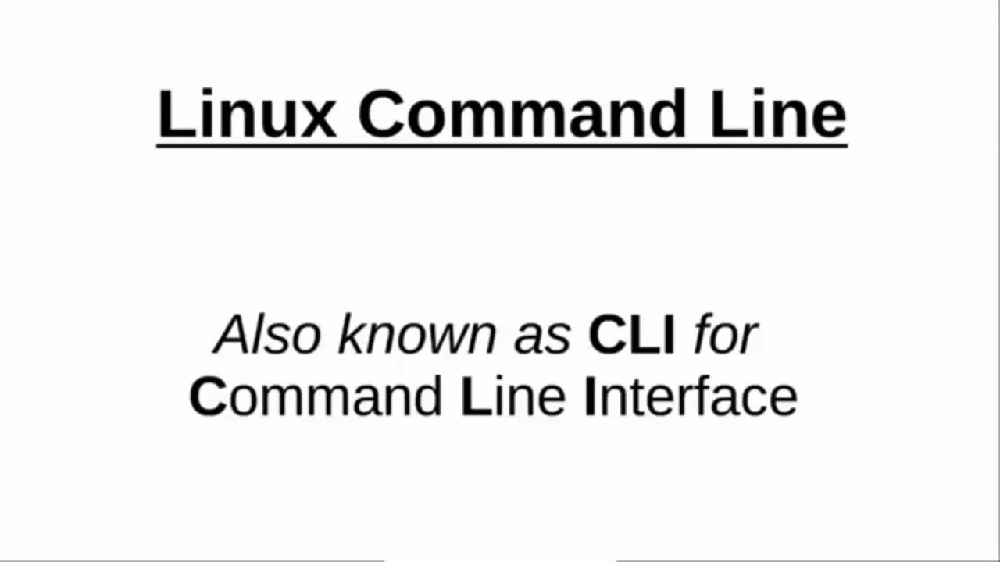
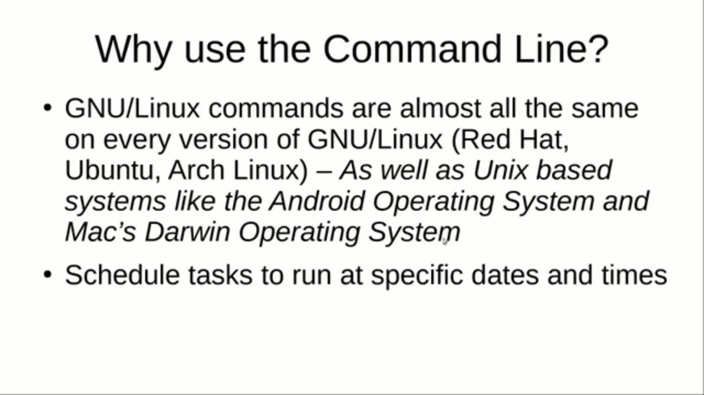
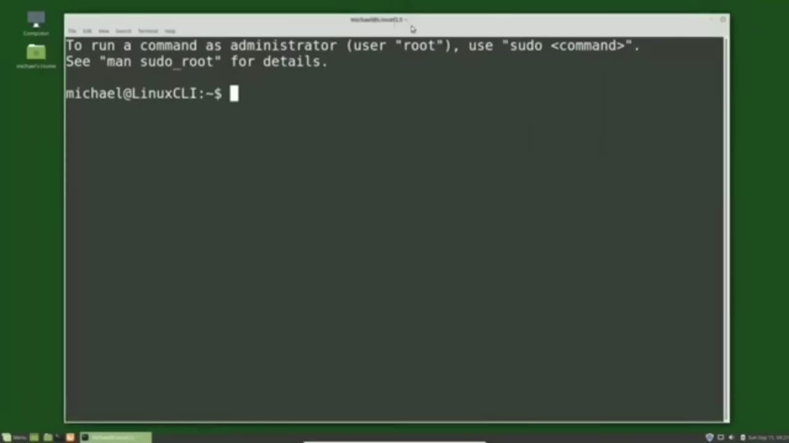

[← Course contents](../../01.md)

# 1. What is the Linux Command Line

**Course:** [Linux Command Line - Entire Tutorial Series](https://www.youtube.com/watch?v=avg65oY7sj4)  
**Transcript:** [`Linux Command Line - Entire Tutorial Series transcript`](../../../../course_videos/Linux%20Command%20Line%20-%20Entire%20Tutorial%20Series/Linux%20Command%20Line%20-%20Entire%20Tutorial%20Series.txt)  
**Video:** 00:00:00–00:05:52 ([open at this time](https://www.youtube.com/watch?v=avg65oY7sj4&t=0s))

## Introduction

In this tutorial series we're going to look at the Linux command line, which some people refer to as CLI for Command Line interface. I know some people get intimidated by the Command Line but in this tutorial series we're going to turn that feeling of intimidation into a feeling of excitement when you open up a terminal knowing all the things that you'll be able to do in the command line. To explain what's going on, I'm going to use this picture that I created for my xp to Linux tutorial series.

## Detailed Explanation

<details>
  <summary>Step 1 — In this tutorial series we're going to look at the Linux command line</summary>

### Step 1 — In this tutorial series we're going to look at the Linux command line

- [x] **In this tutorial series we're going to look at the Linux command**
  - In this tutorial series we're going to look at the Linux command line, which some people refer to as CLI for Command Line interface.
  - I know some people get intimidated by the Command Line but in this tutorial series we're going to turn that feeling of intimidation into a feeling of excitement when you open up a terminal knowing all the things that you'll be able to do in the command line.
  - To explain what's going on, I'm going to use this picture that I created for my xp to Linux tutorial series.

- [x] **Only in this picture I did correct the typo in the word kernel**
  - Only in this picture I did correct the typo in the word kernel.
  - We have a girl here in the lower right corner using her Linux graphical user interface Desktop, which is also known as a GUI desktop.
  - When she clicks on something, it sends a command to the operating system.

- [x] **which sends it to the kernel, which translates that into computer**
  - which sends it to the kernel, which translates that into computer code and comes back to the kernel.
  - And then we see the results on the nice GUI graphical user interface desktop.
  - When we're using the Linux command line, we're starting right here.

- [x] **And we're skipping over this graphical user desktop screen and**
  - And we're skipping over this graphical user desktop screen and sending the command right to the operating system.
  - I'm using Linux Mint mate and we can open up a terminal by clicking on the...
  - Icon down here on the bottom of the screen on the panel or in the menu we've got the terminal right here on the main menu or we can go into the system tools and find the terminal right there clicking that opens up the terminal the creators of Linux Mint have made it easy to get to a terminal

- [x] **Because they know how useful it can be the command line is one of**
  - Because they know how useful it can be the command line is one of those things that once you learn it you'll wonder how you ever got along without it we have our Terminal open and we see that it is prompting us or asking us what command do we want to type in.
  - Going back to this picture for a moment, I said using the command line is skipping over the GUI screen, but we were in the GUI and opened up a terminal to skip the GUI screen.



</details>

<details>
  <summary>Step 2 — Run `at`</summary>

### Step 2 — Run `at`

- [x] **I know that sounds a little funny in this case, but that's not always**
  - I know that sounds a little funny in this case, but that's not always the case and often servers don't have any GUI installed.
  - And the terminal is all that's available.
  - So why would anyone want to type in commands when they can just point and click a mouse button?

- [x] **Well Linux has a lot of different operating systems and a lot of**
  - Well Linux has a lot of different operating systems and a lot of different desktops on those operating systems and although they're all meant to be easy to learn and use, they're all different.
  - Most of the commands in the command line are the same whether you're using Red Hat, Ubuntu or Arch Linux.
  - And it goes farther than that because Linux is based on Unix and most of the Linux commands will work the same on any Unix based operating system.

- [x] **Two Unix based operating systems that come to mind are the Android**
  - Two Unix based operating systems that come to mind are the Android operating system and macOS Darwin operating system.
  - Both of these operating systems are based on the Unix operating system so most of these Linux Unix commands will work on an Android or Mac operating system just as they do for Linux.
  - They might have a few slight differences, but for the most part, the same commands will function the same on any Unix-based computer operating system.

- [x] **Use `at`**
  - So why else might we want to use the Linux command line?
  - It's an easy way to automate tasks, and you can schedule tests to run `at` specific dates and times using Cron.
  - And we will look `at` how to use Cron `at` some point in this tutorial series.

- [x] **Another reason you might want to use the Linux command line?**
  - Another reason you might want to use the Linux command line?
  - Fun. It can be fun and hopefully I'll bring that out in this video tutorial series.

```bash
at
```



</details>

<details>
  <summary>Step 3 — Run `echo`</summary>

### Step 3 — Run `echo`

- [x] **And the last reason I'll give to use the command line interface over**
  - And the last reason I'll give to use the command line interface over the GUI screens is Control.
  - In short, we're giving up that ease of use of point and click for more control.
  - Now there's nothing wrong with using the GUI screens and there are times when you will want to use them.

- [x] **For something like editing a video, I would prefer using the**
  - For something like editing a video, I would prefer using the graphical user interface over the command line.
  - At the same time, there are some things that are better suited for the command line and we'll look at them in this series.
  - Now we have our command line open and to make things easier to see I want to make this terminal window bigger.

- [x] **Use `echo`**
  - To do that, I'm going to hold Control, Shift, and press the plus sign.
  - And actually it's just Control Plus sign, but my plus sign is above the equals, so I need to press Shift as well.
  - We're going to type in our first command, Hello World, and we'll do that by typing `echo`, Double Quote.

- [x] **Hello World, double quote, and press Enter**
  - Hello World, double quote, and press Enter.
  - Now we didn't need the double quotes. We could have used single quotes or we could have left the quotes off.
  - I'm pressing the arrow up which shows me the previous command I submitted.

- [x] **And I'm pressing the backspace to get rid of that double quote**
  - And I'm pressing the backspace to get rid of that double quote.
  - And pressing the backspace again to get rid of the other double quote.
  - And we've just submitted our second Linux command line command in our terminal.

- [x] **We will get to some more command soon, but because we're going to**
  - We will get to some more command soon, but because we're going to spend so much time in our terminal, in the next tutorial, we're going to look at how to configure our terminal.

```bash
echo
```



</details>

<details>
  <summary>Questions and Answers</summary>

## Questions and Answers

### Question 1: What does `at` do in this chapter?

<details>
<summary>Answer</summary>

- [x] It's an easy way to automate tasks, and you can schedule tests to run `at` specific dates and times using Cron.

</details>

### Question 2: What does `echo` do in this chapter?

<details>
<summary>Answer</summary>

- [x] We're going to type in our first command, Hello World, and we'll do that by typing `echo`, Double Quote.

</details>

### Question 3: What does step 1 cover (In this tutorial series we're going to look at the Linux command line)?

<details>
<summary>Answer</summary>

- [x] In this tutorial series we're going to look at the Linux command line, which some people refer to as CLI for Command Line interface.
- [x] I know some people get intimidated by the Command Line but in this tutorial series we're going to turn that feeling of intimidation into a feeling of excitement when you open up a terminal knowing all the things that you'll be able to do in the command line.
- [x] To explain what's going on, I'm going to use this picture that I created for my xp to Linux tutorial series.

</details>

### Question 4: What does step 2 cover (Run at)?

<details>
<summary>Answer</summary>

- [x] I know that sounds a little funny in this case, but that's not always the case and often servers don't have any GUI installed.
- [x] And the terminal is all that's available.
- [x] So why would anyone want to type in commands when they can just point and click a mouse button?

</details>

### Question 5: What does step 3 cover (Run echo)?

<details>
<summary>Answer</summary>

- [x] And the last reason I'll give to use the command line interface over the GUI screens is Control.
- [x] In short, we're giving up that ease of use of point and click for more control.
- [x] Now there's nothing wrong with using the GUI screens and there are times when you will want to use them.

</details>

</details>

## Summary

This chapter, What is the Linux Command Line, walks through In this tutorial series we're going to look at the Linux command line; Run at; Run echo. Commands from the transcript: `at`, `echo`.

## References

- [Linux Command Line - Entire Tutorial Series (YouTube)](https://www.youtube.com/watch?v=avg65oY7sj4)
- [This chapter at 00:00:00](https://www.youtube.com/watch?v=avg65oY7sj4&t=0s)
- [Local transcript](../../../../course_videos/Linux%20Command%20Line%20-%20Entire%20Tutorial%20Series/Linux%20Command%20Line%20-%20Entire%20Tutorial%20Series.txt)
