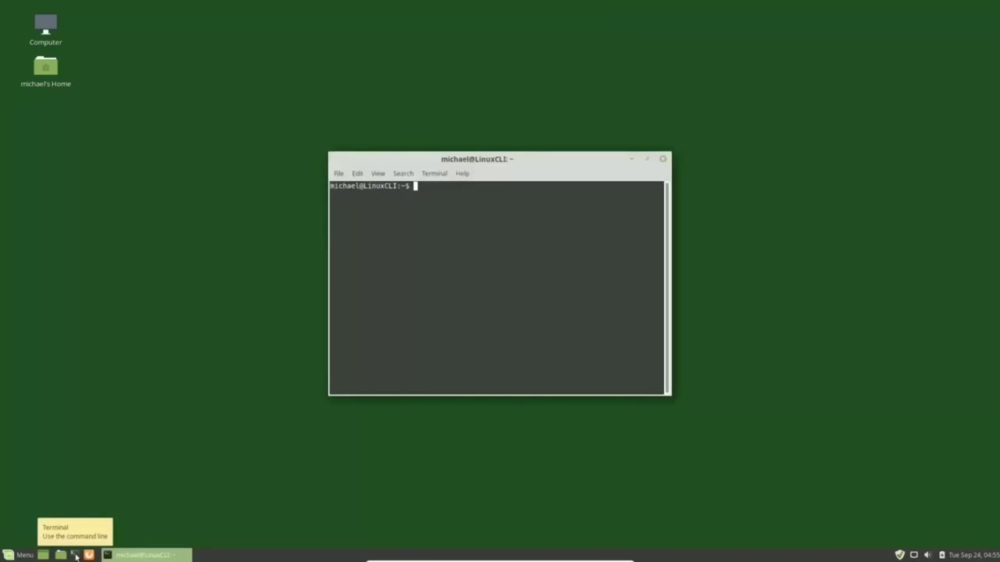
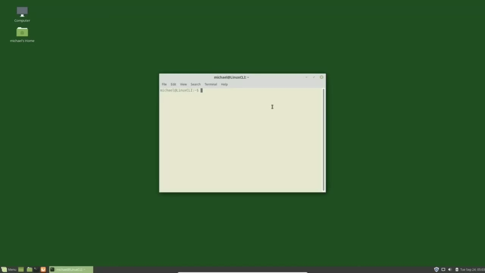
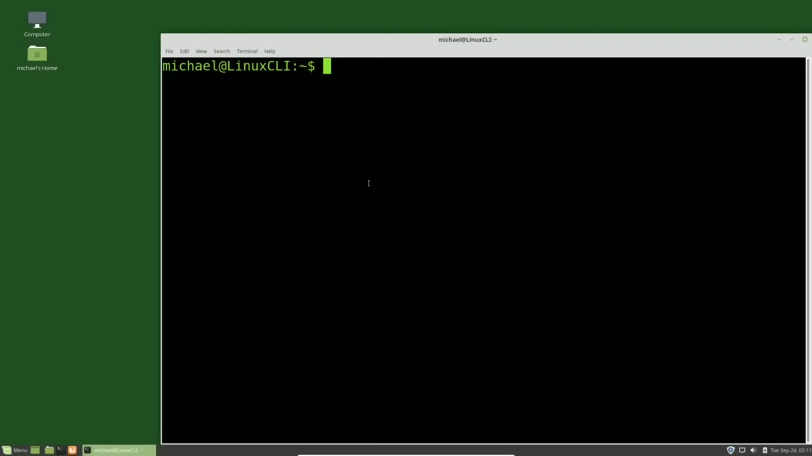
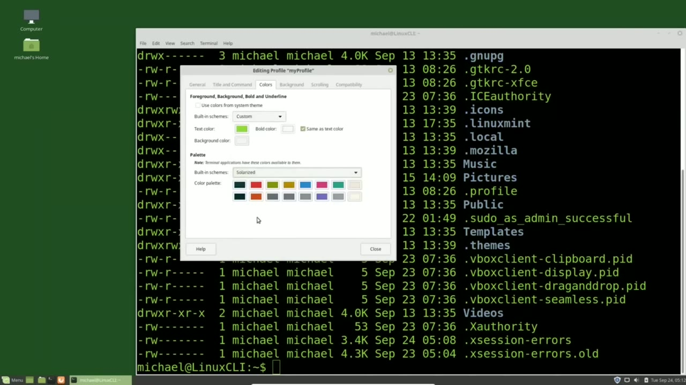

[← Course contents](../../01.md)

# 2. Customize the Terminal

**Course:** [Linux Command Line - Entire Tutorial Series](https://www.youtube.com/watch?v=avg65oY7sj4)  
**Transcript:** [`Linux Command Line - Entire Tutorial Series transcript`](../../../../course_videos/Linux%20Command%20Line%20-%20Entire%20Tutorial%20Series/Linux%20Command%20Line%20-%20Entire%20Tutorial%20Series.txt)  
**Video:** 00:05:52–00:14:55 ([open at this time](https://www.youtube.com/watch?v=avg65oY7sj4&t=352s))

## Introduction

I'm opening up a terminal and pressing Ctrl+Shift++ as we did in the previous tutorial to make our terminal window a little larger. We're going to spend a lot of time in this terminal, so I want to customize my terminal to a way I like. I'm using Linux Mint mate and to see what terminal I'm using I'm going over to help and clicking about and this shows us we're using the Linux Mate terminal. It's not the only choice. There are many more terminals in the software center and there's no one best terminal for everyone. There may be a best terminal for you and that would be the terminal that you like best. I'm going to use this terminal because this is the one that came with the distro that I'm using.

## Detailed Explanation

<details>
  <summary>Step 1 — opening up a terminal and pressing Ctrl+Shift++ as we did in the</summary>

### Step 1 — opening up a terminal and pressing Ctrl+Shift++ as we did in the

- [x] **I'm opening up a terminal and pressing Ctrl+Shift++ as we did in the**
  - I'm opening up a terminal and pressing Ctrl+Shift++ as we did in the previous tutorial to make our terminal window a little larger.
  - We're going to spend a lot of time in this terminal, so I want to customize my terminal to a way I like.
  - I'm using Linux Mint mate and to see what terminal I'm using I'm going over to help and clicking about and this shows us we're using the Linux Mate terminal.

- [x] **It's not the only choice. There are many more terminals in the**
  - It's not the only choice. There are many more terminals in the software center and there's no one best terminal for everyone. There may be a best terminal for you and that would be the terminal that you like best. I'm going to use this terminal because this is the one that came with the distro that I'm using.
  - If you're using a different terminal, you should still have terminal profiles you can customize, just like I have here, but how you customize those will probably be different.
  - I just mentioned the word profile and a profile is basically your terminal customization.

- [x] **And you may want to have multiple profiles with different settings**
  - And you may want to have multiple profiles with different settings for different situations.
  - Here we see that we have a single default profile.
  - I'm going to create a new one by clicking the new button.

- [x] **It's based on the default profile, which means that it's just going**
  - It's based on the default profile, which means that it's just going to copy over all the settings from the default setting.
  - Clicking on Create, this shows me that I'm editing the profile Light.
  - The one I just created. I'm going over to colors and I'm going to uncheck this check box.

- [x] **We'll talk about this in a moment and I'm just selecting solarized**
  - We'll talk about this in a moment and I'm just selecting solarized light and close.
  - We don't see any changes because we're still using the default profile.
  - I want to create another new profile and I'm going to call this my profile.

- [x] **And instead of basing this on the default, I'm going to base it on**
  - And instead of basing this on the default, I'm going to base it on the light profile.
  - Clicking Create takes me into the My Profile to make any changes I like.
  - I'm going to leave it just as it is and click Close.

- [x] **The other thing I'm going to change at the screen is the profile to**
  - The other thing I'm going to change at the screen is the profile to use when launching a new terminal.
  - And I'm going to close our terminal as well.
  - Opening a new terminal, we now see that the terminal shows the solarized background.

- [x] **To switch the profile I'm currently using, I'm going to click on**
  - To switch the profile I'm currently using, I'm going to click on terminal, change profile.
  - And I can go back to that default profile.
  - Clicking terminal again, change profile.

- [x] **We can select the profile or click the next and previous**
  - We can select the profile or click the next and previous.
  - I'm going to select the my profile from the radio button.
  - The other thing we notice is that our terminal window size is smaller than when we had it a moment ago.

- [x] **I made it larger by pressing Ctrl+Shift++, but after we closed the**
  - I made it larger by pressing Ctrl+Shift++, but after we closed the terminal, it went back to the original size.



</details>

<details>
  <summary>Step 2 — To make that screen a larger size every time I open a terminal window</summary>

### Step 2 — To make that screen a larger size every time I open a terminal window

- [x] **To make that screen a larger size every time I open a terminal**
  - To make that screen a larger size every time I open a terminal window, we'll want to change the profile settings.
  - And we can do that in Edit Profile Preferences.
  - Clicking that opens up the profile preferences and we see that we're editing the My Profile Profile.

- [x] **We can change the name here under the profile name and to resize the**
  - We can change the name here under the profile name and to resize the window as we did earlier with the Ctrl+Shift++ I'll want to resize the font.
  - Can do that by unchecking the use system fixed width font and then to change the font size I'm going to click on this font which opens another pop-up window where I can choose a different font if I like but I'm going to keep it the same I just want to change the
  - Size you can click the plus and -they've got some dashes down here you can we can move the dot along the scroll bar I'll go with 24 that looks good and click select we see the change takes place right away there are some other things we can do here like allowing the bold text copying selected text into the clipboard cursor blink cursor shape those are all pretty obvious

- [x] **You'll have to check this box to change the default size of the**
  - You'll have to check this box to change the default size of the columns in the rows i'm going to leave them at the default for the moment Other things we might want to do is change the background.
  - If we click on background, it really doesn't change the background.
  - It gives us the choice of going to the solid color, background image.

- [x] **We can put in an image or make the background transparent**
  - We can put in an image or make the background transparent.
  - And that's done on this slider bar here, the amount of transparency you like.
  - I usually leave this at the solid color.

- [x] **And then to change the color of the background, I'll click on the**
  - And then to change the color of the background, I'll click on the color bar.
  - Now this is the check box that I unchecked a moment ago that I said I'd come back to.



</details>

<details>
  <summary>Step 3 — Run `ls -lah`</summary>

### Step 3 — Run `ls -lah`

- [x] **And depending on which theme your system is using, I'm using Linux**
  - And depending on which theme your system is using, I'm using Linux Mint mate.
  - So when I check this box, it's defaulting to the Linux Mint mate theme colors.
  - And those are the default colors for that.

- [x] **Unchecking that, I can now change these colors to the built-in schemas**
  - Unchecking that, I can now change these colors to the built-in schemas.
  - And I'm going to change this to green text on a black background.
  - And that green looks a little bright for me.

- [x] **So I'm going to change it and click this lesser bright green**
  - So I'm going to change it and click this lesser bright green.
  - But if you don't like that, you can click on this plus sign and change it to whichever color you like by moving the slider and moving where these lines cross.
  - Makes it either darker or lighter in that shade.

- [x] **And if you know the hex value, you can type that in as well**
  - And if you know the hex value, you can type that in as well.
  - I'm going to cancel out of here and go back to the lesser bright green and select.
  - The bold color is going to be the same as the text color and our background is black.

- [x] **Use `ls -lah`**
  - I'm going to close this window to see how this looks.
  - To get a full feeling of what these colors look like, I'm going to type in the command `ls -lah`.
  - Now we'll talk about this command in the next tutorial.

- [x] **For now, we just need to know that this lists out what is in our**
  - For now, we just need to know that this lists out what is in our directory.
  - Shows us that we've got all green text, but there's blue in there as well.
  - So I'm going back over to edit profile preferences and the colors.

- [x] **Text color should be green. Where are we getting this blue from?**
  - Text color should be green. Where are we getting this blue from?
  - Well, that's down here in the color palette. We've got a custom schema here.

```bash
ls -lah
```



</details>

<details>
  <summary>Step 4 — We can change this to tango, solarized, and we see it changes it right</summary>

### Step 4 — We can change this to tango, solarized, and we see it changes it right

- [x] **We can change this to tango, solarized, and we see it changes it**
  - We can change this to tango, solarized, and we see it changes it right away.
  - I am going to go with the X term and to change this blue color.
  - I'm going to find the blue in this color palette that closely matches it.

- [x] **And when I click select, it changes all my blue text to red**
  - And when I click select, it changes all my blue text to red.
  - And the point of this is if you don't like one of the default colors, you can change it.
  - And the built in schemes are here to help you get started.

- [x] **Just like the scheme is above, you can select one and make changes or**
  - Just like the scheme is above, you can select one and make changes or tweaks to it or have all custom colors.
  - So that's the basics of customizing your terminals that I wanted to go over.
  - There's more there that you can play with and change.

- [x] **We can change these terminals by going terminal, change profile to**
  - We can change these terminals by going terminal, change profile to the default.
  - We see that drastic change there with the size and the color.
  - We'll go back to the my profile, which is the profile I set it to when I open up a new terminal.

- [x] **In the next video, We'll start looking at the Linux command line**
  - In the next video, We'll start looking at the Linux command line commands.



</details>

<details>
  <summary>Questions and Answers</summary>

## Questions and Answers

### Question 1: What does `ls -lah` do in this chapter?

<details>
<summary>Answer</summary>

- [x] To get a full feeling of what these colors look like, I'm going to type in the command `ls -lah`.

</details>

### Question 2: What does step 1 cover (opening up a terminal and pressing Ctrl+Shift++ as we did in the)?

<details>
<summary>Answer</summary>

- [x] I'm opening up a terminal and pressing Ctrl+Shift++ as we did in the previous tutorial to make our terminal window a little larger.
- [x] We're going to spend a lot of time in this terminal, so I want to customize my terminal to a way I like.
- [x] I'm using Linux Mint mate and to see what terminal I'm using I'm going over to help and clicking about and this shows us we're using the Linux Mate terminal.

</details>

### Question 3: What does step 2 cover (To make that screen a larger size every time I open a terminal window)?

<details>
<summary>Answer</summary>

- [x] To make that screen a larger size every time I open a terminal window, we'll want to change the profile settings.
- [x] And we can do that in Edit Profile Preferences.
- [x] Clicking that opens up the profile preferences and we see that we're editing the My Profile Profile.

</details>

### Question 4: What does step 3 cover (Run ls -lah)?

<details>
<summary>Answer</summary>

- [x] And depending on which theme your system is using, I'm using Linux Mint mate.
- [x] So when I check this box, it's defaulting to the Linux Mint mate theme colors.
- [x] And those are the default colors for that.

</details>

### Question 5: What does step 4 cover (We can change this to tango, solarized, and we see it changes it right)?

<details>
<summary>Answer</summary>

- [x] We can change this to tango, solarized, and we see it changes it right away.
- [x] I am going to go with the X term and to change this blue color.
- [x] I'm going to find the blue in this color palette that closely matches it.

</details>

</details>

## Summary

This chapter, Customize the Terminal, walks through opening up a terminal and pressing Ctrl+Shift++ as we did in the; To make that screen a larger size every time I open a terminal window; Run ls -lah; We can change this to tango, solarized, and we see it changes it right. Commands from the transcript: `ls -lah`.

## References

- [Linux Command Line - Entire Tutorial Series (YouTube)](https://www.youtube.com/watch?v=avg65oY7sj4)
- [This chapter at 00:05:52](https://www.youtube.com/watch?v=avg65oY7sj4&t=352s)
- [Local transcript](../../../../course_videos/Linux%20Command%20Line%20-%20Entire%20Tutorial%20Series/Linux%20Command%20Line%20-%20Entire%20Tutorial%20Series.txt)
