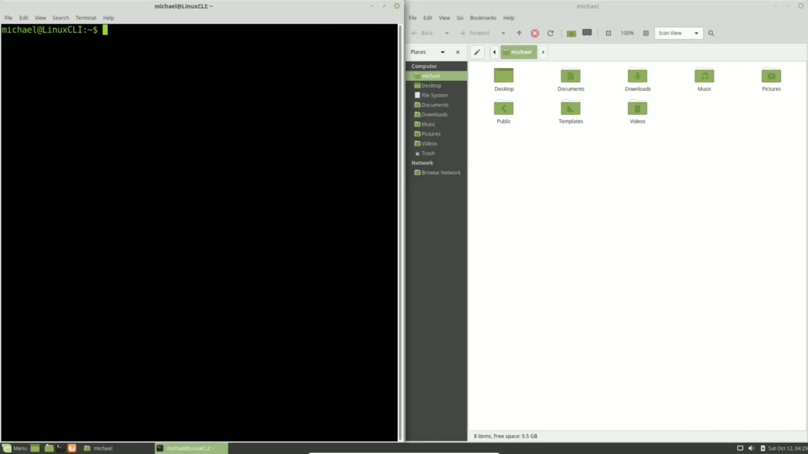
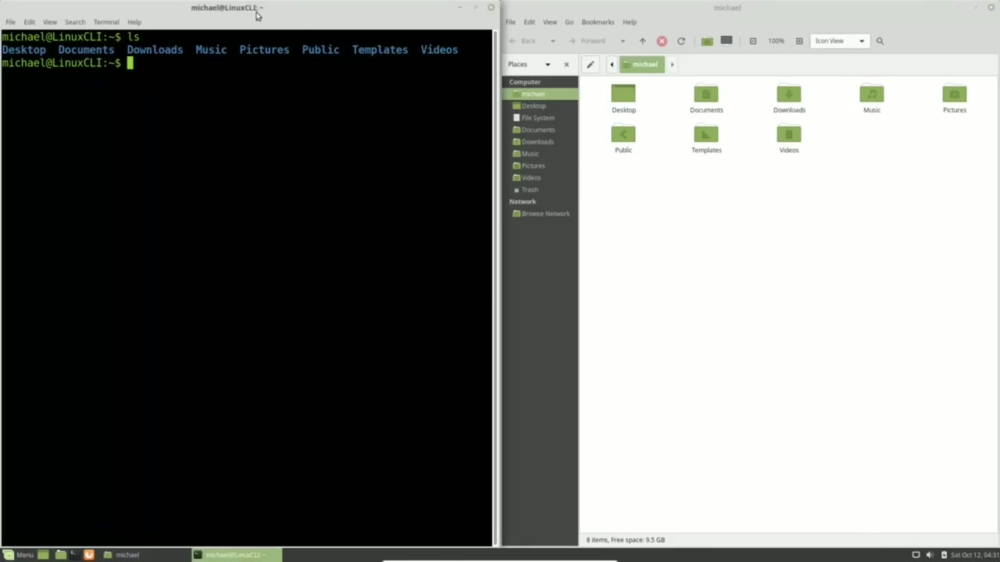
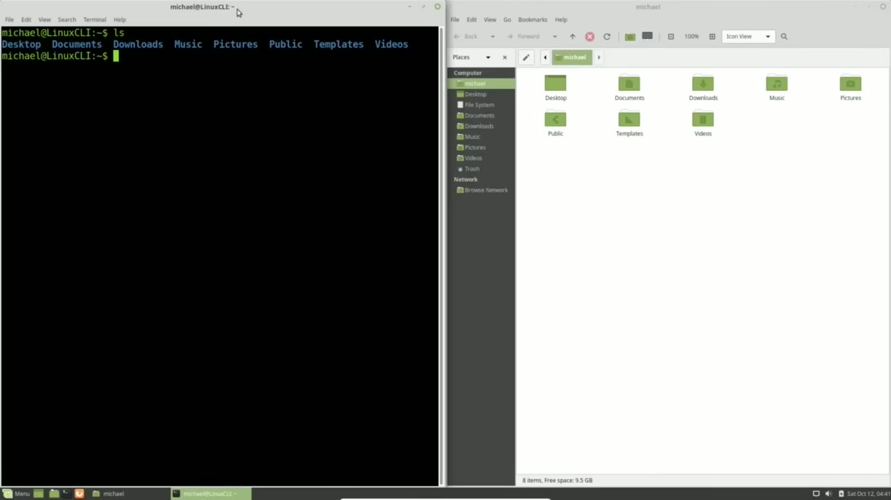
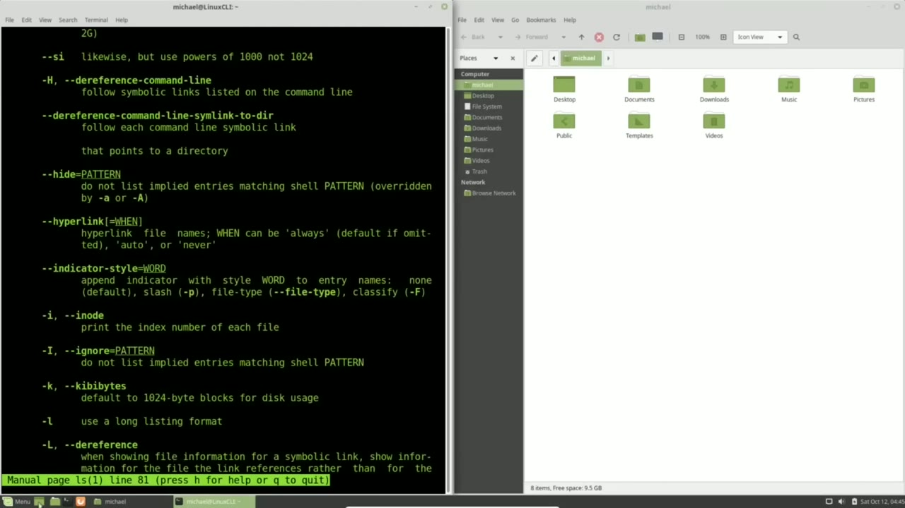

[← Course contents](../../01.md)

# 3. ls, command, and man pages

**Course:** [Linux Command Line - Entire Tutorial Series](https://www.youtube.com/watch?v=avg65oY7sj4)  
**Transcript:** [`Linux Command Line - Entire Tutorial Series transcript`](../../../../course_videos/Linux%20Command%20Line%20-%20Entire%20Tutorial%20Series/Linux%20Command%20Line%20-%20Entire%20Tutorial%20Series.txt)  
**Video:** 00:14:55–00:22:00 ([open at this time](https://www.youtube.com/watch?v=avg65oY7sj4&t=895s))

## Introduction

I am opening up the File Manager and moving it to the far right side of the screen, which makes the window take up the right half of the screen. I'm going to make this a little smaller with Ctrl+-. And move this to the left side of the screen, making it take up the left half of the screen. Having both of these windows open at the same time will help show that we are in the same place in the terminal as we are in the file manager.

## Detailed Explanation

<details>
  <summary>Step 1 — Run `ls`</summary>

### Step 1 — Run `ls`

- [x] **I am opening up the File Manager and moving it to the far right side**
  - I am opening up the File Manager and moving it to the far right side of the screen, which makes the window take up the right half of the screen.
  - I'm going to make this a little smaller with Ctrl+-.
  - And move this to the left side of the screen, making it take up the left half of the screen.

- [x] **Use `ls`**
  - Having both of these windows open at the same time will help show that we are in the same place in the terminal as we are in the file manager.
  - To show we're in the same place, I'm going to type `ls` in the terminal.
  - `ls` is the command to list the directory contents.

- [x] **When we do that, we see the same eight names we see in our file**
  - When we do that, we see the same eight names we see in our file manager window, showing that we're in the same place in both windows.
  - We don't call them folders. We call them directories.
  - When we're in the file manager, in these GUI screens, it's okay to call them folders.

- [x] **Looking at them, they even have a picture of a folder to encourage**
  - Looking at them, they even have a picture of a folder to encourage the name folder.
  - And that is great to give you an idea of what they are and how they work.

```bash
ls
```



</details>

<details>
  <summary>Step 2 — Run `ls -lah`, `ls`</summary>

### Step 2 — Run `ls -lah`, `ls`

- [x] **Use `ls -lah`, `ls`**
  - But when we're in the command line, we call them directories.
  - Unless I screw up and accidentally call it a folder, which will probably happen from time to time, but officially, they should be called directories when we are in a terminal.
  - In the last video, I typed `ls -lah`, and that listed things a lot differently than what we see here when I typed `ls` by itself.

- [x] **Let's take a moment to talk about the Linux command line command**
  - Let's take a moment to talk about the Linux command line command.
  - The Linux command line command is made up of three parts.
  - We have the command, options, and arguments.

- [x] **Use `ls`**
  - When I type the `ls` command by itself, there are no options because they're optional, and the argument is the current directory we are in.
  - We can change that directory and we will in a future video, but for now, we're just going to work in the current directory.
  - So `ls` by itself is listing out the contents of the current directory.

- [x] **Use `ls`**
  - `ls` is the command and the current directory is the argument.
  - The -lah that we saw on the last video are the options and options usually start with a dash or hyphen to note that they are options.
  - So how did I know which options I wanted to use or what options are available for this command?

- [x] **Or as we have in this case, we see the options and we just want to**
  - Or as we have in this case, we see the options and we just want to know what they mean.

```bash
ls -lah
ls
```



</details>

<details>
  <summary>Step 3 — Run `man ls`, `ls`</summary>

### Step 3 — Run `man ls`, `ls`

- [x] **Use `man ls`**
  - We can find them by using the man pages.
  - To use it, we type in man and then the command we want to know more about.
  - So in this case, we'll type `man ls`.

- [x] **Use `ls`**
  - Pressing Enter brings up the man pages and at the top of the screen here we see Name `ls` List Directory contents.
  - Then we see all the options listed alphabetically and we have A for all. And to go down a screen we can use our arrow keys or page down and page up keys.
  - If you don't have those keys available on your keyboard, you'll want to view the help screens.

- [x] **And looking at the bottom of the screen, we see press H for help**
  - And looking at the bottom of the screen, we see press H for help.
  - So I'll press H. And we see right at the top, H displays this help screen.
  - And Q or any of those options will exit.

- [x] **Use `ls`**
  - Below that we see how to move around with the different options there and paging down we see there's a lot more help available.
  - I am going to press Q to quit out of this and now we're out of the man help pages and back just in the man pages for `ls`.
  - Paging down we see down at the bottom of the screen here.

```bash
man ls
ls
```



</details>

<details>
  <summary>Step 4 — Run `ls -lah`, `ls -a`, `ls -l`</summary>

### Step 4 — Run `ls -lah`, `ls -a`, `ls -l`

- [x] **Use `ls -lah`, `ls -a`**
  - And the other one I used was the lowercase L is use long listing format I'm pressing Q to quit out of our man pages so `ls -lah` are actually three different options let's take a look at these options I'm going to start with the -a option `ls -a` and when I press enter
  - We see it lists all the same files in our file manager window, but this time I have extra files and directories.
  - And the new ones all start with a dot or a period.

- [x] **Typing dot before the directory name or a file name will make that**
  - Typing dot before the directory name or a file name will make that directory.
  - A hidden file. We can view these files in our file manager by clicking on view, show hidden files. The point of the hidden files is to hide the configuration files and system files that we will rarely if ever need to be changed or updated. Having them hidden will declutter our
  - Directories and make the files that we use regularly a lot easier to get to.

- [x] **Use `ls -l`**
  - I'm going to turn off the show hidden files.
  - In our file manager window and go back over to our command line.
  - Now the L option `ls -l` shows us the long format.

- [x] **Use `ls -lh`**
  - This gives us a little more information like the permissions, the owner, the group, which we will go over in detail in a future tutorial.
  - We also have the size and the date that the file or directory was last modified.
  - The size here is what we want to pay attention to because when I type ls -l-h, I'm adding the human readable.

- [x] **Use `ls -lh`, `ls -lh -a`**
  - So now when I press Enter, instead of seeing the 4096, we just see 4K, which is a lot easier for us humans to read.
  - Now, the options can be separate like that.
  - -L space -H or we can put them together `ls -lh` and they don't have to be in that order I could have typed hl and that works the same and then we can add that all to this as well I can type `ls -lh -a` that works or I can put them all together `ls -lh` or

- [x] **A hl, the order doesn't matter. Works the same either way**
  - A hl, the order doesn't matter. Works the same either way.
  - In the next video, we'll continue looking at Command Line commands.

```bash
ls -lah
ls -a
ls -l
ls -lh
ls -lh -a
```



</details>

<details>
  <summary>Questions and Answers</summary>

## Questions and Answers

### Question 1: What does `ls` do in this chapter?

<details>
<summary>Answer</summary>

- [x] To show we're in the same place, I'm going to type `ls` in the terminal.

</details>

### Question 2: What does `ls -lah` do in this chapter?

<details>
<summary>Answer</summary>

- [x] In the last video, I typed `ls -lah`, and that listed things a lot differently than what we see here when I typed ls by itself.

</details>

### Question 3: What does `man ls` do in this chapter?

<details>
<summary>Answer</summary>

- [x] So in this case, we'll type `man ls`.

</details>

### Question 4: What does `man` do in this chapter?

<details>
<summary>Answer</summary>

- [x] I am going to press Q to quit out of this and now we're out of the `man` help pages and back just in the `man` pages for ls.

</details>

### Question 5: What does `ls -a` do in this chapter?

<details>
<summary>Answer</summary>

- [x] And the other one I used was the lowercase L is use long listing format I'm pressing Q to quit out of our man pages so ls -lah are actually three different options let's take a look at these options I'm going to start with the -a option `ls -a` and when I press enter

</details>

### Question 6: What does `ls -l` do in this chapter?

<details>
<summary>Answer</summary>

- [x] Now the L option `ls -l` shows us the long format.

</details>

### Question 7: What does `ls -lh` do in this chapter?

<details>
<summary>Answer</summary>

- [x] The size here is what we want to pay attention to because when I type ls -l-h, I'm adding the human readable.

</details>

### Question 8: What does `ls -lh -a` do in this chapter?

<details>
<summary>Answer</summary>

- [x] -L space -H or we can put them together ls -lh and they don't have to be in that order I could have typed hl and that works the same and then we can add that all to this as well I can type `ls -lh -a` that works or I can put them all together ls -lh or

</details>

</details>

## Summary

This chapter, ls, command, and man pages, walks through Run ls; Run ls -lah, ls; Run man ls, ls; Run ls -lah, ls -a, ls -l. Commands from the transcript: `ls`, `ls -lah`, `man ls`, `ls -a`, `ls -l`, `ls -lh`, `ls -lh -a`.

## References

- [Linux Command Line - Entire Tutorial Series (YouTube)](https://www.youtube.com/watch?v=avg65oY7sj4)
- [This chapter at 00:14:55](https://www.youtube.com/watch?v=avg65oY7sj4&t=895s)
- [Local transcript](../../../../course_videos/Linux%20Command%20Line%20-%20Entire%20Tutorial%20Series/Linux%20Command%20Line%20-%20Entire%20Tutorial%20Series.txt)
